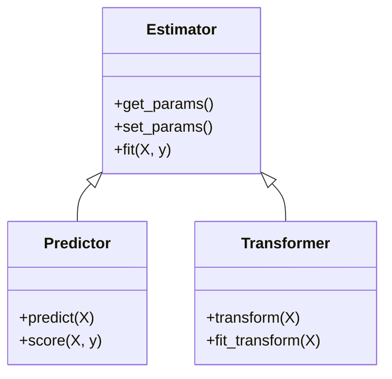

# The scikit-learn API and your first model

scikit-learn's design is so consistent that once you learn one model you have effectively learned them all.
This lesson walks through the book's first application, **classifying iris species**, and uses it to teach
the estimator API, train/test splitting, and the habit of looking at your data.

## 1. The problem

A hobby botanist has measured the length and width of the **petals** and **sepals** of iris flowers (in cm).
For 150 flowers an expert has already identified the species: *setosa*, *versicolor* or *virginica*. Can we
predict the species of a newly measured flower?

- It is **supervised** (we have labels).
- It is **classification** (species are discrete), more precisely **three-class** classification.
- In scikit-learn terms the possible outputs are **classes**, and the species of a particular flower is its
  **label**.

## 2. Meet the data

`load_iris()` returns a `Bunch`, which behaves like a dictionary:

```python-run
from sklearn.datasets import load_iris
iris = load_iris()
print("keys:", list(iris.keys()))
print("target names:", iris.target_names)
print("feature names:", iris.feature_names)
print("data shape:", iris.data.shape, " dtype:", iris.data.dtype)
print("first five rows:\n", iris.data[:5])
print("targets:", iris.target[:5], "...", iris.target[-5:])
```

The data is a numpy array of shape `(150, 4)`. As in the whole book, **rows are samples and columns are
features**. The target is encoded as integers 0, 1, 2, which index into `target_names`.

## 3. Measuring success: training and test data

We can't judge a model on the data it learned from. A model could simply memorise every training flower and
look perfect. We need data the model has never seen. `train_test_split` shuffles the rows and, by default,
puts **75% in a training set** and **25% in a test set**.

```python-run
from sklearn.datasets import load_iris
from sklearn.model_selection import train_test_split
import numpy as np

iris = load_iris()
X_train, X_test, y_train, y_test = train_test_split(iris.data, iris.target, random_state=0)
print("X_train:", X_train.shape, " X_test:", X_test.shape)
print("class counts train:", np.bincount(y_train), " test:", np.bincount(y_test))
print("first 10 labels in file order:", iris.target[:10], "<- sorted by class!")
```

Two details are important:

- **Shuffling is essential.** The file is sorted by class. Taking the last 25% without shuffling would put
  only virginica in the test set.
- **`random_state` fixes the shuffle** so results are reproducible. The book uses `random_state=0`
  everywhere.
- By convention, data is a capital `X` (a 2-D matrix) and labels a lowercase `y` (a 1-D vector).

> [!TIP]
> For classification, pass `stratify=y` so that both splits keep the same class proportions. This matters
> most with small or imbalanced datasets.

## 4. First things first: look at your data

Before modelling, inspect the data. Is the task feasible? Are there oddities such as inches mixed with
centimetres? The book uses a pair plot (a scatter matrix). Here is a text equivalent: per-class means and
ranges show how separable the classes are.

```python-run
import pandas as pd
from sklearn.datasets import load_iris
iris = load_iris()
df = pd.DataFrame(iris.data, columns=[c.replace(" (cm)", "") for c in iris.feature_names])
df["species"] = iris.target_names[iris.target]
print(df.groupby("species").agg(["mean", "min", "max"]).round(1).T)
```

Petal length alone separates setosa perfectly (max 1.9 vs min 3.0 for the others), and the other two
species overlap only a little. A good model should do very well.

## 5. The estimator API

Every scikit-learn model is a Python class with the same interface:

| method | what it does | available on |
|---|---|---|
| `Estimator(**hyperparams)` | create the object; nothing is learned yet | all |
| `.fit(X, y)` | learn parameters from training data; returns `self` | all (`y` omitted for unsupervised) |
| `.predict(X)` | predicted labels/values | supervised models, some clusterers |
| `.score(X, y)` | default metric: accuracy for classifiers, $R^2$ for regressors | supervised |
| `.transform(X)` | return a new representation | preprocessors, PCA, … |
| `.fit_transform(X)` | fit then transform, sometimes more efficient | transformers |
| `.predict_proba(X)` / `.decision_function(X)` | uncertainty estimates | most classifiers |

Learned attributes end in an **underscore**: `coef_`, `classes_`, `feature_importances_`, `n_features_in_`.
That tells you they exist only after `fit`.



## 6. Building your first model: k-nearest neighbours

The k-NN classifier is the simplest model there is. **Fitting just stores the training set.** To predict a
new point, it finds the $k$ closest training points and takes a majority vote of their labels. With
`n_neighbors=1`, the prediction is the label of the single closest flower.

```python-run
import numpy as np
from sklearn.datasets import load_iris
from sklearn.model_selection import train_test_split
from sklearn.neighbors import KNeighborsClassifier

iris = load_iris()
X_train, X_test, y_train, y_test = train_test_split(iris.data, iris.target, random_state=0)

knn = KNeighborsClassifier(n_neighbors=1)   # 1. instantiate with hyperparameters
knn.fit(X_train, y_train)                   # 2. learn (here: memorise)

# 3. predict a new flower: sepal 5 x 2.9 cm, petal 1 x 0.2 cm
X_new = np.array([[5, 2.9, 1, 0.2]])        # note: 2-D, one row per sample
pred = knn.predict(X_new)
print("prediction:", pred, "->", iris.target_names[pred])

# 4. evaluate on held-out data
y_pred = knn.predict(X_test)
print("test predictions:", y_pred)
print("accuracy (manual):", round(float(np.mean(y_pred == y_test)), 3))
print("accuracy (.score):", round(knn.score(X_test, y_test), 3))
```

The model is about 97% accurate on the test set, so we can expect it to be right about 97% of the time on
new flowers. Note the **2-D input** for a single sample: scikit-learn always expects `X` to have shape
`(n_samples, n_features)`.

> [!WARNING]
> A frequent error is `knn.predict([5, 2.9, 1, 0.2])`, which raises "Expected 2D array". Wrap a single
> sample as `[[...]]` or use `x.reshape(1, -1)`.

## 7. Trying different hyperparameters

How does $k$ affect the result? Here we do it the *wrong* way, by choosing $k$ on the test set. Module 5
explains why that is a mistake and how cross-validation fixes it. For now, just watch the pattern.

```python-run
from sklearn.datasets import load_iris
from sklearn.model_selection import train_test_split, cross_val_score
from sklearn.neighbors import KNeighborsClassifier

X, y = load_iris(return_X_y=True)
X_train, X_test, y_train, y_test = train_test_split(X, y, random_state=0)
for k in [1, 3, 5, 15, 40, 80]:
    knn = KNeighborsClassifier(n_neighbors=k).fit(X_train, y_train)
    cv = cross_val_score(KNeighborsClassifier(n_neighbors=k), X_train, y_train, cv=5).mean()
    print(f"k={k:3d}  train acc={knn.score(X_train, y_train):.3f}  5-fold CV on train={cv:.3f}")
```

$k=1$ scores 100% on the training data (each point is its own nearest neighbour), which is memorisation.
Very large $k$ approaches "predict the majority class" and underfits. The next module explains this
trade-off properly.

## 8. Swapping the model is one line

Because of the shared API, trying other algorithms changes only the constructor:

```python-run
from sklearn.datasets import load_iris
from sklearn.model_selection import train_test_split
from sklearn.linear_model import LogisticRegression
from sklearn.tree import DecisionTreeClassifier
from sklearn.ensemble import RandomForestClassifier
from sklearn.svm import SVC

X, y = load_iris(return_X_y=True)
X_train, X_test, y_train, y_test = train_test_split(X, y, random_state=0)
models = {
    "logistic regression": LogisticRegression(max_iter=1000),
    "decision tree": DecisionTreeClassifier(random_state=0),
    "random forest": RandomForestClassifier(n_estimators=50, random_state=0),
    "RBF SVM": SVC(),
}
for name, m in models.items():
    m.fit(X_train, y_train)
    print(f"{name:20s} test accuracy = {m.score(X_test, y_test):.3f}")
```

## 9. Method chaining and other conveniences

`fit` returns `self`, so `KNeighborsClassifier().fit(X, y).predict(X_new)` works. `get_params()` shows
every hyperparameter with its default. `repr(model)` prints the non-default ones. The book also notes that
`fit`, `predict` and `score` form the core of the supervised interface, and everything else builds on them.

> [!INTERVIEW]
> **"Walk me through training and evaluating a classifier in scikit-learn."** Load `X` (2-D, samples ×
> features) and `y`; use `train_test_split(..., stratify=y, random_state=...)`; put preprocessing and the
> model in a `Pipeline`; tune hyperparameters with `GridSearchCV` on the training set (cross-validation);
> evaluate once on the test set with metrics suited to the problem (not just accuracy on imbalanced data).
> Mention that fitted attributes end in `_` and that `fit` returns `self`.

## Summary

- Iris is a three-class supervised classification problem: 150 samples × 4 features.
- Always evaluate on data the model didn't see. Shuffle, and set `random_state` for reproducibility.
- The estimator API: instantiate → `fit` → `predict`/`score` (and `transform` for transformers).
- k-NN memorises the training set and votes among the closest points. $k$ controls complexity.
- Swapping algorithms is a one-line change. That is why scikit-learn is the standard for classical ML.

```quiz
[
  {"q": "What does `train_test_split` do by default?", "options": ["Shuffles and puts 25% of samples in the test set", "Takes the last 25% of rows without shuffling", "Splits 50/50", "Stratifies by the label automatically"], "answer": 0,
   "explain": "Default test_size is 0.25 with shuffling; stratification requires stratify=y."},
  {"q": "Why must you shuffle the iris data before splitting?", "options": ["The rows are sorted by class", "scikit-learn requires shuffled data", "To increase the sample size", "To normalise the features"], "answer": 0,
   "explain": "Without shuffling, the test set would contain only one species."},
  {"q": "knn.predict([5, 2.9, 1, 0.2]) fails because…", "options": ["X must be 2-D: shape (n_samples, n_features)", "k-NN cannot predict single samples", "the values must be integers", "predict needs y as well"], "answer": 0,
   "explain": "Pass [[5, 2.9, 1, 0.2]] or reshape(1, -1)."},
  {"q": "Attributes such as coef_ and classes_ end with an underscore to signal that…", "options": ["they are learned during fit", "they are private", "they are hyperparameters", "they are deprecated"], "answer": 0,
   "explain": "scikit-learn convention: trailing underscore = estimated from data, exists only after fitting."},
  {"q": "A 1-NN classifier's accuracy on its own training set is…", "options": ["100% (barring duplicate points with different labels)", "about 50%", "the same as on the test set", "undefined"], "answer": 0,
   "explain": "Every training point's nearest neighbour is itself, so training accuracy says nothing about generalisation."},
  {"q": "What does `.score(X, y)` return for a classifier?", "options": ["Accuracy", "R²", "Log-loss", "F1 score"], "answer": 0,
   "explain": "Classifiers default to mean accuracy; regressors default to R²."},
  {"q": "What does `KNeighborsClassifier.fit` actually compute?", "options": ["It stores the training data (plus an optional search index)", "A weight vector", "A tree of if/else rules", "Cluster centroids"], "answer": 0,
   "explain": "k-NN is a lazy learner: the work happens at prediction time."}
]
```

> **Source:** Müller & Guido, *Introduction to Machine Learning with Python*, ch. 1 ("A First Application: Classifying Iris Species": Meet the Data, Measuring Success, Look at Your Data, Building Your First Model, Making Predictions, Evaluating the Model); ch. 2 ("Method chaining" box); scikit-learn User Guide, "Getting started".
