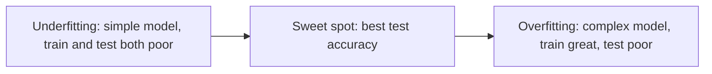

# Generalisation, overfitting and k-nearest neighbours

Supervised learning has one goal: **make accurate predictions on new, unseen data**. This lesson covers
the central concepts of chapter 2 of Müller & Guido (generalisation, overfitting, underfitting and how
model complexity relates to dataset size) and then studies the first algorithm in depth: k-nearest
neighbours for classification and regression.

## 1. Generalisation

If a model makes accurate predictions on unseen data, we say it **generalises** from the training set to the
test set. A model that is right on every training point but wrong on new points has learned nothing useful.

The book's example: a boat-sales company wants to predict which customers will buy a boat. A data scientist
finds the rule "*customers older than 45 who have fewer than 3 children or are not divorced want a boat*".
It is 100% correct on the existing customers. But with enough conditions, you can *always* find a rule that
fits a finite dataset perfectly. The rule probably reflects quirks of these particular customers, not a real
pattern. The question to ask is whether it will hold for **new** customers.

- **Overfitting**: building a model that is too complex for the amount of information available. It fits the
  training set's noise and peculiarities and generalises poorly.
- **Underfitting**: a model too simple to capture the structure ("everybody who owns a house buys a boat")
  does badly on training *and* test data.
- The sweet spot lies between them and gives the best generalisation.



As complexity grows, **training accuracy keeps rising** while **test accuracy rises and then falls**. The
gap between them signals overfitting.

## 2. Model complexity vs dataset size

The right complexity depends on how much (and how varied) data you have. With more data, a more complex
model can be supported without overfitting. Müller & Guido remark that collecting more data is often a
better investment than tweaking a model, as long as the data is genuinely new, not duplicates or near
duplicates. Larger datasets let you use more expressive models. This is the story of deep learning.

```python-run
import numpy as np
from sklearn.datasets import make_moons
from sklearn.tree import DecisionTreeClassifier
from sklearn.model_selection import train_test_split

for n in [50, 200, 1000, 4000]:
    X, y = make_moons(n_samples=n, noise=0.3, random_state=0)
    X_tr, X_te, y_tr, y_te = train_test_split(X, y, random_state=0)
    row = []
    for depth in [1, 3, 6, None]:
        t = DecisionTreeClassifier(max_depth=depth, random_state=0).fit(X_tr, y_tr)
        row.append(f"d={str(depth):4s} {t.score(X_te, y_te):.2f}")
    print(f"n={n:5d} test acc: " + " | ".join(row))
```

With 50 samples, the shallow tree is about as good as anything. With thousands, deeper trees win.

## 3. Sample datasets used throughout the book

| dataset | type | size | notes |
|---|---|---|---|
| `forge` (mglearn) | synthetic binary classification | 26 × 2 | toy 2-D plots |
| `wave` (mglearn) | synthetic regression | n × 1 | toy 1-D regression |
| `load_breast_cancer` | real binary classification | 569 × 30 | benign vs malignant |
| `load_iris` | real 3-class | 150 × 4 | first application |
| Boston housing (`load_extended_boston`) | regression | 506 × 104 | *removed from scikit-learn 1.2* over an ethically problematic feature; use `fetch_california_housing` or `load_diabetes` instead |
| `make_moons`, `make_blobs` | synthetic | any | nonlinear / clustered data |

We use `make_moons`, `load_breast_cancer`, `load_diabetes` and friends below, because they ship with
scikit-learn and run in your browser.

## 4. k-nearest neighbours classification

**Fit**: store the training set. **Predict**: for a new point, find the $k$ nearest training points by
Euclidean distance and take the majority vote.

$$\hat y(x) = \operatorname{mode}\{y_i : x_i \in N_k(x)\}$$

For **multiclass** problems you count how many neighbours belong to each class and pick the most common.

```python-run
import numpy as np
from sklearn.datasets import load_breast_cancer
from sklearn.model_selection import train_test_split
from sklearn.neighbors import KNeighborsClassifier

X, y = load_breast_cancer(return_X_y=True)
X_tr, X_te, y_tr, y_te = train_test_split(X, y, stratify=y, random_state=66)
print(" k   train   test")
for k in [1, 3, 5, 10, 20, 50, 100]:
    clf = KNeighborsClassifier(n_neighbors=k).fit(X_tr, y_tr)
    print(f"{k:3d}  {clf.score(X_tr, y_tr):.3f}  {clf.score(X_te, y_te):.3f}")
```

This is the book's model-complexity curve in numbers. **Small $k$ means a complex model**: the decision
boundary follows every training point, giving perfect training accuracy and lower test accuracy. **Large
$k$ means a simple model** with a smooth boundary. At the extreme, $k = n$, it predicts the majority class
everywhere. The best test accuracy lies in between, around $k\approx 6$ in the book's run.

### Decision boundaries

On a 2-D dataset you can picture this. $k=1$ draws a jagged boundary that wraps around every point, while
$k=9$ draws a smooth one. We can't plot here, but we can measure the boundary's length by counting neighbouring grid cells that
receive different predictions:

```python-run
import numpy as np
from sklearn.datasets import make_moons
from sklearn.neighbors import KNeighborsClassifier

X, y = make_moons(n_samples=200, noise=0.35, random_state=3)
xx, yy = np.meshgrid(np.linspace(-1.5, 2.5, 120), np.linspace(-1, 1.5, 120))
grid = np.column_stack([xx.ravel(), yy.ravel()])
for k in [1, 5, 25, 100]:
    p = KNeighborsClassifier(n_neighbors=k).fit(X, y).predict(grid).reshape(xx.shape)
    edges = (p[:, 1:] != p[:, :-1]).sum() + (p[1:] != p[:-1]).sum()
    print(f"k={k:3d}: {edges:4d} grid cells sit on the decision boundary (longer = more wiggly)")
```

## 5. k-nearest neighbours regression

For regression, predict the **mean** of the neighbours' targets (`KNeighborsRegressor`). With
`weights="distance"`, closer neighbours count more. `.score` returns $R^2$, the coefficient of
determination: 1 is perfect, 0 is no better than predicting the mean, and it can be negative.

$$R^2 = 1 - \frac{\sum_i (y_i - \hat y_i)^2}{\sum_i (y_i - \bar y)^2}$$

```python-run
import numpy as np
from sklearn.neighbors import KNeighborsRegressor
from sklearn.model_selection import train_test_split

rng = np.random.RandomState(42)
X = rng.uniform(-3, 3, size=(80, 1))
y = np.sin(4 * X[:, 0]) + X[:, 0] + rng.normal(scale=0.3, size=80)   # a "wave"-like dataset
X_tr, X_te, y_tr, y_te = train_test_split(X, y, random_state=0)
for k in [1, 3, 9, 30]:
    reg = KNeighborsRegressor(n_neighbors=k).fit(X_tr, y_tr)
    print(f"k={k:2d}: train R2={reg.score(X_tr, y_tr):.2f}  test R2={reg.score(X_te, y_te):.2f}")
```

## 6. Strengths, weaknesses and parameters

Paraphrasing the book's assessment:

- **Two important parameters**: the number of neighbours, where a small number such as 3 or 5 often works
  well but should be tuned, and the **distance metric**, Euclidean by default.
- **Strengths**: very easy to understand; often reasonable performance without much tuning; a good
  **baseline**; fitting is essentially instant.
- **Weaknesses**:
  - **prediction is slow** for large training sets, because every query compares against all stored
    points (KD-trees and ball trees help in low dimensions);
  - it **needs preprocessing**: features must be on comparable scales, or the largest-scale feature
    dominates the distance (lesson 3.1);
  - it performs poorly with **many features** (hundreds or more), because of the distance concentration
    seen in the linear-algebra lesson;
  - it does particularly badly on **sparse** data where most features are 0, such as text.

So k-NN is easy to understand but rarely used in production for tabular data. However, *nearest-neighbour
search over learned embeddings* is at the heart of modern retrieval systems (semantic search, RAG,
recommendations), done with approximate algorithms like HNSW.

```python-run
import numpy as np
from sklearn.datasets import load_breast_cancer
from sklearn.model_selection import train_test_split
from sklearn.neighbors import KNeighborsClassifier
from sklearn.preprocessing import StandardScaler

X, y = load_breast_cancer(return_X_y=True)
print("feature scales range from", X.std(0).min().round(4), "to", X.std(0).max().round(1))
X_tr, X_te, y_tr, y_te = train_test_split(X, y, random_state=0)
raw = KNeighborsClassifier().fit(X_tr, y_tr).score(X_te, y_te)
sc = StandardScaler().fit(X_tr)
scaled = KNeighborsClassifier().fit(sc.transform(X_tr), y_tr).score(sc.transform(X_te), y_te)
print(f"k-NN accuracy raw: {raw:.3f}   after standard scaling: {scaled:.3f}")
```

> [!INTERVIEW]
> **"How do you choose k, and what happens at the extremes?"** Choose by cross-validation. $k=1$ has zero
> training error and high variance; $k=n$ predicts the majority class (high bias). Odd $k$ avoids ties in
> binary problems. Also mention scaling, the curse of dimensionality, and that prediction costs $O(n\cdot p)$
> per query without an index.

## 7. Diagnosing over- and underfitting in practice

| symptom | diagnosis | remedies |
|---|---|---|
| train high, validation much lower | overfitting / high variance | more data, regularise, simpler model, fewer features, ensembles (bagging), early stopping |
| train and validation both low | underfitting / high bias | more expressive model, better features, less regularisation, train longer |
| train and validation close and high | good fit | ship it (after a final test-set check) |

**Learning curves**, which plot score against training-set size, tell the two apart. If the validation
curve is still rising as data grows, more data will help. If both curves have plateaued at a low value,
you need a better model or features.

```python-run
import numpy as np
from sklearn.datasets import load_breast_cancer
from sklearn.model_selection import learning_curve
from sklearn.neighbors import KNeighborsClassifier
from sklearn.preprocessing import StandardScaler
from sklearn.pipeline import make_pipeline

X, y = load_breast_cancer(return_X_y=True)
sizes, tr, va = learning_curve(make_pipeline(StandardScaler(), KNeighborsClassifier(1)), X, y,
                               train_sizes=[0.1, 0.3, 0.6, 1.0], cv=5)
for s, a, b in zip(sizes, tr.mean(1), va.mean(1)):
    print(f"n_train={s:3d}  train={a:.3f}  validation={b:.3f}")
```

## 8. Worked example: classifying one point by hand

Doing one prediction on paper fixes the algorithm in memory, and it is a common warm-up question. Six
training points have two features and a class:

| point | $x_1$ | $x_2$ | class |
|---|---|---|---|
| P1 | 1 | 1 | A |
| P2 | 2 | 1 | A |
| P3 | 1 | 3 | A |
| P4 | 5 | 4 | B |
| P5 | 6 | 5 | B |
| P6 | 3 | 3 | B |

Classify the query $q = (3, 2)$. Squared Euclidean distances are enough, since the square root does not
change the ordering:

| point | $(x_1 - 3)^2 + (x_2 - 2)^2$ | class |
|---|---|---|
| P6 | $0 + 1 = 1$ | B |
| P2 | $1 + 1 = 2$ | A |
| P1 | $4 + 1 = 5$ | A |
| P3 | $4 + 1 = 5$ | A |
| P4 | $4 + 4 = 8$ | B |
| P5 | $9 + 9 = 18$ | B |

- With $k=1$ the nearest point is P6, so the prediction is **B**.
- With $k=3$ the neighbours are P6 (B), P2 (A) and one of P1/P3 (A). The vote is 2 to 1 for **A**.
- With $k=5$ the neighbours are P6, P2, P1, P3, P4: three A and two B, so **A**.

The answer changes with $k$. With $k=1$ a single nearby point decides everything, which makes the model
sensitive to noise: if P6 were a labelling mistake, the prediction would be wrong. Larger $k$ averages
over more evidence.

Note the tie between P1 and P3 at distance 5. Here it does not matter, because both are class A. In
general an implementation needs a rule. scikit-learn keeps whichever comes first in the training data.
Problem *ml-knn-predict* specifies the rule exactly.

```python-run
import numpy as np
from sklearn.neighbors import KNeighborsClassifier
X = np.array([[1, 1], [2, 1], [1, 3], [5, 4], [6, 5], [3, 3]])
y = np.array(["A", "A", "A", "B", "B", "B"])
q = np.array([[3, 2]])
print("squared distances:", ((X - q) ** 2).sum(axis=1))
for k in [1, 3, 5]:
    knn = KNeighborsClassifier(n_neighbors=k).fit(X, y)
    proba = {str(c): round(float(v), 2) for c, v in zip(knn.classes_, knn.predict_proba(q)[0])}
    print(f"k={k}: predict {knn.predict(q)[0]}  class probabilities {proba}")
weighted = KNeighborsClassifier(n_neighbors=5, weights="distance").fit(X, y)
print("k=5, distance-weighted:", weighted.predict(q)[0], {str(c): round(float(v), 2) for c, v in zip(weighted.classes_, weighted.predict_proba(q)[0])})
```

`predict_proba` for k-NN is the fraction of neighbours in each class. With `weights="distance"`, each
neighbour's vote is weighted by $1/d$, so the very close P6 counts for more.

## 9. Design choices and pitfalls

**Choosing the distance.** Euclidean distance is the default. Manhattan distance (`metric="manhattan"`,
the sum of absolute differences) is less dominated by one large difference. Cosine distance suits text
and embeddings, where direction matters and length does not. The right metric is part of the model. It
encodes what "similar" means in your problem.

**Choosing $k$.** Use cross-validation on the training data (module 5). A common starting range is 1 to
about $\sqrt{n}$. For two classes, an odd $k$ avoids tied votes.

**Why many features hurt.** Every feature contributes to the distance, including irrelevant ones. With a
few informative features and many noisy ones, the noise swamps the signal. The demonstration below adds
random features to iris.

```python-run
import numpy as np
from sklearn.datasets import load_iris
from sklearn.neighbors import KNeighborsClassifier
from sklearn.model_selection import cross_val_score
from sklearn.preprocessing import StandardScaler
from sklearn.pipeline import make_pipeline

X, y = load_iris(return_X_y=True)
rng = np.random.RandomState(0)
for n_noise in [0, 5, 20, 100, 500]:
    X_noisy = np.hstack([X, rng.randn(len(X), n_noise)])
    acc = cross_val_score(make_pipeline(StandardScaler(), KNeighborsClassifier(5)), X_noisy, y, cv=5).mean()
    print(f"4 real features + {n_noise:3d} noise features: CV accuracy = {acc:.3f}")
```

**Other pitfalls.**

- *Duplicates.* If the same row appears in both training and test data, $k=1$ gets it right by lookup.
  The score then says nothing about generalisation.
- *Imbalanced classes.* With large $k$ the majority class wins most votes. Use distance weighting or a
  smaller $k$.
- *Memory.* The model **is** the training set. A million rows of 100 features must be kept in memory and
  shipped with the model.
- *Categorical features.* A distance between category codes is meaningless. One-hot encode them and think
  about how they should be weighted against numeric features.

## Summary

- Generalisation, meaning performance on unseen data, is the goal. The training score alone is meaningless.
- Overfitting = too complex for the data; underfitting = too simple. Complexity should grow with data.
- k-NN: store the data, vote among the $k$ closest points (or average them for regression). Small $k$ is
  complex, large $k$ is simple.
- k-NN needs scaled features, struggles with many or sparse features, and predicts slowly on big data. It
  is a great baseline.

```quiz
[
  {"q": "A model scores 100% on training data and 70% on test data. Most likely…", "options": ["it is overfitting", "it is underfitting", "the test set is too large", "the model is perfect"], "answer": 0,
   "explain": "A large train–test gap is the signature of overfitting (high variance)."},
  {"q": "In k-NN, increasing k generally makes the decision boundary…", "options": ["smoother (simpler model)", "more jagged (more complex)", "unchanged", "linear"], "answer": 0,
   "explain": "Averaging over more neighbours smooths out local fluctuations; k = n predicts the majority class everywhere."},
  {"q": "What does `KNeighborsRegressor` predict for a query point?", "options": ["The (optionally distance-weighted) mean of the k neighbours' targets", "The median of all targets", "The target of the farthest neighbour", "A linear fit through the neighbours"], "answer": 0,
   "explain": "k-NN regression averages neighbour targets."},
  {"q": "Why does k-NN usually need feature scaling?", "options": ["Distances are dominated by features with large numeric ranges", "Scaling makes k-NN linear", "Unscaled data cannot be stored", "Scaling reduces k"], "answer": 0,
   "explain": "Euclidean distance sums squared differences; a feature in the thousands swamps one in fractions."},
  {"q": "Which data is k-NN particularly bad at, according to Müller & Guido?", "options": ["High-dimensional sparse data (mostly zeros), e.g. text", "Small 2-D datasets", "Data with few classes", "Data with integer labels"], "answer": 0,
   "explain": "Many features and sparse vectors make nearest-neighbour distances uninformative."},
  {"q": "R² = 0 for a regression model means…", "options": ["It does no better than always predicting the mean", "It is perfect", "It is worse than random", "The data has no variance"], "answer": 0,
   "explain": "R² = 1 − SS_res/SS_tot; predicting ȳ everywhere gives SS_res = SS_tot."},
  {"q": "A learning curve where training and validation scores both plateau at a low value suggests…", "options": ["high bias: get a more expressive model or better features", "high variance: collect more data", "data leakage", "a perfect model"], "answer": 0,
   "explain": "If both are low and flat, more data will not help; the model cannot represent the pattern."}
]
```

> **Source:** Müller & Guido, *Introduction to Machine Learning with Python*, ch. 2 ("Classification and Regression", "Generalization, Overfitting, and Underfitting", "Relation of Model Complexity to Dataset Size", "Some Sample Datasets", "k-Nearest Neighbors"); scikit-learn User Guide, "Nearest Neighbors".
