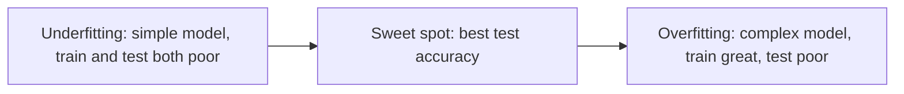

# Generalisation, overfitting and k-nearest neighbours

> **Before this lesson:** you should have built the iris classifier in [The scikit-learn API and your first model](#/lesson/ml/sklearn-first-model), so that `fit`, `predict`, `score`, `train_test_split` and the idea of k-nearest neighbours are familiar. The terms *bias* and *variance* come from [Probability, statistics and MLE](#/lesson/ml/probability-statistics), section 6, and are explained again here.

## In plain words

A model is only useful if it works on cases it has never seen. Doing well on new data is called **generalising**. This lesson is about the two ways a model can fail to generalise, and about one algorithm, k-nearest neighbours, that lets you watch both failures happen by turning a single dial.

Picture two students preparing for an exam from a book of past papers. The first memorises every answer word for word. Given the same questions she scores 100%, but a new question defeats her: she learned the papers, not the subject. The second skims and concludes "the answer is usually C". He does poorly on the past papers and on the exam alike. The first student is **overfitting**; the second is **underfitting**. A good student sits between the two, learning the patterns that will hold for questions not yet written.

Why this matters for a job: "my model scores 99% in training and 70% in production, what is wrong?" is the most common practical problem in machine learning and a guaranteed interview topic. The cure depends on diagnosing which of the two failures you have.

## 1. Generalisation

In supervised learning we train on examples whose answers are known and then predict for new ones. If the predictions on unseen data are accurate, we say the model **generalises** from the training set to the test set. A model that is right on every training example and wrong on new ones has learned nothing useful.

An example. A company that sells boats wants to predict which customers will buy one. It has records for its existing customers: age, number of children, marital status, whether they own a house, and whether they bought a boat. An analyst searches the records and finds a rule: "customers over 45 who either have fewer than three children or have never divorced buy a boat". The rule is correct for every customer in the file.

Should the company trust it? With enough conditions joined by "and" and "or", you can *always* build a rule that fits a finite list of customers perfectly, in the extreme by listing each buyer's exact age. Such a rule describes accidents of this particular list. The only question that matters is whether it holds for **new** customers.

- **Overfitting**: the model is too complicated for the amount of information in the data. It fits the accidents of the training set (its **noise**) as if they were patterns, so it does very well on training data and badly on new data.
- **Underfitting**: the model is too crude to capture the pattern at all, as in "everyone who owns a house buys a boat". It does badly on training data *and* on new data.
- Between them lies a sweet spot that gives the best performance on new data.

How flexible a model is, meaning how complicated a rule it is able to represent, is called its **model complexity**.



Moving from left to right in the diagram means increasing complexity. As you do so, **training accuracy keeps rising**, because a more flexible model can always fit the training data better. **Test accuracy rises and then falls.** The gap between the two is the signal of overfitting.

This is the same trade-off as bias and variance in the probability lesson. **Bias** is the error of a model that is too rigid (underfitting). **Variance** is how much the model would change if it were trained on a different sample of data, which is large for a very flexible model (overfitting).

## 2. Model complexity vs dataset size

How much complexity is "too much" depends on how much data you have, and how varied it is. With more data, there are fewer accidents that hold across all of it, so a more flexible model can be supported before it starts fitting noise. Collecting more data is therefore often a better investment than fiddling with a model, provided the new data is really new and not copies or near-copies of what you already have. This is also the story of deep learning: very large datasets are what make very flexible models workable.

The demonstration below uses a **decision tree** (lesson 22), a model that asks a sequence of yes/no questions about the features. Its `max_depth` setting limits how many questions it may ask in a row, so depth is its complexity dial. `None` means no limit.

```python-run
import numpy as np
from sklearn.datasets import make_moons
from sklearn.tree import DecisionTreeClassifier
from sklearn.model_selection import train_test_split

for n in [50, 200, 1000, 4000]:
    X, y = make_moons(n_samples=n, noise=0.3, random_state=0)
    X_tr, X_te, y_tr, y_te = train_test_split(X, y, random_state=0)
    row = []
    for depth in [1, 3, 6, None]:
        t = DecisionTreeClassifier(max_depth=depth, random_state=0).fit(X_tr, y_tr)
        row.append(f"d={str(depth):4s} {t.score(X_te, y_te):.2f}")
    print(f"n={n:5d} test acc: " + " | ".join(row))
```

**Reading this code line by line**

- `make_moons(n_samples=n, noise=0.3, random_state=0)` generates an artificial two-class dataset with two features: the points of each class form a crescent, and the two crescents interlock. `noise` blurs them so that they overlap. Artificial data is useful because we can make as much as we like.
- `train_test_split` holds a quarter back for testing, as in the previous lesson.
- The inner loop fits a tree at four depths and records the test accuracy of each. The outer loop repeats everything for four dataset sizes.

In the output, with 50 samples the depth-3 tree is best (0.92) and the deep trees are much worse (0.69): they have overfitted the tiny training set. With 4,000 samples the depth-6 tree is the best (0.91). More data supports a more complex model. Notice also that the unlimited tree is never the winner: with noisy data, unlimited flexibility always ends up fitting noise.

## 3. Sample datasets used in this module

A few small datasets come up again and again, because they ship with scikit-learn and run in the browser.

| dataset | kind | size (rows × features) | notes |
|---|---|---|---|
| `load_iris` | real, 3 classes | 150 × 4 | flower species; the first application |
| `load_breast_cancer` | real, 2 classes | 569 × 30 | harmless vs cancerous tumours |
| `load_diabetes` | real, regression | 442 × 10 | disease progression after one year |
| `make_moons` | artificial, 2 classes | any | two interlocking crescents; cannot be separated by a straight line |
| `make_blobs` | artificial, any number of classes | any | separate round clumps of points |
| `fetch_california_housing` | real, regression | 20,640 × 8 | needs a download, so it is not used in the runnable examples |

The source book also uses a housing dataset from Boston. scikit-learn removed it in version 1.2 because one of its features was built on a racist assumption; the California and diabetes datasets are the usual replacements. The book's own toy datasets (`forge` and `wave`, from its helper package `mglearn`) are replaced here by generated data of the same shape.

## 4. k-nearest neighbours classification

Recall the algorithm from the previous lesson. **Fit**: store the training set. **Predict**: for a new point, find the $k$ training points nearest to it by straight-line (Euclidean) distance and take a majority vote of their labels. In symbols,

$$\hat y(x) = \operatorname{mode}\{y_i : x_i \in N_k(x)\}$$

where $N_k(x)$ is the set of the $k$ nearest neighbours of $x$, the **mode** is the most common value in a collection, and $\hat y$ is the prediction. With more than two classes the rule is unchanged: count the neighbours in each class and pick the largest count.

The number of neighbours $k$ is this model's complexity dial. Watch what it does on the breast-cancer data:

```python-run
import numpy as np
from sklearn.datasets import load_breast_cancer
from sklearn.model_selection import train_test_split
from sklearn.neighbors import KNeighborsClassifier

X, y = load_breast_cancer(return_X_y=True)
X_tr, X_te, y_tr, y_te = train_test_split(X, y, stratify=y, random_state=66)
print(" k   train   test")
for k in [1, 3, 5, 10, 20, 50, 100]:
    clf = KNeighborsClassifier(n_neighbors=k).fit(X_tr, y_tr)
    print(f"{k:3d}  {clf.score(X_tr, y_tr):.3f}  {clf.score(X_te, y_te):.3f}")
```

The loop fits one model per value of $k$ and prints its accuracy on the training set and on the test set. This table is the diagram from section 1 in numbers, read from bottom to top:

- **Small $k$ is a complex model.** With $k=1$ training accuracy is a perfect 1.000 (each point is its own nearest neighbour) while test accuracy is 0.902. The model follows every single training point, including the odd ones.
- **Large $k$ is a simple model.** With $k=100$ training accuracy has dropped to 0.913. At the extreme, $k$ equal to the number of training points, every prediction would be the overall majority class.
- The best test accuracy (0.923) is found in between.

It surprises people that *small* $k$ is the *complex* setting. The reason: a model that consults one neighbour can change its answer every time you move a little, so the border between classes can be as wiggly as the data. A model that averages over 100 neighbours changes its mind slowly.

### Decision boundaries

A classifier divides the space of possible inputs into regions, one per class. The border between regions is the **decision boundary**. With two features you can picture it as a line drawn on a map of points. For $k=1$ the line is jagged and wraps little islands around individual points; for larger $k$ it is smooth.

Charts are not available here, so we measure the boundary instead: lay a fine grid over the plane, predict a class for every cell, and count the pairs of side-by-side cells that got different predictions. A longer boundary is a more wiggly one.

```python-run
import numpy as np
from sklearn.datasets import make_moons
from sklearn.neighbors import KNeighborsClassifier

X, y = make_moons(n_samples=200, noise=0.35, random_state=3)
xx, yy = np.meshgrid(np.linspace(-1.5, 2.5, 120), np.linspace(-1, 1.5, 120))
grid = np.column_stack([xx.ravel(), yy.ravel()])
for k in [1, 5, 25, 100]:
    p = KNeighborsClassifier(n_neighbors=k).fit(X, y).predict(grid).reshape(xx.shape)
    edges = (p[:, 1:] != p[:, :-1]).sum() + (p[1:] != p[:-1]).sum()
    print(f"k={k:3d}: {edges:4d} grid cells sit on the decision boundary (longer = more wiggly)")
```

`np.linspace(a, b, 120)` gives 120 evenly spaced numbers from `a` to `b`, and `np.meshgrid` combines two such lists into the coordinates of a 120 × 120 grid. `.ravel()` flattens a grid into one long list, so `grid` is a table of 14,400 points to classify. After predicting, `.reshape(xx.shape)` folds the answers back into grid form. `p[:, 1:] != p[:, :-1]` compares each cell with its left-hand neighbour, and `p[1:] != p[:-1]` with the cell above; `.sum()` counts the disagreements. The count falls from 579 at $k=1$ to 236 at $k=100$: the boundary gets shorter and smoother as $k$ grows.

## 5. k-nearest neighbours regression

The same idea predicts numbers. For **regression**, `KNeighborsRegressor` finds the $k$ nearest training points and returns the **average** of their target values. If the three nearest houses sold for 200, 220 and 240 thousand, the prediction is 220 thousand. With the option `weights="distance"`, closer neighbours count for more in the average.

For regression models, `.score` returns $R^2$ ("R squared"), the **coefficient of determination**. It compares the model's squared errors with those of the laziest possible predictor, one that always answers with the average target $\bar y$:

$$R^2 = 1 - \frac{\sum_i (y_i - \hat y_i)^2}{\sum_i (y_i - \bar y)^2}$$

The top of the fraction is the model's total squared error; the bottom is the lazy predictor's. So $R^2 = 1$ means perfect predictions, $R^2 = 0$ means no better than always guessing the average, and a negative value means worse than that. Worked example: true values 1, 2, 3 (average 2) and predictions 1, 2, 4. The model's squared error is $0 + 0 + 1 = 1$, the lazy predictor's is $1 + 0 + 1 = 2$, so $R^2 = 1 - 1/2 = 0.5$.

```python-run
import numpy as np
from sklearn.neighbors import KNeighborsRegressor
from sklearn.model_selection import train_test_split

rng = np.random.RandomState(42)
X = rng.uniform(-3, 3, size=(80, 1))
y = np.sin(4 * X[:, 0]) + X[:, 0] + rng.normal(scale=0.3, size=80)   # a "wave"-like dataset
X_tr, X_te, y_tr, y_te = train_test_split(X, y, random_state=0)
for k in [1, 3, 9, 30]:
    reg = KNeighborsRegressor(n_neighbors=k).fit(X_tr, y_tr)
    print(f"k={k:2d}: train R2={reg.score(X_tr, y_tr):.2f}  test R2={reg.score(X_te, y_te):.2f}")
```

The data has a single feature drawn at random between −3 and 3, and a target that follows a rising wave plus random noise. Note the shape `(80, 1)`: even one feature must be a table with one column. The pattern in the output matches classification. $k=1$ reproduces the training data exactly (training $R^2$ of 1.00), $k=3$ gives the best test score (0.94), and $k=30$ averages over so many points that the wave is flattened out (0.79): underfitting.

## 6. Strengths, weaknesses and parameters

- **Two settings matter**: the number of neighbours (a small number such as 3 or 5 is a reasonable start, but tune it) and the **distance metric**, the rule for measuring how far apart two points are (Euclidean by default).
- **Strengths**: easy to understand and explain; often gives reasonable results with little tuning; a good **baseline** to compare better models against; training takes almost no time.
- **Weaknesses**:
  - **Prediction is slow** when the training set is large, because each new point is compared with every stored point. Index structures called KD-trees and ball trees speed this up when there are few features.
  - **It needs preprocessing.** Features must be on comparable scales, or the feature with the biggest numbers decides the distance on its own (demonstrated below; lesson 30 covers scaling).
  - **It copes poorly with many features** (hundreds or more), because in high dimensions all points are about equally far apart, the "curse of dimensionality" from the linear-algebra lesson.
  - **It does badly on sparse data**, where most feature values are 0, as with word counts for text.

So k-NN is rarely the final model for ordinary tables of data. The underlying idea is very much alive, though: modern search and recommendation systems turn items into lists of numbers called **embeddings** and then look up the nearest neighbours of a query, using approximate methods (HNSW is a popular one) that trade a little accuracy for a great deal of speed.

```python-run
import numpy as np
from sklearn.datasets import load_breast_cancer
from sklearn.model_selection import train_test_split
from sklearn.neighbors import KNeighborsClassifier
from sklearn.preprocessing import StandardScaler

X, y = load_breast_cancer(return_X_y=True)
print("feature scales range from", X.std(0).min().round(4), "to", X.std(0).max().round(1))
X_tr, X_te, y_tr, y_te = train_test_split(X, y, random_state=0)
raw = KNeighborsClassifier().fit(X_tr, y_tr).score(X_te, y_te)
sc = StandardScaler().fit(X_tr)
scaled = KNeighborsClassifier().fit(sc.transform(X_tr), y_tr).score(sc.transform(X_te), y_te)
print(f"k-NN accuracy raw: {raw:.3f}   after standard scaling: {scaled:.3f}")
```

`X.std(0)` is the standard deviation (the typical spread) of each column. The first line of output shows that one feature varies by about 0.003 and another by about 569, a factor of two hundred thousand. In a distance calculation the second drowns out the first entirely. `StandardScaler` rescales every feature to have mean 0 and spread 1; it learns the rescaling from the training data with `fit` and applies it to both sets with `transform`. Accuracy rises from 0.937 to 0.951 with no other change.

> [!INTERVIEW]
> **"How do you choose k, and what happens at the extremes?"** Choose it by cross-validation. $k=1$ has zero training error and high variance; $k=n$ predicts the majority class everywhere (high bias). An odd $k$ avoids tied votes when there are two classes. Also mention that features must be scaled, that many features hurt (the curse of dimensionality), and that without an index each prediction costs work proportional to the number of training points times the number of features.

## 7. Diagnosing over- and underfitting in practice

Compare the score on the training data with the score on held-out data (called **validation** data when it is used for making decisions about the model).

| symptom | diagnosis | remedies |
|---|---|---|
| training score high, validation score much lower | overfitting (high variance) | more data, a simpler model, stronger regularisation (lesson 21), fewer features, averaging many models (lesson 22) |
| training and validation scores both low | underfitting (high bias) | a more flexible model, better features, weaker regularisation |
| training and validation scores close and high | a good fit | finish with one check on the test set |

A **learning curve** tells the two problems apart. Train the model on a small part of the data, then a larger part, then all of it, recording both scores each time. If the validation score is still climbing as data is added, more data will help. If both scores have levelled off at a low value, more data will not help, and you need a better model or better features.

```python-run
import numpy as np
from sklearn.datasets import load_breast_cancer
from sklearn.model_selection import learning_curve
from sklearn.neighbors import KNeighborsClassifier
from sklearn.preprocessing import StandardScaler
from sklearn.pipeline import make_pipeline

X, y = load_breast_cancer(return_X_y=True)
sizes, tr, va = learning_curve(make_pipeline(StandardScaler(), KNeighborsClassifier(1)), X, y,
                               train_sizes=[0.1, 0.3, 0.6, 1.0], cv=5)
for s, a, b in zip(sizes, tr.mean(1), va.mean(1)):
    print(f"n_train={s:3d}  train={a:.3f}  validation={b:.3f}")
```

`make_pipeline` chains the scaler and a 1-nearest-neighbour model into one object (lesson 60). `learning_curve` trains it on 10%, 30%, 60% and 100% of the available training data, each time repeating the measurement on five different held-out slices (`cv=5`), and returns the sizes and the two tables of scores; `.mean(1)` averages over the five repeats. The training score is 1.000 throughout, as always for $k=1$. The validation score climbs from 0.750 with 45 samples to 0.954 with 455, and it is still creeping upward at the end: a sign that this model would benefit from more data.

## 8. Worked example: classifying one point by hand

Doing one prediction on paper fixes the algorithm in memory, and it is a common warm-up question. Six training points have two features and a class:

| point | $x_1$ | $x_2$ | class |
|---|---|---|---|
| P1 | 1 | 1 | A |
| P2 | 2 | 1 | A |
| P3 | 1 | 3 | A |
| P4 | 5 | 4 | B |
| P5 | 6 | 5 | B |
| P6 | 3 | 3 | B |

Classify the new point $q = (3, 2)$. For each training point, subtract the coordinates, square and add. We can skip the square root, because it does not change which distances are smaller. Sorted from nearest to farthest:

| point | $(x_1 - 3)^2 + (x_2 - 2)^2$ | class |
|---|---|---|
| P6 | $0 + 1 = 1$ | B |
| P2 | $1 + 1 = 2$ | A |
| P1 | $4 + 1 = 5$ | A |
| P3 | $4 + 1 = 5$ | A |
| P4 | $4 + 4 = 8$ | B |
| P5 | $9 + 9 = 18$ | B |

- With $k=1$ the nearest point is P6, so the prediction is **B**.
- With $k=3$ the neighbours are P6 (B), P2 (A) and one of P1 or P3 (both A). The vote is 2 to 1 for **A**.
- With $k=5$ the neighbours are P6, P2, P1, P3 and P4: three A and two B, so **A**.

The answer changes with $k$. With $k=1$ a single nearby point decides everything, which makes the model sensitive to noise: if P6 had been labelled wrongly, the prediction would be wrong. A larger $k$ weighs more evidence.

Note the tie between P1 and P3, both at squared distance 5. Here it does not matter, because both are class A. In general an implementation needs a rule; scikit-learn keeps whichever comes first in the training data. The problem *ml-knn-predict* states its rule exactly.

```python-run
import numpy as np
from sklearn.neighbors import KNeighborsClassifier
X = np.array([[1, 1], [2, 1], [1, 3], [5, 4], [6, 5], [3, 3]])
y = np.array(["A", "A", "A", "B", "B", "B"])
q = np.array([[3, 2]])
print("squared distances:", ((X - q) ** 2).sum(axis=1))
for k in [1, 3, 5]:
    knn = KNeighborsClassifier(n_neighbors=k).fit(X, y)
    proba = {str(c): round(float(v), 2) for c, v in zip(knn.classes_, knn.predict_proba(q)[0])}
    print(f"k={k}: predict {knn.predict(q)[0]}  class probabilities {proba}")
weighted = KNeighborsClassifier(n_neighbors=5, weights="distance").fit(X, y)
print("k=5, distance-weighted:", weighted.predict(q)[0], {str(c): round(float(v), 2) for c, v in zip(weighted.classes_, weighted.predict_proba(q)[0])})
```

The code repeats the hand calculation. `((X - q) ** 2).sum(axis=1)` computes the six squared distances in one expression (`axis=1` adds across each row). `predict_proba` returns, for each class, the model's estimated probability; for k-NN that is the fraction of the $k$ neighbours in the class, so $k=3$ prints 0.67 for A and 0.33 for B. With `weights="distance"` each neighbour's vote is multiplied by one over its distance, so the very close P6 counts for more and the probability of A falls from 0.60 to 0.54, though A still wins.

## 9. Design choices and pitfalls

**Choosing the distance.** Euclidean distance is the default. Manhattan distance (`metric="manhattan"`, the sum of the absolute differences) is less dominated by one large difference. Cosine distance compares direction and ignores length, which suits text and embeddings. The metric is part of the model: it encodes what "similar" means in your problem.

**Choosing $k$.** Use cross-validation on the training data (lesson 50). A common search range is from 1 up to about the square root of the number of training samples. For two classes, an odd $k$ avoids tied votes.

**Why many features hurt.** Every feature contributes to the distance, including irrelevant ones. With a few informative features and many noisy ones, the noise swamps the signal. The demonstration below adds columns of pure random numbers to iris.

```python-run
import numpy as np
from sklearn.datasets import load_iris
from sklearn.neighbors import KNeighborsClassifier
from sklearn.model_selection import cross_val_score
from sklearn.preprocessing import StandardScaler
from sklearn.pipeline import make_pipeline

X, y = load_iris(return_X_y=True)
rng = np.random.RandomState(0)
for n_noise in [0, 5, 20, 100, 500]:
    X_noisy = np.hstack([X, rng.randn(len(X), n_noise)])
    acc = cross_val_score(make_pipeline(StandardScaler(), KNeighborsClassifier(5)), X_noisy, y, cv=5).mean()
    print(f"4 real features + {n_noise:3d} noise features: CV accuracy = {acc:.3f}")
```

`np.hstack` glues extra columns onto the right of the table, and `rng.randn(len(X), n_noise)` creates that many columns of random numbers that have nothing to do with the species. Accuracy falls from 0.960 with no noise columns to 0.847 with five, and to 0.467 with five hundred, which is close to the 0.333 you would get by guessing among three species. The four useful measurements are still in the table; the model can no longer hear them over the noise.

**Other pitfalls.**

- *Duplicates.* If the same row appears in both the training and the test data, $k=1$ gets it right by looking it up. The score then says nothing about generalisation.
- *Imbalanced classes.* When one class is much more common than another, a large $k$ lets the common class win most votes. Use distance weighting or a smaller $k$.
- *Memory.* The model **is** the training set. A million rows of 100 features must be kept in memory and shipped along with the model.
- *Categorical features.* Features that are categories (such as a colour stored as 0, 1, 2) have no meaningful distance between their codes. They must be encoded differently (lesson 40), and you must decide how they weigh against numeric features.

## Summary

- Generalisation, meaning performance on unseen data, is the goal. A training score on its own says nothing.
- Overfitting is a model too complex for the data; underfitting is one too crude. The complexity you can afford grows with the amount of data.
- k-NN stores the data and lets the $k$ closest points vote (or averages them, for regression). Small $k$ is complex, large $k$ is simple.
- k-NN needs scaled features, struggles with many or sparse features, and predicts slowly on large data. It is a good baseline.
- A learning curve tells you whether more data or a better model is the cure.

## Glossary

- **Generalisation**: accuracy on data the model was not trained on.
- **Overfitting**: fitting the accidents of the training data; high training score, low test score.
- **Underfitting**: a model too crude to capture the pattern; low scores everywhere.
- **Model complexity**: how flexible a model is; how complicated a rule it can represent.
- **Noise**: random variation in the data that carries no pattern.
- **Bias / variance**: error from rigidity / error from sensitivity to the particular training sample.
- **Decision boundary**: the border between the regions a classifier assigns to different classes.
- **Mode**: the most frequent value in a collection.
- **$R^2$ (coefficient of determination)**: regression score; 1 is perfect, 0 is no better than predicting the average.
- **Distance metric**: the rule used to measure how far apart two samples are.
- **Baseline**: a basic model used as a point of comparison.
- **Sparse data**: data in which most values are zero.
- **Embedding**: a list of numbers representing an item so that similar items are close together.
- **Validation data**: held-out data used to make choices about the model.
- **Learning curve**: scores plotted against the amount of training data.

## Check yourself

```quiz
[
  {"q": "A model scores 100% on training data and 70% on test data. Most likely…", "options": ["it is overfitting", "it is underfitting", "the test set is too large", "the model is perfect"], "answer": 0,
   "explain": "A large train–test gap is the signature of overfitting (high variance)."},
  {"q": "In k-NN, increasing k generally makes the decision boundary…", "options": ["smoother (simpler model)", "more jagged (more complex)", "unchanged", "linear"], "answer": 0,
   "explain": "Averaging over more neighbours smooths out local fluctuations; k = n predicts the majority class everywhere."},
  {"q": "What does `KNeighborsRegressor` predict for a query point?", "options": ["The (optionally distance-weighted) mean of the k neighbours' targets", "The median of all targets", "The target of the farthest neighbour", "A linear fit through the neighbours"], "answer": 0,
   "explain": "k-NN regression averages neighbour targets."},
  {"q": "Why does k-NN usually need feature scaling?", "options": ["Distances are dominated by features with large numeric ranges", "Scaling makes k-NN linear", "Unscaled data cannot be stored", "Scaling reduces k"], "answer": 0,
   "explain": "Euclidean distance sums squared differences; a feature in the thousands swamps one in fractions."},
  {"q": "Which data is k-NN particularly bad at, according to Müller & Guido?", "options": ["High-dimensional sparse data (mostly zeros), e.g. text", "Small 2-D datasets", "Data with few classes", "Data with integer labels"], "answer": 0,
   "explain": "Many features and sparse vectors make nearest-neighbour distances uninformative."},
  {"q": "R² = 0 for a regression model means…", "options": ["It does no better than always predicting the mean", "It is perfect", "It is worse than random", "The data has no variance"], "answer": 0,
   "explain": "R² = 1 − SS_res/SS_tot; predicting ȳ everywhere gives SS_res = SS_tot."},
  {"q": "A learning curve where training and validation scores both plateau at a low value suggests…", "options": ["high bias: get a more expressive model or better features", "high variance: collect more data", "data leakage", "a perfect model"], "answer": 0,
   "explain": "If both are low and flat, more data will not help; the model cannot represent the pattern."}
]
```

> **Source:** Müller & Guido, *Introduction to Machine Learning with Python*, ch. 2 ("Classification and Regression", "Generalization, Overfitting, and Underfitting", "Relation of Model Complexity to Dataset Size", "Some Sample Datasets", "k-Nearest Neighbors"); scikit-learn User Guide, "Nearest Neighbors".
