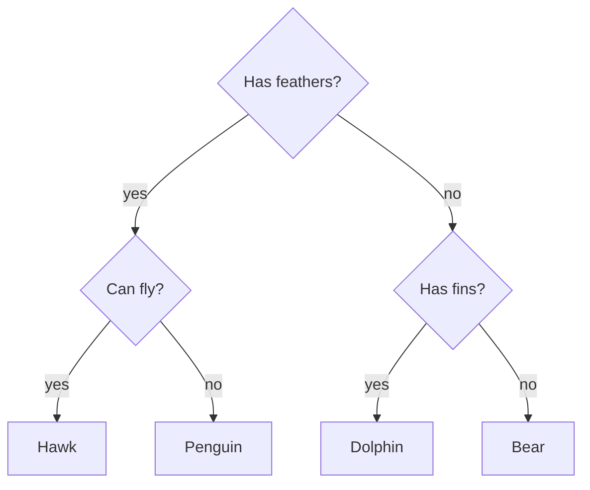

# Naive Bayes, decision trees and ensembles of trees

> **Before this lesson:** you need overfitting and model complexity from [Generalisation, overfitting and k-NN](#/lesson/ml/generalization-knn) and the idea of regularisation from [Linear models](#/lesson/ml/linear-models). Bayes' rule, conditional probability and entropy were introduced in [Probability, statistics and MLE](#/lesson/ml/probability-statistics); each is recalled here in a sentence when it is needed.

## In plain words

This lesson covers three kinds of model that reason very differently from the weighted sums of the last lesson.

**Naive Bayes** is a tally counter. It counts how often each feature value turns up in each class ("the word *prize* appears in 80% of spam and 10% of normal mail") and combines the tallies with a probability rule to judge a new example.

A **decision tree** plays the game of Twenty Questions. It asks a yes/no question about one feature, then another depending on the answer, until it has narrowed things down enough to answer.

An **ensemble** is a committee. One tree on its own is erratic; hundreds of trees that each see the problem a little differently, and whose answers are combined, are among the most accurate models there are.

Why this matters for a job: on data that comes as a table (customers, transactions, sensor readings), ensembles of trees are the usual winners, and the libraries XGBoost and LightGBM are everyday tools in industry. "Explain bagging versus boosting" and "how does a tree choose a split?" are among the most frequently asked ML interview questions.

## 1. Naive Bayes classifiers

Recall **Bayes' rule**: to find the probability of a class given some evidence, multiply how common the class is (the **prior**) by how likely the evidence is within that class (the **likelihood**), and compare across classes.

A naive Bayes classifier applies this with many features at once by making a simplifying assumption: *within a class, the features do not influence each other*. Statisticians say the features are **conditionally independent given the class**. That lets the likelihood of a whole sample be computed as a product with one factor per feature:

$$P(y\mid x)\ \propto\ P(y)\prod_{j=1}^p P(x_j\mid y)\quad\Longrightarrow\quad \hat y = \arg\max_y\Big[\log P(y) + \sum_j \log P(x_j\mid y)\Big].$$

Reading the notation: $P(y \mid x)$ is the probability of class $y$ given the features $x$; $\propto$ means "is proportional to"; $\prod$ means "multiply together for every feature $j$"; and $\arg\max_y$ means "the class $y$ that makes the expression largest". The right-hand version takes logarithms, turning the product into a sum, because multiplying many small probabilities produces numbers too tiny for a computer to hold.

The assumption is "naive" because it is rarely true: in an email, the words *prize* and *winner* tend to appear together. The classifier often works well anyway, and the assumption is what makes it so fast: training only has to look at **one feature at a time** and record a few numbers per class.

scikit-learn has three main variants, which differ in what kind of feature values they expect:

| class | kind of features | what it records for each class |
|---|---|---|
| `GaussianNB` | any continuous numbers | the mean and standard deviation of each feature |
| `BernoulliNB` | yes/no features (0 or 1) | how often each feature is switched on |
| `MultinomialNB` | counts (such as how often each word occurs) | the average value of each feature |

`BernoulliNB` and `MultinomialNB` are mostly used for text. Both have one setting, **`alpha`**. Without it there is a trap: if a word never appeared with a class in training, its tally is zero, and a single zero factor wipes out the whole product. `alpha` adds that many imaginary examples to every tally so that nothing is ever exactly zero. This is called **additive** or **Laplace smoothing**. A larger `alpha` smooths more and gives a simpler model; results are usually not very sensitive to its value.

```python-run
import numpy as np
X = np.array([[0, 1, 0, 1],
              [1, 0, 1, 1],
              [0, 0, 0, 1],
              [1, 0, 1, 0]])
y = np.array([0, 1, 0, 1])
# what BernoulliNB "learns": count non-zero entries per feature, per class
for label in np.unique(y):
    print("class", label, "feature counts:", X[y == label].sum(axis=0))

from sklearn.naive_bayes import BernoulliNB
nb = BernoulliNB(alpha=1.0).fit(X, y)
print("P(feature=1 | class), smoothed:\n", np.exp(nb.feature_log_prob_).round(2))
print("prediction for [1,0,1,1]:", nb.predict([[1, 0, 1, 1]]), nb.predict_proba([[1, 0, 1, 1]]).round(3))
```

**Reading this code line by line**

- `X` is a tiny dataset: four samples (rows), each with four yes/no features. `y` gives their classes: rows 0 and 2 are class 0, rows 1 and 3 are class 1.
- `X[y == label]` keeps only the rows of one class, and `.sum(axis=0)` adds down each column. The result is the tally: in class 0, feature 1 is switched on once and feature 3 twice.
- `BernoulliNB(alpha=1.0).fit(X, y)` does that counting, with smoothing. The model stores logarithms in `feature_log_prob_`, so `np.exp` converts them back to probabilities.
- Check one value by hand. Class 0 has 2 samples, and feature 0 is on in none of them. With smoothing the estimate is $(0 + 1)/(2 + 2) = 0.25$, not 0: one imaginary "on" and one imaginary "off" were added. That is the 0.25 in the top-left of the printed table.
- The last line classifies a new sample `[1, 0, 1, 1]`. It resembles the class-1 rows, and the model says class 1 with probability 0.9.

`GaussianNB` is mainly used when there are very many numeric features. The other two are used for sparse counts, and `MultinomialNB` usually does better than `BernoulliNB` on longer documents. To sum up naive Bayes: very fast to train and to predict, easy to understand, good on data with many sparse features, and forgiving about its one setting. Its accuracy is often a little below that of a linear classifier such as logistic regression. It is a strong **baseline**, and it is used on datasets so large that even a linear model would take too long.

> [!NOTE]
> Naive Bayes is a **generative** model: it describes how the features are distributed within each class, $P(x\mid y)$, and how common each class is, $P(y)$. Logistic regression is **discriminative**: it models $P(y\mid x)$ directly. Because the independence assumption is wrong, naive Bayes treats related features as separate pieces of evidence and counts them twice, so its probabilities tend to be too extreme (too close to 0 or 1) even when the chosen class is right.

## 2. Decision trees

A decision tree learns a sequence of **if/else questions** that leads to a decision. Suppose you had to tell four animals apart, a bear, a hawk, a penguin and a dolphin, by asking as few questions as possible:



Some vocabulary. Each box is a **node**. The top node, where every sample starts, is the **root**. A question is called a **test** or a **split**, because it divides the samples into two groups. The boxes at the bottom, where an answer is given, are **leaves**. The **depth** of the tree is the largest number of questions asked on the way from the root to a leaf (2 here).

With numeric features the questions take the form "is feature $j$ less than or equal to some threshold $t$?", for example "is petal length ≤ 2.45 cm?".

### Building a tree

Nobody writes the questions; the algorithm finds them. At the root it tries every feature and every possible threshold, and picks the test that is **most informative about the label**, meaning the one that separates the classes best. The data is divided in two accordingly, and the same search is repeated on each half, and again on the quarters, and so on. Choosing the best split at each step without looking ahead is called a **greedy** method. If nothing stops it, the process continues until every leaf contains samples of a single class; such a leaf is called **pure**.

To predict for a new sample, start at the root, answer the questions, and arrive at a leaf. A classification tree returns the most common class among the training samples in that leaf. A regression tree returns the average of their target values.

"Most informative" needs a number. **Impurity** measures how mixed the classes in a node are: 0 when all samples share one class, larger the more evenly they are mixed. Writing $p_c$ for the fraction of the node's samples that belong to class $c$, the two standard measures are:

$$\text{Gini} = 1-\sum_c p_c^2\qquad\qquad \text{Entropy} = -\sum_c p_c\log_2 p_c$$

**Gini impurity** is the chance that two samples drawn at random from the node belong to different classes. Worked example: a node with 8 samples of class A and 2 of class B has $p_A = 0.8$ and $p_B = 0.2$, so Gini $= 1 - (0.64 + 0.04) = 0.32$. A pure node gives $1 - 1 = 0$, and a 50/50 node gives $1 - (0.25 + 0.25) = 0.5$, the maximum for two classes. **Entropy** measures the same mixedness in bits (the number of yes/no answers needed, on average, to learn a sample's class): 0 for a pure node, 1 bit for a 50/50 node.

A split is scored by how much it lowers impurity: the parent's impurity minus the impurities of the two children, each weighted by its share of the samples ($n_L$ and $n_R$ are the numbers of samples going left and right, $n$ the total):

$$\Delta = I(\text{parent}) - \frac{n_L}{n}I(L) - \frac{n_R}{n}I(R).$$

The tree picks the split with the largest $\Delta$. When entropy is the impurity, $\Delta$ is called the **information gain**. For regression trees the impurity of a node is the variance of its target values. You implement the search in the problems *ml-gini-best-split* and *ml-info-gain*.

```python-run
import numpy as np
def gini(labels):
    _, c = np.unique(labels, return_counts=True); p = c / c.sum(); return 1 - (p ** 2).sum()
def entropy(labels):
    _, c = np.unique(labels, return_counts=True); p = c / c.sum(); return -(p * np.log2(p)).sum()

parent = np.array([0] * 5 + [1] * 5)
for name, left, right in [("perfect split", parent[:5], parent[5:]),
                          ("weak split", np.array([0, 0, 0, 0, 1]), np.array([0, 1, 1, 1, 1])),
                          ("useless split", np.array([0, 1] * 2), np.array([0, 1] * 3))]:
    w = lambda f: len(left) / 10 * f(left) + len(right) / 10 * f(right)
    print(f"{name:14s} gini gain={gini(parent) - w(gini):.3f}  info gain={entropy(parent) - w(entropy):.3f} bits")
```

The two functions implement the formulas: `np.unique(labels, return_counts=True)` returns how many times each class occurs, dividing by the total gives the fractions `p`, and the last expression applies the formula. The parent node holds five samples of class 0 and five of class 1 (impurity 0.5 by Gini, 1 bit by entropy). Three candidate splits are then scored. The perfect split puts each class on its own side and removes all the impurity (gain 0.500, or 1 bit). The weak split leaves one stray sample on each side (gain 0.180). The useless split leaves both sides as mixed as the parent (gain 0). The two measures always rank these splits in the same order, which is why the choice between them rarely matters in practice.

### Controlling complexity

A tree grown until every leaf is pure scores 100% on the training data and is far too complex: some leaves exist to accommodate a single odd sample. There are two ways to hold it back.

- **Pre-pruning**: stop growing early. Limit the depth (`max_depth`), limit the number of leaves (`max_leaf_nodes`), or require a minimum number of samples in a leaf (`min_samples_leaf`) or in a node before it may be split (`min_samples_split`).
- **Post-pruning**: grow the full tree, then cut back branches that contribute little. scikit-learn offers this through the setting `ccp_alpha` (cost-complexity pruning).

```python-run
from sklearn.datasets import load_breast_cancer
from sklearn.tree import DecisionTreeClassifier, export_text
from sklearn.model_selection import train_test_split

data = load_breast_cancer()
X_tr, X_te, y_tr, y_te = train_test_split(data.data, data.target, stratify=data.target, random_state=42)
for depth in [None, 4, 2]:
    t = DecisionTreeClassifier(max_depth=depth, random_state=0).fit(X_tr, y_tr)
    print(f"max_depth={depth}: train={t.score(X_tr, y_tr):.3f} test={t.score(X_te, y_te):.3f} leaves={t.get_n_leaves()}")
tree = DecisionTreeClassifier(max_depth=2, random_state=0).fit(X_tr, y_tr)
print(export_text(tree, feature_names=list(data.feature_names)))
```

The loop grows three trees on the tumour data: one with no depth limit (`None`), one limited to depth 4 and one to depth 2. The unlimited tree has 18 leaves and a training accuracy of 1.000, with 0.937 on the test set. Limiting the depth to 4 lowers the training accuracy to 0.988 and *raises* the test accuracy to 0.951: less memorising, better generalising. Depth 2 is too crude (0.909). `export_text` then prints the depth-2 tree as indented rules that a doctor could read: first "is the worst radius at most 16.8?", then one further question on each side.

### Feature importances

After fitting, the attribute `feature_importances_` holds one number per feature: the share of the total impurity reduction that came from splits on that feature. The numbers lie between 0 and 1 and add up to 1. Two cautions. A low importance does not prove a feature is useless: the tree may have happened to use another feature that carries the same information. And importances are never negative, so they do not say **which class** a feature points towards, unlike the sign of a linear model's weight.

### Trees cannot extrapolate

A tree's prediction is always an average of training targets in some leaf. So for an input beyond the range of the training data, it returns the value of the outermost leaf, a constant, however far out you go. To **extrapolate** means to predict outside the range seen in training, and no tree-based model can follow a trend there.

```python-run
import numpy as np
from sklearn.tree import DecisionTreeRegressor
from sklearn.linear_model import LinearRegression
X = np.arange(0, 20).reshape(-1, 1).astype(float)
y = 3 * X[:, 0] + 5
tree = DecisionTreeRegressor().fit(X, y)
lin = LinearRegression().fit(X, y)
print("x=30  truth=95  tree:", tree.predict([[30]])[0], " linear:", lin.predict([[30]])[0].round(1))
```

The training inputs are the whole numbers 0 to 19 and the target is the straight line $3x + 5$. Asked about $x = 30$, where the true value is 95, the linear model continues the line and answers 95.0. The tree answers 62.0, which is the target of the largest training input ($3\times19 + 5$). This matters whenever the future lies outside the past, as with prices that rise over time.

### Strengths and weaknesses

- **Easy to display and explain**, as long as the tree is small.
- **Unaffected by the scale of the features.** A test such as "is $x \le t$?" gives the same division whether $x$ is in metres or millimetres, so no rescaling is needed, and features on wildly different scales or of different kinds (yes/no mixed with continuous) cause no trouble.
- **Main weakness**: even with pre-pruning, single trees tend to overfit and generalise poorly. In most applications ensembles of trees are used instead.

## 3. Random forests

An **ensemble** combines many models into one stronger model. A **random forest** is a collection of decision trees, each a little different from the others. The reasoning: a deep tree predicts well but overfits its training data in its own particular way. If we build many trees that overfit in *different* ways and **average** their answers, the individual errors tend to cancel while what the trees agree on, the real pattern, remains.

For this to work the trees must differ, so randomness is injected in two places:

1. **Bootstrap samples.** Each tree is trained on its own version of the data, made by drawing $n$ rows at random from the $n$ training rows **with replacement** (a row can be picked more than once). Each such sample repeats some rows and leaves out about a third of them. Training models on bootstrap samples and combining them is called **bagging**, short for bootstrap aggregating.
2. **Feature subsampling.** At each node, the tree may choose its split from only a random subset of the features, of size `max_features`. Setting `max_features` to the total number of features removes this randomness; setting it to 1 leaves the tree no choice of feature at all. Smaller values make the trees more different from one another, and each tree then has to grow deeper to fit the data.

To predict, every tree gives its answer and the forest combines them: for classification it averages the trees' predicted class probabilities and picks the largest (a **soft vote**); for regression it averages the predicted numbers.

Why averaging helps, in one formula. Suppose there are $B$ models, each with variance $\sigma^2$, and each pair has correlation $\rho$ (how alike their errors are, from 0 for unrelated to 1 for identical). The variance of their average is

$$\rho\sigma^2 + \frac{1-\rho}{B}\sigma^2 .$$

With $\sigma^2 = 1$, $\rho = 0.5$ and $B = 100$ this is $0.5 + 0.005 = 0.505$, about half the variance of one tree. Adding trees shrinks only the second term; the first can be reduced only by making the trees less alike, which is exactly the job of feature subsampling.

```python-run
from sklearn.datasets import load_breast_cancer
from sklearn.ensemble import RandomForestClassifier
from sklearn.tree import DecisionTreeClassifier
from sklearn.model_selection import train_test_split
import numpy as np

data = load_breast_cancer()
X_tr, X_te, y_tr, y_te = train_test_split(data.data, data.target, random_state=0)
tree = DecisionTreeClassifier(random_state=0).fit(X_tr, y_tr)
print(f"single tree            test={tree.score(X_te, y_te):.3f}")
for n in [1, 5, 25, 100]:
    rf = RandomForestClassifier(n_estimators=n, random_state=0).fit(X_tr, y_tr)
    print(f"forest of {n:3d} trees    test={rf.score(X_te, y_te):.3f}")
top = np.argsort(rf.feature_importances_)[::-1][:5]
print("top features:", [(str(data.feature_names[i]), round(float(rf.feature_importances_[i]), 3)) for i in top])
```

`n_estimators` is the number of trees. A single tree scores 0.881 on the test set. A forest of 5 trees scores 0.944, 25 trees 0.965, and 100 trees 0.972: each increase helps, by less and less. The last two lines sort the forest's feature importances (`np.argsort` gives the positions in increasing order, `[::-1]` reverses them, `[:5]` keeps the top five) and print the names. A forest's importances are averaged over many trees, so they are more trustworthy than those of one tree.

**Settings and advice.**

- `n_estimators`: **more is better**. More trees cannot make a forest overfit; they give a steadier average, with shrinking benefit and growing cost in time and memory. Use as many as you can afford.
- `max_features`: how random each tree is. The default for classification is the square root of the number of features, a sound rule of thumb. For regression, current scikit-learn uses all the features by default (older advice suggested fewer).
- Pre-pruning (`max_depth`, `max_leaf_nodes`) sometimes helps and saves memory.
- Trees are built independently of one another, so on an ordinary computer `n_jobs=-1` builds them on all processor cores at once. (The in-browser examples on this site run on a single core.) Set `random_state` so that results can be repeated.
- Forests need **no scaling**, work well with almost no tuning, and give more reliable feature importances than a single tree.
- They do **not** suit data with a huge number of sparse features, such as text, where linear models do better. They also use more memory and predict more slowly than linear models.

> [!TIP]
> Each tree never sees roughly 37% of the rows: these are its **out-of-bag** samples. Setting `oob_score=True` tests each tree on the rows it did not see, which gives an estimate of the forest's accuracy on new data without setting aside a separate validation set.

## 4. Gradient boosted trees

**Gradient boosting** also combines many trees, with the opposite strategy. A forest builds its trees independently and averages them. Boosting builds them **one after another**, and each new tree is trained to **correct the mistakes of all the trees so far**. The trees are kept very shallow, usually of depth 1 to 5. Such a deliberately limited model is called a **weak learner**: on its own it is hardly better than guessing, but each one fixes part of what remains wrong, and hundreds of them added together are very accurate.

For regression with squared error the procedure is short:

1. Start with a constant prediction for every sample, the average of the targets: $F_0(x) = \bar y$.
2. Repeat for $m = 1, \dots, M$: compute each sample's **residual**, the gap between its true value and the current prediction, $r_i = y_i - F_{m-1}(x_i)$. Fit a small regression tree $h_m$ to predict the residuals. Add a fraction of that tree's output to the running prediction: $F_m(x) = F_{m-1}(x) + \eta\,h_m(x)$.

Numbers: if a house's true price is 300 and the current prediction is 250, its residual is 50. If the new tree predicts 40 for it and $\eta = 0.3$, the prediction moves to $250 + 0.3 \times 40 = 262$.

The fraction $\eta$ is the **`learning_rate`**: how strongly each tree is allowed to correct its predecessors. For losses other than squared error, the "residuals" are replaced by the negative gradient of the loss with respect to the current predictions, the direction in which each prediction should move to reduce the loss. That is where the name gradient boosting comes from. (For squared error, that negative gradient *is* the residual.)

```python-run
import numpy as np
from sklearn.tree import DecisionTreeRegressor
rng = np.random.RandomState(0)
X = rng.uniform(-3, 3, (200, 1)); y = np.sin(X[:, 0]) + 0.2 * rng.randn(200)

F = np.full(200, y.mean()); lr = 0.3
for m in range(1, 31):
    residual = y - F                                   # negative gradient of 1/2 (y - F)^2
    stump = DecisionTreeRegressor(max_depth=2).fit(X, residual)
    F += lr * stump.predict(X)
    if m in (1, 5, 10, 30):
        print(f"after {m:2d} trees: training MSE = {np.mean((y - F) ** 2):.4f}")
```

**Reading this code line by line**

- The data is 200 points on a noisy sine wave, with one feature.
- `F = np.full(200, y.mean())` is step 1: an array of 200 predictions, all equal to the average target. `lr = 0.3` is the learning rate.
- Inside the loop, `residual = y - F` is what is still unexplained. A depth-2 regression tree is fitted to the residuals, not to `y`, and 0.3 times its predictions are added to `F`.
- The mean squared error on the training data is printed after 1, 5, 10 and 30 trees.

The error falls from 0.30 after one tree to 0.06 after five and 0.02 after thirty. Thirty trees of depth 2, each almost useless alone, have traced out the sine wave between them. This is the whole algorithm; the libraries add speed and safeguards.

**Settings and advice.**

- `n_estimators` and `learning_rate` are tied together: a lower learning rate needs more trees to reach the same fit. Unlike in a random forest, **more trees can overfit**, because each one keeps squeezing the training error. Common practice is to fix the number of trees by the time you can afford and search over the learning rate, or to use **early stopping**: watch the error on held-out data and stop adding trees when it stops improving.
- `max_depth` is kept low, seldom above five.
- Strengths: among the most accurate and most widely used models for tabular data. No scaling needed; handles mixed kinds of features.
- Weaknesses: needs careful tuning, can be slow to train, and like all tree models does poorly on huge numbers of sparse features.
- A sensible order of work: try a random forest first, because it is robust and needs little tuning. Move to gradient boosting when you need the last few points of accuracy or faster predictions.

```python-run
from sklearn.datasets import load_breast_cancer
from sklearn.ensemble import GradientBoostingClassifier
from sklearn.model_selection import train_test_split
X, y = load_breast_cancer(return_X_y=True)
X_tr, X_te, y_tr, y_te = train_test_split(X, y, random_state=0)
for kw in [dict(), dict(max_depth=1), dict(learning_rate=0.01)]:
    gb = GradientBoostingClassifier(n_estimators=60, random_state=0, **kw).fit(X_tr, y_tr)
    print(f"{str(kw):25s} train={gb.score(X_tr, y_tr):.3f} test={gb.score(X_te, y_te):.3f}")
```

Three boosted models of 60 trees each are compared: the default settings (depth 3, learning rate 0.1), trees of depth 1, and a learning rate of 0.01. (`**kw` passes the entries of a dictionary as named arguments.) The default model reaches a training accuracy of 1.000, a hint of overfitting. The two restrained models have lower training accuracy (0.984 and 0.986) and the same test accuracy of 0.965. On this small, easy dataset the restraint costs nothing; on harder data it is often what improves the test score.

### XGBoost, LightGBM, CatBoost and HistGradientBoosting

scikit-learn's `GradientBoostingClassifier` is fine for learning and for small data. For serious work people use faster, more refined implementations:

| library | key ideas |
|---|---|
| **XGBoost** | uses curvature as well as slope when fitting each tree, adds L1 and L2 penalties on the values in the leaves, handles sparse data efficiently, can run on graphics processors |
| **LightGBM** | grows the tree **leaf by leaf**, always splitting the leaf that promises the largest gain, and samples the data cleverly; very fast on large datasets |
| **CatBoost** | special handling of categorical features and a training order designed to avoid leaking the target |
| `HistGradientBoostingClassifier` | scikit-learn's own modern version; accepts missing values and categorical features directly |

All of them first sort each feature's values into at most 256 buckets (a **histogram**). Finding the best split then means checking 256 candidate thresholds instead of one per data row, which is what makes them fast. They also offer extra regularisation (training each tree on a random fraction of the rows or of the features, penalties on leaf values) and early stopping on a validation set.

> [!INTERVIEW]
> **"Bagging vs boosting?"** Bagging (as in a random forest) trains deep trees, which have low bias and high variance, independently on bootstrap samples and averages them, which **reduces variance**. The trees can be built in parallel, and adding more does not cause overfitting. Boosting trains shallow trees, which have high bias, one after another on the errors of those before, which **reduces bias**. It is usually more accurate once tuned, but it is sensitive to the learning rate, the number of trees and mislabelled data. Expect the follow-ups: why trees need no scaling (a split depends only on the order of a feature's values) and why they cannot extrapolate.

## Summary

- Naive Bayes: per-feature tallies combined with Bayes' rule. Extremely fast, good for sparse text, with `alpha` smoothing to avoid zero probabilities.
- Decision trees: greedy splits on one feature at a time, chosen by Gini impurity or entropy. Readable and unaffected by feature scale, but they overfit and cannot extrapolate.
- Random forests: bagging plus feature subsampling, which reduces variance. More trees never hurt.
- Gradient boosting: shallow trees fitted one after another to the remaining errors. Tune `learning_rate`, `n_estimators` and `max_depth` together.
- XGBoost and LightGBM are the fast, regularised, histogram-based versions used in practice.

## Glossary

- **Naive Bayes**: a classifier that applies Bayes' rule assuming features are independent within each class.
- **Conditional independence**: within a class, knowing one feature tells you nothing about another.
- **Laplace (additive) smoothing**: adding imaginary counts so no estimated probability is zero.
- **Generative / discriminative model**: models how the features arise in each class / models the class given the features directly.
- **Decision tree**: a model that predicts by asking a sequence of yes/no questions about features.
- **Node / root / leaf**: a point in the tree / the first node / a final node that gives the answer.
- **Split (test)**: a question that divides the samples of a node in two.
- **Impurity**: how mixed the classes in a node are; Gini and entropy are two measures.
- **Information gain**: the drop in entropy achieved by a split.
- **Pruning**: limiting or cutting back a tree to reduce overfitting.
- **Feature importance**: the share of total impurity reduction credited to a feature.
- **Extrapolate**: predict outside the range of the training data.
- **Ensemble**: a model made by combining many models.
- **Bootstrap sample**: a sample of the data drawn with replacement, the same size as the original.
- **Bagging**: training models on bootstrap samples and averaging them.
- **Random forest**: bagged decision trees with a random subset of features considered at each split.
- **Out-of-bag samples**: the rows a given tree did not see in its bootstrap sample.
- **Gradient boosting**: adding shallow trees one at a time, each fitted to the errors of the ensemble so far.
- **Weak learner**: a deliberately limited model, such as a very shallow tree.
- **Early stopping**: ending training when the score on held-out data stops improving.

## Check yourself

```quiz
[
  {"q": "What is the 'naive' assumption in naive Bayes?", "options": ["Features are conditionally independent given the class", "All classes are equally likely", "Features are normally distributed", "The decision boundary is linear"], "answer": 0,
   "explain": "It lets P(x|y) factor into a product of per-feature terms, which is why training only needs per-feature statistics."},
  {"q": "A node contains 8 samples of class A and 2 of class B. Its Gini impurity is…", "options": ["0.32", "0.5", "0.2", "0.72"], "answer": 0,
   "explain": "1 − (0.8² + 0.2²) = 1 − 0.68 = 0.32."},
  {"q": "Why don't tree-based models need feature scaling?", "options": ["Splits depend only on the ordering of values within each feature", "They scale features internally with StandardScaler", "They use cosine distance", "They only work on binary features"], "answer": 0,
   "explain": "A threshold test x ≤ t is unaffected by monotonic rescaling of the feature."},
  {"q": "In a random forest, increasing n_estimators…", "options": ["never hurts accuracy (apart from compute); it reduces variance with diminishing returns", "eventually overfits badly", "increases bias", "reduces the depth of each tree"], "answer": 0,
   "explain": "Averaging more de-correlated trees only stabilises the prediction. In boosting, by contrast, more trees can overfit."},
  {"q": "In gradient boosting with squared error, each new tree is fitted to…", "options": ["the residuals of the current ensemble", "a bootstrap sample of the original targets", "random noise", "the predictions of the previous tree"], "answer": 0,
   "explain": "Residuals are the negative gradient of the squared loss w.r.t. current predictions."},
  {"q": "A decision tree regressor trained on x in [0, 20] is asked to predict at x = 30. It returns…", "options": ["the value of the leaf covering the largest training x (a constant)", "a linear extrapolation", "NaN", "zero"], "answer": 0,
   "explain": "Trees predict averages of training targets in a leaf; outside the training range the prediction stays flat."},
  {"q": "Lowering learning_rate in gradient boosting typically requires…", "options": ["more trees to reach the same training fit", "fewer trees", "deeper trees only", "no other change"], "answer": 0,
   "explain": "Each tree contributes less, so more of them are needed; the two parameters must be tuned together."},
  {"q": "Which statement about feature_importances_ is correct?", "options": ["They are non-negative, sum to 1, and do not indicate the direction of the effect", "Negative values mean the feature lowers the prediction", "A zero importance proves the feature is useless", "They are the same as linear coefficients"], "answer": 0,
   "explain": "Importances measure impurity reduction only; a correlated feature may have been used instead."}
]
```

> **Source:** Müller & Guido, *Introduction to Machine Learning with Python*, ch. 2 ("Naive Bayes Classifiers", "Decision Trees", "Ensembles of Decision Trees": random forests, gradient boosted regression trees); scikit-learn User Guide, "Ensembles: Gradient boosting, random forests, bagging"; XGBoost and LightGBM documentation.
