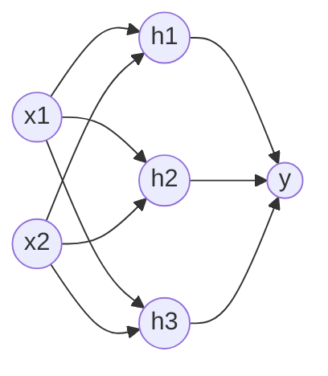

# Kernel SVMs, neural networks and uncertainty estimates

The last part of chapter 2 covers two families of models that can learn complex, nonlinear decision
boundaries: **kernelized support vector machines** and **multilayer perceptrons**. It then shows how to ask
any classifier how *sure* it is. This lesson also derives backpropagation for an MLP, which the book
leaves out.

## 1. Linear models and nonlinear features

A linear classifier can only separate classes with a hyperplane. One way to make it more flexible is to
**add features**, such as products or powers of the originals. The book's example is a 2-D dataset that no
line can separate. After adding `feature1 ** 2` as a third feature, a plane separates it. Viewed back in
the original two dimensions, the boundary is an ellipse.

```python-run
import numpy as np
from sklearn.datasets import make_circles
from sklearn.svm import LinearSVC

X, y = make_circles(n_samples=300, noise=0.08, factor=0.4, random_state=0)
print("linear model on raw 2-D features:   ", LinearSVC().fit(X, y).score(X, y))
X3 = np.column_stack([X, X[:, 0] ** 2 + X[:, 1] ** 2])        # add the squared radius
print("linear model with one extra feature:", LinearSVC().fit(X3, y).score(X3, y))
```

## 2. The kernel trick

Which features should we add? Adding all polynomials up to a high degree of a 100-dimensional input is
far too expensive. The **kernel trick** lets us learn a classifier in a higher-dimensional space **without
computing the new representation**. It only needs the dot product between pairs of points in the expanded
space, and that is given directly by a **kernel function** $k(x, x')$.

- **Polynomial kernel**: $k(x,x') = (\gamma\,x^\top x' + c)^d$ corresponds to all polynomials up to degree $d$.
- **RBF (Gaussian) kernel**: $k(x,x') = \exp(-\gamma\lVert x - x'\rVert^2)$ corresponds to an
  *infinite-dimensional* feature space. Intuitively it considers all polynomials of all degrees, with
  higher degrees mattering less.

## 3. How an SVM predicts

During training the SVM learns how important each training point is for the boundary. Typically only a
subset matters: the points lying on the border between the classes. These are the **support vectors**. To
classify a new point, the model measures its kernel similarity to each support vector:

$$f(x) = \sum_{i\in SV}\alpha_i\,y_i\,k(x_i, x) + b,\qquad \hat y = \operatorname{sign} f(x).$$

The underlying optimisation is the **soft-margin** problem: maximise the margin $2/\lVert w\rVert$ between
the classes while paying $C$ for each margin violation,

$$\min_{w,b,\xi}\ \tfrac12\lVert w\rVert^2 + C\sum_i \xi_i\quad\text{s.t.}\quad y_i(w^\top\phi(x_i)+b)\ge 1-\xi_i,\ \xi_i\ge0 .$$

```python-run
from sklearn.datasets import make_moons
from sklearn.svm import SVC
X, y = make_moons(n_samples=200, noise=0.2, random_state=0)
print(" gamma     C   train   #support vectors")
for gamma in [0.1, 1, 10, 100]:
    for C in [0.1, 100]:
        svm = SVC(kernel="rbf", gamma=gamma, C=C).fit(X, y)
        print(f"{gamma:6g} {C:5g}   {svm.score(X, y):.3f}   {svm.n_support_.sum():4d}")
```

### Tuning `gamma` and `C`

- **`gamma`** sets the width of the Gaussian kernel, i.e. what "close" means. Small gamma gives a large
  radius: many points count as close, the boundary varies slowly, and the model is simple. Large gamma makes
  each point matter only in a tiny neighbourhood, and the model becomes complex.
- **`C`** is the regularisation parameter, as in linear models. Small `C` restricts each point's influence,
  giving a nearly linear boundary that tolerates errors. Large `C` bends the boundary to classify each
  training point correctly.
- Both raise complexity when increased, and their good values are strongly correlated, so **tune them
  together** on a log-scale grid.

### Preprocessing is critical

SVMs are very sensitive to feature scale. On the breast-cancer data the book gets about 63% test accuracy
on raw features and about 97% after rescaling every feature to $[0,1]$.

```python-run
from sklearn.datasets import load_breast_cancer
from sklearn.svm import SVC
from sklearn.model_selection import train_test_split
from sklearn.preprocessing import MinMaxScaler

X, y = load_breast_cancer(return_X_y=True)
X_tr, X_te, y_tr, y_te = train_test_split(X, y, random_state=0)
raw = SVC(gamma=1 / X.shape[1]).fit(X_tr, y_tr)        # the old default gamma used in the book
print(f"unscaled: train={raw.score(X_tr, y_tr):.2f} test={raw.score(X_te, y_te):.2f}")
sc = MinMaxScaler().fit(X_tr)                           # statistics from the TRAINING set only
svm = SVC(gamma=1 / X.shape[1], C=1000).fit(sc.transform(X_tr), y_tr)
print(f"scaled, C=1000: train={svm.score(sc.transform(X_tr), y_tr):.3f} test={svm.score(sc.transform(X_te), y_te):.3f}")
```

### Strengths and weaknesses

- Powerful on a variety of datasets, with complex boundaries even from few features. They work on low- and
  high-dimensional data.
- They **don't scale well with the number of samples**: fine up to about 10,000, challenging at 100,000 or
  more, because training is roughly quadratic to cubic in $n$.
- They need **careful preprocessing and tuning**, which is why many practitioners prefer tree ensembles.
- They are hard to inspect and explain.
- Worth trying when all features have similar meaning and scale, such as pixel intensities.

## 4. Neural networks: the multilayer perceptron

An MLP generalises a linear model by computing weighted sums **repeatedly**, with a nonlinearity in
between. For one hidden layer:

$$h = g(W_1^\top x + b_1),\qquad \hat y = W_2^\top h + b_2 .$$

Without the nonlinearity $g$, the stack of linear maps collapses into a single linear map. The two classic
choices are the **rectified linear unit**, $\text{ReLU}(a)=\max(0,a)$, and **tanh**. Either lets the network
learn far more complicated functions than a linear model.



Knobs that control complexity: the **number of hidden layers**, the **number of units per layer**
(`hidden_layer_sizes`), the activation, and **L2 regularisation** (`alpha` in `MLPClassifier`, which
shrinks weights towards zero).

```python-run
from sklearn.datasets import make_moons
from sklearn.neural_network import MLPClassifier
from sklearn.model_selection import train_test_split
X, y = make_moons(n_samples=200, noise=0.25, random_state=3)
X_tr, X_te, y_tr, y_te = train_test_split(X, y, stratify=y, random_state=42)
for hidden in [(2,), (10,), (10, 10)]:
    for alpha in [0.0001, 1.0]:
        mlp = MLPClassifier(solver="lbfgs", hidden_layer_sizes=hidden, alpha=alpha, random_state=0, max_iter=2000)
        mlp.fit(X_tr, y_tr)
        print(f"hidden={str(hidden):9s} alpha={alpha:<7} train={mlp.score(X_tr, y_tr):.3f} test={mlp.score(X_te, y_te):.3f}")
```

Two more properties the book highlights:

- **Random initialisation matters.** Weights start random, so different seeds give different models,
  especially for small networks.
- **Scaling matters.** MLPs expect features with similar ranges, ideally mean 0 and variance 1. On the
  breast-cancer data, standardising takes test accuracy from mediocre to about 97%.

### Backpropagation, derived

Take a classifier with one ReLU hidden layer, softmax output and mean cross-entropy loss over $n$ samples.
In row-batch notation:

$$A_1 = XW_1 + b_1,\quad H = \max(0, A_1),\quad Z = HW_2 + b_2,\quad P = \operatorname{softmax}(Z),\quad L = -\tfrac1n\sum_i\log P_{i,y_i}.$$

Apply the chain rule from the loss backwards:

| step | gradient | why |
|---|---|---|
| 1 | $dZ = (P - Y)/n$ | softmax + cross-entropy simplify to "prediction minus one-hot truth" |
| 2 | $dW_2 = H^\top dZ$, $db_2 = \sum_i dZ_i$ | $Z$ is linear in $W_2$ and $b_2$ |
| 3 | $dH = dZ\,W_2^\top$ | push the gradient back through the linear layer |
| 4 | $dA_1 = dH\odot\mathbb 1[A_1 > 0]$ | ReLU passes the gradient only where it was active |
| 5 | $dW_1 = X^\top dA_1$, $db_1 = \sum_i dA_{1,i}$ | same rule as step 2 |

Then update each parameter with gradient descent, $\theta \leftarrow \theta - \eta\,d\theta$.

```python-run
import numpy as np
from sklearn.datasets import make_moons
X, y = make_moons(n_samples=300, noise=0.2, random_state=0)
rng = np.random.RandomState(0)
W1 = rng.randn(2, 16) * 0.5; b1 = np.zeros(16)
W2 = rng.randn(16, 2) * 0.5; b2 = np.zeros(2)
n, lr = len(y), 0.5
for epoch in range(1, 1501):
    A1 = X @ W1 + b1; H = np.maximum(0, A1); Z = H @ W2 + b2          # forward
    Z -= Z.max(1, keepdims=True); P = np.exp(Z); P /= P.sum(1, keepdims=True)
    loss = -np.log(P[np.arange(n), y]).mean()
    dZ = P.copy(); dZ[np.arange(n), y] -= 1; dZ /= n                  # backward
    dW2 = H.T @ dZ; db2 = dZ.sum(0)
    dA1 = (dZ @ W2.T) * (A1 > 0)
    dW1 = X.T @ dA1; db1 = dA1.sum(0)
    W1 -= lr * dW1; b1 -= lr * db1; W2 -= lr * dW2; b2 -= lr * db2    # update
    if epoch in (1, 100, 500, 1500):
        print(f"epoch {epoch:4d}  loss={loss:.4f}  accuracy={(P.argmax(1) == y).mean():.3f}")
```

That is a complete neural network in about 15 lines of numpy. Problems *ml-mlp-forward* and
*ml-mlp-backprop* ask you to write these two passes yourself.

### Estimating complexity and practical advice

- The most important parameters are the number of layers and the units per layer. Start with one or two
  hidden layers.
- A useful measure of complexity is the **number of weights**. With 100 features and 100 hidden units,
  there are $100\times100 = 10{,}000$ weights from input to hidden and 100 from hidden to a single output.
  A second hidden layer of 100 adds another 10,000.
- A common tuning recipe: first build a network **large enough to overfit**, to confirm the task is
  learnable, then shrink it or raise `alpha` to improve generalisation.
- Solvers in scikit-learn: `adam` is the default. It works well in most cases but is sensitive to scaling.
  `lbfgs` is robust but slow on large data. `sgd` has many extra knobs and is what deep-learning researchers
  use.
- Strengths: networks can capture information from large amounts of data and build very complex models.
  With enough compute, data and tuning they often beat other algorithms.
- Weaknesses: long training times, careful preprocessing, and many hyperparameters. They work best on
  **homogeneous** data where all features have similar meanings. For mixed tabular features, tree models
  often do better.
- scikit-learn's MLPs are for small problems. Real deep learning uses PyTorch, TensorFlow or JAX with GPUs
  (module 8).

## 5. Uncertainty estimates from classifiers

Often you need more than a label. You want to know *how certain* the model is, because in most real
applications different mistakes have different costs. scikit-learn classifiers offer two functions.

**`decision_function(X)`** returns, for binary classification, one real number per sample. The sign gives
the predicted class (positive means `classes_[1]`) and the magnitude says how strongly the model believes
it. The scale is arbitrary and depends on the model and data, so it is hard to interpret.

**`predict_proba(X)`** returns shape `(n_samples, n_classes)`. Each row sums to 1, and the class with
probability above 0.5 (in binary) is the prediction.

```python-run
import numpy as np
from sklearn.datasets import make_circles
from sklearn.ensemble import GradientBoostingClassifier
from sklearn.model_selection import train_test_split

X, y = make_circles(noise=0.25, factor=0.5, random_state=1)
X_tr, X_te, y_tr, y_te = train_test_split(X, y, random_state=0)
gb = GradientBoostingClassifier(random_state=0).fit(X_tr, y_tr)
d = gb.decision_function(X_te[:6]); p = gb.predict_proba(X_te[:6])
print("decision_function:", d.round(2))
print("predict_proba:\n", p.round(3))
print("sign(decision) == predict:", np.all((d > 0).astype(int) == gb.predict(X_te[:6])))
print("argmax(proba)  == predict:", np.all(p.argmax(1) == gb.predict(X_te[:6])))
```

For **multiclass** problems, `decision_function` has shape `(n_samples, n_classes)` with one score per
class, and `predict_proba` again sums to 1 per row. Take `argmax` across columns to recover predictions.
If the classes are strings, map the indices through `classes_`.

### Calibration

A model is **calibrated** if, among all points to which it assigns 70% probability, about 70% are actually
positive. The book warns that the reported certainty depends on the model and its parameters. An overfitted
model tends to be over-confident even when wrong, and a simple model tends to be less certain. Unpruned
trees, naive Bayes and boosted models are often poorly calibrated. Logistic regression is usually good.
`CalibratedClassifierCV` (Platt scaling or isotonic regression) fixes this after the fact.

> [!INTERVIEW]
> **"Why would you change the 0.5 threshold?"** Because costs are asymmetric. In cancer screening a missed
> tumour (a false negative) is far worse than an extra test, so you lower the threshold to raise recall.
> Use `predict_proba` or `decision_function` and pick the threshold on a validation set from the
> precision–recall or ROC curve. Never pick it on the test set.

## 6. Choosing a model: the book's cheat sheet

| model | when to use it |
|---|---|
| nearest neighbours | small datasets; a good baseline; easy to explain |
| linear models | go-to first algorithm; very large or very high-dimensional data |
| naive Bayes | classification only; even faster than linear models; large, high-dimensional data |
| decision trees | fast, no scaling, can be visualised and explained |
| random forests | nearly always better than one tree; robust and powerful; no scaling; not for high-dim sparse data |
| gradient boosted trees | often slightly more accurate than forests; slower to train, faster to predict, smaller; more tuning |
| SVMs | medium-sized data with features of similar meaning; need scaling; sensitive to parameters |
| neural networks | can build very complex models, particularly for large datasets; sensitive to scaling and parameters; slow to train |

Start with a simple model such as a linear model, naive Bayes or k-NN. Once you understand the data better,
move to something more complex.

## Summary

- Kernels let a linear method work in a huge implicit feature space. RBF SVMs are controlled by `C` and
  `gamma`, and they need scaled inputs.
- MLPs stack linear layers with nonlinearities. Backprop is the chain rule: $dZ=(P-Y)/n$, then
  $H^\top dZ$, mask, and $X^\top dA_1$.
- `decision_function` and `predict_proba` expose confidence. Probabilities are not automatically calibrated.
- Pick thresholds according to the costs of the two kinds of error.

```quiz
[
  {"q": "What does the kernel trick avoid?", "options": ["Explicitly computing the high-dimensional feature representation", "Choosing a regularisation parameter", "Storing any training points", "Scaling the data"], "answer": 0,
   "explain": "Kernels compute dot products in the expanded space directly from the original points."},
  {"q": "In an RBF SVM, a very large gamma tends to…", "options": ["overfit: each point only influences a tiny neighbourhood", "underfit: the boundary becomes linear", "remove all support vectors", "make C irrelevant"], "answer": 0,
   "explain": "Large gamma = narrow Gaussian = very local, wiggly decision boundaries."},
  {"q": "Why does an MLP need a nonlinear activation function?", "options": ["Otherwise stacked linear layers collapse to a single linear model", "To make the loss convex", "To speed up matrix multiplication", "To normalise the inputs"], "answer": 0,
   "explain": "A composition of linear maps is linear; the nonlinearity is what adds expressive power."},
  {"q": "For softmax + cross-entropy, the gradient of the loss w.r.t. the logits Z is…", "options": ["(P − Y_onehot) / n", "P(1 − P)", "−log P", "Y / P"], "answer": 0,
   "explain": "The Jacobian of softmax and the derivative of −log combine into prediction minus truth."},
  {"q": "An MLP with 100 input features, one hidden layer of 100 units and one output has roughly how many weights (ignoring biases)?", "options": ["10,100", "200", "1,000,000", "100"], "answer": 0,
   "explain": "100×100 between input and hidden plus 100×1 from hidden to output."},
  {"q": "For a binary classifier, decision_function(X) returns…", "options": ["one real-valued score per sample; its sign gives the class", "two probabilities per sample", "class labels", "the support vectors"], "answer": 0,
   "explain": "Positive values indicate classes_[1]; the scale is model-dependent."},
  {"q": "A classifier is well calibrated when…", "options": ["among samples given probability 0.7, about 70% are truly positive", "its accuracy is above 70%", "all predicted probabilities are near 0 or 1", "decision_function is always positive"], "answer": 0,
   "explain": "Calibration is about predicted probabilities matching observed frequencies."},
  {"q": "Which models are most sensitive to feature scaling?", "options": ["SVMs and neural networks", "Decision trees and random forests", "Naive Bayes with counts", "Gradient boosted trees"], "answer": 0,
   "explain": "Distance/kernel computations and gradient-based training depend on feature scales; tree splits do not."}
]
```

> **Source:** Müller & Guido, *Introduction to Machine Learning with Python*, ch. 2 ("Kernelized Support Vector Machines", "Neural Networks (Deep Learning)", "Uncertainty Estimates from Classifiers", "Summary and Outlook"); scikit-learn User Guide, "Support Vector Machines", "Neural network models (supervised)", "Probability calibration".
