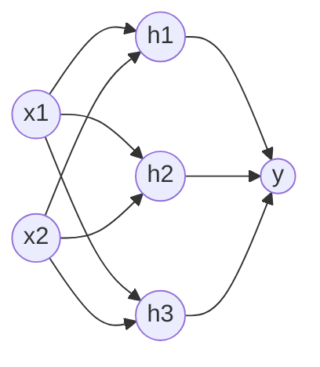

# Kernel SVMs, neural networks and uncertainty estimates

> **Before this lesson:** you need linear classifiers, the decision boundary, the regularisation setting `C`, the sigmoid and softmax from [Linear models](#/lesson/ml/linear-models). The backpropagation section uses matrix products from [Linear algebra for ML](#/lesson/ml/linear-algebra) and the chain rule from [Calculus, gradients and gradient descent](#/lesson/ml/calculus-optimization). Overfitting and complexity come from [Generalisation, overfitting and k-NN](#/lesson/ml/generalization-knn).

## In plain words

A linear classifier separates two classes with a straight line (or a flat surface). Many real problems cannot be divided that way: imagine red dots clustered in the middle of a page with blue dots in a ring around them. No straight cut puts the reds on one side. This lesson presents two families of models that can draw curved boundaries, and then a question that applies to every classifier: how sure is it?

- A **support vector machine** with a **kernel** judges a new point by how similar it is to a handful of key training points near the border between the classes. Think of identifying which country you are in by checking which border posts you are closest to.
- A **neural network** stacks several layers of small linear models with a bend in between each. Each layer re-describes the data a little more usefully for the next, like an assembly line where each station does one small job.
- An **uncertainty estimate** is the model's own statement of confidence, the difference between a doctor saying "definitely benign" and "probably benign, let's run another test".

Why this matters for a job: neural networks are the basis of all modern deep learning, and writing backpropagation for a small network is a classic interview exercise. Knowing when to distrust a model's confidence, and how to act on it, is what separates a usable system from a demo.

## 1. Linear models and nonlinear features

A linear classifier computes a weighted sum of the features and checks its sign, so its decision boundary is always flat. One way to give it more power is to hand it **extra features computed from the original ones**, such as squares or products.

Take the ring example. Each point has two features, its horizontal and vertical position $(x_1, x_2)$. Add a third feature, the squared distance from the centre, $x_1^2 + x_2^2$. Inner points have a small value and outer points a large one, so a single threshold on the new feature separates the classes. The classifier is still linear in the *three* features, but seen in the original two dimensions its boundary is a circle.

```python-run
import numpy as np
from sklearn.datasets import make_circles
from sklearn.svm import LinearSVC

X, y = make_circles(n_samples=300, noise=0.08, factor=0.4, random_state=0)
print("linear model on raw 2-D features:   ", LinearSVC().fit(X, y).score(X, y))
X3 = np.column_stack([X, X[:, 0] ** 2 + X[:, 1] ** 2])        # add the squared radius
print("linear model with one extra feature:", LinearSVC().fit(X3, y).score(X3, y))
```

`make_circles` generates the ring data: 300 points, half in a small inner circle and half in a larger outer one. `LinearSVC` is a linear classifier (the linear support vector machine from the previous lesson). On the two raw features it scores about 0.50, no better than a coin toss. `np.column_stack` appends the squared-radius column, and the same classifier now scores 1.0.

## 2. The kernel trick

The difficulty is knowing which features to add. You could add every product of up to, say, ten original features, but for data with 100 features that is an astronomically large table.

The **kernel trick** is a mathematical shortcut that gets the benefit without the cost. It turns out that training this kind of classifier does not need the expanded features themselves. It only ever needs the dot product between pairs of samples in the expanded space (recall that a dot product measures how alike two vectors are). For certain expansions, that dot product can be computed directly from the original features by a short formula called a **kernel function**, written $k(x, x')$, where $x$ and $x'$ are two samples. So the model behaves as if it worked in a huge feature space while only ever computing a similarity between pairs of points.

Two kernels are common:

- **Polynomial kernel**: $k(x,x') = (\gamma\,x^\top x' + c)^d$. It corresponds to adding all products of the original features up to degree $d$ (with $d = 2$: all squares and pairwise products). $\gamma$ (gamma) and $c$ are settings.
- **RBF kernel** (radial basis function, also called the Gaussian kernel): $k(x,x') = \exp(-\gamma\lVert x - x'\rVert^2)$. In words: take the squared distance between the two points, multiply by $-\gamma$, and exponentiate. Two identical points give $e^0 = 1$, and the value falls towards 0 as the points move apart. With $\gamma = 1$, points at distance 1 have similarity $e^{-1} = 0.37$ and points at distance 3 have $e^{-9} = 0.0001$. The RBF kernel corresponds to an expansion with infinitely many features, which could never be written out explicitly.

## 3. How a kernel SVM predicts

A **support vector machine** (SVM) looks for the boundary that leaves the widest possible gap between the classes. The width of that gap is the **margin**. A wide margin is a form of caution: the boundary stays as far as it can from the training points of both classes.

Only the training points on the edge of the gap, the ones nearest the other class, determine where the boundary goes. These are the **support vectors**. Points deep inside their own class could be deleted without changing anything. To classify a new point $x$, the model measures its kernel similarity to each support vector and adds up the results:

$$f(x) = \sum_{i\in SV}\alpha_i\,y_i\,k(x_i, x) + b,\qquad \hat y = \operatorname{sign} f(x).$$

Reading it: the sum runs over the support vectors $x_i$. Each has a label $y_i$ written as $+1$ or $-1$ and an importance $\alpha_i$ learned in training. $k(x_i, x)$ is the similarity between that support vector and the new point, and $b$ is a constant. Support vectors of the positive class push the total up, those of the negative class push it down, and nearby ones count most. The prediction is the sign of the total.

Real data is noisy, so a perfect gap rarely exists. The **soft-margin** SVM allows some points to sit inside the gap or on the wrong side, at a price of $C$ per unit of violation:

$$\min_{w,b,\xi}\ \tfrac12\lVert w\rVert^2 + C\sum_i \xi_i\quad\text{s.t.}\quad y_i(w^\top\phi(x_i)+b)\ge 1-\xi_i,\ \xi_i\ge0 .$$

Here $\phi(x_i)$ ("phi") is the sample in the expanded feature space, $w$ and $b$ define the boundary there, and $\xi_i$ ("xi") is how far sample $i$ falls short of the margin, zero for a well-placed point. "s.t." means "subject to": the conditions that must hold. The margin equals $2/\lVert w\rVert$, so making $\lVert w\rVert$ small makes the margin wide. The two terms trade a wide margin against few violations, and $C$ sets the exchange rate.

```python-run
from sklearn.datasets import make_moons
from sklearn.svm import SVC
X, y = make_moons(n_samples=200, noise=0.2, random_state=0)
print(" gamma     C   train   #support vectors")
for gamma in [0.1, 1, 10, 100]:
    for C in [0.1, 100]:
        svm = SVC(kernel="rbf", gamma=gamma, C=C).fit(X, y)
        print(f"{gamma:6g} {C:5g}   {svm.score(X, y):.3f}   {svm.n_support_.sum():4d}")
```

`SVC` is scikit-learn's kernel SVM classifier. The loops fit it on the two-crescents data with four values of `gamma` and two of `C`, printing the accuracy on the training data and the number of support vectors (`n_support_` holds the count per class). With `gamma=0.1` and `C=0.1` the model is very smooth: 0.815 accuracy, and 150 of the 200 points are support vectors because the margin is wide and loose. With `gamma=100` and `C=100` the training accuracy is a perfect 1.000 and 179 points are support vectors, because the boundary is wrapped tightly around individual points. That is memorisation, and such a model would do badly on new data.

### Tuning `gamma` and `C`

- **`gamma`** sets how far the influence of one training point reaches. A small gamma means a wide reach: many points count as "close", the boundary bends slowly, and the model is simple. A large gamma means each point matters only in its immediate surroundings, and the model becomes complex.
- **`C`** is the regularisation setting, as in linear models. A small `C` makes violations cheap, so the model accepts some training errors in exchange for a smooth boundary. A large `C` makes them expensive, so the boundary bends to get every training point right.
- Raising either one makes the model more complex, and the best value of one depends on the other, so **tune them together**, trying powers of ten for both.

### Preprocessing is critical

Kernels are computed from distances between points, so a feature with large numbers dominates. SVMs are therefore very sensitive to the scale of the features.

```python-run
from sklearn.datasets import load_breast_cancer
from sklearn.svm import SVC
from sklearn.model_selection import train_test_split
from sklearn.preprocessing import MinMaxScaler

X, y = load_breast_cancer(return_X_y=True)
X_tr, X_te, y_tr, y_te = train_test_split(X, y, random_state=0)
raw = SVC(gamma=1 / X.shape[1]).fit(X_tr, y_tr)        # the old default gamma used in the book
print(f"unscaled: train={raw.score(X_tr, y_tr):.2f} test={raw.score(X_te, y_te):.2f}")
sc = MinMaxScaler().fit(X_tr)                           # statistics from the TRAINING set only
svm = SVC(gamma=1 / X.shape[1], C=1000).fit(sc.transform(X_tr), y_tr)
print(f"scaled, C=1000: train={svm.score(sc.transform(X_tr), y_tr):.3f} test={svm.score(sc.transform(X_te), y_te):.3f}")
```

On the raw tumour measurements the SVM scores 1.00 on the training data and 0.63 on the test data: it has memorised the training set and learned nothing general, because a few features with huge values make every pair of points look far apart. `MinMaxScaler` rescales each feature to run from 0 to 1. It learns the minimum and maximum from the training data only (`fit(X_tr)`), and the same rescaling is applied to both sets with `transform`. After scaling, and with a larger `C`, the test accuracy is 0.972.

### Strengths and weaknesses

- Powerful on many kinds of data, and able to build complex boundaries from only a few features.
- They **do not scale well with the number of samples**. Up to about 10,000 samples they are comfortable; at 100,000 or more, training time and memory become a serious problem, because the work grows roughly with the square or cube of the number of samples.
- They need **careful preprocessing and tuning**, which is one reason many practitioners reach for tree ensembles first.
- They are hard to inspect: it is difficult to say why a particular prediction was made.
- Worth trying when all features measure the same kind of thing on similar scales, such as the brightness of pixels.

## 4. Neural networks: the multilayer perceptron

The **multilayer perceptron** (MLP) is the basic neural network. It extends a linear model by computing weighted sums **more than once**. The inputs are combined into several intermediate numbers, and those are combined again to give the output. The intermediate numbers form a **hidden layer** (hidden because they are neither inputs nor outputs), and each one is called a **unit** or neuron.

For one hidden layer:

$$h = g(W_1^\top x + b_1),\qquad \hat y = W_2^\top h + b_2 .$$

In words: multiply the input vector $x$ by a matrix of weights $W_1$ and add a constant vector $b_1$, which gives one weighted sum per hidden unit. Apply a function $g$ to each of them to get the hidden values $h$. Then take a weighted sum of the hidden values (weights $W_2$, constant $b_2$) to get the prediction.

The function $g$ is the **activation function**, and it is essential. Without it, a weighted sum of weighted sums is one bigger weighted sum, so the whole network would collapse into a linear model. The activation puts a bend into each unit, and bends are what let the network represent curves. The two classic choices are the **rectified linear unit**, $\text{ReLU}(a)=\max(0,a)$, which keeps positive values and replaces negative ones with zero, and **tanh**, an S-shaped curve from −1 to 1.

A tiny example with two inputs and two hidden ReLU units: for the input $x = (1, 2)$, suppose the first unit computes $1\times1 + (-1)\times2 = -1$, which ReLU turns into 0, and the second computes $0.5\times1 + 0.5\times2 = 1.5$, which stays 1.5. If the output weights are 2 and 4, the prediction is $2\times0 + 4\times1.5 = 6$.



The diagram shows two inputs, three hidden units and one output. Every arrow carries one weight; the network's parameters are all of those weights plus the constants.

The settings that control complexity are the **number of hidden layers**, the **number of units in each** (`hidden_layer_sizes`), the activation function, and the strength of **L2 regularisation** (called `alpha` in `MLPClassifier`; it penalises large weights, as ridge does).

```python-run
from sklearn.datasets import make_moons
from sklearn.neural_network import MLPClassifier
from sklearn.model_selection import train_test_split
X, y = make_moons(n_samples=200, noise=0.25, random_state=3)
X_tr, X_te, y_tr, y_te = train_test_split(X, y, stratify=y, random_state=42)
for hidden in [(2,), (10,), (10, 10)]:
    for alpha in [0.0001, 1.0]:
        mlp = MLPClassifier(solver="lbfgs", hidden_layer_sizes=hidden, alpha=alpha, random_state=0, max_iter=2000)
        mlp.fit(X_tr, y_tr)
        print(f"hidden={str(hidden):9s} alpha={alpha:<7} train={mlp.score(X_tr, y_tr):.3f} test={mlp.score(X_te, y_te):.3f}")
```

`hidden_layer_sizes=(2,)` means one hidden layer of 2 units; `(10, 10)` means two hidden layers of 10 units each. `solver="lbfgs"` picks the optimisation method, and `max_iter` caps the number of rounds. With only 2 hidden units the network is too limited for the crescents (test accuracy about 0.88 to 0.90). With 10 units it reaches 0.96. The best test score here, 0.98, comes from two layers with strong regularisation (`alpha=1.0`): plenty of capacity, held in check.

Two more properties of neural networks to keep in mind:

- **The starting point matters.** The weights begin as random numbers and training adjusts them from there, so a different `random_state` gives a different final model, especially for small networks.
- **Scaling matters.** MLPs expect all features to have similar ranges, ideally mean 0 and variance 1. On the tumour data, standardising the features lifts test accuracy from mediocre to about 0.97.

### Backpropagation, derived

How are the weights found? By gradient descent: compute the slope of the loss with respect to every weight, and nudge each weight downhill. Computing all those slopes efficiently is **backpropagation**, the chain rule applied layer by layer from the output back to the input.

Take a classifier with one ReLU hidden layer and a softmax output, trained with cross-entropy averaged over $n$ samples. Stack the samples as the rows of a matrix $X$, so that every row is processed at once. The forward pass, step by step:

$$A_1 = XW_1 + b_1,\quad H = \max(0, A_1),\quad Z = HW_2 + b_2,\quad P = \operatorname{softmax}(Z),\quad L = -\tfrac1n\sum_i\log P_{i,y_i}.$$

$A_1$ holds the weighted sums of the hidden layer and $H$ their values after ReLU. $Z$ holds the output scores (the **logits**), one column per class. $P$ holds the predicted probabilities, each row adding to 1. $P_{i,y_i}$ is the probability sample $i$ gives to its true class $y_i$, and the loss $L$ is the average of minus its logarithm.

Now go backwards. Write $dZ$ for "the slope of the loss with respect to $Z$", and so on. $Y$ is the matrix of true labels in **one-hot** form: each row has a 1 in the column of the true class and 0 elsewhere.

| step | gradient | why |
|---|---|---|
| 1 | $dZ = (P - Y)/n$ | softmax followed by cross-entropy simplifies to "predicted probabilities minus the truth" |
| 2 | $dW_2 = H^\top dZ$, $db_2 = \sum_i dZ_i$ | $Z$ is a weighted sum of $H$, so each weight's slope is its input times the slope of its output |
| 3 | $dH = dZ\,W_2^\top$ | pass the slope back through the weights to the hidden values |
| 4 | $dA_1 = dH\odot\mathbb 1[A_1 > 0]$ | ReLU lets the slope through where the unit was positive and blocks it elsewhere ($\odot$ is entry-by-entry multiplication, $\mathbb 1[\cdot]$ is 1 where the condition holds and 0 otherwise) |
| 5 | $dW_1 = X^\top dA_1$, $db_1 = \sum_i dA_{1,i}$ | the same rule as step 2, one layer down |

Then every parameter is updated by gradient descent, $\theta \leftarrow \theta - \eta\,d\theta$, where $\eta$ is the learning rate.

```python-run
import numpy as np
from sklearn.datasets import make_moons
X, y = make_moons(n_samples=300, noise=0.2, random_state=0)
rng = np.random.RandomState(0)
W1 = rng.randn(2, 16) * 0.5; b1 = np.zeros(16)
W2 = rng.randn(16, 2) * 0.5; b2 = np.zeros(2)
n, lr = len(y), 0.5
for epoch in range(1, 1501):
    A1 = X @ W1 + b1; H = np.maximum(0, A1); Z = H @ W2 + b2          # forward
    Z -= Z.max(1, keepdims=True); P = np.exp(Z); P /= P.sum(1, keepdims=True)
    loss = -np.log(P[np.arange(n), y]).mean()
    dZ = P.copy(); dZ[np.arange(n), y] -= 1; dZ /= n                  # backward
    dW2 = H.T @ dZ; db2 = dZ.sum(0)
    dA1 = (dZ @ W2.T) * (A1 > 0)
    dW1 = X.T @ dA1; db1 = dA1.sum(0)
    W1 -= lr * dW1; b1 -= lr * db1; W2 -= lr * dW2; b2 -= lr * db2    # update
    if epoch in (1, 100, 500, 1500):
        print(f"epoch {epoch:4d}  loss={loss:.4f}  accuracy={(P.argmax(1) == y).mean():.3f}")
```

**Reading this code line by line**

- `W1` is a 2 × 16 matrix of small random numbers (2 inputs, 16 hidden units) and `W2` is 16 × 2 (16 hidden units, 2 classes). The constants start at zero. `lr = 0.5` is the learning rate.
- Each pass of the loop is one **epoch**, one run through all the data.
- The first line inside the loop is the forward pass up to the logits. `np.maximum(0, A1)` is ReLU.
- The second line is the softmax, written safely: subtracting each row's largest value first (`Z.max(1, keepdims=True)`) prevents overflow in `np.exp` and does not change the result. Dividing by the row sums makes each row add to 1.
- `P[np.arange(n), y]` picks, from each row, the probability of that row's true class. The loss is the average of minus its log.
- `dZ = P.copy(); dZ[np.arange(n), y] -= 1; dZ /= n` is step 1: subtracting 1 at the true class's position is the same as subtracting the one-hot matrix $Y$.
- The next three lines are steps 2 to 5. `(A1 > 0)` is the ReLU mask.
- The update line moves every parameter against its gradient.

The loss falls from 0.98 to 0.05 and the accuracy rises from 0.40 to 0.98. That is a complete neural network, with training, in about fifteen lines of NumPy. The problems *ml-mlp-forward* and *ml-mlp-backprop* ask you to write the two passes yourself.

### Estimating complexity and practical advice

- The settings that matter most are the number of layers and the units per layer. Start with one or two hidden layers.
- A useful measure of complexity is the **number of weights**. With 100 features and 100 hidden units there are $100\times100 = 10{,}000$ weights from the input to the hidden layer and 100 from the hidden layer to a single output. A second hidden layer of 100 units adds another 10,000.
- A common tuning recipe: first build a network **large enough to overfit**, which confirms that the task can be learned at all. Then shrink it or raise `alpha` until it generalises.
- Solvers in scikit-learn: `adam` (the default) works well in most cases but is sensitive to the scale of the data. `lbfgs` is robust but slow on large datasets. `sgd` is plain stochastic gradient descent with many extra settings.
- Strengths: given enough data, computing power and tuning, neural networks can build very complex models and often beat every other method, above all on images, sound and text.
- Weaknesses: long training times, fussy preprocessing and many settings. They work best when all the features are of the same kind. For tables of mixed features, tree ensembles are often better and much less work.
- scikit-learn's MLPs are for small problems. Real deep learning uses libraries such as PyTorch running on graphics processors (module 8).

## 5. Uncertainty estimates from classifiers

Often you need more than a label. You want to know *how certain* the model is, because different mistakes have different costs: telling a healthy patient to take another test is an inconvenience, and telling a sick one they are fine can be fatal. scikit-learn classifiers offer two methods for this.

**`decision_function(X)`** returns, for two-class problems, one number per sample: the model's raw score. Its sign gives the predicted class (positive means the second class listed in `classes_`), and its size says how strongly the model leans that way. The units are arbitrary and differ between models, so the numbers are hard to interpret on their own.

**`predict_proba(X)`** returns a table with one row per sample and one column per class. Each row adds up to 1, and the entries are meant to be read as probabilities. With two classes, the class whose probability exceeds 0.5 is the prediction.

```python-run
import numpy as np
from sklearn.datasets import make_circles
from sklearn.ensemble import GradientBoostingClassifier
from sklearn.model_selection import train_test_split

X, y = make_circles(noise=0.25, factor=0.5, random_state=1)
X_tr, X_te, y_tr, y_te = train_test_split(X, y, random_state=0)
gb = GradientBoostingClassifier(random_state=0).fit(X_tr, y_tr)
d = gb.decision_function(X_te[:6]); p = gb.predict_proba(X_te[:6])
print("decision_function:", d.round(2))
print("predict_proba:\n", p.round(3))
print("sign(decision) == predict:", np.all((d > 0).astype(int) == gb.predict(X_te[:6])))
print("argmax(proba)  == predict:", np.all(p.argmax(1) == gb.predict(X_te[:6])))
```

A gradient-boosting classifier is fitted to noisy ring data, and both methods are called on the first six test points. The scores are 4.14, −1.70, −3.95 and so on: positive for class 1, negative for class 0. The matching probability rows read 0.984 for class 1, then 0.846 for class 0, and so on. A score of −1.70 corresponds to a less confident prediction (0.846) than a score of −3.95 (0.981). The last two lines confirm that both methods agree with `predict`: the sign of the score, and the column with the largest probability (`argmax`), each give the predicted class.

With **more than two classes**, `decision_function` returns one score per class for every sample, and `predict_proba` again gives rows that add to 1. Take the `argmax` across the columns to recover the prediction. If the classes are text labels, look the column number up in `classes_`.

### Calibration

Can the probabilities be taken at face value? A model is **calibrated** if, among all the samples to which it gives a probability of 70%, about 70% really are positive. Many models are not. The reported confidence depends on the model and its settings: an overfitted model tends to be too sure of itself even when wrong, and a heavily restricted model tends to hedge. Unpruned trees, naive Bayes and boosted trees are often poorly calibrated; logistic regression is usually good, because it is trained directly on the probabilities. `CalibratedClassifierCV` corrects the probabilities after training by learning a mapping from the model's scores to observed frequencies (the two methods are called Platt scaling and isotonic regression).

> [!INTERVIEW]
> **"Why would you change the 0.5 threshold?"** Because the two kinds of error rarely cost the same. In cancer screening a missed tumour (a **false negative**) is far worse than an unnecessary follow-up test, so you lower the threshold: flag anyone with a probability above, say, 0.1. That catches more of the real cases at the cost of more false alarms. Take the scores from `predict_proba` or `decision_function` and choose the threshold on validation data using the precision-recall or ROC curve (lesson 52). Never choose it on the test set.

## 6. Choosing a model: a cheat sheet

| model | when to use it |
|---|---|
| nearest neighbours | small datasets; a good baseline; easy to explain |
| linear models | the standard first choice; very large datasets or very many features |
| naive Bayes | classification only; even faster than linear models; huge datasets with many features |
| decision trees | fast, no scaling needed, can be drawn and explained |
| random forests | nearly always better than a single tree; robust and powerful; no scaling; not for huge sparse feature sets |
| gradient boosted trees | often a little more accurate than forests; slower to train, faster to predict, smaller in memory; more tuning |
| SVMs | medium-sized datasets whose features are all of the same kind; need scaling; sensitive to settings |
| neural networks | very complex models, particularly for large datasets; sensitive to scaling and settings; slow to train |

Begin with something modest, such as a linear model, naive Bayes or nearest neighbours. Once you understand the data better, move to a more complex model if the extra accuracy is worth the extra effort.

## Summary

- Kernels let a linear method work in a huge feature space that is never built explicitly. RBF SVMs are controlled by `C` and `gamma`, and they need scaled inputs.
- MLPs stack weighted sums with activation functions in between. Backpropagation is the chain rule: $dZ=(P-Y)/n$, then $H^\top dZ$, the ReLU mask, and $X^\top dA_1$.
- `decision_function` and `predict_proba` expose a model's confidence. The probabilities are not automatically calibrated.
- Choose the decision threshold according to the costs of the two kinds of error.

## Glossary

- **Kernel function**: a formula giving the similarity of two samples, equal to their dot product in an expanded feature space.
- **Kernel trick**: training in that expanded space using only kernel values, never the expanded features.
- **RBF (Gaussian) kernel**: a kernel that is 1 for identical points and decays with distance.
- **Support vector machine (SVM)**: a classifier that seeks the boundary with the widest margin.
- **Margin**: the width of the gap between the boundary and the nearest training points.
- **Support vectors**: the training points that lie on or inside the margin and determine the boundary.
- **`gamma`**: how far a single training point's influence reaches in an RBF kernel (large = short reach).
- **Multilayer perceptron (MLP)**: a neural network of fully connected layers.
- **Hidden layer / unit**: a layer of intermediate values between input and output / one of those values.
- **Activation function**: the bend applied to each unit's weighted sum, such as ReLU or tanh.
- **ReLU**: the activation $\max(0, a)$.
- **Logits**: the raw scores before softmax.
- **One-hot**: a vector with a 1 at the position of the true class and 0 elsewhere.
- **Backpropagation**: computing all gradients of a network by the chain rule, from the loss backwards.
- **Epoch**: one pass over the whole training set.
- **`decision_function` / `predict_proba`**: a model's raw score / its predicted class probabilities.
- **Calibration**: the property that predicted probabilities match observed frequencies.
- **Threshold**: the cut-off on a score above which the positive class is predicted.

## Check yourself

```quiz
[
  {"q": "What does the kernel trick avoid?", "options": ["Explicitly computing the high-dimensional feature representation", "Choosing a regularisation parameter", "Storing any training points", "Scaling the data"], "answer": 0,
   "explain": "Kernels compute dot products in the expanded space directly from the original points."},
  {"q": "In an RBF SVM, a very large gamma tends to…", "options": ["overfit: each point only influences a tiny neighbourhood", "underfit: the boundary becomes linear", "remove all support vectors", "make C irrelevant"], "answer": 0,
   "explain": "Large gamma = narrow Gaussian = very local, wiggly decision boundaries."},
  {"q": "Why does an MLP need a nonlinear activation function?", "options": ["Otherwise stacked linear layers collapse to a single linear model", "To make the loss convex", "To speed up matrix multiplication", "To normalise the inputs"], "answer": 0,
   "explain": "A composition of linear maps is linear; the nonlinearity is what adds expressive power."},
  {"q": "For softmax + cross-entropy, the gradient of the loss w.r.t. the logits Z is…", "options": ["(P − Y_onehot) / n", "P(1 − P)", "−log P", "Y / P"], "answer": 0,
   "explain": "The Jacobian of softmax and the derivative of −log combine into prediction minus truth."},
  {"q": "An MLP with 100 input features, one hidden layer of 100 units and one output has roughly how many weights (ignoring biases)?", "options": ["10,100", "200", "1,000,000", "100"], "answer": 0,
   "explain": "100×100 between input and hidden plus 100×1 from hidden to output."},
  {"q": "For a binary classifier, decision_function(X) returns…", "options": ["one real-valued score per sample; its sign gives the class", "two probabilities per sample", "class labels", "the support vectors"], "answer": 0,
   "explain": "Positive values indicate classes_[1]; the scale is model-dependent."},
  {"q": "A classifier is well calibrated when…", "options": ["among samples given probability 0.7, about 70% are truly positive", "its accuracy is above 70%", "all predicted probabilities are near 0 or 1", "decision_function is always positive"], "answer": 0,
   "explain": "Calibration is about predicted probabilities matching observed frequencies."},
  {"q": "Which models are most sensitive to feature scaling?", "options": ["SVMs and neural networks", "Decision trees and random forests", "Naive Bayes with counts", "Gradient boosted trees"], "answer": 0,
   "explain": "Distance/kernel computations and gradient-based training depend on feature scales; tree splits do not."}
]
```

> **Source:** Müller & Guido, *Introduction to Machine Learning with Python*, ch. 2 ("Kernelized Support Vector Machines", "Neural Networks (Deep Learning)", "Uncertainty Estimates from Classifiers", "Summary and Outlook"); scikit-learn User Guide, "Support Vector Machines", "Neural network models (supervised)", "Probability calibration".
