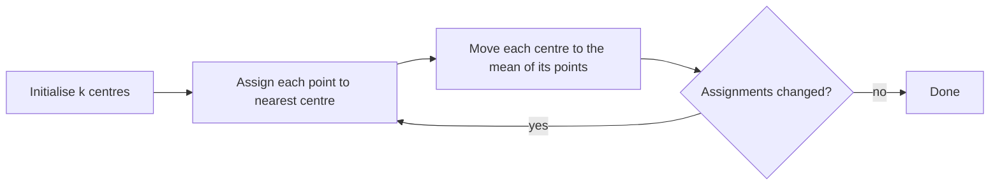
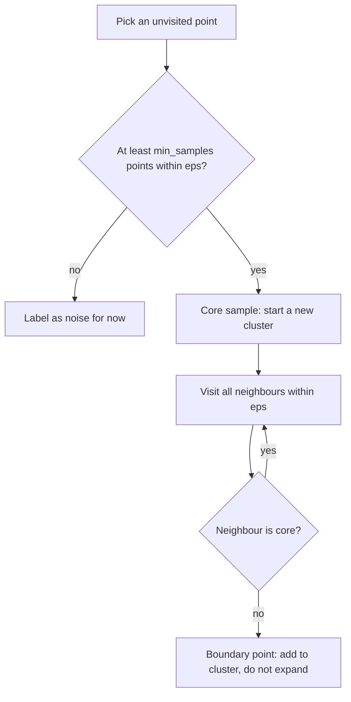

# Clustering: k-means, agglomerative clustering and DBSCAN

**Clustering** partitions a dataset into groups, called clusters, so that points in one cluster are very
similar and points in different clusters are different. Like a classifier, a clustering algorithm assigns
a number to each point. Unlike a classifier, the numbers have no predefined meaning. This lesson covers
the three algorithms from chapter 3 of Müller & Guido and how to evaluate their output.

## 1. k-means

k-means is one of the simplest and most widely used clustering algorithms. It looks for **cluster
centres** that are representative of regions of the data, by alternating two steps:

1. **Assign** each data point to the closest cluster centre.
2. **Update** each centre to the mean of the points assigned to it.

It stops when the assignments no longer change. The first centres are chosen from the data (randomly, or
with the smarter k-means++ scheme below).



The objective being minimised is the **inertia**, the within-cluster sum of squares:

$$J = \sum_{i=1}^n \lVert x_i - \mu_{c(i)}\rVert^2 .$$

Each step can only lower $J$. The assignment step picks the nearest centre, and the mean is the point that
minimises summed squared distance. So the algorithm always converges, but only to a **local** minimum.

```python-run
import numpy as np
from sklearn.datasets import make_blobs
X, _ = make_blobs(n_samples=150, centers=3, cluster_std=0.8, random_state=1)

rng = np.random.RandomState(0)
centres = X[rng.choice(len(X), 3, replace=False)]            # initialise from data points
for it in range(1, 20):
    d2 = ((X[:, None, :] - centres[None, :, :]) ** 2).sum(axis=2)      # (n, k) squared distances
    labels = d2.argmin(axis=1)                                         # assignment step
    inertia = d2[np.arange(len(X)), labels].sum()
    new = np.array([X[labels == j].mean(axis=0) for j in range(3)])    # update step
    print(f"iteration {it}: inertia = {inertia:.1f}")
    if np.allclose(new, centres):
        break
    centres = new
print("final centres:\n", centres.round(2))
```

With scikit-learn:

```python-run
from sklearn.cluster import KMeans
from sklearn.datasets import make_blobs
import numpy as np
X, _ = make_blobs(n_samples=150, centers=3, cluster_std=0.8, random_state=1)
km = KMeans(n_clusters=3, n_init=10, random_state=0).fit(X)
print("labels_ (first 15):", km.labels_[:15])
print("cluster sizes:", np.bincount(km.labels_))
print("cluster_centers_:\n", km.cluster_centers_.round(2))
print("inertia_:", round(km.inertia_, 1))
print("predict for new points:", km.predict([[0, 0], [-10, -3]]))
```

`labels_` holds the cluster of each training point, and `predict` assigns new points to the closest
centre without changing the model. The labels themselves are arbitrary. Running again with another seed
may number the same clusters differently.

### Failure cases

Even if you know the "right" number of clusters, k-means may not recover them. Each cluster is defined
only by its centre, so every cluster is a **convex** shape, and the boundary between two clusters lies
exactly halfway between their centres. As a result:

- it assumes all clusters have roughly the **same diameter**. A dense cluster next to a wide one is split
  badly;
- it assumes all **directions matter equally**, so stretched (non-spherical) clusters are cut up;
- it cannot find complex shapes such as the `two_moons` crescents.

```python-run
from sklearn.cluster import KMeans
from sklearn.datasets import make_moons
from sklearn.metrics import adjusted_rand_score
X, y = make_moons(n_samples=200, noise=0.05, random_state=0)
labels = KMeans(n_clusters=2, n_init=10, random_state=0).fit_predict(X)
print("k-means on two moons, ARI vs true halves:", round(adjusted_rand_score(y, labels), 2), "(1.0 would be perfect)")
```

### k-means as vector quantisation

The book draws a parallel between k-means and decomposition methods such as PCA and NMF. Those express a
point as a *sum* of components. k-means expresses each point with a *single* component, its cluster
centre. This view is called **vector quantisation**. An interesting consequence is that you can use *more*
clusters than input dimensions. With 10 clusters on the 2-D two-moons data, the distances to the 10
centres (`kmeans.transform(X)`) form a 10-dimensional representation in which a linear model can separate
the moons.

### Practical notes

- **Initialisation**: scikit-learn uses **k-means++**. It picks the first centre at random and each later
  one with probability proportional to its squared distance from the nearest centre already chosen. It
  also runs the algorithm `n_init` times and keeps the lowest inertia.
- **Choosing $k$**: you must specify it. Useful heuristics are the "elbow" of inertia against $k$ and the
  silhouette score (below). Domain knowledge beats both.
- **Scale your features**, because distances drive everything.
- It is fast and scales to large data. `MiniBatchKMeans` handles very large datasets.
- Drawbacks: random initialisation, restrictive assumptions about cluster shape, and the need to specify
  $k$.

```python-run
from sklearn.cluster import KMeans
from sklearn.datasets import make_blobs
from sklearn.metrics import silhouette_score
X, _ = make_blobs(n_samples=300, centers=4, cluster_std=0.9, random_state=3)
print(" k   inertia   silhouette")
for k in range(2, 8):
    km = KMeans(n_clusters=k, n_init=10, random_state=0).fit(X)
    print(f"{k:2d}  {km.inertia_:8.1f}   {silhouette_score(X, km.labels_):.3f}")
```

Inertia always falls as $k$ grows, so you can't simply minimise it. Look for the elbow, where the drop
flattens, or for the silhouette peak.

## 2. Agglomerative clustering

Agglomerative clustering is a family of algorithms built on one idea. Start with **each point as its own
cluster**, then repeatedly **merge the two most similar clusters** until a stopping criterion is met. In
scikit-learn the criterion is the number of clusters. The **linkage** defines "most similar":

| linkage | merges the two clusters that… |
|---|---|
| `ward` (default) | give the smallest increase in within-cluster variance; tends to give equally sized clusters |
| `average` | have the smallest average distance between all their points |
| `complete` | have the smallest *maximum* distance between their points |
| `single` | have the smallest *minimum* distance; can follow chains and odd shapes, but is sensitive to noise |

Ward works on most datasets. If clusters have very different sizes, `average` or `complete` may do better.

Because of how it works, agglomerative clustering **cannot predict for new points**. It has no `predict`,
only `fit_predict`.

### Hierarchies and dendrograms

The merging produces a **hierarchical clustering**. Every intermediate step gives a clustering with a
different number of clusters, and looking at all of them together is informative. The tool for this is the
**dendrogram**, a tree diagram in which each merge is a join and the *height* of the join shows how far
apart the two merged clusters were. Long vertical branches mean you are merging things that are far apart.
That is a hint about where to cut the tree. SciPy computes it (`scipy.cluster.hierarchy.linkage`,
`dendrogram`).

```python-run
import numpy as np
from scipy.cluster.hierarchy import linkage
from sklearn.cluster import AgglomerativeClustering
from sklearn.datasets import make_blobs

X, _ = make_blobs(n_samples=12, centers=3, cluster_std=0.6, random_state=0)
Z = linkage(X, method="ward")       # each row: cluster a, cluster b, merge distance, new cluster size
print("last five merges (distance jumps show the natural number of clusters):")
for a, b, dist, size in Z[-5:]:
    print(f"  merge {int(a):2d} + {int(b):2d}  at distance {dist:5.2f}  -> size {int(size)}")
print("labels with 3 clusters:", AgglomerativeClustering(n_clusters=3).fit_predict(X))
```

The last two merges happen at much larger distances than the ones before. That is the dendrogram's way of
saying "three clusters". Like k-means, agglomerative clustering with Ward linkage still fails on shapes
such as two moons.

## 3. DBSCAN

DBSCAN stands for *density-based spatial clustering of applications with noise*. Its main benefits are
that you **do not set the number of clusters** in advance, it can capture **complex shapes**, and it can
identify points that belong to **no cluster**. It is slower than the other two methods but still scales to
fairly large datasets.

The idea is that clusters are dense regions of the data, separated by regions that are relatively empty.
There are two parameters, `eps` and `min_samples`:

- A point is a **core sample** if at least `min_samples` points (itself included) lie within distance `eps`.
- Core samples closer than `eps` to each other go into the same cluster.
- A non-core point within `eps` of a core sample is a **boundary point** and joins that cluster.
- Everything else is **noise** and gets the label **`-1`**.



Core and noise points are the same on every run. Boundary points that are neighbours of core samples from
two clusters depend on the visiting order, but that is rare and of little importance.

```python-run
import numpy as np
from sklearn.cluster import DBSCAN
from sklearn.datasets import make_moons
from sklearn.preprocessing import StandardScaler
from sklearn.metrics import adjusted_rand_score

X, y = make_moons(n_samples=200, noise=0.05, random_state=0)
X = StandardScaler().fit_transform(X)                 # eps is a distance, so scale first
for eps in [0.1, 0.3, 0.5, 1.5]:
    labels = DBSCAN(eps=eps, min_samples=5).fit_predict(X)
    n_clusters = len(set(labels)) - (1 if -1 in labels else 0)
    print(f"eps={eps}: clusters={n_clusters}  noise points={np.sum(labels == -1):3d}  ARI={adjusted_rand_score(y, labels):.2f}")
```

Setting the parameters:

- **`eps`** matters most, because it defines what "close" means. If it is very small, no point is a core
  sample and everything is noise. If it is very large, everything is one cluster. Scaling the data with
  `StandardScaler` or `MinMaxScaler` first makes a good `eps` easier to find.
- **`min_samples`** decides whether points in less dense regions become clusters or noise. It is also the
  minimum cluster size.
- You don't set the number of clusters directly, but `eps` controls it implicitly.
- Like agglomerative clustering, DBSCAN has no `predict`.

> [!WARNING]
> If you index another array with DBSCAN's labels, remember that noise is `-1`. In Python `-1` silently
> indexes the *last* element.

## 4. Comparing and evaluating clusterings

### With ground truth

If you happen to have true labels (for benchmarking), use the **adjusted Rand index (ARI)** or
**normalised mutual information (NMI)**. Both give 1 for a perfect match. NMI lies between 0 and 1, and
ARI is about 0 for a random assignment and can go negative.

A common mistake is to use `accuracy_score`. Accuracy needs cluster labels that exactly match the truth,
but **cluster labels are arbitrary**. Only *which points are grouped together* matters.

```python-run
from sklearn.metrics import accuracy_score, adjusted_rand_score, normalized_mutual_info_score
truth = [0, 0, 1, 1]
clusters = [1, 1, 0, 0]          # the same grouping, with different names
print("accuracy:", accuracy_score(truth, clusters), "<- misleading")
print("ARI:", adjusted_rand_score(truth, clusters), " NMI:", normalized_mutual_info_score(truth, clusters))
```

### Without ground truth

In practice you usually have no labels. If you did, you would train a classifier. The **silhouette
coefficient** measures compactness. For each point,

$$s = \frac{b - a}{\max(a, b)}$$

where $a$ is the mean distance to the other points in its own cluster and $b$ the mean distance to the
points of the nearest other cluster. The score lies in $[-1, 1]$, and higher is better. The book's warning:
compactness does not allow for complex shapes. On two moons, k-means gets a *higher* silhouette score than
DBSCAN, although DBSCAN's result is the one we would prefer.

A somewhat better idea is **robustness-based** evaluation: perturb the data or the parameters and check
that the clustering stays stable. Even a robust or compact clustering may not carry any meaning you care
about, though. The only way to know is to **inspect the clusters manually**. On the faces dataset the
authors show that k-means, DBSCAN and agglomerative clustering each group the images by quite different
properties (pose, lighting, whether a hat is worn), and that looking at the actual images in each cluster
is what reveals this.

## 5. Summary of the three methods

From the book's summary: applying and evaluating clustering is a highly **qualitative** procedure, most
useful in exploratory analysis.

| | k-means | agglomerative | DBSCAN |
|---|---|---|---|
| you specify | number of clusters | number of clusters (+ linkage) | `eps`, `min_samples` |
| cluster shapes | convex, similar size | depends on linkage | arbitrary |
| noise handling | none | none | labels noise as −1 |
| `predict` on new data | yes | no | no |
| special strength | cluster means characterise clusters; a decomposition view | full hierarchy / dendrogram | finds the number of clusters; complex shapes |
| caveat | random init; restrictive shape assumptions | can't scale to very large $n$ easily | clusters of very different sizes; tuning `eps` |

> [!INTERVIEW]
> **"How does k-means work, and when does it fail?"** Alternate between assigning points to the nearest
> centroid and moving each centroid to the mean of its points. This minimises within-cluster squared
> distance and converges to a local optimum, so use k-means++ and several restarts. It fails on non-convex
> clusters and on clusters of unequal density or size, is sensitive to scale and outliers, and needs $k$.
> For arbitrary shapes and noise, use DBSCAN. For soft assignments and elliptical clusters, use Gaussian
> mixture models.

## Summary

- k-means: assign and update until stable. Fast, with spherical clusters, and it needs $k$ and scaling.
- Agglomerative: bottom-up merging. The linkage sets the notion of similarity, and the dendrogram shows
  the whole hierarchy.
- DBSCAN: density-based, finds arbitrary shapes and noise, and is controlled by `eps` and `min_samples`.
- Evaluate with ARI or NMI when truth exists (never with accuracy). Use silhouette with care, and always
  inspect the clusters.

```quiz
[
  {"q": "Which two steps does k-means alternate?", "options": ["Assign points to the nearest centre; move each centre to the mean of its points", "Merge the closest clusters; split the largest cluster", "Compute core samples; expand clusters", "Project onto components; reconstruct"], "answer": 0,
   "explain": "That is Lloyd's algorithm; each step can only reduce the inertia."},
  {"q": "Why can't you choose k by simply minimising inertia?", "options": ["Inertia always decreases as k increases", "Inertia is random", "Inertia requires labels", "Inertia is only defined for k = 2"], "answer": 0,
   "explain": "With k = n the inertia is 0. Look for an elbow or use the silhouette score."},
  {"q": "In DBSCAN, a point labelled −1 is…", "options": ["noise (not part of any cluster)", "the first cluster", "a core sample", "an error value"], "answer": 0,
   "explain": "Points that are neither core samples nor within eps of one are noise."},
  {"q": "Which algorithm can cluster the two-moons dataset correctly?", "options": ["DBSCAN", "k-means with k = 2", "Agglomerative clustering with Ward linkage", "None of them"], "answer": 0,
   "explain": "Density-based clustering follows arbitrary shapes; k-means and Ward assume compact, convex clusters."},
  {"q": "Why is accuracy_score a poor way to compare a clustering with true labels?", "options": ["Cluster label numbers are arbitrary; only the grouping matters", "Accuracy cannot be computed for integers", "It is too slow", "It always returns 1"], "answer": 0,
   "explain": "A perfect clustering with permuted label names can have accuracy 0. Use ARI or NMI."},
  {"q": "In agglomerative clustering, what does the linkage criterion define?", "options": ["How the similarity between two clusters is measured when choosing which to merge", "The number of clusters", "The learning rate", "The distance to noise points"], "answer": 0,
   "explain": "Ward, average, complete and single linkage give different notions of cluster distance."},
  {"q": "Which of these algorithms has a predict method for new data in scikit-learn?", "options": ["KMeans", "AgglomerativeClustering", "DBSCAN", "None of them"], "answer": 0,
   "explain": "k-means can assign new points to the nearest learned centre; the other two only offer fit_predict."},
  {"q": "A high silhouette score guarantees that…", "options": ["clusters are compact and well separated, but not that they are meaningful", "the clustering matches the true classes", "the number of clusters is correct", "DBSCAN was used"], "answer": 0,
   "explain": "Compactness is not the same as semantic meaning, and it penalises valid non-convex clusters."}
]
```

> **Source:** Müller & Guido, *Introduction to Machine Learning with Python*, ch. 3 ("Clustering": k-means clustering, failure cases, vector quantization, agglomerative clustering, hierarchical clustering and dendrograms, DBSCAN, comparing and evaluating clustering algorithms, summary of clustering methods); scikit-learn User Guide, "Clustering".
