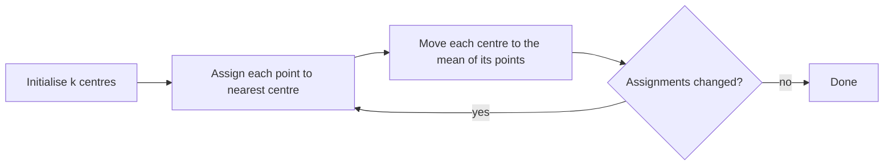
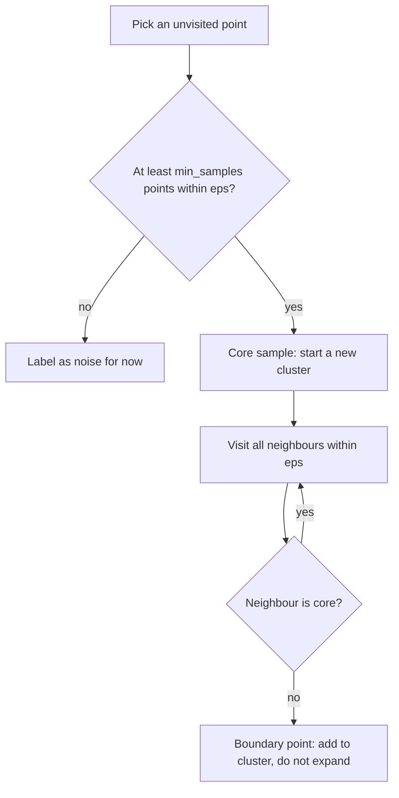

# Clustering: k-means, agglomerative clustering and DBSCAN

> **Before this lesson:** you need unsupervised learning and scaling from [Preprocessing and scaling](#/lesson/ml/preprocessing-scaling), and Euclidean (straight-line) distance from [The scikit-learn API and your first model](#/lesson/ml/sklearn-first-model), section 10. NumPy broadcasting, used in one demo, was introduced there too and is explained again here.

## In plain words

**Clustering** means sorting items into groups so that the items in a group resemble each other and items in different groups do not, *without anyone saying in advance what the groups are*. Each group is a **cluster**.

Think of sorting a drawer of mixed buttons. Nobody gave you categories, yet you make piles: the small white ones, the big brown ones, the metal ones. You invented the groups by looking at what was similar. A second person might have sorted by number of holes instead, and neither sorting is wrong. That is the nature of clustering: it finds *a* structure, and you must judge whether it is the one you care about.

A clustering algorithm, like a classifier, gives every sample a number. The difference is that the numbers have no meaning fixed beforehand: "cluster 0" is only a name for one of the piles.

Why this matters for a job: clustering is used to segment customers, group similar documents or images, detect unusual records and compress data. In interviews, "how does k-means work and when does it fail?" is asked constantly. This lesson covers three algorithms that define a cluster in three different ways, and then the awkward question of how to tell whether a clustering is any good.

## 1. k-means

**k-means** is the most widely used clustering algorithm. It describes each cluster by a single point, its **centre** (also called the **centroid**), and puts every sample in the cluster whose centre is nearest. You choose the number of clusters, $k$, and the algorithm looks for good centres by repeating two steps:

1. **Assign**: put each sample in the cluster of its nearest centre.
2. **Update**: move each centre to the mean (the average position) of the samples now assigned to it.

It stops when a round changes no assignments. The starting centres are picked from among the data points.



A tiny example with one feature. The data is 1, 2, 9, 10 and the starting centres are 1 and 2. *Assign*: 1 goes to centre 1; 2, 9 and 10 are all nearer to centre 2. *Update*: the first centre stays at 1; the second moves to the mean of 2, 9, 10, which is 7. *Assign* again: 2 is now nearer to 1 than to 7, so the clusters become {1, 2} and {9, 10}. *Update*: the centres move to 1.5 and 9.5. Another round changes nothing, so the algorithm stops.

What is being made small is the **inertia**: for every sample, take the squared distance to its own cluster's centre, and add them all up.

$$J = \sum_{i=1}^n \lVert x_i - \mu_{c(i)}\rVert^2 .$$

Here $x_i$ is sample $i$, $c(i)$ is the cluster it is assigned to, $\mu_{c(i)}$ (mu) is that cluster's centre, and $\lVert\cdot\rVert^2$ is the squared distance. In the example above the final inertia is $0.25 \times 4 = 1$. Each of the two steps can only lower $J$ or leave it unchanged: the assign step moves a sample only to a nearer centre, and the mean is the point with the smallest total squared distance to a group of points. So the algorithm always settles down. It may settle in a **local minimum**, though: an arrangement that no single step can improve but that is not the best one overall. Which one it reaches depends on the starting centres.

```python-run
import numpy as np
from sklearn.datasets import make_blobs
X, _ = make_blobs(n_samples=150, centers=3, cluster_std=0.8, random_state=1)

rng = np.random.RandomState(0)
centres = X[rng.choice(len(X), 3, replace=False)]            # initialise from data points
for it in range(1, 20):
    d2 = ((X[:, None, :] - centres[None, :, :]) ** 2).sum(axis=2)      # (n, k) squared distances
    labels = d2.argmin(axis=1)                                         # assignment step
    inertia = d2[np.arange(len(X)), labels].sum()
    new = np.array([X[labels == j].mean(axis=0) for j in range(3)])    # update step
    print(f"iteration {it}: inertia = {inertia:.1f}")
    if np.allclose(new, centres):
        break
    centres = new
print("final centres:\n", centres.round(2))
```

**Reading this code line by line**

- `make_blobs` generates artificial data: 150 points in two dimensions forming three round clumps. It also returns which clump each point came from; the underscore `_` discards that, since clustering must not use it.
- `rng.choice(len(X), 3, replace=False)` picks three different row numbers at random, and those three data points become the starting centres.
- `X[:, None, :] - centres[None, :, :]` subtracts every centre from every point. `None` inserts an axis of size 1, so the shapes are (150, 1, 2) and (1, 3, 2), and NumPy stretches both to (150, 3, 2): this is broadcasting. Squaring and summing over the last axis gives `d2`, a 150 × 3 table of squared distances from each point to each centre.
- `d2.argmin(axis=1)` gives, for each point, the position of its smallest distance: the assign step.
- `d2[np.arange(len(X)), labels].sum()` picks each point's distance to its own centre and adds them: the inertia.
- The `new = ...` line is the update step: for each cluster `j`, the mean of the points labelled `j`.
- The loop stops when the centres no longer move.

The inertia falls quickly, from 1,392.7 to 472.7 to 196.2, then levels off at 170.3 after five rounds. This is the whole algorithm, and the problem *ml-kmeans-step* asks you to write one round of it.

With scikit-learn the same thing is a few lines:

```python-run
from sklearn.cluster import KMeans
from sklearn.datasets import make_blobs
import numpy as np
X, _ = make_blobs(n_samples=150, centers=3, cluster_std=0.8, random_state=1)
km = KMeans(n_clusters=3, n_init=10, random_state=0).fit(X)
print("labels_ (first 15):", km.labels_[:15])
print("cluster sizes:", np.bincount(km.labels_))
print("cluster_centers_:\n", km.cluster_centers_.round(2))
print("inertia_:", round(km.inertia_, 1))
print("predict for new points:", km.predict([[0, 0], [-10, -3]]))
```

`KMeans(n_clusters=3, n_init=10)` asks for three clusters and runs the algorithm from ten different random starts, keeping the best. After `fit`, `labels_` holds the cluster number of every training point, `cluster_centers_` the centres, and `inertia_` the final inertia (170.3, the same as our hand-written version). `predict` assigns new points to the nearest existing centre without changing the model.

Notice that the centres are the same three points as before but listed in a different order. The cluster numbers are arbitrary; a different seed may number the same clusters differently. Never attach meaning to "cluster 0".

### Failure cases

Even when you give it the right number of clusters, k-means may not find the groups you see by eye. Because a cluster is defined by its centre alone, the border between two clusters always runs exactly halfway between their centres, and every cluster is a **convex** region: a shape with no dents, in which the straight line between any two of its points stays inside it. Consequently:

- it assumes clusters are of similar **width**. A small tight cluster beside a wide loose one is divided badly, because the border is drawn halfway between the centres regardless of how wide each cluster is;
- it assumes all **directions count equally**, so long, stretched clusters are chopped into pieces;
- it cannot follow curved shapes, such as two interlocking crescents.

```python-run
from sklearn.cluster import KMeans
from sklearn.datasets import make_moons
from sklearn.metrics import adjusted_rand_score
X, y = make_moons(n_samples=200, noise=0.05, random_state=0)
labels = KMeans(n_clusters=2, n_init=10, random_state=0).fit_predict(X)
print("k-means on two moons, ARI vs true halves:", round(adjusted_rand_score(y, labels), 2), "(1.0 would be perfect)")
```

`make_moons` produces two interlocking crescents, and `fit_predict` fits the model and returns the cluster numbers in one call. `adjusted_rand_score` (explained in section 4) compares the clusters with the true crescents: 1.0 would be perfect agreement and about 0 is what random grouping gives. k-means scores 0.26. It cut the picture with a straight line, putting half of each crescent in each cluster.

### k-means as vector quantisation

There is another way to look at k-means. PCA and NMF, from the previous lesson, describe each sample as a *sum* of several components. k-means describes each sample by a *single* component: its cluster centre. Replacing every sample by the nearest of a small set of representative points is called **vector quantisation**.

This view has a surprising consequence: it can be useful to ask for *more* clusters than there are features. With 10 clusters on the two-dimensional crescent data, each sample can be re-described by its distances to the 10 centres (`kmeans.transform(X)` returns exactly that). In this new 10-feature description, a plain linear model can separate the two crescents, which it could not do with the original two features.

### Practical notes

- **Starting centres.** scikit-learn uses a method called **k-means++**. It picks the first centre at random, and each later one at random but favouring points far from the centres already chosen, so the starting centres are well spread out. Combined with several restarts (`n_init`), this avoids most poor local minima.
- **Choosing $k$.** You have to supply it. Two aids are the "elbow" in a table of inertia against $k$ and the silhouette score (both shown below). Knowledge of the subject matter beats both.
- **Scale the features first**, because everything depends on distances.
- It is fast and handles large datasets. `MiniBatchKMeans` handles very large ones by working on small random portions at a time.
- Drawbacks: the result depends on a random start, the assumptions about cluster shape are restrictive, and $k$ must be chosen.

```python-run
from sklearn.cluster import KMeans
from sklearn.datasets import make_blobs
from sklearn.metrics import silhouette_score
X, _ = make_blobs(n_samples=300, centers=4, cluster_std=0.9, random_state=3)
print(" k   inertia   silhouette")
for k in range(2, 8):
    km = KMeans(n_clusters=k, n_init=10, random_state=0).fit(X)
    print(f"{k:2d}  {km.inertia_:8.1f}   {silhouette_score(X, km.labels_):.3f}")
```

The data has four true clumps, and the loop runs k-means for every $k$ from 2 to 7. Inertia *always* falls as $k$ grows (with one cluster per point it would be zero), so the smallest inertia is no guide. Look instead for the **elbow**: inertia drops steeply from 4,752 to 1,966 to 503 as $k$ goes from 2 to 4, and then hardly moves (449, 401, 357). The bend at $k = 4$ marks the point where extra clusters stop explaining much. The silhouette score agrees, peaking at 0.750 for $k = 4$.

## 2. Agglomerative clustering

**Agglomerative clustering** works from the bottom up. Start with **every sample as its own cluster**. Then repeatedly **merge the two most similar clusters**, until a stopping rule is met; in scikit-learn the rule is a target number of clusters. ("Agglomerate" means "gather into a mass".)

What "most similar" means for two *groups* of points has to be defined, and the definition is called the **linkage**:

| linkage | merges the two clusters that... |
|---|---|
| `ward` (the default) | cause the smallest increase in the total spread inside clusters; tends to give clusters of similar size |
| `average` | have the smallest average distance between their points |
| `complete` | have the smallest *largest* distance between any two of their points |
| `single` | have the smallest *smallest* distance; can follow chains and odd shapes, but one stray point can bridge two clusters |

Ward works on most datasets. If the clusters differ greatly in size, `average` or `complete` may do better.

Because of the way it is built, by merging the specific points it was given, agglomerative clustering **cannot assign new points**. It has no `predict` method, only `fit_predict`.

### Hierarchies and dendrograms

The sequence of merges contains more than one answer: stopping after any merge gives a clustering with a different number of clusters, each nested inside the next. This is a **hierarchical clustering**. The tool for viewing all the levels together is the **dendrogram**, a tree diagram with the samples along the bottom. Every merge is drawn as a join, and the *height* of the join shows how far apart the two merged clusters were. A tall join means two very different things were forced together, which suggests cutting the tree just below it. The SciPy library computes the merges (`scipy.cluster.hierarchy.linkage`) and draws the tree (`dendrogram`).

```python-run
import numpy as np
from scipy.cluster.hierarchy import linkage
from sklearn.cluster import AgglomerativeClustering
from sklearn.datasets import make_blobs

X, _ = make_blobs(n_samples=12, centers=3, cluster_std=0.6, random_state=0)
Z = linkage(X, method="ward")       # each row: cluster a, cluster b, merge distance, new cluster size
print("last five merges (distance jumps show the natural number of clusters):")
for a, b, dist, size in Z[-5:]:
    print(f"  merge {int(a):2d} + {int(b):2d}  at distance {dist:5.2f}  -> size {int(size)}")
print("labels with 3 clusters:", AgglomerativeClustering(n_clusters=3).fit_predict(X))
```

With 12 points there are 11 merges, and `linkage` returns one row per merge: which two clusters were joined, the distance between them, and the size of the result. (Clusters created by merges are given new numbers starting at 12.) The printout shows the last five. The first three happen at distances of 1.07, 1.53 and 2.83; the last two at 5.81 and 7.41. That jump is the dendrogram's way of saying "three clusters": before it, merges joined nearby points; after it, they join separate clumps. `AgglomerativeClustering(n_clusters=3)` stops at exactly that point and returns the three groups.

Like k-means, agglomerative clustering with Ward linkage still fails on shapes such as the two crescents.

## 3. DBSCAN

**DBSCAN** stands for "density-based spatial clustering of applications with noise". It has a different idea of what a cluster is: a crowded region, separated from other crowded regions by emptier space. Three benefits follow. You **do not choose the number of clusters**. It can find clusters of **any shape**. And it can declare that some points belong to **no cluster at all**. It is somewhat slower than the other two methods, but it still copes with fairly large datasets.

It has two settings, a distance `eps` (short for the Greek letter epsilon) and a count `min_samples`:

- A point is a **core sample** if at least `min_samples` points, counting itself, lie within distance `eps` of it. Core samples sit in crowded places.
- Core samples that are within `eps` of each other are put in the same cluster. A cluster therefore grows from core sample to core sample, like a rumour passing between people standing close together, and can take any shape.
- A point that is not a core sample but lies within `eps` of one is a **boundary point** and joins that core sample's cluster.
- Every other point is **noise** and receives the label **`-1`**.



"Noise for now" in the diagram means that a point first marked as noise can later be claimed as a boundary point when a nearby core sample is visited. Which points are core samples and which are noise is the same on every run. Only a boundary point that is close to core samples of two different clusters depends on the order of visiting, and that is rare.

```python-run
import numpy as np
from sklearn.cluster import DBSCAN
from sklearn.datasets import make_moons
from sklearn.preprocessing import StandardScaler
from sklearn.metrics import adjusted_rand_score

X, y = make_moons(n_samples=200, noise=0.05, random_state=0)
X = StandardScaler().fit_transform(X)                 # eps is a distance, so scale first
for eps in [0.1, 0.3, 0.5, 1.5]:
    labels = DBSCAN(eps=eps, min_samples=5).fit_predict(X)
    n_clusters = len(set(labels)) - (1 if -1 in labels else 0)
    print(f"eps={eps}: clusters={n_clusters}  noise points={np.sum(labels == -1):3d}  ARI={adjusted_rand_score(y, labels):.2f}")
```

The crescents are standardised first, because `eps` is a distance and should mean the same thing along every feature. The loop then tries four values of `eps`. `set(labels)` is the collection of distinct labels; subtracting one if −1 is present gives the number of real clusters. With `eps=0.1`, too few points have five neighbours that close: 161 of the 200 points are called noise and the rest fall into 7 fragments. With `eps=0.3` or `0.5`, DBSCAN finds exactly two clusters with no noise, and they match the true crescents perfectly (a score of 1.00), which k-means could not do. With `eps=1.5` everything is within reach of everything else and there is one cluster.

Setting the two values:

- **`eps`** matters most, because it defines what "close" means. Too small, and no point is a core sample, so everything is noise. Too large, and everything is one cluster. Scaling the data first makes a sensible `eps` easier to find.
- **`min_samples`** decides whether thinly populated regions become clusters or noise. It is also the smallest size a cluster can have.
- You do not set the number of clusters directly, but `eps` controls it indirectly.
- Like agglomerative clustering, DBSCAN has no `predict`.

> [!WARNING]
> If you use DBSCAN's labels to index another array, remember that noise is `-1`. In Python, index `-1` silently means the *last* element, so noise points would all be treated as belonging to whatever comes last.

## 4. Comparing and evaluating clusterings

### When the true groups are known

Sometimes, when testing an algorithm, you do know the true grouping. Then use the **adjusted Rand index** (ARI) or **normalised mutual information** (NMI). Both measure how well two groupings of the same items agree, and both give 1 for perfect agreement. NMI lies between 0 and 1. ARI is about 0 for a random grouping and can be slightly negative.

A common mistake is to use accuracy. Accuracy checks whether each predicted number equals the true number, but **cluster numbers are arbitrary names**. What matters is only *which samples are grouped together*.

```python-run
from sklearn.metrics import accuracy_score, adjusted_rand_score, normalized_mutual_info_score
truth = [0, 0, 1, 1]
clusters = [1, 1, 0, 0]          # the same grouping, with different names
print("accuracy:", accuracy_score(truth, clusters), "<- misleading")
print("ARI:", adjusted_rand_score(truth, clusters), " NMI:", normalized_mutual_info_score(truth, clusters))
```

The clustering puts the first two samples together and the last two together, exactly as the truth does, but calls the groups 1 and 0 instead of 0 and 1. Accuracy reports 0.0, as if everything were wrong. ARI and NMI both report 1.0.

### When they are not known

In real use you have no true grouping; if you did, you would train a classifier. One score that needs no labels is the **silhouette coefficient**, which measures how compact and well separated the clusters are. For each sample, let $a$ be its average distance to the other samples in its own cluster and $b$ its average distance to the samples of the nearest other cluster. Then

$$s = \frac{b - a}{\max(a, b)} .$$

A sample that is close to its own cluster and far from the next has a small $a$ and a large $b$, so $s$ is near 1. A sample midway between two clusters has $s$ near 0, and one that seems to be in the wrong cluster has a negative $s$. Example: $a = 1$ and $b = 4$ give $s = 3/4 = 0.75$. The overall score is the average over all samples, between −1 and 1, higher being better.

The silhouette has a blind spot: it rewards compact, round clusters, so it marks down clusters with complex shapes even when they are right. On the two crescents, k-means's wrong answer gets a *higher* silhouette score than DBSCAN's right one.

A somewhat better approach is to test **robustness**: change the data a little (add a bit of noise, or leave out some samples) or change the settings, and see whether the clustering stays the same. A grouping that changes with every small disturbance is not to be trusted.

Even a compact and robust clustering may not mean anything useful to you. The only way to know is to **look at the members of each cluster yourself**. Run three algorithms on a collection of face photographs and they may group the images by quite different properties: the direction the head is turned, the lighting, whether the person wears a hat. Only by viewing the actual images in each cluster do you find out what a cluster stands for.

## 5. The three methods side by side

Applying and judging clustering is a largely **qualitative** activity, and it is most useful while exploring data.

| | k-means | agglomerative | DBSCAN |
|---|---|---|---|
| you specify | number of clusters | number of clusters, and a linkage | `eps` and `min_samples` |
| cluster shapes | convex, of similar size | depends on the linkage | any shape |
| handling of noise | none | none | labels noise as −1 |
| `predict` on new data | yes | no | no |
| special strength | each cluster is summarised by its centre | gives the whole hierarchy (dendrogram) | finds the number of clusters itself; complex shapes |
| caveat | random start; restrictive assumptions about shape | does not scale easily to very large datasets | struggles when clusters differ greatly in density; `eps` needs tuning |

> [!INTERVIEW]
> **"How does k-means work, and when does it fail?"** Alternate between assigning each point to its nearest centroid and moving each centroid to the mean of its points. This minimises the within-cluster sum of squared distances and converges to a local optimum, so use k-means++ and several restarts. It fails on clusters that are not convex and on clusters of unequal size or density, it is sensitive to feature scale and to outliers, and it needs $k$ supplied. For arbitrary shapes and noise, use DBSCAN. For clusters that are stretched ellipses, or when you want each point to belong partly to several clusters, use a Gaussian mixture model.

## Summary

- k-means: assign and update until nothing changes. Fast; assumes round clusters of similar size; needs $k$ and scaled features.
- Agglomerative: merge from the bottom up. The linkage defines similarity between clusters, and the dendrogram shows the whole hierarchy.
- DBSCAN: clusters are dense regions. It finds any shape, marks noise, and is controlled by `eps` and `min_samples`.
- Evaluate with ARI or NMI when the truth is known, never with accuracy. Use the silhouette with care, and always inspect the clusters yourself.

## Glossary

- **Clustering**: grouping similar samples without labels.
- **Cluster**: one of the groups found.
- **Centroid (cluster centre)**: the mean position of the samples in a cluster.
- **k-means**: clustering by alternately assigning points to the nearest centre and moving centres to the mean of their points.
- **Inertia**: the sum of squared distances from each sample to its cluster's centre.
- **Local minimum**: a solution no small change can improve, though a better one may exist.
- **Convex**: a shape without dents; the line between any two of its points stays inside.
- **k-means++**: a way of choosing well-spread starting centres.
- **Elbow**: the value of $k$ after which inertia stops falling steeply.
- **Vector quantisation**: representing each sample by the nearest of a small set of reference points.
- **Agglomerative clustering**: repeatedly merging the two most similar clusters.
- **Linkage**: the rule that measures similarity between two clusters.
- **Dendrogram**: a tree diagram of the merges and the distances at which they happened.
- **DBSCAN**: density-based clustering that grows clusters from core samples.
- **Core sample / boundary point / noise**: a point in a crowded region / a point next to one / a point in neither situation (label −1).
- **Adjusted Rand index (ARI), normalised mutual information (NMI)**: scores comparing a clustering with a known grouping; 1 is perfect.
- **Silhouette coefficient**: a label-free score of how compact and separated clusters are.

## Check yourself

```quiz
[
  {"q": "Which two steps does k-means alternate?", "options": ["Assign points to the nearest centre; move each centre to the mean of its points", "Merge the closest clusters; split the largest cluster", "Compute core samples; expand clusters", "Project onto components; reconstruct"], "answer": 0,
   "explain": "That is Lloyd's algorithm; each step can only reduce the inertia."},
  {"q": "Why can't you choose k by simply minimising inertia?", "options": ["Inertia always decreases as k increases", "Inertia is random", "Inertia requires labels", "Inertia is only defined for k = 2"], "answer": 0,
   "explain": "With k = n the inertia is 0. Look for an elbow or use the silhouette score."},
  {"q": "In DBSCAN, a point labelled −1 is…", "options": ["noise (not part of any cluster)", "the first cluster", "a core sample", "an error value"], "answer": 0,
   "explain": "Points that are neither core samples nor within eps of one are noise."},
  {"q": "Which algorithm can cluster the two-moons dataset correctly?", "options": ["DBSCAN", "k-means with k = 2", "Agglomerative clustering with Ward linkage", "None of them"], "answer": 0,
   "explain": "Density-based clustering follows arbitrary shapes; k-means and Ward assume compact, convex clusters."},
  {"q": "Why is accuracy_score a poor way to compare a clustering with true labels?", "options": ["Cluster label numbers are arbitrary; only the grouping matters", "Accuracy cannot be computed for integers", "It is too slow", "It always returns 1"], "answer": 0,
   "explain": "A perfect clustering with permuted label names can have accuracy 0. Use ARI or NMI."},
  {"q": "In agglomerative clustering, what does the linkage criterion define?", "options": ["How the similarity between two clusters is measured when choosing which to merge", "The number of clusters", "The learning rate", "The distance to noise points"], "answer": 0,
   "explain": "Ward, average, complete and single linkage give different notions of cluster distance."},
  {"q": "Which of these algorithms has a predict method for new data in scikit-learn?", "options": ["KMeans", "AgglomerativeClustering", "DBSCAN", "None of them"], "answer": 0,
   "explain": "k-means can assign new points to the nearest learned centre; the other two only offer fit_predict."},
  {"q": "A high silhouette score guarantees that…", "options": ["clusters are compact and well separated, but not that they are meaningful", "the clustering matches the true classes", "the number of clusters is correct", "DBSCAN was used"], "answer": 0,
   "explain": "Compactness is not the same as semantic meaning, and it penalises valid non-convex clusters."}
]
```

> **Source:** Müller & Guido, *Introduction to Machine Learning with Python*, ch. 3 ("Clustering": k-means clustering, failure cases, vector quantization, agglomerative clustering, hierarchical clustering and dendrograms, DBSCAN, comparing and evaluating clustering algorithms, summary of clustering methods); scikit-learn User Guide, "Clustering".
