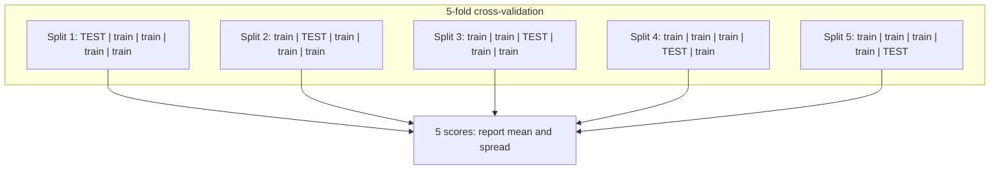

# Cross-validation

> **Before this lesson:** you should be comfortable with `fit`, `score` and `train_test_split` from [The scikit-learn API and your first model](#/lesson/ml/sklearn-first-model), and with the idea that only performance on unseen data counts, from [Generalisation, overfitting and k-NN](#/lesson/ml/generalization-knn). The examples use logistic regression and decision trees; all you need to know is that each is a classifier with `fit` and `score`. The feature-selection lesson used `cross_val_score` briefly; this lesson explains it properly.

## In plain words

To judge a model we have, so far, split the data once: train on one part, test on the other, read off one score. **Cross-validation** repeats that experiment several times with different splits and combines the results, so that the verdict does not depend on one lucky or unlucky split.

Picture a teacher who wants to know how well a student really understands a subject. One test with five questions could happen to hit the student's favourite topics, or her weakest ones. A fairer teacher gives five short tests, each on a different chapter, and looks at all five marks: the average says how good the student is, and the spread says how consistent she is. Cross-validation does the same for a model.

Why this matters for a job: every claim like "model B beats model A" rests on an evaluation, and a sloppy evaluation leads to shipping the wrong model. Interviewers routinely ask how you would validate a model when classes are rare, when one customer has many rows, or when data arrives over time, and the answer is always a choice of cross-validation strategy.

## 1. Why a single split is not enough

A single `train_test_split` has two weaknesses.

- **Luck.** A random split might put most of the hard examples in the training set and only easy ones in the test set, which gives a score that is too high, or the reverse. The number you report depends on the random seed.
- **Waste.** With the usual 75/25 split, a quarter of the data never helps train the model.

The demo below measures the luck directly by trying 20 different random splits.

```python-run
import numpy as np
from sklearn.datasets import load_iris
from sklearn.linear_model import LogisticRegression
from sklearn.model_selection import train_test_split

X, y = load_iris(return_X_y=True)
scores = []
for seed in range(20):
    X_tr, X_te, y_tr, y_te = train_test_split(X, y, random_state=seed)
    scores.append(LogisticRegression(max_iter=1000).fit(X_tr, y_tr).score(X_te, y_te))
print("test accuracy over 20 different random splits:")
print("  min =", round(min(scores), 3), " max =", round(max(scores), 3), " std =", np.std(scores).round(3))
```

**Reading this code line by line**

- `load_iris(return_X_y=True)` loads the 150 iris flowers: `X` has four measurements per flower and `y` the species (0, 1 or 2).
- The loop runs 20 times. Each time, `train_test_split(..., random_state=seed)` makes a different random split, because the **seed** (the number that starts the random number generator) changes. A logistic regression is trained on the training part and scored on the test part, and the accuracy is appended to the list `scores`.
- The final line prints the lowest score, the highest, and the **standard deviation** (`np.std`), a measure of how spread out the values are.

The output shows accuracies from 0.895 to 1.0 with a standard deviation of about 0.03. Same model, same data, and the reported accuracy swings by more than ten points purely because of which 38 flowers landed in the test set. If you compared two models on one split each, a difference of five points could be entirely luck.

## 2. k-fold cross-validation

In **k-fold cross-validation** the data is divided into $k$ parts of roughly equal size, called **folds**; $k$ is usually 5 or 10. Then $k$ separate models are trained:

1. Model 1 is tested on fold 1 and trained on all the other folds.
2. Model 2 is tested on fold 2 and trained on all the others.
3. ... and so on, until every fold has been the test set once.

You end up with $k$ scores, one per fold.



**A worked example of the fold boundaries.** Take $n = 10$ samples, numbered 0 to 9, and $k = 3$ folds. Ten does not divide evenly by three, so scikit-learn's rule is that the first $n \bmod k$ folds get one extra sample ($n \bmod k$, "n modulo k", is the remainder after division: $10 \bmod 3 = 1$). The fold sizes are therefore 4, 3 and 3:

| split | test indices | training indices |
|---|---|---|
| 1 | 0, 1, 2, 3 | 4, 5, 6, 7, 8, 9 |
| 2 | 4, 5, 6 | 0, 1, 2, 3, 7, 8, 9 |
| 3 | 7, 8, 9 | 0, 1, 2, 3, 4, 5, 6 |

Every sample appears in exactly one test set. The problem *ml-kfold-indices* asks you to produce this table in code.

In scikit-learn the whole procedure is one function call, `cross_val_score`:

```python-run
from sklearn.datasets import load_iris
from sklearn.linear_model import LogisticRegression
from sklearn.model_selection import cross_val_score

X, y = load_iris(return_X_y=True)
scores = cross_val_score(LogisticRegression(max_iter=1000), X, y, cv=5)
print("scores per fold:", scores.round(3))
print(f"mean = {scores.mean():.3f}  std = {scores.std():.3f}")
```

**Reading this code line by line**

- `cross_val_score(model, X, y, cv=5)` takes an unfitted model, the full feature table and labels, and the number of folds. Internally it makes five copies of the model, trains each on four folds and scores it on the fifth.
- It returns a NumPy array of the five test scores. For a classifier the default score is **accuracy**, the fraction of correct predictions.
- The last line prints the mean and standard deviation of the five scores.

The output is `[0.967 1. 0.933 0.967 1.]`, with mean 0.973 and standard deviation 0.025. Each fold holds 30 flowers, so 0.967 means one mistake and 0.933 two.

**From fold scores to a summary.** In words, the mean adds up the scores and divides by how many there are; the standard deviation measures the typical distance of a score from that mean. As formulas, for scores $s_1, \dots, s_k$:

$$\bar s = \frac{1}{k}\sum_{j=1}^{k} s_j, \qquad \text{std} = \sqrt{\frac{1}{k}\sum_{j=1}^{k}(s_j - \bar s)^2}.$$

Worked example with the five scores above: the sum is $0.967 + 1 + 0.933 + 0.967 + 1 = 4.867$, so $\bar s = 0.973$. The differences from the mean are about $-0.006, 0.027, -0.040, -0.006, 0.027$; their squares add up to about $0.0031$; divided by 5 that is $0.00063$; and the square root is $0.025$.

The usual headline is the **mean**. Look at the individual values as well. A wide range across folds (say 90% on one and 100% on another) means either that the model is sensitive to exactly which samples it trains on, or that the dataset is small and each fold contains few examples.

### `cross_validate`: more detail in one call

`cross_validate` is the more informative sibling. It returns a dictionary with the fit time and score time of each fold, the scores for several metrics at once, and, if you ask, the scores on the training folds too.

```python-run
from sklearn.datasets import load_breast_cancer
from sklearn.tree import DecisionTreeClassifier
from sklearn.model_selection import cross_validate
X, y = load_breast_cancer(return_X_y=True)
res = cross_validate(DecisionTreeClassifier(random_state=0), X, y, cv=5,
                     scoring=["accuracy", "roc_auc"], return_train_score=True)
for key in ["train_accuracy", "test_accuracy", "test_roc_auc"]:
    print(f"{key:15s} {res[key].round(3)}  mean={res[key].mean():.3f}")
```

`scoring=["accuracy", "roc_auc"]` requests two metrics. **ROC AUC** is a score between 0.5 (no better than guessing) and 1 (perfect) that measures how well the model ranks positive cases above negative ones; lesson 52 explains it. `return_train_score=True` adds the scores on the training folds. The result `res` is a dictionary whose keys are names like `"test_accuracy"`, each holding an array of five values.

The output shows training accuracy of 1.000 in every fold and test accuracy averaging 0.917. That gap is the overfitting signature from the generalisation lesson: an unlimited decision tree memorises its training data. Seeing both numbers side by side, fold by fold, is the quickest way to diagnose it.

## 3. Benefits and costs

The benefits:

- **Every example is tested exactly once.** For every fold score to be high, the model must do well on *all* the data, not on one convenient subset. A lucky or unlucky split cannot hide anything.
- **You see how sensitive the model is** to the training data. The spread of fold scores hints at the best and worst cases you might meet on new data.
- **The data is used more efficiently.** With 5 folds each model trains on 80% of the data, and with 10 folds on 90%, compared with 75% for a typical single split. More training data usually means a better model, so the estimate is closer to what the final model will achieve.

The cost is **computation**: $k$ models are trained instead of one, so cross-validation takes roughly $k$ times as long.

> [!NOTE]
> **Cross-validation does not build a model.** `cross_val_score` trains several models internally and throws them all away. Its only purpose is to *estimate* how well this kind of model, with these settings, generalises when trained on data like yours. To get a model you can use, fit it once more on all the training data afterwards.

## 4. Stratified k-fold

Plain k-fold cuts the data into consecutive blocks, in the order the rows appear. That can go badly wrong. The iris labels are stored sorted: fifty 0s, then fifty 1s, then fifty 2s. With three unshuffled folds, the first fold contains only class 0, so the model trained on the other two folds has never seen a class-0 flower and gets every test example wrong. The same happens in every fold: accuracy **zero**, three times.

For classification, scikit-learn therefore uses **stratified k-fold** by default. **Stratified** means the folds are built so that each one has the same proportion of each class as the whole dataset. If 90% of the samples are class A, each fold is about 90% class A. This gives a more reliable estimate, and it matters most with **imbalanced** classes (one class much rarer than the others), where a plain fold could end up with no examples of the rare class at all.

For regression, where there are no classes, the default is plain unstratified k-fold.

```python-run
import numpy as np
from sklearn.datasets import load_iris
from sklearn.linear_model import LogisticRegression
from sklearn.model_selection import cross_val_score, KFold, StratifiedKFold

X, y = load_iris(return_X_y=True)
logreg = LogisticRegression(max_iter=1000)
print("KFold(3), no shuffle:   ", cross_val_score(logreg, X, y, cv=KFold(n_splits=3)).round(2))
print("KFold(3), shuffled:     ", cross_val_score(logreg, X, y, cv=KFold(n_splits=3, shuffle=True, random_state=0)).round(2))
print("StratifiedKFold(3):     ", cross_val_score(logreg, X, y, cv=StratifiedKFold(n_splits=3)).round(2))
for i, (tr, te) in enumerate(StratifiedKFold(n_splits=3).split(X, y)):
    print(f"  stratified fold {i}: class counts in test = {np.bincount(y[te])}")
```

**Reading this code line by line**

- Instead of a number, `cv=` here receives a **splitter object** that decides how to make the folds. `KFold(n_splits=3)` makes three consecutive folds without shuffling.
- `KFold(n_splits=3, shuffle=True, random_state=0)` shuffles the rows first (reproducibly, thanks to the fixed seed), then cuts.
- `StratifiedKFold(n_splits=3)` keeps the class proportions equal in every fold.
- The loop calls the splitter's `split(X, y)` method directly. It yields pairs of index arrays, `tr` for training and `te` for testing. `np.bincount(y[te])` counts how many test samples of each class there are.

The output: unshuffled `KFold` gives `[0. 0. 0.]`, exactly the disaster described above. Shuffling repairs it (0.98, 0.96, 0.96) and stratification gives 0.98, 0.96, 0.98. The class counts show each stratified test fold holding 16 or 17 flowers of each species.

## 5. More control: splitter objects

The `cv` parameter accepts either an integer or a **cross-validation splitter**: an object whose `split(X, y, groups)` method produces `(train_indices, test_indices)` pairs. The important ones:

| splitter | what it does | when to use |
|---|---|---|
| `KFold(n_splits, shuffle, random_state)` | consecutive folds, optionally shuffled | regression; reproducing someone else's results |
| `StratifiedKFold` | keeps class proportions in each fold | classification (the default) |
| `LeaveOneOut` | each test fold is a single sample, so $k = n$ | very small datasets; far too slow on large ones |
| `ShuffleSplit` / `StratifiedShuffleSplit` | repeated independent random splits, with any train and test sizes and any number of repeats | large data (use a subsample per repeat); full control over sizes |
| `GroupKFold` | all samples of one **group** stay in the same fold | several rows per patient, speaker, user or customer |
| `TimeSeriesSplit` | training data always comes before test data | data ordered in time |
| `RepeatedStratifiedKFold` | repeats stratified k-fold with different shuffles | more stable estimates on small data |

### Leave-one-out

**Leave-one-out** cross-validation is k-fold with as many folds as samples: each model is trained on all samples but one and tested on that one. It trains $n$ models, which is very slow for large datasets, but on small datasets it uses almost all the data for training each time and can give a better estimate.

### Shuffle-split

`ShuffleSplit` draws `train_size` samples for training and a separate, non-overlapping set of `test_size` samples for testing, and repeats this `n_splits` times. Unlike k-fold, the number of repeats is independent of the sizes, and the sizes need not add up to the whole dataset. Using `train_size=0.5, test_size=0.1`, for example, works with only 60% of the data in each repeat, which is handy for quick experiments on large datasets.

### Groups

Suppose you are building a system that recognises emotions from photos of faces, and each person appears in several photos. With ordinary stratified cross-validation, photos of the same person end up in both the training and the test folds. A classifier finds it much easier to read the emotion on a face it has already seen, so the score overstates how it will do on **new people**, which is the real goal. `GroupKFold` takes a `groups` array, holding for each photo the id of the person in it, and keeps all photos of a person together: entirely in training or entirely in testing.

Groups are common in medicine (several samples from one patient), speech (several recordings of one speaker) and business data (many transactions per customer).

```python-run
import numpy as np
from sklearn.model_selection import GroupKFold, StratifiedKFold, cross_val_score
from sklearn.neighbors import KNeighborsClassifier

rng = np.random.RandomState(0)
n_people, photos = 20, 10
identity = rng.randn(n_people, 8) * 3                   # each person has a distinctive "face"
groups = np.repeat(np.arange(n_people), photos)
emotion = rng.randint(0, 2, size=n_people * photos)     # the label we actually want to predict
person_habit = rng.randint(0, 2, size=n_people)         # each person mostly shows one emotion
emotion = np.where(rng.rand(len(groups)) < 0.8, person_habit[groups], emotion)
X = identity[groups] + rng.randn(len(groups), 8) * 0.3  # features encode identity, not emotion

knn = KNeighborsClassifier(3)
shuffled = StratifiedKFold(5, shuffle=True, random_state=0)
print("shuffled 5-fold accuracy:", cross_val_score(knn, X, emotion, cv=shuffled).mean().round(3), "<- optimistic: memorises people")
print("GroupKFold accuracy:     ", cross_val_score(knn, X, emotion, groups=groups, cv=GroupKFold(5)).mean().round(3), "<- honest: new people (about chance)")
```

**Reading this code line by line**

- 20 people each get a random 8-number "face" (`identity`), and each person contributes 10 photos. `np.repeat(np.arange(20), 10)` builds the `groups` array: ten 0s, ten 1s, and so on, giving the person id of each photo.
- Each person has a habit (mostly happy or mostly sad, `person_habit`), and 80% of their photos show that habitual emotion. The features `X` are each person's face plus a little noise: they say *who* is in the photo and nothing about the emotion itself.
- A 3-nearest-neighbour classifier is cross-validated twice: once with shuffled stratified folds, once with `GroupKFold(5)`, which receives the `groups` array.

With shuffled folds the score is 0.86: the model finds other photos of the same person in the training folds and copies their usual emotion. With groups it falls to about 0.37. A new person's habit cannot be read from a face the model has never seen, so the honest answer is chance level (0.5), and with only 20 people this particular run lands below it. The 0.86 is not a measure of emotion recognition at all.

### Time series

With data ordered in time, a random split lets the model **train on the future and test on the past**. Real forecasting never gets that luxury, so the score would be too optimistic. Use `TimeSeriesSplit`, in which every test fold comes after its training data, or a single cut-off date as in the bike-rental example of the previous lesson.

```python-run
import numpy as np
from sklearn.model_selection import TimeSeriesSplit, LeaveOneOut, ShuffleSplit
X = np.arange(12).reshape(-1, 1)
for tr, te in TimeSeriesSplit(n_splits=4).split(X):
    print("TimeSeriesSplit  train:", tr, " test:", te)
print("LeaveOneOut number of splits:", LeaveOneOut().get_n_splits(X))
for tr, te in ShuffleSplit(n_splits=2, train_size=0.5, test_size=0.25, random_state=0).split(X):
    print("ShuffleSplit     train:", tr, " test:", te)
```

`X` is twelve rows numbered 0 to 11, standing in for twelve time steps. The printout shows `TimeSeriesSplit` growing the training window step by step (0–3, then 0–5, 0–7, 0–9) and always testing on the next two rows. Leave-one-out on 12 rows makes 12 splits. `ShuffleSplit` picks 6 random rows to train on and 3 different random rows to test on, twice; the remaining 3 rows are unused in each repeat.

## 6. Choosing k

- **5 or 10 folds** are the standard choices and a good compromise between the quality of the estimate and the cost.
- A larger $k$ means each model trains on more data, so the estimate is less **pessimistic** (models trained on less data than the final model tend to score a bit lower). It also costs more, and the fold models become more alike, because they share almost all their training data.
- For small datasets, use repeated stratified k-fold or leave-one-out.
- For very large datasets a single validation split may be enough. With a million test examples, the score from one split is already very precise.

## 7. What the spread tells you

The standard deviation across folds is a rough indication of uncertainty. It is not a precise **confidence interval** (a range that contains the true value with a stated probability), because the fold models share most of their training data and their scores are not independent; the real uncertainty is somewhat larger than the spread suggests. Use it to avoid reading too much into small differences: if model A scores $0.953 \pm 0.02$ and model B $0.957 \pm 0.02$, you have not shown that B is better.

> [!INTERVIEW]
> **"How would you validate a model on (a) imbalanced classes, (b) several rows per customer, (c) daily sales data?"** (a) Stratified k-fold, with a metric suited to rare classes such as precision–recall AUC rather than accuracy. (b) `GroupKFold` by customer id; otherwise the model is rewarded for recognising customers it has seen. (c) Time-based splits (`TimeSeriesSplit` or a rolling cut-off date), with features built only from the past. In every case, fit all preprocessing inside each fold with a `Pipeline`, and keep a final untouched test set.

## 8. Cross-validation by hand

Writing the loop yourself removes any mystery about what `cross_val_score` does. A splitter's `split` method yields pairs of index arrays; for each pair you train a fresh model on one part and score it on the other.

```python-run
import numpy as np
from sklearn.base import clone
from sklearn.datasets import load_iris
from sklearn.linear_model import LogisticRegression
from sklearn.model_selection import StratifiedKFold, cross_val_score

X, y = load_iris(return_X_y=True)
model = LogisticRegression(max_iter=1000)
cv = StratifiedKFold(n_splits=5)

scores = []
for fold, (train_idx, test_idx) in enumerate(cv.split(X, y)):
    m = clone(model)                               # a fresh, unfitted copy for every fold
    m.fit(X[train_idx], y[train_idx])
    scores.append(m.score(X[test_idx], y[test_idx]))
    print(f"fold {fold}: train on {len(train_idx)} samples, test on {len(test_idx)} -> accuracy {scores[-1]:.3f}")
print("by hand:        ", np.round(scores, 3))
print("cross_val_score:", cross_val_score(model, X, y, cv=cv).round(3))
```

**Reading this code line by line**

- `enumerate(cv.split(X, y))` walks through the five splits, numbering them from 0. Each split gives `train_idx` and `test_idx`, arrays of row numbers.
- `clone(model)` makes a new, unfitted copy of the model with the same settings. Nothing learned in one fold carries into the next.
- `X[train_idx]` selects the training rows by their numbers (NumPy "fancy indexing"); the model is fitted on them and scored on `X[test_idx]`.
- The final two lines print our scores and those of `cross_val_score` with the same splitter.

Each fold trains on 120 flowers and tests on 30, and both rows of output are identical: `[0.967 1. 0.933 0.967 1.]`. Three details in the loop matter:

- `clone` guarantees independence between folds.
- The five test sets do not overlap and together cover every sample exactly once.
- Any preprocessing, such as scaling, must happen *inside* the loop and be fitted on `X[train_idx]` only. Passing a `Pipeline` as `model` does this for you (module 6).

Finally, `cross_val_predict` returns, for every sample, the prediction made by the model that did *not* train on it (the **out-of-fold** prediction). That is useful for building one confusion matrix (lesson 52) over the whole dataset.

## Summary

- One train/test split is noisy and wastes data. k-fold cross-validation averages over $k$ splits and tests every sample exactly once.
- `cross_val_score(model, X, y, cv=5)` returns the fold scores. It evaluates an approach and does not return a fitted model.
- Classification uses stratified folds by default. Unshuffled plain k-fold on sorted data fails completely.
- Match the splitter to the structure of the data: several rows per entity → `GroupKFold`; time order → `TimeSeriesSplit`.
- Report the mean and the spread, and do not over-read small differences.

## Glossary

- **Cross-validation**: estimating generalisation by repeating the train/test experiment over several splits.
- **Fold**: one of the $k$ roughly equal parts the data is divided into.
- **k-fold cross-validation**: each fold serves once as the test set while the rest train the model.
- **Seed (random state)**: the number that starts a random generator; the same seed reproduces the same split.
- **Standard deviation**: the typical distance of values from their mean.
- **Accuracy**: the fraction of predictions that are correct.
- **Stratified**: built so that each fold has the same class proportions as the whole dataset.
- **Imbalanced classes**: one class far rarer than the others.
- **Splitter**: an object whose `split` method yields training and test index arrays.
- **Leave-one-out**: k-fold with one sample per fold.
- **Shuffle-split**: repeated independent random train/test splits of chosen sizes.
- **Group**: a set of samples that belong together, such as all rows of one patient.
- **Out-of-fold prediction**: a prediction made by the model that did not see that sample during training.
- **Confidence interval**: a range expected to contain the true value with a stated probability.

## Check yourself

```quiz
[
  {"q": "What does cross_val_score(model, X, y, cv=5) return?", "options": ["An array of 5 scores, one per held-out fold", "A fitted model", "The best hyperparameters", "Predictions for X"], "answer": 0,
   "explain": "It trains five temporary models and reports each one's score on its held-out fold."},
  {"q": "Three-fold KFold without shuffling on iris gives accuracy 0 on every fold because…", "options": ["the data is sorted by class, so each test fold contains a class absent from training", "iris has too few samples", "logistic regression cannot handle three classes", "the features are unscaled"], "answer": 0,
   "explain": "Each fold is exactly one class; stratification or shuffling fixes it."},
  {"q": "Which splitter should you use when the same patient contributes several samples?", "options": ["GroupKFold", "KFold", "StratifiedKFold", "LeaveOneOut"], "answer": 0,
   "explain": "All of a patient's samples must stay on one side of the split to measure generalisation to new patients."},
  {"q": "A benefit of cross-validation over a single split is that…", "options": ["every sample is used for testing exactly once, giving a more reliable estimate", "it is faster", "it automatically tunes hyperparameters", "it removes the need for a test set in all cases"], "answer": 0,
   "explain": "It reduces dependence on one lucky/unlucky split, at k times the computational cost."},
  {"q": "For time-series forecasting, random k-fold is inappropriate because…", "options": ["the model would be trained on data from the future relative to its test points", "time series cannot be stored in arrays", "k-fold needs class labels", "it uses too little data"], "answer": 0,
   "explain": "Temporal leakage inflates the score; training data must precede test data."},
  {"q": "In StratifiedKFold, each fold…", "options": ["has approximately the same class proportions as the whole dataset", "contains exactly one class", "has the same number of features", "contains only minority-class samples"], "answer": 0,
   "explain": "Stratification preserves the label distribution in every fold."},
  {"q": "With 5-fold CV, each model is trained on what fraction of the data?", "options": ["80%", "20%", "50%", "100%"], "answer": 0,
   "explain": "Four of the five folds are used for training in each split."},
  {"q": "KFold with 3 folds on 10 samples (no shuffling) uses which test sets?", "options": ["0–3, 4–6, 7–9", "0–2, 3–5, 6–9", "0–3, 4–7, 8–9", "random sets of 3"], "answer": 0,
   "explain": "10 mod 3 = 1, so the first fold gets one extra sample: sizes 4, 3, 3 in order."}
]
```

> **Source:** Müller & Guido, *Introduction to Machine Learning with Python*, ch. 5 ("Cross-Validation", "Cross-Validation in scikit-learn", "Benefits of Cross-Validation", "Stratified k-Fold Cross-Validation and Other Strategies": leave-one-out, shuffle-split, cross-validation with groups); scikit-learn User Guide, "Cross-validation: evaluating estimator performance".
