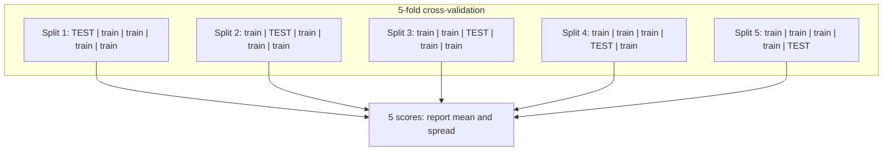

# Cross-validation

Up to now we evaluated models with a single `train_test_split`: fit on the training part, call `score` on
the test part. Chapter 5 of Müller & Guido makes this more robust. This lesson covers
**cross-validation**, a way of estimating generalisation performance that is more stable and thorough than
one split, and the splitting strategies that go with different kinds of data.

## 1. Why a single split is not enough

A single split has two weaknesses:

- **Luck.** With a random 75/25 split you might get all the hard examples in the training set and only
  easy ones in the test set (a score that is too high), or the reverse (too low). The number you report
  depends on the seed.
- **Waste.** A quarter of the data is never used for training.

```python-run
import numpy as np
from sklearn.datasets import load_iris
from sklearn.linear_model import LogisticRegression
from sklearn.model_selection import train_test_split

X, y = load_iris(return_X_y=True)
scores = []
for seed in range(20):
    X_tr, X_te, y_tr, y_te = train_test_split(X, y, random_state=seed)
    scores.append(LogisticRegression(max_iter=1000).fit(X_tr, y_tr).score(X_te, y_te))
print("test accuracy over 20 different random splits:")
print("  min =", round(min(scores), 3), " max =", round(max(scores), 3), " std =", np.std(scores).round(3))
```

The same model and the same data give accuracies several points apart, depending only on the split.

## 2. k-fold cross-validation

In **k-fold cross-validation** the data is split into $k$ parts of roughly equal size, called **folds**
(usually 5 or 10). Then $k$ models are trained. The first uses fold 1 as the test set and folds 2–5 for
training. The second uses fold 2 as the test set, and so on. You end up with $k$ accuracy values.



```python-run
from sklearn.datasets import load_iris
from sklearn.linear_model import LogisticRegression
from sklearn.model_selection import cross_val_score

X, y = load_iris(return_X_y=True)
scores = cross_val_score(LogisticRegression(max_iter=1000), X, y, cv=5)
print("scores per fold:", scores.round(3))
print(f"mean = {scores.mean():.3f}  std = {scores.std():.3f}")
```

The usual summary is the **mean**. Look at the individual values too. A wide range between folds (say 90%
to 100%) means either that the model depends heavily on the particular folds used for training, or just
that the dataset is small.

`cross_validate` is the more informative sibling. It returns fit times, score times and (optionally)
training scores, and it accepts several metrics at once.

```python-run
from sklearn.datasets import load_breast_cancer
from sklearn.tree import DecisionTreeClassifier
from sklearn.model_selection import cross_validate
X, y = load_breast_cancer(return_X_y=True)
res = cross_validate(DecisionTreeClassifier(random_state=0), X, y, cv=5,
                     scoring=["accuracy", "roc_auc"], return_train_score=True)
for key in ["train_accuracy", "test_accuracy", "test_roc_auc"]:
    print(f"{key:15s} {res[key].round(3)}  mean={res[key].mean():.3f}")
```

## 3. Benefits and costs

Benefits, as the book lists them:

- **Every example is in the test set exactly once.** The model must generalise well to *all* samples for
  every fold score to be high. A lucky or unlucky split cannot hide.
- **You learn how sensitive the model is** to the choice of training set. The spread of the fold scores
  indicates best-case and worst-case behaviour on new data.
- **The data is used more effectively.** With 5 folds each model trains on 80% of the data, and with 10
  folds on 90%. More training data usually gives more accurate models.

The cost is **computation**: $k$ models are trained instead of one, so it is roughly $k$ times slower.

> [!NOTE]
> **Cross-validation does not build a model.** `cross_val_score` trains several models internally and
> throws them away. Its purpose is only to *evaluate* how well an algorithm generalises when trained on a
> dataset like this one. To get a model for predictions, fit on the whole training set afterwards.

## 4. Stratified k-fold

Plain k-fold splits the data in order. The iris labels are `0,0,…,0,1,1,…,1,2,2,…,2`. With three
unshuffled folds, the first fold holds only class 0, so the model trained on the other two has never seen
class 0 and scores **zero**. All three folds fail the same way.

For classification, scikit-learn therefore uses **stratified k-fold** by default. The folds are built so
that the proportion of classes in each fold matches the whole dataset. If 90% of samples are class A,
each fold is about 90% class A. That gives a more reliable estimate, above all with imbalanced classes,
where a plain fold might contain no minority examples at all.

For regression the default is standard, unstratified k-fold.

```python-run
import numpy as np
from sklearn.datasets import load_iris
from sklearn.linear_model import LogisticRegression
from sklearn.model_selection import cross_val_score, KFold, StratifiedKFold

X, y = load_iris(return_X_y=True)
logreg = LogisticRegression(max_iter=1000)
print("KFold(3), no shuffle:   ", cross_val_score(logreg, X, y, cv=KFold(n_splits=3)).round(2))
print("KFold(3), shuffled:     ", cross_val_score(logreg, X, y, cv=KFold(n_splits=3, shuffle=True, random_state=0)).round(2))
print("StratifiedKFold(3):     ", cross_val_score(logreg, X, y, cv=StratifiedKFold(n_splits=3)).round(2))
for i, (tr, te) in enumerate(StratifiedKFold(n_splits=3).split(X, y)):
    print(f"  stratified fold {i}: class counts in test = {np.bincount(y[te])}")
```

## 5. More control: splitter objects

The `cv` parameter accepts an integer or a **cross-validation splitter**, an object whose
`split(X, y, groups)` method yields `(train_indices, test_indices)` pairs. The important ones:

| splitter | what it does | when to use |
|---|---|---|
| `KFold(n_splits, shuffle, random_state)` | consecutive folds, optionally shuffled | regression; reproducing others' results |
| `StratifiedKFold` | preserves class proportions | classification (the default) |
| `LeaveOneOut` | each fold is one sample ($k = n$) | very small datasets; slow otherwise |
| `ShuffleSplit` / `StratifiedShuffleSplit` | repeated random splits with any train/test sizes, any number of iterations | large data (subsample); control over sizes |
| `GroupKFold` | all samples of one **group** stay in the same fold | several samples per patient, speaker or user |
| `TimeSeriesSplit` | training folds always come before test folds | temporal data |
| `RepeatedStratifiedKFold` | repeats k-fold with different shuffles | lower-variance estimates |

### Leave-one-out

Leave-one-out is k-fold where each fold is a single sample. It can be very slow on large datasets, but
sometimes gives better estimates on small ones.

### Shuffle-split

`ShuffleSplit` samples `train_size` points for training and `test_size` disjoint points for testing, and
repeats this `n_splits` times. The number of iterations is independent of the split sizes. You can also
use only part of the data in each iteration (for example `train_size=0.5, test_size=0.1`), which helps
when experimenting with large datasets.

### Groups

Suppose you are building an emotion recogniser from face photos, and each person appears in several
photos. With ordinary stratified CV, photos of the same person end up in both training and test sets. The
classifier finds it much easier to recognise an emotion on a face it has already seen, so the score is
too high for the real goal: **generalising to new people**. `GroupKFold` takes a `groups` array (the
person's id for each photo) and keeps every group entirely in the training set or entirely in the test set.

Groups are common in medicine (several samples from one patient) and speech (several recordings of one
speaker).

```python-run
import numpy as np
from sklearn.model_selection import GroupKFold, StratifiedKFold, cross_val_score
from sklearn.neighbors import KNeighborsClassifier

rng = np.random.RandomState(0)
n_people, photos = 20, 10
identity = rng.randn(n_people, 8) * 3                   # each person has a distinctive "face"
groups = np.repeat(np.arange(n_people), photos)
emotion = rng.randint(0, 2, size=n_people * photos)     # the label we actually want to predict
person_habit = rng.randint(0, 2, size=n_people)         # each person mostly shows one emotion
emotion = np.where(rng.rand(len(groups)) < 0.8, person_habit[groups], emotion)
X = identity[groups] + rng.randn(len(groups), 8) * 0.3  # features encode identity, not emotion

knn = KNeighborsClassifier(3)
shuffled = StratifiedKFold(5, shuffle=True, random_state=0)
print("shuffled 5-fold accuracy:", cross_val_score(knn, X, emotion, cv=shuffled).mean().round(3), "<- optimistic: memorises people")
print("GroupKFold accuracy:     ", cross_val_score(knn, X, emotion, groups=groups, cv=GroupKFold(5)).mean().round(3), "<- honest: new people (about chance)")
```

### Time series

With temporal data a random split lets the model **train on the future and test on the past**. Use
`TimeSeriesSplit`, in which each test fold comes after its training data, or a simple cut-off date as in
the bike-rental example.

```python-run
import numpy as np
from sklearn.model_selection import TimeSeriesSplit, LeaveOneOut, ShuffleSplit
X = np.arange(12).reshape(-1, 1)
for tr, te in TimeSeriesSplit(n_splits=4).split(X):
    print("TimeSeriesSplit  train:", tr, " test:", te)
print("LeaveOneOut number of splits:", LeaveOneOut().get_n_splits(X))
for tr, te in ShuffleSplit(n_splits=2, train_size=0.5, test_size=0.25, random_state=0).split(X):
    print("ShuffleSplit     train:", tr, " test:", te)
```

## 6. Choosing k

- **5 or 10 folds** are the standard choices. They are a good compromise between bias, variance and cost.
- Larger $k$ means each model sees more data (less pessimistic bias) but costs more, and the fold
  estimates are more correlated.
- For small datasets, use repeated stratified k-fold or leave-one-out.
- For huge datasets a single validation split may be enough. With a million test examples, the standard
  error is already tiny.

## 7. What the spread tells you

The standard deviation across folds is a rough indication of uncertainty. It is not a rigorous confidence
interval, because the folds share training data. Use it to avoid over-reading small differences. If model
A scores $0.953 \pm 0.02$ and model B $0.957 \pm 0.02$, you have not shown that B is better.

> [!INTERVIEW]
> **"How would you validate a model on (a) imbalanced classes, (b) several rows per customer, (c) daily
> sales data?"** (a) Stratified k-fold, with a metric such as PR AUC and not accuracy. (b) `GroupKFold` by
> customer id, or you leak customer identity. (c) Time-based splits (`TimeSeriesSplit` or rolling origin),
> with features built only from the past. In every case, fit preprocessing inside each fold with a
> `Pipeline`, and keep a final untouched test set.

## Summary

- One train/test split is noisy. k-fold CV averages over $k$ splits and uses all the data for testing once.
- `cross_val_score(model, X, y, cv=5)` returns the fold scores. It evaluates an algorithm and does not
  return a fitted model.
- Classification uses stratified folds by default. Unshuffled plain k-fold on sorted data fails
  catastrophically.
- Match the splitter to the structure of the data: groups → `GroupKFold`, time → `TimeSeriesSplit`.

```quiz
[
  {"q": "What does cross_val_score(model, X, y, cv=5) return?", "options": ["An array of 5 scores, one per held-out fold", "A fitted model", "The best hyperparameters", "Predictions for X"], "answer": 0,
   "explain": "It trains five temporary models and reports each one's score on its held-out fold."},
  {"q": "Three-fold KFold without shuffling on iris gives accuracy 0 on every fold because…", "options": ["the data is sorted by class, so each test fold contains a class absent from training", "iris has too few samples", "logistic regression cannot handle three classes", "the features are unscaled"], "answer": 0,
   "explain": "Each fold is exactly one class; stratification or shuffling fixes it."},
  {"q": "Which splitter should you use when the same patient contributes several samples?", "options": ["GroupKFold", "KFold", "StratifiedKFold", "LeaveOneOut"], "answer": 0,
   "explain": "All of a patient's samples must stay on one side of the split to measure generalisation to new patients."},
  {"q": "A benefit of cross-validation over a single split is that…", "options": ["every sample is used for testing exactly once, giving a more reliable estimate", "it is faster", "it automatically tunes hyperparameters", "it removes the need for a test set in all cases"], "answer": 0,
   "explain": "It reduces dependence on one lucky/unlucky split, at k times the computational cost."},
  {"q": "For time-series forecasting, random k-fold is inappropriate because…", "options": ["the model would be trained on data from the future relative to its test points", "time series cannot be stored in arrays", "k-fold needs class labels", "it uses too little data"], "answer": 0,
   "explain": "Temporal leakage inflates the score; training data must precede test data."},
  {"q": "In StratifiedKFold, each fold…", "options": ["has approximately the same class proportions as the whole dataset", "contains exactly one class", "has the same number of features", "contains only minority-class samples"], "answer": 0,
   "explain": "Stratification preserves the label distribution in every fold."},
  {"q": "With 5-fold CV, each model is trained on what fraction of the data?", "options": ["80%", "20%", "50%", "100%"], "answer": 0,
   "explain": "Four of the five folds are used for training in each split."}
]
```

> **Source:** Müller & Guido, *Introduction to Machine Learning with Python*, ch. 5 ("Cross-Validation", "Cross-Validation in scikit-learn", "Benefits of Cross-Validation", "Stratified k-Fold Cross-Validation and Other Strategies": leave-one-out, shuffle-split, cross-validation with groups); scikit-learn User Guide, "Cross-validation: evaluating estimator performance".
