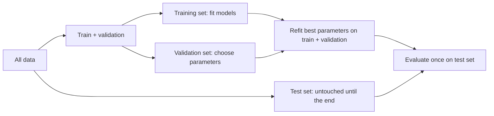

# Grid search and nested cross-validation

> **Before this lesson:** you need [Cross-validation](#/lesson/ml/cross-validation), in particular `cross_val_score` and the idea of folds. The model tuned here is the kernel support vector machine from [Kernel SVMs, neural networks and uncertainty](#/lesson/ml/svm-mlp-uncertainty); its two settings are re-explained below. The difference between parameters and hyperparameters comes from [What machine learning is](#/lesson/ml/what-is-ml).

## In plain words

Most models come with settings you must choose before training, such as how many neighbours k-NN consults or how strongly a linear model is regularised. These are **hyperparameters**: knobs you set, as opposed to the parameters the model learns. **Grid search** is the most common way to choose them: make a list of candidate values for each knob, try every combination, and keep the one that scores best. The difficult part is not the trying; it is scoring the combinations honestly.

An everyday picture: a baker adjusting a new oven. She bakes test batches at different temperatures and times, and tastes each. If she then enters the best batch in a competition and claims "my cakes are this good", she is fine. If she uses the competition judges to taste her test batches, picks the one they liked best, and then reports the judges' score as proof of her skill, she has cheated without meaning to: the judges were part of the tuning. Machine learning has exactly the same trap, and this lesson is about avoiding it.

Why this matters for a job: tuning is part of nearly every modelling project, and "why do we need separate train, validation and test sets?" is one of the most common interview questions. Getting it wrong produces models that look great in a report and disappoint in production.

## 1. A first grid search

The model to tune is a kernel support vector machine (`SVC`, from lesson 23) with an RBF kernel. It has two important hyperparameters:

- **`C`** controls how heavily the model is penalised for misclassifying training points. A small `C` tolerates mistakes and gives a smooth, simple boundary; a large `C` tries hard to classify every training point correctly, giving a more complex boundary.
- **`gamma`** controls how far the influence of a single training point reaches. A small `gamma` means each point influences a wide area (smooth boundary); a large `gamma` means each point only influences its immediate neighbourhood (a wiggly boundary that can wrap around individual points).

Both knobs act over many orders of magnitude, so we try values on a **logarithmic scale**, where each value is ten times the previous: 0.001, 0.01, 0.1, 1, 10, 100. Six values of each give $6 \times 6 = 36$ combinations. The naive implementation is two nested loops:

```python-run
from sklearn.datasets import load_iris
from sklearn.model_selection import train_test_split
from sklearn.svm import SVC

X, y = load_iris(return_X_y=True)
X_train, X_test, y_train, y_test = train_test_split(X, y, random_state=0)
best_score, best_params = 0, None
for gamma in [0.001, 0.01, 0.1, 1, 10, 100]:
    for C in [0.001, 0.01, 0.1, 1, 10, 100]:
        score = SVC(gamma=gamma, C=C).fit(X_train, y_train).score(X_test, y_test)   # evaluated on the TEST set
        if score > best_score:
            best_score, best_params = score, {"C": C, "gamma": gamma}
print("best score:", round(best_score, 3), " best parameters:", best_params)
```

**Reading this code line by line**

- The data is split once into training and test parts, as in earlier lessons.
- `best_score, best_params = 0, None` sets up variables to remember the best result seen so far.
- The two `for` loops visit all 36 combinations. For each, an `SVC` with those settings is trained on the training set and scored on the test set.
- `if score > best_score:` keeps the combination if it beats the best so far. A dictionary `{"C": C, "gamma": gamma}` records the winning settings.

The output reports a best score of 0.974 with `C=100` and `gamma=0.001`. The code works. The problem is what that 0.974 means.

## 2. The danger: overfitting the hyperparameters to the test set

It is tempting to announce "we found a model that is 97% accurate". That claim may be too optimistic. We tried 36 settings and kept the one that did best **on the test set**. The test set was used to make a decision, so it is no longer independent of the model. Its score no longer tells us how the model will do on new data, for the same reason that a training score does not: the thing being measured was adjusted to look good on that very data.

How big can this effect be? The demo below takes it to the extreme. A hundred "models" that guess completely at random are each scored on the same 40-row test set, and we pick the best.

```python-run
import numpy as np
rng = np.random.RandomState(0)
y_test = rng.randint(0, 2, 40)                          # labels of a 40-row test set
accs = [(rng.randint(0, 2, 40) == y_test).mean() for _ in range(100)]   # 100 coin-flip "models"
print("median test accuracy:", np.median(accs))
print("best test accuracy:  ", max(accs), " <- the one we would 'select'")
print("true accuracy of every one of them on new data: 0.5")
```

`rng.randint(0, 2, 40)` makes 40 random 0/1 values. The list comprehension builds 100 sets of random guesses and records each one's accuracy against the test labels. The median is 0.5, as expected from guessing, but the best of the hundred scores 0.65. Every one of these "models" is worthless; selection alone produced an apparently useful one. Real hyperparameter tuning is far less extreme, since the candidates are genuine models, but the bias points the same way: **the best of many scores on one dataset overstates the truth.**

The fix is to split the data into **three** sets:

- the **training set**, to fit the models;
- the **validation set** (also called the development set), to compare hyperparameter settings and pick one;
- the **test set**, to evaluate the chosen setting, once, at the very end.



Once the best setting is chosen on the validation set, rebuild the model with that setting on the **combined training and validation data**, so that the final model learns from as much data as possible. Then evaluate it on the test set.

```python-run
from sklearn.datasets import load_iris
from sklearn.model_selection import train_test_split
from sklearn.svm import SVC

X, y = load_iris(return_X_y=True)
X_trainval, X_test, y_trainval, y_test = train_test_split(X, y, random_state=0)
X_train, X_valid, y_train, y_valid = train_test_split(X_trainval, y_trainval, random_state=1)
print("sizes: train", len(X_train), " validation", len(X_valid), " test", len(X_test))

best_score, best_params = 0, None
for gamma in [0.001, 0.01, 0.1, 1, 10, 100]:
    for C in [0.001, 0.01, 0.1, 1, 10, 100]:
        score = SVC(gamma=gamma, C=C).fit(X_train, y_train).score(X_valid, y_valid)
        if score > best_score:
            best_score, best_params = score, {"C": C, "gamma": gamma}
final = SVC(**best_params).fit(X_trainval, y_trainval)
print("best validation score:", round(best_score, 3), best_params)
print("test score with those parameters:", round(final.score(X_test, y_test), 3))
```

**Reading this code line by line**

- The first `train_test_split` sets the test set aside. The second splits the remainder into training and validation parts. The sizes come out as 84, 28 and 38 flowers.
- The loops are the same as before, except that each model is now scored on the **validation** set.
- `SVC(**best_params)` unpacks the dictionary into keyword arguments, so it means `SVC(C=10, gamma=0.001)` for the winner here. That model is refitted on training plus validation data and scored once on the untouched test set.

The best validation score is 0.964 and the test score 0.921. The validation score is higher because the setting was chosen to do well on those particular 28 flowers; the test score is the honest estimate.

The distinction between training, validation and test data is one of the most important ideas in applied machine learning. Any decision based on test-set results, whether choosing hyperparameters, features or even which model family to use, **leaks** information from the test set into the model. Do all exploration and model selection with training and validation data, and keep the test set for one final check.

## 3. Grid search with cross-validation

A single validation split has the same weakness as a single test split (lesson 50): the result depends on which samples happened to land in it. In the demo above the winner was `C=10, gamma=0.001`; with a different seed it might have been something else. The more robust approach is to score **each combination with cross-validation** on the training data. scikit-learn packages this as `GridSearchCV`, which behaves like any other model:

1. Describe the search as a **parameter grid**: a dictionary mapping each hyperparameter name to the list of values to try.
2. Create `GridSearchCV(model, param_grid, cv=5)`.
3. Call `fit(X_train, y_train)`. It runs 5-fold cross-validation for every combination, picks the combination with the best mean score, and then **refits** a new model with that combination on the whole training set.
4. Call `predict` or `score` on the grid object; they use the refitted model.

```python-run
import pandas as pd
from sklearn.datasets import load_iris
from sklearn.model_selection import train_test_split, GridSearchCV
from sklearn.svm import SVC

X, y = load_iris(return_X_y=True)
X_train, X_test, y_train, y_test = train_test_split(X, y, random_state=0)

param_grid = {"C": [0.001, 0.01, 0.1, 1, 10, 100], "gamma": [0.001, 0.01, 0.1, 1, 10, 100]}
grid = GridSearchCV(SVC(), param_grid, cv=5, return_train_score=True)
grid.fit(X_train, y_train)                         # 36 combinations x 5 folds = 180 fits, plus one refit

print("best_params_:", grid.best_params_)
print("best_score_ (mean CV accuracy on the training set):", round(grid.best_score_, 3))
print("test set score:", round(grid.score(X_test, y_test), 3))
print("best_estimator_:", grid.best_estimator_)
```

**Reading this code line by line**

- `param_grid` lists six values for `C` and six for `gamma`. The keys must match the model's argument names exactly.
- `GridSearchCV(SVC(), param_grid, cv=5, return_train_score=True)` wraps an unfitted SVC. `return_train_score=True` also records scores on the training folds, useful for spotting overfitting.
- `grid.fit(X_train, y_train)` does all the work: $36 \times 5 = 180$ fits for the cross-validation, then 1 refit of the winner on all training data, 181 fits in total.
- `grid.best_params_` is the winning combination, `grid.best_score_` its mean cross-validation accuracy, and `grid.best_estimator_` the refitted model itself. `grid.score(X_test, y_test)` scores that refitted model on the test set.

The output: best parameters `C=10, gamma=0.1`, `best_score_` 0.973 and test score 0.974.

Keep the two numbers apart:

- **`best_score_`** is the mean cross-validation accuracy of the best combination, computed **within the training set**. It was used for selection, so it is slightly optimistic.
- **`grid.score(X_test, y_test)`** is the accuracy of the refitted model on data that played no part in any choice. That is the number to report.

### Analysing the results

`grid.cv_results_` is a dictionary with one entry per combination: the mean and standard deviation of the fold scores, the rank, timings, and the parameter values. Turned into a table it shows how sensitive the model is to each knob, and whether the grid covered the right range.

```python-run
import pandas as pd
from sklearn.datasets import load_iris
from sklearn.model_selection import train_test_split, GridSearchCV
from sklearn.svm import SVC
X, y = load_iris(return_X_y=True)
X_train, X_test, y_train, y_test = train_test_split(X, y, random_state=0)
grid = GridSearchCV(SVC(), {"C": [0.001, 0.01, 0.1, 1, 10, 100], "gamma": [0.001, 0.01, 0.1, 1, 10, 100]}, cv=5).fit(X_train, y_train)
res = pd.DataFrame(grid.cv_results_)
heat = res.pivot(index="param_gamma", columns="param_C", values="mean_test_score").round(2)
print("mean CV accuracy (rows: gamma, columns: C)")
print(heat.to_string())
```

`pd.DataFrame(grid.cv_results_)` makes a table with one row per combination. `res.pivot(index=..., columns=..., values=...)` rearranges it so that each row is a `gamma` value, each column a `C` value, and each cell the mean cross-validation accuracy. Plotted with colours, this would be a **heat map**.

Reading the printed table:

- The two left-hand columns (`C` = 0.001 and 0.01) are 0.37 everywhere. With so little penalty for mistakes the model predicts the most common class for every flower, and 37% of the training flowers belong to it. Those values are too small to be useful.
- The bottom row (`gamma` = 100) is poor too: each point's influence is so local that the model memorises the training points and fails on new ones.
- The good region, around 0.94 to 0.97, runs diagonally: a larger `C` works with a smaller `gamma` and vice versa, because both knobs trade off complexity.

General rules for reading a search table:

- If the scores hardly change across the grid, either the range is wrong or the parameter does not matter. Try much more extreme values first.
- If the best value lies **on the edge** of the grid, extend the grid in that direction; better values may lie beyond it.
- Ideally the best value sits inside the grid, with clearly worse values on all sides.
- Search hyperparameters that act multiplicatively, such as `C`, `gamma` and regularisation strengths, on a logarithmic scale.

### Grids that are not rectangular

Some hyperparameters only matter when another has a certain value. `SVC` has a `kernel` hyperparameter: with `kernel="linear"` only `C` is used, while with `kernel="rbf"` both `C` and `gamma` are. A single rectangular grid would waste time trying many `gamma` values for the linear kernel, where they make no difference. Instead, give `param_grid` as a **list of dictionaries**; each dictionary is expanded into its own grid:

```python-run
from sklearn.datasets import load_iris
from sklearn.model_selection import train_test_split, GridSearchCV
from sklearn.svm import SVC
X, y = load_iris(return_X_y=True)
X_train, X_test, y_train, y_test = train_test_split(X, y, random_state=0)
param_grid = [
    {"kernel": ["rbf"], "C": [0.01, 1, 100], "gamma": [0.01, 0.1, 1]},
    {"kernel": ["linear"], "C": [0.01, 1, 100]},
]
grid = GridSearchCV(SVC(), param_grid, cv=5).fit(X_train, y_train)
print("combinations tried:", len(grid.cv_results_["params"]))
print("best:", grid.best_params_, " CV score:", round(grid.best_score_, 3))
```

The first dictionary gives $1 \times 3 \times 3 = 9$ combinations and the second $1 \times 3 = 3$, so 12 are tried, as the output confirms. On iris the winner is the linear kernel with `C=1`, with a cross-validation score of 0.973.

## 4. Nested cross-validation

`GridSearchCV` still relies on *one* split of the data into training and test sets, so the final test score depends on that split. We can go one step further and use cross-validation for the outer split as well. This is **nested cross-validation**:

- an **outer loop** splits the data into training and test folds, as in ordinary cross-validation;
- for each outer split, an **inner** grid search, with its own cross-validation on the outer training part only, chooses the best hyperparameters;
- the model chosen in each outer split is scored on that split's outer test fold.

The result is a list of scores, not a model and not a parameter setting. It answers the question: "how well does this *whole procedure*, a model plus its hyperparameter search, generalise on data like mine?" That makes it a good tool for comparing approaches (say, SVM with tuning versus random forest with tuning) and rarely the way to produce the model you deploy.

```python-run
from sklearn.datasets import load_iris
from sklearn.model_selection import GridSearchCV, cross_val_score
from sklearn.svm import SVC
X, y = load_iris(return_X_y=True)
param_grid = {"C": [0.1, 1, 10, 100], "gamma": [0.01, 0.1, 1]}
scores = cross_val_score(GridSearchCV(SVC(), param_grid, cv=3), X, y, cv=5)     # outer 5 folds x inner 3 folds
print("nested CV scores:", scores.round(3), " mean:", scores.mean().round(3))
```

The single line `cross_val_score(GridSearchCV(...), X, y, cv=5)` does it all. `cross_val_score` treats the grid search as one model: for each of its five outer folds it calls the grid search's `fit` on the outer training part, which runs its own 3-fold search and refits, and then scores the result on the outer test fold. The output is five scores, `[0.967 1. 0.9 0.967 1.]`, with mean 0.967.

The cost multiplies. In words: outer folds times (combinations times inner folds, plus one refit). Here that is $5 \times (12 \times 3 + 1) = 5 \times 37 = 185$ fits. With a big grid and a slow model, nested cross-validation quickly becomes expensive.

## 5. Parallelism and smarter searches

- Grid search is **embarrassingly parallel**: the fits do not depend on each other, so they can run at the same time. `n_jobs=-1` tells scikit-learn to use all processor cores. (The in-browser demos on this site run on a single core, so they leave it at the default.)
- **`RandomizedSearchCV`** draws a fixed number of random combinations from distributions you specify, instead of trying them all. When there are several hyperparameters, random search usually finds good settings far more cheaply than a grid. The reason: often only one or two hyperparameters really matter. With a budget of 9 evaluations, a $3 \times 3$ grid tries only 3 different values of the important one; random search tries 9.
- **Successive halving** (`HalvingGridSearchCV`) starts many candidates on a small amount of data and gives more data only to the most promising. **Bayesian optimisation** libraries such as Optuna and scikit-optimize build a model of which regions score well and choose the next setting to try accordingly.

```python-run
from scipy.stats import loguniform
from sklearn.datasets import load_breast_cancer
from sklearn.model_selection import RandomizedSearchCV, train_test_split
from sklearn.pipeline import make_pipeline
from sklearn.preprocessing import StandardScaler
from sklearn.svm import SVC

X, y = load_breast_cancer(return_X_y=True)
X_tr, X_te, y_tr, y_te = train_test_split(X, y, random_state=0)
search = RandomizedSearchCV(
    make_pipeline(StandardScaler(), SVC()),
    {"svc__C": loguniform(1e-2, 1e3), "svc__gamma": loguniform(1e-4, 1e0)},
    n_iter=15, cv=3, random_state=0).fit(X_tr, y_tr)
print("best:", {k: float(round(v, 4)) for k, v in search.best_params_.items()})
print("CV score:", round(search.best_score_, 3), " test score:", round(search.score(X_te, y_te), 3))
```

**Reading this code line by line**

- `loguniform(1e-2, 1e3)` is a probability distribution from SciPy whose values are spread evenly on a logarithmic scale between 0.01 and 1,000: a draw is as likely to fall between 0.01 and 0.1 as between 100 and 1,000. It is the random-search version of a log-spaced list.
- `make_pipeline(StandardScaler(), SVC())` chains scaling and the SVM into one model (lesson 60). In a pipeline, hyperparameters are addressed as *step name*, two underscores, *parameter name*: `svc__C` is the `C` of the step named `svc`.
- `n_iter=15` draws 15 random combinations; `cv=3` scores each with 3-fold cross-validation; `random_state=0` makes the draws reproducible.

The search picks roughly `C` = 10.3 and `gamma` = 0.015, with a cross-validation score of 0.977 and a test score of 0.979, from 15 combinations rather than a full grid.

> [!WARNING]
> The search above scales the data *inside* a pipeline, so each cross-validation fold fits its own scaler on its own training part. Scaling the whole training set first and then running `GridSearchCV` on it lets every validation fold influence the scaler. That is a small leak for scaling and a serious one for steps like feature selection, as the previous module showed. Module 6 explains how pipelines prevent it.

> [!INTERVIEW]
> **"Why do we need train, validation and test sets?"** Training data fits the model's parameters. Validation data (or cross-validation on the training data) chooses hyperparameters and compares models. The test set is used once, at the end, to estimate real-world performance. If you tune on the test set, the reported score is biased upwards, because you selected the configuration that happened to do best on those particular examples. Likely follow-ups: nested cross-validation for an unbiased estimate of the whole tuning procedure, and why random search beats grid search when only a few hyperparameters matter.

## Summary

- Grid search tries every combination of candidate hyperparameter values. Never use the test set to choose among them.
- Use training, validation and test sets, or better, `GridSearchCV`, which cross-validates each combination on the training data and refits the winner.
- `best_score_` is a cross-validation score from the training data and is slightly optimistic. The test score from `grid.score` is the honest one.
- Inspect `cv_results_`: a best value on the edge of the grid means the grid should be extended.
- Nested cross-validation estimates the performance of "model plus tuning procedure". Random search is cheaper when there are many hyperparameters.

## Glossary

- **Hyperparameter**: a setting chosen before training rather than learned from the data.
- **Grid search**: trying every combination of candidate hyperparameter values.
- **Parameter grid**: the dictionary (or list of dictionaries) of candidate values to try.
- **`C` (SVM)**: how heavily misclassified training points are penalised; larger means a more complex model.
- **`gamma` (RBF kernel)**: how far one training point's influence reaches; larger means a more local, wiggly boundary.
- **Logarithmic scale**: candidate values that grow by a constant factor, such as 0.01, 0.1, 1, 10.
- **Validation (development) set**: data held out from training to compare settings.
- **Refit**: retraining the winning setting on all the available training data.
- **Heat map**: a table of scores coloured by value, here with one hyperparameter per axis.
- **Nested cross-validation**: an outer cross-validation loop around a cross-validated hyperparameter search.
- **Embarrassingly parallel**: made of independent tasks that can all run at the same time.
- **Random search**: trying a fixed number of randomly drawn combinations instead of all of them.
- **Successive halving / Bayesian optimisation**: search methods that spend more effort on promising candidates.

## Check yourself

```quiz
[
  {"q": "Why is it wrong to pick hyperparameters by their score on the test set?", "options": ["The test score then overestimates performance on new data, because the parameters were tuned to that set", "The test set is too small to compute accuracy", "scikit-learn forbids it", "It makes training slower"], "answer": 0,
   "explain": "Information from the test set leaks into model selection, so it is no longer an independent evaluation."},
  {"q": "After GridSearchCV.fit(X_train, y_train), best_score_ is…", "options": ["the mean cross-validated score of the best parameter combination on the training data", "the accuracy on the test set", "the training accuracy of the refitted model", "the worst fold score"], "answer": 0,
   "explain": "It comes from the inner cross-validation; the test score must be computed separately."},
  {"q": "A grid of 6 values of C and 6 values of gamma with cv=5 trains how many models before the refit?", "options": ["180", "36", "30", "11"], "answer": 0,
   "explain": "36 combinations × 5 folds = 180 fits, then one refit on the full training set."},
  {"q": "The best parameters found lie on the boundary of your grid. You should…", "options": ["extend the grid in that direction and search again", "stop: the optimum has been found", "reduce the number of folds", "switch to the test set to decide"], "answer": 0,
   "explain": "Better values may lie outside the range you tried."},
  {"q": "What does nested cross-validation estimate?", "options": ["The generalisation performance of the model including its hyperparameter search", "The single best hyperparameter setting", "The training time", "The feature importances"], "answer": 0,
   "explain": "The outer loop scores models whose parameters were chosen by the inner search; it returns scores, not a model."},
  {"q": "How do you search parameters that only apply for some values of another parameter (e.g. gamma only for the RBF kernel)?", "options": ["Pass a list of dictionaries as param_grid", "Run two separate programs", "It is impossible in scikit-learn", "Set gamma to None"], "answer": 0,
   "explain": "Each dictionary in the list defines its own independent grid."},
  {"q": "Compared with grid search, random search with the same budget…", "options": ["tries more distinct values of each individual parameter, which helps when only a few parameters matter", "always finds the global optimum", "cannot be parallelised", "does not use cross-validation"], "answer": 0,
   "explain": "Grids repeat the same few values of each parameter; random sampling covers each dimension more densely."},
  {"q": "100 models that guess at random are scored on one 40-row test set and the best is kept. Its test accuracy will most likely be…", "options": ["well above 0.5, though its true accuracy is 0.5", "exactly 0.5", "below 0.5", "1.0"], "answer": 0,
   "explain": "Picking the maximum of many noisy scores selects luck; the demo's best of 100 scored 0.65."}
]
```

> **Source:** Müller & Guido, *Introduction to Machine Learning with Python*, ch. 5 ("Grid Search", "Simple Grid Search", "The Danger of Overfitting the Parameters and the Validation Set", "Grid Search with Cross-Validation": analysing the results, search over spaces that are not grids, nested cross-validation, parallelising); scikit-learn User Guide, "Tuning the hyper-parameters of an estimator".
