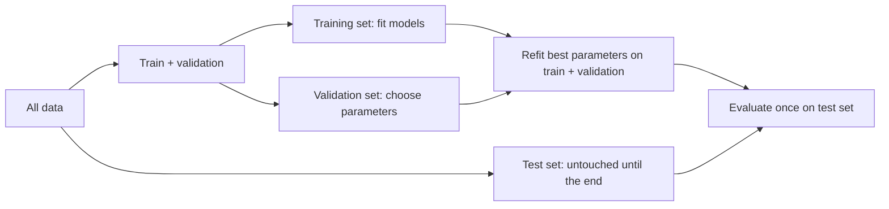

# Grid search and nested cross-validation

Now that we can evaluate how well a model generalises, the next step is to **improve** it by tuning its
parameters. Finding the values that give the best generalisation is a common and tricky task, and the
most common method is **grid search**: try every combination of the parameters of interest. This lesson
follows chapter 5 of Müller & Guido from a hand-written loop to `GridSearchCV`, and then to the pitfalls.

## 1. A simple grid search

Take an RBF-kernel SVM with two important parameters, the kernel width `gamma` and the regularisation
`C`. Trying six values of each gives 36 combinations. A naive implementation is two nested loops:

```python-run
from sklearn.datasets import load_iris
from sklearn.model_selection import train_test_split
from sklearn.svm import SVC

X, y = load_iris(return_X_y=True)
X_train, X_test, y_train, y_test = train_test_split(X, y, random_state=0)
best_score, best_params = 0, None
for gamma in [0.001, 0.01, 0.1, 1, 10, 100]:
    for C in [0.001, 0.01, 0.1, 1, 10, 100]:
        score = SVC(gamma=gamma, C=C).fit(X_train, y_train).score(X_test, y_test)   # evaluated on the TEST set
        if score > best_score:
            best_score, best_params = score, {"C": C, "gamma": gamma}
print("best score:", round(best_score, 3), " best parameters:", best_params)
```

## 2. The danger: overfitting the parameters to the test set

It is tempting to report "we found a model that is 97% accurate". That claim could be **overly
optimistic, or simply wrong**. We tried many parameter values and picked the one with the best accuracy
*on the test set*. That accuracy won't necessarily carry over to new data, because the test data was used
to adjust the parameters. It can no longer tell us how good the model is. This is the same reason we
split off a test set in the first place: evaluation needs an independent dataset that was **not used to
create the model**.

The fix is to split the data into **three** sets:

- the **training set**, to build the model;
- the **validation (development) set**, to select the parameters;
- the **test set**, to evaluate the selected parameters, once, at the very end.



After choosing the best parameters on the validation set, rebuild the model with those parameters on the
**combined training and validation data**, so that as much data as possible is used. Then evaluate on the
test set.

```python-run
from sklearn.datasets import load_iris
from sklearn.model_selection import train_test_split
from sklearn.svm import SVC

X, y = load_iris(return_X_y=True)
X_trainval, X_test, y_trainval, y_test = train_test_split(X, y, random_state=0)
X_train, X_valid, y_train, y_valid = train_test_split(X_trainval, y_trainval, random_state=1)
print("sizes: train", len(X_train), " validation", len(X_valid), " test", len(X_test))

best_score, best_params = 0, None
for gamma in [0.001, 0.01, 0.1, 1, 10, 100]:
    for C in [0.001, 0.01, 0.1, 1, 10, 100]:
        score = SVC(gamma=gamma, C=C).fit(X_train, y_train).score(X_valid, y_valid)
        if score > best_score:
            best_score, best_params = score, {"C": C, "gamma": gamma}
final = SVC(**best_params).fit(X_trainval, y_trainval)
print("best validation score:", round(best_score, 3), best_params)
print("test score with those parameters:", round(final.score(X_test, y_test), 3))
```

The validation score is typically a little higher than the test score, because the parameters were
selected to do well on that particular validation set. The book stresses that the distinction between
training, validation and test sets is fundamentally important. Any choice made on the basis of test-set
accuracy **"leaks" information from the test set into the model**. Keep a separate test set that is used
only for the final evaluation. It is fine to do all exploratory analysis and model selection on the
training and validation sets, and to save the test set for the end.

## 3. Grid search with cross-validation

A single validation split is still sensitive to how the data happened to be divided. For a better estimate,
use **cross-validation to evaluate each parameter combination**. scikit-learn provides this as
`GridSearchCV`, which behaves like any other estimator:

1. Describe the parameters to search as a dictionary, mapping names to lists of values.
2. Create `GridSearchCV(model, param_grid, cv=5)`.
3. Call `fit(X_train, y_train)`. It runs cross-validation for every combination, picks the best, and
   **automatically refits** a new model on the whole training set with the best parameters.
4. Use `predict` and `score` on the test set through the refitted model.

```python-run
import pandas as pd
from sklearn.datasets import load_iris
from sklearn.model_selection import train_test_split, GridSearchCV
from sklearn.svm import SVC

X, y = load_iris(return_X_y=True)
X_train, X_test, y_train, y_test = train_test_split(X, y, random_state=0)

param_grid = {"C": [0.001, 0.01, 0.1, 1, 10, 100], "gamma": [0.001, 0.01, 0.1, 1, 10, 100]}
grid = GridSearchCV(SVC(), param_grid, cv=5, return_train_score=True)
grid.fit(X_train, y_train)                         # 36 combinations x 5 folds = 180 fits, plus one refit

print("best_params_:", grid.best_params_)
print("best_score_ (mean CV accuracy on the training set):", round(grid.best_score_, 3))
print("test set score:", round(grid.score(X_test, y_test), 3))
print("best_estimator_:", grid.best_estimator_)
```

Keep two numbers apart:

- **`best_score_`** is the mean cross-validation accuracy of the best combination, computed **on the
  training set**.
- **`grid.score(X_test, y_test)`** is the generalisation performance of the refitted model on data that
  played no part in parameter selection. This is the number to report.

### Analysing the results

`cv_results_` holds a row per combination: mean and standard deviation of the scores, the rank, and the
timings. Viewing it as a DataFrame or heat map shows how sensitive the model is to each parameter and
whether the grid is well chosen.

```python-run
import pandas as pd
from sklearn.datasets import load_iris
from sklearn.model_selection import train_test_split, GridSearchCV
from sklearn.svm import SVC
X, y = load_iris(return_X_y=True)
X_train, X_test, y_train, y_test = train_test_split(X, y, random_state=0)
grid = GridSearchCV(SVC(), {"C": [0.001, 0.01, 0.1, 1, 10, 100], "gamma": [0.001, 0.01, 0.1, 1, 10, 100]}, cv=5).fit(X_train, y_train)
res = pd.DataFrame(grid.cv_results_)
heat = res.pivot(index="param_gamma", columns="param_C", values="mean_test_score").round(2)
print("mean CV accuracy (rows: gamma, columns: C)")
print(heat.to_string())
```

How to read such a table, following the book:

- If the scores hardly change across the grid, the parameter range is wrong or the parameter doesn't
  matter. Try more extreme values first.
- If the best values lie **on the edge** of the grid, extend the grid in that direction. Better values may
  lie beyond it.
- Ideally the optimum sits in the interior, with clearly worse values on all sides.
- Tune parameters on a **logarithmic** scale.

### Grids that are not rectangular

Some parameters apply only with certain settings of others. `SVC` has a `kernel` parameter. With
`kernel="linear"` only `C` is used, and with `kernel="rbf"` both `C` and `gamma` are. Give `param_grid`
as a **list of dictionaries**, each expanded into its own grid:

```python-run
from sklearn.datasets import load_iris
from sklearn.model_selection import train_test_split, GridSearchCV
from sklearn.svm import SVC
X, y = load_iris(return_X_y=True)
X_train, X_test, y_train, y_test = train_test_split(X, y, random_state=0)
param_grid = [
    {"kernel": ["rbf"], "C": [0.01, 1, 100], "gamma": [0.01, 0.1, 1]},
    {"kernel": ["linear"], "C": [0.01, 1, 100]},
]
grid = GridSearchCV(SVC(), param_grid, cv=5).fit(X_train, y_train)
print("combinations tried:", len(grid.cv_results_["params"]))
print("best:", grid.best_params_, " CV score:", round(grid.best_score_, 3))
```

## 4. Nested cross-validation

`GridSearchCV` still relies on *one* split into training and test data, so the final score depends on
that split. We can go a step further and use cross-validation for the outer split as well. This is
**nested cross-validation**:

- an **outer loop** splits the data into training and test folds;
- for each outer split, an **inner** grid search (with its own cross-validation on the outer training
  part) finds the best parameters;
- the best model of each outer split is scored on its outer test fold.

The result is a list of scores, not a model and not a parameter setting. It tells you how well a model
generalises *when its parameters are chosen by this grid search*. It is rarely used to build a predictive
model. It is useful for judging how well a given model works on a given dataset.

```python-run
from sklearn.datasets import load_iris
from sklearn.model_selection import GridSearchCV, cross_val_score
from sklearn.svm import SVC
X, y = load_iris(return_X_y=True)
param_grid = {"C": [0.1, 1, 10, 100], "gamma": [0.01, 0.1, 1]}
scores = cross_val_score(GridSearchCV(SVC(), param_grid, cv=3), X, y, cv=5)     # outer 5 folds x inner 3 folds
print("nested CV scores:", scores.round(3), " mean:", scores.mean().round(3))
```

The cost multiplies: 12 combinations × 3 inner folds × 5 outer folds = 180 fits, plus 5 refits.

## 5. Parallelism and smarter searches

- Grid search is embarrassingly parallel. `n_jobs=-1` uses all CPU cores.
- **`RandomizedSearchCV`** samples a fixed number of combinations from distributions instead of trying
  them all. With several parameters, random search usually finds good settings far more cheaply than a
  grid. A grid wastes evaluations on unimportant parameters, while random search tries a new value of the
  important ones every time.
- **Successive halving** (`HalvingGridSearchCV`) and **Bayesian optimisation** (Optuna, scikit-optimize)
  spend the budget on promising regions.

```python-run
from scipy.stats import loguniform
from sklearn.datasets import load_breast_cancer
from sklearn.model_selection import RandomizedSearchCV, train_test_split
from sklearn.pipeline import make_pipeline
from sklearn.preprocessing import StandardScaler
from sklearn.svm import SVC

X, y = load_breast_cancer(return_X_y=True)
X_tr, X_te, y_tr, y_te = train_test_split(X, y, random_state=0)
search = RandomizedSearchCV(
    make_pipeline(StandardScaler(), SVC()),
    {"svc__C": loguniform(1e-2, 1e3), "svc__gamma": loguniform(1e-4, 1e0)},
    n_iter=15, cv=3, random_state=0).fit(X_tr, y_tr)
print("best:", {k: float(round(v, 4)) for k, v in search.best_params_.items()})
print("CV score:", round(search.best_score_, 3), " test score:", round(search.score(X_te, y_te), 3))
```

> [!WARNING]
> The search above scales the data *inside* a pipeline. Scaling the whole training set first and then
> running `GridSearchCV` on it lets every validation fold influence the scaler. That is a small leak here
> and a serious one for steps like feature selection. Module 6 explains.

> [!INTERVIEW]
> **"Why do we need train, validation and test sets?"** Training fits the parameters. Validation (or
> cross-validation) chooses hyperparameters and models. The test set is used once to estimate real-world
> performance. If you tune on the test set, the reported score is biased upwards, because you selected the
> configuration that happened to do best on those particular examples. Follow-ups: nested CV for an
> unbiased estimate of the whole tuning procedure, and random search versus grid search.

## Summary

- Grid search tries all combinations. Never use the test set to choose among them.
- Use train / validation / test, or better, `GridSearchCV` with cross-validation on the training set.
- `best_score_` is a cross-validation score from the training data. The test score from `grid.score` is
  the honest one.
- Inspect `cv_results_`: an optimum on the edge of the grid means the grid should be extended.
- Nested CV estimates the performance of "model plus tuning procedure". Random search is cheaper when
  there are many parameters.

```quiz
[
  {"q": "Why is it wrong to pick hyperparameters by their score on the test set?", "options": ["The test score then overestimates performance on new data, because the parameters were tuned to that set", "The test set is too small to compute accuracy", "scikit-learn forbids it", "It makes training slower"], "answer": 0,
   "explain": "Information from the test set leaks into model selection, so it is no longer an independent evaluation."},
  {"q": "After GridSearchCV.fit(X_train, y_train), best_score_ is…", "options": ["the mean cross-validated score of the best parameter combination on the training data", "the accuracy on the test set", "the training accuracy of the refitted model", "the worst fold score"], "answer": 0,
   "explain": "It comes from the inner cross-validation; the test score must be computed separately."},
  {"q": "A grid of 6 values of C and 6 values of gamma with cv=5 trains how many models before the refit?", "options": ["180", "36", "30", "11"], "answer": 0,
   "explain": "36 combinations × 5 folds = 180 fits, then one refit on the full training set."},
  {"q": "The best parameters found lie on the boundary of your grid. You should…", "options": ["extend the grid in that direction and search again", "stop: the optimum has been found", "reduce the number of folds", "switch to the test set to decide"], "answer": 0,
   "explain": "Better values may lie outside the range you tried."},
  {"q": "What does nested cross-validation estimate?", "options": ["The generalisation performance of the model including its hyperparameter search", "The single best hyperparameter setting", "The training time", "The feature importances"], "answer": 0,
   "explain": "The outer loop scores models whose parameters were chosen by the inner search; it returns scores, not a model."},
  {"q": "How do you search parameters that only apply for some values of another parameter (e.g. gamma only for the RBF kernel)?", "options": ["Pass a list of dictionaries as param_grid", "Run two separate programs", "It is impossible in scikit-learn", "Set gamma to None"], "answer": 0,
   "explain": "Each dictionary in the list defines its own independent grid."},
  {"q": "Compared with grid search, random search with the same budget…", "options": ["tries more distinct values of each individual parameter, which helps when only a few parameters matter", "always finds the global optimum", "cannot be parallelised", "does not use cross-validation"], "answer": 0,
   "explain": "Grids repeat the same few values of each parameter; random sampling covers each dimension more densely."}
]
```

> **Source:** Müller & Guido, *Introduction to Machine Learning with Python*, ch. 5 ("Grid Search", "Simple Grid Search", "The Danger of Overfitting the Parameters and the Validation Set", "Grid Search with Cross-Validation": analysing the results, search over spaces that are not grids, nested cross-validation, parallelising); scikit-learn User Guide, "Tuning the hyper-parameters of an estimator".
