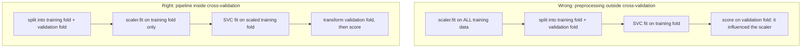

# Algorithm chains and pipelines

> **Before this lesson:** you need `GridSearchCV` and the train/validation/test discipline from [Grid search and nested cross-validation](#/lesson/ml/grid-search), and scalers such as `MinMaxScaler` and `StandardScaler` from [Preprocessing and scaling](#/lesson/ml/preprocessing-scaling). PCA from [PCA, NMF and t-SNE](#/lesson/ml/dimensionality-reduction) and feature selection from [Nonlinear transforms, feature selection and expert knowledge](#/lesson/ml/feature-selection) appear as example steps; you only need to know that each one is fitted on data and then transforms it.

## In plain words

Real machine-learning code rarely uses one algorithm on its own. Data is first cleaned, then scaled, perhaps reduced or filtered, and only then handed to a model. A **pipeline** packages that whole chain of steps into one object that behaves like a single model: you call `fit` once and every step is trained in order; you call `predict` once and every step is applied in order.

Think of a coffee machine that grinds, tamps and brews when you press one button, compared with doing each step by hand with separate tools. The machine is more convenient, but the real advantage is that it always does the steps in the same order with the same settings, and it never uses tomorrow's beans to calibrate today's grind. A pipeline gives your code that same reliability.

Why this matters for a job: pipelines prevent a whole family of evaluation bugs called data leakage, which make models look better in testing than they will be in production. They also make deployment safer, because the exact preprocessing used in training travels with the model. "What is data leakage and how do you prevent it?" is a standard interview question, and pipelines are the expected answer.

## 1. The problem: preprocessing before cross-validation

Two terms first. In scikit-learn, a **transformer** is an object with `fit` and `transform` methods: it learns something from data in `fit` (such as each column's minimum and maximum) and then changes data in `transform`. Scalers, PCA and feature selectors are transformers. A **predictor** has `fit` and `predict`: classifiers and regressors. Both are kinds of **estimator**, scikit-learn's name for anything with a `fit` method.

Here is the workflow from earlier lessons for a support vector machine on the breast-cancer data: scale, then grid-search.

```python-run
from sklearn.datasets import load_breast_cancer
from sklearn.model_selection import train_test_split, GridSearchCV
from sklearn.preprocessing import MinMaxScaler
from sklearn.svm import SVC

X, y = load_breast_cancer(return_X_y=True)
X_train, X_test, y_train, y_test = train_test_split(X, y, random_state=0)

scaler = MinMaxScaler().fit(X_train)                 # scaling fitted on the training set: good
X_train_scaled = scaler.transform(X_train)
X_test_scaled = scaler.transform(X_test)

param_grid = {"C": [0.01, 0.1, 1, 10, 100], "gamma": [0.01, 0.1, 1, 10]}
grid = GridSearchCV(SVC(), param_grid, cv=5).fit(X_train_scaled, y_train)     # <- subtle problem here
print("best CV accuracy:", round(grid.best_score_, 3), grid.best_params_)
print("test accuracy:", round(grid.score(X_test_scaled, y_test), 3))
```

**Reading this code line by line**

- `MinMaxScaler().fit(X_train)` learns the minimum and maximum of each column from the training data; `transform` then rescales every column to run from 0 to 1. The test set is transformed with the same learned numbers, which is correct.
- `GridSearchCV(SVC(), param_grid, cv=5)` searches 20 combinations of `C` and `gamma` with 5-fold cross-validation, on the already-scaled training data.

The output is a best cross-validation accuracy of 0.981 at `C=1, gamma=1` and a test accuracy of 0.972. Nothing looks wrong, and yet there is a flaw.

The scaler was fitted on **all** of the training data. The grid search then split that data into training folds and a validation fold, five times. The validation fold is supposed to stand in for new, unseen data. But the scaler had already looked at the validation fold when it computed the minimum and maximum of each column. **Information from the held-out part leaked into the model.**

That is not how new data reaches a model in real use. A genuinely new patient's measurements were not part of the data used to choose the scaling. So the cross-validation splits do not imitate reality, which can produce over-optimistic scores and even the wrong choice of hyperparameters.

The rule that fixes it: split first, then preprocess. **Any step that learns from data must be fitted on the training portion only**, so cross-validation has to be the *outermost* loop, wrapped around all the learning steps.



## 2. Building a pipeline

A `Pipeline` is created from a list of steps. Each step is a **tuple**, a fixed pair written in round brackets, holding a **name** of your choice (any string) and an estimator object.

```python-run
from sklearn.datasets import load_breast_cancer
from sklearn.model_selection import train_test_split
from sklearn.pipeline import Pipeline
from sklearn.preprocessing import MinMaxScaler
from sklearn.svm import SVC

X, y = load_breast_cancer(return_X_y=True)
X_train, X_test, y_train, y_test = train_test_split(X, y, random_state=0)

pipe = Pipeline([("scaler", MinMaxScaler()), ("svm", SVC())])
pipe.fit(X_train, y_train)       # 1) scaler.fit_transform(X_train)  2) svm.fit(scaled X_train, y_train)
print("test score:", round(pipe.score(X_test, y_test), 3))   # scaler.transform(X_test), then svm.score
```

**Reading this code line by line**

- `Pipeline([("scaler", MinMaxScaler()), ("svm", SVC())])` defines a two-step chain: a step named `"scaler"` followed by a step named `"svm"`.
- `pipe.fit(X_train, y_train)` fits the scaler on `X_train`, transforms `X_train` with it, and fits the SVM on the scaled result. Doing fit and transform in one go is called `fit_transform`.
- `pipe.score(X_test, y_test)` transforms `X_test` **with the already fitted scaler** (nothing is refitted), then asks the SVM to score the result. `pipe.predict` works the same way.

The test score is 0.972, the same as before, since this split was already handled correctly. The gain is that the pipeline is now a single model, and the test data can never influence the scaler by accident.

## 3. Using pipelines in grid searches

A pipeline goes into `GridSearchCV` like any other estimator. The one change is how hyperparameters are named: **step name, two underscores, parameter name**. To search the `C` of the step called `"svm"`, the key is `"svm__C"`. The double underscore tells scikit-learn where the step name ends.

```python-run
from sklearn.datasets import load_breast_cancer
from sklearn.model_selection import train_test_split, GridSearchCV
from sklearn.pipeline import Pipeline
from sklearn.preprocessing import MinMaxScaler
from sklearn.svm import SVC

X, y = load_breast_cancer(return_X_y=True)
X_train, X_test, y_train, y_test = train_test_split(X, y, random_state=0)
pipe = Pipeline([("scaler", MinMaxScaler()), ("svm", SVC())])
param_grid = {"svm__C": [0.01, 0.1, 1, 10, 100], "svm__gamma": [0.01, 0.1, 1, 10]}
grid = GridSearchCV(pipe, param_grid, cv=5).fit(X_train, y_train)       # raw data in: scaling happens per fold
print("best CV accuracy:", round(grid.best_score_, 3))
print("best parameters:", grid.best_params_)
print("test accuracy:", round(grid.score(X_test, y_test), 3))
```

Notice that the grid search now receives the **raw**, unscaled `X_train`. For each of the 100 fits (20 combinations × 5 folds), the pipeline refits the `MinMaxScaler` on that split's training folds only, and only then transforms the validation fold. Nothing leaks.

On this dataset the result happens to be identical: best accuracy 0.981 at `C=1, gamma=1`, test accuracy 0.972. For a scaler the leak is small, because the minimum and maximum of 426 training rows barely change when one fold is removed. The next demo shows a step for which the leak is enormous.

### How bad can leakage be?

The example below, which the book borrows from Hastie, Tibshirani and Friedman's *The Elements of Statistical Learning*, uses data in which there is nothing to learn: 100 samples with 10,000 features of pure random noise, and a target that is also random noise, unrelated to the features.

We first pick the 5% of features most correlated with the target, using the whole dataset, and then cross-validate a ridge regression on those features. Then we do it properly, with the selection inside a pipeline.

```python-run
import numpy as np
from sklearn.feature_selection import SelectPercentile, f_regression
from sklearn.linear_model import Ridge
from sklearn.model_selection import cross_val_score
from sklearn.pipeline import Pipeline

rng = np.random.RandomState(0)
X = rng.normal(size=(100, 10000))         # 100 samples, 10,000 features of pure noise
y = rng.normal(size=100)                  # the target is independent of X: nothing to learn

# WRONG: feature selection sees every sample, including those later used for validation
X_selected = SelectPercentile(f_regression, percentile=5).fit(X, y).transform(X)
leaky = cross_val_score(Ridge(), X_selected, y, cv=5).mean()

# RIGHT: selection is a pipeline step, refitted inside each fold
pipe = Pipeline([("select", SelectPercentile(f_regression, percentile=5)), ("ridge", Ridge())])
honest = cross_val_score(pipe, X, y, cv=5).mean()
print(f"leaky cross-validation R2:  {leaky:.2f}   <- looks like a great model, on pure noise")
print(f"proper cross-validation R2: {honest:.2f}   <- correctly reports that there is nothing to learn")
```

**Reading this code line by line**

- `rng.normal(size=(100, 10000))` creates the noise features and `rng.normal(size=100)` the noise target.
- `SelectPercentile(f_regression, percentile=5)` keeps the 5% of features (500 of them) with the strongest straight-line relationship to the target, as measured by the F-test for regression. In the wrong version it is fitted on all 100 rows, and cross-validation then runs on the 500 chosen columns.
- In the right version the selector and the ridge model form one pipeline, so each of the five cross-validation runs selects its own 500 columns from its own 80 training rows.

The leaky version reports $R^2 = 0.91$, a seemingly excellent model built on noise. The proper version reports $-0.25$: worse than predicting the average, which is the honest verdict. Here is why. Among 10,000 random columns, some correlate with 100 random targets by pure chance. When the selection sees all 100 rows, it picks exactly the columns whose chance correlations hold *on the rows that will later be used for validation*, so validation confirms them. When selection only sees the training rows, its chance correlations do not carry over to the held-out rows.

> [!WARNING]
> Every step that **learns from data** belongs inside the pipeline: scalers, imputers (which fill in missing values), encoders, PCA, feature selection, tf-idf (module 7), target encoding, and oversampling. If a step has a `fit` method, it must be fitted on training folds only.

## 4. The general pipeline interface

A pipeline is not limited to "one preprocessing step plus a classifier". It can chain any number of estimators: for example feature extraction, then feature selection, then scaling, then classification. The single requirement is that every step **except the last** must have a `transform` method, so that it can produce the input for the next step. The last step can be anything.

- `pipeline.fit(X, y)` goes through the steps in order. Each step except the last is fitted on the output of the previous step and then transforms it (in practice with `fit_transform`). The last step is fitted on the final transformed data.
- `pipeline.predict(X)` calls `transform` on each step except the last, then `predict` on the last step.
- The last step need not be a predictor. A pipeline of a scaler followed by PCA has a `transform` method but no `predict`.

To remove any mystery, here is a simplified re-implementation. It is written as a Python **class**, a template for objects that bundles data (here, the list of steps) with functions that act on it, called **methods** (here `fit` and `predict`).

```python-run
class MiniPipeline:
    """A tiny re-implementation of the idea behind sklearn.pipeline.Pipeline."""
    def __init__(self, steps):
        self.steps = steps
    def fit(self, X, y):
        X_t = X
        for name, est in self.steps[:-1]:
            X_t = est.fit(X_t, y).transform(X_t)       # fit each transformer on the output of the previous one
        self.steps[-1][1].fit(X_t, y)
        return self
    def predict(self, X):
        X_t = X
        for name, est in self.steps[:-1]:
            X_t = est.transform(X_t)                   # transform only: nothing is refitted at prediction time
        return self.steps[-1][1].predict(X_t)

from sklearn.datasets import load_breast_cancer
from sklearn.model_selection import train_test_split
from sklearn.preprocessing import StandardScaler
from sklearn.decomposition import PCA
from sklearn.linear_model import LogisticRegression
X, y = load_breast_cancer(return_X_y=True)
X_tr, X_te, y_tr, y_te = train_test_split(X, y, random_state=0)
mini = MiniPipeline([("scale", StandardScaler()), ("pca", PCA(n_components=5)), ("clf", LogisticRegression())]).fit(X_tr, y_tr)
print("mini pipeline test accuracy:", round(float((mini.predict(X_te) == y_te).mean()), 3))
```

**Reading this code line by line**

- `__init__` runs when the object is created and stores the list of steps in `self.steps`. `self` refers to the object itself.
- In `fit`, `self.steps[:-1]` is every step except the last. For each, `est.fit(X_t, y).transform(X_t)` fits the step on the current data and replaces the data with the transformed version. Then `self.steps[-1][1]` picks the last step's estimator (index 1 of the last tuple) and fits it. `return self` allows chaining, as in `MiniPipeline(...).fit(...)`.
- `predict` repeats the walk using only `transform`, never `fit`, and finishes with the last step's `predict`.
- The bottom half builds a three-step chain: standardise, reduce the 30 features to 5 principal components, then classify. `(mini.predict(X_te) == y_te).mean()` is the accuracy: the share of predictions equal to the true labels.

The test accuracy is 0.965. The real `Pipeline` does essentially this, plus parameter routing, caching and error checks.

## 5. Convenient creation with `make_pipeline`

Naming every step by hand is often unnecessary. `make_pipeline` builds a pipeline from the estimators alone and **names each step after its class, in lowercase**. When the same class appears more than once, a number is appended.

```python-run
from sklearn.pipeline import make_pipeline
from sklearn.preprocessing import StandardScaler
from sklearn.decomposition import PCA
from sklearn.linear_model import LogisticRegression
pipe = make_pipeline(StandardScaler(), PCA(n_components=2), StandardScaler(), LogisticRegression())
print("step names:", [name for name, _ in pipe.steps])
```

`pipe.steps` is the list of (name, estimator) tuples, and the list comprehension keeps only the names. The output is `['standardscaler-1', 'pca', 'standardscaler-2', 'logisticregression']`. These names are what you use in grid keys, for example `"logisticregression__C"`. The trade-off: `make_pipeline` is shorter, `Pipeline` with explicit names gives shorter, clearer keys.

## 6. Accessing step attributes

You will often want to look inside one step: the coefficients of a linear model, or the components PCA found. The pipeline attribute `named_steps` is a dictionary from step names to the fitted estimators. A pipeline can also be indexed like a list.

```python-run
from sklearn.datasets import load_breast_cancer
from sklearn.pipeline import make_pipeline
from sklearn.preprocessing import StandardScaler
from sklearn.decomposition import PCA
from sklearn.linear_model import LogisticRegression
X, y = load_breast_cancer(return_X_y=True)
pipe = make_pipeline(StandardScaler(), PCA(n_components=2), LogisticRegression()).fit(X, y)
print("PCA components shape:", pipe.named_steps["pca"].components_.shape)
print("classifier coefficients:", pipe[-1].coef_.round(2))
print("output of the first two steps:", pipe[:-1].transform(X[:1]).round(2))
```

**Reading this code line by line**

- `pipe.named_steps["pca"]` fetches the fitted PCA step. Its `components_` array has shape (2, 30): two components, each a weighting of the 30 original features.
- `pipe[-1]` is the last step, the logistic regression; `coef_` holds its two weights, one per principal component: about −2.03 and 1.12.
- `pipe[:-1]` is a new pipeline made of all steps but the last. Calling its `transform` on the first row of `X` shows what the classifier actually receives: two numbers, about 9.19 and 1.95.

### In a grid-searched pipeline

After a grid search over a pipeline, `grid.best_estimator_` is itself a pipeline, already refitted on the whole training set with the best settings. Reach into it in the same way, for example `grid.best_estimator_.named_steps["logisticregression"].coef_`.

## 7. Grid-searching preprocessing steps and model parameters together

Because the whole workflow is one estimator, you can tune the **settings of the preprocessing together with those of the model**. The book combines polynomial features (from lesson 40), scaling and ridge regression, and searches the polynomial degree and ridge's regularisation strength `alpha` at the same time. The two interact: more polynomial features need stronger regularisation to avoid overfitting, so tuning them one after the other could miss the best pair.

```python-run
import pandas as pd
from sklearn.datasets import load_diabetes
from sklearn.model_selection import train_test_split, GridSearchCV
from sklearn.pipeline import make_pipeline
from sklearn.preprocessing import StandardScaler, PolynomialFeatures
from sklearn.linear_model import Ridge

X, y = load_diabetes(return_X_y=True)
X_train, X_test, y_train, y_test = train_test_split(X, y, random_state=0)
pipe = make_pipeline(StandardScaler(), PolynomialFeatures(), Ridge())
param_grid = {"polynomialfeatures__degree": [1, 2, 3], "ridge__alpha": [0.01, 1, 10, 100]}
grid = GridSearchCV(pipe, param_grid, cv=5).fit(X_train, y_train)
res = pd.DataFrame(grid.cv_results_).pivot(index="param_polynomialfeatures__degree", columns="param_ridge__alpha", values="mean_test_score")
print(res.round(2).to_string())
print("best:", grid.best_params_, " test R2:", round(grid.score(X_test, y_test), 3))
```

The grid has $3 \times 4 = 12$ combinations. The printed table has one row per degree and one column per `alpha`, holding the mean cross-validation $R^2$. Degree 1 (the original 10 features) scores about 0.51 whatever `alpha` is. Degree 2 improves steadily as `alpha` grows, from 0.38 to 0.49, because the extra 55 features need more regularisation. Degree 3 is a disaster with weak regularisation ($-16.45$ at `alpha=0.01`, a sign of extreme overfitting) and only reaches 0.32 at `alpha=100`. The search picks degree 1 with `alpha=10`. On the housing data in the book the winner was degree 2; on the diabetes data the extra features do not help, and learning that is a useful result too.

## 8. Grid-searching which model to use

You can go one step further and search over the **steps themselves**: for example, compare an SVM with scaling against a random forest without scaling. Create the pipeline with placeholder steps, then give a list of parameter grids in which a step is itself a "parameter". The special value `"passthrough"` (or `None`) skips a step.

```python-run
from sklearn.datasets import load_breast_cancer
from sklearn.model_selection import train_test_split, GridSearchCV
from sklearn.pipeline import Pipeline
from sklearn.preprocessing import StandardScaler
from sklearn.svm import SVC
from sklearn.ensemble import RandomForestClassifier

X, y = load_breast_cancer(return_X_y=True)
X_train, X_test, y_train, y_test = train_test_split(X, y, random_state=0)
pipe = Pipeline([("preprocessing", StandardScaler()), ("classifier", SVC())])
param_grid = [
    {"classifier": [SVC()], "preprocessing": [StandardScaler()],
     "classifier__gamma": [0.001, 0.01, 0.1], "classifier__C": [1, 10, 100]},
    {"classifier": [RandomForestClassifier(n_estimators=50, random_state=0)], "preprocessing": ["passthrough"],
     "classifier__max_features": [2, 5]},
]
grid = GridSearchCV(pipe, param_grid, cv=3).fit(X_train, y_train)
print("best model:", grid.best_params_["classifier"])
print("best CV score:", round(grid.best_score_, 3), " test score:", round(grid.score(X_test, y_test), 3))
```

**Reading this code line by line**

- The pipeline has two named slots, `"preprocessing"` and `"classifier"`, filled with placeholders.
- The first grid puts an SVC with a `StandardScaler` in the slots and searches 9 combinations of `gamma` and `C`. The second puts a random forest in the classifier slot, skips preprocessing (trees do not need scaling), and tries two values of `max_features`, the number of features each split may consider.
- `grid.best_params_["classifier"]` is the winning estimator object. It prints as `SVC()` because its tuned values are stored separately under `classifier__C` and `classifier__gamma` in `best_params_`.

An SVM wins, with a cross-validation score of 0.979 and a test score of 0.979. Searching over everything costs computation, and the more configurations you try, the more the best cross-validation score is inflated by luck (lesson 51). That is one more reason to keep a final test set.

## 9. Why pipelines matter in production

- **One object to save and load.** `joblib.dump(pipe, "model.joblib")` writes the preprocessing and the model to a single file (**joblib** is a library for saving Python objects to disk). This prevents **training/serving skew**: a mismatch where the code that serves predictions prepares features differently from the code used in training, so the model receives inputs unlike those it learned from.
- **Fewer mistakes.** You cannot forget a step or apply the steps in the wrong order.
- **Caching.** `Pipeline(..., memory="cache_dir")` stores the outputs of expensive transformers, so that a grid search that only changes the final model's settings does not recompute them.

> [!INTERVIEW]
> **"What is data leakage, and how do pipelines prevent one form of it?"** Leakage is any use of information during training or evaluation that would not be available at prediction time; it leads to over-optimistic scores. Preprocessing leakage happens when a scaler, selector or imputer is fitted on data that includes the validation or test samples. A `Pipeline` passed to `cross_val_score` or `GridSearchCV` is refitted on the training folds of every split, so nothing leaks. Be ready to describe the noise example (R² of 0.91 on pure noise) and to name the other kinds of leakage: target leakage, temporal leakage and group leakage, covered in the next lesson.

## Summary

- A `Pipeline` chains transformers and a final estimator into one object with `fit`, `predict` and `score`.
- Inside cross-validation the whole pipeline is refitted for each split, so no information leaks from validation data. For scalers the leak is small; for feature selection it can be enormous.
- Grid-search keys are `step__parameter`. `make_pipeline` names steps after their classes, in lowercase.
- Inspect steps with `named_steps` or indexing. `best_estimator_` is a fitted pipeline.
- Preprocessing settings, and even the choice of model, can be tuned jointly with the model's hyperparameters.

## Glossary

- **Pipeline**: a chain of steps that behaves as a single estimator.
- **Estimator**: any scikit-learn object with a `fit` method.
- **Transformer**: an estimator with `fit` and `transform`, which learns from data and then changes data.
- **Predictor**: an estimator with `fit` and `predict`.
- **fit_transform**: fitting a transformer and transforming the same data in one call.
- **Data leakage**: information that would not be available at prediction time influencing training or evaluation.
- **Tuple**: a fixed group of values in round brackets, such as `("svm", SVC())`.
- **Step name**: the label of a pipeline step, used in grid keys as `name__parameter`.
- **`named_steps`**: a dictionary from step names to the pipeline's estimators.
- **`"passthrough"`**: a placeholder that skips a pipeline step.
- **Class / method**: a template for objects / a function that belongs to an object.
- **Imputer**: a transformer that fills in missing values.
- **Training/serving skew**: features prepared differently in production than in training.
- **Caching**: storing results so they need not be recomputed.

## Check yourself

```quiz
[
  {"q": "What is wrong with scaling the full training set and then running GridSearchCV on the scaled data?", "options": ["The scaler has seen the validation folds, so information leaks into each cross-validation split", "GridSearchCV cannot handle scaled data", "The scaler must be fitted on the test set", "Nothing is wrong"], "answer": 0,
   "explain": "Validation folds are supposed to act as unseen data, but they influenced the scaling statistics."},
  {"q": "In a pipeline with steps [('scaler', MinMaxScaler()), ('svm', SVC())], the grid key for the SVM's C is…", "options": ["svm__C", "svm.C", "C", "SVC__C"], "answer": 0,
   "explain": "Step name, double underscore, parameter name."},
  {"q": "When you call pipe.predict(X_test), the scaler step…", "options": ["calls transform using statistics learned during fit", "is refitted on X_test", "is skipped", "calls fit_transform on X_test"], "answer": 0,
   "explain": "Nothing is learned at prediction time; fitted transformers are only applied."},
  {"q": "Which requirement must every step except the last one satisfy?", "options": ["It must have a transform method", "It must have a predict method", "It must be a classifier", "It must be unsupervised"], "answer": 0,
   "explain": "Intermediate steps must output a new representation for the next step."},
  {"q": "make_pipeline(StandardScaler(), PCA(), StandardScaler()) names its steps…", "options": ["standardscaler-1, pca, standardscaler-2", "step1, step2, step3", "scaler, pca, scaler", "StandardScaler, PCA, StandardScaler"], "answer": 0,
   "explain": "Lower-cased class names, with a number appended when a class is repeated."},
  {"q": "In the noise experiment, selecting features on all the data before cross-validation produced a high R² because…", "options": ["chance correlations with the target, found using the validation samples, carried over to those samples", "Ridge can learn from noise", "the features were actually informative", "cross-validation was not run"], "answer": 0,
   "explain": "With thousands of random features, some correlate with y by chance; choosing them with the validation data leaks y."},
  {"q": "After grid = GridSearchCV(pipe, ...).fit(X, y), how do you get the fitted final-step model?", "options": ["grid.best_estimator_.named_steps[<step name>]", "grid.pipeline", "pipe.named_steps on the original unfitted pipe", "grid.cv_results_['model']"], "answer": 0,
   "explain": "best_estimator_ is the pipeline refitted with the best parameters on the whole training set."},
  {"q": "Why does saving the whole pipeline, rather than the model alone, help in production?", "options": ["The exact preprocessing travels with the model, preventing training/serving skew", "It makes the file smaller", "It removes the need for a test set", "It makes predictions faster than the model alone"], "answer": 0,
   "explain": "Serving code then cannot prepare features differently from the training code."}
]
```

> **Source:** Müller & Guido, *Introduction to Machine Learning with Python*, ch. 6 ("Parameter Selection with Preprocessing", "Building Pipelines", "Using Pipelines in Grid Searches", "The General Pipeline Interface", "Convenient Pipeline Creation with make_pipeline", "Accessing Step Attributes", "Grid-Searching Preprocessing Steps and Model Parameters", "Grid-Searching Which Model To Use"); scikit-learn User Guide, "Pipelines and composite estimators".
