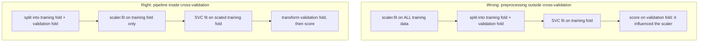

# Algorithm chains and pipelines

Most machine-learning applications need more than one algorithm. They chain several processing steps
(scaling, feature extraction, feature selection) and then a model. Chapter 6 of Müller & Guido introduces
the **`Pipeline`** class, which glues these steps into a single estimator. A pipeline makes code shorter.
More importantly, it makes a whole class of evaluation bugs impossible.

## 1. The problem: parameter selection with preprocessing

Here is the workflow we have used so far for an SVM on the breast-cancer data:

```python-run
from sklearn.datasets import load_breast_cancer
from sklearn.model_selection import train_test_split, GridSearchCV
from sklearn.preprocessing import MinMaxScaler
from sklearn.svm import SVC

X, y = load_breast_cancer(return_X_y=True)
X_train, X_test, y_train, y_test = train_test_split(X, y, random_state=0)

scaler = MinMaxScaler().fit(X_train)                 # scaling fitted on the training set: good
X_train_scaled = scaler.transform(X_train)
X_test_scaled = scaler.transform(X_test)

param_grid = {"C": [0.01, 0.1, 1, 10, 100], "gamma": [0.01, 0.1, 1, 10]}
grid = GridSearchCV(SVC(), param_grid, cv=5).fit(X_train_scaled, y_train)     # <- subtle problem here
print("best CV accuracy:", round(grid.best_score_, 3), grid.best_params_)
print("test accuracy:", round(grid.score(X_test_scaled, y_test), 3))
```

There is a catch. The scaler was fitted on **all** of the training data. Then the grid search ran
cross-validation on that scaled data. In each split, one part of the training set is the training fold and
another is the validation fold. The validation fold stands in for new data. But the scaler already used
the validation fold when it computed the minimum and maximum. **Information from the held-out part leaked
into the modelling process.**

This differs from how new data reaches the model in reality. A truly new point, such as a test point, will
*not* have been used to scale the training data. So the splits in the cross-validation do not mirror real
use, and the result can be over-optimistic estimates and even sub-optimal parameter choices.

The fix is to do the splitting **before any preprocessing**. Any process that extracts knowledge from the
data should be applied only to the training portion, so the cross-validation must be the *outermost* loop.



## 2. Building a pipeline

A `Pipeline` is built from a list of steps. Each step is a tuple of a **name** (any string) and an
estimator instance.

```python-run
from sklearn.datasets import load_breast_cancer
from sklearn.model_selection import train_test_split
from sklearn.pipeline import Pipeline
from sklearn.preprocessing import MinMaxScaler
from sklearn.svm import SVC

X, y = load_breast_cancer(return_X_y=True)
X_train, X_test, y_train, y_test = train_test_split(X, y, random_state=0)

pipe = Pipeline([("scaler", MinMaxScaler()), ("svm", SVC())])
pipe.fit(X_train, y_train)       # 1) scaler.fit_transform(X_train)  2) svm.fit(scaled X_train, y_train)
print("test score:", round(pipe.score(X_test, y_test), 3))   # scaler.transform(X_test), then svm.score
```

`pipe.fit` first calls `fit` on the scaler, transforms the training data with it, and then fits the SVM on
the scaled data. `pipe.score` (or `predict`) first transforms the test data **with the already fitted
scaler** and then calls the SVM. The pipeline behaves like a single model, and the test data never
influences the scaler.

## 3. Using pipelines in grid searches

A pipeline goes into `GridSearchCV` like any other estimator. The one change is how parameters are named:
**`<step name>__<parameter name>`**, with a double underscore. To search `C` of the step called `"svm"`,
use the key `"svm__C"`.

```python-run
from sklearn.datasets import load_breast_cancer
from sklearn.model_selection import train_test_split, GridSearchCV
from sklearn.pipeline import Pipeline
from sklearn.preprocessing import MinMaxScaler
from sklearn.svm import SVC

X, y = load_breast_cancer(return_X_y=True)
X_train, X_test, y_train, y_test = train_test_split(X, y, random_state=0)
pipe = Pipeline([("scaler", MinMaxScaler()), ("svm", SVC())])
param_grid = {"svm__C": [0.01, 0.1, 1, 10, 100], "svm__gamma": [0.01, 0.1, 1, 10]}
grid = GridSearchCV(pipe, param_grid, cv=5).fit(X_train, y_train)       # raw data in: scaling happens per fold
print("best CV accuracy:", round(grid.best_score_, 3))
print("best parameters:", grid.best_params_)
print("test accuracy:", round(grid.score(X_test, y_test), 3))
```

Now, for every split of the cross-validation, the `MinMaxScaler` is refitted on the training folds only.
Nothing leaks from the validation fold.

### How bad can leakage be?

For scaling, the effect is usually small. The book makes the danger concrete with an example from Hastie,
Tibshirani and Friedman, reproduced below. Take 100 samples with 10,000 features of **pure Gaussian
noise** and a target that is also noise, independent of the features. Nothing can be learned.

Suppose we first select the features most correlated with the target, using the whole dataset, and then
cross-validate a Ridge model on those features.

```python-run
import numpy as np
from sklearn.feature_selection import SelectPercentile, f_regression
from sklearn.linear_model import Ridge
from sklearn.model_selection import cross_val_score
from sklearn.pipeline import Pipeline

rng = np.random.RandomState(0)
X = rng.normal(size=(100, 10000))         # 100 samples, 10,000 features of pure noise
y = rng.normal(size=100)                  # the target is independent of X: nothing to learn

# WRONG: feature selection sees every sample, including those later used for validation
X_selected = SelectPercentile(f_regression, percentile=5).fit(X, y).transform(X)
leaky = cross_val_score(Ridge(), X_selected, y, cv=5).mean()

# RIGHT: selection is a pipeline step, refitted inside each fold
pipe = Pipeline([("select", SelectPercentile(f_regression, percentile=5)), ("ridge", Ridge())])
honest = cross_val_score(pipe, X, y, cv=5).mean()
print(f"leaky cross-validation R2:  {leaky:.2f}   <- looks like a great model, on pure noise")
print(f"proper cross-validation R2: {honest:.2f}   <- correctly reports that there is nothing to learn")
```

The leaky version reports an $R^2$ near 0.9 for a model that cannot possibly work. With thousands of
random features, some will correlate with the target by chance. Selecting them on the full data hands
those chance correlations to the validation folds. Inside the pipeline, the selection sees only training
folds, the chosen features don't correlate with the held-out targets, and the score is honestly negative.

> [!WARNING]
> Every step that **learns from data** belongs inside the pipeline: scalers, imputers, encoders, PCA,
> feature selection, tf-idf, target encoding, oversampling. If a step calls `fit`, it must be fitted on
> training folds only.

## 4. The general pipeline interface

A pipeline is not limited to preprocessing plus classification. It can join any number of estimators, for
example feature extraction, feature selection, scaling and classification. The one requirement is that
every step **except the last** must have a `transform` method, so that it can produce a new representation
for the next step.

- `pipeline.fit(X, y)` calls `fit` and then `transform` on each step in turn (in practice
  `fit_transform`), feeding each step the output of the previous one, and finally calls `fit` on the last
  step.
- `pipeline.predict(X)` calls `transform` on each step, then `predict` on the last.
- The last step need not be a predictor. A pipeline of only a scaler and PCA has `transform` but no
  `predict`.

A simplified version of what happens inside:

```python-run
class MiniPipeline:
    """A tiny re-implementation of the idea behind sklearn.pipeline.Pipeline."""
    def __init__(self, steps):
        self.steps = steps
    def fit(self, X, y):
        X_t = X
        for name, est in self.steps[:-1]:
            X_t = est.fit(X_t, y).transform(X_t)       # fit each transformer on the output of the previous one
        self.steps[-1][1].fit(X_t, y)
        return self
    def predict(self, X):
        X_t = X
        for name, est in self.steps[:-1]:
            X_t = est.transform(X_t)                   # transform only: nothing is refitted at prediction time
        return self.steps[-1][1].predict(X_t)

from sklearn.datasets import load_breast_cancer
from sklearn.model_selection import train_test_split
from sklearn.preprocessing import StandardScaler
from sklearn.decomposition import PCA
from sklearn.linear_model import LogisticRegression
X, y = load_breast_cancer(return_X_y=True)
X_tr, X_te, y_tr, y_te = train_test_split(X, y, random_state=0)
mini = MiniPipeline([("scale", StandardScaler()), ("pca", PCA(n_components=5)), ("clf", LogisticRegression())]).fit(X_tr, y_tr)
print("mini pipeline test accuracy:", round(float((mini.predict(X_te) == y_te).mean()), 3))
```

## 5. Convenient creation with `make_pipeline`

Naming every step is often unnecessary. `make_pipeline` builds a pipeline and **names each step after its
class, in lowercase**. If the same class appears more than once, a number is appended.

```python-run
from sklearn.pipeline import make_pipeline
from sklearn.preprocessing import StandardScaler
from sklearn.decomposition import PCA
from sklearn.linear_model import LogisticRegression
pipe = make_pipeline(StandardScaler(), PCA(n_components=2), StandardScaler(), LogisticRegression())
print("step names:", [name for name, _ in pipe.steps])
```

## 6. Accessing step attributes

You will often want to inspect one step, such as the coefficients of a linear model or the components
found by PCA. Use `named_steps`, a dictionary from step names to estimators, or index the pipeline.

```python-run
from sklearn.datasets import load_breast_cancer
from sklearn.pipeline import make_pipeline
from sklearn.preprocessing import StandardScaler
from sklearn.decomposition import PCA
from sklearn.linear_model import LogisticRegression
X, y = load_breast_cancer(return_X_y=True)
pipe = make_pipeline(StandardScaler(), PCA(n_components=2), LogisticRegression()).fit(X, y)
print("PCA components shape:", pipe.named_steps["pca"].components_.shape)
print("classifier coefficients:", pipe[-1].coef_.round(2))
print("output of the first two steps:", pipe[:-1].transform(X[:1]).round(2))
```

### In a grid-searched pipeline

After a grid search over a pipeline, `grid.best_estimator_` is itself a pipeline, already refitted on the
full training set. Reach into it in the same way:
`grid.best_estimator_.named_steps["logisticregression"].coef_`.

## 7. Grid-searching preprocessing steps and model parameters

Because the whole workflow is one estimator, you can tune the **parameters of the preprocessing together
with those of the model**. The book uses polynomial features, scaling and ridge regression, and searches
the polynomial degree and `alpha` jointly. The best degree depends on how strongly the model is
regularised, so tuning them one at a time would miss the best combination. (On the diabetes data used below, the
search concludes that degree 1 is best. Finding out that the extra features do not help is a useful result too.)

```python-run
import pandas as pd
from sklearn.datasets import load_diabetes
from sklearn.model_selection import train_test_split, GridSearchCV
from sklearn.pipeline import make_pipeline
from sklearn.preprocessing import StandardScaler, PolynomialFeatures
from sklearn.linear_model import Ridge

X, y = load_diabetes(return_X_y=True)
X_train, X_test, y_train, y_test = train_test_split(X, y, random_state=0)
pipe = make_pipeline(StandardScaler(), PolynomialFeatures(), Ridge())
param_grid = {"polynomialfeatures__degree": [1, 2, 3], "ridge__alpha": [0.01, 1, 10, 100]}
grid = GridSearchCV(pipe, param_grid, cv=5).fit(X_train, y_train)
res = pd.DataFrame(grid.cv_results_).pivot(index="param_polynomialfeatures__degree", columns="param_ridge__alpha", values="mean_test_score")
print(res.round(2).to_string())
print("best:", grid.best_params_, " test R2:", round(grid.score(X_test, y_test), 3))
```

## 8. Grid-searching which model to use

You can go further and search over the **steps themselves**, for example comparing a random forest with an
SVM, and `StandardScaler` with no scaling at all. Give the pipeline placeholder steps, and use a list of
parameter grids in which the step itself is a parameter. `None` (or `"passthrough"`) skips a step.

```python-run
from sklearn.datasets import load_breast_cancer
from sklearn.model_selection import train_test_split, GridSearchCV
from sklearn.pipeline import Pipeline
from sklearn.preprocessing import StandardScaler
from sklearn.svm import SVC
from sklearn.ensemble import RandomForestClassifier

X, y = load_breast_cancer(return_X_y=True)
X_train, X_test, y_train, y_test = train_test_split(X, y, random_state=0)
pipe = Pipeline([("preprocessing", StandardScaler()), ("classifier", SVC())])
param_grid = [
    {"classifier": [SVC()], "preprocessing": [StandardScaler()],
     "classifier__gamma": [0.001, 0.01, 0.1], "classifier__C": [1, 10, 100]},
    {"classifier": [RandomForestClassifier(n_estimators=50, random_state=0)], "preprocessing": ["passthrough"],
     "classifier__max_features": [2, 5]},
]
grid = GridSearchCV(pipe, param_grid, cv=3).fit(X_train, y_train)
print("best model:", grid.best_params_["classifier"])
print("best CV score:", round(grid.best_score_, 3), " test score:", round(grid.score(X_test, y_test), 3))
```

Searching over everything costs compute, and the more configurations you try, the more the best
cross-validation score is biased upwards. That is one more reason to keep a final test set.

## 9. Why pipelines matter in production

- **One object to persist.** `joblib.dump(pipe, "model.joblib")` saves the preprocessing and the model
  together. This prevents training/serving skew, where the serving code scales features differently from
  the training code.
- **Fewer mistakes.** You cannot forget a step or apply steps in the wrong order.
- **Caching.** `Pipeline(..., memory="cache_dir")` avoids recomputing expensive transformers during a
  grid search.

> [!INTERVIEW]
> **"What is data leakage, and how do pipelines prevent one form of it?"** Leakage is any use of
> information during training that would not be available at prediction time. It leads to over-optimistic
> evaluation. Preprocessing leakage happens when a scaler, selector or imputer is fitted on data that
> includes the validation or test samples. A `Pipeline` passed to `cross_val_score` or `GridSearchCV`
> refits every step on the training folds only. Be ready to give the noise example, and to mention the
> other kinds of leakage: target leakage, temporal leakage and group leakage.

## Summary

- A `Pipeline` chains transformers and a final estimator into one object with `fit`, `predict` and `score`.
- Inside cross-validation, the whole pipeline is refitted per fold. No information leaks from validation
  data.
- Grid-search parameter names are `step__parameter`. `make_pipeline` names steps after their classes.
- Inspect steps with `named_steps`. `best_estimator_` is a fitted pipeline.
- Preprocessing parameters, and even the choice of model, can be tuned jointly.

```quiz
[
  {"q": "What is wrong with scaling the full training set and then running GridSearchCV on the scaled data?", "options": ["The scaler has seen the validation folds, so information leaks into each cross-validation split", "GridSearchCV cannot handle scaled data", "The scaler must be fitted on the test set", "Nothing is wrong"], "answer": 0,
   "explain": "Validation folds are supposed to act as unseen data, but they influenced the scaling statistics."},
  {"q": "In a pipeline with steps [('scaler', MinMaxScaler()), ('svm', SVC())], the grid key for the SVM's C is…", "options": ["svm__C", "svm.C", "C", "SVC__C"], "answer": 0,
   "explain": "Step name, double underscore, parameter name."},
  {"q": "When you call pipe.predict(X_test), the scaler step…", "options": ["calls transform using statistics learned during fit", "is refitted on X_test", "is skipped", "calls fit_transform on X_test"], "answer": 0,
   "explain": "Nothing is learned at prediction time; fitted transformers are only applied."},
  {"q": "Which requirement must every step except the last one satisfy?", "options": ["It must have a transform method", "It must have a predict method", "It must be a classifier", "It must be unsupervised"], "answer": 0,
   "explain": "Intermediate steps must output a new representation for the next step."},
  {"q": "make_pipeline(StandardScaler(), PCA(), StandardScaler()) names its steps…", "options": ["standardscaler-1, pca, standardscaler-2", "step1, step2, step3", "scaler, pca, scaler", "StandardScaler, PCA, StandardScaler"], "answer": 0,
   "explain": "Lower-cased class names, with a number appended when a class is repeated."},
  {"q": "In the noise experiment, selecting features on all the data before cross-validation produced a high R² because…", "options": ["chance correlations with the target, found using the validation samples, carried over to those samples", "Ridge can learn from noise", "the features were actually informative", "cross-validation was not run"], "answer": 0,
   "explain": "With thousands of random features, some correlate with y by chance; choosing them with the validation data leaks y."},
  {"q": "After grid = GridSearchCV(pipe, ...).fit(X, y), how do you get the fitted final-step model?", "options": ["grid.best_estimator_.named_steps[<step name>]", "grid.pipeline", "pipe.named_steps on the original unfitted pipe", "grid.cv_results_['model']"], "answer": 0,
   "explain": "best_estimator_ is the pipeline refitted with the best parameters on the whole training set."}
]
```

> **Source:** Müller & Guido, *Introduction to Machine Learning with Python*, ch. 6 ("Parameter Selection with Preprocessing", "Building Pipelines", "Using Pipelines in Grid Searches", "The General Pipeline Interface", "Convenient Pipeline Creation with make_pipeline", "Accessing Step Attributes", "Grid-Searching Preprocessing Steps and Model Parameters", "Grid-Searching Which Model To Use"); scikit-learn User Guide, "Pipelines and composite estimators".
