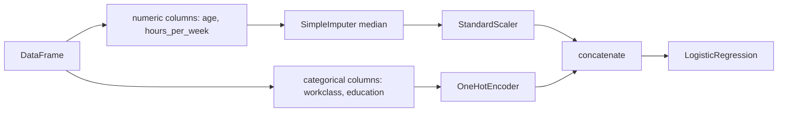

# ColumnTransformer and data leakage

> **Before this lesson:** read [Pipelines and grid search](#/lesson/ml/pipelines) first: this lesson builds directly on `Pipeline`, `make_pipeline` and the `step__parameter` naming. One-hot encoding and target encoding come from [Categorical features, binning and polynomials](#/lesson/ml/feature-engineering), and `GroupKFold` and `TimeSeriesSplit` from [Cross-validation](#/lesson/ml/cross-validation).

## In plain words

Real tables mix different kinds of columns: numbers with gaps in them, categories stored as text, sometimes free text. Each kind needs its own preparation. A **ColumnTransformer** is a sorting office for columns: it sends each group of columns down its own conveyor belt (fill the gaps and scale the numbers; one-hot encode the categories) and then lays the results side by side, ready for one model. Put inside a pipeline, the whole preparation is learned from training data only.

The second half of the lesson is about **data leakage**, the most damaging mistake in applied machine learning. An everyday picture: a student who has seen the answer sheet before the exam. Their mark is excellent and says nothing about what they know. A model that, during training or evaluation, gets information it will not have when it is used for real looks excellent in testing and disappoints in production. Leakage comes in several disguises, and pipelines only stop one of them.

Why this matters for a job: almost every tabular model in industry needs mixed-type preprocessing, and `ColumnTransformer` is the standard tool for it. "Your model scored 99% offline and poorly in production; what went wrong?" is a classic interview question, and the answer is a tour of the leakage catalogue in section 4.

## 1. The problem with mixed column types

Here is a small generated dataset in the style of the adult census data from lesson 40: two numeric columns, two categorical ones, and a 0/1 target saying whether income is high.

```python-run
import numpy as np
import pandas as pd

rng = np.random.RandomState(0)
n = 400
df = pd.DataFrame({
    "age": rng.randint(18, 70, n).astype(float),
    "hours_per_week": rng.normal(40, 10, n).round(),
    "workclass": rng.choice(["Private", "Self-emp", "State-gov", "Federal-gov"], n, p=[0.6, 0.2, 0.15, 0.05]),
    "education": rng.choice(["HS-grad", "Bachelors", "Masters", "Doctorate"], n, p=[0.5, 0.3, 0.15, 0.05]),
})
score = 0.04 * df.age + 0.05 * df.hours_per_week + df.education.map({"HS-grad": 0, "Bachelors": 1, "Masters": 1.8, "Doctorate": 2.5})
df["income_high"] = (score + rng.normal(0, 1, n) > 5).astype(int)
df.loc[rng.choice(n, 30, replace=False), "age"] = np.nan                 # some missing ages
print(df.head().to_string())
print("\nmissing values per column:\n", df.isna().sum().to_string())
print("\ndtypes:", dict(df.dtypes.astype(str)))
```

**Reading this code line by line**

- The `pd.DataFrame` call builds 400 rows. `rng.randint(18, 70, n)` draws ages; `rng.normal(40, 10, n).round()` draws working hours around 40; `rng.choice([...], n, p=[...])` picks a category for each row with the given probabilities (60% Private, and so on).
- `score` combines age, hours and an education bonus (`.map` replaces each education string by a number from the dictionary). The target `income_high` is 1 when the score plus noise exceeds 5.
- `df.loc[rows, "age"] = np.nan` blanks out the age of 30 random rows. `np.nan` ("not a number") is how missing values are stored.
- `df.isna().sum()` counts missing values per column, and `df.dtypes` shows each column's **dtype** (data type): `float64` for decimals, `int64` for whole numbers, and `object` or `str` (depending on the pandas version) for text.

The output shows the first five rows, 30 missing ages, and the mix of number and text columns. We want to:

- fill in (**impute**) the missing numeric values with the **median** (the middle value when sorted), then standardise the numeric columns;
- one-hot encode the categorical columns;
- fit every one of these steps on training data only.

A plain `Pipeline` cannot do this, because it applies each step to *all* columns: a scaler would choke on the text columns, and a one-hot encoder would turn every distinct age into its own column.

## 2. ColumnTransformer

A `ColumnTransformer` takes a list of **triples** `(name, transformer, columns)`. Each transformer is fitted on and applied to its own subset of columns, and the outputs are joined side by side (**concatenated**) into one table.



```python-run
import numpy as np
import pandas as pd
from sklearn.compose import ColumnTransformer
from sklearn.pipeline import Pipeline, make_pipeline
from sklearn.impute import SimpleImputer
from sklearn.preprocessing import StandardScaler, OneHotEncoder
from sklearn.linear_model import LogisticRegression
from sklearn.model_selection import train_test_split, cross_val_score

rng = np.random.RandomState(0)
n = 400
df = pd.DataFrame({
    "age": rng.randint(18, 70, n).astype(float),
    "hours_per_week": rng.normal(40, 10, n).round(),
    "workclass": rng.choice(["Private", "Self-emp", "State-gov", "Federal-gov"], n, p=[0.6, 0.2, 0.15, 0.05]),
    "education": rng.choice(["HS-grad", "Bachelors", "Masters", "Doctorate"], n, p=[0.5, 0.3, 0.15, 0.05]),
})
score = 0.04 * df.age + 0.05 * df.hours_per_week + df.education.map({"HS-grad": 0, "Bachelors": 1, "Masters": 1.8, "Doctorate": 2.5})
y = (score + rng.normal(0, 1, n) > 5).astype(int)
df.loc[rng.choice(n, 30, replace=False), "age"] = np.nan

numeric = ["age", "hours_per_week"]
categorical = ["workclass", "education"]
preprocess = ColumnTransformer([
    ("num", make_pipeline(SimpleImputer(strategy="median"), StandardScaler()), numeric),
    ("cat", OneHotEncoder(handle_unknown="ignore"), categorical),
])
model = Pipeline([("prep", preprocess), ("clf", LogisticRegression(max_iter=1000))])

X_train, X_test, y_train, y_test = train_test_split(df, y, stratify=y, random_state=0)
model.fit(X_train, y_train)
print("transformed shape:", model.named_steps["prep"].transform(X_train).shape)
print("output features:", list(model.named_steps["prep"].get_feature_names_out()))
print("test accuracy:", round(model.score(X_test, y_test), 3))
print("5-fold CV accuracy:", cross_val_score(model, X_train, y_train, cv=5).mean().round(3))
```

**Reading this code line by line**

- The data is rebuilt as before (each demo on this site runs on its own, so it cannot reuse the previous one's variables).
- `numeric` and `categorical` are lists of column names.
- `ColumnTransformer([...])` gets two triples. The one named `"num"` sends the numeric columns through a small pipeline: `SimpleImputer(strategy="median")`, which learns each column's median in `fit` and fills blanks with it in `transform`, then `StandardScaler`. The one named `"cat"` sends the categorical columns through a `OneHotEncoder`.
- `Pipeline([("prep", preprocess), ("clf", LogisticRegression(...))])` puts the column transformer in front of a classifier, so the whole thing is one model.
- `train_test_split(df, y, ...)` splits the raw DataFrame. Nothing has been fitted yet, so nothing can leak.
- `model.fit(X_train, y_train)` fits the imputer, scaler and encoder on the training rows, then the classifier on their output.
- `named_steps["prep"].transform(X_train).shape` shows the table the classifier sees, and `get_feature_names_out()` names its columns.

The transformed training table is 300 rows by 10 columns: 2 numeric columns plus 4 workclass and 4 education indicator columns. The names say where each column came from: `num__age`, `cat__workclass_Private` and so on (transformer name, two underscores, column). The test accuracy is 0.77 and the 5-fold cross-validation accuracy 0.76. Inside `cross_val_score` the imputer's medians, the scaler's statistics and the encoder's categories are all relearned from each split's training folds.

Points to notice:

- A transformer inside a `ColumnTransformer` can itself be a pipeline (`imputer → scaler` here).
- Columns are chosen by **name** for DataFrames, or by integer position or boolean mask for arrays.
- Columns you do not list are **dropped** by default (`remainder="drop"`). Use `remainder="passthrough"` to keep them unchanged.
- `make_column_selector(dtype_include="number")` picks columns by dtype, so you need not hard-code names.
- `get_feature_names_out()` tells you what each output column means, which you need in order to read a linear model's coefficients.
- `handle_unknown="ignore"` keeps the encoder from failing on categories that appear only at prediction time.

`ColumnTransformer` was added to scikit-learn after the first edition of Müller & Guido was published; the book handles mixed types with pandas `get_dummies` instead. It is now the standard way to build leak-free preprocessing for tables.

### Tuning through nested steps

Hyperparameter names are chained with double underscores through every level of nesting. `prep__num__simpleimputer__strategy` means: pipeline step `prep`, then column-transformer entry `num`, then inner pipeline step `simpleimputer`, then its parameter `strategy`.

```python-run
import numpy as np
import pandas as pd
from sklearn.compose import ColumnTransformer, make_column_selector
from sklearn.pipeline import Pipeline, make_pipeline
from sklearn.impute import SimpleImputer
from sklearn.preprocessing import StandardScaler, OneHotEncoder
from sklearn.linear_model import LogisticRegression
from sklearn.model_selection import GridSearchCV

rng = np.random.RandomState(1)
n = 300
df = pd.DataFrame({"x1": rng.normal(size=n), "x2": rng.normal(size=n), "colour": rng.choice(["red", "green", "blue"], n)})
y = ((df.x1 + (df.colour == "red") * 1.5 + rng.normal(0, 0.5, n)) > 0.5).astype(int)
df.loc[rng.choice(n, 40, replace=False), "x1"] = np.nan

prep = ColumnTransformer([
    ("num", make_pipeline(SimpleImputer(), StandardScaler()), make_column_selector(dtype_include="number")),
    ("cat", OneHotEncoder(handle_unknown="ignore"), ["colour"]),
])
pipe = Pipeline([("prep", prep), ("clf", LogisticRegression(max_iter=1000))])
grid = GridSearchCV(pipe, {"prep__num__simpleimputer__strategy": ["mean", "median"], "clf__C": [0.1, 1, 10]}, cv=5).fit(df, y)
print("best parameters:", grid.best_params_)
print("best CV accuracy:", round(grid.best_score_, 3))
```

This dataset has two numeric columns (one with 40 gaps) and a colour column. `make_column_selector(dtype_include="number")` finds `x1` and `x2` automatically. The grid tries 2 imputation strategies × 3 values of `C` = 6 combinations, each with 5 folds. The search picks mean imputation with `C=1`, at a cross-validation accuracy of 0.82. The imputation method has become a hyperparameter like any other, chosen honestly by cross-validation.

## 3. Writing your own transformer

When no built-in transformer does what you need, there are two straightforward options.

- `FunctionTransformer(np.log1p)` wraps a **stateless** function, one that learns nothing from data and treats every row the same way.
- For a transformer that *learns* something, write a class that **inherits** from `BaseEstimator` and `TransformerMixin`: it starts with all their methods and you add your own. Implement `fit`, which learns from the data, stores what it learned in attributes whose names end in an underscore, and returns `self`; and `transform`, which applies what was learned. `TransformerMixin` then provides `fit_transform` for free, and `BaseEstimator` provides the parameter handling that grid search needs. Chapter 8 of the book points to this as the way to build your own estimators.

```python-run
import numpy as np
from sklearn.base import BaseEstimator, TransformerMixin
from sklearn.pipeline import make_pipeline
from sklearn.preprocessing import FunctionTransformer, StandardScaler

class Clipper(BaseEstimator, TransformerMixin):
    """Clip each feature to the [q, 1-q] quantile range learned from the training data."""
    def __init__(self, q=0.05):
        self.q = q
    def fit(self, X, y=None):
        self.low_ = np.quantile(X, self.q, axis=0)
        self.high_ = np.quantile(X, 1 - self.q, axis=0)
        return self
    def transform(self, X):
        return np.clip(X, self.low_, self.high_)

rng = np.random.RandomState(0)
X_train = np.abs(rng.standard_cauchy(size=(200, 2)))      # heavy tails with extreme outliers
X_new = np.array([[0.5, 1000.0]])
pipe = make_pipeline(Clipper(q=0.05), FunctionTransformer(np.log1p), StandardScaler()).fit(X_train)
print("learned upper clip limits:", pipe.named_steps["clipper"].high_.round(2))
print("new point after the pipeline:", pipe.transform(X_new).round(2), "<- the outlier 1000 was clipped using TRAINING quantiles")
```

**Reading this code line by line**

- `__init__` only stores the setting `q`. scikit-learn's convention is that `__init__` must not look at data.
- `fit` computes, for each column (`axis=0`), the **quantiles** at `q` and `1 - q`: with `q=0.05`, the values below which 5% and 95% of the training data lie. They are stored as `low_` and `high_`.
- `transform` uses `np.clip`, which replaces anything below `low_` by `low_` and anything above `high_` by `high_`.
- `rng.standard_cauchy` draws from a **heavy-tailed** distribution, one that produces occasional enormous values; `np.abs` makes them positive. That imitates messy real data with outliers.
- The pipeline clips, then applies `log1p`, then standardises. It is fitted on the training data only.

The learned upper limits are about 11.5 and 14.3. The new point's second value, 1000, is clipped to 14.3 before the log and scaling, so it ends up at about 2.47 standard deviations instead of dominating everything. Because the limits were learned in `fit`, the new point had no say in them, which is exactly the leak-free behaviour we want.

## 4. Data leakage: the full catalogue

**Leakage** is the use of information during model building or evaluation that will not be available, in the same form, when the model makes real predictions. The symptom is always the same: excellent offline scores and disappointing production results. Pipelines prevent one kind; you must watch for the others yourself.

| type | what happens | example | prevention |
|---|---|---|---|
| **preprocessing leakage** | statistics computed on data that includes validation or test rows | scaling, imputing or selecting features before splitting | put every fitted step in a `Pipeline`; split first |
| **target leakage** | a feature is a consequence of the target, or is recorded after it | `account_closed_date` when predicting churn; a treatment code that implies the diagnosis | ask of every feature: "is this known at the moment of prediction?" |
| **temporal leakage** | training on the future | a random split of time-ordered data; rolling features that include the current row | split by time; build features from the past only |
| **group leakage** | related rows on both sides of the split | several scans of one patient; near-duplicate images | `GroupKFold`; remove duplicates before splitting |
| **test-set reuse** | repeated decisions based on the test set | picking a threshold or a model by its test score | decide with validation data or cross-validation; use the test set once |
| **resampling leakage** | oversampling before splitting | SMOTE on all data puts synthetic copies of validation points into training | resample inside the training folds only |

**Churn** in the table means customers leaving a service. SMOTE (Synthetic Minority Oversampling Technique) creates new rare-class rows by interpolating between existing ones, so a synthetic row is a near-copy of the real rows it came from.

### Target leakage in action

```python-run
import numpy as np
from sklearn.ensemble import RandomForestClassifier
from sklearn.model_selection import cross_val_score

rng = np.random.RandomState(0)
n = 1000
usage = rng.normal(size=n)
support_calls = rng.poisson(2, n)
churned = (0.8 * support_calls - usage + rng.normal(0, 1.5, n) > 2.5).astype(int)
# recorded AFTER the customer has left: the number of retention offers the company sent
retention_offers = churned * rng.randint(1, 4, n)

X_honest = np.column_stack([usage, support_calls])
X_leaky = np.column_stack([usage, support_calls, retention_offers])
rf = RandomForestClassifier(n_estimators=50, random_state=0)
print("CV accuracy with features known at prediction time:", cross_val_score(rf, X_honest, churned, cv=5).mean().round(3))
print("CV accuracy including the leaked feature:          ", cross_val_score(rf, X_leaky, churned, cv=5).mean().round(3))
```

**Reading this code line by line**

- Each of 1,000 customers has a usage level and a number of support calls. Customers who call a lot and use little are more likely to churn.
- `retention_offers = churned * rng.randint(1, 4, n)` is 0 for customers who stayed and 1 to 3 for customers who left, because the company only sends offers *after* someone cancels. It is a consequence of the target.
- The same random forest is cross-validated with and without that column.

With honest features the accuracy is 0.688; with the leaked column it is a perfect 1.0. Cross-validation cannot save you here: the leaked column is present in every fold, training and validation alike, so the model looks perfect. In production the column is always 0 at the moment you need the prediction, because the customer has not left yet. Warning signs of target leakage:

- a score that is too good to be true;
- one feature with overwhelming importance;
- a model that suddenly becomes far better after a new data source is joined in.

### Temporal leakage in action

```python-run
import numpy as np
from sklearn.ensemble import RandomForestRegressor
from sklearn.model_selection import cross_val_score, KFold, TimeSeriesSplit

rng = np.random.RandomState(0)
t = np.arange(600)
y = np.cumsum(rng.normal(size=600))                   # a random walk: the future is not predictable from time
X = t.reshape(-1, 1)
rf = RandomForestRegressor(n_estimators=30, random_state=0)
print("shuffled K-fold R2:", cross_val_score(rf, X, y, cv=KFold(5, shuffle=True, random_state=0)).mean().round(2), "<- interpolates between neighbours in time")
print("time-series split R2:", cross_val_score(rf, X, y, cv=TimeSeriesSplit(5)).mean().round(2), "<- the honest answer")
```

`np.cumsum(rng.normal(size=600))` builds a **random walk**: each value is the previous one plus a random step, like a share price that drifts unpredictably. The only feature is the time index. With shuffled folds the score is a perfect 1.0; with `TimeSeriesSplit` it is about −2.3, far worse than predicting the average.

The explanation: with a shuffled split, every test point has training neighbours a moment before and a moment after it, and their values are almost the same, so the model only has to fill in a gap. Forecasting means predicting beyond the last known point, a different and much harder task, and here an impossible one. The time-series split asks the honest question.

## 5. A leak-free workflow

1. **Split first.** Set the test set aside before looking at anything. Split by time or by group if the data has that structure.
2. Explore only the training data.
3. Put **all** preprocessing in a `Pipeline` with a `ColumnTransformer`.
4. Tune with cross-validation on the training set, using a splitter that imitates how the model will be used.
5. Evaluate **once** on the test set.
6. Save the entire fitted pipeline and serve exactly that object.

> [!INTERVIEW]
> **"Your model has 99% validation accuracy but performs poorly in production. What do you check?"** (1) Leakage: target-derived features, preprocessing fitted on all the data, duplicates across splits, random splits of temporal data. (2) Training/serving skew: features computed differently online and offline. (3) **Distribution shift**: the data arriving now differs from the training period. (4) Whether the validation metric matches the business objective. Then describe the fix: time- or group-based splits, one saved pipeline used everywhere, and monitoring of the input distributions.

## 6. Measuring a preprocessing leak yourself

It is worth seeing once how large a preprocessing leak can be, and why it varies. The experiment uses target encoding (lesson 40), a step that learns from the labels: each of 60 categories is replaced by the average target of its rows. The categories are assigned at random, so they carry **no information** about the target, and an honest evaluation should score about 50%.

```python-run
import numpy as np
from sklearn.linear_model import LogisticRegression
from sklearn.model_selection import StratifiedKFold

rng = np.random.RandomState(0)
n = 400
category = rng.randint(0, 60, n)                   # 60 categories, unrelated to the target
y = rng.randint(0, 2, n)

def target_encode(cat_fit, y_fit, cat_apply):
    means = {c: y_fit[cat_fit == c].mean() for c in np.unique(cat_fit)}
    return np.array([means.get(c, y_fit.mean()) for c in cat_apply]).reshape(-1, 1)

cv = StratifiedKFold(5, shuffle=True, random_state=0)
leaky, honest = [], []
X_leaky = target_encode(category, y, category)     # WRONG: encoded once, using every row's label
for tr, te in cv.split(category, y):
    leaky.append(LogisticRegression().fit(X_leaky[tr], y[tr]).score(X_leaky[te], y[te]))
    X_tr = target_encode(category[tr], y[tr], category[tr])        # RIGHT: learned from the training fold only
    X_te = target_encode(category[tr], y[tr], category[te])
    honest.append(LogisticRegression().fit(X_tr, y[tr]).score(X_te, y[te]))
print(f"encoding fitted on all rows:      CV accuracy = {np.mean(leaky):.3f}   <- looks predictive, is not")
print(f"encoding fitted inside each fold: CV accuracy = {np.mean(honest):.3f}   <- about chance, as it should be")
```

**Reading this code line by line**

- 400 rows get a random category from 0 to 59 and a random 0/1 label.
- `target_encode(cat_fit, y_fit, cat_apply)` learns the average label of each category from `cat_fit` and `y_fit` (a dictionary comprehension: for each category `c`, the mean of the labels of rows in that category), then encodes `cat_apply` with those averages. A category not seen while learning gets the overall average, via `means.get(c, default)`.
- The wrong version encodes all 400 rows once, using all labels, and then cross-validates.
- The right version, inside the loop, learns the averages from the training fold and applies them to both the training fold and the test fold.

The leaky version reports 0.623, a seemingly useful model on data with no signal at all; the honest version reports 0.478, chance level. Each category has only about 7 rows, so each row's own label makes up about a seventh of its category's average. The encoded feature partly *is* the label, and the test rows' labels went into their own features.

How big a leak is depends on how much the step learns from the labels and on how few rows support each learned number. A scaler learns two numbers per feature and never sees the labels, so its leak is small. Feature selection and target encoding learn from the labels, often from few rows, so their leaks can be large. The rule does not depend on the size: fit every step inside the fold.

## Summary

- `ColumnTransformer` applies different preprocessing to different groups of columns and concatenates the results. Combined with `Pipeline` it gives one leak-free estimator.
- Nested hyperparameters are addressed with chained `__` names.
- Custom transformers learn in `fit` (attributes ending in `_`) and only apply in `transform`.
- Leakage comes in many forms: preprocessing, target, temporal, group, test reuse and resampling. Pipelines fix only the first.
- For every feature ask: would I have this value, computed this way, at the moment of prediction?

## Glossary

- **ColumnTransformer**: applies different transformers to different column subsets and joins the results.
- **Impute / imputer**: fill in missing values / a transformer that does so.
- **Median**: the middle value of a sorted list.
- **dtype**: the data type of a column, such as float, integer or text.
- **Concatenate**: join tables side by side.
- **remainder**: what a ColumnTransformer does with unlisted columns (drop or pass through).
- **Stateless transformer**: a transformer that learns nothing from data.
- **Inherit**: create a class that starts with all the methods of another class.
- **Quantile**: the value below which a given fraction of the data lies.
- **Heavy-tailed**: a distribution that occasionally produces extreme values.
- **Target leakage**: a feature that is a consequence of, or recorded after, the target.
- **Temporal leakage**: training on information from the future.
- **Group leakage**: related rows on both sides of a train/test split.
- **Churn**: customers leaving a service.
- **Random walk**: a series where each value is the previous one plus a random step.
- **Distribution shift**: the data seen in production differing from the training data.

## Check yourself

```quiz
[
  {"q": "What does ColumnTransformer do?", "options": ["Applies different transformers to different subsets of columns and concatenates the outputs", "Reorders the columns alphabetically", "Converts a DataFrame into a pipeline", "Removes columns with missing values"], "answer": 0,
   "explain": "It lets numeric, categorical and text columns each get suitable preprocessing inside one estimator."},
  {"q": "By default, columns not mentioned in a ColumnTransformer are…", "options": ["dropped", "passed through unchanged", "one-hot encoded", "imputed with zeros"], "answer": 0,
   "explain": "remainder='drop' is the default; set remainder='passthrough' to keep them."},
  {"q": "Which grid key tunes the imputer strategy inside ColumnTransformer entry 'num' of pipeline step 'prep'?", "options": ["prep__num__simpleimputer__strategy", "prep.num.strategy", "simpleimputer__strategy", "num__strategy"], "answer": 0,
   "explain": "Names are chained with double underscores through each nesting level."},
  {"q": "When predicting customer churn, a feature 'number of retention offers sent after cancellation' is an example of…", "options": ["target leakage", "group leakage", "underfitting", "feature scaling"], "answer": 0,
   "explain": "It is a consequence of the outcome and is not available when the prediction is needed."},
  {"q": "Why can't cross-validation detect target leakage?", "options": ["The leaked feature is present in every training and validation fold alike", "Cross-validation only works for regression", "Leaked features are removed automatically", "It uses too few folds"], "answer": 0,
   "explain": "CV measures how well the model predicts held-out rows given the same features; it cannot know a feature will be unavailable in production."},
  {"q": "Applying SMOTE oversampling to the whole dataset before cross-validation is wrong because…", "options": ["synthetic points derived from validation samples end up in the training folds", "SMOTE only works on images", "oversampling changes the number of features", "it removes the minority class"], "answer": 0,
   "explain": "Resampling must be done within each training fold so validation data stays untouched."},
  {"q": "In a custom transformer, where should statistics learned from data be computed?", "options": ["In fit, stored as attributes ending in an underscore", "In __init__", "In transform", "In a global variable"], "answer": 0,
   "explain": "fit learns from the training data; transform only applies what was learned, so nothing is learned from test data."},
  {"q": "A random forest predicting a random walk from the time index scores R² = 1.0 with shuffled K-fold. Why?", "options": ["Each test point has training neighbours just before and after it, so the model only interpolates", "Random forests can forecast random walks", "The data has no noise", "K-fold always gives R² = 1"], "answer": 0,
   "explain": "Shuffling leaks the future into training; a time-series split gives the honest, strongly negative score."}
]
```

> **Source:** Müller & Guido, *Introduction to Machine Learning with Python*, ch. 6 (pipelines and information leakage), ch. 4 (categorical variables in mixed tables) and ch. 8 ("Building Your Own Estimator"); scikit-learn User Guide, "Column Transformer with Mixed Types", "Pipelines and composite estimators" and "Common pitfalls and recommended practices: Data leakage".
