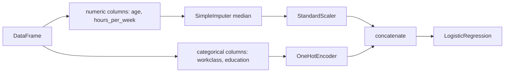

# ColumnTransformer and data leakage

Real tables mix column types. Numeric columns need imputing and scaling, categorical columns need
encoding, and text columns need vectorising. A single `Pipeline` applies the same steps to every column,
which is not enough. **`ColumnTransformer`** routes different columns through different preprocessing and
joins the results. It was added to scikit-learn after the first edition of Müller & Guido (the book
handles mixed types with pandas `get_dummies`), and it is now the standard way to build leak-free
preprocessing for tabular data. The second half of this lesson is a catalogue of **data leakage**, the
most damaging mistake in applied ML.

## 1. The problem with mixed column types

Take a small dataset in the style of the adult census data from chapter 4:

```python-run
import numpy as np
import pandas as pd

rng = np.random.RandomState(0)
n = 400
df = pd.DataFrame({
    "age": rng.randint(18, 70, n).astype(float),
    "hours_per_week": rng.normal(40, 10, n).round(),
    "workclass": rng.choice(["Private", "Self-emp", "State-gov", "Federal-gov"], n, p=[0.6, 0.2, 0.15, 0.05]),
    "education": rng.choice(["HS-grad", "Bachelors", "Masters", "Doctorate"], n, p=[0.5, 0.3, 0.15, 0.05]),
})
score = 0.04 * df.age + 0.05 * df.hours_per_week + df.education.map({"HS-grad": 0, "Bachelors": 1, "Masters": 1.8, "Doctorate": 2.5})
df["income_high"] = (score + rng.normal(0, 1, n) > 5).astype(int)
df.loc[rng.choice(n, 30, replace=False), "age"] = np.nan                 # some missing ages
print(df.head().to_string())
print("\nmissing values per column:\n", df.isna().sum().to_string())
print("\ndtypes:", dict(df.dtypes.astype(str)))
```

We want to:

- impute missing numeric values with the median, then standardise them;
- one-hot encode the categorical columns;
- fit every one of these steps on the training data only.

## 2. ColumnTransformer

A `ColumnTransformer` takes a list of `(name, transformer, columns)` triples. Each transformer is applied
to its own subset of columns, and the outputs are concatenated side by side.



```python-run
import numpy as np
import pandas as pd
from sklearn.compose import ColumnTransformer
from sklearn.pipeline import Pipeline, make_pipeline
from sklearn.impute import SimpleImputer
from sklearn.preprocessing import StandardScaler, OneHotEncoder
from sklearn.linear_model import LogisticRegression
from sklearn.model_selection import train_test_split, cross_val_score

rng = np.random.RandomState(0)
n = 400
df = pd.DataFrame({
    "age": rng.randint(18, 70, n).astype(float),
    "hours_per_week": rng.normal(40, 10, n).round(),
    "workclass": rng.choice(["Private", "Self-emp", "State-gov", "Federal-gov"], n, p=[0.6, 0.2, 0.15, 0.05]),
    "education": rng.choice(["HS-grad", "Bachelors", "Masters", "Doctorate"], n, p=[0.5, 0.3, 0.15, 0.05]),
})
score = 0.04 * df.age + 0.05 * df.hours_per_week + df.education.map({"HS-grad": 0, "Bachelors": 1, "Masters": 1.8, "Doctorate": 2.5})
y = (score + rng.normal(0, 1, n) > 5).astype(int)
df.loc[rng.choice(n, 30, replace=False), "age"] = np.nan

numeric = ["age", "hours_per_week"]
categorical = ["workclass", "education"]
preprocess = ColumnTransformer([
    ("num", make_pipeline(SimpleImputer(strategy="median"), StandardScaler()), numeric),
    ("cat", OneHotEncoder(handle_unknown="ignore"), categorical),
])
model = Pipeline([("prep", preprocess), ("clf", LogisticRegression(max_iter=1000))])

X_train, X_test, y_train, y_test = train_test_split(df, y, stratify=y, random_state=0)
model.fit(X_train, y_train)
print("transformed shape:", model.named_steps["prep"].transform(X_train).shape)
print("output features:", list(model.named_steps["prep"].get_feature_names_out()))
print("test accuracy:", round(model.score(X_test, y_test), 3))
print("5-fold CV accuracy:", cross_val_score(model, X_train, y_train, cv=5).mean().round(3))
```

Points to notice:

- A transformer can itself be a pipeline (`imputer → scaler`).
- Columns are selected by **name** for DataFrames, or by integer index or boolean mask for arrays.
- `remainder="drop"` is the default: columns you don't list are discarded. `remainder="passthrough"`
  keeps them unchanged.
- `make_column_selector(dtype_include="number")` selects columns by dtype, so you don't hard-code names.
- `get_feature_names_out()` tells you what each output column means. You need this to interpret
  coefficients.
- `handle_unknown="ignore"` makes the encoder robust to categories that appear only at prediction time.

### Tuning through nested steps

Parameter names are chained with double underscores through every level:
`prep__num__simpleimputer__strategy` means *pipeline step* `prep` → *column transformer entry* `num` →
*inner pipeline step* `simpleimputer` → *parameter* `strategy`.

```python-run
import numpy as np
import pandas as pd
from sklearn.compose import ColumnTransformer, make_column_selector
from sklearn.pipeline import Pipeline, make_pipeline
from sklearn.impute import SimpleImputer
from sklearn.preprocessing import StandardScaler, OneHotEncoder
from sklearn.linear_model import LogisticRegression
from sklearn.model_selection import GridSearchCV

rng = np.random.RandomState(1)
n = 300
df = pd.DataFrame({"x1": rng.normal(size=n), "x2": rng.normal(size=n), "colour": rng.choice(["red", "green", "blue"], n)})
y = ((df.x1 + (df.colour == "red") * 1.5 + rng.normal(0, 0.5, n)) > 0.5).astype(int)
df.loc[rng.choice(n, 40, replace=False), "x1"] = np.nan

prep = ColumnTransformer([
    ("num", make_pipeline(SimpleImputer(), StandardScaler()), make_column_selector(dtype_include="number")),
    ("cat", OneHotEncoder(handle_unknown="ignore"), ["colour"]),
])
pipe = Pipeline([("prep", prep), ("clf", LogisticRegression(max_iter=1000))])
grid = GridSearchCV(pipe, {"prep__num__simpleimputer__strategy": ["mean", "median"], "clf__C": [0.1, 1, 10]}, cv=5).fit(df, y)
print("best parameters:", grid.best_params_)
print("best CV accuracy:", round(grid.best_score_, 3))
```

## 3. Writing your own transformer

When no built-in transformer does what you need, there are two easy options.

- `FunctionTransformer(np.log1p)` wraps a stateless function.
- For a transformer that *learns* something, subclass `BaseEstimator` and `TransformerMixin`. Implement
  `fit` (learn and store attributes ending in `_`, then return `self`) and `transform`. Chapter 8 of the
  book points to this as the way to build your own estimators.

```python-run
import numpy as np
from sklearn.base import BaseEstimator, TransformerMixin
from sklearn.pipeline import make_pipeline
from sklearn.preprocessing import FunctionTransformer, StandardScaler

class Clipper(BaseEstimator, TransformerMixin):
    """Clip each feature to the [q, 1-q] quantile range learned from the training data."""
    def __init__(self, q=0.05):
        self.q = q
    def fit(self, X, y=None):
        self.low_ = np.quantile(X, self.q, axis=0)
        self.high_ = np.quantile(X, 1 - self.q, axis=0)
        return self
    def transform(self, X):
        return np.clip(X, self.low_, self.high_)

rng = np.random.RandomState(0)
X_train = np.abs(rng.standard_cauchy(size=(200, 2)))      # heavy tails with extreme outliers
X_new = np.array([[0.5, 1000.0]])
pipe = make_pipeline(Clipper(q=0.05), FunctionTransformer(np.log1p), StandardScaler()).fit(X_train)
print("learned upper clip limits:", pipe.named_steps["clipper"].high_.round(2))
print("new point after the pipeline:", pipe.transform(X_new).round(2), "<- the outlier 1000 was clipped using TRAINING quantiles")
```

## 4. Data leakage: the full catalogue

**Leakage** is the use of information during model building that will not be available, in the same form,
when the model makes real predictions. The symptom is always the same: excellent offline scores and
disappointing production results. Pipelines prevent one kind. You must watch for the others yourself.

| type | what happens | example | prevention |
|---|---|---|---|
| **preprocessing leakage** | statistics computed on data that includes validation/test rows | scaling, imputing or selecting features before splitting | put every fitted step in a `Pipeline`; split first |
| **target leakage** | a feature is a consequence of the target, or recorded after it | `account_closed_date` when predicting churn; a treatment code that implies the diagnosis | ask of every feature: "is this known at prediction time?" |
| **temporal leakage** | training on the future | a random split on time-ordered data; rolling features that include the current row | split by time; build features from the past only |
| **group leakage** | related rows on both sides of the split | several scans of one patient; near-duplicate images | `GroupKFold`; de-duplicate before splitting |
| **test-set reuse** | repeated tuning against the test set | picking a threshold or model by test score | use validation data or CV to decide; touch the test set once |
| **resampling leakage** | oversampling before splitting | SMOTE applied to all data puts copies of validation points into training | resample inside the training folds only |

### Target leakage in action

```python-run
import numpy as np
from sklearn.ensemble import RandomForestClassifier
from sklearn.model_selection import cross_val_score

rng = np.random.RandomState(0)
n = 1000
usage = rng.normal(size=n)
support_calls = rng.poisson(2, n)
churned = (0.8 * support_calls - usage + rng.normal(0, 1.5, n) > 2.5).astype(int)
# recorded AFTER the customer has left: the number of retention offers the company sent
retention_offers = churned * rng.randint(1, 4, n)

X_honest = np.column_stack([usage, support_calls])
X_leaky = np.column_stack([usage, support_calls, retention_offers])
rf = RandomForestClassifier(n_estimators=50, random_state=0)
print("CV accuracy with features known at prediction time:", cross_val_score(rf, X_honest, churned, cv=5).mean().round(3))
print("CV accuracy including the leaked feature:          ", cross_val_score(rf, X_leaky, churned, cv=5).mean().round(3))
```

Cross-validation cannot save you here. The leaked column is in every fold, so the model looks perfect.
In production the column is empty at the moment you need the prediction. Warning signs of target leakage:

- a score that is too good to be true;
- one feature with overwhelming importance;
- a model that suddenly becomes far better after a new data source is joined in.

### Temporal leakage in action

```python-run
import numpy as np
from sklearn.ensemble import RandomForestRegressor
from sklearn.model_selection import cross_val_score, KFold, TimeSeriesSplit

rng = np.random.RandomState(0)
t = np.arange(600)
y = np.cumsum(rng.normal(size=600))                   # a random walk: the future is not predictable from time
X = t.reshape(-1, 1)
rf = RandomForestRegressor(n_estimators=30, random_state=0)
print("shuffled K-fold R2:", cross_val_score(rf, X, y, cv=KFold(5, shuffle=True, random_state=0)).mean().round(2), "<- interpolates between neighbours in time")
print("time-series split R2:", cross_val_score(rf, X, y, cv=TimeSeriesSplit(5)).mean().round(2), "<- the honest answer")
```

With a shuffled split, every test point has training neighbours a moment before and after it, so the
model simply interpolates. Forecasting the future is a different and much harder task.

## 5. A leak-free workflow

1. **Split first.** Set the test set aside before looking at anything. Split by time or by group if the
   data has that structure.
2. Do exploratory analysis on the training data.
3. Put **all** preprocessing in a `Pipeline` / `ColumnTransformer`.
4. Tune with cross-validation on the training set, with a splitter that matches the deployment situation.
5. Evaluate **once** on the test set.
6. Persist the entire fitted pipeline and serve exactly that object.

> [!INTERVIEW]
> **"Your model has 99% validation accuracy but performs poorly in production. What do you check?"**
> (1) Leakage: target-derived features, preprocessing fitted on all the data, duplicates across splits,
> random splits of temporal data. (2) Training/serving skew: features computed differently online and
> offline. (3) Distribution shift between the training period and now. (4) Whether the validation metric
> matches the business objective. Then explain the fix: time- or group-based splits, a single persisted
> pipeline, and monitoring of the input distributions.

## 6. Measuring a preprocessing leak yourself

It is worth seeing once how large a preprocessing leak is, and when it is small. The experiment below
uses target encoding, a step that learns from the labels. Each of 60 categories is replaced by the mean
target of its rows. The categories are random, so they carry **no information** about the target. An
honest evaluation should score about 50%.

```python-run
import numpy as np
from sklearn.linear_model import LogisticRegression
from sklearn.model_selection import StratifiedKFold

rng = np.random.RandomState(0)
n = 400
category = rng.randint(0, 60, n)                   # 60 categories, unrelated to the target
y = rng.randint(0, 2, n)

def target_encode(cat_fit, y_fit, cat_apply):
    means = {c: y_fit[cat_fit == c].mean() for c in np.unique(cat_fit)}
    return np.array([means.get(c, y_fit.mean()) for c in cat_apply]).reshape(-1, 1)

cv = StratifiedKFold(5, shuffle=True, random_state=0)
leaky, honest = [], []
X_leaky = target_encode(category, y, category)     # WRONG: encoded once, using every row's label
for tr, te in cv.split(category, y):
    leaky.append(LogisticRegression().fit(X_leaky[tr], y[tr]).score(X_leaky[te], y[te]))
    X_tr = target_encode(category[tr], y[tr], category[tr])        # RIGHT: learned from the training fold only
    X_te = target_encode(category[tr], y[tr], category[te])
    honest.append(LogisticRegression().fit(X_tr, y[tr]).score(X_te, y[te]))
print(f"encoding fitted on all rows:      CV accuracy = {np.mean(leaky):.3f}   <- looks predictive, is not")
print(f"encoding fitted inside each fold: CV accuracy = {np.mean(honest):.3f}   <- about chance, as it should be")
```

The leaky version reports a clearly useful model on data that contains no signal at all. Each row's own
label went into the mean for its category, so the encoded feature partly *is* the label.

The size of a leak depends on how much the step learns from the labels and on how few samples support
each statistic. A scaler learns two numbers per feature and never sees the labels, so its leak is small.
Feature selection and target encoding learn from the labels, so their leaks can be large. The rule does
not depend on the size: fit every step inside the fold.

## Summary

- `ColumnTransformer` applies different preprocessing to different columns and concatenates the results.
  Combine it with `Pipeline` for a single leak-free estimator.
- Nested parameters are addressed with chained `__` names.
- Custom transformers implement `fit` and `transform`. Learned state belongs in `fit`.
- Leakage comes in many forms: preprocessing, target, temporal, group, test reuse and resampling.
  Pipelines fix only the first.
- For every feature ask: would I have this value, computed this way, at prediction time?

```quiz
[
  {"q": "What does ColumnTransformer do?", "options": ["Applies different transformers to different subsets of columns and concatenates the outputs", "Reorders the columns alphabetically", "Converts a DataFrame into a pipeline", "Removes columns with missing values"], "answer": 0,
   "explain": "It lets numeric, categorical and text columns each get suitable preprocessing inside one estimator."},
  {"q": "By default, columns not mentioned in a ColumnTransformer are…", "options": ["dropped", "passed through unchanged", "one-hot encoded", "imputed with zeros"], "answer": 0,
   "explain": "remainder='drop' is the default; set remainder='passthrough' to keep them."},
  {"q": "Which grid key tunes the imputer strategy inside ColumnTransformer entry 'num' of pipeline step 'prep'?", "options": ["prep__num__simpleimputer__strategy", "prep.num.strategy", "simpleimputer__strategy", "num__strategy"], "answer": 0,
   "explain": "Names are chained with double underscores through each nesting level."},
  {"q": "When predicting customer churn, a feature 'number of retention offers sent after cancellation' is an example of…", "options": ["target leakage", "group leakage", "underfitting", "feature scaling"], "answer": 0,
   "explain": "It is a consequence of the outcome and is not available when the prediction is needed."},
  {"q": "Why can't cross-validation detect target leakage?", "options": ["The leaked feature is present in every training and validation fold alike", "Cross-validation only works for regression", "Leaked features are removed automatically", "It uses too few folds"], "answer": 0,
   "explain": "CV measures how well the model predicts held-out rows given the same features; it cannot know a feature will be unavailable in production."},
  {"q": "Applying SMOTE oversampling to the whole dataset before cross-validation is wrong because…", "options": ["synthetic points derived from validation samples end up in the training folds", "SMOTE only works on images", "oversampling changes the number of features", "it removes the minority class"], "answer": 0,
   "explain": "Resampling must be done within each training fold so validation data stays untouched."},
  {"q": "In a custom transformer, where should statistics learned from data be computed?", "options": ["In fit, stored as attributes ending in an underscore", "In __init__", "In transform", "In a global variable"], "answer": 0,
   "explain": "fit learns from the training data; transform only applies what was learned, so nothing is learned from test data."}
]
```

> **Source:** Müller & Guido, *Introduction to Machine Learning with Python*, ch. 6 (pipelines and information leakage), ch. 4 (categorical variables in mixed tables) and ch. 8 ("Building Your Own Estimator"); scikit-learn User Guide, "Column Transformer with Mixed Types", "Pipelines and composite estimators" and "Common pitfalls and recommended practices: Data leakage".
