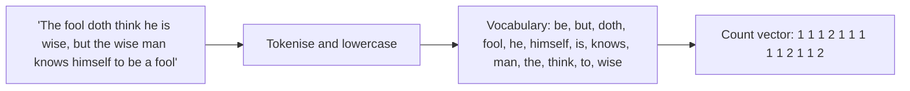

# Working with text: bag of words, tf-idf and n-grams

Chapter 4 dealt with two kinds of features: continuous ones and categorical ones. Chapter 7 of Müller &
Guido adds a third kind found in many applications: **text**. To classify an email as spam, to judge
whether a review is positive, or to route a support ticket, the content of the text carries the
information. Text is usually just a string of varying length, which is nothing like the fixed-size numeric
rows our models expect. This lesson shows the classic way to bridge that gap.

## 1. Four kinds of string data

Not every string column is "text". The book lists four kinds:

| kind | example | how to treat it |
|---|---|---|
| **categorical data** | a colour chosen from a drop-down menu: "red", "green", "blue" | one-hot encode (chapter 4) |
| **free strings that map to categories** | a text box where people type a colour: "gray", "grey", "velvety black", misspellings | clean and map to categories by hand; often needs manual effort |
| **structured string data** | addresses, names, dates, phone numbers, identifiers | domain-specific parsing; hard and context-dependent |
| **text data** | tweets, chat logs, reviews, the collected works of Shakespeare, Wikipedia | the methods in this module |

In text analysis the dataset is called the **corpus**, and each data point, represented as one text, is a
**document**. The terms come from information retrieval (IR) and natural language processing (NLP).

## 2. The running example: sentiment analysis

The book uses the IMDb movie-review dataset collected by Andrew Maas at Stanford: 25,000 training reviews
and 25,000 test reviews, each labelled positive (a score of 7 or more out of 10) or negative (4 or less).
The classes are balanced. The task is to predict the label from the text of a review.

That dataset is too large to download in the browser. We use a tiny corpus of our own to demonstrate
every step, and quote the book's numbers for the real data.

```python-run
reviews = [
    "A wonderful, moving film. The acting was great and the story was beautiful.",
    "Great fun! I loved every minute of this movie.",
    "Brilliant performances and a great script. Highly recommended.",
    "An excellent, touching story with wonderful characters.",
    "I loved it. Beautiful photography and a moving ending.",
    "One of the best movies of the year. Great cast, great direction.",
    "Terrible. The plot was boring and the acting was awful.",
    "A waste of time. Bad script, bad acting, bad everything.",
    "Boring and far too long. I nearly fell asleep.",
    "Awful movie. The worst film I have seen this year.",
    "Not good. The story was dull and the ending was terrible.",
    "I hated it. A boring, badly written waste of money.",
]
labels = [1, 1, 1, 1, 1, 1, 0, 0, 0, 0, 0, 0]          # 1 = positive, 0 = negative
print(len(reviews), "documents;", sum(labels), "positive")
print("document 0:", reviews[0])
```

Real text usually needs cleaning first. The IMDb reviews contain HTML line breaks (`<br />`), which the
book strips out before doing anything else.

## 3. The bag-of-words representation

The simplest and most effective way to represent text for ML is the **bag of words**. We discard most of
the structure of the input (chapters, paragraphs, sentences, formatting) and only **count how often each
word appears in each document**. The name is a mental image: every word of the document thrown into a bag,
with the order lost.

Computing it takes three steps:

1. **Tokenisation.** Split each document into its words (*tokens*), for example on whitespace and
   punctuation.
2. **Vocabulary building.** Collect all words that appear in any document, and number them (say in
   alphabetical order).
3. **Encoding.** For each document, count how often each vocabulary word appears.

The output is one vector of word counts per document, with **one feature per unique word** in the whole
corpus. The order of the words in the original string has no effect on the result.



### On a toy dataset

`CountVectorizer` implements all three steps. It is a transformer: `fit` tokenises the training documents
and builds the vocabulary, and `transform` produces the counts.

```python-run
from sklearn.feature_extraction.text import CountVectorizer
bards_words = ["The fool doth think he is wise,", "but the wise man knows himself to be a fool"]

vect = CountVectorizer().fit(bards_words)
print("vocabulary size:", len(vect.vocabulary_))
print("vocabulary_ (word -> column index):", dict(sorted(vect.vocabulary_.items())))

bag_of_words = vect.transform(bards_words)
print("\nrepr:", repr(bag_of_words))
print("dense array:\n", bag_of_words.toarray())
print("feature names:", list(vect.get_feature_names_out()))
```

Three things to observe:

- The vocabulary has 13 words. The single-letter word "a" is missing. By default tokens are extracted with
  the regular expression **`\b\w\w+\b`**: sequences of at least two letters or digits, separated by word
  boundaries. Everything is converted to **lowercase**, so "The" and "the" are the same token.
- The result is a **SciPy sparse matrix**. Most documents contain only a small fraction of the vocabulary,
  so most entries are zero. Storing only the non-zero entries saves an enormous amount of memory. Calling
  `.toarray()` on a real corpus could easily cause a `MemoryError`.
- Each row is a document and each column a word. The first document contains "fool" once. Both contain
  "the" and "wise".

### On movie reviews

On the 25,000 IMDb training reviews the book reports a vocabulary of **74,849 features**. Looking through
it reveals some issues:

- many entries are **numbers** ("00", "000", "007"), most with no obvious meaning;
- words appear in several forms as separate features: "draught", "drawback", "drawbacks"; singular and
  plural; verb forms.

Even so, a `LogisticRegression` on these counts reaches a mean cross-validation accuracy of about **88%**,
and tuning `C` gives about 89%. High-dimensional sparse data is exactly where linear models do best.

```python-run
from sklearn.feature_extraction.text import CountVectorizer
from sklearn.linear_model import LogisticRegression
from sklearn.pipeline import make_pipeline
from sklearn.model_selection import cross_val_score
reviews = ["A wonderful, moving film. The acting was great and the story was beautiful.", "Great fun! I loved every minute of this movie.",
           "Brilliant performances and a great script. Highly recommended.", "An excellent, touching story with wonderful characters.",
           "I loved it. Beautiful photography and a moving ending.", "One of the best movies of the year. Great cast, great direction.",
           "Terrible. The plot was boring and the acting was awful.", "A waste of time. Bad script, bad acting, bad everything.",
           "Boring and far too long. I nearly fell asleep.", "Awful movie. The worst film I have seen this year.",
           "Not good. The story was dull and the ending was terrible.", "I hated it. A boring, badly written waste of money."]
labels = [1] * 6 + [0] * 6

vect = CountVectorizer().fit(reviews)
X = vect.transform(reviews)
print("X:", repr(X))
print("share of non-zero entries:", round(X.nnz / (X.shape[0] * X.shape[1]), 3))
pipe = make_pipeline(CountVectorizer(), LogisticRegression())
print("3-fold CV accuracy:", cross_val_score(pipe, reviews, labels, cv=3).mean().round(2))
print("new review ->", pipe.fit(reviews, labels).predict(["a boring, awful waste of time", "a beautiful and moving story"]))
```

### Reducing the vocabulary with `min_df`

A token that appears in a single document is unlikely to appear in the test set and so is not helpful.
`min_df=5` keeps only tokens that occur in **at least five documents**. In the book this cuts the features
from 74,849 to **27,271**, about a third, with no loss of accuracy. Fewer features mean faster processing
and a model that is easier to inspect.

If `transform` meets a word that is not in the vocabulary, the word is simply **ignored**. This is not a
problem for classification, since nothing can be learned about words that are absent from the training
data. In some applications, such as spam detection, it helps to add a feature that counts how many
out-of-vocabulary words a document contains.

## 4. Stopwords

Another way to remove uninformative words is to discard words that are too frequent to be informative.
There are two approaches:

- a language-specific list of **stopwords** ("the", "and", "of", …). scikit-learn's built-in English list
  has 318 words, and `stop_words="english"` applies it;
- discarding words that appear too often, with **`max_df`** (for example `max_df=0.9` drops words found in
  more than 90% of documents).

In the book, removing the fixed stopword list shrinks the feature count by about 300 and changes accuracy
very little (it drops slightly). Fixed lists mainly help small datasets, where the data alone doesn't show
which words are uninformative.

```python-run
from sklearn.feature_extraction.text import CountVectorizer, ENGLISH_STOP_WORDS
print("number of built-in English stop words:", len(ENGLISH_STOP_WORDS))
print("a few of them:", sorted(ENGLISH_STOP_WORDS)[::40])
docs = ["the movie was not good at all", "the movie was very good"]
print("default vocabulary:   ", list(CountVectorizer().fit(docs).get_feature_names_out()))
print("with stop_words:      ", list(CountVectorizer(stop_words="english").fit(docs).get_feature_names_out()))
```

> [!WARNING]
> Look at what the stopword list removed: "not" is gone. The two reviews above mean opposite things and
> now look nearly the same. For sentiment analysis, negations matter. Check a stopword list before using it.

## 5. Rescaling the data with tf-idf

Instead of *dropping* features judged unimportant, we can **rescale** them by how informative we expect
them to be. The most common scheme is **term frequency–inverse document frequency (tf-idf)**. It gives a
high weight to a term that appears **often in a particular document, but in few documents of the corpus**.
Such a term is likely to describe the content of that document well.

scikit-learn offers `TfidfTransformer`, which takes the sparse count matrix from `CountVectorizer`, and
`TfidfVectorizer`, which goes from raw text to tf-idf in one step. The score for word $w$ in document $d$
is

$$\text{tfidf}(w, d) = \text{tf}\cdot\left(\log\frac{N+1}{N_w+1} + 1\right)$$

where $N$ is the number of training documents, $N_w$ the number of training documents containing $w$,
and tf the number of times $w$ appears in $d$. After that, each document vector is **L2-normalised** to
Euclidean length 1. A consequence is that the length of a document does not change its representation.

Because tf-idf uses statistics of the training data ($N_w$), it must go **inside a pipeline** when you
cross-validate. Otherwise the document frequencies leak from the validation folds.

```python-run
import numpy as np
from sklearn.feature_extraction.text import TfidfVectorizer
docs = ["the cat sat on the mat", "the dog sat on the log", "the cat chased the dog"]
tfidf = TfidfVectorizer().fit(docs)
names = tfidf.get_feature_names_out()
print("idf_ per word (low = common across documents):")
for w, v in sorted(zip(names, tfidf.idf_), key=lambda p: p[1]):
    print(f"  {w:7s} {v:.3f}")
X = tfidf.transform(docs).toarray()
print("\ndocument 0 weights:", {str(w): round(float(x), 2) for w, x in zip(names, X[0]) if x > 0})
print("row norms:", np.linalg.norm(X, axis=1).round(3))

# by hand, for 'mat' in document 0
N, df_mat, df_the = 3, 1, 3
raw = np.array([1 * (np.log((N + 1) / (df_mat + 1)) + 1), 2 * (np.log((N + 1) / (df_the + 1)) + 1)])
print("unnormalised tf-idf of 'mat' and 'the' in document 0:", raw.round(3))
```

"the" appears in every document, so its idf is the minimum, 1.0. "mat" appears in one document and gets
the highest idf. You implement exactly this in *ml-tfidf*.

In the book, tf-idf with a tuned logistic regression gives about 89% cross-validation accuracy, a slight
improvement over raw counts. tf-idf is an **unsupervised** technique. A high tf-idf value says a word is
distinctive for a document, and says nothing directly about the positive or negative label. The words with
the lowest idf are the stopword-like ones. Some are specific to the corpus, such as "movie", "film" and
"story" in movie reviews.

## 6. Investigating model coefficients

A linear model on bag-of-words features is easy to interpret. Each coefficient belongs to a word. The
largest positive coefficients mark words that indicate a positive review, and the most negative ones mark
negative reviews. In the book the negative side has "worst", "waste", "disappointment" and "laughable",
and the positive side has "excellent", "wonderful", "enjoyable" and "refreshing".

```python-run
import numpy as np
from sklearn.feature_extraction.text import TfidfVectorizer
from sklearn.linear_model import LogisticRegression
from sklearn.pipeline import make_pipeline
reviews = ["A wonderful, moving film. The acting was great and the story was beautiful.", "Great fun! I loved every minute of this movie.",
           "Brilliant performances and a great script. Highly recommended.", "An excellent, touching story with wonderful characters.",
           "I loved it. Beautiful photography and a moving ending.", "One of the best movies of the year. Great cast, great direction.",
           "Terrible. The plot was boring and the acting was awful.", "A waste of time. Bad script, bad acting, bad everything.",
           "Boring and far too long. I nearly fell asleep.", "Awful movie. The worst film I have seen this year.",
           "Not good. The story was dull and the ending was terrible.", "I hated it. A boring, badly written waste of money."]
labels = [1] * 6 + [0] * 6
pipe = make_pipeline(TfidfVectorizer(), LogisticRegression(C=10)).fit(reviews, labels)
names = pipe.named_steps["tfidfvectorizer"].get_feature_names_out()
coef = pipe.named_steps["logisticregression"].coef_[0]
order = np.argsort(coef)
print("most negative words:", [str(names[i]) for i in order[:6]])
print("most positive words:", [str(names[i]) for i in order[::-1][:6]])
```

## 7. Bag of words with more than one word: n-grams

The main weakness of a bag of words is that **word order is completely discarded**. "it's bad, not good at
all" and "it's good, not bad at all" get exactly the same representation, although they mean the opposite.

A way to capture some context is to count **pairs or triples of adjacent tokens** as well as single
tokens. Single tokens are **unigrams**, pairs are **bigrams**, triples are **trigrams**, and in general
sequences are **n-grams**. The `ngram_range` parameter is a tuple of the minimum and maximum length:
`(1, 1)` is the default (unigrams only), `(1, 2)` gives unigrams and bigrams, and `(2, 2)` only bigrams.

```python-run
from sklearn.feature_extraction.text import CountVectorizer
a, b = "it's bad, not good at all", "it's good, not bad at all"
uni = CountVectorizer().fit([a, b])
print("unigram vectors identical:", (uni.transform([a]) != uni.transform([b])).nnz == 0)
bi = CountVectorizer(ngram_range=(1, 2)).fit([a, b])
print("unigram + bigram features:", list(bi.get_feature_names_out()))
print("vectors identical now:", (bi.transform([a]) != bi.transform([b])).nnz == 0)
for n in [(1, 1), (1, 2), (1, 3)]:
    print(f"ngram_range={n}: {len(CountVectorizer(ngram_range=n).fit([a, b]).vocabulary_)} features")
```

Points from the book:

- For most applications the minimum should be 1, because single words often carry much of the meaning.
- Adding longer sequences (up to about 5-grams) may help, but the number of features **explodes**. In
  principle there could be (number of unigrams)² bigrams. The structure of language keeps the real number
  much lower, but it is still very large, and many of the n-grams are so specific that they invite
  overfitting.
- On IMDb, a grid search over `C` and `ngram_range` finds the best result with **unigrams + bigrams +
  trigrams**, at about 90.7% cross-validation accuracy, more than a percentage point better than unigrams.
- The most useful new features are bigrams such as "not worth", "definitely worth" and "well worth". They
  show context changing the meaning of "worth".

Use `min_df` together with n-grams to keep the vocabulary manageable.

> [!INTERVIEW]
> **"Explain tf-idf and why it works."** The term frequency says how much a document is *about* a word.
> The inverse document frequency discounts words that appear everywhere and so carry no information. The
> product highlights words that are frequent here and rare elsewhere. Normalising to unit length removes
> the effect of document length, so cosine similarity becomes a dot product. Limits: no word order (add
> n-grams), no notion of synonyms or meaning (use embeddings), and vocabulary mismatch. It remains a
> strong, cheap baseline, and BM25, a refinement of tf-idf, still powers keyword search and the lexical
> half of hybrid retrieval in RAG systems.

## Summary

- Text must be turned into fixed-size numeric vectors. Bag of words does it by tokenising, building a
  vocabulary and counting.
- `CountVectorizer` returns a sparse matrix. `min_df`, `max_df` and `stop_words` prune the vocabulary.
- tf-idf rescales counts to emphasise words that are frequent in a document and rare in the corpus, then
  L2-normalises.
- Linear models work very well on these sparse, high-dimensional features and are easy to interpret.
- n-grams recover some word order, at the price of many more features.

```quiz
[
  {"q": "What does the bag-of-words representation discard?", "options": ["The order of the words", "The number of times each word occurs", "All words shorter than five letters", "The documents themselves"], "answer": 0,
   "explain": "Only per-document word counts are kept; structure and order are lost."},
  {"q": "Why does CountVectorizer return a sparse matrix?", "options": ["Each document contains only a tiny fraction of the vocabulary, so most entries are zero", "Sparse matrices are required by Python", "Because counts are always integers", "To hide the vocabulary"], "answer": 0,
   "explain": "Storing only non-zero entries saves memory; a dense array could be enormous."},
  {"q": "With CountVectorizer's defaults, which token is dropped from 'I am a cat'?", "options": ["Both 'I' and 'a' (single characters)", "Only 'cat'", "Only 'am'", "None"], "answer": 0,
   "explain": "The default token pattern \\b\\w\\w+\\b requires at least two characters."},
  {"q": "A word appears in every training document. Under scikit-learn's smoothed tf-idf, its idf is…", "options": ["1 (the minimum)", "0", "infinity", "equal to the number of documents"], "answer": 0,
   "explain": "ln((N+1)/(N+1)) + 1 = 1. The '+1' keeps such words from being zeroed out entirely."},
  {"q": "What does min_df=5 do?", "options": ["Keeps only tokens that appear in at least five documents", "Keeps the five most frequent tokens", "Removes tokens appearing in more than five documents", "Limits documents to five words"], "answer": 0,
   "explain": "Rare tokens are unlikely to help generalisation and inflate the vocabulary."},
  {"q": "Why should TfidfVectorizer be inside a Pipeline during cross-validation?", "options": ["Its vocabulary and document frequencies are learned from data and would otherwise leak from validation folds", "It cannot be fitted outside a pipeline", "It needs the labels to compute idf", "It only supports dense input"], "answer": 0,
   "explain": "Any step with a fit that learns statistics must be refitted on the training folds only."},
  {"q": "ngram_range=(1, 2) produces features for…", "options": ["single words and pairs of adjacent words", "only pairs of adjacent words", "characters and words", "words of one or two letters"], "answer": 0,
   "explain": "The tuple gives the minimum and maximum n-gram length."},
  {"q": "A danger of applying a generic English stopword list in sentiment analysis is that…", "options": ["it may remove negations such as 'not', which change meaning", "it makes the matrix dense", "it increases the vocabulary", "it removes all adjectives"], "answer": 0,
   "explain": "'not good' and 'good' become indistinguishable when 'not' is dropped."}
]
```

> **Source:** Müller & Guido, *Introduction to Machine Learning with Python*, ch. 7 ("Types of Data Represented as Strings", "Example Application: Sentiment Analysis of Movie Reviews", "Representing Text Data as a Bag of Words", "Stopwords", "Rescaling the Data with tf-idf", "Investigating Model Coefficients", "Bag-of-Words with More Than One Word (n-Grams)"); scikit-learn User Guide, "Text feature extraction".
