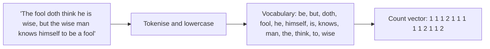

# Working with text: bag of words, tf-idf and n-grams

> **Before this lesson:** you should know one-hot encoding and sparse matrices from [Categorical features, binning and polynomials](#/lesson/ml/feature-engineering), pipelines from [Pipelines and grid search](#/lesson/ml/pipelines), and logistic regression from [Linear models](#/lesson/ml/linear-models) (a classifier that gives every feature a weight and adds them up). Cross-validation scores come from [Cross-validation](#/lesson/ml/cross-validation).

## In plain words

Models need rows of numbers, all the same length. Text is a string of words of any length. This lesson shows the classic bridge between the two, the **bag of words**: for each document, count how often every word of a fixed vocabulary appears in it. A document becomes a long row of counts, one column per word, and any model can read that.

The name describes the idea. Cut a page of text into individual words, throw them into a bag and shake it. The order is lost, but you can still count how many times each word is in the bag, and those counts say a lot about what the page was about. A bag containing "wonderful", "loved" and "beautiful" probably came from a happy film review; one containing "boring", "waste" and "awful" probably did not.

Why this matters for a job: spam filters, sentiment analysis, support-ticket routing and keyword search all started from this representation, and it remains a strong, cheap baseline that large language models are compared against. Interviewers ask you to explain tf-idf, the weighting scheme taught here, and it underlies BM25, the scoring formula still used by search engines.

## 1. Four kinds of string data

Not every column of strings is "text" in the sense of this lesson. There are four kinds:

| kind | example | how to treat it |
|---|---|---|
| **categorical data** | a colour chosen from a drop-down menu: "red", "green", "blue" | one-hot encode (lesson 40) |
| **free strings that map to categories** | a text box where people type a colour: "gray", "grey", "velvety black", misspellings | clean and map to categories, often by hand |
| **structured string data** | addresses, names, dates, phone numbers, product codes | parse with rules specific to the format |
| **text data** | tweets, chat logs, reviews, novels, encyclopaedia articles | the methods in this module |

Two words used throughout: in text analysis the whole dataset is called the **corpus**, and each data point, one piece of text, is a **document**. Both come from the fields of **information retrieval** (IR, the study of search) and **natural language processing** (NLP, the study of getting computers to work with human language).

## 2. The running example: sentiment analysis

**Sentiment analysis** means deciding whether a piece of text expresses a positive or a negative opinion. The book uses the IMDb film-review dataset collected by Andrew Maas at Stanford: 25,000 training reviews and 25,000 test reviews, each labelled positive (the reviewer gave 7 or more out of 10) or negative (4 or less). The two classes are equally common. The task is to predict the label from the review text.

That dataset is too large to download in the browser, so the demos use a tiny corpus of twelve invented reviews, and the lesson quotes the book's numbers for the real data.

```python-run
reviews = [
    "A wonderful, moving film. The acting was great and the story was beautiful.",
    "Great fun! I loved every minute of this movie.",
    "Brilliant performances and a great script. Highly recommended.",
    "An excellent, touching story with wonderful characters.",
    "I loved it. Beautiful photography and a moving ending.",
    "One of the best movies of the year. Great cast, great direction.",
    "Terrible. The plot was boring and the acting was awful.",
    "A waste of time. Bad script, bad acting, bad everything.",
    "Boring and far too long. I nearly fell asleep.",
    "Awful movie. The worst film I have seen this year.",
    "Not good. The story was dull and the ending was terrible.",
    "I hated it. A boring, badly written waste of money.",
]
labels = [1, 1, 1, 1, 1, 1, 0, 0, 0, 0, 0, 0]          # 1 = positive, 0 = negative
print(len(reviews), "documents;", sum(labels), "positive")
print("document 0:", reviews[0])
```

`reviews` is a Python list of twelve strings and `labels` a matching list of 0s and 1s. The output confirms 12 documents, 6 of them positive. Real text usually needs cleaning first: the IMDb reviews contain HTML line-break tags (`<br />`), which the book removes before anything else.

## 3. The bag-of-words representation

The bag of words is the simplest representation of text for machine learning, and a surprisingly effective one. Almost all structure is thrown away: chapters, paragraphs, sentences, punctuation, formatting and word order. What remains is **a count of how often each word occurs in each document**.

It is computed in three steps:

1. **Tokenisation.** Cut each document into words, called **tokens**, for example by splitting at spaces and punctuation.
2. **Vocabulary building.** Collect every distinct token found anywhere in the corpus, and give each one a column number (scikit-learn sorts them alphabetically).
3. **Encoding.** For each document, count how often each vocabulary word appears in it.

Each document becomes a vector of counts with **one feature per distinct word** in the corpus. Shuffling the words of a document would leave its vector unchanged.



Read the diagram as a worked example on one sentence (a line from Shakespeare's *As You Like It*). After tokenising and lowercasing, 13 distinct words remain (the reason "a" is missing comes below). The count vector lists, in alphabetical order, how often each occurs: "fool", "the" and "wise" appear twice, every other word once.

### On a toy dataset

`CountVectorizer` performs all three steps. It is a transformer: `fit` tokenises the training documents and builds the vocabulary; `transform` produces the counts.

```python-run
from sklearn.feature_extraction.text import CountVectorizer
bards_words = ["The fool doth think he is wise,", "but the wise man knows himself to be a fool"]

vect = CountVectorizer().fit(bards_words)
print("vocabulary size:", len(vect.vocabulary_))
print("vocabulary_ (word -> column index):", dict(sorted(vect.vocabulary_.items())))

bag_of_words = vect.transform(bards_words)
print("\nrepr:", repr(bag_of_words))
print("dense array:\n", bag_of_words.toarray())
print("feature names:", list(vect.get_feature_names_out()))
```

**Reading this code line by line**

- `bards_words` splits the sentence into two documents.
- `CountVectorizer().fit(bards_words)` builds the vocabulary. `vect.vocabulary_` is a dictionary from each word to its column number; sorting it makes the printout readable.
- `vect.transform(bards_words)` returns the counts. `repr(...)` shows what kind of object it is: a **sparse matrix** with shape (2, 13) and 16 stored elements.
- `.toarray()` converts it to an ordinary array so we can see every entry, and `get_feature_names_out()` lists the column names in order.

Three things to notice:

- The vocabulary has 13 words, and the single-letter word "a" is missing. By default tokens are found with the **regular expression** `\b\w\w+\b`. A regular expression is a pattern that describes text; this one means "two or more letters or digits in a row, between word boundaries". Single characters therefore never become tokens. Everything is also **lowercased**, so "The" and "the" count as the same token.
- The result is a **SciPy sparse matrix**. Any one document contains only a small fraction of the whole vocabulary, so most entries are zero, and storing only the non-zero ones saves an enormous amount of memory. Here 16 of the 26 entries are non-zero; in a real corpus the share is often below 1%, and calling `.toarray()` could exhaust the computer's memory.
- Each row is a document and each column a word. The first document contains "fool" once (column 3), and both documents contain "the" and "wise".

### On film reviews

On the 25,000 IMDb training reviews the book's vocabulary has **74,849 features**. Looking through it shows some issues:

- many entries are **numbers** ("00", "000", "007"), most of them meaningless as features;
- the same word appears in several forms as separate features: singular and plural, different verb forms, as in "drawback" and "drawbacks".

Even so, a `LogisticRegression` on these counts reaches a cross-validation accuracy of about **88%**, and tuning its regularisation strength `C` gives about 89%. High-dimensional sparse data is where linear models shine: with tens of thousands of features, a weighted sum is flexible enough, and training stays fast.

```python-run
from sklearn.feature_extraction.text import CountVectorizer
from sklearn.linear_model import LogisticRegression
from sklearn.pipeline import make_pipeline
from sklearn.model_selection import cross_val_score
reviews = ["A wonderful, moving film. The acting was great and the story was beautiful.", "Great fun! I loved every minute of this movie.",
           "Brilliant performances and a great script. Highly recommended.", "An excellent, touching story with wonderful characters.",
           "I loved it. Beautiful photography and a moving ending.", "One of the best movies of the year. Great cast, great direction.",
           "Terrible. The plot was boring and the acting was awful.", "A waste of time. Bad script, bad acting, bad everything.",
           "Boring and far too long. I nearly fell asleep.", "Awful movie. The worst film I have seen this year.",
           "Not good. The story was dull and the ending was terrible.", "I hated it. A boring, badly written waste of money."]
labels = [1] * 6 + [0] * 6

vect = CountVectorizer().fit(reviews)
X = vect.transform(reviews)
print("X:", repr(X))
print("share of non-zero entries:", round(X.nnz / (X.shape[0] * X.shape[1]), 3))
pipe = make_pipeline(CountVectorizer(), LogisticRegression())
print("3-fold CV accuracy:", cross_val_score(pipe, reviews, labels, cv=3).mean().round(2))
print("new review ->", pipe.fit(reviews, labels).predict(["a boring, awful waste of time", "a beautiful and moving story"]))
```

**Reading this code line by line**

- `X.nnz` is the number of non-zero entries in the sparse matrix, and `X.shape` its (rows, columns). Their ratio is the share of non-zero entries.
- `make_pipeline(CountVectorizer(), LogisticRegression())` builds a model that takes raw strings: the vectoriser turns them into counts, then the classifier learns one weight per word.
- `cross_val_score(pipe, reviews, labels, cv=3)` cross-validates the whole pipeline, so the vocabulary is rebuilt from each split's training documents.
- The last line fits on all twelve reviews and classifies two new sentences.

The matrix has shape (12, 60): twelve documents and a 60-word vocabulary, with 97 non-zero entries, 13.5% of the table. The cross-validation accuracy is 0.83 (with only four test documents per fold, one mistake costs 25 points), and the two new reviews are classified as `[0 1]`: negative, then positive.

### Reducing the vocabulary with `min_df`

A token that appears in only one training document will probably never appear in test data, so it cannot help. `min_df=5` keeps only tokens that occur in **at least five documents** ("df" stands for document frequency). In the book this cuts the features from 74,849 to **27,271**, about a third, with no loss of accuracy. Fewer features mean faster training and a model that is easier to inspect.

When `transform` meets a word that is not in the vocabulary, it **ignores** it. For classification that costs nothing, since nothing could have been learned about a word absent from the training data. In some applications, such as spam detection, it helps to add a feature counting how many unknown words a document contains, because spam often contains odd spellings.

## 4. Stop words

Uninformative words can also be removed from the other end: words so common that they tell us nothing. There are two ways:

- a fixed, language-specific list of **stop words** ("the", "and", "of" and so on). scikit-learn's built-in English list has 318 words, applied with `stop_words="english"`;
- discarding words that occur in too many documents, with **`max_df`**: `max_df=0.9` drops words found in more than 90% of documents.

In the book, removing the fixed stop-word list shrinks the IMDb vocabulary by about 300 features and changes accuracy very little (it falls slightly). Fixed lists mainly help on small datasets, where the data alone cannot reveal which words are uninformative.

```python-run
from sklearn.feature_extraction.text import CountVectorizer, ENGLISH_STOP_WORDS
print("number of built-in English stop words:", len(ENGLISH_STOP_WORDS))
print("a few of them:", sorted(ENGLISH_STOP_WORDS)[::40])
docs = ["the movie was not good at all", "the movie was very good"]
print("default vocabulary:   ", list(CountVectorizer().fit(docs).get_feature_names_out()))
print("with stop_words:      ", list(CountVectorizer(stop_words="english").fit(docs).get_feature_names_out()))
```

`ENGLISH_STOP_WORDS` is the built-in list; `sorted(...)[::40]` takes every fortieth word to show a sample ("a", "becoming", "empty" and so on). The default vocabulary of the two short reviews has eight words; with stop words removed only "good" and "movie" remain.

> [!WARNING]
> Look at what the stop-word list removed: "not" is gone. The two reviews above mean different things, and now both are represented by the words "movie" and "good". For sentiment analysis, negations matter. Always check a stop-word list before using it.

## 5. Reweighting counts with tf-idf

Instead of dropping words, we can keep them all and **rescale** each one by how much information it is likely to carry. The most common scheme is **tf-idf**, short for term frequency–inverse document frequency. A word gets a high score in a document when it is **frequent in that document and rare across the rest of the corpus**. Such a word is likely to say something specific about that document.

The two halves of the name:

- **term frequency** (tf): how many times the word appears in this document. More appearances suggest the document is more *about* that word.
- **inverse document frequency** (idf): a weight that is large for words found in few documents and small for words found in almost all of them. "The" appears everywhere, so it gets the smallest weight.

scikit-learn's formula multiplies the two. With $N$ the number of training documents, $N_w$ the number of training documents containing word $w$, and $\text{tf}$ the count of $w$ in document $d$:

$$\text{tfidf}(w, d) = \text{tf}\cdot\left(\ln\frac{N+1}{N_w+1} + 1\right)$$

The "+1" inside the fraction avoids dividing by zero, and the "+1" outside keeps a word that appears in every document from getting a weight of exactly zero. After this, each document's vector is **L2-normalised**: divided by its **L2 norm** (its Euclidean length, the square root of the sum of its squared entries), so that every document vector has length 1. A long review and a short review about the same things then get similar vectors.

A worked example with three documents: "the cat sat on the mat", "the dog sat on the log" and "the cat chased the dog". So $N = 3$.

- "mat" is in 1 document: idf $= \ln(4/2) + 1 = 0.693 + 1 = 1.693$. It appears once in document 0, so its unnormalised score there is 1.693.
- "cat" is in 2 documents: idf $= \ln(4/3) + 1 = 1.288$.
- "the" is in all 3: idf $= \ln(4/4) + 1 = 1$. It appears twice in document 0, so its score there is $2 \times 1 = 2$.

Document 0's unnormalised vector has the entries the = 2, mat = 1.693, and cat, sat, on = 1.288 each. Its length is $\sqrt{2^2 + 1.693^2 + 3 \times 1.288^2} = \sqrt{11.84} = 3.44$, so after normalising "the" becomes $2/3.44 = 0.58$, "mat" $0.49$, and "cat" $0.37$.

```python-run
import numpy as np
from sklearn.feature_extraction.text import TfidfVectorizer
docs = ["the cat sat on the mat", "the dog sat on the log", "the cat chased the dog"]
tfidf = TfidfVectorizer().fit(docs)
names = tfidf.get_feature_names_out()
print("idf_ per word (low = common across documents):")
for w, v in sorted(zip(names, tfidf.idf_), key=lambda p: p[1]):
    print(f"  {w:7s} {v:.3f}")
X = tfidf.transform(docs).toarray()
print("\ndocument 0 weights:", {str(w): round(float(x), 2) for w, x in zip(names, X[0]) if x > 0})
print("row norms:", np.linalg.norm(X, axis=1).round(3))

# by hand, for 'mat' in document 0
N, df_mat, df_the = 3, 1, 3
raw = np.array([1 * (np.log((N + 1) / (df_mat + 1)) + 1), 2 * (np.log((N + 1) / (df_the + 1)) + 1)])
print("unnormalised tf-idf of 'mat' and 'the' in document 0:", raw.round(3))
```

**Reading this code line by line**

- `TfidfVectorizer` goes from raw text to tf-idf in one step (it is a `CountVectorizer` followed by a `TfidfTransformer`). `.fit(docs)` builds the vocabulary and computes the idf of every word, stored in `tfidf.idf_`.
- The loop prints each word with its idf, sorted from smallest to largest (`key=lambda p: p[1]` sorts the pairs by their second element).
- `tfidf.transform(docs).toarray()` gives the normalised tf-idf table; the dictionary comprehension shows document 0's non-zero entries.
- `np.linalg.norm(X, axis=1)` computes each row's length, which should be 1.
- The last three lines repeat the hand calculation for "mat" and "the" with `np.log`, NumPy's natural logarithm.

The output matches the worked example: "the" has the minimum idf, 1.000; "cat", "dog", "on" and "sat" 1.288; "chased", "log" and "mat" 1.693. Document 0's weights are the 0.58, mat 0.49, and cat, on, sat 0.37, every row has length 1, and the unnormalised scores are 1.693 and 2. You implement exactly this calculation in *ml-tfidf*.

Because tf-idf learns statistics from the training data (the vocabulary and every $N_w$), it must go **inside a pipeline** during cross-validation. Otherwise the document frequencies would include the validation documents, a leak (lesson 61).

In the book, tf-idf with a tuned logistic regression reaches about 89% cross-validation accuracy, a slight improvement over raw counts. Note that tf-idf is **unsupervised**: it never looks at the labels. A high tf-idf value says that a word is distinctive for a document, not that it signals a positive or negative review. The words with the lowest idf are the stop-word-like ones, including some specific to the corpus, such as "movie", "film" and "story" in film reviews.

## 6. Investigating model coefficients

A linear model on bag-of-words features is easy to interpret: each coefficient belongs to one word. The largest positive coefficients mark words that push a review towards "positive", and the most negative mark words that push towards "negative". In the book, the negative end includes "worst", "waste", "disappointment" and "laughable", and the positive end "excellent", "wonderful", "enjoyable" and "refreshing".

```python-run
import numpy as np
from sklearn.feature_extraction.text import TfidfVectorizer
from sklearn.linear_model import LogisticRegression
from sklearn.pipeline import make_pipeline
reviews = ["A wonderful, moving film. The acting was great and the story was beautiful.", "Great fun! I loved every minute of this movie.",
           "Brilliant performances and a great script. Highly recommended.", "An excellent, touching story with wonderful characters.",
           "I loved it. Beautiful photography and a moving ending.", "One of the best movies of the year. Great cast, great direction.",
           "Terrible. The plot was boring and the acting was awful.", "A waste of time. Bad script, bad acting, bad everything.",
           "Boring and far too long. I nearly fell asleep.", "Awful movie. The worst film I have seen this year.",
           "Not good. The story was dull and the ending was terrible.", "I hated it. A boring, badly written waste of money."]
labels = [1] * 6 + [0] * 6
pipe = make_pipeline(TfidfVectorizer(), LogisticRegression(C=10)).fit(reviews, labels)
names = pipe.named_steps["tfidfvectorizer"].get_feature_names_out()
coef = pipe.named_steps["logisticregression"].coef_[0]
order = np.argsort(coef)
print("most negative words:", [str(names[i]) for i in order[:6]])
print("most positive words:", [str(names[i]) for i in order[::-1][:6]])
```

`coef_[0]` holds the logistic regression's weight for each of the vocabulary's words. `np.argsort(coef)` returns the column positions in order from the most negative weight to the most positive, so `order[:6]` gives the six most negative words and `order[::-1][:6]` (the order reversed) the six most positive. The output: "bad", "boring", "awful", "terrible", "waste", "worst" on the negative side; "great", "moving", "beautiful", "wonderful", "loved", "photography" on the positive side. The last one is a reminder that with twelve documents a model also learns accidents: "photography" appears in one positive review and nowhere else.

## 7. Beyond single words: n-grams

The main weakness of a bag of words is that **word order is discarded completely**. "It's bad, not good at all" and "it's good, not bad at all" contain the same words, so they get identical vectors, although they mean opposite things.

A way to keep some context is to count **sequences of adjacent tokens** as well as single tokens. Single tokens are **unigrams**, pairs are **bigrams**, triples **trigrams**, and in general a sequence of $n$ tokens is an **n-gram**. The `ngram_range` parameter is a tuple giving the shortest and longest sequence to count: `(1, 1)` (the default) gives unigrams only, `(1, 2)` unigrams and bigrams, and `(2, 2)` only bigrams.

```python-run
from sklearn.feature_extraction.text import CountVectorizer
a, b = "it's bad, not good at all", "it's good, not bad at all"
uni = CountVectorizer().fit([a, b])
print("unigram vectors identical:", (uni.transform([a]) != uni.transform([b])).nnz == 0)
bi = CountVectorizer(ngram_range=(1, 2)).fit([a, b])
print("unigram + bigram features:", list(bi.get_feature_names_out()))
print("vectors identical now:", (bi.transform([a]) != bi.transform([b])).nnz == 0)
for n in [(1, 1), (1, 2), (1, 3)]:
    print(f"ngram_range={n}: {len(CountVectorizer(ngram_range=n).fit([a, b]).vocabulary_)} features")
```

**Reading this code line by line**

- `uni.transform([a]) != uni.transform([b])` compares the two sparse vectors entry by entry; `.nnz == 0` asks whether no entry differs. With unigrams the answer is `True`: identical.
- `CountVectorizer(ngram_range=(1, 2))` also counts adjacent pairs. The printed feature names include bigrams such as "not good", "not bad", "bad not" and "good not".
- With bigrams the two vectors differ: review `a` contains "not good" and review `b` contains "not bad".
- The loop shows how the vocabulary grows: 6 features for unigrams, 15 with bigrams, 23 with trigrams, for two six-word sentences. ("it's" becomes the token "it", since the apostrophe is not a letter and "s" alone is too short.)

Guidance from the book:

- For most applications the shortest length should be 1, because single words carry much of the meaning.
- Adding longer sequences (up to about 5-grams) can help, but the number of features **explodes**. In principle there could be as many bigrams as the square of the number of unigrams. The structure of language keeps the real number far lower, but it is still very large, and many long n-grams are so specific that they invite overfitting.
- On IMDb, a grid search over `C` and `ngram_range` finds the best result with **unigrams, bigrams and trigrams** together, at about 90.7% cross-validation accuracy, more than a percentage point better than unigrams alone.
- The most useful new features are bigrams such as "not worth", "definitely worth" and "well worth": context changing the meaning of "worth".

Use `min_df` together with n-grams to keep the vocabulary manageable.

> [!INTERVIEW]
> **"Explain tf-idf and why it works."** The term frequency says how much a document is *about* a word. The inverse document frequency discounts words that appear everywhere and therefore carry no information. The product highlights words that are frequent here and rare elsewhere. Normalising to unit length removes the effect of document length, so the **cosine similarity** of two documents (how closely their vectors point in the same direction) becomes a plain dot product. Limits: no word order (add n-grams), no notion of synonyms or meaning (use embeddings, module 8), and vocabulary mismatch between query and document. It remains a strong, cheap baseline, and BM25, a refinement of tf-idf, still powers keyword search and the keyword half of "hybrid" retrieval in RAG (retrieval-augmented generation) systems.

## Summary

- Text must be turned into fixed-length numeric vectors. The bag of words does it by tokenising, building a vocabulary and counting.
- `CountVectorizer` returns a sparse matrix. `min_df`, `max_df` and `stop_words` prune the vocabulary; check stop-word lists for negations.
- tf-idf rescales counts to emphasise words that are frequent in a document and rare in the corpus, then normalises each document to length 1. It learns from training data, so it belongs inside a pipeline.
- Linear models work very well on these sparse, high-dimensional features, and their coefficients are easy to read.
- n-grams recover some word order, at the price of many more features.

## Glossary

- **Corpus / document**: the whole collection of texts / one text in it.
- **Information retrieval (IR) / natural language processing (NLP)**: the study of search / of computers working with human language.
- **Sentiment analysis**: deciding whether text expresses a positive or negative opinion.
- **Bag of words**: representing a document by how often each vocabulary word occurs in it.
- **Token / tokenisation**: one unit of text, usually a word / cutting text into tokens.
- **Vocabulary**: the list of distinct tokens, each assigned a column.
- **Regular expression**: a pattern describing which pieces of text to match.
- **Sparse matrix**: a storage format that keeps only the non-zero entries.
- **Document frequency (df)**: the number of documents containing a word.
- **Stop words**: very common words that are often removed.
- **tf-idf**: term frequency times inverse document frequency.
- **L2 norm / L2 normalisation**: a vector's Euclidean length / dividing a vector by its length.
- **Unsupervised (here)**: computed without looking at the labels.
- **n-gram (unigram, bigram, trigram)**: a sequence of n adjacent tokens (1, 2, 3).
- **Cosine similarity**: how closely two vectors point in the same direction.

## Check yourself

```quiz
[
  {"q": "What does the bag-of-words representation discard?", "options": ["The order of the words", "The number of times each word occurs", "All words shorter than five letters", "The documents themselves"], "answer": 0,
   "explain": "Only per-document word counts are kept; structure and order are lost."},
  {"q": "Why does CountVectorizer return a sparse matrix?", "options": ["Each document contains only a tiny fraction of the vocabulary, so most entries are zero", "Sparse matrices are required by Python", "Because counts are always integers", "To hide the vocabulary"], "answer": 0,
   "explain": "Storing only non-zero entries saves memory; a dense array could be enormous."},
  {"q": "With CountVectorizer's defaults, which token is dropped from 'I am a cat'?", "options": ["Both 'I' and 'a' (single characters)", "Only 'cat'", "Only 'am'", "None"], "answer": 0,
   "explain": "The default token pattern \\b\\w\\w+\\b requires at least two characters."},
  {"q": "A word appears in every training document. Under scikit-learn's smoothed tf-idf, its idf is…", "options": ["1 (the minimum)", "0", "infinity", "equal to the number of documents"], "answer": 0,
   "explain": "ln((N+1)/(N+1)) + 1 = 1. The '+1' keeps such words from being zeroed out entirely."},
  {"q": "What does min_df=5 do?", "options": ["Keeps only tokens that appear in at least five documents", "Keeps the five most frequent tokens", "Removes tokens appearing in more than five documents", "Limits documents to five words"], "answer": 0,
   "explain": "Rare tokens are unlikely to help generalisation and inflate the vocabulary."},
  {"q": "Why should TfidfVectorizer be inside a Pipeline during cross-validation?", "options": ["Its vocabulary and document frequencies are learned from data and would otherwise leak from validation folds", "It cannot be fitted outside a pipeline", "It needs the labels to compute idf", "It only supports dense input"], "answer": 0,
   "explain": "Any step with a fit that learns statistics must be refitted on the training folds only."},
  {"q": "ngram_range=(1, 2) produces features for…", "options": ["single words and pairs of adjacent words", "only pairs of adjacent words", "characters and words", "words of one or two letters"], "answer": 0,
   "explain": "The tuple gives the minimum and maximum n-gram length."},
  {"q": "A danger of applying a generic English stopword list in sentiment analysis is that…", "options": ["it may remove negations such as 'not', which change meaning", "it makes the matrix dense", "it increases the vocabulary", "it removes all adjectives"], "answer": 0,
   "explain": "'not good' and 'good' become indistinguishable when 'not' is dropped."}
]
```

> **Source:** Müller & Guido, *Introduction to Machine Learning with Python*, ch. 7 ("Types of Data Represented as Strings", "Example Application: Sentiment Analysis of Movie Reviews", the sections on the bag-of-words representation, stopwords, tf-idf rescaling, model coefficients and n-grams); scikit-learn User Guide, "Text feature extraction".
