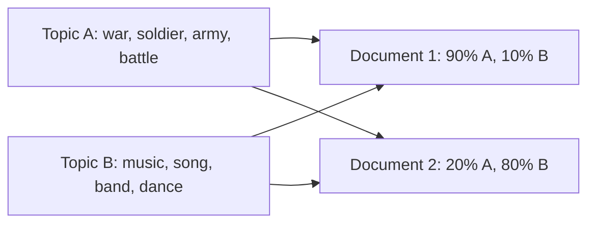

# Tokenisation, normalisation and topic models

The previous lesson treated tokenisation as a black box inside `CountVectorizer`. This lesson opens it up.
It covers better tokenisation, **stemming** and **lemmatisation**, the subword tokenisers used by modern
language models, and then **topic modelling** with latent Dirichlet allocation (LDA), the unsupervised
technique from the end of chapter 7 of Müller & Guido. It closes with a look at what replaced bag of
words in most NLP applications.

## 1. Why tokenisation matters

Feature extraction in `CountVectorizer` and `TfidfVectorizer` is relatively simple, and much more
elaborate methods exist. The step that is most often improved is the first one: tokenisation, which
decides *what counts as a word*.

The IMDb vocabulary in the book contains singular and plural forms as separate entries ("drawback",
"drawbacks"; "drawer", "drawers"), and different verb forms with related nouns ("replace", "replaced",
"replacement", "replaces", "replacing"). For a bag-of-words model these have closely related meanings.
Keeping them apart **increases overfitting** and stops the model from making full use of the training
data. The model must learn separately, from separate examples, that each form is positive or negative.

## 2. Stemming and lemmatisation

The fix is to represent each word by its **word stem**, and to merge all words with the same stem. This is
a form of **normalisation**. There are two ways to do it.

| | **stemming** | **lemmatisation** |
|---|---|---|
| how | a rule-based heuristic that chops off common suffixes | a dictionary of known word forms, taking the role of the word in the sentence into account |
| result | a stem, which may not be a real word | the **lemma**, a real dictionary form |
| example tool | the Porter stemmer (in `nltk`) | `spacy`, WordNet |
| quality | fast and crude | slower, and usually better |

The book compares them on the sentence *"Our meeting today was worse than yesterday, I'm scared of meeting
the clients tomorrow."*

- **Stemming** turns "was" into "wa" and always reduces "meeting" to "meet", whether it is a noun or a
  verb. It leaves "worse" as "wors".
- **Lemmatisation** maps "was" to "be" and "worse" to "bad". It keeps the *noun* "meeting" as "meeting"
  and reduces the *verb* "meeting" to "meet". "I'm" becomes "I" and "be".

Lemmatisation is the more involved process and usually gives better results when used to normalise tokens
for machine learning.

```python-run
import re

def tiny_stem(word):
    """A deliberately small suffix-stripping stemmer, in the spirit of (but far simpler than) Porter's."""
    for suffix, replacement in [("sses", "ss"), ("ies", "i"), ("ing", ""), ("ed", ""), ("ly", ""), ("s", "")]:
        if word.endswith(suffix) and len(word) - len(suffix) >= 3:
            return word[: len(word) - len(suffix)] + replacement
    return word

sentence = "Our meeting today was worse than yesterday, I'm scared of meeting the clients tomorrow."
tokens = re.findall(r"\b\w\w+\b", sentence.lower())
print("tokens: ", tokens)
print("stemmed:", [tiny_stem(t) for t in tokens])
for group in [["replace", "replaced", "replaces", "replacing"], ["drawback", "drawbacks"], ["was", "worse", "better"]]:
    print(group, "->", sorted({tiny_stem(w) for w in group}))
```

The toy stemmer merges most regular forms. It leaves the irregular ones ("was", "worse", "better")
untouched, which is exactly the case where a lemmatiser's dictionary is needed. It is also inconsistent
("replace" stays, while the other forms become "replac") and it over-stems "scared" to "scar", a
different word. Real stemmers have many more rules, but they make the same kinds of mistakes. A stem
only has to be *consistent*, not readable.

### Using a custom tokeniser

`CountVectorizer` takes a `tokenizer` argument, a function from a document string to a list of tokens. The
book plugs in spaCy's lemmatiser this way. With `min_df=5` on IMDb, lemmatisation reduces the features
from 27,271 to 21,596. On a small training set (1% of the data) it raises cross-validation accuracy
slightly, from about 71.9% to about 73.1%.

The book's conclusion: lemmatisation can be seen as a kind of **regularisation**, since it merges certain
features. It helps most on **small datasets**. As with many feature-extraction techniques, the result
varies with the dataset. Both stemming and lemmatisation are worth trying when you want to squeeze out the
last bits of performance on a task.

```python-run
import re
from sklearn.feature_extraction.text import CountVectorizer

def tiny_stem(word):
    for suffix, replacement in [("sses", "ss"), ("ies", "i"), ("ing", ""), ("ed", ""), ("ly", ""), ("s", "")]:
        if word.endswith(suffix) and len(word) - len(suffix) >= 3:
            return word[: len(word) - len(suffix)] + replacement
    return word

def stem_tokenizer(doc):
    return [tiny_stem(t) for t in re.findall(r"\b\w\w+\b", doc.lower())]

docs = ["The actors acted badly and the acting was boring", "A boring actor in a badly directed film",
        "Great actors, great acting, great direction", "The director directs great films"]
plain = CountVectorizer().fit(docs)
stemmed = CountVectorizer(tokenizer=stem_tokenizer, token_pattern=None).fit(docs)
print("plain vocabulary  :", len(plain.vocabulary_), list(plain.get_feature_names_out()))
print("stemmed vocabulary:", len(stemmed.vocabulary_), list(stemmed.get_feature_names_out()))
```

## 3. Other normalisation choices

- **Lowercasing** is on by default. It loses the difference between "US" and "us", or "Apple" and "apple".
- **Spelling correction** merges misspelled variants.
- **Character n-grams** (`analyzer="char_wb"`) are robust to typos and useful for languages with rich
  morphology or for language identification.
- **Hashing** (`HashingVectorizer`) maps tokens straight to column indices with a hash function. No
  vocabulary is stored, which suits streaming data and very large corpora. The price is that you can't map
  a column back to a word, and different words can collide.

## 4. Subword tokenisation: what modern models use

Word-level vocabularies have two problems. They are huge, and any word not seen in training is **out of
vocabulary**. Neural language models avoid both with **subword tokenisation**:

- **Byte-pair encoding (BPE)**, used by the GPT family: start from characters and repeatedly merge the
  most frequent adjacent pair into a new token, until the vocabulary reaches a target size (often 30,000 to
  100,000).
- **WordPiece** (BERT) and **SentencePiece/Unigram** (T5, many multilingual models) are close relatives.

Frequent words become single tokens. Rare words split into meaningful pieces (`token`, `isation`). Nothing
is ever out of vocabulary, because in the worst case a word falls back to characters or bytes.

```python-run
from collections import Counter

def learn_bpe(corpus, n_merges):
    words = Counter(tuple(w) + ("</w>",) for w in corpus.split())       # each word as a tuple of symbols
    merges = []
    for _ in range(n_merges):
        pairs = Counter()
        for w, freq in words.items():
            for a, b in zip(w, w[1:]):
                pairs[(a, b)] += freq
        if not pairs:
            break
        best = max(pairs, key=lambda p: (pairs[p], p))
        merges.append(best)
        merged = Counter()
        for w, freq in words.items():
            out, i = [], 0
            while i < len(w):
                if i < len(w) - 1 and (w[i], w[i + 1]) == best:
                    out.append(w[i] + w[i + 1]); i += 2
                else:
                    out.append(w[i]); i += 1
            merged[tuple(out)] += freq
        words = merged
    return merges, words

corpus = "low low low low low lower lower newest newest newest newest newest newest widest widest widest"
merges, words = learn_bpe(corpus, 8)
print("merges learned, in order:", ["+".join(m) for m in merges])
for w, f in words.items():
    print(f"  {f} x {' | '.join(w)}")
```

This is why LLM limits and prices are quoted in **tokens**, not words. One English word averages roughly
1.3 tokens.

## 5. Topic modelling and document clustering

One technique often applied to text is **topic modelling**, an umbrella term for assigning each document
to one or more topics, usually **without supervision**. For news, the topics might be "politics",
"sports", "finance". If every document gets a single topic, this is clustering (chapter 3). If a document
can have several topics, it is closer to the decomposition methods (PCA, NMF): each learned component is
a "topic", and a document's coefficients say how strongly each topic is present.

When people say "topic modelling" they often mean one particular decomposition method: **latent Dirichlet
allocation (LDA)**.

### Latent Dirichlet allocation

Intuitively, LDA tries to find **groups of words (the topics) that appear together frequently**. It also
requires that each document can be understood as a "mixture" of a subset of the topics.

It is important to understand that a "topic" for the model may not be what we would call a topic in
everyday speech. It is more like a component extracted by PCA or NMF, and it may or may not have a
semantic meaning. Two topics might be the vocabulary of sports reports and of political news. But another
topic might gather the words one particular reviewer likes to use, and another the typical phrasing of
very short reviews.

The generative story LDA assumes for each document:

1. Draw the document's topic proportions $\theta_d$ from a Dirichlet distribution.
2. For each word position, draw a topic $z$ from $\theta_d$, then draw the word from that topic's word
   distribution $\beta_z$.

Fitting LDA means inferring the topic–word distributions (`components_`, shape `(n_topics, n_words)`) and
the per-document topic mixtures (the output of `transform`, shape `(n_documents, n_topics)`).



### Practical recipe from the book

- For unsupervised text models it is good to **remove very common words**, since they would otherwise
  dominate the analysis. The book uses `CountVectorizer(max_features=10000, max_df=.15)`: drop words that
  appear in more than 15% of documents, and keep the 10,000 most frequent of the rest.
- LDA works on **raw counts**, not tf-idf.
- Start with a small number of topics, such as 10, so they are easy to inspect.
- Inspect each topic through its highest-weighted words. Then look at the documents with the highest
  weight for a topic, to check that the interpretation holds.
- The topics have **no inherent order**. Changing the number of topics changes all of them, as with NMF.
- The result is **random**: a different `random_state` gives different topics. The `"batch"` learning
  method is slower than the default `"online"` one but usually gives better results. Increasing `max_iter`
  also helps.

With 10 topics on IMDb, the book finds topics that look like genres (historical and war films, bad
comedies, TV series, children's films) and some that capture reviewing style. With 100 topics the topics
become much more specific, and so harder to survey. Among them is a topic about music.

```python-run
import numpy as np
from sklearn.feature_extraction.text import CountVectorizer
from sklearn.decomposition import LatentDirichletAllocation

themes = {
    "war": "army battle soldier war general tank enemy victory".split(),
    "music": "band song singer dance guitar concert melody album".split(),
    "crime": "detective murder killer mystery police clue suspect alibi".split(),
}
rng = np.random.RandomState(0)
docs, main_theme = [], []
for i in range(60):                 # synthetic "reviews": about 80% of the words from one theme, the rest from the others
    theme = list(themes)[i % 3]
    others = [w for t in themes if t != theme for w in themes[t]]
    words = [rng.choice(themes[theme]) if rng.rand() < 0.8 else rng.choice(others) for _ in range(15)]
    docs.append(" ".join(words)); main_theme.append(theme)
print("example document:", docs[0])

vect = CountVectorizer()
X = vect.fit_transform(docs)
lda = LatentDirichletAllocation(n_components=3, learning_method="batch", max_iter=50, random_state=0)
doc_topics = lda.fit_transform(X)
names = vect.get_feature_names_out()
print("components_ shape (topics x words):", lda.components_.shape)
for k, comp in enumerate(lda.components_):
    print(f"topic {k}:", ", ".join(str(names[i]) for i in np.argsort(comp)[::-1][:6]))
print()
print("document-topic mixtures (each row sums to 1):")
for i in range(3):
    print(f"  doc {i} (mostly {main_theme[i]:5s}): {doc_topics[i].round(2)}")
new = lda.transform(vect.transform(["soldier army battle war singer song band dance"]))
print("a new document, half war and half music:", new.round(2))
```

### What topic models are good for

The book's assessment: topic models such as LDA are interesting ways to **understand large text corpora
without labels**, or even with labels. Because LDA is randomised, different seeds can give quite different
outcomes. Identifying topics is helpful, but any conclusions drawn from an unsupervised model should be
taken with a grain of salt. Check your intuition by looking at the documents in a topic. The topic
mixtures from `transform` can also be used as a compact representation for supervised learning, which is
most useful when few labelled examples are available.

## 6. Beyond bag of words

The book's closing section points to three developments, all of which have since become the mainstream:

- **Continuous vector representations**, also called **word embeddings** or distributed word
  representations (`word2vec`, GloVe). Each word is a dense vector, and words used in similar contexts get
  similar vectors. Unlike one-hot columns, "excellent" and "wonderful" end up close together.
- **Recurrent neural networks**, which read text as a sequence and can produce text as output, for
  example in translation and summarisation.
- Today, **transformers** (BERT, the GPT family). They produce *contextual* embeddings, where the vector
  for "bank" depends on the sentence around it. They are used through **fine-tuning** or prompting, and
  module 8 introduces the mechanism behind them, attention.

| approach | word order? | meaning / synonyms? | data needed | cost |
|---|---|---|---|---|
| bag of words / tf-idf + linear model | no (a little with n-grams) | no | little | tiny |
| averaged word embeddings + linear model | no | yes | little (pretrained vectors) | small |
| fine-tuned transformer | yes | yes, contextual | moderate | high (GPU) |
| LLM with a prompt | yes | yes | none or a few examples | per-token cost, latency |

A tf-idf + logistic-regression pipeline is still the right **first baseline** for text classification. It
trains in seconds, is interpretable, and is often within a few points of far heavier models.

> [!INTERVIEW]
> **"How would you build a text classifier, and how would your approach change with more data or
> budget?"** Start with cleaning and a tf-idf (uni- and bigram) + logistic regression pipeline, tuned by
> cross-validation, and read the top coefficients as a sanity check. If accuracy is not enough, move to
> sentence embeddings + a linear model, then to fine-tuning a pretrained transformer. Throughout: keep
> preprocessing inside the pipeline, choose metrics that fit the class balance, look at the errors, and
> mention the latency and cost trade-offs. Follow-up on stemming vs lemmatisation, and on why subword
> tokenisers remove the out-of-vocabulary problem.

## Summary

- Tokenisation decides what the features are. Stemming (rules) and lemmatisation (dictionary and
  grammatical role) merge word forms and act as regularisation, which helps most on small data.
- Modern models use subword tokenisers (BPE, WordPiece), so no word is out of vocabulary.
- LDA finds groups of co-occurring words and describes each document as a mixture of them. It is
  unsupervised and random, and its topics need human inspection.
- Use counts with `max_df` for LDA. Read topics through their top words and top documents.
- Embeddings and transformers capture meaning and order. tf-idf + a linear model is still the baseline to
  beat.

```quiz
[
  {"q": "What is the main difference between stemming and lemmatisation?", "options": ["Stemming strips suffixes with rules; lemmatisation uses a dictionary and the word's role to return a real base form", "Stemming needs labels; lemmatisation does not", "Lemmatisation is faster and cruder", "They are two names for the same algorithm"], "answer": 0,
   "explain": "A stemmer may output non-words like 'wors'; a lemmatiser maps 'worse' to 'bad' and 'was' to 'be'."},
  {"q": "Why can lemmatisation be viewed as a form of regularisation?", "options": ["It merges related word forms into one feature, reducing the number of parameters to learn", "It adds an L2 penalty", "It removes all rare words", "It increases the vocabulary size"], "answer": 0,
   "explain": "Fewer, denser features generalise better, especially when training data is scarce."},
  {"q": "How does byte-pair encoding build its vocabulary?", "options": ["By repeatedly merging the most frequent adjacent pair of symbols", "By keeping the most frequent whole words only", "By hashing words into buckets", "By using a hand-written dictionary"], "answer": 0,
   "explain": "Starting from characters, frequent sequences become single tokens; rare words stay split into pieces."},
  {"q": "In LDA, each document is modelled as…", "options": ["a mixture of topics, each topic being a distribution over words", "belonging to exactly one cluster", "a single principal component", "a sequence of n-grams"], "answer": 0,
   "explain": "transform returns per-document topic proportions; components_ holds per-topic word weights."},
  {"q": "For sklearn's LatentDirichletAllocation with 10 topics and a 5,000-word vocabulary, components_ has shape…", "options": ["(10, 5000)", "(5000, 10)", "(10, 10)", "(n_documents, 10)"], "answer": 0,
   "explain": "One row per topic, one column per vocabulary word."},
  {"q": "Why does the book remove very common words (max_df=0.15) before fitting LDA?", "options": ["They would otherwise dominate the topics without carrying meaning", "LDA cannot process more than 15% of the documents", "To make the matrix dense", "Because common words are always misspelled"], "answer": 0,
   "explain": "Unsupervised models have no labels to tell them which frequent words are uninformative."},
  {"q": "Which statement about LDA topics is TRUE?", "options": ["They may not correspond to human notions of a topic and depend on the random seed", "They are always sorted by importance", "They are identical for any number of topics", "They require labelled documents"], "answer": 0,
   "explain": "Topics are components that may capture style as well as subject matter; inspect them before trusting them."},
  {"q": "An advantage of word embeddings over bag-of-words columns is that…", "options": ["words with similar meaning get similar vectors", "they need no training data at all", "they keep exact word counts", "they are always sparse"], "answer": 0,
   "explain": "In a one-hot/bag-of-words space every pair of distinct words is equally unrelated."}
]
```

> **Source:** Müller & Guido, *Introduction to Machine Learning with Python*, ch. 7 ("Advanced Tokenization, Stemming, and Lemmatization", "Topic Modeling and Document Clustering", "Latent Dirichlet Allocation", "Summary and Outlook"); scikit-learn User Guide, "Latent Dirichlet Allocation"; Hugging Face documentation, "Summary of the tokenizers" (BPE, WordPiece, SentencePiece).
