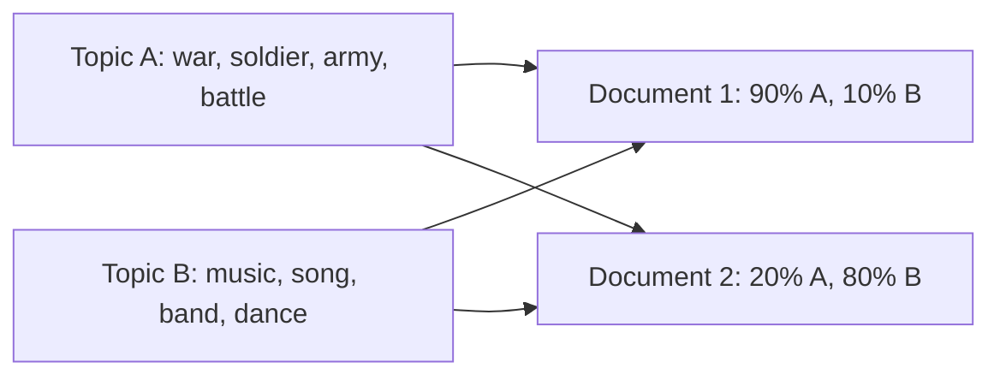

# Tokenisation, normalisation and topic models

> **Before this lesson:** read [Bag of words, tf-idf and n-grams](#/lesson/ml/bag-of-words) first: this lesson opens up the tokenisation step inside `CountVectorizer` and reuses its vocabulary, `min_df` and `max_df`. The topic-model half compares LDA with NMF and with clustering, from [PCA, NMF and t-SNE](#/lesson/ml/dimensionality-reduction) and [Clustering](#/lesson/ml/clustering); a sentence of reminder is given for each.

## In plain words

The previous lesson cut text into words with a fixed rule and counted them. This lesson asks two further questions. First, *what should count as a word?* "Replace", "replaced" and "replacing" are three columns to a plain bag of words, though they mean nearly the same thing; merging them is called **normalisation**. Second, *what is a large pile of documents about?* **Topic models** discover, without any labels, groups of words that tend to appear together, and describe each document as a blend of those groups.

An everyday picture for each. Normalisation is like a librarian filing "Running", "ran" and "runs" under one index card for "run", so that anyone looking up the idea finds all of it. A topic model is like sorting a heap of newspaper clippings into piles by the vocabulary they use, without being told the sections: one pile keeps mentioning "goal", "match" and "league", another "election", "vote" and "minister". Nobody named the piles; the words did.

Why this matters for a job: every language model you will use, from search to chatbots, starts by tokenising text, and its limits and prices are quoted in tokens, so you need to know what a token is. Topic models are a standard first look at a large collection of customer feedback or support tickets when nobody has labelled them. Interviewers ask about stemming versus lemmatisation, how byte-pair encoding works, and how to build a text classifier on a budget.

## 1. Why tokenisation matters

`CountVectorizer` and `TfidfVectorizer` extract features in a fairly basic way. The step most often worth improving is the first one, tokenisation, which decides *what counts as a word*.

The book's IMDb vocabulary contains singular and plural forms as separate entries ("drawback" and "drawbacks", "drawer" and "drawers"), and verb forms next to related nouns ("replace", "replaced", "replacement", "replaces", "replacing"). For a bag-of-words model these carry almost the same meaning. Keeping them apart **increases overfitting**: the model must learn separately, from separate examples, that each form signals a positive or a negative review, and a form seen in only a few training reviews gets an unreliable weight.

## 2. Stemming and lemmatisation

The fix is to represent each word by a base form, and to merge all words that share it. There are two ways to do this.

| | **stemming** | **lemmatisation** |
|---|---|---|
| how | rules that chop off common word endings (suffixes) | a dictionary of known word forms, plus the grammatical role each word plays in its sentence |
| result | a **stem**, which may not be a real word | the **lemma**, the form you would look up in a dictionary |
| example tool | the Porter stemmer (in the `nltk` library) | the `spacy` library, WordNet |
| quality | fast and crude | slower, and usually better |

The book compares the two on one sentence about a meeting, in which "meeting" appears once as a noun and once as a verb (the code below uses a similar sentence):

- **Stemming** turns "was" into "wa" and reduces both uses of "meeting" to "meet", whatever their role. It leaves "worse" as "wors".
- **Lemmatisation** maps "was" to "be" and "worse" to "bad". It keeps the *noun* "meeting" as "meeting" and reduces the *verb* to "meet". It splits "I'm" into "I" and "be".

Lemmatisation is the more involved process and usually gives better features for machine learning. The demo below builds a deliberately tiny stemmer so you can see exactly what rules of this kind do.

```python-run
import re

def tiny_stem(word):
    """A deliberately small suffix-stripping stemmer, in the spirit of (but far simpler than) Porter's."""
    for suffix, replacement in [("sses", "ss"), ("ies", "i"), ("ing", ""), ("ed", ""), ("ly", ""), ("s", "")]:
        if word.endswith(suffix) and len(word) - len(suffix) >= 3:
            return word[: len(word) - len(suffix)] + replacement
    return word

sentence = "Our meeting today was worse than yesterday, I'm scared of meeting the clients tomorrow."
tokens = re.findall(r"\b\w\w+\b", sentence.lower())
print("tokens: ", tokens)
print("stemmed:", [tiny_stem(t) for t in tokens])
for group in [["replace", "replaced", "replaces", "replacing"], ["drawback", "drawbacks"], ["was", "worse", "better"]]:
    print(group, "->", sorted({tiny_stem(w) for w in group}))
```

**Reading this code line by line**

- `tiny_stem` tries six rules in order. Each rule is a pair (suffix, replacement): for example, "ies" becomes "i" and "ing" is removed. `word.endswith(suffix)` checks the ending, and the length test refuses to cut a word down to fewer than three letters (so "sing" keeps its "ing"). The first matching rule wins; if none matches, the word comes back unchanged.
- `word[: len(word) - len(suffix)]` is a **slice**: the word with its last few characters removed.
- `re.findall(r"\b\w\w+\b", sentence.lower())` uses Python's `re` (regular expression) module with the same pattern as `CountVectorizer`, so the tokens match the previous lesson's: words of two or more letters, lowercased.
- The loop stems three groups of related words and prints the set of distinct stems each group produces (`{...}` builds a set, which drops duplicates).

The output shows "meeting" → "meet" (both times) and "clients" → "client", which is what we want. The groups reveal the weaknesses. "replaced", "replaces" and "replacing" all become "replac", but "replace" itself stays "replace", so the group still yields two stems. "scared" is over-stemmed to "scar", a different word. And the irregular forms "was", "worse" and "better" are untouched, which is exactly where a lemmatiser's dictionary is needed. Real stemmers have many more rules and make the same kinds of mistakes, less often. A stem does not need to be readable, only *consistent*.

### Using a custom tokeniser

`CountVectorizer` accepts a `tokenizer` argument: any function that takes a document string and returns a list of tokens. The book plugs in spaCy's lemmatiser this way. With `min_df=5` on IMDb, lemmatisation reduces the vocabulary from 27,271 to 21,596 features. Trained on a small sample (1% of the data), it raises cross-validation accuracy slightly, from about 71.9% to about 73.1%.

The book's interpretation: lemmatisation acts as a kind of **regularisation** (anything that limits how freely a model can fit its training data), because it merges features and leaves fewer weights to learn. It helps most on **small datasets**, and as with many feature-extraction tricks the gain varies from dataset to dataset. Stemming and lemmatisation are worth trying when you want the last bit of performance.

```python-run
import re
from sklearn.feature_extraction.text import CountVectorizer

def tiny_stem(word):
    for suffix, replacement in [("sses", "ss"), ("ies", "i"), ("ing", ""), ("ed", ""), ("ly", ""), ("s", "")]:
        if word.endswith(suffix) and len(word) - len(suffix) >= 3:
            return word[: len(word) - len(suffix)] + replacement
    return word

def stem_tokenizer(doc):
    return [tiny_stem(t) for t in re.findall(r"\b\w\w+\b", doc.lower())]

docs = ["The actors acted badly and the acting was boring", "A boring actor in a badly directed film",
        "Great actors, great acting, great direction", "The director directs great films"]
plain = CountVectorizer().fit(docs)
stemmed = CountVectorizer(tokenizer=stem_tokenizer, token_pattern=None).fit(docs)
print("plain vocabulary  :", len(plain.vocabulary_), list(plain.get_feature_names_out()))
print("stemmed vocabulary:", len(stemmed.vocabulary_), list(stemmed.get_feature_names_out()))
```

`stem_tokenizer` finds the tokens as before and stems each one. Passing it as `tokenizer=` replaces `CountVectorizer`'s own tokenisation; `token_pattern=None` switches off the default pattern so scikit-learn does not warn that it is unused. The plain vocabulary has 17 words; the stemmed one has 13. "acted" and "acting" merged into "act", "directed" and "directs" into "direct", "films" into "film", and "badly" into "bad". "actor" and "actors" also merged into "actor". "boring" became "bor", which no human would write, but it is consistent, so the model does not mind.

## 3. Other normalisation choices

- **Lowercasing** is on by default. It loses the difference between "US" and "us", or "Apple" (the company) and "apple".
- **Spelling correction** merges misspelled variants into the correct word.
- **Character n-grams** (`analyzer="char_wb"`) count short sequences of letters instead of words, such as "act", "cti", "tin". They are robust to typos and useful for languages with many word forms, or for identifying which language a text is in.
- **Hashing** (`HashingVectorizer`) sends each token straight to a column number using a **hash function**, a fixed formula that turns any string into a number. No vocabulary is stored, which suits streaming data and very large corpora. The price: you cannot map a column back to its word, and different words occasionally share a column (a **collision**).

## 4. Subword tokenisation: what modern models use

Word-level vocabularies have two problems. They are huge, and any word not seen in training is **out of vocabulary** (OOV): the model has no column for it and ignores it. The neural language models behind modern chatbots avoid both problems with **subword tokenisation**, which splits rare words into smaller pieces.

- **Byte-pair encoding (BPE)**, used by the GPT family of models: start with individual characters as the vocabulary, then repeatedly find the most frequent pair of adjacent symbols in the training text and merge it into a new symbol. Stop when the vocabulary reaches a target size, often 30,000 to 100,000 tokens.
- **WordPiece** (used by BERT) and **SentencePiece / Unigram** (used by T5 and many multilingual models) are close relatives with different rules for choosing what to merge or keep.

The effect: frequent words become single tokens, while rare words split into meaningful pieces such as `token` + `isation`. Nothing is ever out of vocabulary, because in the worst case a word falls back to single characters or bytes.

A worked example of the first BPE merge. Take a corpus with "low" 5 times, "lower" 2 times, "newest" 6 times and "widest" 3 times. Each word is written as characters followed by an end-of-word marker `</w>`, so that endings can be learned as tokens. Now count every adjacent pair, weighted by word frequency. The pair `t` `</w>` occurs at the end of "newest" (6) and "widest" (3), 9 times; so do `s` `t` and `e` `s`. The pair `w` `e` occurs 8 times (2 in "lower", 6 in "newest"), and `l` `o` 7 times. Three pairs tie on 9; the code below breaks ties by taking the alphabetically last pair, which is `t` `</w>`. That pair becomes the new symbol `t</w>`, and counting starts again.

```python-run
from collections import Counter

def learn_bpe(corpus, n_merges):
    words = Counter(tuple(w) + ("</w>",) for w in corpus.split())       # each word as a tuple of symbols
    merges = []
    for _ in range(n_merges):
        pairs = Counter()
        for w, freq in words.items():
            for a, b in zip(w, w[1:]):
                pairs[(a, b)] += freq
        if not pairs:
            break
        best = max(pairs, key=lambda p: (pairs[p], p))
        merges.append(best)
        merged = Counter()
        for w, freq in words.items():
            out, i = [], 0
            while i < len(w):
                if i < len(w) - 1 and (w[i], w[i + 1]) == best:
                    out.append(w[i] + w[i + 1]); i += 2
                else:
                    out.append(w[i]); i += 1
            merged[tuple(out)] += freq
        words = merged
    return merges, words

corpus = "low low low low low lower lower newest newest newest newest newest newest widest widest widest"
merges, words = learn_bpe(corpus, 8)
print("merges learned, in order:", ["+".join(m) for m in merges])
for w, f in words.items():
    print(f"  {f} x {' | '.join(w)}")
```

**Reading this code line by line**

- `Counter(...)` from Python's `collections` module counts how often each item occurs. Here each word becomes a tuple of characters plus `"</w>"`, so `words` maps, for example, `('l','o','w','</w>')` to 5.
- Each pass of the outer loop counts every adjacent pair in every word, weighted by `freq`. `zip(w, w[1:])` pairs each symbol with the next one.
- `max(pairs, key=lambda p: (pairs[p], p))` picks the most frequent pair, breaking ties by the pair itself (alphabetically last).
- The inner `while` loop rewrites every word, replacing each occurrence of the winning pair by one joined symbol.
- After 8 merges the function returns the list of merges and the words as they are now split.

The merges come out in this order: `t+</w>`, `s+t</w>`, `e+st</w>`, `o+w`, `l+ow`, `w+est</w>`, `n+e`, `ne+west</w>`. After them, "newest" is a single token `newest</w>`, "low" is `low` + `</w>`, "lower" is `low` + `e` + `r` + `</w>`, and "widest" is `w` + `i` + `d` + `est</w>`. The ending `est</w>` became a reusable piece that would also help with words like "fastest" that were never seen.

This is why the limits and prices of large language models are quoted in **tokens** rather than words. A common rule of thumb is that an English word averages roughly 1.3 tokens.

## 5. Topic modelling and document clustering

**Topic modelling** is an umbrella term for assigning each document to one or more topics, usually **without supervision** (no labels). For news, the topics might be "politics", "sport" and "finance". If each document gets exactly one topic, the task is **clustering**, grouping similar items (module 3). If a document can mix several topics, it resembles the **decomposition** methods PCA and NMF from module 3, which describe each data point as a weighted combination of a few learned components: each component is a "topic", and a document's weights say how strongly each topic is present.

When people say "topic modelling" they usually mean one particular decomposition method: **latent Dirichlet allocation (LDA)**. ("Latent" means hidden: the topics are never observed directly. Do not confuse it with linear discriminant analysis, a classifier that shares the abbreviation.)

### Latent Dirichlet allocation

In plain terms, LDA looks for **groups of words that tend to occur in the same documents**. Those groups are the topics. It also assumes that each document blends only a few of them.

Be careful with the word "topic". What LDA finds need not match what a person would call a topic. It is a component, like one from PCA or NMF, and may or may not have an obvious meaning. Two topics might be the vocabulary of sports reports and of political news, but another might gather the words one prolific reviewer likes to use, and another the typical phrasing of very short reviews.

LDA is built on a **generative story**, an imagined process by which the documents could have been written. For each document:

1. Choose the document's **topic proportions** $\theta_d$: a list of shares, one per topic, that add up to 1. They are drawn from a **Dirichlet distribution**, a probability distribution over such lists of proportions that, with typical settings, favours lists where a few topics dominate.
2. For each word position, first pick a topic $z$ at random according to $\theta_d$, then pick a word at random according to that topic's word distribution $\beta_z$ (its list of word probabilities).

A worked example with two topics: war (words like soldier, army, battle) and music (song, band, dance). A document with proportions $\theta = (0.9, 0.1)$ is written word by word: for each of its 10 words, a 10-sided die with nine "war" faces and one "music" face picks the topic, then a word is drawn from that topic's list. On average 9 words come from the war list and 1 from the music list. Fitting LDA runs this story backwards: given only the documents, it infers the topics' word lists and each document's proportions.

In scikit-learn the topics' word weights end up in `components_`, with shape (number of topics, number of words), and `transform` returns each document's topic mixture, with shape (number of documents, number of topics).



### Practical recipe from the book

- Remove **very common words** before an unsupervised text model, or they dominate the analysis. The book uses `CountVectorizer(max_features=10000, max_df=.15)`: drop words found in more than 15% of documents, then keep the 10,000 most frequent of the rest.
- LDA works on **raw counts**, not tf-idf, because its generative story is about counts of words.
- Start with a small number of topics, such as 10, so they are easy to inspect.
- Inspect each topic through its highest-weighted words, then read the documents with the highest weight for that topic to check that your interpretation holds.
- The topics have **no inherent order**, and changing the number of topics changes all of them, as with NMF.
- The result is **random**: a different `random_state` can give different topics. The `"batch"` learning method is slower than the default `"online"` one but usually gives better results, and raising `max_iter` (the number of fitting passes) also helps.

With 10 topics on IMDb, the book finds topics that look like film genres (historical and war films, bad comedies, TV series, children's films) and some that capture reviewing style. With 100 topics they become much more specific and harder to survey; one of them is about music in films.

```python-run
import numpy as np
from sklearn.feature_extraction.text import CountVectorizer
from sklearn.decomposition import LatentDirichletAllocation

themes = {
    "war": "army battle soldier war general tank enemy victory".split(),
    "music": "band song singer dance guitar concert melody album".split(),
    "crime": "detective murder killer mystery police clue suspect alibi".split(),
}
rng = np.random.RandomState(0)
docs, main_theme = [], []
for i in range(60):                 # synthetic "reviews": about 80% of the words from one theme, the rest from the others
    theme = list(themes)[i % 3]
    others = [w for t in themes if t != theme for w in themes[t]]
    words = [rng.choice(themes[theme]) if rng.rand() < 0.8 else rng.choice(others) for _ in range(15)]
    docs.append(" ".join(words)); main_theme.append(theme)
print("example document:", docs[0])

vect = CountVectorizer()
X = vect.fit_transform(docs)
lda = LatentDirichletAllocation(n_components=3, learning_method="batch", max_iter=50, random_state=0)
doc_topics = lda.fit_transform(X)
names = vect.get_feature_names_out()
print("components_ shape (topics x words):", lda.components_.shape)
for k, comp in enumerate(lda.components_):
    print(f"topic {k}:", ", ".join(str(names[i]) for i in np.argsort(comp)[::-1][:6]))
print()
print("document-topic mixtures (each row sums to 1):")
for i in range(3):
    print(f"  doc {i} (mostly {main_theme[i]:5s}): {doc_topics[i].round(2)}")
new = lda.transform(vect.transform(["soldier army battle war singer song band dance"]))
print("a new document, half war and half music:", new.round(2))
```

**Reading this code line by line**

- `themes` holds three word lists of eight words each. The loop writes 60 synthetic documents of 15 words: document $i$ gets main theme number $i \bmod 3$ (war, music, crime, war, ...), and each word comes from the main theme with probability 0.8 and from the other two themes otherwise. This imitates LDA's own generative story, with known answers.
- `vect.fit_transform(docs)` makes the count matrix: 60 documents by 24 words.
- `LatentDirichletAllocation(n_components=3, ...)` asks for three topics. `fit_transform` learns them and returns each document's mixture.
- For each topic, `np.argsort(comp)[::-1][:6]` lists the positions of its six heaviest words, which are printed by name.
- The last two lines describe a brand-new document with the fitted model.

The three topics recover the three themes, without ever being told them: topic 0 is war (victory, soldier, war, enemy, tank, army), topic 1 crime (mystery, clue, alibi, suspect, detective, police) and topic 2 music (band, dance, guitar, concert, singer, melody). Note that the topic numbers are arbitrary: "crime" was the third theme but became topic 1. Document 0, mostly war, has the mixture `[0.72 0.19 0.09]`; document 1, mostly music, is 89% topic 2. The new sentence, half war words and half music words, comes out as about 47% war and 49% music.

### What topic models are good for

Topic models such as LDA are useful for **understanding large text collections without labels**, and sometimes with them. Because LDA is randomised, different seeds can give quite different results, so treat its suggestions with caution: confirm what a topic means by reading the documents that score highest on it. The topic mixtures returned by `transform` can also serve as a compact set of features for a supervised model, which helps most when few labelled examples are available.

## 6. Beyond bag of words

The book's closing section points to three developments, all of which have since become mainstream:

- **Word embeddings** (also called continuous or distributed word representations; `word2vec` and GloVe are well-known methods). Each word is a dense vector of, say, 300 numbers, learned so that words used in similar contexts get similar vectors. Unlike one-hot columns, where every pair of distinct words is equally unrelated, "excellent" and "wonderful" end up close together.
- **Recurrent neural networks**, which read text as a sequence, one token at a time, and can also produce text, as in translation and summarisation (lesson 82).
- Today, **transformers** (BERT, the GPT family). They produce *contextual* embeddings, in which the vector for "bank" depends on the sentence around it (river bank or savings bank). They are used through **fine-tuning** (further training a pretrained model on your own labelled data) or through prompting, and module 8 introduces their core mechanism, attention.

| approach | word order? | meaning / synonyms? | data needed | cost |
|---|---|---|---|---|
| bag of words / tf-idf + linear model | no (a little with n-grams) | no | little | tiny |
| averaged word embeddings + linear model | no | yes | little (pretrained vectors) | small |
| fine-tuned transformer | yes | yes, contextual | moderate | high (needs a GPU) |
| large language model with a prompt | yes | yes | none or a few examples | cost per token, slower responses |

A tf-idf plus logistic-regression pipeline is still the right **first baseline** for text classification. It trains in seconds, is easy to interpret, and is often within a few points of far heavier models.

> [!INTERVIEW]
> **"How would you build a text classifier, and how would your approach change with more data or budget?"** Start with cleaning and a tf-idf (unigrams and bigrams) plus logistic regression pipeline, tuned by cross-validation, and read the top coefficients as a sanity check. If accuracy is not enough, move to sentence embeddings plus a linear model, then to fine-tuning a pretrained transformer. Throughout: keep preprocessing inside the pipeline, choose metrics that fit the class balance, read the errors, and mention latency and cost trade-offs. Expect follow-ups on stemming versus lemmatisation, and on why subword tokenisers remove the out-of-vocabulary problem.

## Summary

- Tokenisation decides what the features are. Stemming (rules) and lemmatisation (dictionary plus grammatical role) merge word forms and act as regularisation, which helps most on small data.
- Modern models use subword tokenisers (BPE, WordPiece), so no word is ever out of vocabulary; their limits and prices are counted in tokens.
- LDA finds groups of co-occurring words and describes each document as a mixture of them. It is unsupervised and random, and its topics need human inspection.
- For LDA use raw counts with very common words removed (`max_df`). Read topics through their top words and their top documents.
- Embeddings and transformers capture meaning and order; tf-idf plus a linear model is still the baseline to beat.

## Glossary

- **Normalisation (text)**: mapping different forms of a word to one representative.
- **Stemming / stem**: chopping word endings by rule / the result, not always a real word.
- **Lemmatisation / lemma**: finding the dictionary form using a dictionary and the word's role / that dictionary form.
- **Suffix**: an ending added to a word, such as "-ing" or "-ed".
- **Regularisation**: anything that limits how freely a model can fit its training data.
- **Character n-gram**: a short sequence of adjacent letters used as a feature.
- **Hash function / collision**: a formula mapping any string to a number / two strings getting the same number.
- **Out of vocabulary (OOV)**: a word with no entry in the model's vocabulary.
- **Subword tokenisation**: splitting rare words into frequent pieces.
- **Byte-pair encoding (BPE)**: building a vocabulary by repeatedly merging the most frequent adjacent pair of symbols.
- **Topic model**: an unsupervised model that describes documents as mixtures of word groups.
- **Latent Dirichlet allocation (LDA)**: the standard probabilistic topic model.
- **Generative story**: an imagined random process that could have produced the data.
- **Dirichlet distribution**: a probability distribution over lists of proportions that add up to 1.
- **Word embedding**: a dense vector representing a word, with similar words close together.
- **Fine-tuning**: further training a pretrained model on your own task's data.

## Check yourself

```quiz
[
  {"q": "What is the main difference between stemming and lemmatisation?", "options": ["Stemming strips suffixes with rules; lemmatisation uses a dictionary and the word's role to return a real base form", "Stemming needs labels; lemmatisation does not", "Lemmatisation is faster and cruder", "They are two names for the same algorithm"], "answer": 0,
   "explain": "A stemmer may output non-words like 'wors'; a lemmatiser maps 'worse' to 'bad' and 'was' to 'be'."},
  {"q": "Why can lemmatisation be viewed as a form of regularisation?", "options": ["It merges related word forms into one feature, reducing the number of parameters to learn", "It adds an L2 penalty", "It removes all rare words", "It increases the vocabulary size"], "answer": 0,
   "explain": "Fewer, denser features generalise better, especially when training data is scarce."},
  {"q": "How does byte-pair encoding build its vocabulary?", "options": ["By repeatedly merging the most frequent adjacent pair of symbols", "By keeping the most frequent whole words only", "By hashing words into buckets", "By using a hand-written dictionary"], "answer": 0,
   "explain": "Starting from characters, frequent sequences become single tokens; rare words stay split into pieces."},
  {"q": "In LDA, each document is modelled as…", "options": ["a mixture of topics, each topic being a distribution over words", "belonging to exactly one cluster", "a single principal component", "a sequence of n-grams"], "answer": 0,
   "explain": "transform returns per-document topic proportions; components_ holds per-topic word weights."},
  {"q": "For sklearn's LatentDirichletAllocation with 10 topics and a 5,000-word vocabulary, components_ has shape…", "options": ["(10, 5000)", "(5000, 10)", "(10, 10)", "(n_documents, 10)"], "answer": 0,
   "explain": "One row per topic, one column per vocabulary word."},
  {"q": "Why does the book remove very common words (max_df=0.15) before fitting LDA?", "options": ["They would otherwise dominate the topics without carrying meaning", "LDA cannot process more than 15% of the documents", "To make the matrix dense", "Because common words are always misspelled"], "answer": 0,
   "explain": "Unsupervised models have no labels to tell them which frequent words are uninformative."},
  {"q": "Which statement about LDA topics is TRUE?", "options": ["They may not correspond to human notions of a topic and depend on the random seed", "They are always sorted by importance", "They are identical for any number of topics", "They require labelled documents"], "answer": 0,
   "explain": "Topics are components that may capture style as well as subject matter; inspect them before trusting them."},
  {"q": "An advantage of word embeddings over bag-of-words columns is that…", "options": ["words with similar meaning get similar vectors", "they need no training data at all", "they keep exact word counts", "they are always sparse"], "answer": 0,
   "explain": "In a one-hot/bag-of-words space every pair of distinct words is equally unrelated."}
]
```

> **Source:** Müller & Guido, *Introduction to Machine Learning with Python*, ch. 7 ("Advanced Tokenization, Stemming, and Lemmatization", "Topic Modeling and Document Clustering", "Latent Dirichlet Allocation", "Summary and Outlook"); scikit-learn User Guide, "Latent Dirichlet Allocation"; Hugging Face documentation, "Summary of the tokenizers" (BPE, WordPiece, SentencePiece).
