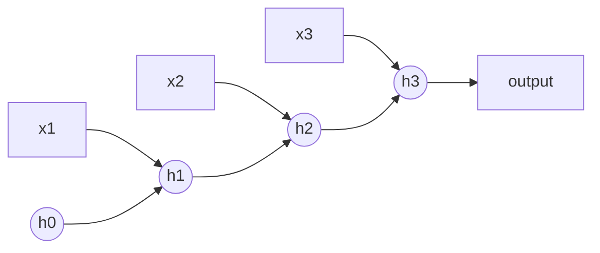
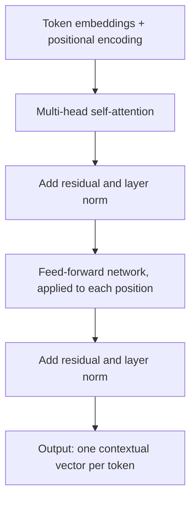

# CNNs, RNNs, embeddings and attention

> **Before this lesson:** you need the training loop, logits and softmax from [Tensors, autograd and the training loop](#/lesson/ml/training-loop), and vanishing gradients, residual connections and layer normalisation from [Optimisers and regularisation](#/lesson/ml/optimizers-regularization). Dot products and cosine similarity come from [Linear algebra for ML](#/lesson/ml/linear-algebra), and one-hot vectors and tokens from [Bag of words, tf-idf and n-grams](#/lesson/ml/bag-of-words).

## In plain words

A plain neural network (a multilayer perceptron, or MLP) treats its input as a flat list of unrelated numbers. But images, text and sound have **structure**: neighbouring pixels belong together, and words come in an order. The big successes of deep learning came from network designs, called **architectures**, that build this structure in. This lesson explains the three families every ML engineer must be able to describe: **convolutional networks** for images, **recurrent networks** for sequences, and **transformers**, built on **attention**, which power today's language models. It also explains **embeddings**, the learned vectors that turn words and ids into numbers all of these networks can use.

An everyday picture for each. A convolutional network reads an image the way you search a page for a word: you slide your eyes across it looking for the same small pattern everywhere. A recurrent network reads a sentence the way you listen to a story: one word at a time, keeping a running memory of what has happened so far. Attention works like a student answering an exam question with the textbook open: for each question, look back at every page, decide which passages are relevant, and combine what they say.

Why this matters for a job: every image model, speech recogniser and large language model is one of these architectures or a mix of them. Interviews for ML roles routinely ask you to compute a convolution's output size, explain why transformers replaced RNNs, and write down the attention formula. Müller & Guido point to these architectures in their outlook chapters as the natural next step after the MLP.

## 1. Inductive bias: why architecture matters

An **inductive bias** is an assumption a model makes before it has seen any data. A fully connected layer assumes nothing about its inputs: it must learn from scratch that a cat in the top-left corner of a photo and a cat in the bottom-right corner are the same thing, which takes a great deal of data. A good architecture builds in what we already know about the data, so less has to be learned.

| data | structure | architecture | built-in assumption |
|---|---|---|---|
| tabular | none in particular | MLP, tree ensembles | none |
| images | local patterns that look the same wherever they appear | CNN | locality and translation equivariance |
| sequences | order matters, length varies | RNN / LSTM | recent inputs matter most; the same step applies at every position |
| sets or sequences with long-range relations | any element may relate to any other | transformer (attention) | very little: relations are learned from data |

Weaker assumptions need more data. That is the transformer story in one line: given enough data, the model with the fewest built-in assumptions wins.

## 2. Convolutional neural networks (CNNs)

### The convolution operation

A **convolutional layer** slides a small grid of weights, called a **kernel** or **filter** (typically 3×3), across the image. At each position it multiplies the kernel's weights by the pixel values underneath and adds up the results, a dot product between the kernel and the image patch. The grid of results is a **feature map**: it shows where in the image the kernel's pattern occurs. In symbols, for a $k \times k$ kernel and bias $b$:

$$\text{out}[i, j] = \sum_{u=0}^{k-1}\sum_{v=0}^{k-1} \text{kernel}[u, v]\cdot \text{image}[i+u,\ j+v] + b$$

The output at row $i$, column $j$ comes from the patch whose top-left corner is at $(i, j)$.

A worked example. Take the kernel with rows $(-1, 0, 1)$ three times: it subtracts the left column of a patch from the right column, so it responds to a change from dark to bright, left to right: a vertical edge. Place it over a patch whose columns are dark, dark, bright, with pixel rows $(0, 0, 1)$ three times. Each row contributes $-1 \times 0 + 0 \times 0 + 1 \times 1 = 1$, so the output is 3. Over a patch that is all dark or all bright, the left and right columns cancel and the output is 0.

Two ideas make convolution powerful:

- **Local connectivity.** Each output looks at a small patch only. Edges and textures are local, so nothing is lost.
- **Weight sharing.** The *same* kernel is used at every position. A 3×3 kernel has 9 weights whether the image is 28×28 or 4000×3000. By contrast, a dense layer from a 224×224 colour image ($224 \times 224 \times 3 = 150{,}528$ numbers) to 1,000 hidden units would need about 150 million weights.

Because the same kernel is applied everywhere, shifting the input shifts the feature map by the same amount. This property is called **translation equivariance**: a pattern is detected wherever it appears.

```python-run
import numpy as np

def conv2d(image, kernel):
    """'Valid' cross-correlation, which is what deep-learning libraries call convolution."""
    k = kernel.shape[0]
    h, w = image.shape[0] - k + 1, image.shape[1] - k + 1
    out = np.zeros((h, w))
    for i in range(h):
        for j in range(w):
            out[i, j] = np.sum(image[i:i + k, j:j + k] * kernel)
    return out

image = np.zeros((6, 6)); image[:, 3:] = 1.0           # dark on the left, bright on the right
vertical_edge = np.array([[-1, 0, 1], [-1, 0, 1], [-1, 0, 1]], dtype=float)
horizontal_edge = vertical_edge.T
print("image:\n", image.astype(int))
print("response to the vertical-edge kernel:\n", conv2d(image, vertical_edge).astype(int))
print("response to the horizontal-edge kernel:\n", conv2d(image, horizontal_edge).astype(int))
```

**Reading this code line by line**

- `conv2d` computes the output size, $6 - 3 + 1 = 4$ in each direction ("valid" means the kernel never hangs over the edge), then loops over every position. `image[i:i + k, j:j + k]` slices out the 3×3 patch, `* kernel` multiplies element by element, and `np.sum` adds the nine products. (Strictly this is "cross-correlation", since true convolution flips the kernel first; deep-learning libraries use the unflipped version and call it convolution anyway.)
- `image[:, 3:] = 1.0` makes the right half of a 6×6 image bright.
- `vertical_edge.T` (the transpose) is the same kernel turned on its side, which detects horizontal edges.

The vertical-edge kernel's feature map is 3 in the two middle columns, exactly where its patches straddle the boundary (the worked example above), and 0 elsewhere. The horizontal-edge kernel responds nowhere, because the image has no horizontal edges. In a CNN the kernels are **learned** by backpropagation, not designed by hand, yet the first layer typically ends up with edge and colour detectors much like these.

### Hyperparameters and shapes

- **Kernel size** $k$; **stride** $s$, how far the kernel moves at each step; and **padding** $p$, the number of rings of zeros added around the border. In words, the output size counts how many positions the kernel can take: the padded width minus the kernel width, divided by the stride, plus one. As a formula, for an input of size $n$ along one dimension:

$$\text{out} = \left\lfloor\frac{n + 2p - k}{s}\right\rfloor + 1$$

  where $\lfloor \cdot \rfloor$ means rounding down. Worked example: $n = 32$, $k = 3$, $p = 1$, $s = 1$ gives $(32 + 2 - 3)/1 + 1 = 32$, so padding 1 keeps the size. With $k = 2$, $s = 2$, $p = 0$: $(32 - 2)/2 + 1 = 16$, halving it.
- **Channels.** A colour image has 3 input channels. A layer applies many kernels, each spanning all input channels, and each kernel produces one output channel. The number of parameters is $(k\cdot k\cdot c_{in} + 1)\cdot c_{out}$, with $c_{in}$ input and $c_{out}$ output channels: each kernel has $k \cdot k \cdot c_{in}$ weights and one bias.
- **Pooling** shrinks a feature map, usually by a factor of 2, by keeping the maximum (max pooling) or the average of each small block. It reduces computation and adds tolerance to small shifts.
- The **receptive field** of a unit is the region of the input that can influence it. It grows with depth: early layers see edges, middle layers textures and parts, deep layers whole objects.

```python-run
def conv_out(n, k, s=1, p=0):
    return (n + 2 * p - k) // s + 1

n, channels, params = 32, 3, 0
print(f"input: {channels} x {n} x {n}")
for name, k, s, p, c_out in [("conv 3x3, 16 filters, padding 1", 3, 1, 1, 16), ("max-pool 2x2", 2, 2, 0, None),
                             ("conv 3x3, 32 filters, padding 1", 3, 1, 1, 32), ("max-pool 2x2", 2, 2, 0, None)]:
    n = conv_out(n, k, s, p)
    if c_out:
        params += (k * k * channels + 1) * c_out
        channels = c_out
    print(f"{name:34s} -> {channels} x {n} x {n}")
print("convolution parameters:", params, " | a dense layer from the 3072 inputs to 100 units alone would have", 3072 * 100 + 100)
```

`conv_out` is the size formula (`//` is integer division, which rounds down). The loop walks a 32×32 colour image through two convolution-plus-pooling stages, printing the shape after each layer and adding up the convolution parameters (pooling has none). The shapes go 3×32×32 → 16×32×32 → 16×16×16 → 32×16×16 → 32×8×8. The parameters are $(3 \cdot 3 \cdot 3 + 1) \cdot 16 = 448$ for the first convolution and $(3 \cdot 3 \cdot 16 + 1) \cdot 32 = 4640$ for the second, 5,088 in total, while one dense layer from the 3,072 input numbers to only 100 units would need 307,300.

```python
import torch
from torch import nn

class SmallCNN(nn.Module):
    def __init__(self, n_classes=10):
        super().__init__()
        self.features = nn.Sequential(
            nn.Conv2d(3, 16, kernel_size=3, padding=1), nn.ReLU(), nn.MaxPool2d(2),    # 3x32x32 -> 16x16x16
            nn.Conv2d(16, 32, kernel_size=3, padding=1), nn.ReLU(), nn.MaxPool2d(2),   # -> 32x8x8
        )
        self.classifier = nn.Linear(32 * 8 * 8, n_classes)

    def forward(self, x):                      # x: (batch, 3, 32, 32)
        x = self.features(x)
        return self.classifier(x.flatten(1))   # flatten all but the batch dimension
```

The same network in PyTorch: `nn.Conv2d(3, 16, kernel_size=3, padding=1)` is a convolution from 3 to 16 channels, `nn.MaxPool2d(2)` halves the size, and after two stages `x.flatten(1)` turns each 32×8×8 feature stack into 2,048 numbers for a final dense layer producing one logit per class.

**Landmarks.** LeNet (1998, handwritten digits), AlexNet (2012, the result that started the deep-learning era), VGG (deep stacks of 3×3 convolutions) and **ResNet** (2015), whose residual connections $y = x + F(x)$ let gradients flow through hundreds of layers. In practice you rarely train a CNN from scratch: you **fine-tune a pretrained network**, one already trained on millions of images, on your own data.

## 3. Recurrent neural networks (RNNs)

A sequence has a variable length, and its order matters. A **recurrent neural network** processes it **one element at a time**, keeping a **hidden state**: a vector that summarises everything seen so far. At each step the new hidden state is computed from the current input and the previous hidden state:

$$h_t = \tanh(W_x x_t + W_h h_{t-1} + b)$$

Here $x_t$ is the input at step $t$, $h_{t-1}$ the previous hidden state, $W_x$ and $W_h$ weight matrices, and $\tanh$ (the hyperbolic tangent) squashes each number into the range −1 to 1. The **same weights are used at every step**: weight sharing across *time*, as a CNN shares weights across space. The final hidden state can classify the whole sequence, or every $h_t$ can produce an output (for tagging each word, or predicting the next one).

A worked example with single numbers: $W_x = 1$, $W_h = 0.5$, $b = 0$, a starting state $h_0 = 0$ and the input sequence $1, 0, 0$. Then $h_1 = \tanh(1) = 0.762$, $h_2 = \tanh(0.5 \times 0.762) = 0.364$, and $h_3 = \tanh(0.5 \times 0.364) = 0.180$. The memory of the first input fades with every step, which foreshadows the long-range problem below.



```python-run
import numpy as np
rng = np.random.RandomState(0)
d_in, d_hidden = 4, 3
Wx, Wh, b = rng.randn(d_in, d_hidden) * 0.5, rng.randn(d_hidden, d_hidden) * 0.5, np.zeros(d_hidden)

def rnn(sequence):
    h = np.zeros(d_hidden)
    for x_t in sequence:                         # one step per element, the same weights every time
        h = np.tanh(x_t @ Wx + h @ Wh + b)
    return h

seq = rng.randn(5, d_in)
print("final hidden state:                ", rnn(seq).round(3))
print("same elements in reverse order:    ", rnn(seq[::-1]).round(3), "<- order matters")
print("a sequence of a different length:  ", rnn(rng.randn(9, d_in)).round(3), "<- any length works")
```

**Reading this code line by line**

- Each input element has 4 numbers and the hidden state has 3. `Wx` (4×3) and `Wh` (3×3) are random weights.
- `rnn` starts from a zero hidden state and, for each element `x_t` of the sequence, applies the update formula. The loop body is the whole network.
- `seq` is a sequence of 5 random elements; `seq[::-1]` is the same elements in reverse order.

The final hidden state for the sequence is about $(-0.19, -0.30, 0.43)$; for the reversed sequence it is completely different, about $(0.91, 0.61, 0.45)$, so the network is sensitive to order, unlike a bag of words. A sequence of 9 elements works with the same weights, producing another 3-number summary.

### The long-range problem, LSTM and GRU

Training an RNN means backpropagating through every time step, called **backpropagation through time**. At each step the gradient is multiplied by $W_h$ and by the slope of tanh. Over 100 steps that product **vanishes or explodes** (lesson 81), so a plain RNN cannot learn links between distant positions, such as a pronoun and the name it refers to fifty words earlier.

The **LSTM** (long short-term memory) adds a separate **cell state**, a second memory vector that is updated by *adding* new information rather than by repeated multiplication, and three **gates**: learned switches (sigmoid units with outputs between 0 and 1) that decide how much to forget, how much new information to write, and how much to output. The additive path lets gradients survive across many steps. The **GRU** (gated recurrent unit) is a simpler variant with two gates.

RNNs have two limits that remain even with gates. They are **sequential**: step $t$ needs the result of step $t-1$, so the steps cannot run in parallel, which makes training slow on long sequences. And everything the network knows about a long input must squeeze through one fixed-size hidden state. Both limits led to attention.

## 4. Embeddings

Networks need numeric input, but words, product ids and categories are discrete symbols. One-hot vectors (lesson 40) are huge, mostly zeros, and treat every pair of items as equally different: "excellent" is as far from "wonderful" as from "terrible". An **embedding** is a learned lookup table that maps each discrete id to a **dense vector** (one with no special zeros) of typically a few dozen to a few thousand numbers. With a vocabulary $V$ of $|V|$ items and vectors of length $d$, the table is a matrix $E$ with one row per item:

$$E \in \mathbb{R}^{|V|\times d},\qquad \text{embedding}(i) = E[i]$$

$\mathbb{R}^{|V|\times d}$ means "a table of real numbers with $|V|$ rows and $d$ columns", and $E[i]$ is row $i$. Multiplying a one-hot vector by $E$ selects exactly one row, so an embedding layer is a linear layer applied to one-hot input, implemented as a fast index lookup. The table is trained by backpropagation along with the rest of the model, and the result is that **items used in similar ways end up with similar vectors**. Closeness is usually measured by **cosine similarity**, the cosine of the angle between two vectors: 1 for the same direction, 0 for unrelated (perpendicular) directions.

```python-run
import numpy as np
vocab = {"king": 0, "queen": 1, "man": 2, "woman": 3, "apple": 4, "pear": 5}
# a hand-made 3-d embedding table so the geometry is easy to see: (royalty, gender, fruitiness)
E = np.array([[0.9, 0.4, 0.0], [0.9, -0.4, 0.0], [0.1, 0.4, 0.0], [0.1, -0.4, 0.0], [0.0, 0.0, 0.9], [0.0, 0.1, 0.8]])

def cosine(a, b):
    return float(a @ b / (np.linalg.norm(a) * np.linalg.norm(b)))

ids = np.array([vocab["king"], vocab["apple"]])
print("lookup E[ids] has shape", E[ids].shape)                       # (sequence length, embedding dimension)
one_hot = np.eye(len(vocab))[ids]
print("identical to one_hot @ E:", np.allclose(one_hot @ E, E[ids]))
print("cos(king, queen) =", round(cosine(E[0], E[1]), 2), " cos(king, apple) =", round(cosine(E[0], E[4]), 2), " cos(apple, pear) =", round(cosine(E[4], E[5]), 2))
target = E[vocab["king"]] - E[vocab["man"]] + E[vocab["woman"]]
best = max(vocab, key=lambda w: cosine(E[vocab[w]], target))
print("king - man + woman is closest to:", best)
```

**Reading this code line by line**

- `E` is a hand-made table of six 3-number vectors whose positions mean (royalty, gender, fruitiness), so the geometry is easy to follow. Real embeddings are learned and their dimensions have no such neat labels.
- `E[ids]` looks up the rows for "king" and "apple", giving shape (2, 3). `np.eye(6)[ids]` builds the matching one-hot vectors, and `np.allclose` confirms that multiplying them by `E` gives the same rows.
- `cosine` divides the dot product by the product of the two lengths.
- The last lines compute king − man + woman and find the vocabulary word whose vector points most nearly the same way.

Worked by hand: king $= (0.9, 0.4, 0)$ and queen $= (0.9, -0.4, 0)$ have dot product $0.81 - 0.16 = 0.65$, and each has length $\sqrt{0.97} = 0.985$, so their cosine is $0.65/0.97 = 0.67$. King and apple share no direction (cosine 0), and apple and pear are nearly parallel (0.99). And king − man + woman $= (0.9, 0.4, 0) - (0.1, 0.4, 0) + (0.1, -0.4, 0) = (0.9, -0.4, 0)$, which is exactly queen: subtracting "man" removes the male direction and adding "woman" adds the female one. Learned word embeddings show this kind of arithmetic approximately.

Embeddings are everywhere:

- **Word embeddings** (word2vec, GloVe): trained so that words appearing in similar contexts get similar vectors.
- **Contextual embeddings** (BERT, GPT): a token's vector depends on the sentence it is in.
- **Sentence and document embeddings**: one vector per text, compared with cosine similarity. They are the basis of **semantic search** (search by meaning rather than exact words) and retrieval-augmented generation.
- **Entity embeddings** for users, items and categorical features in recommender systems and tabular models.

## 5. Attention

### The idea

Instead of squeezing a whole sequence into one hidden state, let each position **look directly at every other position** and take what it needs. Each position produces three vectors:

- a **query** ("what am I looking for?"),
- a **key** ("what do I contain?"), and
- a **value** ("what will I hand over if chosen?").

Each query is compared with every key by a dot product; the scores are turned into weights by a softmax; and the output for that position is the weighted average of all the values. Stacking the queries, keys and values of all positions as the rows of matrices $Q$, $K$ and $V$:

$$\operatorname{Attention}(Q, K, V) = \operatorname{softmax}\!\left(\frac{QK^\top}{\sqrt{d_k}}\right)V$$

- $QK^\top$ is a table holding the dot product of every query with every key: "how relevant is position $j$ to position $i$?"
- Dividing by $\sqrt{d_k}$, the square root of the key length, keeps the scores at a sensible size. Dot products of long vectors are large, and very large scores push the softmax towards giving all the weight to one position, where its gradients vanish.
- The softmax, applied to each row, turns scores into weights that add up to 1.
- In **self-attention**, $Q$, $K$ and $V$ are three different learned linear projections (matrix multiplications) of the *same* sequence.

```python-run
import numpy as np

def softmax(z):
    z = z - z.max(axis=-1, keepdims=True)
    e = np.exp(z)
    return e / e.sum(axis=-1, keepdims=True)

def attention(Q, K, V, causal=False):
    scores = Q @ K.T / np.sqrt(Q.shape[-1])
    if causal:                                             # position i may only look at positions <= i
        scores = np.where(np.tril(np.ones_like(scores, dtype=bool)), scores, -np.inf)
    weights = softmax(scores)
    return weights @ V, weights

tokens = ["the", "bank", "of", "the", "river"]
X = np.array([[1.0, 0.0, 0.0, 0.0],      # hand-made 4-d vectors: "bank" and "river" share a direction
              [0.0, 2.0, 0.0, 1.0],
              [0.0, 0.0, 1.0, 0.0],
              [1.0, 0.0, 0.0, 0.0],
              [0.0, 2.0, 0.0, -1.0]])
out, w = attention(X, X, X)
print("attention weights of 'bank' over", tokens, ":\n ", w[1].round(2))
print("new vector for 'bank' (a context-dependent mixture):", out[1].round(2))
_, w_causal = attention(X, X, X, causal=True)
print("with a causal mask, 'bank' can only see", tokens[:2], ":", w_causal[1].round(2))
```

**Reading this code line by line**

- `softmax` subtracts each row's maximum before exponentiating (for numerical safety) and divides by the row sum; `axis=-1` means "along the last axis".
- `attention` computes the score table, optionally applies a **causal mask**, turns scores into weights and returns the weighted average of the values together with the weights.
- The causal mask uses `np.tril` (the lower triangle of a matrix) to keep only scores where the key's position is at or before the query's position, and sets the rest to $-\infty$, which the softmax turns into weight 0. Text generators use this so that a word cannot peek at the words after it.
- `X` gives each of the five tokens a hand-made 4-number vector. For simplicity the same matrix serves as queries, keys and values (no learned projections).

Worked by hand for "bank", whose vector is $(0, 2, 0, 1)$. Its dot products with the five tokens are $0, 5, 0, 0, 3$ (with itself $4 + 1 = 5$; with "river" $4 - 1 = 3$). Dividing by $\sqrt{4} = 2$ gives $0, 2.5, 0, 0, 1.5$. Exponentiating gives $1, 12.18, 1, 1, 4.48$, summing to 19.66, so the weights are $0.05, 0.62, 0.05, 0.05, 0.23$: exactly the printed row. "Bank" attends mostly to itself and, next, to "river". Its new vector, the weighted average of all five value vectors, is about $(0.10, 1.69, 0.05, 0.39)$: still mostly "bank", but now containing information from "river". With the causal mask, "bank" can only see "the" and itself, and the weights become 0.08 and 0.92.

That is how a transformer builds **contextual** representations: after attention, the vector for "bank" next to "river" differs from the vector for "bank" next to "loan". You implement this function in *ml-attention*.

### From attention to the transformer

A **transformer** is a stack of identical blocks, each combining a few components:



- **Multi-head attention** runs several attention operations ("heads") in parallel, each with its own learned projections, so different heads can track different relations: grammar, which earlier noun a pronoun refers to, nearby positions.
- **Positional encodings** are added to the token embeddings, because attention by itself ignores order: shuffling the tokens would shuffle the outputs the same way. Without position information a sentence would be a bag of words.
- **Residual connections and layer normalisation** (lesson 81) make deep stacks trainable.
- A position-wise **feed-forward network**, a small MLP applied to each token's vector separately, processes the information after attention has mixed it.

Three variants:

| variant | attention | trained to | examples | used for |
|---|---|---|---|---|
| **encoder-only** | bidirectional (every token sees every other) | predict hidden (masked) tokens | BERT, RoBERTa | classification, embeddings, retrieval |
| **decoder-only** | causal (left to right) | predict the next token | the GPT family, Llama, Claude | text generation, chat |
| **encoder–decoder** | encoder bidirectional, decoder causal plus **cross-attention** to the encoder's outputs | turn an input sequence into an output sequence | T5, the original transformer | translation, summarisation |

Why transformers won:

- **Parallelism.** All positions are processed at once, with no recurrence, so training makes full use of GPUs.
- **Direct long-range connections.** Any two positions are one attention step apart, where an RNN needs as many steps as the distance between them.
- **Scalability.** Performance keeps improving with more data and more parameters.

The price is that self-attention compares every position with every other, so its time and memory grow with the square of the sequence length, written $O(n^2)$. Worked example: 1,000 tokens need a million scores per head; 100,000 tokens need ten billion. That is why models have a limited **context window**, the maximum number of tokens they can take in at once.

### Pretraining and transfer

The dominant recipe today is **self-supervised pretraining** on huge unlabelled text collections (the labels, such as the next word, come from the text itself; lesson 10), followed by adaptation: fine-tuning all the weights, training a small set of extra weights (**LoRA**, low-rank adaptation, adds small trainable matrices alongside frozen ones), or writing a prompt. With the Hugging Face `transformers` library a pretrained model takes a few lines:

```python
from transformers import pipeline, AutoTokenizer, AutoModel

classifier = pipeline("sentiment-analysis")                 # downloads a small fine-tuned model
classifier("This movie was a wonderful surprise.")          # [{'label': 'POSITIVE', 'score': 0.99...}]

tokenizer = AutoTokenizer.from_pretrained("bert-base-uncased")
model = AutoModel.from_pretrained("bert-base-uncased")
batch = tokenizer(["The bank of the river."], return_tensors="pt", padding=True)
hidden = model(**batch).last_hidden_state                   # shape (batch, tokens, 768): contextual embeddings
```

`pipeline("sentiment-analysis")` downloads a ready-made classifier; calling it on a sentence returns a label and a confidence. The lower half loads BERT and its tokeniser (a WordPiece subword tokeniser, lesson 71), turns a sentence into token ids, and returns one 768-number contextual embedding per token.

## 6. Choosing an architecture

| problem | sensible first choice |
|---|---|
| tabular data | gradient-boosted trees; an MLP with entity embeddings as an alternative |
| image classification or detection | a pretrained CNN (ResNet, EfficientNet) or vision transformer, fine-tuned |
| text classification with little data | tf-idf plus a linear model, then a fine-tuned small BERT-style encoder |
| semantic search / RAG | a sentence-embedding model plus a vector index |
| text generation, chat, flexible extraction | a pretrained decoder-only large language model, prompted or fine-tuned |
| time series | gradient boosting on lag features first; then sequence models |

> [!INTERVIEW]
> **"Why did transformers replace RNNs?"** RNNs process tokens one after another, so they cannot be parallelised across the sequence, and they struggle with long-range dependencies because information and gradients must pass through every intermediate step. Self-attention connects every pair of positions directly and computes all positions in parallel, which scales with modern hardware and data. The costs are $O(n^2)$ attention and the need for positional encodings. Be ready to write the attention formula, explain the $\sqrt{d_k}$ scaling and the causal mask, and say what queries, keys and values are.

## Summary

- Architectures encode assumptions: CNNs assume locality and translation equivariance, RNNs assume sequential order, and transformers assume very little.
- A convolution slides a small shared kernel over the input. The output size is $\lfloor(n+2p-k)/s\rfloor+1$, and the parameter count is $(k^2 c_{in} + 1)\,c_{out}$.
- RNNs carry a hidden state through time. LSTMs and GRUs add gates and an additive memory path to fight vanishing gradients.
- Embeddings map discrete ids to dense learned vectors in which similarity reflects meaning.
- Attention computes a weighted average of values, with weights from query–key similarity. Transformers stack it with residual connections, normalisation and feed-forward layers.

## Glossary

- **Architecture**: the overall design of a neural network.
- **Inductive bias**: an assumption built into a model before it sees data.
- **Convolution / kernel (filter)**: sliding a small weight grid across the input / that grid.
- **Feature map**: the grid of a kernel's responses across the input.
- **Translation equivariance**: shifting the input shifts the output in the same way.
- **Stride / padding**: how far the kernel moves per step / zeros added around the border.
- **Pooling**: shrinking a feature map by taking the maximum or average of small blocks.
- **Receptive field**: the region of the input that influences one unit.
- **Recurrent neural network (RNN) / hidden state**: a network applied step by step along a sequence / its running summary vector.
- **Backpropagation through time**: backpropagation across the steps of an RNN.
- **LSTM / GRU / gate**: recurrent units with gated, additive memory / a learned 0-to-1 switch.
- **Embedding**: a learned dense vector representing a discrete item.
- **Cosine similarity**: the cosine of the angle between two vectors.
- **Query / key / value**: what a position looks for / what it offers for matching / what it passes on.
- **Self-attention**: attention in which a sequence attends to itself.
- **Causal mask**: blocking each position from attending to later positions.
- **Multi-head attention**: several attention operations run in parallel.
- **Positional encoding**: information about token order added to the embeddings.
- **Transformer (encoder / decoder)**: a stack of attention blocks (bidirectional / causal).
- **Context window**: the maximum number of tokens a model can process at once.

## Check yourself

```quiz
[
  {"q": "What are the two key ideas of a convolutional layer?", "options": ["Local connectivity and weight sharing", "Recurrence and gating", "Full connectivity and dropout", "Sorting and pooling"], "answer": 0,
   "explain": "Each output sees a small patch, and the same kernel is reused at every position."},
  {"q": "A 3×3 convolution with stride 1 and padding 1 is applied to a 32×32 input. The output size is…", "options": ["32×32", "30×30", "34×34", "16×16"], "answer": 0,
   "explain": "(32 + 2·1 − 3)/1 + 1 = 32: padding 1 preserves the size for a 3×3 kernel."},
  {"q": "How many parameters does a conv layer with 16 filters of size 3×3 on a 3-channel input have (with biases)?", "options": ["448", "144", "432", "27"], "answer": 0,
   "explain": "(3·3·3 + 1) · 16 = 28 · 16 = 448."},
  {"q": "Why do plain RNNs struggle with long sequences?", "options": ["Gradients vanish or explode when backpropagated through many time steps", "They have too many parameters per step", "They cannot handle variable lengths", "They ignore word order"], "answer": 0,
   "explain": "The gradient is multiplied by the recurrent weights and activation derivatives at every step."},
  {"q": "An embedding layer is equivalent to…", "options": ["a linear layer applied to one-hot vectors, implemented as a table lookup", "a convolution with kernel size 1", "a softmax over the vocabulary", "a fixed random projection that is never trained"], "answer": 0,
   "explain": "Multiplying a one-hot vector by the embedding matrix selects one row."},
  {"q": "In scaled dot-product attention, why divide the scores by sqrt(d_k)?", "options": ["To keep the scores from growing with dimension and saturating the softmax", "To make the weights sum to one", "To apply the causal mask", "To normalise the values V"], "answer": 0,
   "explain": "Dot products of d_k-dimensional vectors have variance proportional to d_k; large scores give near one-hot softmax outputs with tiny gradients."},
  {"q": "Why do transformers need positional encodings?", "options": ["Self-attention is otherwise insensitive to the order of the tokens", "To reduce the O(n²) cost", "To replace the embeddings", "To implement dropout"], "answer": 0,
   "explain": "Attention treats its input as a set; position information must be added explicitly."},
  {"q": "Which model family uses a causal mask and is trained to predict the next token?", "options": ["Decoder-only transformers such as GPT", "Encoder-only transformers such as BERT", "Convolutional networks", "k-means"], "answer": 0,
   "explain": "The causal mask prevents each position from attending to later positions."}
]
```

> **Source:** Müller & Guido, *Introduction to Machine Learning with Python*, ch. 2 ("Neural Networks (Deep Learning)"), ch. 7 ("Summary and Outlook": word embeddings, recurrent neural networks) and ch. 8 ("Neural Networks"); Goodfellow, Bengio & Courville, *Deep Learning*, ch. 9–10; Vaswani et al., "Attention Is All You Need"; Chip Huyen, *AI Engineering*, ch. 2 (model architecture); Hugging Face `transformers` documentation.
