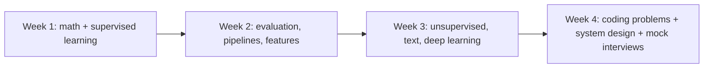

# ML interview essentials

This lesson gathers the whole track into the form interviewers ask for. It is organised by the kind of
question you will face: concept questions, "compare A and B", debugging scenarios, quick calculations,
and coding from scratch. Each answer is short enough to say aloud in a minute or two and points back to
the lesson that covers it in depth. Use it as a checklist. If an answer here surprises you, go back to
that lesson.

## 1. How ML interviews are structured

| round | what it tests | how to prepare |
|---|---|---|
| ML fundamentals / breadth | can you explain core concepts precisely? | sections 2–5 below |
| ML coding | implement an algorithm or metric in numpy; data manipulation | the 25 problems in this track |
| applied modelling / case study | given a business problem, how would you approach it? | section 6 and the next lesson |
| ML system design | design an end-to-end production system | the next lesson |
| past projects | depth, judgement, honesty about trade-offs | prepare two projects in detail: metric, baseline, what failed, what you'd change |

A good answer has three parts: a **one-sentence definition**, the **mechanism or reason**, and a
**practical consequence or trade-off**. Interviewers reward the third part most.

## 2. Core concepts: the questions that always come up

### Bias and variance

**Q: Explain the bias–variance trade-off.**
Expected squared error splits into bias² + variance + irreducible noise. Bias is error from wrong
assumptions (a model too simple to fit the pattern). Variance is error from sensitivity to the particular
training sample (a model flexible enough to fit noise). More complexity lowers bias and raises variance.
You diagnose with training against validation error: both high means bias, a large gap means variance.
*(Lessons 0.3 and 2.1.)*

**Q: How do you fix high variance? High bias?**
Variance: more data, regularisation, a simpler model, fewer features, bagging, early stopping, dropout.
Bias: a more expressive model, better features, less regularisation, longer training, boosting.

```python-run
import numpy as np
from sklearn.datasets import make_moons
from sklearn.model_selection import train_test_split
from sklearn.tree import DecisionTreeClassifier
from sklearn.ensemble import RandomForestClassifier

X, y = make_moons(n_samples=400, noise=0.35, random_state=0)
X_tr, X_te, y_tr, y_te = train_test_split(X, y, random_state=0)
for name, m in [("depth-1 tree (high bias)", DecisionTreeClassifier(max_depth=1)),
                ("full tree (high variance)", DecisionTreeClassifier(random_state=0)),
                ("random forest (bagging)", RandomForestClassifier(n_estimators=100, random_state=0))]:
    m.fit(X_tr, y_tr)
    print(f"{name:27s} train={m.score(X_tr, y_tr):.2f}  test={m.score(X_te, y_te):.2f}")
```

### Regularisation

**Q: L1 versus L2?**
Both add a penalty on weight size. L2 (ridge, weight decay) shrinks all weights smoothly and spreads
weight across correlated features. It corresponds to a Gaussian prior. L1 (lasso) drives some weights
exactly to zero, giving sparse models and feature selection. It corresponds to a Laplace prior. The
geometric reason is that the L1 ball has corners on the axes. Scale features before either.
*(Lesson 2.2.)*

**Q: Why does regularisation help generalisation?**
It restricts the set of functions the model can represent, which lowers variance at the cost of a little
bias. With limited data, a smaller hypothesis space is less likely to fit noise.

### Evaluation

**Q: Why not use accuracy?**
On imbalanced data a constant prediction scores high. Use the confusion matrix, precision and recall, F1,
PR AUC or ROC AUC, chosen by the cost of each error type. *(Lesson 5.3.)*

**Q: Precision versus recall, and when to favour each?**
Precision = TP/(TP+FP): how trustworthy a positive prediction is. Recall = TP/(TP+FN): how many positives
are found. Favour recall when a miss is costly (disease screening, fraud). Favour precision when a false
alarm is costly (spam filtering of important mail, expensive interventions). The threshold moves you
along the trade-off.

**Q: What is AUC?**
The probability that a random positive scores higher than a random negative. It is threshold-free, and
0.5 is chance at any class balance. With heavy imbalance prefer PR AUC, because the false positive rate
hides large numbers of false positives.

**Q: Why cross-validation?**
A single split is noisy and wastes data. k-fold uses every sample for validation once and gives a mean
and a spread. Use stratified folds for classification, group folds when samples are related, and
time-based splits for temporal data. *(Lesson 5.1.)*

**Q: What is data leakage?**
Using information in training that is unavailable at prediction time: preprocessing fitted on all the
data, features derived from the target, future data, duplicates across splits, or tuning on the test set.
The symptom is offline scores that don't survive deployment. *(Lesson 6.2.)*

### Optimisation

**Q: How does gradient descent work? Batch, mini-batch, stochastic?**
Step against the gradient of the loss, scaled by the learning rate. Batch uses all the data per step,
stochastic uses one sample, and mini-batch a small set, which is the practical compromise. Too large a
learning rate diverges, and too small is slow. *(Lesson 0.2.)*

**Q: Explain backpropagation.**
Reverse-mode automatic differentiation. Cache activations on the forward pass, then apply the chain rule
from the loss backwards. Each layer turns the gradient with respect to its output into gradients for its
parameters and for its input. The cost is a small constant multiple of the forward pass. *(Lessons 0.2
and 2.4.)*

**Q: Vanishing gradients?**
Repeated multiplication by small derivatives makes early-layer gradients negligible. Remedies: ReLU,
careful initialisation, normalisation, residual connections, and gated cells for RNNs. *(Lesson 8.2.)*

## 3. Algorithm one-liners

| algorithm | how it works | strengths | weaknesses | key hyperparameters |
|---|---|---|---|---|
| linear / logistic regression | weighted sum (+ sigmoid); convex loss | fast, interpretable, great on sparse high-dim data | linear boundary | `alpha` / `C`, penalty |
| k-NN | vote among the k nearest training points | simple baseline, no training | slow prediction, needs scaling, bad in high dimensions | `n_neighbors`, metric |
| naive Bayes | Bayes' rule with independent features | extremely fast, good for text | poor probabilities | `alpha` smoothing |
| decision tree | greedy axis-aligned splits by impurity | interpretable, no scaling | overfits, unstable | `max_depth`, `min_samples_leaf` |
| random forest | bagged, de-correlated deep trees, averaged | robust, little tuning | large, slow, weak on sparse data | `n_estimators`, `max_features` |
| gradient boosting | shallow trees fitted in sequence to residual gradients | top accuracy on tabular data | needs tuning, sequential | `learning_rate`, `n_estimators`, `max_depth` |
| SVM (RBF) | maximum margin in a kernel-induced space | strong on medium-sized data | scales poorly in n, needs scaling | `C`, `gamma` |
| k-means | alternate assignment and mean update | fast, simple | needs k, spherical clusters | `n_clusters`, `n_init` |
| PCA | project onto top-variance directions (SVD) | compression, de-correlation | linear, hard to interpret | `n_components` |
| MLP | stacked linear layers + nonlinearities, trained by backprop | flexible, learns features | data-hungry, many knobs | architecture, learning rate, regularisation |

*(Lessons 2.1–2.4, 3.2, 3.3.)*

## 4. "Compare A and B"

- **Bagging vs boosting.** Bagging trains independent high-variance models on bootstrap samples and
  averages them: it reduces variance and parallelises. Boosting trains weak models in sequence on the
  errors of the ensemble: it reduces bias, is more accurate when tuned, and is more sensitive to noise.
- **Random forest vs gradient boosting.** A forest is the robust default, where more trees never hurt.
  Boosting usually wins by a little with careful tuning of the learning rate and number of trees, and
  more trees can overfit.
- **Generative vs discriminative.** Generative models learn $P(x\mid y)P(y)$ (naive Bayes, LDA).
  Discriminative models learn $P(y\mid x)$ directly (logistic regression). Discriminative models are
  usually more accurate with enough data. Generative ones can cope with less data and missing features.
- **Parametric vs non-parametric.** A parametric model has a fixed number of parameters (linear models).
  A non-parametric one grows with the data (k-NN, trees, kernel SVMs).
- **Logistic regression vs SVM.** Log-loss versus hinge loss. Logistic regression gives probabilities.
  The SVM depends only on support vectors and takes kernels naturally. With a linear kernel the results
  are similar.
- **Normalisation vs standardisation.** Min-max to $[0,1]$ versus zero mean and unit variance.
  Standardisation is the usual default, and robust scaling handles outliers.
- **Batch norm vs layer norm.** Statistics over the batch for each feature, versus over the features for
  each sample. Layer norm is independent of batch size and is used in transformers.
- **Adam vs SGD with momentum.** Adam adapts the step per parameter and converges quickly with little
  tuning. SGD with momentum can generalise slightly better in vision with a tuned schedule. AdamW
  decouples weight decay.
- **CNN vs RNN vs transformer.** Local shared filters; a sequential hidden state; all-pairs attention
  computed in parallel.
- **Stemming vs lemmatisation.** Rule-based suffix stripping versus dictionary-based reduction to a real
  base form.

## 5. Quick calculations you should be able to do

```python-run
import numpy as np

# 1. Metrics from a confusion matrix
tp, fp, fn, tn = 80, 20, 40, 860
precision, recall = tp / (tp + fp), tp / (tp + fn)
print(f"precision={precision:.2f} recall={recall:.3f} F1={2 * precision * recall / (precision + recall):.3f} "
      f"accuracy={(tp + tn) / (tp + fp + fn + tn):.2f}")

# 2. Bayes' rule: 1% prevalence, 95% sensitivity, 90% specificity
p = 0.95 * 0.01 / (0.95 * 0.01 + 0.10 * 0.99)
print(f"P(disease | positive test) = {p:.3f}")

# 3. Gini impurity and entropy of a node with class counts [6, 2]
q = np.array([6, 2]) / 8
print(f"gini={1 - (q ** 2).sum():.3f}  entropy={-(q * np.log2(q)).sum():.3f} bits")

# 4. Parameters of an MLP with layers 784 -> 256 -> 64 -> 10 (weights + biases)
sizes = [784, 256, 64, 10]
print("MLP parameters:", sum(a * b + b for a, b in zip(sizes, sizes[1:])))

# 5. Conv output size: 224 input, 7x7 kernel, stride 2, padding 3
print("conv output size:", (224 + 2 * 3 - 7) // 2 + 1)

# 6. Standard error of an accuracy of 0.92 measured on 400 test samples
print("standard error:", round(float(np.sqrt(0.92 * 0.08 / 400)), 4))

# 7. Softmax of logits [2, 1, 0] and the cross-entropy if the true class is the first
z = np.array([2.0, 1.0, 0.0]); probs = np.exp(z - z.max()); probs /= probs.sum()
print("softmax:", probs.round(3), " cross-entropy:", round(float(-np.log(probs[0])), 3))
```

## 6. Debugging and scenario questions

**"Training accuracy 99%, validation 75%."** Overfitting. First rule out leakage in the other direction
(is the validation set from a different distribution?). Then: more data or augmentation, regularisation,
a simpler model, early stopping, feature selection. Check a learning curve to see whether more data
would help.

**"Both training and validation accuracy are poor."** Underfitting, or a bug. Check the labels, the
preprocessing, and whether the model can overfit a tiny subset. Then add capacity or better features, or
reduce regularisation.

**"Great offline, poor in production."** Leakage; training/serving skew (features computed differently);
distribution shift since training; an offline metric that doesn't match the business goal; a feedback
loop. *(Lesson 6.2 and the next lesson.)*

**"The dataset has 0.5% positives."** Stratified splits. PR AUC or recall at a fixed precision instead of
accuracy. Class weights or resampling inside the training folds. Tune the threshold on validation data.
Consider anomaly detection if positives are extremely rare. *(Lesson 5.3.)*

**"Features have missing values."** Find out why they are missing first. Impute (median or most frequent,
fitted on training data) and consider adding a missing-indicator feature. Tree boosters handle missing
values natively. Never impute with statistics from the test set.

**"You have 500 features and 300 samples."** High risk of overfitting. Use strong regularisation (ridge,
lasso, elastic net), feature selection inside cross-validation, or dimensionality reduction. Prefer
simple models, and use nested or repeated cross-validation, because estimates will be noisy.

**"A feature has 50,000 categories."** One-hot is impractical for most models. Options: group rare
categories, hashing, target encoding computed out-of-fold, learned embeddings, or a booster with native
categorical support. *(Lesson 4.1.)*

**"How do you know a model is good enough to ship?"** It beats a simple baseline and the current system
on the offline metric tied to the business goal, on a held-out set that mirrors production. Its errors
have been inspected across important segments. It meets latency and cost limits. Then an online A/B test
confirms the effect on the real metric.

```python-run
import numpy as np
from sklearn.datasets import load_breast_cancer
from sklearn.dummy import DummyClassifier
from sklearn.linear_model import LogisticRegression
from sklearn.ensemble import RandomForestClassifier, GradientBoostingClassifier
from sklearn.model_selection import cross_val_score, StratifiedKFold
from sklearn.pipeline import make_pipeline
from sklearn.preprocessing import StandardScaler

# The habit to demonstrate in any applied round: baseline first, honest CV, a pipeline, mean and spread.
X, y = load_breast_cancer(return_X_y=True)
cv = StratifiedKFold(5, shuffle=True, random_state=0)
candidates = {
    "majority-class baseline": DummyClassifier(strategy="most_frequent"),
    "logistic regression": make_pipeline(StandardScaler(), LogisticRegression(max_iter=1000)),
    "random forest": RandomForestClassifier(n_estimators=60, random_state=0),
    "gradient boosting": GradientBoostingClassifier(n_estimators=60, random_state=0),
}
for name, model in candidates.items():
    s = cross_val_score(model, X, y, cv=cv, scoring="roc_auc")
    print(f"{name:25s} ROC AUC = {s.mean():.3f} +/- {s.std():.3f}")
```

## 7. Coding from scratch

Interviewers like short numpy implementations because they show whether you understand the algorithm.
Every one of these is a problem in this track. Practise until you can write each in ten minutes.

| asked for | problem | the trap |
|---|---|---|
| softmax / cross-entropy | *ml-softmax*, *ml-sigmoid-bce* | numerical overflow; use the max-shift and logits |
| linear regression | *ml-normal-equation*, *ml-gd-linear-regression* | forgetting the intercept; the factor 2/n |
| logistic regression | *ml-logreg-gradient* | sign of the gradient; regularising the bias |
| k-NN | *ml-knn-predict* | tie-breaking; vectorised distances |
| k-means | *ml-kmeans-step* | empty clusters |
| decision-tree split | *ml-gini-best-split*, *ml-info-gain* | weighting children by size |
| PCA | *ml-pca-svd* | centring; variance from squared singular values |
| metrics | *ml-confusion-matrix*, *ml-precision-recall-f1*, *ml-roc-auc* | division by zero; ties in AUC |
| preprocessing | *ml-standard-scaler*, *ml-one-hot*, *ml-impute-scale-pipeline* | fitting on test data; unseen categories |
| cross-validation | *ml-kfold-indices*, *ml-train-test-split* | uneven fold sizes |
| text | *ml-tfidf*, *ml-cosine-similarity* | idf smoothing; zero vectors |
| neural networks | *ml-mlp-forward*, *ml-mlp-backprop*, *ml-adam-step*, *ml-attention* | shapes; the ReLU mask; bias correction; the mask before softmax |

Habits that score points while coding:

1. State the shapes of the inputs and the output before writing anything.
2. Vectorise with broadcasting, and say what the intermediate shapes are.
3. Name the edge cases: empty input, division by zero, ties, numerical overflow.
4. Test on a tiny example you can verify by hand.
5. State the time and memory complexity.

## 8. A study plan



- Re-do each lesson's quiz without looking at the answers.
- Solve all 25 problems, then re-solve the ones you needed hints for a few days later.
- Explain ten concepts from section 2 aloud, with a timer, in under two minutes each.
- Prepare two project stories using: goal and metric → baseline → what you tried → result → what you
  would do differently.

> [!INTERVIEW]
> When you don't know something, say what you do know and reason from first principles. "I haven't used
> CatBoost, but it is a gradient-boosting library, so I'd expect the usual learning-rate and tree-depth
> trade-offs, and I know its distinguishing feature is its handling of categorical variables" is a good
> answer. A confident wrong answer is the worst outcome, and interviewers probe for it.

## Summary

- Structure every answer as definition → mechanism → practical consequence.
- Know bias and variance, regularisation, the metrics, cross-validation, leakage and backprop cold.
- Have a one-line description, the strengths, the weaknesses and the main hyperparameters ready for each
  algorithm.
- In scenario questions, check the data and the evaluation before you reach for a fancier model.
- Practise the from-scratch implementations until the shapes and edge cases are automatic.

```quiz
[
  {"q": "A model has 98% training accuracy and 97% validation accuracy, but both are below the 99.5% you need. The model most likely suffers from…", "options": ["bias: it needs more capacity or better features", "variance: it needs more regularisation", "data leakage", "too many training samples"], "answer": 0,
   "explain": "A small train–validation gap with insufficient performance points to underfitting, not overfitting."},
  {"q": "With TP=80, FP=20, FN=40, what are precision and recall?", "options": ["0.80 and 0.667", "0.667 and 0.80", "0.80 and 0.80", "0.60 and 0.80"], "answer": 0,
   "explain": "Precision = 80/100; recall = 80/120."},
  {"q": "Which technique primarily reduces variance by averaging independently trained models?", "options": ["Bagging", "Boosting", "Gradient descent", "L1 regularisation"], "answer": 0,
   "explain": "Bagging averages high-variance models trained on bootstrap samples; boosting primarily reduces bias."},
  {"q": "How many parameters does a dense layer from 256 units to 64 units have, including biases?", "options": ["16,448", "16,384", "320", "4,160"], "answer": 0,
   "explain": "256 × 64 weights + 64 biases = 16,448."},
  {"q": "You have 300 samples and 500 features. Which approach is most appropriate?", "options": ["A strongly regularised linear model with selection or tuning done inside cross-validation", "A very deep unregularised neural network", "A fully grown decision tree evaluated on the training set", "k-NN with k = 1 on unscaled features"], "answer": 0,
   "explain": "With more features than samples, overfitting is the main risk; regularisation and honest validation are essential."},
  {"q": "A model performs well offline but poorly after deployment. Which is NOT a likely cause?", "options": ["The model was evaluated with stratified cross-validation", "A feature derived from the target leaked into training", "Features are computed differently in production", "The data distribution has shifted"], "answer": 0,
   "explain": "Stratified CV is good practice; leakage, training/serving skew and drift are the usual culprits."},
  {"q": "For a dataset with 0.5% positives, which metric is the most informative single summary?", "options": ["Average precision (PR AUC)", "Accuracy", "R²", "Mean squared error"], "answer": 0,
   "explain": "Accuracy is dominated by the negatives; PR AUC focuses on how well the rare positives are found and how clean the flagged set is."},
  {"q": "Which statement about L1 regularisation is correct?", "options": ["It can set coefficients exactly to zero, acting as feature selection", "It corresponds to a Gaussian prior", "It never changes which features are used", "It is identical to dropout"], "answer": 0,
   "explain": "L1 corresponds to a Laplace prior and yields sparse solutions; L2 corresponds to a Gaussian prior."}
]
```

> **Source:** Müller & Guido, *Introduction to Machine Learning with Python*, ch. 2 ("Summary and Outlook": when to use each model), ch. 5 (evaluation) and ch. 8 ("Approaching a Machine Learning Problem"); synthesis of all earlier lessons in this track; Chip Huyen, *AI Engineering* and *Designing Machine Learning Systems* (background for the scenario questions).
