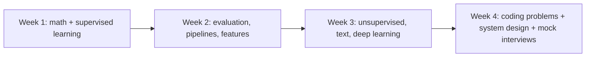

# ML interview essentials

> **Before this lesson:** this is a review of the whole track, so it assumes you have worked through the earlier modules, from [What machine learning is](#/lesson/ml/what-is-ml) to [CNNs, RNNs, embeddings and attention](#/lesson/ml/architectures). Every answer names the lesson that teaches it in depth, and each technical term gets a one-line reminder, so you can also use this page to find out which lessons to revisit.

## In plain words

A machine-learning interview checks two things: whether you understand the ideas well enough to explain them clearly, and whether you can apply them to a messy, realistic problem. This lesson collects the whole track into the shapes interviewers actually use: concept questions, "compare A with B", quick calculations, debugging scenarios, and coding from scratch. Each answer is short enough to say aloud in a minute or two.

Think of it as the summary card a driving instructor gives you the week before the test. It does not teach you to drive; the lessons did that. It lists what the examiner will check, in the order they check it, with the one sentence you should be able to say about each.

Why this matters for a job: knowing the material and performing under interview conditions are different skills. Candidates who understand bias and variance perfectly still lose points by rambling, skipping the trade-off, or reaching for a fancy model before checking the data. Use this page as a checklist: if any answer here surprises you, go back to the lesson it names.

## 1. How ML interviews are structured

| round | what it tests | how to prepare |
|---|---|---|
| ML fundamentals ("breadth") | can you explain the core concepts precisely? | sections 2–5 below |
| ML coding | implement an algorithm or metric in NumPy; manipulate data | the 25 problems in this track |
| applied modelling / case study | given a business problem, how would you approach it? | section 6 and the next lesson |
| ML system design | design an end-to-end production system | [ML system design primer](#/lesson/ml/system-design) |
| past projects | depth, judgement, honesty about trade-offs | prepare two projects in detail: metric, baseline, what failed, what you would change |

A strong answer has three parts: a **one-sentence definition**, the **mechanism or reason** behind it, and a **practical consequence or trade-off**. Interviewers reward the third part most, because it shows you have used the idea rather than memorised it. For example: "Regularisation adds a penalty on large weights (definition). That limits how wiggly a function the model can fit, so it fits less noise (mechanism). The price is a little bias, so I tune its strength by cross-validation (trade-off)."

## 2. Core concepts: the questions that always come up

### Bias and variance

**Q: Explain the bias–variance trade-off.**
The expected squared error of a model on new data splits into three parts: bias² + variance + irreducible noise. **Bias** is error from wrong assumptions, a model too simple to capture the pattern. **Variance** is error from sensitivity to the particular training sample, a model flexible enough to fit noise. **Irreducible noise** is randomness no model can predict. More complexity lowers bias and raises variance. You diagnose by comparing training and validation error: both high means high bias (underfitting); a large gap between them means high variance (overfitting). *(Lessons 02 and 20.)*

**Q: How do you fix high variance? High bias?**
High variance: more data, regularisation, a simpler model, fewer features, bagging, early stopping, dropout. High bias: a more expressive model, better features, less regularisation, longer training, boosting.

The demo shows both failures and one cure on the two-crescent "moons" data.

```python-run
import numpy as np
from sklearn.datasets import make_moons
from sklearn.model_selection import train_test_split
from sklearn.tree import DecisionTreeClassifier
from sklearn.ensemble import RandomForestClassifier

X, y = make_moons(n_samples=1000, noise=0.35, random_state=0)
X_tr, X_te, y_tr, y_te = train_test_split(X, y, random_state=0)
for name, m in [("depth-1 tree (high bias)", DecisionTreeClassifier(max_depth=1)),
                ("full tree (high variance)", DecisionTreeClassifier(random_state=0)),
                ("random forest (bagging)", RandomForestClassifier(n_estimators=100, random_state=0))]:
    m.fit(X_tr, y_tr)
    print(f"{name:27s} train={m.score(X_tr, y_tr):.2f}  test={m.score(X_te, y_te):.2f}")
```

**Reading this code line by line**

- `make_moons` generates 1,000 points in two interlocking crescents with noise; a quarter is held out for testing.
- The loop fits three models: a tree allowed one question (a "stump"), a fully grown tree, and a random forest of 100 trees, and prints training and test accuracy.

The stump scores 0.81 on training data and 0.78 on test data: both low and close together, the signature of high bias. The full tree scores 1.00 on training data and 0.81 on test data: a large gap, the signature of high variance. The forest also fits the training data perfectly, but by averaging 100 different trees it reaches 0.86 on test data: **bagging** (averaging models trained on random resamples of the data) cut the variance without adding bias.

### Regularisation

**Q: L1 versus L2?**
Both add a penalty on the size of the weights to the loss. **L2** (ridge regression, weight decay) penalises squared weights: it shrinks all weights smoothly and spreads weight across correlated features. In probability terms it corresponds to a Gaussian (bell-shaped) prior belief about the weights. **L1** (lasso) penalises absolute values: it drives some weights exactly to zero, giving **sparse** models and built-in feature selection; it corresponds to a Laplace (sharply peaked) prior. The geometric reason is that the region of allowed weights under L1 is a diamond whose corners lie on the axes, where some weights are zero. Scale the features before using either, or the penalty treats them unequally. *(Lesson 21.)*

**Q: Why does regularisation help generalisation?**
It restricts the set of functions the model can represent, which lowers variance at the cost of a little bias. With limited data, a smaller set of candidate functions is less likely to contain one that fits the noise.

### Evaluation

**Q: Why not use accuracy?**
On imbalanced data a constant prediction scores high: if 99% of cases are negative, "always negative" is 99% accurate and useless. Use the confusion matrix (the table of true versus predicted classes), precision and recall, F1, or the area under the precision–recall or ROC curve, chosen by what each kind of error costs. *(Lesson 52.)*

**Q: Precision versus recall, and when to favour each?**
Precision $= TP/(TP+FP)$: of the cases flagged positive, how many really are, which says how trustworthy a positive prediction is. Recall $= TP/(TP+FN)$: of the real positives, how many were found. Favour recall when a miss is costly (disease screening, fraud). Favour precision when a false alarm is costly (filtering important mail into spam, expensive interventions). Moving the decision threshold slides you along the trade-off.

**Q: What is AUC?**
The area under the ROC curve: the probability that a randomly chosen positive gets a higher score than a randomly chosen negative. It does not depend on any threshold, and 0.5 is chance level whatever the class balance. With heavy imbalance prefer the area under the precision–recall curve (average precision), because the false positive rate can stay tiny even when the flagged set is mostly false alarms.

**Q: Why cross-validation?**
A single train/test split is noisy and wastes data. k-fold cross-validation splits the data into $k$ parts, uses each once for validation, and reports a mean and a spread. Use stratified folds (equal class proportions) for classification, group folds when several rows belong to the same person or customer, and time-based splits for data ordered in time. *(Lesson 50.)*

**Q: What is data leakage?**
Using information during training or evaluation that will not be available at prediction time: preprocessing fitted on all the data, features derived from the target, data from the future, duplicates across the split, or tuning on the test set. The symptom is offline scores that do not survive deployment. *(Lessons 60 and 61.)*

### Optimisation

**Q: How does gradient descent work? Batch, mini-batch, stochastic?**
Repeatedly step against the gradient of the loss (the direction of steepest increase), with a step size set by the learning rate. **Batch** gradient descent uses all the data for each step, **stochastic** uses one sample, and **mini-batch** a small set, which is the practical compromise between accuracy of the gradient and cost per step. Too large a learning rate makes training diverge; too small makes it slow. *(Lessons 01 and 80.)*

**Q: Explain backpropagation.**
Reverse-mode automatic differentiation. Run the forward pass and keep the intermediate values; then apply the chain rule from the loss backwards, layer by layer. Each layer turns the gradient with respect to its output into gradients for its own parameters and for its input, which it passes on. The cost is a small constant multiple of one forward pass, however many parameters there are. *(Lessons 01, 23 and 80.)*

**Q: Vanishing gradients?**
Repeated multiplication by small derivatives, layer after layer, makes the gradients reaching the early layers negligible, so those layers stop learning. Remedies: ReLU activations, careful initialisation, normalisation layers, residual connections, and gated cells (LSTM, GRU) in recurrent networks. *(Lesson 81.)*

## 3. Algorithm one-liners

| algorithm | how it works | strengths | weaknesses | key hyperparameters |
|---|---|---|---|---|
| linear / logistic regression | weighted sum of features (passed through a sigmoid for classification); convex loss | fast, interpretable, strong on sparse high-dimensional data | linear decision boundary | `alpha` / `C`, penalty type |
| k-nearest neighbours | vote among the k closest training points | simple baseline, no training | slow prediction, needs scaling, poor in high dimensions | `n_neighbors`, distance metric |
| naive Bayes | Bayes' rule assuming features are independent given the class | extremely fast, good for text | poor probability estimates | `alpha` smoothing |
| decision tree | greedy yes/no splits on single features, chosen by impurity | interpretable, no scaling needed | overfits, unstable | `max_depth`, `min_samples_leaf` |
| random forest | many deep trees on bootstrap samples with random feature subsets, averaged | robust, little tuning | large, slowish, weak on sparse data | `n_estimators`, `max_features` |
| gradient boosting | shallow trees added one at a time, each fitted to the current errors | top accuracy on tabular data | needs tuning, trains sequentially | `learning_rate`, `n_estimators`, `max_depth` |
| SVM (RBF kernel) | maximum-margin boundary in a kernel-induced feature space | strong on medium-sized data | scales poorly with many samples, needs scaling | `C`, `gamma` |
| k-means | alternate assigning points to the nearest centre and moving centres to the mean | fast, simple | needs k; assumes round clusters | `n_clusters`, `n_init` |
| PCA | project onto the directions of greatest variance (via SVD) | compression, removes correlation | linear; components hard to interpret | `n_components` |
| MLP | stacked linear layers with nonlinear activations, trained by backpropagation | flexible, learns features | needs much data, many settings | architecture, learning rate, regularisation |

*(Lessons 20–23, 31 and 32.)* "Convex" means the loss has a single valley, so gradient descent cannot get stuck in a worse local minimum. "Bootstrap sample" means a sample of the same size drawn with replacement.

## 4. "Compare A and B"

- **Bagging vs boosting.** Bagging trains independent high-variance models on bootstrap samples and averages them: it reduces variance and parallelises well. Boosting trains weak models in sequence, each focusing on the errors of the ensemble so far: it reduces bias, is usually more accurate when tuned, and is more sensitive to noisy labels.
- **Random forest vs gradient boosting.** A forest is the robust default, and adding trees never makes it overfit. Boosting usually wins by a small margin with careful tuning of the learning rate and number of trees, and too many trees can overfit.
- **Generative vs discriminative.** A generative model learns how the data is produced for each class, $P(x\mid y)P(y)$ (naive Bayes, linear discriminant analysis), and uses Bayes' rule to classify. A discriminative model learns $P(y\mid x)$ directly (logistic regression). Discriminative models are usually more accurate given enough data; generative ones can cope better with little data and missing features.
- **Parametric vs non-parametric.** A parametric model has a fixed number of parameters regardless of data size (linear models). A non-parametric model's size grows with the data (k-NN stores it all; trees and kernel SVMs grow with it).
- **Logistic regression vs SVM.** Logistic regression minimises log-loss and gives probabilities. The SVM minimises hinge loss, depends only on the **support vectors** (the training points nearest the boundary), and works naturally with kernels. With a linear kernel the two usually give similar results.
- **Normalisation vs standardisation.** Min-max scaling squeezes each feature into $[0, 1]$; standardisation gives zero mean and unit variance. Standardisation is the usual default, and robust scaling (using the median and quartiles) handles outliers.
- **Batch norm vs layer norm.** Statistics computed over the batch for each feature, versus over the features for each sample. Layer norm does not depend on the batch size and is used in transformers.
- **Adam vs SGD with momentum.** Adam adapts the step size per parameter and converges quickly with little tuning. SGD with momentum can generalise slightly better for image models with a tuned schedule. AdamW decouples weight decay from Adam's scaling.
- **CNN vs RNN vs transformer.** Local filters shared across positions; a hidden state passed along the sequence one step at a time; attention between all pairs of positions, computed in parallel.
- **Stemming vs lemmatisation.** Rule-based suffix stripping versus dictionary-based reduction to a real base form.

## 5. Quick calculations you should be able to do

Interviewers like small calculations because they reveal whether a formula is understood or only recognised. Work each one by hand first, then check it against the code.

1. **Metrics from a confusion matrix.** TP = 80, FP = 20, FN = 40, TN = 860. Precision $= 80/100 = 0.80$; recall $= 80/120 = 0.667$; $F_1 = 2 \times 0.8 \times 0.667 / 1.467 = 0.727$; accuracy $= 940/1000 = 0.94$.
2. **Bayes' rule.** A disease affects 1% of people; a test detects 95% of cases (**sensitivity**) and correctly clears 90% of healthy people (**specificity**, so 10% of healthy people test positive). Of everyone who tests positive, the share who are ill is $\frac{0.95 \times 0.01}{0.95 \times 0.01 + 0.10 \times 0.99} = \frac{0.0095}{0.1085} = 0.088$. Fewer than one positive in ten is real, because healthy people vastly outnumber ill ones.
3. **Gini impurity and entropy** of a tree node with class counts 6 and 2, so proportions 0.75 and 0.25. Gini $= 1 - (0.75^2 + 0.25^2) = 0.375$; entropy $= -(0.75\log_2 0.75 + 0.25 \log_2 0.25) = 0.811$ bits.
4. **Parameters of an MLP** with layers 784 → 256 → 64 → 10: each layer has inputs × outputs weights plus one bias per output. $784 \times 256 + 256 = 200{,}960$; $256 \times 64 + 64 = 16{,}448$; $64 \times 10 + 10 = 650$; total 218,058.
5. **Convolution output size** for a 224-pixel input, 7×7 kernel, stride 2, padding 3: $\lfloor(224 + 6 - 7)/2\rfloor + 1 = 111 + 1 = 112$.
6. **Standard error of an accuracy.** An accuracy of 0.92 measured on 400 test samples has standard error $\sqrt{0.92 \times 0.08 / 400} = 0.0136$, so roughly ±2.7 points at 95% confidence. Differences smaller than that are not convincing.
7. **Softmax and cross-entropy** for logits $(2, 1, 0)$: probabilities $0.665, 0.245, 0.090$; if the true class is the first, the cross-entropy is $-\ln 0.665 = 0.408$.

```python-run
import numpy as np

# 1. Metrics from a confusion matrix
tp, fp, fn, tn = 80, 20, 40, 860
precision, recall = tp / (tp + fp), tp / (tp + fn)
print(f"precision={precision:.2f} recall={recall:.3f} F1={2 * precision * recall / (precision + recall):.3f} "
      f"accuracy={(tp + tn) / (tp + fp + fn + tn):.2f}")

# 2. Bayes' rule: 1% prevalence, 95% sensitivity, 90% specificity
p = 0.95 * 0.01 / (0.95 * 0.01 + 0.10 * 0.99)
print(f"P(disease | positive test) = {p:.3f}")

# 3. Gini impurity and entropy of a node with class counts [6, 2]
q = np.array([6, 2]) / 8
print(f"gini={1 - (q ** 2).sum():.3f}  entropy={-(q * np.log2(q)).sum():.3f} bits")

# 4. Parameters of an MLP with layers 784 -> 256 -> 64 -> 10 (weights + biases)
sizes = [784, 256, 64, 10]
print("MLP parameters:", sum(a * b + b for a, b in zip(sizes, sizes[1:])))

# 5. Conv output size: 224 input, 7x7 kernel, stride 2, padding 3
print("conv output size:", (224 + 2 * 3 - 7) // 2 + 1)

# 6. Standard error of an accuracy of 0.92 measured on 400 test samples
print("standard error:", round(float(np.sqrt(0.92 * 0.08 / 400)), 4))

# 7. Softmax of logits [2, 1, 0] and the cross-entropy if the true class is the first
z = np.array([2.0, 1.0, 0.0]); probs = np.exp(z - z.max()); probs /= probs.sum()
print("softmax:", probs.round(3), " cross-entropy:", round(float(-np.log(probs[0])), 3))
```

Each numbered block in the code is the matching calculation above. Two lines deserve a note: `zip(sizes, sizes[1:])` pairs each layer size with the next one, giving (784, 256), (256, 64), (64, 10); and `np.log2` is the base-2 logarithm, which measures entropy in bits. The printed values match the hand calculations.

## 6. Debugging and scenario questions

**"Training accuracy 99%, validation 75%."** Overfitting. First check that the validation set comes from the same distribution as the training set and that nothing leaked. Then: more data or augmentation, regularisation, a simpler model, early stopping, feature selection. A learning curve (score against training-set size) shows whether more data would help.

**"Both training and validation accuracy are poor."** Underfitting, or a bug. Check the labels, the preprocessing, and whether the model can overfit a tiny subset (if it cannot, something is broken). Then add capacity or better features, or reduce regularisation.

**"Great offline, poor in production."** Leakage; **training/serving skew** (features computed differently in production than in training); **distribution shift** since training; an offline metric that does not match the business goal; a **feedback loop**, where the model's own decisions change the data it later learns from. *(Lesson 61 and the next lesson.)*

**"The dataset has 0.5% positives."** Stratified splits. Average precision or recall at a fixed precision instead of accuracy. Class weights or resampling inside the training folds only. Tune the threshold on validation data. Consider anomaly detection if positives are extremely rare. *(Lesson 52.)*

**"Features have missing values."** First find out *why* they are missing; the pattern can itself be informative. Impute (median or most frequent value, fitted on training data only) and consider adding a 0/1 "was missing" indicator feature. Gradient-boosting libraries handle missing values natively. Never impute with statistics computed from the test set.

**"You have 500 features and 300 samples."** High risk of overfitting. Use strong regularisation (ridge, lasso, or elastic net, which mixes the two), feature selection inside cross-validation, or dimensionality reduction. Prefer simple models, and use nested or repeated cross-validation, because estimates from so few samples are noisy.

**"A feature has 50,000 categories."** One-hot encoding is impractical for most models. Options: group rare categories, feature hashing, target encoding computed out of fold, learned embeddings, or a boosting library with native categorical support. *(Lesson 40.)*

**"How do you know a model is good enough to ship?"** It beats a simple baseline and the current system on the offline metric tied to the business goal, on a held-out set that resembles production. Its errors have been inspected across important segments (regions, device types, customer groups). It meets latency and cost limits. Then an online **A/B test**, a controlled experiment that shows the new model to a random share of users and compares outcomes, confirms the effect on the real metric.

The habit to demonstrate in any applied round is: baseline first, honest cross-validation, preprocessing in a pipeline, and a mean with a spread.

```python-run
import numpy as np
from sklearn.datasets import load_breast_cancer
from sklearn.dummy import DummyClassifier
from sklearn.linear_model import LogisticRegression
from sklearn.ensemble import RandomForestClassifier, GradientBoostingClassifier
from sklearn.model_selection import cross_val_score, StratifiedKFold
from sklearn.pipeline import make_pipeline
from sklearn.preprocessing import StandardScaler

# The habit to demonstrate in any applied round: baseline first, honest CV, a pipeline, mean and spread.
X, y = load_breast_cancer(return_X_y=True)
cv = StratifiedKFold(5, shuffle=True, random_state=0)
candidates = {
    "majority-class baseline": DummyClassifier(strategy="most_frequent"),
    "logistic regression": make_pipeline(StandardScaler(), LogisticRegression(max_iter=1000)),
    "random forest": RandomForestClassifier(n_estimators=60, random_state=0),
    "gradient boosting": GradientBoostingClassifier(n_estimators=60, random_state=0),
}
for name, model in candidates.items():
    s = cross_val_score(model, X, y, cv=cv, scoring="roc_auc")
    print(f"{name:25s} ROC AUC = {s.mean():.3f} +/- {s.std():.3f}")
```

**Reading this code line by line**

- `StratifiedKFold(5, shuffle=True, random_state=0)` defines five shuffled folds with equal class proportions; the same folds are used for every model, so the comparison is fair.
- The dictionary holds four candidates: a baseline that always predicts the majority class, a scaled logistic regression in a pipeline (so scaling is learned inside each fold), a random forest and gradient boosting.
- `cross_val_score(..., scoring="roc_auc")` returns five AUC values per model, summarised as mean ± standard deviation.

The baseline scores exactly 0.500 (constant scores cannot rank anything). Logistic regression scores 0.995 ± 0.006, the forest 0.990 ± 0.009 and boosting 0.991 ± 0.009. The three real models are within one standard deviation of each other, so the honest conclusion is "all three are excellent and indistinguishable on this data; the simplest, logistic regression, is the sensible choice". Saying that out loud scores more points than declaring a winner.

## 7. Coding from scratch

Interviewers like short NumPy implementations because they show whether you understand an algorithm. Every item below is a problem in this track; practise until you can write each one in about ten minutes.

| asked for | problem | the trap |
|---|---|---|
| softmax / cross-entropy | *ml-softmax*, *ml-sigmoid-bce* | numerical overflow; subtract the maximum and work from logits |
| linear regression | *ml-normal-equation*, *ml-gd-linear-regression* | forgetting the intercept; the factor 2/n in the gradient |
| logistic regression | *ml-logreg-gradient* | the sign of the gradient; regularising the bias by mistake |
| k-NN | *ml-knn-predict* | tie-breaking; computing distances with broadcasting |
| k-means | *ml-kmeans-step* | clusters that end up empty |
| decision-tree split | *ml-gini-best-split*, *ml-info-gain* | weighting each child's impurity by its size |
| PCA | *ml-pca-svd* | forgetting to centre; variance comes from squared singular values |
| metrics | *ml-confusion-matrix*, *ml-precision-recall-f1*, *ml-roc-auc* | division by zero; ties in AUC |
| preprocessing | *ml-standard-scaler*, *ml-one-hot*, *ml-impute-scale-pipeline* | fitting on test data; unseen categories |
| cross-validation | *ml-kfold-indices*, *ml-train-test-split* | uneven fold sizes |
| text | *ml-tfidf*, *ml-cosine-similarity* | idf smoothing; zero-length vectors |
| neural networks | *ml-mlp-forward*, *ml-mlp-backprop*, *ml-adam-step*, *ml-attention* | shapes; the ReLU mask; bias correction; applying the mask before the softmax |

Habits that score points while coding:

1. State the shapes of the inputs and the output before writing anything.
2. Vectorise with broadcasting (whole-array operations instead of Python loops), and say what the intermediate shapes are.
3. Name the edge cases: empty input, division by zero, ties, numerical overflow.
4. Test on a tiny example you can verify by hand.
5. State the time and memory complexity, for example "O(n·d) per prediction for k-NN without an index".

## 8. A study plan



- Redo each lesson's quiz without looking at the answers.
- Solve all 25 problems, then re-solve the ones you needed hints for a few days later.
- Explain ten concepts from section 2 aloud, with a timer, in under two minutes each.
- Prepare two project stories using the outline: goal and metric → baseline → what you tried → result → what you would do differently.

> [!INTERVIEW]
> When you do not know something, say what you do know and reason from first principles. "I haven't used CatBoost, but it is a gradient-boosting library, so I would expect the usual learning-rate and tree-depth trade-offs, and I know its distinguishing feature is its handling of categorical variables" is a good answer. A confident wrong answer is the worst outcome, and interviewers probe for it.

## Summary

- Structure every answer as definition → mechanism → practical consequence.
- Know bias and variance, regularisation, the metrics, cross-validation, leakage and backpropagation thoroughly.
- Have a one-line description, the strengths, the weaknesses and the main hyperparameters ready for each algorithm.
- In scenario questions, check the data and the evaluation before reaching for a fancier model.
- Practise the from-scratch implementations until the shapes and edge cases are automatic.

## Glossary

- **Bias / variance / irreducible noise**: error from rigid assumptions / from sensitivity to the training sample / from randomness no model can predict.
- **Bagging / boosting**: averaging models trained on bootstrap samples / adding models in sequence, each fixing the errors so far.
- **Bootstrap sample**: a same-size sample drawn with replacement.
- **Sparse model**: a model in which many weights are exactly zero.
- **Convex loss**: a loss with a single valley, so gradient descent finds the global minimum.
- **Support vectors**: the training points closest to an SVM's boundary, which alone determine it.
- **Generative / discriminative model**: models how each class produces data / models the class given the data directly.
- **Parametric / non-parametric**: fixed number of parameters / size that grows with the data.
- **Sensitivity / specificity**: the share of real positives detected / of real negatives correctly cleared.
- **Standard error**: the typical size of the error in an estimate due to limited data.
- **Training/serving skew**: features computed differently in production than in training.
- **Distribution shift**: production data differing from the training data.
- **Feedback loop**: a model's decisions changing the data it later learns from.
- **A/B test**: a randomised experiment comparing two versions on live users.
- **Elastic net**: a linear model with both L1 and L2 penalties.

## Check yourself

```quiz
[
  {"q": "A model has 98% training accuracy and 97% validation accuracy, but both are below the 99.5% you need. The model most likely suffers from…", "options": ["bias: it needs more capacity or better features", "variance: it needs more regularisation", "data leakage", "too many training samples"], "answer": 0,
   "explain": "A small train–validation gap with insufficient performance points to underfitting, not overfitting."},
  {"q": "With TP=80, FP=20, FN=40, what are precision and recall?", "options": ["0.80 and 0.667", "0.667 and 0.80", "0.80 and 0.80", "0.60 and 0.80"], "answer": 0,
   "explain": "Precision = 80/100; recall = 80/120."},
  {"q": "Which technique primarily reduces variance by averaging independently trained models?", "options": ["Bagging", "Boosting", "Gradient descent", "L1 regularisation"], "answer": 0,
   "explain": "Bagging averages high-variance models trained on bootstrap samples; boosting primarily reduces bias."},
  {"q": "How many parameters does a dense layer from 256 units to 64 units have, including biases?", "options": ["16,448", "16,384", "320", "4,160"], "answer": 0,
   "explain": "256 × 64 weights + 64 biases = 16,448."},
  {"q": "You have 300 samples and 500 features. Which approach is most appropriate?", "options": ["A strongly regularised linear model with selection or tuning done inside cross-validation", "A very deep unregularised neural network", "A fully grown decision tree evaluated on the training set", "k-NN with k = 1 on unscaled features"], "answer": 0,
   "explain": "With more features than samples, overfitting is the main risk; regularisation and honest validation are essential."},
  {"q": "A model performs well offline but poorly after deployment. Which is NOT a likely cause?", "options": ["The model was evaluated with stratified cross-validation", "A feature derived from the target leaked into training", "Features are computed differently in production", "The data distribution has shifted"], "answer": 0,
   "explain": "Stratified CV is good practice; leakage, training/serving skew and drift are the usual culprits."},
  {"q": "For a dataset with 0.5% positives, which metric is the most informative single summary?", "options": ["Average precision (PR AUC)", "Accuracy", "R²", "Mean squared error"], "answer": 0,
   "explain": "Accuracy is dominated by the negatives; PR AUC focuses on how well the rare positives are found and how clean the flagged set is."},
  {"q": "Which statement about L1 regularisation is correct?", "options": ["It can set coefficients exactly to zero, acting as feature selection", "It corresponds to a Gaussian prior", "It never changes which features are used", "It is identical to dropout"], "answer": 0,
   "explain": "L1 corresponds to a Laplace prior and yields sparse solutions; L2 corresponds to a Gaussian prior."}
]
```

> **Source:** Müller & Guido, *Introduction to Machine Learning with Python*, ch. 2 ("Summary and Outlook": when to use each model), ch. 5 (evaluation) and ch. 8 ("Approaching a Machine Learning Problem"); synthesis of all earlier lessons in this track; Chip Huyen, *AI Engineering* and *Designing Machine Learning Systems* (background for the scenario questions).
