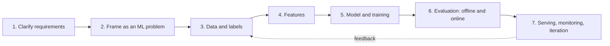
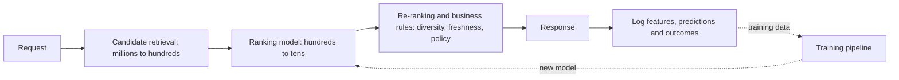

# ML system design primer

An ML system design interview gives you an open problem ("design a fraud detection system", "design the
recommendations for a video site") and 45 minutes. It does not test whether you know the best model. It
tests whether you can turn a vague business goal into a system that works in production and keeps
working. Müller & Guido's closing chapter makes the same point about real projects: the algorithm is
usually a small part of a larger data-analysis and decision-making process. This lesson gives you a
framework, the vocabulary for each step, and two worked examples.

## 1. A framework for the interview

Use the same seven steps every time. Say them at the start, so the interviewer knows where you are going.



A rough time budget for 45 minutes: 5 for requirements, 5 for framing, 8 for data and features, 8 for the
model, 7 for evaluation, 10 for serving and monitoring, and the rest for questions. The most common
failure is spending 30 minutes on model architecture.

## 2. Step 1: clarify requirements

Ask before you design. Good questions:

- **Business goal.** What are we trying to improve: revenue, engagement, losses, time saved? How is
  success measured today?
- **Users and scale.** How many users, items and requests per second? How fast does the data grow?
- **Latency.** Must the prediction be returned in milliseconds (online), or can it be computed in advance
  (batch)?
- **Constraints.** Privacy and regulation, explainability, cost limits, on-device or server-side.
- **The current solution.** Is there a rule-based system or an existing model? That is your baseline.

The book's advice applies directly. Ask what would happen if you built the *perfect* model. If perfect
fraud detection would save \$100 a month, the project isn't worth starting. Also consider **humans in the
loop**. Many applications are dominated by simple cases an algorithm can decide, while the difficult ones
are passed to a person. A system that automates even part of the decisions can already save time or cost.

## 3. Step 2: frame it as an ML problem

Translate the goal into inputs, an output and a learning task.

| business problem | ML framing | output |
|---|---|---|
| block fraudulent payments | binary classification | probability of fraud |
| "videos you may like" | ranking (often retrieval, then ranking) | ordered list of items |
| estimate delivery time | regression (possibly quantile regression) | minutes, with an interval |
| route support tickets | multiclass text classification | queue label |
| detect unusual server behaviour | anomaly detection | anomaly score |
| search | retrieval + learning to rank | ranked documents |

Decide what exactly the **label** is. This is the most consequential choice. "Did the user click?" is
plentiful but noisy, and optimising for it produces clickbait. "Did the user watch 80% of the video?" is
closer to what you want. A proxy label that differs from the true objective is the root of many failed
systems.

State the simplest thing that could work, and say you would build it first: a rule, a popularity
ranking, or logistic regression. A baseline tells you whether ML helps at all, and it gives you an
end-to-end pipeline early.

## 4. Step 3: data and labels

- **Sources.** Event logs, databases, third-party data, user-entered data. Which are available **at
  prediction time**?
- **Label collection.** *Natural labels* come from the system itself (clicks, chargebacks, returns). They
  are cheap but may arrive late: a fraud chargeback can take weeks. *Human labels* are expensive and need
  guidelines and quality checks. *Weak supervision* and model-assisted labelling sit in between.
- **Volume and balance.** How many positives are there? Is sampling needed?
- **Quality.** Missing values, duplicates, inconsistent units, label noise.
- **Bias in the data.** You only observe outcomes for the decisions the old system made. A loan model
  sees repayment only for loans that were approved. A recommender sees clicks only on items that were
  shown. This is **selection bias**, and it creates feedback loops.
- **Splitting.** Split by **time** when the system predicts the future, and by **user or group** when
  rows are related. A random split usually overstates performance. *(Lessons 5.1 and 6.2.)*

## 5. Step 4: features

Group your features so the discussion is organised:

- **Entity features**: about the user, the item, the merchant.
- **Context features**: time of day, device, location.
- **Interaction and history features**: counts and rates over windows ("transactions in the last hour",
  "purchases in this category in 30 days"), time since the last event.
- **Content features**: text, images, represented by embeddings.

Then say how each is computed and when:

| type | computed | example | freshness |
|---|---|---|---|
| batch feature | by a scheduled job over the warehouse | average order value over 90 days | hours to a day |
| streaming feature | by a stream processor over recent events | transactions in the last 5 minutes | seconds |
| request-time feature | from the request itself | amount, device type | immediate |

Two risks to name every time:

- **Training/serving skew.** If the training pipeline and the online service compute a feature with
  different code, the model sees different values in production. A **feature store** addresses this by
  serving the same feature definitions offline and online.
- **Point-in-time correctness.** A training row for an event at time $t$ may only use feature values
  known *before* $t$. Joining the latest value of a feature onto old events leaks the future.

## 6. Step 5: model and training

Start simple and justify each step up in complexity.

| situation | sensible choice |
|---|---|
| tabular features, moderate data | gradient-boosted trees (XGBoost, LightGBM) |
| need a fast, interpretable baseline | logistic or linear regression |
| text, images, audio | a pretrained network, fine-tuned, or its embeddings fed to a simple model |
| very many users and items | two-tower embedding model for retrieval, then a ranking model |
| strict latency or on-device | a small model, distillation, quantisation |

Discuss the trade-offs: accuracy against latency and cost, interpretability, how much data the model
needs, and how hard it is to maintain. The book's warning about production is worth quoting in spirit.
Production systems have different requirements from one-off analysis scripts: reliability,
predictability, runtime and memory all gain importance, and **simplicity is key**. Inspect every part of
the pipeline and ask whether its benefit justifies its complexity. The authors recommend the paper
"Machine Learning: The High Interest Credit Card of Technical Debt" for exactly this reason.

Also cover: how often the model is **retrained** (on a schedule, or triggered by a drop in performance),
how hyperparameters are tuned, and how experiments are tracked so that results can be reproduced.

## 7. Step 6: evaluation

### Offline

- Choose a metric that matches the framing and the cost of errors: PR AUC or recall at a fixed precision
  for rare-event classification; NDCG or recall@k for ranking; MAE or a quantile loss for regression.
- Compare against the baseline and the current production model on the same held-out, time-separated data.
- **Slice the results**: by country, device, new versus returning users, important customer segments. An
  average can hide a segment where the model fails badly.
- Check **calibration** if the scores are used as probabilities.

### Online

Offline evaluation is, as the book puts it, only the first step for a user-facing system. The next step
is **online or live testing**, where the consequences of using the model in the whole system are measured.

- **A/B testing.** Serve the new model to a random fraction of users and the old one to the rest, then
  compare the business metric. The book describes it as a form of blind user study: users don't know
  which version they get. Decide the metric, the sample size and the duration *before* starting, and run
  a full weekly cycle at least.
- **Shadow deployment.** The new model receives real traffic and its predictions are logged but not
  used. This tests the system safely before any user is affected.
- **Canary release.** Roll out to 1%, then 5%, then 50%, watching for regressions.
- **Bandit algorithms**, which the book mentions as more elaborate than A/B tests, shift traffic towards
  the better variant during the experiment.
- **Guardrail metrics.** Latency, error rate, complaints, and anything that must not get worse.

```python-run
import numpy as np

def required_sample_size(p_base, lift, z_alpha=1.96, z_power=0.84):
    """Approximate users per arm to detect an absolute lift in a rate (5% two-sided significance, 80% power)."""
    p_new = p_base + lift
    variance = p_base * (1 - p_base) + p_new * (1 - p_new)
    return int(np.ceil((z_alpha + z_power) ** 2 * variance / lift ** 2))

for base, lift in [(0.05, 0.01), (0.05, 0.005), (0.05, 0.001)]:
    print(f"baseline conversion {base:.1%}, detect +{lift:.2%}: about {required_sample_size(base, lift):>9,} users per arm")

# analysing a finished test with a two-proportion z-test
n_a, conv_a, n_b, conv_b = 20000, 1000, 20000, 1090
pa, pb = conv_a / n_a, conv_b / n_b
pooled = (conv_a + conv_b) / (n_a + n_b)
z = (pb - pa) / np.sqrt(pooled * (1 - pooled) * (1 / n_a + 1 / n_b))
print(f"A: {pa:.2%}  B: {pb:.2%}  z = {z:.2f}  -> {'significant' if abs(z) > 1.96 else 'not significant'} at the 5% level")
```

Halving the effect you want to detect roughly quadruples the traffic you need. This is why small
improvements are so expensive to verify.

## 8. Step 7: serving and monitoring

### Serving patterns

| pattern | how | when |
|---|---|---|
| **batch prediction** | score everything on a schedule, store the results, look them up | predictions don't depend on fresh context; e.g. nightly recommendations, churn scores |
| **online prediction** | a model service computes each prediction on request | fresh context matters; e.g. fraud, search ranking |
| **streaming** | predictions triggered by events in a stream | near-real-time reactions |
| **edge / on-device** | the model runs on the client | privacy, offline use, very low latency |

For online serving, discuss the latency budget (say, a 100 ms total with 20 ms for the model), caching,
autoscaling, a **fallback** when the model or a feature is unavailable (a default score or a simple rule),
and how a bad model is rolled back.

For large candidate sets, use a **funnel**: a cheap stage narrows millions of items to hundreds
(retrieval, often approximate nearest-neighbour search over embeddings), and an expensive model ranks only
those. Business rules are applied last.



### Monitoring

A model that was accurate at launch degrades, because the world changes.

- **Data drift (covariate shift).** The distribution of the inputs changes: new devices, new markets,
  seasonal behaviour.
- **Concept drift.** The relation between inputs and the target changes. Fraudsters adapt, and prices
  move.
- **Label shift.** The proportion of the classes changes.
- **Upstream breakage.** A schema change, a feature that silently becomes null, a unit that changes.
  These pipeline failures are the most common production problems, and the least glamorous.

What to monitor: operational health (latency, errors, throughput), feature distributions against the
training distribution, the distribution of the predictions, and model performance once the labels
arrive. When labels are delayed, input and prediction drift are your early warning.

```python-run
import numpy as np

def psi(expected, actual, bins=10):
    """Population stability index between a reference sample and a new sample of one feature."""
    edges = np.quantile(expected, np.linspace(0, 1, bins + 1))
    edges[0], edges[-1] = -np.inf, np.inf
    e = np.histogram(expected, edges)[0] / len(expected)
    a = np.histogram(actual, edges)[0] / len(actual)
    e, a = np.clip(e, 1e-6, None), np.clip(a, 1e-6, None)
    return float(np.sum((a - e) * np.log(a / e)))

rng = np.random.RandomState(0)
training = rng.normal(50, 10, 20000)                    # the feature as seen at training time
for name, live in [("same distribution", rng.normal(50, 10, 5000)),
                   ("mean shifted by 3", rng.normal(53, 10, 5000)),
                   ("mean shifted by 10", rng.normal(60, 10, 5000)),
                   ("variance doubled", rng.normal(50, 20, 5000))]:
    print(f"{name:20s} PSI = {psi(training, live):.3f}")
print("rule of thumb: below 0.1 stable, 0.1 to 0.25 worth a look, above 0.25 investigate")
```

Close the loop: log the features, predictions and outcomes, feed them back into training, and retrain on
a schedule or when monitoring raises an alarm. Watch for **feedback loops**, where the model's own
decisions shape its future training data. Keeping a small share of traffic for exploration (random or
less-filtered results) gives you unbiased data.

## 9. Worked example: fraud detection for card payments

1. **Requirements.** Decide within about 100 ms whether to approve, decline or send a payment for review.
   Missing fraud costs the transaction amount. A false decline costs a sale and annoys a good customer.
2. **Framing.** Binary classification that outputs a fraud probability, with two thresholds: decline
   above the higher one, manual review between the two. That keeps humans in the loop for uncertain cases.
3. **Data and labels.** Labels come from chargebacks and customer reports. They are **delayed by weeks**
   and heavily **imbalanced** (well under 1% fraud). Declined transactions have no label at all, which is
   selection bias.
4. **Features.** Amount, merchant category, country mismatch, device fingerprint; velocity features over
   windows (count and sum in the last minute, hour and day per card, per device, per merchant); distance
   from the usual location; account age. The velocity features must be computed from a stream.
5. **Model.** Start with logistic regression on a handful of features, then gradient-boosted trees, which
   suit tabular data and train quickly. Use class weights, and keep training data point-in-time correct.
6. **Evaluation.** A time-based split. PR AUC, and recall at a fixed false-positive rate. The
   money-weighted version matters more: fraud value caught against good-customer value declined. Then a
   shadow deployment, followed by an A/B test with decline rate and customer complaints as guardrails.
7. **Serving and monitoring.** An online service backed by a feature store with low-latency lookups, and
   a rule-based fallback. Monitor feature drift and the score distribution daily, because the labels lag.
   Retrain often: fraud is adversarial, so concept drift is the normal state.

## 10. Worked example: video recommendations

1. **Requirements.** Show each user a home page of videos they will value. Millions of users and videos,
   and a response in under 200 ms.
2. **Framing.** A ranking problem in two stages. The label must be chosen with care: clicks alone reward
   clickbait, so use watch time or completion, possibly combined with explicit signals such as likes.
3. **Data.** Implicit feedback logs. Only shown items have outcomes (**position and selection bias**).
   New users and new videos have no history, which is the **cold-start** problem.
4. **Features.** User history and embeddings, video content embeddings and metadata, context (time,
   device), freshness and popularity.
5. **Model.** *Retrieval*: a two-tower model that embeds users and videos into the same space, with an
   approximate nearest-neighbour index to fetch a few hundred candidates. Add other candidate sources
   such as "popular now" and "new from subscriptions". *Ranking*: a larger model that scores each
   candidate with rich features. *Re-ranking*: diversity, removal of watched or unsuitable items.
6. **Evaluation.** Offline: recall@k for retrieval and NDCG for ranking, on a time-based split. Online:
   an A/B test on long-term engagement and retention, with guardrails for content quality.
7. **Serving and monitoring.** Precompute video embeddings in batch, compute user embeddings near real
   time, cache where possible. For cold start, fall back to content-based and popularity signals. Monitor
   for feedback loops that narrow what users see, and reserve some traffic for exploration.

## 11. Common pitfalls in the interview

- Jumping to a model before clarifying the goal, the label and the constraints.
- No baseline, and no comparison with the current system.
- Random splits for temporal or grouped data.
- Ignoring how labels are obtained and how late they arrive.
- Forgetting the serving side: latency, fallbacks, training/serving skew.
- No plan for monitoring, drift and retraining.
- Presenting one design as the only option. Name the trade-offs and say what you would do with more time,
  data or budget.

> [!INTERVIEW]
> **How to open.** "Let me first clarify the goal and constraints, then frame it as an ML problem, then
> go through data, features, model, evaluation, and finally serving and monitoring." Then ask your
> clarifying questions. **How to close.** Summarise the design in three sentences, name the two biggest
> risks (usually label quality and drift), and say what you would build first. Interviewers remember a
> candidate who thinks in terms of iterations: ship a simple version end to end, measure, then improve.

## Summary

- Follow a fixed path: requirements → framing → data and labels → features → model → evaluation →
  serving and monitoring.
- The label definition and the data-splitting strategy matter more than the model family.
- Start with a baseline, and add complexity only when it pays for itself.
- Evaluate offline on time-separated data with sliced metrics, then online with shadow runs and A/B tests.
- Production means latency budgets, fallbacks, feature consistency, drift monitoring and retraining.

```quiz
[
  {"q": "In an ML system design interview, what should you do first?", "options": ["Clarify the business goal, scale, latency and constraints", "Choose between XGBoost and a neural network", "Design the feature store", "Write the training loop"], "answer": 0,
   "explain": "The right design depends on requirements; skipping them is the most common failure."},
  {"q": "Optimising a recommender purely for click-through rate risks…", "options": ["promoting clickbait, because the proxy label differs from what users value", "making the model too interpretable", "reducing the number of features", "eliminating feedback loops"], "answer": 0,
   "explain": "The label defines what the system optimises; a poor proxy leads to a system that hits the metric and misses the goal."},
  {"q": "What is training/serving skew?", "options": ["Features are computed differently in the training pipeline and in production", "The training set is larger than the test set", "The model is trained on a GPU and served on a CPU", "The class distribution is imbalanced"], "answer": 0,
   "explain": "The model then receives inputs in production that do not match what it learned from; shared feature definitions prevent it."},
  {"q": "Fraud labels arrive weeks after the transaction. What can you monitor in the meantime?", "options": ["Drift in the input features and in the distribution of predicted scores", "Nothing until labels arrive", "Only the training loss", "The number of model parameters"], "answer": 0,
   "explain": "Input and prediction distributions give early warning before performance can be measured."},
  {"q": "What is a shadow deployment?", "options": ["The new model receives live traffic and logs predictions, but its outputs are not used", "The model is served only at night", "Half of the users get the new model", "The model is trained on anonymised data"], "answer": 0,
   "explain": "It tests the system under real conditions without affecting users; an A/B test then measures impact."},
  {"q": "Why is a two-stage retrieval-then-ranking design used for recommendations?", "options": ["Scoring millions of items with a heavy model per request is too slow, so a cheap stage first narrows the candidates", "Because two models are always more accurate than one", "To avoid using embeddings", "To remove the need for evaluation"], "answer": 0,
   "explain": "The funnel trades a little recall for a large reduction in computation within the latency budget."},
  {"q": "Concept drift means…", "options": ["the relationship between the inputs and the target changes over time", "the input feature distribution changes while the relationship stays the same", "the model's weights change during training", "the test set is too small"], "answer": 0,
   "explain": "Covariate (data) drift is a change in the inputs; concept drift is a change in P(y | x)."},
  {"q": "For a model that predicts next month's demand, the right way to split data is…", "options": ["by time: train on earlier periods and evaluate on later ones", "a random 80/20 split", "by alphabetical order of the product name", "leave-one-out over all rows"], "answer": 0,
   "explain": "A random split lets the model train on the future relative to its test points."}
]
```

> **Source:** Müller & Guido, *Introduction to Machine Learning with Python*, ch. 8 ("Approaching a Machine Learning Problem", "Humans in the Loop", "From Prototype to Production", "Testing Production Systems") and ch. 5 ("Keep the End Goal in Mind"); Sculley et al., "Machine Learning: The High Interest Credit Card of Technical Debt"; Chip Huyen, *AI Engineering* (evaluation and deployment chapters) and *Designing Machine Learning Systems* (background).
