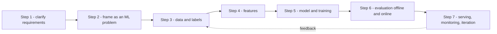
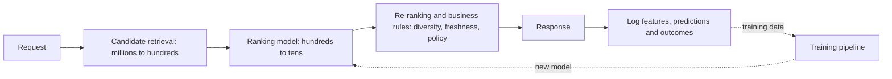

# ML system design primer

> **Before this lesson:** you should be comfortable with what a model, a feature and a label are, from [What machine learning is](#/lesson/ml/what-is-ml); with train/test splits and cross-validation from [Cross-validation](#/lesson/ml/cross-validation); with precision, recall and imbalanced data from [Evaluation metrics and imbalanced data](#/lesson/ml/metrics); and with data leakage from [ColumnTransformer and data leakage](#/lesson/ml/columntransformer-leakage). Embeddings appear briefly; they are taught in [CNNs, RNNs, embeddings and attention](#/lesson/ml/architectures). It also helps to have read [ML interview essentials](#/lesson/ml/interview-essentials) first. Every term is explained again where it is used.

## In plain words

Everything earlier in this track was about building a good **model**: a program that learns a pattern from examples and then makes predictions. A real company does not need a model. It needs a **system**: something that collects data every day, turns it into the inputs the model expects, asks the model for a prediction fast enough for a customer who is waiting, acts on the answer, notices when the answers start going wrong, and learns again from fresh data. The model is one box in that diagram, and often a small one.

An everyday comparison: a great recipe is not a restaurant. The restaurant also needs suppliers who deliver fresh ingredients (data), a kitchen layout that gets plates out in ten minutes (serving), a way to know whether diners liked the food (evaluation), and someone who notices when the fish supplier changes and the dish starts tasting different (monitoring). A chef who can only talk about the recipe would not be trusted to open a restaurant.

Why this matters for a job: the **ML system design interview** hands you an open, vague problem ("design a fraud detection system", "design the recommendations for a video site") and about 45 minutes. It does not test whether you know the single best model. It tests whether you can turn a fuzzy business goal into a design that works in **production** (the live environment where real users and real money are involved) and keeps working as the world changes. Müller and Guido end their book on the same note: picking the algorithm is usually a modest share of a much bigger process of analysing data and making decisions. This lesson gives you a fixed framework, the vocabulary for every step, two small calculations interviewers like, and two complete worked examples.

## 1. A framework for the interview

Use the same seven steps every time, and say them out loud at the start so the interviewer can follow where you are heading.



The dotted arrow matters. A production system is a loop, not a line: what you learn from monitoring sends you back to collect better data or define a better label.

A rough time budget for 45 minutes: 5 for requirements, 5 for framing, 8 for data and features, 8 for the model, 7 for evaluation, 10 for serving and monitoring, and what remains for questions. The most common way candidates fail is by spending 30 minutes on the architecture of a neural network and never reaching serving or monitoring.

## 2. Step 1: clarify requirements

A **requirement** is something the finished system must do or must respect. Ask about them before you design anything. Useful questions:

- **Business goal.** What are we trying to improve: revenue, engagement, losses, staff time? How is success measured today? The answer tells you which number the whole system should move.
- **Users and scale.** How many users and items are there, and how many **requests per second** (how many predictions the system must answer every second at peak)? How fast is the data growing?
- **Latency.** **Latency** is the time between a request arriving and the answer going back, usually measured in **milliseconds** (thousandths of a second). Must each prediction come back while a person waits (**online** prediction), or can predictions be computed ahead of time, for example overnight (**batch** prediction)?
- **Constraints.** Privacy rules and regulation, whether decisions must be explainable to customers or auditors, budget for computing power, and whether the model runs on the company's servers or on the user's phone.
- **The current solution.** Is there a hand-written rule system or an older model already? That is your **baseline**: the existing or simplest approach that any new design has to beat.

Two ideas from the book are worth bringing into the room. First, imagine the *perfect* model and estimate what it would be worth. Their example: if catching every single fraudulent payment would save a company only \$100 a month, nobody should spend months building a fraud model; if it would save tens of thousands a month, the project is worth exploring. This "value of perfection" question sets an upper limit on what the project can ever earn.

Second, consider **humans in the loop**: a design where the model decides the easy cases on its own and passes the uncertain ones to a person. Some decisions must be instant (a self-driving car cannot wait for a human to confirm a pedestrian), but many can wait a few minutes or hours. In many applications most cases are easy and a few are hard. Automating even a tenth or half of the decisions can cut cost and response time, while people keep control of the risky ones.

## 3. Step 2: frame it as an ML problem

**Framing** means translating the business goal into three things: the inputs, the output, and the type of learning task. Here are the task types you will meet most:

- **Binary classification**: predict one of two outcomes (fraud or not).
- **Multiclass classification**: predict one of several categories (which support queue a ticket belongs to).
- **Regression**: predict a number (minutes until delivery). **Quantile regression** predicts a chosen percentile instead of the average, for example "90% of deliveries arrive within this many minutes", which gives an honest range.
- **Ranking**: put a list of items in the best order for one user. At large scale this is split into **retrieval** (quickly fetch a few hundred plausible items from millions) and **ranking** (carefully order those few hundred). **Learning to rank** is the family of methods trained directly to produce good orderings.
- **Anomaly detection**: give each event a score for how unusual it is, often without labelled examples of problems.

| business problem | ML framing | output |
|---|---|---|
| block fraudulent payments | binary classification | probability of fraud |
| "videos you may like" | ranking (often retrieval, then ranking) | ordered list of items |
| estimate delivery time | regression (possibly quantile regression) | minutes, with an interval |
| route support tickets | multiclass text classification | queue label |
| detect unusual server behaviour | anomaly detection | anomaly score |
| search | retrieval + learning to rank | ranked documents |

Next decide exactly what the **label** is: the answer the model learns to predict for each training example. This is the most consequential decision in the whole design, because the model will become very good at whatever the label measures, whether or not that is what you wanted. "Did the user click?" is easy to collect in huge quantities, but optimising for it rewards **clickbait** (eye-catching items people click and immediately regret). "Did the user watch at least 80% of the video?" is much closer to real satisfaction. A label that stands in for the true goal is called a **proxy label**; when the proxy and the goal drift apart, the system hits its number and misses its purpose. That gap is behind a great many failed projects.

Finally, name the simplest thing that could possibly work, and say you would build it first: a hand-written rule, a "most popular items" list, or a **logistic regression** (a linear model that outputs a probability, from [Linear models](#/lesson/ml/linear-models)). A baseline answers the question "does machine learning help here at all?", and building it forces you to wire up the whole pipeline from raw data to served prediction early, which is where most surprises hide.

## 4. Step 3: data and labels

- **Sources.** Where does the data come from: **event logs** (a record written every time a user does something), company databases, data bought from third parties, things users type in? For each source, ask whether it is available **at prediction time**. A feature you can compute for last year's data but not for a live request is useless in production.
- **Label collection.** *Natural labels* come from the system itself: clicks, **chargebacks** (a customer disputing a card payment, which often signals fraud), returned products. They are cheap but can arrive late; a chargeback may come weeks after the payment. *Human labels* come from people paid to annotate examples; they are expensive and need written guidelines and quality checks. *Weak supervision* sits in between: rough labels generated automatically by rules or by another model, then cleaned up.
- **Volume and balance.** How many positive examples exist? If fraud is 0.1% of payments, even a million payments gives only a thousand frauds. You may need to **sample** (keep all positives and only some negatives) or weight the classes, as covered in the metrics lesson.
- **Quality.** Missing values, duplicate rows, inconsistent units (dollars mixed with cents), and **label noise** (labels that are simply wrong).
- **Bias in the data.** You only observe outcomes for the decisions the old system allowed to happen. A loan model sees whether people repaid only for loans that were approved; it never learns what the rejected applicants would have done. A recommender sees clicks only on items it chose to show. This is **selection bias**: the training data is not a fair sample of the world. It feeds a **feedback loop**, where the model's own decisions shape the data it will later learn from.
- **Splitting.** When the system predicts the future, split by **time**: train on older data and test on newer data. When several rows belong to the same person or group, split by **user or group** so the same person never appears in both training and test data. A random split usually makes the model look better than it will be in production. (See [Cross-validation](#/lesson/ml/cross-validation) and [ColumnTransformer and data leakage](#/lesson/ml/columntransformer-leakage).)

## 5. Step 4: features

A **feature** is one measurable input to the model. Grouping your features keeps the discussion organised:

- **Entity features**: facts about the user, the item or the merchant (account age, item price).
- **Context features**: facts about the moment of the request (time of day, device, location).
- **Interaction and history features**: counts and rates over a **time window** (a fixed period looking back from now), such as "transactions in the last hour" or "purchases in this category in 30 days", and "time since the last event".
- **Content features**: text, images and audio, usually turned into **embeddings** (lists of numbers that place similar things close together).

Then say how and when each feature is computed. A **data warehouse** is a large database that stores the company's history for analysis; a **stream processor** is a program that reads events one by one as they happen and keeps running totals up to date.

| type | computed | example | freshness |
|---|---|---|---|
| batch feature | by a scheduled job over the warehouse | average order value over 90 days | hours to a day |
| streaming feature | by a stream processor over recent events | transactions in the last 5 minutes | seconds |
| request-time feature | from the request itself | amount, device type | immediate |

Two risks to name every single time:

- **Training/serving skew.** If the training pipeline and the live service compute the same feature with two different pieces of code, they will eventually disagree (a different rounding, a different time zone), and the model will see values in production that do not match what it learned from. A **feature store** is a shared service that holds one definition of each feature and serves it both to training jobs and to the live system, so the two cannot diverge.
- **Point-in-time correctness.** A training row describing an event at time $t$ may only use feature values that were known *before* $t$. If you attach today's value of a feature to last year's events, the model is quietly shown the future, which is a form of **data leakage** (information in training that will not exist at prediction time).

The demo below shows the second risk with one customer and three past payments.

```python-run
import bisect

# snapshots of one card's "chargebacks so far", taken on these days
snapshot_days  = [1, 10, 20, 30]
snapshot_value = [0, 0, 1, 3]

# training events: (day of the payment, 1 if it later proved to be fraud)
events = [(5, 0), (15, 0), (25, 1)]

latest = snapshot_value[-1]
print("day  label  naive join  point-in-time join")
for day, label in events:
    i = bisect.bisect_left(snapshot_days, day) - 1      # last snapshot strictly before the payment
    print(f"{day:3d}  {label:5d}  {latest:10d}  {snapshot_value[i]:18d}")
```

**Reading this code line by line**

- `snapshot_days` and `snapshot_value` record what the feature "number of chargebacks so far" was on four dates.
- `events` are three payments we want to train on, each with its label.
- The **naive join** attaches the latest value (3) to every payment, as happens when someone joins today's customer table onto old events.
- `bisect.bisect_left(snapshot_days, day) - 1` finds the position of the last snapshot taken strictly before the payment day; that is the value the live system would really have seen.

The output shows the naive column at 3 for all three payments, while the correct column reads 0, 0 and 1. In the naive version, every row already "knows" about chargebacks that happened later, so the feature looks far more predictive in training than it can ever be in production. The model scores brilliantly offline and disappoints after launch.

## 6. Step 5: model and training

Start simple and justify every step up in complexity.

| situation | sensible choice |
|---|---|
| tabular features, moderate data | gradient-boosted trees (XGBoost, LightGBM) |
| need a fast, interpretable baseline | logistic or linear regression |
| text, images, audio | a pretrained network, fine-tuned, or its embeddings fed to a simple model |
| very many users and items | two-tower embedding model for retrieval, then a ranking model |
| strict latency or on-device | a small model, distillation, quantisation |

Terms in that table: **tabular** data is data in rows and columns, like a spreadsheet. **Gradient-boosted trees** build many small decision trees one after another, each correcting the errors of the ones before (see [Naive Bayes, decision trees and ensembles](#/lesson/ml/bayes-trees-ensembles)); XGBoost and LightGBM are popular libraries for them. A **pretrained network** has already been trained on a huge general dataset, and **fine-tuning** continues its training briefly on your data. A **two-tower model** has one neural network that turns a user into an embedding and another that turns an item into an embedding, trained so that a user's embedding lands near the items they like. **Distillation** trains a small, fast "student" model to imitate a big "teacher" model, and **quantisation** stores the model's numbers with fewer bits, so it runs faster and uses less memory at a small cost in accuracy.

Discuss the trade-offs: accuracy against latency and cost, how interpretable the model is, how much data it needs, and how hard it is to maintain. The book's advice about production fits here, in paraphrase: a live system has different needs from a one-off analysis script. Reliability, predictable behaviour, running time and memory all start to matter, and keeping things simple is what makes them achievable. Go through each stage of the pipeline and ask whether its benefit is worth the complexity it adds and how badly it breaks when the data or infrastructure changes. The authors point readers to the Google paper "Machine Learning: The High Interest Credit Card of Technical Debt" for this reason. **Technical debt** is the future cost of shortcuts taken today, and ML systems pile it up fast through tangled data dependencies and glue code.

Also cover three practical questions. How often is the model **retrained** (trained again on newer data): on a fixed schedule, or when monitoring shows performance dropping? How are **hyperparameters** (settings chosen before training, like tree depth) tuned, for example with the grid search from [Grid search and nested cross-validation](#/lesson/ml/grid-search)? And how are experiments tracked, so that anyone can rerun a result and get the same model?

## 7. Step 6: evaluation

### Offline

**Offline evaluation** measures the model on historical data collected beforehand, before any user sees it.

- Pick a metric that matches the framing and the real cost of mistakes. For rare-event classification, use **PR AUC** (the area under the precision-recall curve, which summarises how well the model finds positives without raising too many false alarms) or **recall at a fixed precision** (the share of real positives caught while keeping alarms at an acceptable level of correctness). For ranking, use **recall@k** (what share of the relevant items appear in the top $k$) or **NDCG** (normalised discounted cumulative gain, a score that rewards putting the most relevant items near the top of the list). For regression, use **MAE** (mean absolute error, the average size of the miss) or a quantile loss.
- Compare against the baseline and the current production model on the same held-out, time-separated data.
- **Slice the results**: compute the metric separately by country, device, new versus returning users and other important groups. A good average can hide one segment where the model fails badly.
- Check **calibration** if the scores will be used as probabilities: among payments scored 0.2, about 20% should really be fraud.

### Online

For a system that users interact with, offline numbers are only the first hurdle. The next is **online testing** (also called live testing): putting the model into the real product and measuring what happens to the whole system. Changing what people are shown can change how they behave in ways no historical dataset predicts.

- **A/B testing.** Randomly assign a share of users to the new model (one group) and the rest to the current system (the other group), without telling them, then compare the business metric between groups. The book calls it a kind of blind user study. Decide the metric, the sample size and the duration *before* starting, and run for at least one full week so weekday and weekend behaviour are both included.
- **Shadow deployment.** The new model receives real traffic and its predictions are logged, but nobody acts on them. This checks speed, errors and agreement with the old model before any user can be affected.
- **Canary release.** Roll the new model out gradually, to 1%, then 5%, then 50% of traffic, watching for problems at each stage, like the canary miners once carried to detect bad air early.
- **Bandit algorithms**, which the book mentions as a more advanced alternative, move traffic towards the better-performing version while the experiment is still running, so fewer users are stuck with the worse one.
- **Guardrail metrics.** Numbers that must not get worse even if the main metric improves: latency, error rate, complaints, unsubscribes.

How many users does an A/B test need? Two statistics ideas help. **Statistical significance** means the difference you saw is unlikely to be pure chance; the usual bar is a 5% chance of a false alarm. **Statistical power** is the chance the test detects a real improvement of the size you care about; 80% is the usual target. The demo turns these into numbers.

```python-run
import numpy as np

def required_sample_size(p_base, lift, z_alpha=1.96, z_power=0.84):
    """Approximate users per arm to detect an absolute lift in a rate (5% two-sided significance, 80% power)."""
    p_new = p_base + lift
    variance = p_base * (1 - p_base) + p_new * (1 - p_new)
    return int(np.ceil((z_alpha + z_power) ** 2 * variance / lift ** 2))

for base, lift in [(0.05, 0.01), (0.05, 0.005), (0.05, 0.001)]:
    print(f"baseline conversion {base:.1%}, detect +{lift:.2%}: about {required_sample_size(base, lift):>9,} users per arm")

# analysing a finished test with a two-proportion z-test
n_a, conv_a, n_b, conv_b = 20000, 1000, 20000, 1090
pa, pb = conv_a / n_a, conv_b / n_b
pooled = (conv_a + conv_b) / (n_a + n_b)
z = (pb - pa) / np.sqrt(pooled * (1 - pooled) * (1 / n_a + 1 / n_b))
print(f"A: {pa:.2%}  B: {pb:.2%}  z = {z:.2f}  -> {'significant' if abs(z) > 1.96 else 'not significant'} at the 5% level")
```

**Reading this code line by line**

- A **conversion rate** is the share of users who do the thing you want (buy, sign up). `p_base` is the current rate and `lift` the improvement you hope to detect, both as fractions.
- `z_alpha=1.96` and `z_power=0.84` are the standard values from the normal distribution for 5% significance and 80% power.
- `variance` measures how noisy a yes/no rate is in each group; `required_sample_size` applies the standard formula and rounds up. An **arm** is one of the groups in the test.
- The second half analyses a finished test with a **two-proportion z-test**: it measures the difference between the two rates in units of its expected random wobble. A value of `z` beyond 1.96 in either direction counts as significant at the 5% level.

The output: detecting a lift from 5% to 6% needs about 8,146 users per arm; detecting 5% to 5.5% needs about 31,196; and detecting 5% to 5.1% needs about 751,849. The finished test, 5.00% against 5.45% on 20,000 users each, gives $z = 2.02$, just over the bar, so it is significant. Halving the effect you want to detect roughly quadruples the traffic you need, because the required size grows with one over the lift squared. That is why small improvements are so expensive to prove.

## 8. Step 7: serving and monitoring

**Serving** means making the model's predictions available to the product.

### Serving patterns

| pattern | how | when |
|---|---|---|
| **batch prediction** | score everything on a schedule, store the results, look them up | predictions don't depend on fresh context; e.g. nightly recommendations, churn scores |
| **online prediction** | a model service computes each prediction on request | fresh context matters; e.g. fraud, search ranking |
| **streaming** | predictions triggered by events in a stream | near-real-time reactions |
| **edge / on-device** | the model runs on the client | privacy, offline use, very low latency |

(**Churn** is a customer leaving; a **client** here is the user's own phone or browser.)

For online serving, discuss:

- the **latency budget**: how the total allowed time is shared out, for example 100 ms in total with 20 ms for the model itself;
- **caching**: storing recent answers so a repeated request does not recompute them;
- **autoscaling**: adding or removing servers automatically as traffic rises and falls;
- a **fallback**: what happens when the model or one of its features is unavailable, such as a default score or a simple rule, so the product keeps working;
- **rollback**: how quickly a bad model can be swapped back for the previous version.

When there are millions of candidate items, use a **funnel**. A cheap first stage narrows millions of items to a few hundred, typically with **approximate nearest-neighbour search** (a fast index that finds embeddings close to the user's embedding, accepting that it occasionally misses the exact closest one). An expensive model then ranks only those few hundred, and business rules are applied last.



### Monitoring

A model that was accurate on launch day gets worse over time, because the world it learned from keeps changing. **Monitoring** means watching the live system continuously so you notice. The kinds of change have names:

- **Data drift (covariate shift).** The distribution of the inputs changes, while the rule linking inputs to outcomes stays the same: new devices, new markets, seasonal habits.
- **Concept drift.** The relationship between inputs and the target itself changes. Fraudsters adapt to the model; prices move. In symbols, $P(y \mid x)$ changes: the probability of the outcome given the same inputs is no longer what it was.
- **Label shift.** The proportion of each class changes, for example fraud jumps from 0.5% to 2% during a holiday attack.
- **Upstream breakage.** Something earlier in the data pipeline breaks: a column is renamed, a feature silently becomes empty, a unit switches from seconds to milliseconds. These failures are the least glamorous and the most common production problems.

What to watch: operational health (latency, errors, **throughput**, meaning requests handled per second), the distribution of each feature compared with the training data, the distribution of the predictions, and true model performance once the labels arrive. When labels arrive late, input drift and prediction drift are your early warning.

A common drift score is the **population stability index** (PSI). It splits the feature's training values into ten equal-sized bins, counts what share of the live values falls in each bin, and adds up how far those shares have moved. Zero means identical distributions.

```python-run
import numpy as np

def psi(expected, actual, bins=10):
    """Population stability index between a reference sample and a new sample of one feature."""
    edges = np.quantile(expected, np.linspace(0, 1, bins + 1))
    edges[0], edges[-1] = -np.inf, np.inf
    e = np.histogram(expected, edges)[0] / len(expected)
    a = np.histogram(actual, edges)[0] / len(actual)
    e, a = np.clip(e, 1e-6, None), np.clip(a, 1e-6, None)
    return float(np.sum((a - e) * np.log(a / e)))

rng = np.random.RandomState(0)
training = rng.normal(50, 10, 20000)                    # the feature as seen at training time
for name, live in [("same distribution", rng.normal(50, 10, 5000)),
                   ("mean shifted by 3", rng.normal(53, 10, 5000)),
                   ("mean shifted by 10", rng.normal(60, 10, 5000)),
                   ("variance doubled", rng.normal(50, 20, 5000))]:
    print(f"{name:20s} PSI = {psi(training, live):.3f}")
print("rule of thumb: below 0.1 stable, 0.1 to 0.25 worth a look, above 0.25 investigate")
```

**Reading this code line by line**

- `np.quantile(expected, np.linspace(0, 1, bins + 1))` finds the cut points that split the training values into ten bins holding 10% each; the outer edges are widened to infinity so no live value falls outside.
- `np.histogram(...)[0] / len(...)` gives the share of values in each bin, for training (`e`) and live data (`a`).
- `np.clip(..., 1e-6, None)` replaces empty bins with a tiny number so the logarithm never sees zero.
- The final sum is the PSI formula: for each bin, the change in share times the log of the ratio of shares.
- The loop compares the training sample with four live samples: one from the same distribution, two with the average moved, and one with the spread doubled.

The output: 0.001 for the same distribution, 0.084 for a small shift of 3, 0.914 for a large shift of 10, and 0.500 for doubled spread. The small shift stays under the "stable" line, while both big changes are flagged loudly, even though the doubled spread leaves the average untouched. That last case is why you monitor the whole distribution and not only the mean.

Close the loop: log the features, predictions and outcomes, feed them back into training, and retrain on a schedule or when monitoring raises an alarm. Watch for feedback loops, where the model's decisions shape its own future training data. Reserving a small share of traffic for **exploration** (showing random or less-filtered results) gives you data the model did not choose, which keeps the training data less biased.

## 9. Worked example: fraud detection for card payments

1. **Requirements.** Decide within about 100 ms whether to approve a payment, decline it, or send it to a person for review. Missing a fraud costs the payment amount. A **false decline** (blocking a genuine customer) costs a sale and annoys someone you want to keep.
2. **Framing.** Binary classification that outputs a fraud probability, with *two* thresholds: decline above the higher one, send to manual review between the two, approve below the lower one. That keeps humans in the loop for the uncertain middle.
3. **Data and labels.** Labels come from chargebacks and customer reports. They are **delayed by weeks** and heavily **imbalanced** (well under 1% fraud). Declined payments never get a label at all, because they never happened; that is selection bias.
4. **Features.** Amount, merchant category, whether the card's country matches the shop's, a **device fingerprint** (an identifier built from the phone or browser's characteristics); **velocity features** over windows (count and total of payments in the last minute, hour and day per card, per device, per merchant); distance from the card's usual location; account age. The velocity features must come from a stream processor to be fresh.
5. **Model.** Start with logistic regression on a handful of features, then move to gradient-boosted trees, which suit tabular data and train quickly. Use class weights for the imbalance, and build the training set with point-in-time correct features.
6. **Evaluation.** A time-based split. PR AUC, and recall at a fixed false-positive rate. The money-weighted version matters more: value of fraud caught against value of good payments declined. Then a shadow deployment, followed by an A/B test with decline rate and customer complaints as guardrails.
7. **Serving and monitoring.** An online service backed by a feature store with fast lookups, and a rule-based fallback if the model is down. Monitor feature drift and the score distribution daily, because labels lag by weeks. Retrain often: fraud is **adversarial** (people are actively trying to beat the model), so concept drift is the normal state.

How should the two thresholds be chosen? By cost, not by accuracy. The demo simulates 100,000 payments with 1% fraud and a model whose scores are high for most frauds and low for most genuine payments, then searches for the cheapest thresholds.

```python-run
import numpy as np

rng = np.random.RandomState(1)
n = 100000
is_fraud = rng.rand(n) < 0.01                                      # about 1% of payments are fraud
score = np.where(is_fraud, rng.beta(5, 2, n), rng.beta(1, 8, n))   # the model's fraud score

COST_MISSED, COST_FALSE_DECLINE, COST_REVIEW = 200, 15, 3

def total_cost(low, high):
    decline = score >= high
    review = (score >= low) & ~decline
    approve = score < low
    missed = (approve & is_fraud).sum()
    false_decl = (decline & ~is_fraud).sum()
    return missed * COST_MISSED + false_decl * COST_FALSE_DECLINE + review.sum() * COST_REVIEW, review.sum()

grid = np.round(np.arange(0.05, 1.0, 0.05), 2)
best_one = min((total_cost(t, t)[0], t) for t in grid)
best_two = min((total_cost(lo, hi)[0], lo, hi) for lo in grid for hi in grid if hi > lo)
print(f"approve everything:            cost = {total_cost(1.01, 1.01)[0]:>8,}")
print(f"best single threshold {best_one[1]:.2f}:    cost = {best_one[0]:>8,}")
c, reviewed = total_cost(best_two[1], best_two[2])
print(f"two thresholds {best_two[1]:.2f} and {best_two[2]:.2f}: cost = {c:>8,}  ({reviewed:,} payments sent to people)")
```

**Reading this code line by line**

- `is_fraud` marks roughly 1% of the simulated payments as fraud.
- `rng.beta(5, 2, n)` draws scores that lean towards 1 (used for frauds) and `rng.beta(1, 8, n)` draws scores that lean towards 0 (used for genuine payments). A real model's scores would come from your validation data instead.
- The three constants are made-up costs: 200 per missed fraud, 15 per genuine customer wrongly declined, and 3 for a person to review one payment.
- `total_cost(low, high)` splits payments into approve, review and decline, counts the expensive mistakes, and returns the total cost and the number reviewed. Setting `low` equal to `high` means no review band, so a single threshold.
- The two `min(...)` lines try every threshold, or pair of thresholds, on a grid from 0.05 to 0.95 and keep the cheapest.

The output: approving everything costs 197,000; the best single threshold (0.50) costs 23,845; the best pair (0.40 and 0.65) costs 13,069, sending 1,928 payments, about 2% of traffic, to people. The review band almost halves the cost, because the payments the model is unsure about are exactly the ones where a cheap human check pays off. In an interview, saying "I would pick thresholds by expected cost, using these error costs from the business" shows you are thinking about the system, not only the classifier.

## 10. Worked example: video recommendations

1. **Requirements.** Show each user a home page of videos they will value. Millions of users and videos, and a response in under 200 ms.
2. **Framing.** A ranking problem in two stages. Choose the label with care: clicks alone reward clickbait, so use watch time or completion, possibly combined with explicit signals such as likes.
3. **Data.** **Implicit feedback** logs (behaviour such as watching or skipping, as opposed to explicit ratings). Only shown items have outcomes, and items higher on the page get more attention whatever their quality; that is **position bias**, on top of selection bias. New users and new videos have no history, which is the **cold-start** problem.
4. **Features.** User history and user embeddings, video content embeddings and metadata (title, length, category), context (time, device), freshness and popularity.
5. **Model.** *Retrieval*: a two-tower model that embeds users and videos into the same space, with an approximate nearest-neighbour index to fetch a few hundred candidates. Add other candidate sources such as "popular now" and "new from your subscriptions". *Ranking*: a larger model that scores each candidate using rich features. *Re-ranking*: enforce variety and remove videos already watched or unsuitable.
6. **Evaluation.** Offline: recall@k for retrieval and NDCG for ranking, on a time-based split. Online: an A/B test on long-term engagement and **retention** (whether users keep coming back), with guardrails for content quality.
7. **Serving and monitoring.** Precompute video embeddings in batch, compute user embeddings close to real time, cache where possible. For cold start, fall back to content-based and popularity signals. Monitor for feedback loops that narrow what users see, and reserve some traffic for exploration.

## 11. Common pitfalls in the interview

- Jumping to a model before clarifying the goal, the label and the constraints.
- No baseline, and no comparison with the current system.
- Random splits for data that is ordered in time or grouped by user.
- Ignoring how labels are obtained and how late they arrive.
- Forgetting the serving side: latency, fallbacks, training/serving skew.
- No plan for monitoring, drift and retraining.
- Presenting one design as the only option. Name the trade-offs and say what you would change with more time, data or budget.

> [!INTERVIEW]
> **How to open.** "Let me first clarify the goal and constraints, then frame it as an ML problem, then
> go through data, features, model, evaluation, and finally serving and monitoring." Then ask your
> clarifying questions. **How to close.** Summarise the design in three sentences, name the two biggest
> risks (usually label quality and drift), and say what you would build first. Interviewers remember a
> candidate who thinks in iterations: ship a simple version end to end, measure, then improve.

## Summary

- Follow a fixed path: requirements → framing → data and labels → features → model → evaluation →
  serving and monitoring, and treat it as a loop.
- The label definition and the data-splitting strategy matter more than the model family.
- Start with a baseline, and add complexity only when it pays for itself.
- Keep features consistent between training and serving, and point-in-time correct.
- Evaluate offline on time-separated data with sliced metrics, then online with shadow runs and A/B tests sized in advance.
- Production means latency budgets, fallbacks, cost-based thresholds, drift monitoring and retraining.

## Glossary

- **Production**: the live environment where real users and real money depend on the system.
- **Latency / throughput**: time to answer one request / number of requests answered per second.
- **Batch / online prediction**: computed ahead of time on a schedule / computed on demand while the user waits.
- **Baseline**: the simplest or existing approach that a new design must beat.
- **Proxy label**: a measurable stand-in for the true goal, such as clicks for satisfaction.
- **Humans in the loop**: the model decides easy cases and routes uncertain ones to people.
- **Selection bias**: training data that covers only the cases an earlier system let through.
- **Feedback loop**: a model's decisions shaping the data it later learns from.
- **Feature store**: a shared service serving the same feature definitions to training and live prediction.
- **Training/serving skew**: a feature computed differently in production than in training.
- **Point-in-time correctness**: each training row uses only feature values known before its event.
- **Two-tower model**: two networks that embed users and items into one space for fast retrieval.
- **Approximate nearest-neighbour search**: a fast index that finds close embeddings, occasionally missing the exact closest.
- **Distillation / quantisation**: training a small model to copy a big one / storing weights with fewer bits.
- **Calibration**: predicted probabilities matching observed frequencies.
- **A/B test**: a randomised comparison of two versions on live users.
- **Statistical significance / power**: low chance the difference is luck / high chance a real effect is detected.
- **Shadow deployment / canary release**: live traffic with predictions logged but unused / a gradual rollout to growing shares of users.
- **Guardrail metric**: a number that must not get worse, whatever the main metric does.
- **Fallback / rollback**: a backup answer when the model is unavailable / reverting to the previous model.
- **Data drift / concept drift / label shift**: inputs change / the input-to-target relationship changes / class proportions change.
- **Population stability index (PSI)**: a score of how far a feature's distribution has moved from training.
- **Cold start**: no history yet for a new user or item.
- **Technical debt**: the future cost of today's shortcuts.

## Check yourself

```quiz
[
  {"q": "In an ML system design interview, what should you do first?", "options": ["Clarify the business goal, scale, latency and constraints", "Choose between XGBoost and a neural network", "Design the feature store", "Write the training loop"], "answer": 0,
   "explain": "The right design depends on requirements; skipping them is the most common failure."},
  {"q": "Optimising a recommender purely for click-through rate risks…", "options": ["promoting clickbait, because the proxy label differs from what users value", "making the model too interpretable", "reducing the number of features", "eliminating feedback loops"], "answer": 0,
   "explain": "The label defines what the system optimises; a poor proxy leads to a system that hits the metric and misses the goal."},
  {"q": "What is training/serving skew?", "options": ["Features are computed differently in the training pipeline and in production", "The training set is larger than the test set", "The model is trained on a GPU and served on a CPU", "The class distribution is imbalanced"], "answer": 0,
   "explain": "The model then receives inputs in production that do not match what it learned from; shared feature definitions prevent it."},
  {"q": "Fraud labels arrive weeks after the transaction. What can you monitor in the meantime?", "options": ["Drift in the input features and in the distribution of predicted scores", "Nothing until labels arrive", "Only the training loss", "The number of model parameters"], "answer": 0,
   "explain": "Input and prediction distributions give early warning before performance can be measured."},
  {"q": "What is a shadow deployment?", "options": ["The new model receives live traffic and logs predictions, but its outputs are not used", "The model is served only at night", "Half of the users get the new model", "The model is trained on anonymised data"], "answer": 0,
   "explain": "It tests the system under real conditions without affecting users; an A/B test then measures impact."},
  {"q": "Why is a two-stage retrieval-then-ranking design used for recommendations?", "options": ["Scoring millions of items with a heavy model per request is too slow, so a cheap stage first narrows the candidates", "Because two models are always more accurate than one", "To avoid using embeddings", "To remove the need for evaluation"], "answer": 0,
   "explain": "The funnel trades a little recall for a large reduction in computation within the latency budget."},
  {"q": "Concept drift means…", "options": ["the relationship between the inputs and the target changes over time", "the input feature distribution changes while the relationship stays the same", "the model's weights change during training", "the test set is too small"], "answer": 0,
   "explain": "Covariate (data) drift is a change in the inputs; concept drift is a change in P(y | x)."},
  {"q": "For a model that predicts next month's demand, the right way to split data is…", "options": ["by time: train on earlier periods and evaluate on later ones", "a random 80/20 split", "by alphabetical order of the product name", "leave-one-out over all rows"], "answer": 0,
   "explain": "A random split lets the model train on the future relative to its test points."}
]
```

> **Source:** Müller & Guido, *Introduction to Machine Learning with Python*, ch. 8 ("Approaching a Machine Learning Problem", "Humans in the Loop", "From Prototype to Production", "Testing Production Systems") and ch. 5 ("Keep the End Goal in Mind"); Sculley et al., "Machine Learning: The High Interest Credit Card of Technical Debt"; Chip Huyen, *AI Engineering* (evaluation and deployment chapters) and *Designing Machine Learning Systems* (background).
