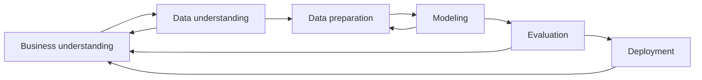
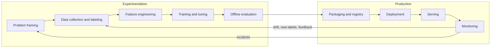
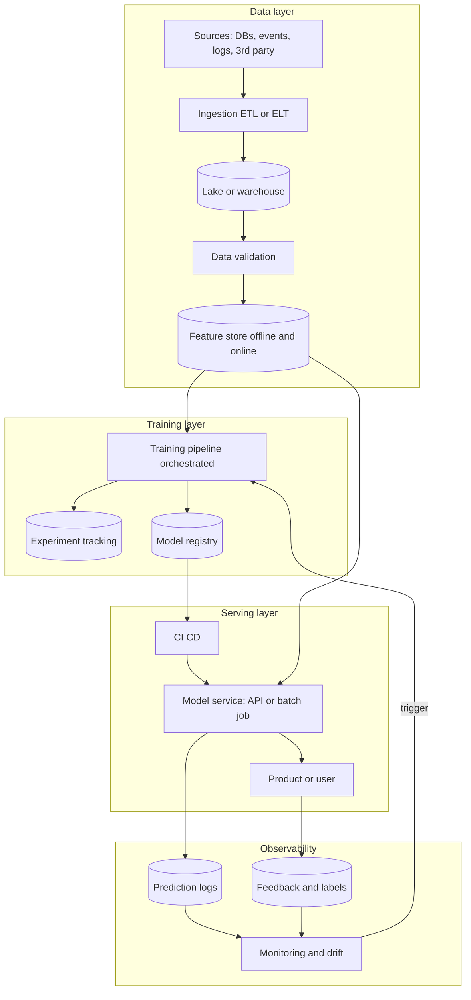

# The ML lifecycle and the anatomy of an ML system

> **Before this lesson:** you need basic Python (variables, loops, functions) and the rough idea of
> what "training a model" means: a program looks at many examples and adjusts itself until it can
> guess the answer for new examples. Nothing else is assumed. Every technical word is explained
> where it first appears and collected in the glossary at the end.

## In plain words

**Machine learning** (ML) is a way of writing software where you do not type the rules yourself.
You hand a program a pile of past examples ("this customer cancelled, this one stayed") and it
works out the rules. The result is called a **model**: a file of numbers plus a little code that
turns an input into a prediction.

**MLOps** (machine learning operations) is everything needed to keep that model useful after the
day it was trained: getting fresh data to it, recording how it was made, putting it where a
product can call it, watching whether its answers are still good, and replacing it when they are
not.

An everyday picture: training a model is like developing a recipe in a test kitchen. MLOps is
running the restaurant. A restaurant needs suppliers who deliver ingredients every morning, a
written recipe so any cook produces the same dish, a kitchen that can serve two hundred people at
once, someone tasting plates before they leave, and a way to change the menu when ingredients or
tastes change. The recipe matters, but it is a small part of the work.

Why this matters for a job: most companies have discovered that getting a model to work once on a
laptop is the smaller part of the effort. The people who can carry it to production and keep it
healthy are ML engineers and MLOps engineers, and interviews for those roles ask about the whole
journey, not only the algorithm. This lesson draws the map that the remaining 36 lessons fill in.

## Why this track exists

Data scientists usually do their first experiments in a **notebook**: an interactive document
(Jupyter is the best-known kind) where you run small pieces of Python one cell at a time and see
the result under each cell. Suppose a notebook reports that a model scores 0.93 AUC. (AUC, "area
under the curve", is a quality score between 0.5 for coin-flipping and 1.0 for perfect ranking.)
That number is not yet a product. **Production** means the live system that real users or other
programs depend on, and between the notebook cell and a production service that answers millions
of requests a day sit dozens of decisions:

- Where does the data come from, and how is it refreshed?
- How do you run the same training again in six months and get the same model?
- How is the model packaged so it runs on a server and not only on one person's laptop?
- How is a new version rolled out without breaking the product?
- How do you find out that its answers have quietly become worse?
- How much does all of this cost?

MLOps is the discipline that answers those questions. It borrows from two older fields. **DevOps**
(development plus operations) is the practice of automating how software is tested, released and
watched. **Data engineering** is the work of moving and cleaning data reliably. MLOps adds the
problems that only appear when a system's behaviour is *learned from data* and not written by hand.

A useful one-line definition: **MLOps is the set of practices that make machine-learning systems
reproducible, deployable, observable and continuously improvable, reliably and at a sustainable
cost.** In plain terms: you can rebuild it (reproducible), you can put it in front of users
(deployable), you can see what it is doing (observable), and you can keep making it better.

We build the mental model one layer at a time. This first lesson zooms out: what are the phases of
an ML project, what parts does a real ML system contain, and where does the "model" sit among
them?

## The classic process model: CRISP-DM

Long before the word MLOps existed, teams doing **data mining** (searching large data sets for
useful patterns, the older name for much of what is now called data science) followed a process
called **CRISP-DM**: the Cross-Industry Standard Process for Data Mining, published in 1999 by a
group of companies including SPSS, NCR and Daimler. It describes six phases. The important design
choice is that it draws them as a **cycle**, where later steps send you back to earlier ones, and
not as a **waterfall**, the name for a plan in which each step is finished once and never revisited:



Read the diagram as "an arrow means you often move this way". Each phase in plain words:

1. **Business understanding.** What decision will the model improve, and how will we know it did?
   A business goal ("reduce churn", where **churn** means customers leaving) has to be turned into
   an ML task ("predict the probability that a subscriber cancels in the next 30 days") and a
   success measure the business cares about, such as retained revenue. A score that only the data
   scientist cares about, such as log loss (a measure of how far predicted probabilities are from
   what happened), is not enough.
2. **Data understanding.** What data exists, how is it collected, how fresh is it, in what ways is
   it lopsided, and who owns it? Looking at the data with charts and summaries, called exploratory
   analysis, lives here.
3. **Data preparation.** Cleaning, joining tables together, **labelling** (attaching the correct
   answer to each example) and **feature engineering** (turning raw data into the input columns,
   called **features**, that the model reads). Practitioners consistently report that this phase
   eats the majority of project time.
4. **Modeling.** Choosing an algorithm, training it, and tuning its **hyperparameters**: the
   settings you choose before training, such as how deep a decision tree may grow.
5. **Evaluation.** Does the model meet the *business* success criteria? Is it fair, robust and
   explainable enough? Is it better than a **baseline**, meaning the cheapest alternative you
   could use instead, such as a hand-written rule?
6. **Deployment.** Put it in front of users, and plan how it will be watched and maintained.

The arrows that point back to business understanding are the important part. Evaluation frequently
reveals that the question was framed wrongly; deployment reveals that the real world differs from
the data the model was trained on.

> [!NOTE]
> CRISP-DM's main gap, and the reason MLOps exists, is that "Deployment" is a single box. In
> reality deployment is the *start* of the most expensive part of the lifecycle: operating,
> monitoring and retraining a model for years.

## The modern ML lifecycle

More recent descriptions (Google's MLOps whitepapers, Huyen's *Designing ML Systems* and *AI
Engineering*, the machine-learning part of AWS's Well-Architected guidance) agree on a loop like
the one below. The left box is where a model is invented; the right box is where it lives.



Three words in the diagram are new. **Offline evaluation** means testing the model on stored data
before any user sees it. **Serving** means answering prediction requests. **Drift** means the live
data slowly becoming different from the data the model was trained on.

The left half is where data scientists traditionally work; the right half is where software and
platform engineers work. MLOps is about making the **arrow from E to F** (handing a model to
production) and the **arrow from I back to B** (learning from production) cheap, automatic and
safe.

### Two loops, two speeds

It helps to picture two loops, one inside the other:

- **The inner (experimentation) loop:** change a feature, retrain, compare scores. One turn should
  take minutes to hours. The tools are notebooks, **experiment tracking** (a logbook that records
  the settings and results of every training run automatically; MLflow and Weights & Biases are
  two examples) and fast access to data.
- **The outer (production) loop:** retrain on fresh data, check the new model, deploy it, observe
  it, repeat. One turn might take a day or a month. The tools are an **orchestrator** (a scheduler
  that runs multi-step jobs in the right order and retries failed steps; Airflow, Prefect and
  Kubeflow are examples), **CI/CD** (continuous integration and continuous delivery: machines that
  test every code change and release it automatically), a **model registry** (a catalogue of
  trained models with version numbers and an approval status) and monitoring.

A team at MLOps level 0 (lesson 3) runs only the inner loop by hand and then "throws a model over
the wall" to someone else. A mature team has automated both loops, and the outer one runs without
people for routine retraining.

## Anatomy of a production ML system

The most frequently cited picture in MLOps comes from a 2015 paper by Sculley and colleagues at
Google, *Hidden Technical Debt in Machine Learning Systems*. It shows a small black box labelled
"ML Code" surrounded by much larger boxes for configuration, data collection, feature extraction,
data verification, resource management, analysis tools, process management, serving infrastructure
and monitoring. The point: **the model code is a tiny fraction of a real ML system.**

The next diagram names each part as we will meet it in this track. Do not try to memorise it now.
Read it top to bottom as the path that data takes: it enters at the sources, is cleaned and stored,
feeds training, becomes a model, the model answers requests, and what happens in production flows
back to trigger the next training run. The table under it says what each box does in one line.




A few abbreviations in that diagram and the table below deserve a sentence each. **ETL** and
**ELT** are two orders of the same three steps, extract, transform and load, for copying data out
of the systems that create it (lesson 7). A **data lake** is cheap storage for raw files and a
**data warehouse** is a database built for analysis. A **feature store** keeps the model's input
values so that training and serving read exactly the same ones (lesson 9). An **artifact** is any
file a pipeline produces and wants to keep, such as a trained model or a chart. An **API**
(application programming interface) is the door through which one program asks another for
something.
| Component | Job | Typical tools | Module |
|---|---|---|---|
| Ingestion | move data from sources into analytical storage | Airbyte, Fivetran, Kafka, Spark | 3 |
| Validation | catch broken data before it poisons a model | Great Expectations, pandera, TFDV | 3 |
| Versioning | reproduce exactly the data a model saw | DVC, lakeFS, Delta/Iceberg time travel | 3 |
| Feature store | consistent features for training and serving | Feast, Tecton, Databricks/Vertex/SageMaker FS | 3 |
| Experiment tracking | record params, metrics, artifacts of every run | MLflow, W&B, Neptune | 4 |
| Orchestration | run multi-step pipelines on schedule/trigger | Airflow, Prefect, Dagster, Kubeflow | 5 |
| Model registry | versioned, staged, approved models | MLflow Registry, SageMaker, Vertex | 4 |
| Packaging | portable runtime | Docker, Conda, BentoML | 6 |
| Serving | answer predictions online or in batch | FastAPI, Triton, KServe, vLLM, Ray Serve | 7–8 |
| CI/CD/CT | automate test, build, deploy, retrain | GitHub Actions, Argo CD, Argo Rollouts | 9 |
| Monitoring | detect failures, drift, cost blow-ups | Prometheus, Grafana, Evidently, OpenTelemetry | 10 |

### What makes ML systems different from ordinary software?

1. **Behaviour is defined by data.** You can change what a model does without changing a line of
   code, by retraining it on different data. So data has to be versioned (kept as numbered
   snapshots) and tested the way code is.
2. **Silent failures.** A broken web service answers with an error code such as HTTP 500, which
   every monitoring tool notices. A broken model answers with a believable but wrong number and
   the success code HTTP 200. Checking that the service is up is not enough; you need
   *statistical* monitoring that looks at the numbers themselves.
3. **Entanglement.** A model blends all its inputs together. If the typical values of one feature
   change (its **distribution** changes), the way the model uses every other feature can change
   too. Sculley and colleagues call this "Changing Anything Changes Everything".
4. **Experimentation is the default mode.** Most training runs are thrown away. Recording the
   failures matters as much as recording the winner, otherwise someone repeats them.
5. **Feedback loops.** A model's predictions influence the data it is later retrained on. A
   recommender only learns about items it chose to show, so it can lock in its own early
   preferences.
6. **Unusual hardware and costs.** Training often needs **GPUs** (graphics processing units, chips
   that do the arithmetic of ML tens of times faster than ordinary processors and cost far more),
   the model files can be gigabytes in size, and jobs run for hours.

> [!INTERVIEW]
> "How is MLOps different from DevOps?" A strong answer: DevOps versions and tests **code**; MLOps
> must also version and test **data** and **models**, adds **continuous training (CT)**, meaning
> automatic retraining, to CI/CD, and replaces yes-or-no health checks with **statistical
> monitoring** because ML systems fail silently. Mention training/serving skew (the model seeing
> differently computed inputs in production than in training) and feedback loops as failure modes
> that only ML has.

## Framing the problem: from business goal to ML task

Most failed ML projects fail at business understanding, not at modeling. A practical checklist to
work through before writing any code:

- **Is ML needed?** Huyen (*AI Engineering*, ch. 1) urges teams to ask whether something less
  complicated is enough: a few hand-written rules (a **heuristic**), a search box, a lookup table.
  Whatever that cheap alternative is, it is also the baseline your model must beat.
- **What is the prediction and what action follows?** "We predict churn probability; customers
  above 0.7 get a retention offer." If nothing changes because of the prediction, the model has no
  value.
- **What number captures value?** Pick one *optimising* metric, the number you try to push as high
  as possible, and several *satisficing* constraints, limits that only have to be met. Example:
  maximise **recall** (the share of real churners the model catches) while keeping **precision**
  (the share of flagged customers who really were churners) at a fixed level, subject to
  "99% of requests answered within 100 ms", "cost per thousand predictions under \$0.05" and
  "difference in error rate between customer groups under 2%". The first constraint is usually
  written "latency p99 < 100 ms": **latency** is the time one request takes and **p99**, the 99th
  percentile, is the time that 99 out of 100 requests stay under.
- **Online or batch?** Does a user wait for the answer (**online**), or can predictions be
  computed in advance for everyone, for example every night (**batch**)? This one decision drives
  most of the architecture (module 7).
- **Where do labels come from and how fast?** A **label** is the true answer for an example. Fraud
  labels arrive weeks later, when a customer disputes a charge; click labels arrive in seconds.
  The delay, called **label latency**, decides how quickly you can notice that the model has
  become wrong.

### Worked example: a churn model's requirements

| Aspect | Decision |
|---|---|
| Prediction | P(cancel within 30 days) for each active subscriber |
| Consumer | CRM campaign tool, daily |
| Mode | **Batch** scoring nightly, results written to a table |
| Freshness | features as of midnight |
| Business metric | retained revenue from offers minus offer cost |
| Model metric | PR-AUC; precision at top 5% |
| Labels | known 30 days after prediction date |
| Retraining | monthly, or when PSI on key features > 0.2 |
| Constraints | explainable top factors per customer (for agents) |

Two abbreviations in the table: **PR-AUC** is the area under the precision-recall curve, a quality
score that suits problems where the interesting class is rare, and **PSI**, the population
stability index, is a number that measures how far a feature's distribution has moved (lesson 28).
A **CRM** (customer relationship management) tool is the software the marketing team uses to
contact customers.

Notice how many of these rows are not about the algorithm. That is MLOps thinking.

## A tiny simulation: why "deploy" is not the end

The following program simulates a model that is trained once and then left alone while the world
changes. The relationship between a feature and the label moves a little each month, so accuracy
falls. This is called **model decay**, and its cause here is **concept drift**: the rule that
connects inputs to the right answer has changed (module 10).

The "model" is as small as a model can be: one number, a threshold. It predicts 1 when the feature
`x` is above the threshold and 0 otherwise. Press Run, then read the walkthrough under the code.

```python-run
import numpy as np
rng = np.random.default_rng(0)

def make_data(n, shift):
    x = rng.normal(0, 1, n)
    # the decision boundary moves over time: label = x > shift
    y = (x + rng.normal(0, 0.3, n) > shift).astype(int)
    return x, y

# "train": learn the threshold on month 0 data
x0, y0 = make_data(5000, 0.0)
cands = np.linspace(-1, 1, 201)
best_t = cands[np.argmax([((x0 > t) == y0).mean() for t in cands])]
print(f"learned threshold: {best_t:.2f}")

for month in range(0, 13, 2):
    shift = 0.08 * month                  # world drifts
    x, y = make_data(5000, shift)
    acc_static = ((x > best_t) == y).mean()
    # a model retrained each month on that month's data
    t_new = cands[np.argmax([((x > t) == y).mean() for t in cands])]
    acc_retrained = ((x > t_new) == y).mean()
    print(f"month {month:2d}: frozen model acc={acc_static:.3f}   retrained acc={acc_retrained:.3f}")
```

What each part does:

- `rng = np.random.default_rng(0)` creates a random-number generator with the fixed starting value
  0, called a **seed**, so that every run prints the same numbers.
- `make_data(n, shift)` invents `n` examples. `x` is a feature drawn from a bell curve. The label
  `y` is 1 when `x` plus a little random noise is above `shift`. So `shift` is the true rule of the
  world, and it is the thing that will move.
- The "train" block tries 201 candidate thresholds between -1 and 1 and keeps the one that gets the
  most month-0 examples right. That is the whole training step, and it prints a threshold close to
  0.00 because the true rule in month 0 is `shift = 0`.
- The loop then moves the world: `shift = 0.08 * month`. For each month it measures the accuracy of
  the frozen threshold, and also of a threshold re-learned from that month's data.

In the output the "frozen model" column starts near 0.91 and falls month after month, to about
0.67 by month 12, while the "retrained" column stays between 0.91 and 0.94. Nothing crashed and no error was
raised at any point: the frozen model kept returning answers, they were wrong more often, and only
the comparison against true labels revealed it. The outer loop (monitor, detect, retrain, redeploy)
is what keeps the second column flat in real life.

## Common anti-patterns at the start of a project

An **anti-pattern** is a common way of doing something that looks reasonable and causes trouble
later.

- **Notebook as production.** A notebook that one person runs by hand on a laptop each Monday.
  There are no tests and no versioning, and everything stops when that person is on holiday.
- **Metric myopia.** Pushing offline accuracy higher while the business cares about speed or cost.
- **No baseline.** Without a cheap rule to compare against you cannot tell whether the model adds
  value.
- **Leaky evaluation.** Before testing, data is divided into a training part and a held-back test
  part (the **train/test split**). If a preprocessing step, such as a scaler that rescales columns
  using their average, is fitted on the whole data set before the split, facts about the test part
  leak into training and the test score comes out too high. Mueller and Guido (ch. 6) show the
  effect; the fix is to put preprocessing inside a scikit-learn `Pipeline` so that it is re-fitted
  on the training part only, each time.
- **Ignoring the serving path.** Training on features that will not be known at the moment of
  prediction. This is the most common source of models that look too good to be true.

> [!WARNING]
> **Data leakage** means information reaching the model during training that it could not have at
> prediction time. It is the leading reason models collapse after deployment. If a feature would
> not be known at the moment of prediction (for example "number of support tickets in the next
> week"), it must not be in the training set.

## Summary

- CRISP-DM gives six iterative phases; its weakness is treating deployment as the end.
- The modern lifecycle has an inner experimentation loop and an outer production loop; MLOps automates
  the handoff between them and the feedback from production.
- Real ML systems are mostly *not* model code: data pipelines, validation, feature stores, registries,
  serving, monitoring.
- ML differs from ordinary software because behaviour comes from data, failures are silent, components are
  entangled, and feedback loops exist.
- Start every project with explicit framing: prediction, action, metrics, mode (batch/online), label
  latency and constraints.

## Glossary

- **Machine learning (ML)** - software that learns its rules from examples and is not given them
  by hand.
- **Model** - the result of training: stored numbers plus code that turn an input into a
  prediction.
- **MLOps** - the practices that keep ML systems reproducible, deployable, observable and
  improvable.
- **Production** - the live system that real users and other programs depend on.
- **Notebook** - an interactive document that runs code one cell at a time.
- **Feature** - one input column that the model reads.
- **Label** - the true answer for one example. **Label latency** is how long it takes to arrive.
- **Baseline / heuristic** - the cheap alternative a model must beat / a hand-written rule.
- **CRISP-DM** - a six-phase, cyclic process for data projects published in 1999.
- **Experiment tracking** - automatic recording of the settings and results of every training run.
- **Orchestrator** - a scheduler that runs multi-step jobs in order and retries failures.
- **CI/CD/CT** - continuous integration, delivery and training: automated testing, release and
  retraining.
- **Model registry** - a catalogue of versioned, approved models.
- **Feature store** - storage that gives training and serving the same feature values.
- **Artifact** - a file produced by a pipeline that is worth keeping, such as a trained model.
- **Serving** - answering prediction requests, online (someone is waiting) or in batch (computed
  ahead of time).
- **Latency / p99** - the time one request takes / the time 99% of requests stay under.
- **Drift** - live data, or the rule linking inputs to answers, moving away from what the model
  learned. **Model decay** is the loss of quality that follows.
- **Data leakage** - training on information that is not available at prediction time.
- **Feedback loop** - a model's predictions shaping the data it is later trained on.
```quiz
[
  {"q": "In CRISP-DM, why are the phases drawn as a cycle rather than a straight line?",
   "options": ["Because each phase must be repeated exactly twice", "Because findings in later phases (e.g. evaluation) often send you back to earlier ones such as business understanding", "Because deployment always happens first", "Because it was designed for streaming data"],
   "answer": 1, "explain": "Evaluation can reveal a mis-framed problem and deployment reveals a changing world; the arrows back model that iteration."},
  {"q": "According to Sculley et al.'s famous figure, how large is the 'ML code' box relative to the whole ML system?",
   "options": ["It is the largest component", "About half of the system", "A small fraction surrounded by much larger infrastructure", "It is not shown at all"],
   "answer": 2, "explain": "Configuration, data collection, verification, serving and monitoring dwarf the model code."},
  {"q": "Which property makes ML failures 'silent'?",
   "options": ["Models never crash", "A degraded model still returns well-formed predictions with HTTP 200", "Logs are disabled in production", "GPUs suppress errors"],
   "answer": 1, "explain": "Wrong-but-plausible outputs pass health checks, so you need statistical monitoring."},
  {"q": "A churn model's predictions are consumed once a day by a CRM tool. Which serving mode fits best?",
   "options": ["Online low-latency API", "Batch scoring written to a table", "Streaming inference on every click", "Edge deployment on phones"],
   "answer": 1, "explain": "Nobody waits for the answer interactively; nightly batch scoring is simpler and cheaper."},
  {"q": "What does 'label latency' affect most directly?",
   "options": ["Docker image size", "How quickly you can measure real model performance and detect concept drift", "The number of GPU cores", "The choice of programming language"],
   "answer": 1, "explain": "If ground truth arrives weeks later, performance monitoring lags by weeks; you must rely on proxy signals like input drift meanwhile."},
  {"q": "Fitting a StandardScaler on the full dataset before splitting into train/test is an example of...",
   "options": ["Feature store usage", "Data leakage that inflates evaluation scores", "Concept drift", "Continuous training"],
   "answer": 1, "explain": "Test-set statistics leak into training; Mueller & Guido recommend wrapping preprocessing in a Pipeline."},
  {"q": "Which is the best one-line contrast between DevOps and MLOps?",
   "options": ["MLOps does not use CI/CD", "MLOps additionally versions/tests data and models and adds continuous training and statistical monitoring", "DevOps is only for Java", "They are identical"],
   "answer": 1, "explain": "MLOps extends DevOps with data and model artifacts, CT, and drift/performance monitoring."}
]
```

> **Source:** Chapman et al., *CRISP-DM 1.0* (1999); Sculley et al., *Hidden Technical Debt in Machine Learning Systems* (NeurIPS 2015); Chip Huyen, *AI Engineering*, ch. 1 and ch. 10; Mueller & Guido, *Introduction to Machine Learning with Python*, ch. 6 (pipelines and leakage); Google Cloud, *MLOps: Continuous delivery and automation pipelines in machine learning*.
