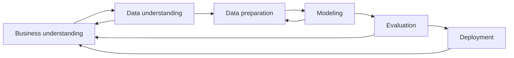
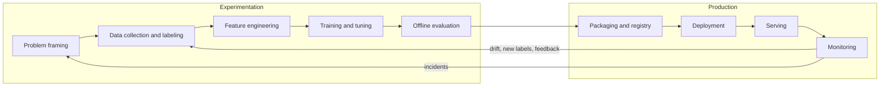
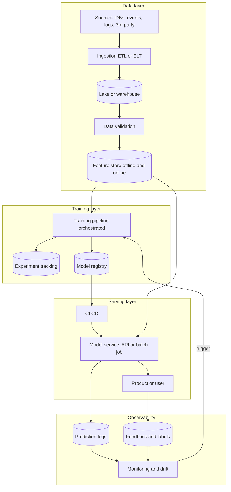

# The ML lifecycle and the anatomy of an ML system

## Why this track exists

A model that scores 0.93 AUC in a notebook is not a product. Between that notebook cell and a service
that answers millions of requests a day sit dozens of decisions: where the data comes from and how it
is refreshed, how the training run is reproduced six months later, how the model is packaged, how it
is rolled out without breaking anything, how you find out it has silently degraded, and how much all of
this costs. **MLOps** is the discipline that answers those questions. It borrows heavily from DevOps
(automation, CI/CD, infrastructure as code, observability) and from data engineering (pipelines,
validation, lineage), and adds the problems that are unique to systems whose behaviour is *learned from
data* rather than written in code.

A useful one-line definition: **MLOps is the set of practices that make machine-learning systems
reproducible, deployable, observable and continuously improvable — reliably and at a sustainable cost.**

Throughout this track we will build the mental model incrementally. This first lesson zooms out: what
are the phases of an ML project, what components does a real ML system contain, and where does the
"model" actually sit in all of it?

## The classic process model: CRISP-DM

Long before the word MLOps existed, data-mining teams used **CRISP-DM** (Cross-Industry Standard Process
for Data Mining, published in 1999 by a consortium including SPSS, NCR and Daimler). It describes six
phases and, crucially, draws them as a **cycle**, not a waterfall:



1. **Business understanding.** What decision will the model improve, and how will we know? Translate a
   business goal ("reduce churn") into an ML task ("predict the probability a subscriber cancels in the
   next 30 days") and a success metric that matters to the business (retained revenue), not just to the
   data scientist (log loss).
2. **Data understanding.** What data exists, how is it collected, how fresh, how biased, who owns it?
   Exploratory analysis lives here.
3. **Data preparation.** Cleaning, joining, labelling, feature engineering. Practitioners consistently
   report that this phase eats the majority of project time.
4. **Modeling.** Choosing algorithms, training, tuning hyperparameters.
5. **Evaluation.** Does the model meet the *business* success criteria? Is it fair, robust, explainable
   enough? Is it better than the simple baseline (or a heuristic rule)?
6. **Deployment.** Put it in front of users — and plan monitoring and maintenance.

The arrows back to business understanding are the important part. Evaluation frequently reveals that the
question was framed wrong; deployment reveals that the world differs from the training set.

> [!NOTE]
> CRISP-DM's main gap — and the reason MLOps exists — is that "Deployment" is a single box. In reality
> deployment is the *start* of the most expensive part of the lifecycle: operating, monitoring and
> retraining a model for years.

## The modern ML lifecycle

Modern descriptions (Google's MLOps whitepapers, Huyen's *Designing ML Systems* and *AI Engineering*,
AWS's Well-Architected ML Lens) converge on a loop like this:



The left half is where data scientists traditionally live; the right half is where software and
platform engineers live. MLOps is about making the **arrow from E to F** (handing a model to production)
and the **arrow from I back to B** (learning from production) cheap, automatic and safe.

### Two loops, two speeds

It helps to think of two nested loops:

- **The inner (experimentation) loop:** change a feature, retrain, compare metrics. It should take minutes
  to hours. Tooling: notebooks, experiment tracking (MLflow, Weights & Biases), fast data access.
- **The outer (production) loop:** retrain on fresh data, validate, deploy, observe, repeat. It might take
  a day or a month. Tooling: orchestrators (Airflow, Prefect, Kubeflow), CI/CD, model registry,
  monitoring.

A team at MLOps level 0 (lesson 3) runs only the inner loop by hand and then "throws a model over the
wall". A mature team has automated both loops, and the outer one runs without humans for routine
retrains.

## Anatomy of a production ML system

The single most cited figure in MLOps comes from Sculley et al.'s paper *Hidden Technical Debt in Machine
Learning Systems* (NeurIPS 2015): a small black box labelled "ML Code" surrounded by much larger boxes
for configuration, data collection, feature extraction, data verification, resource management, analysis
tools, process management, serving infrastructure and monitoring. The point: **the model code is a tiny
fraction of a real ML system.**

Let us name each component as we will meet it in this track.



| Component | Job | Typical tools | Module |
|---|---|---|---|
| Ingestion | move data from sources into analytical storage | Airbyte, Fivetran, Kafka, Spark | 3 |
| Validation | catch broken data before it poisons a model | Great Expectations, pandera, TFDV | 3 |
| Versioning | reproduce exactly the data a model saw | DVC, lakeFS, Delta/Iceberg time travel | 3 |
| Feature store | consistent features for training and serving | Feast, Tecton, Databricks/Vertex/SageMaker FS | 3 |
| Experiment tracking | record params, metrics, artifacts of every run | MLflow, W&B, Neptune | 4 |
| Orchestration | run multi-step pipelines on schedule/trigger | Airflow, Prefect, Dagster, Kubeflow | 5 |
| Model registry | versioned, staged, approved models | MLflow Registry, SageMaker, Vertex | 4 |
| Packaging | portable runtime | Docker, Conda, BentoML | 6 |
| Serving | answer predictions online or in batch | FastAPI, Triton, KServe, vLLM, Ray Serve | 7–8 |
| CI/CD/CT | automate test, build, deploy, retrain | GitHub Actions, Argo CD, Argo Rollouts | 9 |
| Monitoring | detect failures, drift, cost blow-ups | Prometheus, Grafana, Evidently, OpenTelemetry | 10 |

### What makes ML systems different from ordinary software?

1. **Behaviour is defined by data.** You can change a model's behaviour without changing a line of code —
   just by retraining on different data. So data must be versioned and tested like code.
2. **Silent failures.** A web service that breaks returns 500s. A model that breaks returns plausible but
   wrong numbers with HTTP 200. You need *statistical* monitoring, not just uptime checks.
3. **Entanglement.** Changing one input feature's distribution changes how every other feature is used
   ("Changing Anything Changes Everything", Sculley et al.).
4. **Experimentation is the default mode.** Most training runs are thrown away. Tracking the failures is
   as important as tracking the winner, otherwise you redo them.
5. **Feedback loops.** The model's predictions influence the data it is later retrained on (a recommender
   only learns about items it showed). This can lock in bias.
6. **Heterogeneous hardware and costs.** GPUs, large artifacts (gigabytes of weights), long-running jobs.

> [!INTERVIEW]
> "How is MLOps different from DevOps?" — A strong answer: DevOps versions and tests **code**; MLOps must
> also version and test **data** and **models**, adds **continuous training (CT)** to CI/CD, and replaces
> binary health checks with **statistical monitoring** because ML systems fail silently. Mention
> training/serving skew and feedback loops as ML-specific failure modes.

## Framing the problem: from business goal to ML task

Most failed ML projects fail at business understanding, not at modeling. A practical checklist before
writing any code:

- **Is ML needed?** Huyen (*AI Engineering*, ch. 1) urges teams to ask whether a simpler solution — rules,
  search, a lookup table — is enough. A heuristic baseline is also what your model must beat.
- **What is the prediction and what action follows?** "We predict churn probability; customers above 0.7
  get a retention offer." If nothing changes based on the prediction, the model has no value.
- **What metric captures value?** Pick an *optimising* metric (e.g., recall at a fixed precision) and
  *satisficing* constraints (latency p99 < 100 ms, cost per 1k predictions < \$0.05, fairness gap < 2%).
- **Online or batch?** Does the user wait for the answer (online), or can predictions be precomputed
  nightly (batch)? This one decision drives most of the architecture (module 7).
- **Where do labels come from and how fast?** Fraud labels arrive weeks later (chargebacks); click labels
  arrive in seconds. Label latency determines how quickly you can detect concept drift.

### Worked example: a churn model's requirements

| Aspect | Decision |
|---|---|
| Prediction | P(cancel within 30 days) for each active subscriber |
| Consumer | CRM campaign tool, daily |
| Mode | **Batch** scoring nightly, results written to a table |
| Freshness | features as of midnight |
| Business metric | retained revenue from offers minus offer cost |
| Model metric | PR-AUC; precision at top 5% |
| Labels | known 30 days after prediction date |
| Retraining | monthly, or when PSI on key features > 0.2 |
| Constraints | explainable top factors per customer (for agents) |

Notice how many of these rows are not about the algorithm. That is MLOps thinking.

## A tiny simulation: why "deploy" is not the end

Let us simulate a model trained once and left alone while the world shifts. The relationship between a
feature and the label drifts slowly, so accuracy decays — a phenomenon called **model decay** or
**concept drift** (module 10).

```python-run
import numpy as np
rng = np.random.default_rng(0)

def make_data(n, shift):
    x = rng.normal(0, 1, n)
    # the decision boundary moves over time: label = x > shift
    y = (x + rng.normal(0, 0.3, n) > shift).astype(int)
    return x, y

# "train": learn the threshold on month 0 data
x0, y0 = make_data(5000, 0.0)
cands = np.linspace(-1, 1, 201)
best_t = cands[np.argmax([((x0 > t) == y0).mean() for t in cands])]
print(f"learned threshold: {best_t:.2f}")

for month in range(0, 13, 2):
    shift = 0.08 * month                  # world drifts
    x, y = make_data(5000, shift)
    acc_static = ((x > best_t) == y).mean()
    # a model retrained each month on that month's data
    t_new = cands[np.argmax([((x > t) == y).mean() for t in cands])]
    acc_retrained = ((x > t_new) == y).mean()
    print(f"month {month:2d}: frozen model acc={acc_static:.3f}   retrained acc={acc_retrained:.3f}")
```

The frozen model degrades steadily while a retrained one stays flat. The outer loop — monitor, detect,
retrain, redeploy — is what keeps the second line flat in real life.

## Common anti-patterns at the start of a project

- **Notebook as production.** A notebook run by hand on someone's laptop each Monday. No tests, no
  versioning, a single point of failure (the person).
- **Metric myopia.** Optimising offline accuracy while the business cares about latency or cost.
- **No baseline.** Without a heuristic baseline you cannot tell whether the model adds value.
- **Leaky evaluation.** Fitting preprocessing (e.g., a scaler) on the whole dataset before the train/test
  split. Mueller & Guido (ch. 6) show this inflates scores; the fix is to put preprocessing inside a
  `Pipeline` so it is re-fit within each cross-validation fold.
- **Ignoring the serving path.** Training on features that are not available at prediction time
  (future information) — the most common source of too-good-to-be-true models.

> [!WARNING]
> "Data leakage" is the number-one reason models collapse after deployment. If a feature would not be
> known at the moment of prediction (e.g., "number of support tickets in the next week"), it must not be
> in the training set.

## Summary

- CRISP-DM gives six iterative phases; its weakness is treating deployment as the end.
- The modern lifecycle has an inner experimentation loop and an outer production loop; MLOps automates
  the handoff between them and the feedback from production.
- Real ML systems are mostly *not* model code: data pipelines, validation, feature stores, registries,
  serving, monitoring.
- ML differs from ordinary software because behaviour comes from data, failures are silent, components are
  entangled, and feedback loops exist.
- Start every project with explicit framing: prediction, action, metrics, mode (batch/online), label
  latency and constraints.

```quiz
[
  {"q": "In CRISP-DM, why are the phases drawn as a cycle rather than a straight line?",
   "options": ["Because each phase must be repeated exactly twice", "Because findings in later phases (e.g. evaluation) often send you back to earlier ones such as business understanding", "Because deployment always happens first", "Because it was designed for streaming data"],
   "answer": 1, "explain": "Evaluation can reveal a mis-framed problem and deployment reveals a changing world; the arrows back model that iteration."},
  {"q": "According to Sculley et al.'s famous figure, how large is the 'ML code' box relative to the whole ML system?",
   "options": ["It is the largest component", "About half of the system", "A small fraction surrounded by much larger infrastructure", "It is not shown at all"],
   "answer": 2, "explain": "Configuration, data collection, verification, serving and monitoring dwarf the model code."},
  {"q": "Which property makes ML failures 'silent'?",
   "options": ["Models never crash", "A degraded model still returns well-formed predictions with HTTP 200", "Logs are disabled in production", "GPUs suppress errors"],
   "answer": 1, "explain": "Wrong-but-plausible outputs pass health checks, so you need statistical monitoring."},
  {"q": "A churn model's predictions are consumed once a day by a CRM tool. Which serving mode fits best?",
   "options": ["Online low-latency API", "Batch scoring written to a table", "Streaming inference on every click", "Edge deployment on phones"],
   "answer": 1, "explain": "Nobody waits for the answer interactively; nightly batch scoring is simpler and cheaper."},
  {"q": "What does 'label latency' affect most directly?",
   "options": ["Docker image size", "How quickly you can measure real model performance and detect concept drift", "The number of GPU cores", "The choice of programming language"],
   "answer": 1, "explain": "If ground truth arrives weeks later, performance monitoring lags by weeks; you must rely on proxy signals like input drift meanwhile."},
  {"q": "Fitting a StandardScaler on the full dataset before splitting into train/test is an example of...",
   "options": ["Feature store usage", "Data leakage that inflates evaluation scores", "Concept drift", "Continuous training"],
   "answer": 1, "explain": "Test-set statistics leak into training; Mueller & Guido recommend wrapping preprocessing in a Pipeline."},
  {"q": "Which is the best one-line contrast between DevOps and MLOps?",
   "options": ["MLOps does not use CI/CD", "MLOps additionally versions/tests data and models and adds continuous training and statistical monitoring", "DevOps is only for Java", "They are identical"],
   "answer": 1, "explain": "MLOps extends DevOps with data and model artifacts, CT, and drift/performance monitoring."}
]
```

> **Source:** Chapman et al., *CRISP-DM 1.0* (1999); Sculley et al., *Hidden Technical Debt in Machine Learning Systems* (NeurIPS 2015); Chip Huyen, *AI Engineering*, ch. 1 and ch. 10; Mueller & Guido, *Introduction to Machine Learning with Python*, ch. 6 (pipelines and leakage); Google Cloud, *MLOps: Continuous delivery and automation pipelines in machine learning*.
