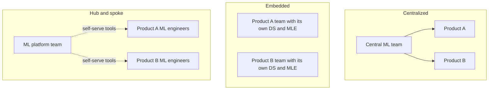
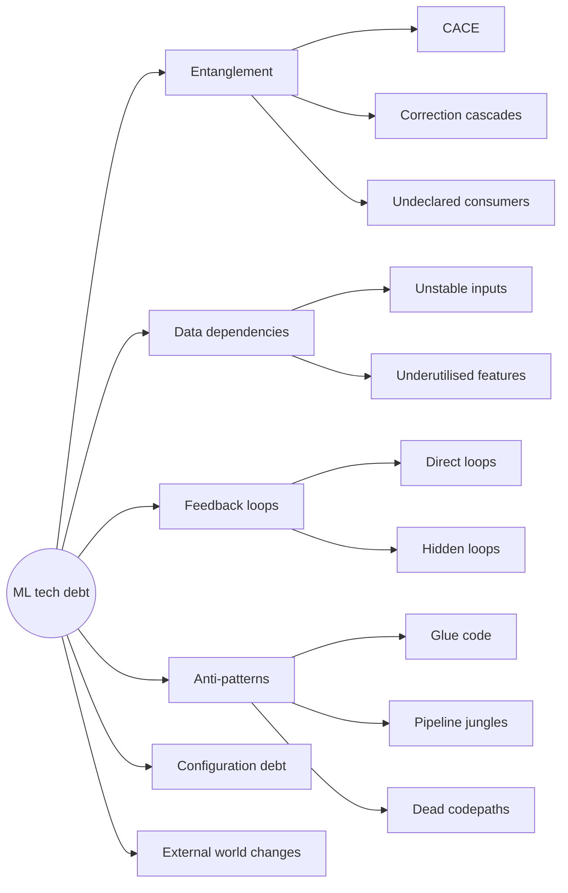

# Roles, teams and hidden technical debt

> **Before this lesson:** read [The ML lifecycle and the anatomy of an ML system](#/lesson/mlops/ml-lifecycle)
> (lesson 1), which introduces the words model, feature, pipeline, serving and monitoring. No work
> experience in a software team is assumed.

## In plain words

Two ideas share this lesson. The first is **who does what**. A model in production is touched by
many people with different jobs, and most accidents happen at the moment one person passes work
to another, the way a relay race is usually lost at the baton change and not on the straight.

The second is **technical debt**. When you take a shortcut to finish sooner (copy a piece of code
in place of sharing it, skip the test, hard-code a number) you have borrowed time. Like money
borrowed from a bank, it comes with interest: every later change is slower and riskier until the
shortcut is cleaned up. ML systems collect special kinds of this debt that are hard to see because
they hide in the data and in the connections between systems, not in any one file of code.

Why this matters for a job: interviewers for ML engineering roles routinely ask "what are the
ML-specific sources of technical debt?" and "how would you organise an ML team?". More practically,
on your first day you will need to know which colleague owns the thing that is broken.

## Who builds an ML system?

Production ML is a team sport. Job titles differ a great deal between companies, but the
*responsibilities* are stable. Knowing them helps you understand **handoffs**, the points where
work passes from one person or team to another, and handoffs are where most ML systems break.

The table lists each role, what it is responsible for, and the documents or files it typically
produces (its "artifacts").

| Role | Primary responsibility | Typical artifacts |
|---|---|---|
| Product manager | frames the problem, defines success, owns the roadmap | PRD, success metrics |
| Data engineer | reliable ingestion, transformation, storage | pipelines, tables, data contracts |
| Analytics engineer | modelled, documented, tested warehouse tables | dbt models, metrics layer |
| Data scientist | analysis, experimentation, model prototypes | notebooks, experiment reports |
| ML engineer | turns prototypes into production training and serving code | packages, pipelines, services |
| MLOps / ML platform engineer | builds the shared platform: tracking, registry, orchestration, serving infra | platform services, templates, CI |
| Software/backend engineer | integrates predictions into the product | APIs, product features |
| SRE / DevOps | reliability, on-call, infrastructure | SLOs, runbooks, IaC |
| Data/ML governance, legal | privacy, fairness, compliance | model cards, audits, DPIAs |
| Labelers / domain experts | ground truth and evaluation | annotation guidelines, labels |
| AI engineer (newer title) | builds applications on top of foundation models | prompts, RAG pipelines, eval suites |


Some abbreviations from the table, each in one sentence. A **PRD** (product requirements document)
describes what is to be built and why. **dbt** is a popular tool for writing and testing the SQL
that shapes warehouse tables. An **SRE** (site reliability engineer) keeps services running and
answers the pager when they fail, which is called being **on-call**. An **SLO** (service level
objective) is a written reliability target such as "99.9% of requests succeed". **IaC**
(infrastructure as code) means describing servers and networks in files kept in version control.
A **runbook** is a step-by-step guide for handling a specific failure. A **DPIA** (data protection
impact assessment) is a privacy review required by European law for risky uses of personal data.
A **data contract** is a written promise from the team that produces a table about its columns,
meaning and freshness.

The last row needs a little more. A **foundation model** is a very large model, such as the ones
behind chat assistants, trained once by a specialised company on enormous amounts of text and then
rented out to everyone through an API. Huyen (*AI Engineering*, ch. 1) describes the rise of the
**AI engineer**: a person who starts from such a ready-made model and spends their effort on
**prompts** (the instructions sent to the model), on supplying it with the right documents (a
technique called **RAG**, retrieval-augmented generation), on evaluation and on the product, and
does little or no training. The disciplines in this track (versioning, evaluation pipelines,
monitoring, cost control) apply to them as much as to anyone (module 12).

### Team topologies



A "team topology" is the shape of the organisation chart: who sits with whom.

- **Centralized:** one ML team serves every product. This works when ML specialists are scarce.
  Its weaknesses are that the central team knows little about each product, and that every
  request queues behind every other request.
- **Embedded:** each product team has its own data scientists (DS) and ML engineers (MLE). They
  understand the product well, but every team builds its own tracking, serving and monitoring from
  scratch.
- **Platform (hub-and-spoke):** a platform team builds **paved roads**, meaning ready-made,
  well-supported ways of doing the common tasks (project templates, a registry, serving, a feature
  store), and product teams use them without having to ask. This is called **self-serve**. Most
  mature organisations end up here; Uber's Michelangelo, Airbnb's Bighead and Netflix's Metaflow
  are well-known internal platforms of this kind.

> [!TIP]
> The goal of an ML platform team is to shorten the **time from idea to production model** and to
> reduce the **cognitive load** (how much a person has to hold in their head) on product ML
> engineers. Measure it: how many days does a new model need to reach a canary deployment, the
> stage where it serves a small slice of real traffic (lesson 26)?

## The "throw it over the wall" problem

Here is the classic failure. A data scientist finishes a model and hands two things to an
engineer: a notebook and a **pickle file** (Python's built-in format for saving an object, such as
a trained model, to disk). The product's servers are written in Java, so the engineer rewrites the
feature calculations in Java for the **serving path**, the code that runs when a live request
arrives. Six weeks later the model goes live and performs worse than it did in testing. The cause:
the Java feature code differs in small ways from the original pandas code. It fills in missing
values with a different default, it handles time zones differently, it splits text into words
differently. The model is being fed inputs that are computed differently from the ones it learned
on. This is **training/serving skew** (lesson 9), and it is a direct result of how the two people
were organised.

Fixes are both technical and organisational:

- **Shared feature definitions** (feature store, or a single Python package imported by both training
  and serving).
- **The same container image** for batch scoring and online serving when possible.
- **End-to-end ownership:** the people who train the model are on the hook for its production metrics
  ("you build it, you run it").

## Hidden technical debt in ML systems

*Technical debt* is the future cost of shortcuts taken now. Sculley and colleagues argued that ML
systems carry all the debt of ordinary software **plus** ML-specific kinds that are harder to see,
because they live at the *system* level (in how data, models and teams connect) and not in a line
of code that a reviewer could point at. The main categories follow, each with a present-day
**mitigation**, meaning a practice that reduces the risk.

### 1. Entanglement: "CACE, Changing Anything Changes Everything"

A model blends its input signals. If you change the range of typical values of feature $x_1$ (its
distribution), the weights the model learned for $x_2 \dots x_n$ may all shift at the next
retraining. You cannot improve one input in isolation the way you can fix one function in a
program.

*Mitigations:* **ablation studies** (retrain with one feature removed and measure what is lost),
tracking how much the model relies on each feature from one retraining to the next, numbered
versions of the feature set, and treating any change to an input as a change to the model that
needs a full evaluation.

### 2. Correction cascades

Model B is trained to correct model A's output for a slightly different problem. Now improving A breaks B.
Chains of such models become impossible to improve.

*Mitigation:* add features to A to handle the new case directly, or train B independently on raw inputs.

### 3. Undeclared consumers

Another team quietly reads your model's predictions from a log table and feeds them into their system.
When you change your model, their system breaks — and you did not know they existed. This is also a
*hidden feedback loop* risk.

*Mitigations:* access control on prediction outputs, data contracts, a catalogue of consumers, versioned
APIs.

### 4. Data dependencies are costlier than code dependencies

Code that depends on other code is checked by compilers and tests. Data that depends on other data
has no such safety net.

- **Unstable data dependencies:** an input produced by another system that changes over time. For
  example, you consume a score from another team's model; they retrain it and your inputs shift
  without any change on your side.
- **Underutilised data dependencies:** features that add almost no value and still carry risk.
  Examples are legacy features nobody remembers the reason for, "bundled" features that were
  added as a group without testing each one, features added for a gain of +0.001 AUC, and features
  that duplicate information already present in another.

*Mitigations:* keep frozen, versioned copies of upstream signals; regularly retrain with each
feature left out in turn and prune the ones that do not matter; use **data lineage** tools, which
record which tables and columns each result was computed from.

### 5. Feedback loops

- **Direct loops:** the model influences its own future training data (a recommender's clicks only come
  from items it chose to show).
- **Hidden loops:** two systems influence each other through the world (two trading models reacting to
  each other's market impact).

*Mitigations:* **exploration** (show a small random sample of items regardless of what the model
prefers, so that data about them exists), recording the probability with which each item was shown
so the bias can be corrected later, and **holdout groups**: a small set of users who never receive
the model's decisions and serve as a clean comparison.

### 6. ML-system anti-patterns

- **Glue code:** most of the codebase is wiring that feeds data into and out of a general-purpose
  library. Wrap each library behind your own small interface so it can be replaced.
- **Pipeline jungles:** data preparation that grew step by step into a tangle of extractions,
  joins and intermediate files. Redesign the pipeline as a whole, and use an orchestrator in which
  the steps and their order are written down explicitly as a **DAG** (directed acyclic graph: a
  set of steps with arrows saying which must finish before which, and no loops; lesson 13).
- **Dead experimental codepaths:** `if experiment_17:` branches that were never removed.
- **Abstraction debt:** no agreed, clean way to represent data, models and how they relate.

### 7. Configuration debt

Mature systems may have more lines of configuration than code: which features, which data window,
thresholds, hyperparameters, hardware. Config errors are easy to make and hard to test.

*Mitigations:* configs in version control, typed and validated (pydantic, Hydra structured configs —
lesson 6), diffs reviewed like code, defaults that are safe.

### 8. Changes in the external world

Thresholds hand-tuned on last year's data, monitoring that only checks averages, no response to
seasonality. *Mitigation:* monitoring of prediction distributions, slices, and action limits (module 10).



> [!INTERVIEW]
> Be ready to name three ML-specific technical-debt sources and how you would mitigate each. A crisp
> trio: **training/serving skew** (shared feature code or feature store), **undeclared consumers**
> (access control + contracts), **feedback loops** (exploration traffic and holdouts).

## Measuring and paying down debt

How do you find out how much debt a system carries? A practical, lightweight tool is the **ML Test
Score** rubric (Breck and colleagues at Google, 2017). A **rubric** is a scoring sheet. This one
lists 28 checks in four areas (features and data, model development, infrastructure, monitoring),
and each check is scored 0 (not done), 0.5 (done by hand) or 1 (automated). Examples:

- Feature expectations are captured in a schema (data).
- All features are beneficial; no feature's cost is too high (data).
- Model specs are reviewed and checked in (model).
- Offline and online metrics correlate (model).
- Training is reproducible (infra).
- The model can be rolled back quickly (infra).
- Dependency changes result in notification (monitoring).
- Training and serving features compute the same values (monitoring).

Score each area, then take the **minimum** across the four areas as the overall score. The reason
for the minimum and not the average: an excellent data score does not protect you if monitoring is
absent, so the weakest area defines your risk. We will implement checks from every area during the
track.

The small program below scores an imaginary team. `scores` is a dictionary with one entry per
area; each entry maps a check name to 0, 0.5 or 1.

```python-run
# A toy ML Test Score calculator: 0 = not done, 0.5 = manual, 1 = automated
scores = {
    "data":       {"schema": 1, "feature_value_tests": 0.5, "privacy_controls": 1, "feature_cost": 0},
    "model":      {"specs_reviewed": 1, "offline_online_corr": 0, "baseline_comparison": 1, "slices": 0.5},
    "infra":      {"reproducible_training": 0.5, "rollback": 1, "canary": 0, "integration_test": 1},
    "monitoring": {"skew_check": 0, "drift": 0.5, "latency_slo": 1, "staleness": 0},
}
totals = {area: sum(v.values()) for area, v in scores.items()}
for area, t in totals.items():
    print(f"{area:11s} {t:.1f} / {len(scores[area])}")
print("overall ML Test Score (min over areas):", min(totals.values()))
weakest = min(totals, key=totals.get)
print("invest next in:", weakest)
```

The line `totals = {area: sum(v.values()) for area, v in scores.items()}` adds up the checks in
each area. The loop prints each total next to the number of checks, and `min(totals.values())`
picks the smallest. The output is:

```text
data        2.5 / 4
model       2.5 / 4
infra       2.5 / 4
monitoring  1.5 / 4
overall ML Test Score (min over areas): 1.5
invest next in: monitoring
```

Three areas tie at 2.5, monitoring trails at 1.5, and so monitoring is where the next week of
effort should go. Change one of the zeros under `monitoring` to 1 and run it again to see the
overall score move.

## Communication artifacts that reduce debt

- **Design docs** before building: problem, metrics, data, architecture, risks, rollout plan.
- **Data contracts** between producers and consumers: schema, semantics, freshness SLA, owner.
- **Model cards** (lesson 12): intended use, metrics by slice, limitations.
- **Runbooks**: what to do when the drift alert fires at 3 a.m.
- **Postmortems**: blameless write-ups after incidents, with action items.

## A worked scenario: how debt accumulates in one year

Abstract categories are easier to remember with a story. Follow a recommendation team through twelve
months.

**Month 1.** A data scientist ships a ranking model. Features are computed in a notebook-derived SQL
script; the backend team reimplements three of them in Go for the online path. *Debt created:* two
implementations of the same features (future skew), no tests on either.

**Month 3.** A second team notices the ranking scores in a log table and starts using them to pick
items for a marketing email. Nobody tells the ranking team. *Debt created:* an undeclared consumer.

**Month 5.** To handle a new product category quickly, someone trains a small "adjustment" model on
top of the ranker's output. *Debt created:* a correction cascade — improving the ranker now changes the
input distribution of the adjustment model.

**Month 7.** Twelve features are added in one experiment that improves offline NDCG by 0.3%. (NDCG,
normalised discounted cumulative gain, is a score for how good the order of a ranked list is.)
Nobody checks which of the twelve matter. Four come from a table owned by another team. *Debt
created:* underutilised, bundled and unstable data dependencies.

**Month 9.** The other team changes the semantics of a column in that table. Offline metrics are fine
(training data is recomputed consistently); online, the Go feature code still reads the old meaning.
Click-through falls 4% over three weeks before anyone connects the dots. The marketing email, fed by the
same scores, sends irrelevant items to two million users.

**Month 10.** The fix is a retrain — which shifts score calibration, which breaks the adjustment model
and a hard-coded threshold in the email job.

Count the cost: one upstream change produced a three-week silent regression, a second incident in
another team, and a risky emergency retrain. Now replay the year with small investments: one feature
library used by both paths (or a feature store) plus a parity test; a data contract with the upstream
table and a schema check at ingestion; predictions published through a versioned, access-controlled
interface so consumers are known; ablation of the twelve features before adoption; monitoring of
prediction distributions. None of these is exotic. Each costs days, not months — and each maps to one
row of the ML Test Score.

### Prioritising debt repayment

You cannot fix everything. A useful rule is to rank debt items by **(probability of an incident) ×
(blast radius) ÷ (cost to fix)**:

| Debt item | Likelihood | Blast radius | Fix cost | Priority |
|---|---|---|---|---|
| Duplicate feature implementations | high | all online predictions | medium | **1** |
| No monitoring of prediction distribution | high (you would not notice anything) | all | low | **1** |
| Undeclared consumers | medium | other teams | low (access control, catalogue) | 2 |
| Correction cascade | medium | two models | high (retrain jointly) | 3 |
| Twelve unpruned features | low per feature | model quality | medium | 3 |

Monitoring usually comes first because it converts unknown failures into known ones — you cannot
prioritise what you cannot see.

> [!TIP]
> Debt is not always bad. Shipping a manual level-0 model to learn whether the product idea works is a
> rational loan. The failure mode is never scheduling the repayment once the model has proven its value.

## Summary

- Responsibilities in ML span product, data engineering, data science, ML engineering, platform and SRE.
  Most failures happen at the handoffs between them.
- Platform (hub-and-spoke) teams provide paved roads so product teams ship models self-serve.
- ML-specific technical debt includes entanglement, correction cascades, undeclared consumers, unstable
  and underutilised data dependencies, feedback loops, pipeline jungles and configuration debt.
- Use rubrics like the ML Test Score to measure readiness; your weakest area sets your risk.


## Glossary

- **Handoff** - the point where work passes from one person or team to another.
- **ML engineer** - turns model prototypes into production training and serving code.
- **ML platform engineer** - builds the shared tools other ML teams use.
- **SRE** - site reliability engineer; keeps services running and handles incidents.
- **SLO** - service level objective, a written reliability target.
- **Foundation model** - a very large pre-trained model offered to many users through an API.
- **Paved road / self-serve** - a supported, ready-made way to do a common task / usable without
  asking another team.
- **Pickle** - Python's format for saving an object to a file.
- **Training/serving skew** - a difference between the inputs a model learned on and the inputs it
  receives in production.
- **Technical debt** - the future cost of a shortcut taken today.
- **Entanglement (CACE)** - changing one input changes how the model uses all the others.
- **Correction cascade** - a model trained on another model's output, so neither can change
  freely.
- **Undeclared consumer** - a system that depends on your outputs without your knowledge.
- **Ablation** - removing one component and measuring the effect.
- **Feedback loop** - a model influencing its own future training data.
- **Holdout group** - users kept away from the model's decisions for comparison.
- **Glue code / pipeline jungle** - wiring code around libraries / tangled data preparation.
- **Data contract** - a producer's written promise about a data set's schema, meaning and freshness.
- **Runbook / postmortem** - instructions for an incident / the written review after one.
- **ML Test Score** - a 28-item rubric for production readiness; the weakest area is the score.
```quiz
[
  {"q": "What does 'CACE' stand for in Sculley et al.'s paper?",
   "options": ["Continuous Automated Code Evaluation", "Changing Anything Changes Everything", "Central Artifact Cache Engine", "Correction And Cascade Elimination"],
   "answer": 1, "explain": "Because models entangle their inputs, a change to any input can change how all others are used."},
  {"q": "Another team silently reads your prediction logs and uses them in their system. This is called...",
   "options": ["A correction cascade", "An undeclared consumer", "Glue code", "A pipeline jungle"],
   "answer": 1, "explain": "Undeclared consumers create hidden coupling; changing your model breaks them unexpectedly."},
  {"q": "Which team topology provides self-serve tooling (registry, serving, feature store) to product ML engineers?",
   "options": ["Centralized", "Embedded", "Platform / hub-and-spoke", "Outsourced"],
   "answer": 2, "explain": "A platform team builds paved roads; product teams own their models."},
  {"q": "A recommender only learns from clicks on items it chose to show. What debt category is this?",
   "options": ["Configuration debt", "Direct feedback loop", "Dead experimental codepaths", "Glue code"],
   "answer": 1, "explain": "The model shapes its own future training data; exploration and holdouts mitigate it."},
  {"q": "In the ML Test Score rubric, how is the overall score computed?",
   "options": ["Sum of all tests", "Average across areas", "Minimum across the four areas", "Maximum across areas"],
   "answer": 2, "explain": "The weakest area determines risk, so the minimum is used."},
  {"q": "Why do features that add +0.001 AUC count as debt?",
   "options": ["They slow down GPUs", "They add maintenance and failure risk (an upstream break) for negligible value", "They violate GDPR", "They are always leaked"],
   "answer": 1, "explain": "Underutilised data dependencies carry the full cost of a dependency with little benefit."},
  {"q": "The classic 'throw it over the wall' handoff most often causes which problem?",
   "options": ["Training/serving skew from re-implemented feature logic", "Too many unit tests", "Over-provisioned GPUs", "Excessive monitoring"],
   "answer": 0, "explain": "Rewriting features in another language for serving introduces subtle differences."}
]
```

> **Source:** Sculley et al., *Hidden Technical Debt in Machine Learning Systems* (NeurIPS 2015); Breck et al., *The ML Test Score: A Rubric for ML Production Readiness* (2017); Chip Huyen, *AI Engineering*, ch. 1 (the AI engineering stack and roles); Skelton & Pais, *Team Topologies*.
