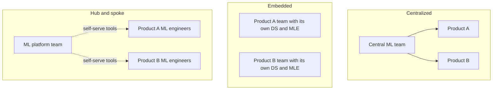
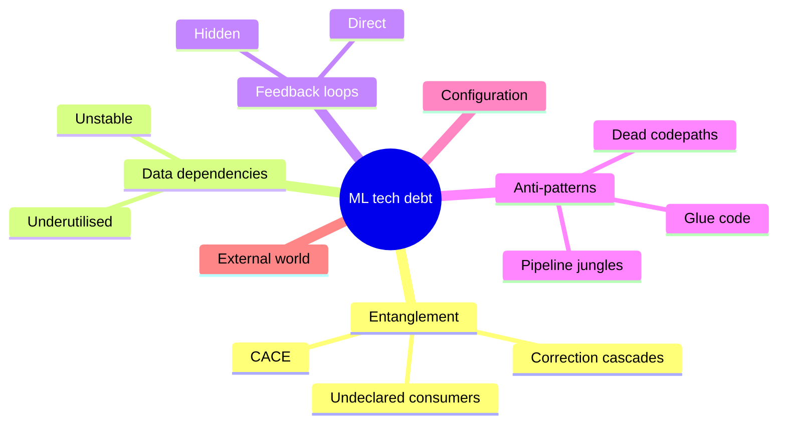

# Roles, teams and hidden technical debt

## Who builds an ML system?

Production ML is a team sport. Job titles vary wildly between companies, but the *responsibilities* are
stable. Knowing them helps you understand handoffs — and handoffs are where most ML systems break.

| Role | Primary responsibility | Typical artifacts |
|---|---|---|
| Product manager | frames the problem, defines success, owns the roadmap | PRD, success metrics |
| Data engineer | reliable ingestion, transformation, storage | pipelines, tables, data contracts |
| Analytics engineer | modelled, documented, tested warehouse tables | dbt models, metrics layer |
| Data scientist | analysis, experimentation, model prototypes | notebooks, experiment reports |
| ML engineer | turns prototypes into production training and serving code | packages, pipelines, services |
| MLOps / ML platform engineer | builds the shared platform: tracking, registry, orchestration, serving infra | platform services, templates, CI |
| Software/backend engineer | integrates predictions into the product | APIs, product features |
| SRE / DevOps | reliability, on-call, infrastructure | SLOs, runbooks, IaC |
| Data/ML governance, legal | privacy, fairness, compliance | model cards, audits, DPIAs |
| Labelers / domain experts | ground truth and evaluation | annotation guidelines, labels |
| AI engineer (newer title) | builds applications on top of foundation models | prompts, RAG pipelines, eval suites |

Huyen (*AI Engineering*, ch. 1) describes the rise of the **AI engineer**: with foundation models
available through APIs, many teams start from a working model and spend their effort on prompts, context,
evaluation and product, rather than on training. The MLOps disciplines in this track — versioning,
evaluation pipelines, monitoring, cost control — apply equally to them (module 12).

### Team topologies



- **Centralized:** one ML team serves everyone. Good for scarce talent; bad for product context and
  becomes a bottleneck.
- **Embedded:** each product team owns its ML. Great context; every team reinvents tracking, serving and
  monitoring.
- **Platform (hub-and-spoke):** a platform team builds paved roads (templates, registry, serving, feature
  store) and product teams use them self-serve. This is where most mature organisations land; Uber's
  Michelangelo, Airbnb's Bighead and Netflix's Metaflow are famous examples.

> [!TIP]
> The goal of an ML platform team is to reduce the **time from idea to production model** and the
> **cognitive load** on product ML engineers. Measure it: how many days does it take a new model to reach
> a canary deployment?

## The "throw it over the wall" problem

The classic failure: a data scientist hands a pickle file and a notebook to an engineer, who rewrites
the feature logic in Java for the serving path. Six weeks later the model goes live — and performs worse
than offline, because the Java feature code differs subtly from the pandas code (a different default for
missing values, a timezone bug, a different tokenizer). This is **training/serving skew** (module 3),
and it is a direct consequence of an organisational handoff.

Fixes are both technical and organisational:

- **Shared feature definitions** (feature store, or a single Python package imported by both training
  and serving).
- **The same container image** for batch scoring and online serving when possible.
- **End-to-end ownership:** the people who train the model are on the hook for its production metrics
  ("you build it, you run it").

## Hidden technical debt in ML systems

*Technical debt* is the future cost of shortcuts taken now. Sculley et al. argued ML systems have all of
ordinary software's debt **plus** ML-specific forms that are harder to see because they live at the
*system* level rather than in code. Here are the main categories, each with a modern mitigation.

### 1. Entanglement — "CACE: Changing Anything Changes Everything"

A model mixes its input signals. If you change the distribution of feature $x_1$, the learned weights for
$x_2 \dots x_n$ may all shift. You cannot make isolated improvements.

*Mitigations:* ablation studies, monitoring per-feature importance across retrains, versioned feature
sets, and treating any input change as a model change requiring full evaluation.

### 2. Correction cascades

Model B is trained to correct model A's output for a slightly different problem. Now improving A breaks B.
Chains of such models become impossible to improve.

*Mitigation:* add features to A to handle the new case directly, or train B independently on raw inputs.

### 3. Undeclared consumers

Another team quietly reads your model's predictions from a log table and feeds them into their system.
When you change your model, their system breaks — and you did not know they existed. This is also a
*hidden feedback loop* risk.

*Mitigations:* access control on prediction outputs, data contracts, a catalogue of consumers, versioned
APIs.

### 4. Data dependencies are costlier than code dependencies

- **Unstable data dependencies:** an input signal produced by another system that changes over time
  (another team retrains *their* model and the scores you consume shift).
- **Underutilised data dependencies:** features that add almost no value but create risk — legacy
  features, "bundled" features added together, epsilon features added for +0.001 AUC, correlated
  features.

*Mitigations:* versioned copies of upstream signals, regular leave-one-feature-out evaluation to prune,
data lineage tooling.

### 5. Feedback loops

- **Direct loops:** the model influences its own future training data (a recommender's clicks only come
  from items it chose to show).
- **Hidden loops:** two systems influence each other through the world (two trading models reacting to
  each other's market impact).

*Mitigations:* exploration (show a small random sample), logging propensities for off-policy correction,
holdout groups that never receive model-driven treatment.

### 6. ML-system anti-patterns

- **Glue code:** most of the codebase is glue around a generic package. Wrap packages behind your own
  interfaces.
- **Pipeline jungles:** data preparation grown organically into a tangle of scrapes, joins and
  intermediate files. Redesign pipelines holistically; use an orchestrator with explicit DAGs.
- **Dead experimental codepaths:** `if experiment_17:` branches that never got removed.
- **Abstraction debt:** no clean abstractions for data, models and their relationships.

### 7. Configuration debt

Mature systems may have more lines of configuration than code: which features, which data window,
thresholds, hyperparameters, hardware. Config errors are easy to make and hard to test.

*Mitigations:* configs in version control, typed and validated (pydantic, Hydra structured configs —
lesson 6), diffs reviewed like code, defaults that are safe.

### 8. Changes in the external world

Thresholds hand-tuned on last year's data, monitoring that only checks averages, no response to
seasonality. *Mitigation:* monitoring of prediction distributions, slices, and action limits (module 10).



> [!INTERVIEW]
> Be ready to name three ML-specific technical-debt sources and how you would mitigate each. A crisp
> trio: **training/serving skew** (shared feature code or feature store), **undeclared consumers**
> (access control + contracts), **feedback loops** (exploration traffic and holdouts).

## Measuring and paying down debt

A practical, lightweight approach is the **ML Test Score** rubric (Breck et al., Google, 2017): 28 tests
across four areas — features and data, model development, infrastructure, and monitoring — each scored
0 (not done), 0.5 (done manually) or 1 (automated). Examples:

- Feature expectations are captured in a schema (data).
- All features are beneficial; no feature's cost is too high (data).
- Model specs are reviewed and checked in (model).
- Offline and online metrics correlate (model).
- Training is reproducible (infra).
- The model can be rolled back quickly (infra).
- Dependency changes result in notification (monitoring).
- Training and serving features compute the same values (monitoring).

Score each area, take the **minimum** across areas as the overall score — the weakest area defines your
risk. We will implement checks from every area during the track.

```python-run
# A toy ML Test Score calculator: 0 = not done, 0.5 = manual, 1 = automated
scores = {
    "data":       {"schema": 1, "feature_value_tests": 0.5, "privacy_controls": 1, "feature_cost": 0},
    "model":      {"specs_reviewed": 1, "offline_online_corr": 0, "baseline_comparison": 1, "slices": 0.5},
    "infra":      {"reproducible_training": 0.5, "rollback": 1, "canary": 0, "integration_test": 1},
    "monitoring": {"skew_check": 0, "drift": 0.5, "latency_slo": 1, "staleness": 0},
}
totals = {area: sum(v.values()) for area, v in scores.items()}
for area, t in totals.items():
    print(f"{area:11s} {t:.1f} / {len(scores[area])}")
print("overall ML Test Score (min over areas):", min(totals.values()))
weakest = min(totals, key=totals.get)
print("invest next in:", weakest)
```

## Communication artifacts that reduce debt

- **Design docs** before building: problem, metrics, data, architecture, risks, rollout plan.
- **Data contracts** between producers and consumers: schema, semantics, freshness SLA, owner.
- **Model cards** (lesson 12): intended use, metrics by slice, limitations.
- **Runbooks**: what to do when the drift alert fires at 3 a.m.
- **Postmortems**: blameless write-ups after incidents, with action items.

## Summary

- Responsibilities in ML span product, data engineering, data science, ML engineering, platform and SRE.
  Most failures happen at the handoffs between them.
- Platform (hub-and-spoke) teams provide paved roads so product teams ship models self-serve.
- ML-specific technical debt includes entanglement, correction cascades, undeclared consumers, unstable
  and underutilised data dependencies, feedback loops, pipeline jungles and configuration debt.
- Use rubrics like the ML Test Score to measure readiness; your weakest area sets your risk.

```quiz
[
  {"q": "What does 'CACE' stand for in Sculley et al.'s paper?",
   "options": ["Continuous Automated Code Evaluation", "Changing Anything Changes Everything", "Central Artifact Cache Engine", "Correction And Cascade Elimination"],
   "answer": 1, "explain": "Because models entangle their inputs, a change to any input can change how all others are used."},
  {"q": "Another team silently reads your prediction logs and uses them in their system. This is called...",
   "options": ["A correction cascade", "An undeclared consumer", "Glue code", "A pipeline jungle"],
   "answer": 1, "explain": "Undeclared consumers create hidden coupling; changing your model breaks them unexpectedly."},
  {"q": "Which team topology provides self-serve tooling (registry, serving, feature store) to product ML engineers?",
   "options": ["Centralized", "Embedded", "Platform / hub-and-spoke", "Outsourced"],
   "answer": 2, "explain": "A platform team builds paved roads; product teams own their models."},
  {"q": "A recommender only learns from clicks on items it chose to show. What debt category is this?",
   "options": ["Configuration debt", "Direct feedback loop", "Dead experimental codepaths", "Glue code"],
   "answer": 1, "explain": "The model shapes its own future training data; exploration and holdouts mitigate it."},
  {"q": "In the ML Test Score rubric, how is the overall score computed?",
   "options": ["Sum of all tests", "Average across areas", "Minimum across the four areas", "Maximum across areas"],
   "answer": 2, "explain": "The weakest area determines risk, so the minimum is used."},
  {"q": "Why do features that add +0.001 AUC count as debt?",
   "options": ["They slow down GPUs", "They add maintenance and failure risk (an upstream break) for negligible value", "They violate GDPR", "They are always leaked"],
   "answer": 1, "explain": "Underutilised data dependencies carry the full cost of a dependency with little benefit."},
  {"q": "The classic 'throw it over the wall' handoff most often causes which problem?",
   "options": ["Training/serving skew from re-implemented feature logic", "Too many unit tests", "Over-provisioned GPUs", "Excessive monitoring"],
   "answer": 0, "explain": "Rewriting features in another language for serving introduces subtle differences."}
]
```

> **Source:** Sculley et al., *Hidden Technical Debt in Machine Learning Systems* (NeurIPS 2015); Breck et al., *The ML Test Score: A Rubric for ML Production Readiness* (2017); Chip Huyen, *AI Engineering*, ch. 1 (the AI engineering stack and roles); Skelton & Pais, *Team Topologies*.
