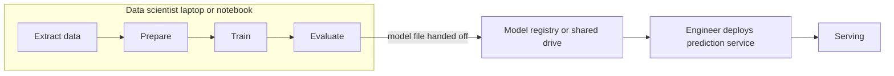
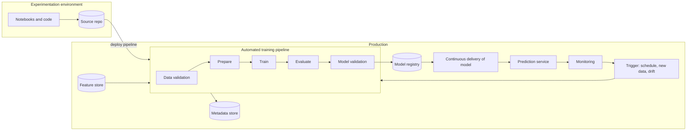
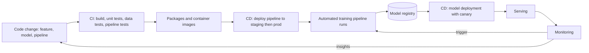

# MLOps maturity levels 0, 1 and 2

## Why a maturity model?

"Do MLOps" is not actionable. A maturity model tells a team *where it is* and *what the next
investment should be*. The most widely used one comes from Google Cloud's architecture guide
*MLOps: Continuous delivery and automation pipelines in machine learning*, which defines three levels.
Microsoft's Azure guidance defines five (0–4) along similar lines. We will use Google's three and map
Microsoft's onto them.

The key idea: maturity is measured by **what is automated**, especially two things:

1. **Continuous training (CT):** the model is retrained automatically on new data by a pipeline.
2. **CI/CD of the pipeline itself:** changes to training code are tested and deployed automatically.

## Level 0 — Manual process



Characteristics:

- Every step is manual and interactive: notebooks, scripts run by hand.
- **Disconnect between ML and operations:** data scientists hand an artifact (a pickle) to engineers.
- **Infrequent releases:** a few times a year. No CI, because there is little code change to test.
- **Deployment = the model**, not the pipeline. Only the trained artifact goes to production.
- **No active monitoring** of model quality.

Level 0 is fine for a first model and for models that rarely change. It breaks down when data changes
frequently, when there are many models, or when a key person leaves.

> [!WARNING]
> The main risk at level 0 is not technical — it is that nobody notices when the model degrades, and
> nobody can retrain it because the notebook no longer runs.

## Level 1 — ML pipeline automation (continuous training)



What changes:

- **The pipeline is the deployable unit.** You deploy a *training pipeline* to production; it then
  produces models continuously.
- **Continuous training** on fresh data, triggered by schedule, by new data arrival, or by monitoring.
- **Experiment–production symmetry:** the same pipeline code runs in dev and prod (modular, containerised
  components).
- **Automated data and model validation** gates: a new model is only pushed if data passes schema and
  distribution checks and the model beats the current champion on held-out data.
- **Feature store** (optional) and **ML metadata store** recording lineage of every run.
- **Pipeline triggers** and **continuous delivery of the model** to the prediction service.

What is still manual: building and deploying *new versions of the pipeline* itself. If a data scientist
adds a feature, someone manually tests and deploys the new pipeline.

## Level 2 — CI/CD pipeline automation



Level 2 adds a robust **CI/CD system for the pipeline itself**:

- **CI:** on every commit, build packages and images, run unit tests (feature logic, model methods), check
  that training converges on a small sample, check that the model does not produce NaNs, run integration
  tests between pipeline components.
- **CD:** deploy the new pipeline to a staging environment, run it end to end, then promote to
  production. Model deployments use progressive delivery (canary/shadow, module 9).
- Data scientists can try new ideas rapidly and have them reach production safely without the platform
  team as a bottleneck.

## Comparing the levels

| Capability | Level 0 | Level 1 | Level 2 |
|---|---|---|---|
| Training | manual notebook | automated pipeline (CT) | automated pipeline (CT) |
| What is deployed | model artifact | training pipeline | pipeline via CI/CD |
| Release cadence | months | days–weeks (models) | many per day (pipeline and models) |
| Data validation | ad hoc | automated in pipeline | automated + tested in CI |
| Model validation | manual eyeballing | automated gate vs champion | automated + canary in prod |
| Monitoring | none or uptime only | model + data monitoring triggers CT | full observability, feedback into dev |
| Metadata/lineage | none | ML metadata store | ML metadata store + build provenance |
| Tests | few | some | unit, integration, data, model, load |

Microsoft's five-level model maps roughly as: 0 *No MLOps* ≈ Google level 0; 1 *DevOps but no MLOps*
(app code has CI/CD, models do not); 2 *Automated training* ≈ Google level 1; 3 *Automated model
deployment* (model release with A/B and traceability); 4 *Full MLOps automated operations* ≈ Google
level 2 with automatic retraining on monitoring signals.

> [!INTERVIEW]
> "What does level 1 add over level 0?" — **Continuous training**: the *pipeline* (not just the model)
> runs in production, triggered automatically, with automated data validation and model validation gates
> and a metadata store. "What does level 2 add?" — **CI/CD for the pipeline code itself**, so changes to
> features or model code are tested and deployed automatically.

## Choosing your next step

Not every model needs level 2. Use the cost of staleness and the rate of change:

```python-run
# Rough heuristic: expected yearly cost of operating at each level for one model
# (all numbers are illustrative assumptions you would replace with your own)
retrains_per_year_needed = 24          # how often the data changes enough to matter
manual_retrain_hours = 16              # level 0: a person re-runs notebooks, checks, deploys
eng_hour_cost = 120
staleness_cost_per_week = 2000         # business loss when the model is stale
weeks_stale_per_cycle = {"L0": 3, "L1": 0.5, "L2": 0.3}
build_cost = {"L0": 0, "L1": 25000, "L2": 60000}   # one-off platform/pipeline investment (amortised 1 year)
run_hours = {"L0": manual_retrain_hours, "L1": 2, "L2": 0.5}

for lvl in ["L0", "L1", "L2"]:
    ops = retrains_per_year_needed * run_hours[lvl] * eng_hour_cost
    stale = retrains_per_year_needed * weeks_stale_per_cycle[lvl] * staleness_cost_per_week
    total = ops + stale + build_cost[lvl]
    print(f"{lvl}: ops={ops:>8.0f}  staleness={stale:>8.0f}  build={build_cost[lvl]:>6.0f}  total={total:>8.0f}")
```

Try lowering `retrains_per_year_needed` to 2: level 0 becomes the cheapest. Raise it to 52 or add more
models (platform cost is shared across models) and level 2 wins. Maturity is an economic decision.

### A pragmatic roadmap

1. **Version everything** (code in Git, data with DVC or table snapshots, models in a registry) and track
   experiments. Cheap, huge payoff.
2. **Containerise** training and serving so environments are reproducible.
3. **Turn the notebook into a pipeline** of testable steps with an orchestrator; schedule it.
4. **Add validation gates**: data checks before training, champion/challenger comparison after.
5. **Monitor** serving: latency/errors first, then input drift, then performance when labels arrive.
6. **CI for the pipeline**: unit and integration tests, image builds, deploy to staging.
7. **Progressive delivery** of models: shadow, canary, automatic rollback.
8. **Close the loop**: monitoring-driven retraining triggers, feedback collection.

Steps 1–5 move you from level 0 to level 1; 6–8 to level 2.

## Maturity for LLM applications

Applications built on foundation-model APIs follow a similar path, though "training" is often replaced
by prompt and retrieval changes. Huyen (*AI Engineering*, ch. 10) describes an architecture that grows
step by step: start with a plain model call, then enhance context (RAG), add guardrails, add a router
and gateway, add caching, add agent patterns — with monitoring and evaluation throughout. An LLMOps
level 0 team edits prompts in production by hand; a level 2 team versions prompts, runs an evaluation
suite in CI on every prompt change, and canaries prompt changes with online metrics (module 12).

## Summary

- Maturity is about automation of **continuous training** and of **CI/CD for the pipeline**.
- Level 0: manual notebooks, model handed over, no monitoring.
- Level 1: the training pipeline is deployed and runs automatically, with data/model validation gates,
  metadata tracking and triggers.
- Level 2: the pipeline code itself goes through CI/CD; rapid, safe iteration.
- Choose the level by economics: rate of change, cost of staleness, and number of models.

```quiz
[
  {"q": "At Google's MLOps level 0, what is deployed to production?",
   "options": ["The training pipeline", "Only the trained model artifact (prediction service)", "A CI/CD system", "A feature store"],
   "answer": 1, "explain": "Level 0 deploys a model artifact handed over from a manual process."},
  {"q": "What is the defining capability of level 1?",
   "options": ["GPU clusters", "Continuous training by an automated pipeline deployed in production", "Kubernetes", "Microservices"],
   "answer": 1, "explain": "Level 1 automates the training pipeline so models are retrained on fresh data automatically."},
  {"q": "Which is still manual at level 1 but automated at level 2?",
   "options": ["Model retraining", "Data validation", "Testing and deploying new versions of the pipeline code", "Serving predictions"],
   "answer": 2, "explain": "Level 2 adds CI/CD for pipeline code changes."},
  {"q": "'Experiment-production symmetry' means...",
   "options": ["Using the same pipeline code and components in dev and prod", "Running experiments on production traffic only", "Mirroring GPU counts", "Using symmetric encryption"],
   "answer": 0, "explain": "Modular, containerised components run identically in experimentation and production."},
  {"q": "Which of these is a typical automated gate in a level 1 pipeline?",
   "options": ["Manual code review of the notebook", "New model must beat the current champion on held-out data before being pushed", "Rebooting servers", "Emailing the data scientist"],
   "answer": 1, "explain": "Model validation compares challenger to champion automatically."},
  {"q": "A model whose data barely changes and is retrained twice a year most likely needs...",
   "options": ["Level 2 immediately", "Level 0 or a light level 1, since automation cost may exceed staleness cost", "No versioning", "A streaming pipeline"],
   "answer": 1, "explain": "Maturity is an economic choice driven by rate of change and cost of staleness."},
  {"q": "Which trigger is NOT a usual way to start continuous training?",
   "options": ["A schedule", "Arrival of new labelled data", "A drift alert from monitoring", "A change in the Docker logo"],
   "answer": 3, "explain": "Schedules, new data, and monitoring signals are the standard triggers."}
]
```

> **Source:** Google Cloud Architecture Center, *MLOps: Continuous delivery and automation pipelines in machine learning*; Microsoft Learn, *Machine Learning operations maturity model*; Chip Huyen, *AI Engineering*, ch. 10 (AI engineering architecture).
