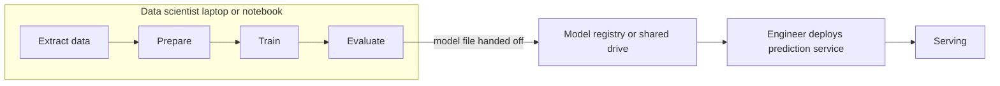
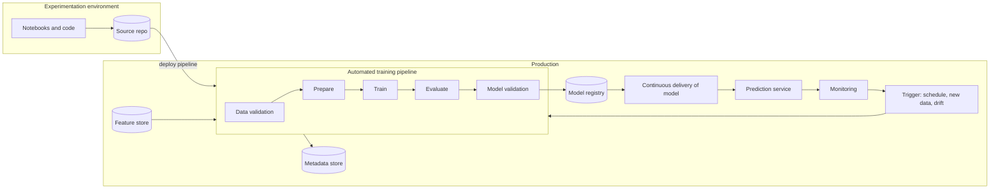
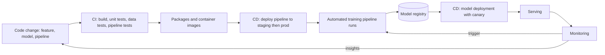

# MLOps maturity levels 0, 1 and 2

> **Before this lesson:** read [The ML lifecycle and the anatomy of an ML system](#/lesson/mlops/ml-lifecycle)
> for the inner and outer loops, and [Roles, teams and hidden technical debt](#/lesson/mlops/tech-debt-roles)
> for what a handoff and a platform team are.

## In plain words

A **maturity model** is a ladder with named rungs. It lets a team say "we are on rung 0" and see
what climbing to rung 1 would require, in place of the vague wish to "get better at MLOps".

Think of how a bakery grows. At first one baker makes every loaf by hand from memory (level 0).
Then the bakery writes the recipe down and installs a machine that mixes and bakes a batch every
morning without anyone starting it (level 1). Finally it sets up a process so that whenever
someone improves the recipe, the change is tested on a small batch and rolled into the machine
automatically (level 2). The bread may taste the same at every level. What changes is how much
human effort each batch needs and how safely the recipe can be changed.

For ML the "batch" is a freshly trained model, and the two things that get automated are:

1. **Continuous training (CT):** a **pipeline**, meaning a fixed chain of steps (get data, check
   it, train, evaluate) that a machine runs from start to finish, retrains the model on new data
   without a person doing it.
2. **CI/CD of the pipeline itself:** CI (continuous integration) means every change to the code is
   automatically built and tested; CD (continuous delivery) means a change that passes is released
   automatically. Here they are applied to the training pipeline's own code.

Why this matters for a job: "describe the MLOps maturity levels" is a standard interview question,
and knowing the ladder lets you say something useful in your first design review: which rung a
system is on and what the cheapest next step is.

## Why a maturity model?

"Do MLOps" is not something a team can act on. A maturity model tells a team *where it is* and
*what the next investment should be*. The most widely used one comes from a Google Cloud
architecture guide, *MLOps: Continuous delivery and automation pipelines in machine learning*,
which defines three levels. Microsoft's Azure guidance defines five (numbered 0 to 4) along
similar lines. We use Google's three and map Microsoft's onto them later.

The key idea: maturity is measured by **what is automated**, and specifically by the two items
above.

## Level 0: manual process

Read the diagram left to right: one person does all the steps in a notebook, then passes a file to
someone else.

## Level 0 — Manual process



What level 0 looks like in practice:

- Every step is done by hand and interactively: notebooks, or scripts that a person starts.
- **ML and operations are disconnected.** The data scientist hands an artifact (usually a pickle
  file holding the trained model) to engineers who had no part in making it.
- **Releases are rare,** a few times a year. There is no CI, because there is little changing code
  to test.
- **What gets deployed is the model,** not the pipeline that made it. Only the trained file reaches
  production; the steps that produced it stay on a laptop.
- **Nobody actively watches model quality** once it is live.

Level 0 is a reasonable place for a first model and for models that rarely need to change. It
breaks down when the data changes often, when there are many models, or when the one person who
knows how to rerun the notebook leaves.

> [!WARNING]
> The main risk at level 0 is not technical. It is that nobody notices when the model gets worse,
> and that nobody can retrain it because the notebook no longer runs.

## Level 1: ML pipeline automation (continuous training)

The diagram is busier, so take it in two parts. The top box is where people experiment and save
code to a **source repository** (the shared, versioned home of the code, usually Git). The bottom
box is production, and the new thing in it is the box inside the box: an automated training
pipeline that something other than a person starts.

## Level 1 — ML pipeline automation (continuous training)



What changes compared with level 0:

- **The pipeline is the thing you deploy.** You put a *training pipeline* into production, and it
  then produces models again and again.
- **Continuous training** on fresh data, started by a **trigger**: a schedule (every Monday), the
  arrival of new data, or an alarm from monitoring.
- **Experiment-production symmetry:** the same pipeline code runs while experimenting and in
  production. This is possible because each step is a separate, self-contained module packed into
  a **container**, a sealed bundle of code plus everything it needs to run (module 6).
- **Automated gates.** A **gate** is a check that must pass before the pipeline is allowed to
  continue. Data validation stops the run if the new data has the wrong columns or wildly
  different values. Model validation only lets a new model through if it beats the **champion**
  (the model currently in production) on data neither has seen.
- A **feature store** (optional) and an **ML metadata store**, a database recording for every run
  which data, code and settings went in and which model came out. That record is called
  **lineage**.
- **Continuous delivery of the model:** an approved model is rolled out to the prediction service
  automatically.

What is still done by hand: building and deploying *new versions of the pipeline* itself. If a
data scientist adds a feature, a person tests the changed pipeline and installs it.

## Level 2: CI/CD pipeline automation

Level 2 automates that last manual part. Follow the diagram from the left: a code change enters,
machines test and package it, the new pipeline is installed, it trains a model, and the model is
released carefully.

## Level 2 — CI/CD pipeline automation



Level 2 adds a dependable **CI/CD system for the pipeline itself**:

- **CI:** on every **commit** (a saved change in Git), machines build the packages and container
  images and run tests. **Unit tests** check small pieces such as one feature calculation.
  Further tests check that training makes progress on a small sample of data, that the model does
  not output **NaN** ("not a number", the value arithmetic produces when something has gone
  wrong), and that the pipeline steps fit together (**integration tests**).
- **CD:** the new pipeline is installed first in **staging**, a copy of production that no real
  user depends on, and run from start to finish. If that works it is promoted to production.
  Models are released by **progressive delivery**: to a few users first (a canary) or alongside
  the old model without affecting users (shadow), as module 9 explains.
- The result: data scientists can try an idea and have it reach production safely the same day,
  without waiting for the platform team.

## Comparing the levels

| Capability | Level 0 | Level 1 | Level 2 |
|---|---|---|---|
| Training | manual notebook | automated pipeline (CT) | automated pipeline (CT) |
| What is deployed | model artifact | training pipeline | pipeline via CI/CD |
| Release cadence | months | days–weeks (models) | many per day (pipeline and models) |
| Data validation | ad hoc | automated in pipeline | automated + tested in CI |
| Model validation | manual eyeballing | automated gate vs champion | automated + canary in prod |
| Monitoring | none or uptime only | model + data monitoring triggers CT | full observability, feedback into dev |
| Metadata/lineage | none | ML metadata store | ML metadata store + build provenance |
| Tests | few | some | unit, integration, data, model, load |

Microsoft's five-level model maps roughly as: 0 *No MLOps* ≈ Google level 0; 1 *DevOps but no MLOps*
(app code has CI/CD, models do not); 2 *Automated training* ≈ Google level 1; 3 *Automated model
deployment* (model release with A/B and traceability); 4 *Full MLOps automated operations* ≈ Google
level 2 with automatic retraining on monitoring signals.

> [!INTERVIEW]
> "What does level 1 add over level 0?" **Continuous training**: the *pipeline*, and not only the
> model it produced, runs in production, is triggered automatically, has automated data-validation
> and model-validation gates, and records its runs in a metadata store. "What does level 2 add?"
> **CI/CD for the pipeline code itself**, so changes to features or model code are tested and
> deployed automatically.

## Choosing your next step

Not every model needs level 2. The choice is a sum: what does a stale model cost the business,
and how often does the data change enough to matter? The program below adds up three costs for
each level over one year. `ops` is the cost of people's time spent retraining, `staleness` is the
business loss while an out-of-date model is serving, and `build` is the one-time cost of building
the automation.

```python-run
# Rough heuristic: expected yearly cost of operating at each level for one model
# (all numbers are illustrative assumptions you would replace with your own)
retrains_per_year_needed = 24          # how often the data changes enough to matter
manual_retrain_hours = 16              # level 0: a person re-runs notebooks, checks, deploys
eng_hour_cost = 120
staleness_cost_per_week = 2000         # business loss when the model is stale
weeks_stale_per_cycle = {"L0": 3, "L1": 0.5, "L2": 0.3}
build_cost = {"L0": 0, "L1": 25000, "L2": 60000}   # one-off platform/pipeline investment (amortised 1 year)
run_hours = {"L0": manual_retrain_hours, "L1": 2, "L2": 0.5}

for lvl in ["L0", "L1", "L2"]:
    ops = retrains_per_year_needed * run_hours[lvl] * eng_hour_cost
    stale = retrains_per_year_needed * weeks_stale_per_cycle[lvl] * staleness_cost_per_week
    total = ops + stale + build_cost[lvl]
    print(f"{lvl}: ops={ops:>8.0f}  staleness={stale:>8.0f}  build={build_cost[lvl]:>6.0f}  total={total:>8.0f}")
```

The loop computes, for each level, retrains per year times hours per retrain times the hourly
rate (`ops`), then retrains per year times weeks spent stale per retrain times the weekly loss
(`staleness`), and adds the build cost. The output is:

```text
L0: ops=   46080  staleness=  144000  build=     0  total=  190080
L1: ops=    5760  staleness=   24000  build= 25000  total=   54760
L2: ops=    1440  staleness=   14400  build= 60000  total=   75840
```

With 24 retrains a year, level 1 is the cheapest. Level 0 loses mostly through staleness, not
through engineer hours, which is typical: the hidden cost of manual work is the weeks during which
nothing happens.

Try lowering `retrains_per_year_needed` to 2: level 0 becomes the cheapest. Raise it to 52 or add more
models (platform cost is shared across models) and level 2 wins. Maturity is an economic decision.

### A pragmatic roadmap

1. **Version everything** (code in Git, data with DVC or table snapshots, models in a registry) and track
   experiments. Cheap, huge payoff.
2. **Containerise** training and serving so environments are reproducible.
3. **Turn the notebook into a pipeline** of testable steps with an orchestrator; schedule it.
4. **Add validation gates**: data checks before training, champion/challenger comparison after.
5. **Monitor** serving: latency/errors first, then input drift, then performance when labels arrive.
6. **CI for the pipeline**: unit and integration tests, image builds, deploy to staging.
7. **Progressive delivery** of models: shadow, canary, automatic rollback.
8. **Close the loop**: monitoring-driven retraining triggers, feedback collection.

Steps 1–5 move you from level 0 to level 1; 6–8 to level 2.

## Maturity for LLM applications

Applications built on foundation models reached through an API (lesson 2) follow a similar ladder,
though "training" is usually replaced by changes to the prompt and to the documents the model is
given. Huyen (*AI Engineering*, ch. 10) describes an architecture that grows one step at a time.
Start with a plain call to the model. Add retrieval of relevant documents (RAG). Add
**guardrails**, checks on what goes into and comes out of the model. Add a **gateway**, a single
entry point through which all model calls pass so they can be counted, limited and logged. Add a
cache, and later more autonomous "agent" behaviour, with monitoring and evaluation at every step.
An LLMOps team at level 0 edits prompts in production by hand. A team at level 2 keeps prompts in
version control, runs an evaluation suite in CI on every prompt change, and releases a prompt
change to a few users first while watching live numbers (module 12). **LLM** stands for large
language model.

## What each level looks like in the repository

Maturity is visible in the artifacts a team keeps. Here is the same churn project at each level.

**Level 0**

```text
churn/
├── churn_analysis_v3_final.ipynb
├── model.pkl                       # emailed to the backend team
└── README.md                       # "ask Priya how to rerun this"
```

**Level 1**

```text
churn/
├── src/churn/{data,features,train,evaluate}.py     # notebook logic extracted into modules
├── pipelines/training_dag.py                       # orchestrated: validate -> train -> evaluate -> register
├── expectations/customers.json                     # data validation suite
├── configs/train.yaml
├── Dockerfile
└── notebooks/                                      # exploration only
```

plus, outside the repo: a scheduler running the DAG weekly, an experiment tracker and model registry, a
serving deployment that reads the registry, and a dashboard with basic drift checks.

**Level 2** adds:

```text
├── tests/{unit,data,model,integration}/            # run on every pull request
├── .github/workflows/{ci,deploy-pipeline,deploy-model}.yml
├── k8s/ or helm/                                    # serving and pipeline infra as code
├── ops/{alerts.yml,dashboards/}                     # monitoring as code
└── docs/{model-card.md,runbook.md}
```

and the property that **nobody deploys by hand**: merging to `main` is the only way anything reaches
production.

## Measuring where you are

Judging your own maturity by opinion is unreliable; use numbers. The four **DORA metrics** (named
after the DevOps Research and Assessment group that popularised them) are the standard measures of
how well a software team delivers. They are the first four rows of the table below and they carry
over to ML directly. ML adds three rows of its own:

| Metric | Question | Typical level 0 | Typical level 2 |
|---|---|---|---|
| Deployment frequency | how often does a new model or pipeline version reach production? | quarterly | weekly or daily |
| Lead time for changes | from "idea merged" to "serving traffic" | weeks–months | hours–days |
| Change failure rate | share of releases needing rollback or hotfix | unknown | measured, < 15% |
| Time to restore | from detection to mitigation | days | minutes (alias rollback) |
| Time to detect model degradation | from quality drop to alert | weeks, by customer complaint | hours–days, by monitor |
| Retraining effort | human hours per retrain | 8–40 | ~0 for routine retrains |
| Reproducibility | can last year's model be rebuilt? | no | yes, from registry lineage |

```python-run
# Score a team on a simple maturity rubric (0 = absent, 1 = manual, 2 = automated).
team = {
    "code in Git with review": 2, "data versioned": 1, "experiments tracked": 2,
    "training is a pipeline": 1, "data validation gate": 0, "model validation gate": 1,
    "model registry": 2, "CI for pipeline code": 0, "automated deployment": 1,
    "progressive rollout / rollback": 0, "serving monitoring": 2, "drift / performance monitoring": 0,
    "retraining trigger": 0,
}
level1_needs = ["training is a pipeline", "data validation gate", "model validation gate", "model registry",
                "drift / performance monitoring", "retraining trigger"]
level2_needs = level1_needs + ["CI for pipeline code", "automated deployment", "progressive rollout / rollback"]
def reached(needs): return all(team[k] == 2 for k in needs)
level = 2 if reached(level2_needs) else 1 if reached(level1_needs) else 0
print(f"score: {sum(team.values())}/{2 * len(team)}  -> effective level {level}")
gaps = sorted((v, k) for k, v in team.items() if k in level1_needs and v < 2)
print("next steps toward level 1:")
for v, k in gaps:
    print(f"  - {k}: {'build it' if v == 0 else 'automate what is manual'}")
```

How the program decides: `reached(needs)` is true only when every listed capability is fully
automated (score 2). The team is level 2 if everything level 2 needs is automated, level 1 if
everything level 1 needs is, and otherwise level 0. The output is:

```text
score: 12/26  -> effective level 0
next steps toward level 1:
  - data validation gate: build it
  - drift / performance monitoring: build it
  - retraining trigger: build it
  - model validation gate: automate what is manual
  - training is a pipeline: automate what is manual
```

This team scores 12 out of 26, which sounds like "almost halfway", and yet its level is 0.

A team can score well on tools (tracker, registry, Git) and still be at level 0, because the *loop* is
not automated. Levels are defined by the weakest link in the chain, not by how many products you bought.

## Common mistakes when climbing

- **Tooling before process.** Installing Kubeflow does not create a pipeline; first make the training
  code runnable end to end from a clean checkout with one command.
- **Automating retraining without gates.** Continuous training without data and model validation is an
  efficient way to ship bad models automatically.
- **One giant leap.** Going from notebooks to a full platform in one project usually stalls. Move one
  model through each step and turn what you learn into templates.
- **Ignoring the organisation.** Level 2 requires that data scientists own tests and pipelines, and that
  platform engineers provide paved roads. No tool fixes a handoff culture.
- **Uniform maturity targets.** A quarterly-refreshed pricing model and a fraud model that drifts weekly
  deserve different investments.

## Summary

- Maturity is about automation of **continuous training** and of **CI/CD for the pipeline**.
- Level 0: manual notebooks, model handed over, no monitoring.
- Level 1: the training pipeline is deployed and runs automatically, with data/model validation gates,
  metadata tracking and triggers.
- Level 2: the pipeline code itself goes through CI/CD; rapid, safe iteration.
- Choose the level by economics: rate of change, cost of staleness, and number of models.

## Glossary

- **Maturity model** - a ladder of named levels describing how automated a team's process is.
- **Pipeline** - a fixed chain of steps that a machine runs from start to finish.
- **Continuous training (CT)** - automatic retraining of a model on new data.
- **CI (continuous integration)** - automatically building and testing every code change.
- **CD (continuous delivery)** - automatically releasing changes that pass their tests.
- **Trigger** - the event that starts a pipeline: a schedule, new data, or an alert.
- **Gate** - an automated check that must pass before a pipeline continues.
- **Champion / challenger** - the model in production / a new model competing to replace it.
- **Metadata store / lineage** - a database of what went into each run / that record of origins.
- **Container** - a sealed bundle of code and its dependencies that runs the same everywhere.
- **Staging** - a production-like environment used for testing before release.
- **Progressive delivery** - releasing to a small share of traffic first (canary) or in parallel
  without user impact (shadow).
- **Commit** - one saved change in a version-control system.
- **Unit / integration test** - a test of one small piece / of several pieces working together.
- **DORA metrics** - deployment frequency, lead time for changes, change failure rate, time to
  restore.
- **Staleness** - the state of serving a model that no longer reflects current data.

```quiz
[
  {"q": "At Google's MLOps level 0, what is deployed to production?",
   "options": ["The training pipeline", "Only the trained model artifact (prediction service)", "A CI/CD system", "A feature store"],
   "answer": 1, "explain": "Level 0 deploys a model artifact handed over from a manual process."},
  {"q": "What is the defining capability of level 1?",
   "options": ["GPU clusters", "Continuous training by an automated pipeline deployed in production", "Kubernetes", "Microservices"],
   "answer": 1, "explain": "Level 1 automates the training pipeline so models are retrained on fresh data automatically."},
  {"q": "Which is still manual at level 1 but automated at level 2?",
   "options": ["Model retraining", "Data validation", "Testing and deploying new versions of the pipeline code", "Serving predictions"],
   "answer": 2, "explain": "Level 2 adds CI/CD for pipeline code changes."},
  {"q": "'Experiment-production symmetry' means...",
   "options": ["Using the same pipeline code and components in dev and prod", "Running experiments on production traffic only", "Mirroring GPU counts", "Using symmetric encryption"],
   "answer": 0, "explain": "Modular, containerised components run identically in experimentation and production."},
  {"q": "Which of these is a typical automated gate in a level 1 pipeline?",
   "options": ["Manual code review of the notebook", "New model must beat the current champion on held-out data before being pushed", "Rebooting servers", "Emailing the data scientist"],
   "answer": 1, "explain": "Model validation compares challenger to champion automatically."},
  {"q": "A model whose data barely changes and is retrained twice a year most likely needs...",
   "options": ["Level 2 immediately", "Level 0 or a light level 1, since automation cost may exceed staleness cost", "No versioning", "A streaming pipeline"],
   "answer": 1, "explain": "Maturity is an economic choice driven by rate of change and cost of staleness."},
  {"q": "Which trigger is NOT a usual way to start continuous training?",
   "options": ["A schedule", "Arrival of new labelled data", "A drift alert from monitoring", "A change in the Docker logo"],
   "answer": 3, "explain": "Schedules, new data, and monitoring signals are the standard triggers."}
]
```

> **Source:** Google Cloud Architecture Center, *MLOps: Continuous delivery and automation pipelines in machine learning*; Microsoft Learn, *Machine Learning operations maturity model*; Chip Huyen, *AI Engineering*, ch. 10 (AI engineering architecture).
