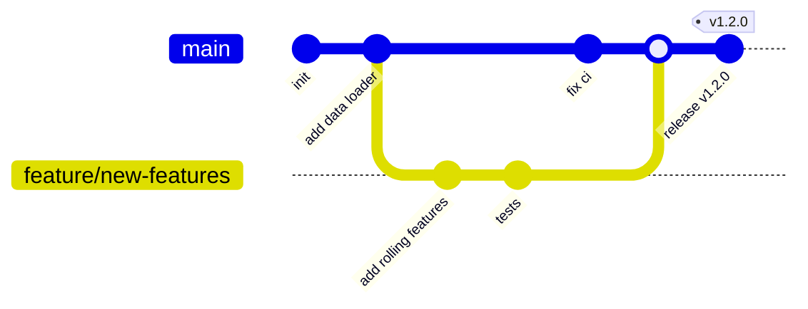
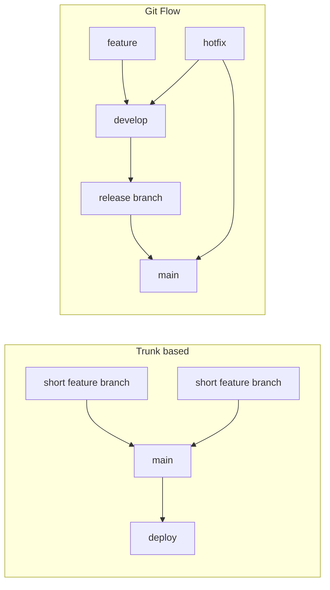

# Git workflows for ML teams

## Why Git discipline matters more in ML

In ML, a "version" of the system is the combination of **code + data + config + environment + model**.
Git is the anchor for all of them: the commit SHA is what you log in every experiment run, what you tag
a Docker image with, and what your model registry points back to. If your Git hygiene is poor —
uncommitted changes, giant notebooks, secrets in history — every other layer of reproducibility
collapses.

This lesson covers the Git mental model you need, branching strategies, commit and review practices,
and the ML-specific problems: notebooks, large files and secrets.

## The mental model in five minutes

Git stores **snapshots**, not diffs. Each commit records a full tree (via content-addressed blobs), a
pointer to its parent(s), an author and a message. Branches are just movable labels pointing at commits;
`HEAD` points at the branch you are on.



Three areas: **working tree** (your files), **index/staging area** (what goes into the next commit),
**repository** (committed history). Essential commands:

```bash
git status                      # what changed?
git add -p                      # stage hunks interactively (review what you commit!)
git commit -m "feat: add 7-day rolling mean features"
git switch -c feature/rolling   # create and switch to a branch
git fetch origin && git rebase origin/main   # update your branch on top of main
git log --oneline --graph --decorate -20
git diff main...HEAD            # what will my PR contain?
git restore --staged file.py    # unstage
git stash push -m "wip"         # park changes temporarily
git tag -a v1.2.0 -m "model service 1.2.0" && git push origin v1.2.0
```

> [!TIP]
> `git rev-parse HEAD` gives the exact commit SHA. Log it as a tag on every experiment run and bake it
> into every Docker image label. When something breaks in production, that SHA is your starting point.

## Branching strategies

### Trunk-based development (recommended default)

Everyone integrates into `main` at least daily through **short-lived feature branches** (hours to a
couple of days) and pull requests. Unfinished work hides behind **feature flags** or config switches.
`main` is always releasable; CI runs on every PR and on every merge.

Why it suits ML teams: long-lived branches diverge, and in ML they diverge in *data assumptions* too.
Merging a three-week-old feature branch that assumes an old table schema is painful.

### GitHub Flow

A simplification of trunk-based: branch from `main`, open a PR, review, CI, merge, deploy. Most open-source
and SaaS teams use this.

### Git Flow

Long-lived `develop` and `main`, plus `feature/*`, `release/*` and `hotfix/*` branches. Designed for
software with scheduled, versioned releases (desktop apps, libraries supporting several versions). Usually
too heavy for services that deploy continuously.



### Environment branches — an anti-pattern

`dev`, `staging`, `prod` branches where you "promote" by merging. They drift apart and hotfixes get lost.
Prefer **one branch, many environments**: the same artifact (image tagged with the SHA) is promoted from
staging to production by CD configuration, not by merges.

## Commits and pull requests

### Conventional Commits

A lightweight convention that makes history scannable and lets tools generate changelogs and version
bumps:

```
feat(features): add 7-day rolling purchase count
fix(serving): handle missing country code as "UNK"
perf(train): cache tokenized dataset to parquet
chore(deps): bump scikit-learn to 1.5.2
docs(model-card): add slice metrics for new region
feat(api)!: rename /predict payload field "x" to "features"   # "!" = breaking change
```

A breaking change (`!` or a `BREAKING CHANGE:` footer) maps to a major version bump — the same idea you
will implement for model versions in the `mlops-semver-bump` problem.

### What a good ML pull request contains

- A focused change (one feature, one fix).
- Tests for new logic (feature computations, preprocessing edge cases).
- For model changes: a link to the experiment run(s) and a metrics comparison table against the champion,
  including slices.
- Data/schema changes called out explicitly.
- No notebooks with huge outputs, no data files, no secrets.

> [!INTERVIEW]
> "How do you review a PR that changes a model?" — Check the code like any PR, then check *evidence*:
> linked experiment runs, metric deltas vs champion on the same test set, slice metrics (no subgroup
> regressions), latency/size impact, and whether the training data window or features changed (which
> would require downstream consumers to be notified).

## Notebooks in Git

Jupyter notebooks are JSON with embedded outputs (including base64 images) and execution counts. Diffs
are unreadable and merge conflicts are miserable. Options:

- **Strip outputs before commit** with `nbstripout` (as a Git filter or pre-commit hook).
- **Pair notebooks with scripts** using **Jupytext**: keep a `.py` (percent format) representation that is
  what you review and diff.
- **Diff tools** like `nbdime` for human-readable notebook diffs.
- **Graduate code out of notebooks**: once logic is reused, move it into the package (`src/`) with tests,
  and import it from the notebook.

```text
# notebook.py — Jupytext "percent" format
# %% [markdown]
# # EDA of transactions
# %%
import pandas as pd
from churn.features import rolling_counts   # logic lives in the package, tested
df = pd.read_parquet("data/transactions.parquet")
```

## Large files: never commit data or models to Git

Git keeps every version of every file forever, in every clone. A 2 GB parquet file committed once bloats
the repo permanently. Options:

| Tool | Idea | Good for |
|---|---|---|
| Git LFS | pointer files in Git, content on an LFS server | moderately sized binaries, images |
| DVC | pointer files (`.dvc`) in Git, content in S3/GCS/Azure/SSH; pipelines | datasets, models, ML pipelines (lesson 8) |
| lakeFS | Git-like branches over an object store | large data lakes |
| Registry / object store | models in MLflow/S3 referenced by URI | model artifacts |

Add a `.gitignore` early:

```gitignore
# data and artifacts
data/
models/
mlruns/
*.parquet
*.pkl
*.onnx
# environments
.venv/
__pycache__/
.ipynb_checkpoints/
# secrets
.env
*.pem
```

## Secrets

Never commit API keys, database passwords or cloud credentials. Once pushed, assume they are compromised
— rotate them; rewriting history is not enough because forks and clones may exist.

- Keep secrets in environment variables loaded from an **uncommitted** `.env` locally, and in a secret
  manager (AWS Secrets Manager, GCP Secret Manager, Vault, GitHub Actions secrets, Kubernetes Secrets) in
  deployed environments.
- Add a secret scanner (`gitleaks`, `detect-secrets`) as a pre-commit hook and in CI (lesson 5).
- GitHub push protection blocks many known token formats automatically.

## Monorepo or polyrepo?

- **Monorepo**: training code, serving code, shared feature library, infra in one repo. Atomic changes
  across training and serving (great for avoiding skew), one CI system, easier refactors. Needs
  path-filtered CI to stay fast.
- **Polyrepo**: separate repos per service. Clear ownership and independent release cadence, but shared
  code becomes a versioned package and cross-repo changes need coordination.

Many ML teams use a monorepo per product (data pipelines + training + service) plus a shared platform
repo.

## A simulation: how often do long-lived branches conflict?

```python-run
import numpy as np
rng = np.random.default_rng(1)
# Model: 40 files; each day, every active branch edits 2 random files.
# A merge "conflicts" if both main and the branch touched the same file since the branch started.
files, edits_per_day, trials = 40, 2, 4000
for days in [1, 2, 5, 10, 20]:
    conflicts = 0
    for _ in range(trials):
        main = set(rng.integers(0, files, size=edits_per_day * days * 3))   # 3 teammates merge into main
        branch = set(rng.integers(0, files, size=edits_per_day * days))
        conflicts += bool(main & branch)
    print(f"branch alive {days:2d} days -> P(conflict) ~ {conflicts / trials:.2f}")
```

Conflict probability rises steeply with branch lifetime — the quantitative case for trunk-based
development with small PRs.

## Summary

- The commit SHA is the root of ML reproducibility: log it with every run, image and model.
- Prefer trunk-based development / GitHub Flow with short-lived branches and feature flags; avoid
  environment branches.
- Use Conventional Commits for readable history and automated versioning.
- Keep notebooks diffable (nbstripout, Jupytext) and move reusable logic into tested packages.
- Never commit data, models or secrets; use DVC/LFS/object stores and secret managers.

```quiz
[
  {"q": "Which branching strategy is generally recommended for continuously deployed ML services?",
   "options": ["Git Flow with long-lived develop branch", "Trunk-based development with short-lived branches", "One branch per environment (dev/staging/prod)", "No branches, commit directly without review"],
   "answer": 1, "explain": "Short-lived branches merged frequently avoid divergence; main stays releasable."},
  {"q": "Why are environment branches (dev/staging/prod) considered an anti-pattern?",
   "options": ["Git cannot have more than two branches", "They drift apart and you promote different code instead of the same artifact", "They are slower to clone", "They break Docker"],
   "answer": 1, "explain": "Promote the same SHA-tagged artifact across environments via CD config instead."},
  {"q": "In Conventional Commits, what does `feat(api)!:` signal?",
   "options": ["A typo fix", "A breaking change to the API", "A performance improvement", "A test-only change"],
   "answer": 1, "explain": "The `!` marks a breaking change, usually mapped to a major version bump."},
  {"q": "What does nbstripout do?",
   "options": ["Converts notebooks to Docker images", "Removes outputs and execution counts from notebooks before committing", "Encrypts notebooks", "Runs notebooks in CI"],
   "answer": 1, "explain": "Stripping outputs keeps diffs small and readable."},
  {"q": "You accidentally pushed an API key. What is the correct first action?",
   "options": ["Delete the file in a new commit", "Rotate/revoke the key immediately", "Force-push to rewrite history and continue using it", "Make the repo private"],
   "answer": 1, "explain": "Assume it is compromised; rotate first, then clean history."},
  {"q": "Which is the best place for a 5 GB training dataset?",
   "options": ["Committed directly to Git", "In object storage tracked by DVC (pointer file in Git)", "In a Docker image layer", "In the README"],
   "answer": 1, "explain": "DVC keeps a small pointer in Git and stores content in remote storage."},
  {"q": "Why log the Git commit SHA with every experiment run?",
   "options": ["It makes runs faster", "It identifies exactly which code produced the model, enabling reproduction and debugging", "MLflow requires it to start", "It compresses artifacts"],
   "answer": 1, "explain": "The SHA anchors code lineage for every model and image."}
]
```

> **Source:** Pro Git (Chacon & Straub), ch. 2–3; trunkbaseddevelopment.com; Conventional Commits 1.0.0 specification; DVC and Git LFS documentation; Jupytext and nbstripout documentation; Bill Lubanovic, *FastAPI*, ch. 2 (modern Python tooling).
