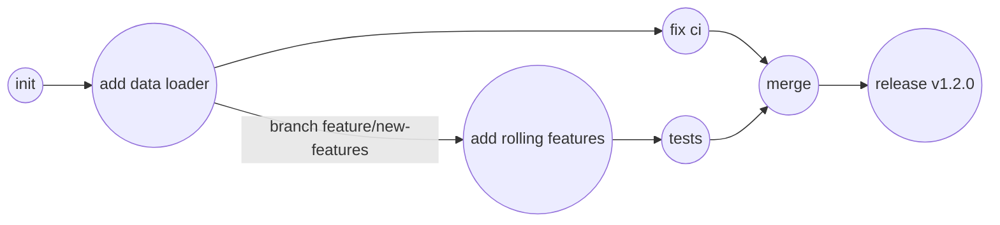
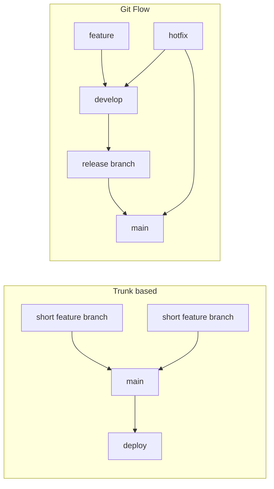

# Git workflows for ML teams

> **Before this lesson:** you should know the lifecycle picture from
> [The ML lifecycle and the anatomy of an ML system](#/lesson/mlops/ml-lifecycle) and be able to
> type a command into a terminal. No previous use of Git is assumed.

## In plain words

**Git** is a program that remembers every saved state of a folder of files. Each saved state is
called a **commit**. You can look at any earlier commit, see exactly what changed between two of
them, and let several people change the same project at once and then combine their work.

A familiar comparison is the "save game" feature of a video game combined with the "track changes"
feature of a word processor. Each commit is a save point with a note attached ("added the new
features"). If something goes wrong you can go back, and you can always answer the question "what
was different the last time this worked?".

Three more words appear constantly. A **repository** (or "repo") is the project folder together
with its whole history. A **branch** is a separate line of work, so you can try something without
disturbing everyone else. **GitHub** is a website that hosts repositories and adds a place to
discuss and approve changes.

Why this matters for a job: every engineering team uses Git every day, and in ML it carries extra
weight. A trained model depends on the exact code that produced it, and the identity of a commit
is how that code is pinned down. Interviewers also ask about branching strategy and about how you
would review a change to a model.

## Why Git discipline matters more in ML

In ordinary software a "version" is a version of the code. In ML a version of the system is a
combination of five things: **code + data + configuration + environment + model**. Git is the
anchor for all of them. Every commit has a unique identifier, a 40-character string called its
**SHA** or hash (for example `a1b2c3d…`, usually shortened to the first seven characters). That
SHA is what you record with every training run, what you stamp on every packaged service, and
what the model registry points back to. If Git habits are poor (changes that were never
committed, enormous notebooks, passwords buried in the history) every other layer of
reproducibility falls with it.

This lesson covers the mental model of Git, branching strategies, commit and review practices, and
the problems specific to ML: notebooks, large files and secrets.

## The mental model in five minutes

Git stores **snapshots**, not differences. Each commit records the full state of every file at
that moment (stored efficiently, so unchanged files are not duplicated), a pointer to the commit
that came before it (its **parent**), the author and a message. A branch is nothing more than a
movable label that points at one commit; when you commit on a branch, the label moves forward.
`HEAD` is Git's name for "the commit you are standing on now". The main branch, the one everybody
shares, is conventionally called `main`.

In the diagram each circle is a commit. The lower line is a branch that split off, received two
commits of its own and was then combined with the main line; combining is called a **merge**.



Your work passes through three areas. The **working tree** is the files as they are on your disk.
The **staging area** (also called the index) is the list of changes you have selected for the next
commit. The **repository** is the committed history. Changes move from the first to the second
with `git add` and from the second to the third with `git commit`. The commands below are the ones
you will use daily; lines starting with `#` are comments.

```bash
git status                      # what changed?
git add -p                      # stage hunks interactively (review what you commit!)
git commit -m "feat: add 7-day rolling mean features"
git switch -c feature/rolling   # create and switch to a branch
git fetch origin && git rebase origin/main   # update your branch on top of main
git log --oneline --graph --decorate -20
git diff main...HEAD            # what will my PR contain?
git restore --staged file.py    # unstage
git stash push -m "wip"         # park changes temporarily
git tag -a v1.2.0 -m "model service 1.2.0" && git push origin v1.2.0
```

Reading the less obvious ones: `git add -p` shows each changed piece (a "hunk") and asks whether to
stage it, which forces you to read what you are about to commit. `git switch -c name` creates a
branch and moves onto it. `origin` is the conventional name of the shared copy of the repository
on a server such as GitHub; `git fetch origin` downloads what others have pushed there. `git
rebase origin/main` re-applies your commits on top of the newest `main` (more on this below). `git
stash` puts unfinished changes aside so you can come back to them. A **tag** is a permanent,
human-readable name for one commit, such as `v1.2.0`. A **PR**, or pull request, is a proposal on
GitHub to merge your branch, where teammates review the change before it is accepted.

> [!TIP]
> `git rev-parse HEAD` prints the exact SHA of the current commit. Record it with every experiment
> run and write it into every packaged image. When something breaks in production, that SHA is
> where the investigation starts.

## Branching strategies

A branching strategy is a team's agreement about which branches exist, how long they live and how
work gets into `main`. Three are common.

### Trunk-based development (recommended default)

"Trunk" is another word for `main`. Everyone merges their work into `main` at least once a day
through **short-lived feature branches** that exist for hours or a couple of days, each reviewed
in a pull request. Work that is not finished is still merged, hidden behind a **feature flag**: a
switch in configuration that keeps the new code path turned off until it is ready. `main` can be
released at any moment, and CI runs the tests on every pull request and on every merge.

Why it suits ML teams: branches that live a long time drift away from `main`, and in ML they drift
in their *assumptions about data* as well. Merging a three-week-old branch that still expects the
old columns of a table is painful.

### GitHub Flow

A stripped-down form of trunk-based development: create a branch from `main`, open a pull request,
get a review, let CI pass, merge, deploy. Most open-source projects and web companies work this
way.

### Git Flow

Two permanent branches, `develop` and `main`, plus temporary `feature/*`, `release/*` and
`hotfix/*` branches (a **hotfix** is an urgent repair to what is live). It was designed for
software that ships on a schedule in numbered versions, such as desktop applications or libraries
that must support several versions at once. For a service that is deployed many times a week it is
usually more ceremony than it is worth.



### Environment branches: an anti-pattern

An **environment** is one running copy of the system: typically `dev` for developers, `staging`
for final checks, and `prod` (production) for real users. Some teams keep a branch per
environment and "promote" a change by merging from one branch to the next. The branches slowly
stop matching each other, and urgent fixes applied to one are forgotten on the others. The better
rule is **one branch, many environments**: build one packaged artifact from a commit (a container
image labelled with the SHA), and move that same artifact from staging to production by changing
deployment configuration, not by merging.

## Commits and pull requests

### Conventional Commits

**Conventional Commits** is a small agreed format for commit messages: a type, an optional area in
brackets, a colon, then a short description. It makes the history easy to scan and lets tools
write the list of changes for a release and decide the next version number automatically.

```
feat(features): add 7-day rolling purchase count
fix(serving): handle missing country code as "UNK"
perf(train): cache tokenized dataset to parquet
chore(deps): bump scikit-learn to 1.5.2
docs(model-card): add slice metrics for new region
feat(api)!: rename /predict payload field "x" to "features"   # "!" = breaking change
```

The types are `feat` for a new capability, `fix` for a bug repair, `perf` for a speed-up, `chore`
for housekeeping and `docs` for documentation. A **breaking change** is one that forces users of
the code to change something on their side. It is marked by `!` or by a `BREAKING CHANGE:` line at
the end of the message, and it calls for a new *major* version number (the first number in
`2.0.0`). You will implement the same rule for model versions in the `mlops-semver-bump` problem.

### What a good ML pull request contains

- One focused change: one feature or one fix.
- Tests for the new logic, such as feature calculations and unusual inputs to preprocessing.
- For changes to a model: a link to the experiment run or runs, and a table comparing the numbers
  against the champion (the model now in production), including **slices**, meaning the same
  numbers computed for subgroups such as each country or device type.
- Any change to data or to the **schema** (the list of columns and their types) called out
  explicitly.
- No notebooks with huge outputs, no data files, no secrets.

> [!INTERVIEW]
> "How do you review a PR that changes a model?" — Check the code like any PR, then check *evidence*:
> linked experiment runs, metric deltas vs champion on the same test set, slice metrics (no subgroup
> regressions), latency/size impact, and whether the training data window or features changed (which
> would require downstream consumers to be notified).

## Notebooks in Git

A Jupyter notebook file is stored as JSON (a text format for nested data) that contains your code
and also every output: tables, printed text, even images encoded as long strings of characters,
plus a counter of how many times each cell was run. When two versions of such a file are compared,
the differences are unreadable, and when two people edit the same notebook, combining their
versions is miserable. The options:

- **Strip outputs before committing** with `nbstripout`, installed as a Git filter or as a
  pre-commit hook (a check that runs automatically before each commit; lesson 5).
- **Pair each notebook with a script** using **Jupytext**: it keeps a plain `.py` twin of the
  notebook, and the `.py` file is what you review and compare. A sample is shown below; a line
  starting with `# %%` marks the start of a cell.
- **Use a notebook-aware comparison tool** such as `nbdime`.
- **Move code out of notebooks as it matures**: once a piece of logic is used twice, put it in the
  project's Python package (the `src/` folder) with tests, and import it from the notebook.

```text
# notebook.py — Jupytext "percent" format
# %% [markdown]
# # EDA of transactions
# %%
import pandas as pd
from churn.features import rolling_counts   # logic lives in the package, tested
df = pd.read_parquet("data/transactions.parquet")
```

## Large files: never commit data or models to Git

Git keeps every version of every file forever, in every copy of the repository. A 2 GB data file
committed once makes the repository 2 GB larger for everyone, permanently, even if the file is
deleted in the next commit. The solution is always the same: keep the big content elsewhere and
keep only a small **pointer file** (a few lines naming the content and where it lives) in Git.
The tools differ in where "elsewhere" is. **Object storage** is a cloud service for storing files
of any size cheaply; Amazon S3 and Google Cloud Storage (GCS) are the best known.

| Tool | Idea | Good for |
|---|---|---|
| Git LFS | pointer files in Git, content on an LFS server | moderately sized binaries, images |
| DVC | pointer files (`.dvc`) in Git, content in S3/GCS/Azure/SSH; pipelines | datasets, models, ML pipelines (lesson 8) |
| lakeFS | Git-like branches over an object store | large data lakes |
| Registry / object store | models in MLflow/S3 referenced by URI | model artifacts |

Next, tell Git which files it must never track by listing them in a file called `.gitignore`. Each
line is a file name or a pattern; `*.pkl` means "any file ending in .pkl". Add it early:

```gitignore
# data and artifacts
data/
models/
mlruns/
*.parquet
*.pkl
*.onnx
# environments
.venv/
__pycache__/
.ipynb_checkpoints/
# secrets
.env
*.pem
```

## Secrets

A **secret** is any value that grants access: an API key, a database password, a cloud credential.
Never commit one. If a secret has been pushed to a shared repository, assume it is compromised
and **rotate** it (cancel it and issue a new one) at once. Deleting it from the history is not
enough, because copies of the repository may already exist elsewhere.

- On your own machine, keep secrets in **environment variables** (named values the operating
  system hands to a program when it starts), loaded from a `.env` file that is listed in
  `.gitignore`. In deployed environments, keep them in a **secret manager**: a service built to
  store secrets and hand them only to authorised programs (AWS Secrets Manager, GCP Secret
  Manager, Vault, GitHub Actions secrets, Kubernetes Secrets).
- Add a secret scanner (`gitleaks`, `detect-secrets`) as a pre-commit hook and in CI (lesson 5).
- GitHub's push protection blocks many well-known key formats automatically.

## Monorepo or polyrepo?

- **Monorepo**: one repository holds the training code, the serving code, the shared feature
  library and the infrastructure files. A single commit can change training and serving together,
  which is a strong defence against skew; there is one CI system and refactoring is easier. To
  stay fast, CI has to be told to run only the tests for the folders that changed.
- **Polyrepo**: one repository per service. Ownership is clear and each service releases on its
  own schedule, but shared code has to be published as a versioned package and a change that
  spans repositories needs coordination.

Many ML teams use a monorepo per product (data pipelines + training + service) plus a shared platform
repo.

## A simulation: how often do long-lived branches conflict?

A **merge conflict** happens when two branches changed the same part of the same file and Git
cannot decide which version to keep; a person has to sort it out. The simulation below estimates
how the chance of a conflict grows with the age of a branch. The model is deliberately crude: a
project of 40 files, where you edit 2 random files a day on your branch while three teammates
together edit 6 random files a day on `main`. A trial counts as a conflict if any file was touched
on both sides. Each branch age is tried 4,000 times.
```python-run
import numpy as np
rng = np.random.default_rng(1)
# Model: 40 files; each day, every active branch edits 2 random files.
# A merge "conflicts" if both main and the branch touched the same file since the branch started.
files, edits_per_day, trials = 40, 2, 4000
for days in [1, 2, 5, 10, 20]:
    conflicts = 0
    for _ in range(trials):
        main = set(rng.integers(0, files, size=edits_per_day * days * 3))   # 3 teammates merge into main
        branch = set(rng.integers(0, files, size=edits_per_day * days))
        conflicts += bool(main & branch)
    print(f"branch alive {days:2d} days -> P(conflict) ~ {conflicts / trials:.2f}")
```

`rng.integers(0, files, size=...)` draws random file numbers; wrapping them in `set(...)` keeps
each file once; `main & branch` is the set of files touched on both sides, and `bool(...)` of a
non-empty set is `True`, which counts as 1. The output:

```text
branch alive  1 days -> P(conflict) ~ 0.27
branch alive  2 days -> P(conflict) ~ 0.70
branch alive  5 days -> P(conflict) ~ 1.00
branch alive 10 days -> P(conflict) ~ 1.00
branch alive 20 days -> P(conflict) ~ 1.00
```

A one-day branch conflicts about a quarter of the time; by day five a conflict is practically
certain. Real projects have more files, so the absolute numbers are lower, but the shape of the
curve is the argument for trunk-based development with small pull requests.

## Worked workflow: one feature from branch to merge

Seeing the commands in order makes the workflow concrete. Read the comments on the right as you
go.

```bash
git switch main && git pull --ff-only                  # start from the latest main
git switch -c feat/rolling-purchase-features           # short-lived branch

# ... edit src/churn/features.py and tests/unit/test_features.py ...
make lint test                                         # fast local feedback
git add -p                                             # review each hunk while staging
git commit -m "feat(features): add 7/30-day rolling purchase counts"

# main moved while you worked: replay your commits on top of it
git fetch origin
git rebase origin/main                                 # resolve conflicts if any, then: git rebase --continue
make test                                              # re-run after rebasing

git push -u origin feat/rolling-purchase-features      # open a pull request
# after review feedback:
git commit --fixup <sha> && git rebase -i --autosquash origin/main
git push --force-with-lease                            # safe force-push: refuses if the remote changed
```

Points that confuse newcomers:

- **`git pull --ff-only`** downloads the newest `main` and refuses to do anything surprising if
  your local copy has diverged from it.
- **`make lint test`** runs the project's style checks and tests through a Makefile (lesson 5).
- **Rebase versus merge.** A merge joins two lines of history with a special merge commit. A
  **rebase** takes your commits and replays them one by one on top of the latest `main`, as if you
  had started your work today. Rebasing your own *private* branch keeps the history a straight
  line and the pull request easy to read. Never rebase commits that other people have already
  built on, because it replaces them with new commits that have different SHAs. Many teams use a
  **squash merge** for pull requests: all the commits of the pull request become one commit on
  `main`, so a bad change can be undone in one step.
- **`git commit --fixup` with `rebase -i --autosquash`** folds a small correction into the earlier
  commit it belongs to.
- **`--force-with-lease`**, not `--force`. After a rebase your branch has new SHAs, so the server
  copy has to be overwritten. The "with lease" form refuses if someone else has pushed to your
  branch in the meantime.
- **`git revert <sha>`** creates a new commit that undoes an earlier one. It is the correct way to
  undo something that is already on `main`. `git reset --hard` erases commits and is only for
  local work nobody else has seen.

### Resolving conflicts in ML repositories

Typical conflict sources and how to avoid them:

| File | Why it conflicts | Mitigation |
|---|---|---|
| `uv.lock` / `poetry.lock` | two branches change dependencies | do not hand-edit; take `main`'s version and re-run the lock command |
| notebooks | JSON with outputs and execution counts | nbstripout, Jupytext, or `nbdime` merge driver |
| `dvc.lock`, `*.dvc` | two branches retrain or change data | accept one side, then `dvc repro` to regenerate |
| big config YAML | everyone edits the same file | split config into groups (Hydra), one file per concern |

### Debugging with history

- `git log -S "threshold = 0.42" -- src/` finds the commit that introduced or removed a string.
- `git blame -L 120,140 src/churn/features.py` shows who last changed each line (and, via the PR, why).
- **`git bisect`** binary-searches history for the commit that introduced a regression. It can be fully
  automated with a script that exits non-zero when the bug is present:

```bash
git bisect start
git bisect bad HEAD                 # current commit: evaluation metric regressed
git bisect good v1.3.0              # last known good tag
git bisect run python scripts/check_metric.py --min-auc 0.80    # trains on a small fixed sample
git bisect reset
```

With 200 commits between good and bad, bisect needs about eight runs. This only works when training is
deterministic enough (fixed data sample and seed) — another payoff of reproducibility.

## Protecting `main`

Repository settings turn conventions into guarantees:

- **Branch protection / rulesets**: no direct pushes to `main`; pull request required; at least one
  approving review; required status checks (CI) must pass; branch must be up to date before merging.
- **CODEOWNERS**: automatically request review from the owning team for sensitive paths.

```text
# .github/CODEOWNERS
/src/churn/features.py      @acme/ml-features
/configs/serve.yaml         @acme/ml-platform
/.github/workflows/         @acme/ml-platform
/docs/model-card.md         @acme/ml-governance
```

- **Signed commits and tags** for releases where provenance matters.
- **Tags and releases**: tag the commit that produced a production model or service release
  (`git tag -a model-churn-v8 -m "run a1b2c3"`); the registry entry stores the SHA, the tag makes it
  findable by humans.

## Git LFS in practice

When small binary assets genuinely belong with the code (test fixtures, a tiny reference model for CI),
LFS is appropriate:

```bash
git lfs install
git lfs track "tests/fixtures/*.parquet" "tests/fixtures/*.onnx"   # writes .gitattributes
git add .gitattributes tests/fixtures/sample.parquet
git commit -m "test: add small parquet fixture via LFS"
```

Keep fixtures tiny (kilobytes to a few megabytes). Anything larger, and anything that changes with every
retrain, belongs in DVC or the model registry.

## Summary

- The commit SHA is the root of ML reproducibility: log it with every run, image and model.
- Prefer trunk-based development / GitHub Flow with short-lived branches and feature flags; avoid
  environment branches.
- Use Conventional Commits for readable history and automated versioning.
- Keep notebooks diffable (nbstripout, Jupytext) and move reusable logic into tested packages.
- Never commit data, models or secrets; use DVC/LFS/object stores and secret managers.

## Glossary

- **Git** - a version-control program that records every saved state of a project.
- **Repository (repo)** - a project folder plus its full history.
- **Commit** - one saved snapshot, with an author, a message and a parent.
- **SHA (hash)** - the unique identifier of a commit.
- **Branch** - a movable label marking a line of work. **`main`** is the shared one.
- **HEAD** - the commit you currently have checked out.
- **Working tree / staging area** - your files on disk / the changes chosen for the next commit.
- **Merge** - combining two branches. **Merge conflict** - both sides changed the same lines.
- **Rebase** - replaying your commits on top of a newer base commit.
- **Squash merge** - merging a pull request as one single commit.
- **Pull request (PR)** - a reviewed proposal to merge a branch.
- **Tag** - a permanent name for one commit, such as `v1.2.0`.
- **Trunk-based development** - everyone merges small changes into `main` at least daily.
- **Feature flag** - a configuration switch that hides unfinished code.
- **Environment** - one running copy of a system, such as staging or production.
- **Conventional Commits** - a standard format for commit messages (`feat:`, `fix:` and so on).
- **Breaking change** - a change that forces users of the code to adapt.
- **Schema** - the columns of a data set and their types.
- **Pointer file** - a small file in Git that names large content stored elsewhere.
- **Object storage** - a cloud service for storing files of any size, such as S3.
- **Secret / rotate** - a value that grants access / replacing it with a new one.
- **Monorepo / polyrepo** - one repository for everything / one per service.
- **`git bisect`** - a search through history for the commit that introduced a bug.

```quiz
[
  {"q": "Which branching strategy is generally recommended for continuously deployed ML services?",
   "options": ["Git Flow with long-lived develop branch", "Trunk-based development with short-lived branches", "One branch per environment (dev/staging/prod)", "No branches, commit directly without review"],
   "answer": 1, "explain": "Short-lived branches merged frequently avoid divergence; main stays releasable."},
  {"q": "Why are environment branches (dev/staging/prod) considered an anti-pattern?",
   "options": ["Git cannot have more than two branches", "They drift apart and you promote different code instead of the same artifact", "They are slower to clone", "They break Docker"],
   "answer": 1, "explain": "Promote the same SHA-tagged artifact across environments via CD config instead."},
  {"q": "In Conventional Commits, what does `feat(api)!:` signal?",
   "options": ["A typo fix", "A breaking change to the API", "A performance improvement", "A test-only change"],
   "answer": 1, "explain": "The `!` marks a breaking change, usually mapped to a major version bump."},
  {"q": "What does nbstripout do?",
   "options": ["Converts notebooks to Docker images", "Removes outputs and execution counts from notebooks before committing", "Encrypts notebooks", "Runs notebooks in CI"],
   "answer": 1, "explain": "Stripping outputs keeps diffs small and readable."},
  {"q": "You accidentally pushed an API key. What is the correct first action?",
   "options": ["Delete the file in a new commit", "Rotate/revoke the key immediately", "Force-push to rewrite history and continue using it", "Make the repo private"],
   "answer": 1, "explain": "Assume it is compromised; rotate first, then clean history."},
  {"q": "Which is the best place for a 5 GB training dataset?",
   "options": ["Committed directly to Git", "In object storage tracked by DVC (pointer file in Git)", "In a Docker image layer", "In the README"],
   "answer": 1, "explain": "DVC keeps a small pointer in Git and stores content in remote storage."},
  {"q": "Why log the Git commit SHA with every experiment run?",
   "options": ["It makes runs faster", "It identifies exactly which code produced the model, enabling reproduction and debugging", "MLflow requires it to start", "It compresses artifacts"],
   "answer": 1, "explain": "The SHA anchors code lineage for every model and image."}
]
```

> **Source:** Pro Git (Chacon & Straub), ch. 2–3; trunkbaseddevelopment.com; Conventional Commits 1.0.0 specification; DVC and Git LFS documentation; Jupytext and nbstripout documentation; Bill Lubanovic, *FastAPI*, ch. 2 (modern Python tooling).
