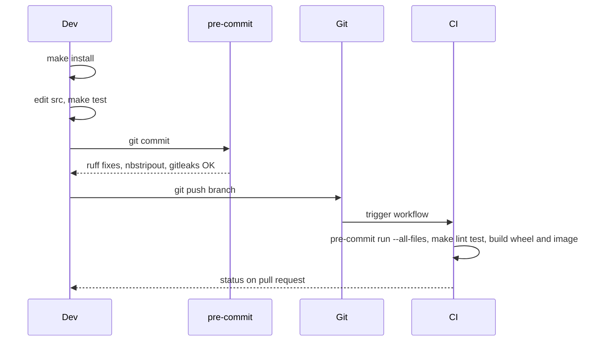

# Python packaging, Makefiles and pre-commit

## From notebook to package

The first concrete MLOps step for most projects is turning notebook code into an **installable Python
package**. Why bother?

- Training pipelines, batch jobs, the serving API and tests can all `import churn.features` — one
  implementation, no copy-paste skew.
- Packages have **declared dependencies**, so environments can be rebuilt.
- Tests can target functions instead of notebook cells.
- Docker images install the package with one line.

## A project layout that scales

```text
churn-model/
├── pyproject.toml          # metadata, dependencies, tool configs
├── uv.lock / poetry.lock   # exact resolved versions (lockfile)
├── Makefile                # task runner: make test, make train ...
├── .pre-commit-config.yaml
├── .gitignore  .dockerignore  .env.example
├── README.md
├── configs/                # YAML configs (lesson 6)
│   ├── train.yaml
│   └── serve.yaml
├── src/
│   └── churn/
│       ├── __init__.py
│       ├── data.py         # loading and validation
│       ├── features.py     # feature engineering (shared by train and serve)
│       ├── train.py        # training entry point
│       ├── evaluate.py
│       └── serve/
│           ├── app.py      # FastAPI app
│           └── schemas.py  # pydantic request/response models
├── tests/
│   ├── test_features.py
│   ├── test_data_contract.py
│   └── test_api.py
├── notebooks/              # exploration only; imports from src/
├── dvc.yaml                # pipeline stages (lesson 8)
└── Dockerfile
```

The **`src/` layout** (code under `src/churn/` rather than `churn/` at the root) forces you to install
the package to import it. That means your tests run against the *installed* package — the same way
production uses it — and accidental imports from the working directory are impossible.

## `pyproject.toml`: one file to rule them all

PEP 517/518/621 standardised project metadata in `pyproject.toml`. A modern example using the `hatchling`
build backend:

```toml
[build-system]
requires = ["hatchling"]
build-backend = "hatchling.build"

[project]
name = "churn"
version = "0.3.0"
description = "Churn prediction: features, training and serving"
requires-python = ">=3.11"
dependencies = [
  "pandas>=2.2,<3",
  "scikit-learn>=1.5,<1.6",
  "pydantic>=2.7",
  "mlflow>=2.14",
]

[project.optional-dependencies]
serve = ["fastapi>=0.111", "uvicorn[standard]>=0.30"]
dev = ["pytest>=8", "pytest-cov", "ruff", "mypy", "pre-commit", "hypothesis"]

[project.scripts]
churn-train = "churn.train:main"      # creates a CLI command on install

[tool.ruff]
line-length = 100
[tool.ruff.lint]
select = ["E", "F", "I", "B", "UP"]   # pycodestyle, pyflakes, isort, bugbear, pyupgrade

[tool.pytest.ini_options]
testpaths = ["tests"]
addopts = "-q --cov=churn --cov-report=term-missing"

[tool.mypy]
strict = true
```

Install for development with `pip install -e ".[dev,serve]"` (editable: code changes take effect without
reinstalling).

### Ranges vs pins vs lockfiles

There are two distinct jobs:

1. **Abstract dependencies** (in `pyproject.toml`): the *ranges* your code is compatible with, e.g.
   `pandas>=2.2,<3`. Libraries should only declare ranges.
2. **Concrete, locked environment** (lockfile): the *exact* versions, including transitive dependencies
   and hashes, that a particular application runs with. Applications and training jobs need this for
   reproducibility.

| Tool | Lockfile | Notes |
|---|---|---|
| `pip` + `pip-tools` | `requirements.txt` from `pip-compile` | simple, ubiquitous |
| Poetry | `poetry.lock` | dependency management + build |
| uv | `uv.lock` | very fast resolver/installer written in Rust |
| Conda / mamba / pixi | `environment.yml`, `conda-lock`, `pixi.lock` | non-Python deps (CUDA, MKL, GDAL) |

```bash
# pip-tools flow
pip-compile --generate-hashes -o requirements.lock pyproject.toml
pip install --require-hashes -r requirements.lock

# uv flow
uv lock            # resolve and write uv.lock
uv sync --frozen   # install exactly what is locked (CI, Docker)
uv run pytest
```

> [!WARNING]
> A training environment built from unpinned ranges today and in three months can produce *different
> models* — a minor scikit-learn or NumPy release can change default parameters or floating-point
> behaviour. Lock the environment and record the lock hash with each run (lesson 11).

### Virtual environments

Always isolate: `python -m venv .venv && source .venv/bin/activate` (or let uv/poetry manage it). Never
`pip install` into the system Python on servers. In Docker, the container itself is the isolation
boundary, but a venv inside it is still handy for multi-stage builds (lesson 17).

### Build and publish

`python -m build` produces an sdist (`.tar.gz`) and a wheel (`.whl`). Wheels are pre-built and install
fast. Internal packages are published to a private index (AWS CodeArtifact, GCP Artifact Registry,
Azure Artifacts, JFrog, devpi) and installed by version — e.g. a shared `company-features` package used
by many models.

## Makefiles: a self-documenting task runner

`make` is ancient, installed everywhere, and perfect as a **single entry point** for common tasks. New
team members (and CI) run `make test` without knowing the underlying commands.

```makefile
.DEFAULT_GOAL := help
PY ?= python
IMAGE ?= churn-api
TAG ?= $(shell git rev-parse --short HEAD)

.PHONY: help install lint test train serve docker-build docker-run clean

help:  ## show this help
	@grep -E '^[a-zA-Z_-]+:.*?## ' $(MAKEFILE_LIST) | awk 'BEGIN {FS = ":.*?## "}; {printf "%-14s %s\n", $$1, $$2}'

install:  ## install package with dev and serve extras
	$(PY) -m pip install -e ".[dev,serve]"
	pre-commit install

lint:  ## static checks
	ruff check src tests
	ruff format --check src tests
	mypy src

test:  ## run unit tests
	pytest

train:  ## train with the default config
	$(PY) -m churn.train --config configs/train.yaml

serve:  ## run the API locally with autoreload
	uvicorn churn.serve.app:app --reload --port 8000

docker-build:  ## build image tagged with git sha
	docker build -t $(IMAGE):$(TAG) .

docker-run: docker-build  ## run the image
	docker run --rm -p 8000:8000 $(IMAGE):$(TAG)

clean:  ## remove caches
	rm -rf .pytest_cache .mypy_cache .ruff_cache dist build
```

Key concepts: **targets** (`test:`), **prerequisites** (`docker-run: docker-build` runs the build first),
**recipes** (indented with a **tab**, not spaces), **variables** (`?=` sets a default overridable from the
command line: `make docker-build TAG=v1`), and `.PHONY` for targets that are not files. `$$` escapes `$`
for the shell.

> [!TIP]
> `make` was designed to rebuild *files* only when their inputs change (timestamps). DVC applies the same
> idea to data pipelines using content hashes instead of timestamps (lesson 8). Alternatives to `make` for
> task running: `just`, `task` (Taskfile), `nox`, `invoke`, `poe`.

## pre-commit: catch problems before they reach Git

`pre-commit` runs a configured set of hooks on staged files at `git commit` time. Fast, local feedback
— and the same config runs in CI (`pre-commit run --all-files`) so nobody can bypass it.

```yaml
# .pre-commit-config.yaml
repos:
  - repo: https://github.com/pre-commit/pre-commit-hooks
    rev: v4.6.0
    hooks:
      - id: trailing-whitespace
      - id: end-of-file-fixer
      - id: check-yaml
      - id: check-added-large-files
        args: ["--maxkb=1024"]          # block accidental data/model commits
      - id: detect-private-key
  - repo: https://github.com/astral-sh/ruff-pre-commit
    rev: v0.5.0
    hooks:
      - id: ruff
        args: ["--fix"]
      - id: ruff-format
  - repo: https://github.com/pre-commit/mirrors-mypy
    rev: v1.10.0
    hooks:
      - id: mypy
        additional_dependencies: ["pydantic>=2"]
  - repo: https://github.com/kynan/nbstripout
    rev: 0.7.1
    hooks:
      - id: nbstripout
  - repo: https://github.com/gitleaks/gitleaks
    rev: v8.18.4
    hooks:
      - id: gitleaks
```

Run `pre-commit install` once per clone; `pre-commit autoupdate` bumps hook versions.

What each hook buys you in an ML repo:

| Hook | Prevents |
|---|---|
| `check-added-large-files` | 2 GB parquet files bloating Git forever |
| `nbstripout` | unreadable notebook diffs, leaked data in outputs |
| `gitleaks` / `detect-private-key` | credentials in history |
| `ruff` / `ruff-format` | style debates, unused imports, common bugs |
| `mypy` | type errors (e.g., passing a DataFrame where a Series is expected) |
| `check-yaml` | broken configs and CI workflows |

## Code quality tools in one place

- **ruff**: extremely fast linter + formatter replacing flake8, isort, pyupgrade and black-style formatting.
- **mypy / pyright**: static type checking. Type hints on pydantic models and function signatures pay off
  hugely in data code.
- **pytest**: tests; `pytest-cov` for coverage; `hypothesis` for property-based tests (lesson 25).

```python-run
# A taste of why type hints + tests matter in feature code.
from typing import Sequence

def rolling_mean(values: Sequence[float], window: int) -> list[float]:
    """Trailing mean; the first window-1 positions use the available prefix."""
    if window <= 0:
        raise ValueError("window must be positive")
    out, s = [], 0.0
    for i, v in enumerate(values):
        s += v
        if i >= window:
            s -= values[i - window]
        out.append(s / min(i + 1, window))
    return out

# "unit tests" you would put in tests/test_features.py
assert rolling_mean([1, 2, 3, 4], 2) == [1.0, 1.5, 2.5, 3.5]
assert rolling_mean([], 3) == []
try:
    rolling_mean([1], 0); raise AssertionError("should fail")
except ValueError:
    pass
print("all feature tests passed:", rolling_mean([10, 20, 30, 40, 50], 3))
```

## Putting it together: the developer loop



> [!INTERVIEW]
> "How do you make an ML environment reproducible?" — Declare ranges in `pyproject.toml`, generate a
> **lockfile with hashes** (pip-tools/uv/poetry/conda-lock), install from the lock in CI and Docker,
> pin the Python version and base image digest, record the lock hash with each run, and capture
> non-Python deps (CUDA, cuDNN, system libs) in the container image.

## Summary

- Turn notebook code into an installable package using the `src/` layout and `pyproject.toml`.
- Separate compatible ranges (pyproject) from exact locks (lockfile with hashes).
- Use a Makefile (or `just`/`nox`) as the single entry point for install, lint, test, train, serve, build.
- Use pre-commit for fast local checks — formatting, linting, typing, large files, notebook outputs, secrets
  — and run the same hooks in CI.

```quiz
[
  {"q": "What is the main benefit of the `src/` layout?",
   "options": ["Faster imports", "Tests run against the installed package, preventing accidental imports from the working directory", "It is required by Docker", "It enables GPU usage"],
   "answer": 1, "explain": "With src/, the package must be installed to be importable, mirroring production."},
  {"q": "Which belongs in `pyproject.toml` dependencies for a library?",
   "options": ["Exact pins of every transitive dependency", "Compatible version ranges like pandas>=2.2,<3", "Hashes of wheels", "Docker image digests"],
   "answer": 1, "explain": "Libraries declare ranges; lockfiles hold exact resolved versions for applications."},
  {"q": "In a Makefile, what must recipe lines be indented with?",
   "options": ["Four spaces", "A tab character", "Two spaces", "Nothing"],
   "answer": 1, "explain": "make requires a literal tab before recipe lines."},
  {"q": "Which pre-commit hook would block an accidental 500 MB model file commit?",
   "options": ["ruff-format", "check-added-large-files", "end-of-file-fixer", "mypy"],
   "answer": 1, "explain": "check-added-large-files fails when staged files exceed a size limit."},
  {"q": "Why run `pre-commit run --all-files` in CI as well as locally?",
   "options": ["To slow CI down", "Because developers can skip local hooks; CI enforces them for everyone", "Because pre-commit cannot run locally", "To build Docker images"],
   "answer": 1, "explain": "Local hooks can be bypassed (--no-verify) or not installed; CI is the enforcement point."},
  {"q": "What does `pip install -e .` do?",
   "options": ["Installs an encrypted package", "Installs the package in editable mode so source changes apply without reinstall", "Exports the environment", "Installs only extras"],
   "answer": 1, "explain": "Editable installs link to the source tree."},
  {"q": "Which tool is best suited when you need CUDA and other non-Python binary dependencies managed alongside Python packages?",
   "options": ["pip-tools", "Conda/mamba/pixi", "ruff", "make"],
   "answer": 1, "explain": "Conda-based tools manage non-Python binaries; Docker base images are the other common answer."}
]
```

> **Source:** Python Packaging User Guide (PEP 517, 518, 621); uv, pip-tools and Poetry documentation; GNU Make manual; pre-commit.com documentation; Bill Lubanovic, *FastAPI*, ch. 2 (modern Python: packages, virtual environments, Poetry) and ch. 12 (testing).
