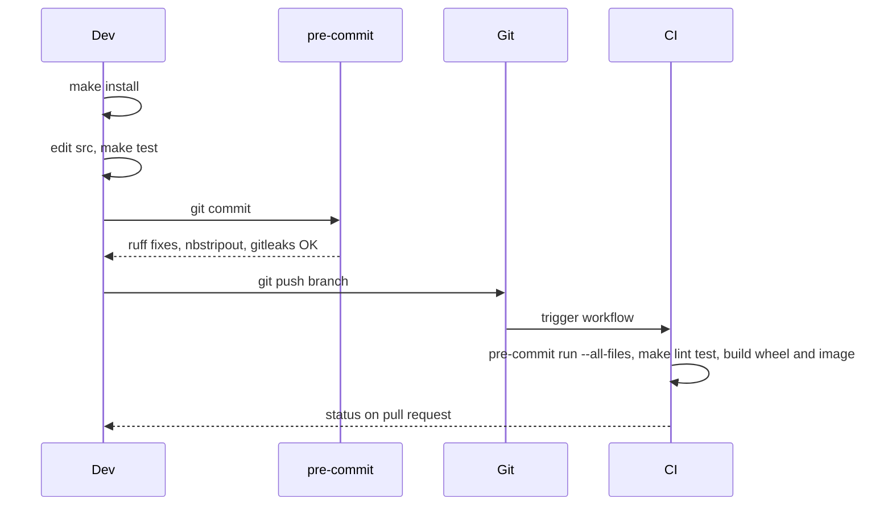

# Python packaging, Makefiles and pre-commit

> **Before this lesson:** read [Git workflows for ML teams](#/lesson/mlops/git-workflows) for
> commits, pull requests and CI. You should be comfortable writing a Python function and running
> `pip install`.

## In plain words

Code written in a notebook lives in one file on one machine. To be used by a training job, a web
service and a test suite at the same time, it has to become a **package**: a named, versioned
bundle of Python code that any machine can install with one command, the same way you install
`pandas`.

Think of the difference between cooking at home and supplying a chain of kitchens. At home you
reach for whatever is in the cupboard. A supplier ships a labelled box: the name of the product,
its version, the exact list of ingredients it needs, and instructions. This lesson is about
building that labelled box for your ML code, and about three helpers around it: a **lockfile**
(the exact list of ingredient versions), a **Makefile** (a short menu of standard commands) and
**pre-commit** (an automatic inspection before anything is saved to Git).

Why this matters for a job: "it works on my machine" is the most common reason an ML project
stalls on its way to production, and "how do you make an environment reproducible?" is one of the
most common interview questions. Everything later in this track (containers, pipelines, CI)
installs the package you learn to build here.

## From notebook to package

The first concrete MLOps step for most projects is turning notebook code into an **installable
Python package**. What it buys:

- The training pipeline, the batch jobs, the serving API and the tests can all write
  `import churn.features`. There is one implementation, so there cannot be two slightly different
  copies (the skew problem from lesson 2).
- A package **declares its dependencies**, the other packages it needs, so the environment can be
  rebuilt on another machine.
- Tests can call functions directly, which is not practical with notebook cells.
- A container image installs the package with one line.

## A project layout that scales

```text
churn-model/
├── pyproject.toml          # metadata, dependencies, tool configs
├── uv.lock / poetry.lock   # exact resolved versions (lockfile)
├── Makefile                # task runner: make test, make train ...
├── .pre-commit-config.yaml
├── .gitignore  .dockerignore  .env.example
├── README.md
├── configs/                # YAML configs (lesson 6)
│   ├── train.yaml
│   └── serve.yaml
├── src/
│   └── churn/
│       ├── __init__.py
│       ├── data.py         # loading and validation
│       ├── features.py     # feature engineering (shared by train and serve)
│       ├── train.py        # training entry point
│       ├── evaluate.py
│       └── serve/
│           ├── app.py      # FastAPI app
│           └── schemas.py  # pydantic request/response models
├── tests/
│   ├── test_features.py
│   ├── test_data_contract.py
│   └── test_api.py
├── notebooks/              # exploration only; imports from src/
├── dvc.yaml                # pipeline stages (lesson 8)
└── Dockerfile
```

Lines beginning with `#` in the tree are comments describing each file; several of the files are
the subject of later lessons.

The **`src/` layout** means the code sits in `src/churn/` and not in `churn/` at the top of the
project. The effect is that Python cannot find the package by accident from the project folder;
you have to install it before `import churn` works. Your tests therefore run against the
*installed* package, which is how production uses it, and a file that was forgotten in the
packaging step is noticed immediately.

## `pyproject.toml`: one file to rule them all

`pyproject.toml` is the standard file that describes a Python project. The standard was set by
three **PEPs** (Python Enhancement Proposals, the documents through which Python evolves),
numbered 517, 518 and 621. **TOML** is a plain configuration format: `[section]` headers followed
by `key = value` lines. The example uses `hatchling` as its **build backend**, the tool that turns
the source folder into an installable file.

```toml
[build-system]
requires = ["hatchling"]
build-backend = "hatchling.build"

[project]
name = "churn"
version = "0.3.0"
description = "Churn prediction: features, training and serving"
requires-python = ">=3.11"
dependencies = [
  "pandas>=2.2,<3",
  "scikit-learn>=1.5,<1.6",
  "pydantic>=2.7",
  "mlflow>=2.14",
]

[project.optional-dependencies]
serve = ["fastapi>=0.111", "uvicorn[standard]>=0.30"]
dev = ["pytest>=8", "pytest-cov", "ruff", "mypy", "pre-commit", "hypothesis"]

[project.scripts]
churn-train = "churn.train:main"      # creates a CLI command on install

[tool.ruff]
line-length = 100
[tool.ruff.lint]
select = ["E", "F", "I", "B", "UP"]   # pycodestyle, pyflakes, isort, bugbear, pyupgrade

[tool.pytest.ini_options]
testpaths = ["tests"]
addopts = "-q --cov=churn --cov-report=term-missing"

[tool.mypy]
strict = true
```

Section by section:

- `[build-system]` names the build backend.
- `[project]` holds the name, the version, the oldest Python that is supported, and
  `dependencies`: the packages that must be present for the code to run. `"pandas>=2.2,<3"` is a
  **version range** meaning "2.2 or newer, but below 3".
- `[project.optional-dependencies]` defines named extra groups, called **extras**. The web server
  is only needed when serving, and the test tools only during development.
- `[project.scripts]` creates a terminal command: after installation, typing `churn-train` calls
  the function `main` in `churn/train.py`.
- The `[tool.*]` sections configure the helper tools described later, so they need no separate
  configuration files.

Install the project for development with `pip install -e ".[dev,serve]"`. The `-e` stands for
**editable**: the installed package points at your source folder, so a change to the code takes
effect without reinstalling. The part in square brackets selects the extras.

### Ranges vs pins vs lockfiles

A dependency list has two different jobs, and mixing them up causes most packaging trouble.

1. **Abstract dependencies** (in `pyproject.toml`): the *ranges* your code is known to work with,
   such as `pandas>=2.2,<3`. A library that other projects will install should declare ranges
   only, so it can coexist with their other packages.
2. **A concrete, locked environment** (in a **lockfile**): the *exact* version of every package
   that one particular application runs with. This includes **transitive dependencies**, the
   packages that your dependencies themselves depend on, and a **hash** of each file (a
   fingerprint computed from its contents, so a tampered or different file is detected).
   Applications and training jobs need this for reproducibility.

The lockfile is generated by a tool, never written by hand. Several tools do this:

| Tool | Lockfile | Notes |
|---|---|---|
| `pip` + `pip-tools` | `requirements.txt` from `pip-compile` | simple, ubiquitous |
| Poetry | `poetry.lock` | dependency management + build |
| uv | `uv.lock` | very fast resolver/installer written in Rust |
| Conda / mamba / pixi | `environment.yml`, `conda-lock`, `pixi.lock` | non-Python deps (CUDA, MKL, GDAL) |

```bash
# pip-tools flow
pip-compile --generate-hashes -o requirements.lock pyproject.toml
pip install --require-hashes -r requirements.lock

# uv flow
uv lock            # resolve and write uv.lock
uv sync --frozen   # install exactly what is locked (CI, Docker)
uv run pytest
```

In the first flow, `pip-compile` reads the ranges and writes a file of exact versions with hashes;
`pip install --require-hashes` then installs precisely those files and refuses anything else. In
the second, `uv lock` does the resolving and `uv sync --frozen` installs exactly what the lockfile
says without attempting to update it. "Resolving" means finding one set of versions that satisfies
every range at once.

> [!WARNING]
> A training environment built from unpinned ranges today and in three months can produce *different
> models* — a minor scikit-learn or NumPy release can change default parameters or floating-point
> behaviour. Lock the environment and record the lock hash with each run (lesson 11).

### Virtual environments

A **virtual environment** (often shortened to venv) is a private folder of installed packages for
one project, so that two projects on the same machine can use different versions of the same
library. Always work in one: `python -m venv .venv` creates it and `source .venv/bin/activate`
switches your terminal to it (uv and Poetry can manage this for you). Never `pip install` into the
Python that the operating system itself uses on a server. Inside a container the container is
already the isolation boundary, but a venv inside it is still handy for multi-stage builds
(lesson 17).

### Build and publish

`python -m build` produces two files. The **sdist** (source distribution, a `.tar.gz`) is the
source code packed up. The **wheel** (a `.whl` file) is a ready-to-install form that needs no
build step on the receiving machine, so it installs quickly. Companies publish internal packages
to a private **package index** (their own equivalent of the public PyPI site that `pip` downloads
from; AWS CodeArtifact, GCP Artifact Registry, Azure Artifacts, JFrog and devpi are examples) and
install them by version. A typical case is a shared `company-features` package used by many
models.

## Makefiles: a self-documenting task runner

`make` is a decades-old program, present on almost every Linux and macOS machine, that runs named
groups of shell commands listed in a file called `Makefile`. It works well as a **single entry
point** for the everyday tasks of a project. A new team member, and the CI system, can run `make
test` without knowing which commands sit behind it.

```makefile
.DEFAULT_GOAL := help
PY ?= python
IMAGE ?= churn-api
TAG ?= $(shell git rev-parse --short HEAD)

.PHONY: help install lint test train serve docker-build docker-run clean

help:  ## show this help
	@grep -E '^[a-zA-Z_-]+:.*?## ' $(MAKEFILE_LIST) | awk 'BEGIN {FS = ":.*?## "}; {printf "%-14s %s\n", $$1, $$2}'

install:  ## install package with dev and serve extras
	$(PY) -m pip install -e ".[dev,serve]"
	pre-commit install

lint:  ## static checks
	ruff check src tests
	ruff format --check src tests
	mypy src

test:  ## run unit tests
	pytest

train:  ## train with the default config
	$(PY) -m churn.train --config configs/train.yaml

serve:  ## run the API locally with autoreload
	uvicorn churn.serve.app:app --reload --port 8000

docker-build:  ## build image tagged with git sha
	docker build -t $(IMAGE):$(TAG) .

docker-run: docker-build  ## run the image
	docker run --rm -p 8000:8000 $(IMAGE):$(TAG)

clean:  ## remove caches
	rm -rf .pytest_cache .mypy_cache .ruff_cache dist build
```

How to read a Makefile:

- A **target** is a name followed by a colon, such as `test:`. Typing `make test` runs it.
- The indented lines under a target are its **recipe**: the shell commands to run. They must be
  indented with a **tab** character, not spaces. This is the most common Makefile error.
- Names after the colon are **prerequisites**: `docker-run: docker-build` means "run
  `docker-build` first".
- `NAME ?= value` defines a **variable** with a default that can be overridden from the command
  line, as in `make docker-build TAG=v1`. `$(NAME)` reads it.
- `TAG ?= $(shell git rev-parse --short HEAD)` runs a shell command and stores its output, here
  the short SHA of the current commit.
- `.PHONY` lists the targets that are commands and not files to be produced.
- The `help` target searches the Makefile for the `## ` comments and prints them as a menu. `$$`
  is how a literal `$` is passed through to the shell.

> [!TIP]
> `make` was designed to rebuild *files* only when their inputs are newer than their outputs. DVC
> applies the same idea to data pipelines, comparing fingerprints of file contents in place of
> timestamps (lesson 8). Other task runners with the same purpose include `task` (Taskfile),
> `nox`, `invoke` and `poe`.

## pre-commit: catch problems before they reach Git

A **hook** is a small program that Git runs automatically at a certain moment. The tool
`pre-commit` manages a list of hooks that run on the files you have staged whenever you type `git
commit`; if any hook fails, the commit is refused until the problem is fixed. The feedback is
fast and local. The same configuration is also run in CI (`pre-commit run --all-files`), so a
person who skipped the local hooks is still caught.

The configuration is written in **YAML**, a format in which nesting is shown by indentation and
list items start with a dash. Each `repo` entry names a public repository of hooks, `rev` fixes
the version, and `hooks` lists which ones to use:

```yaml
# .pre-commit-config.yaml
repos:
  - repo: https://github.com/pre-commit/pre-commit-hooks
    rev: v4.6.0
    hooks:
      - id: trailing-whitespace
      - id: end-of-file-fixer
      - id: check-yaml
      - id: check-added-large-files
        args: ["--maxkb=1024"]          # block accidental data/model commits
      - id: detect-private-key
  - repo: https://github.com/astral-sh/ruff-pre-commit
    rev: v0.5.0
    hooks:
      - id: ruff
        args: ["--fix"]
      - id: ruff-format
  - repo: https://github.com/pre-commit/mirrors-mypy
    rev: v1.10.0
    hooks:
      - id: mypy
        additional_dependencies: ["pydantic>=2"]
  - repo: https://github.com/kynan/nbstripout
    rev: 0.7.1
    hooks:
      - id: nbstripout
  - repo: https://github.com/gitleaks/gitleaks
    rev: v8.18.4
    hooks:
      - id: gitleaks
```

Run `pre-commit install` once per clone; `pre-commit autoupdate` bumps hook versions.

What each hook buys you in an ML repo:

| Hook | Prevents |
|---|---|
| `check-added-large-files` | 2 GB parquet files bloating Git forever |
| `nbstripout` | unreadable notebook diffs, leaked data in outputs |
| `gitleaks` / `detect-private-key` | credentials in history |
| `ruff` / `ruff-format` | style debates, unused imports, common bugs |
| `mypy` | type errors (e.g., passing a DataFrame where a Series is expected) |
| `check-yaml` | broken configs and CI workflows |

## Code quality tools in one place

Three kinds of tool appear in the configuration above.

- A **linter** reads code without running it and reports likely mistakes, such as an unused import
  or an undefined name. A **formatter** rewrites code into one consistent layout. **ruff** is a
  very fast program that does both, replacing the older flake8, isort, pyupgrade and black.
- A **static type checker** (**mypy** or **pyright**) reads **type hints**, the optional
  annotations such as `window: int` that say what kind of value a function expects, and reports
  calls that do not match. In data code this catches a great many errors before anything runs.
- **pytest** runs tests. `pytest-cov` reports **coverage**, the share of code lines that the tests
  executed, and `hypothesis` generates test inputs automatically (lesson 25).

The runnable example below shows a small feature function with type hints and three tests. The
function computes a trailing average: for each position, the mean of the last `window` values, or
of however many values exist so far.
```python-run
# A taste of why type hints + tests matter in feature code.
from typing import Sequence

def rolling_mean(values: Sequence[float], window: int) -> list[float]:
    """Trailing mean; the first window-1 positions use the available prefix."""
    if window <= 0:
        raise ValueError("window must be positive")
    out, s = [], 0.0
    for i, v in enumerate(values):
        s += v
        if i >= window:
            s -= values[i - window]
        out.append(s / min(i + 1, window))
    return out

# "unit tests" you would put in tests/test_features.py
assert rolling_mean([1, 2, 3, 4], 2) == [1.0, 1.5, 2.5, 3.5]
assert rolling_mean([], 3) == []
try:
    rolling_mean([1], 0); raise AssertionError("should fail")
except ValueError:
    pass
print("all feature tests passed:", rolling_mean([10, 20, 30, 40, 50], 3))
```

Line by line: the signature `values: Sequence[float], window: int) -> list[float]` states that the
function takes a sequence of numbers and a whole number and returns a list of numbers. The `if
window <= 0` check rejects a meaningless window by raising an error. Inside the loop, `s` is a
running sum: each new value is added, and once more than `window` values have been seen, the one
that fell out of the window is subtracted. Dividing by `min(i + 1, window)` handles the first few
positions, where fewer than `window` values exist.

The three `assert` lines are the tests. An `assert` does nothing when its condition is true and
stops the program when it is false. They check a normal case, an empty input, and that an invalid
window raises `ValueError`. The output is:

```text
all feature tests passed: [10.0, 15.0, 20.0, 30.0, 40.0]
```

The first two results (10.0 and 15.0) average one and two values because the window of 3 is not
yet full; from the third position on, each result is the mean of three values.

## Putting it together: the developer loop



> [!INTERVIEW]
> "How do you make an ML environment reproducible?" — Declare ranges in `pyproject.toml`, generate a
> **lockfile with hashes** (pip-tools/uv/poetry/conda-lock), install from the lock in CI and Docker,
> pin the Python version and base image digest, record the lock hash with each run, and capture
> non-Python deps (CUDA, cuDNN, system libs) in the container image.

## Dependency groups for ML projects

ML projects have unusually different needs per context. Split dependencies so each environment installs
only what it uses:

```toml
[project]
dependencies = ["numpy>=1.26", "pandas>=2.2", "scikit-learn>=1.5,<1.6", "pydantic>=2.7"]   # needed everywhere

[project.optional-dependencies]
train = ["mlflow>=2.14", "optuna>=3.6", "pandera>=0.20", "dvc[s3]>=3.50"]
serve = ["fastapi>=0.111", "uvicorn[standard]>=0.30", "prometheus-client>=0.20", "mlflow-skinny>=2.14"]
dev   = ["pytest>=8", "pytest-cov", "hypothesis", "ruff", "mypy", "pre-commit"]
```

The serving image installs `.[serve]` only: no Optuna (a tuning library), no DVC, and
`mlflow-skinny`, a cut-down MLflow, in place of the full one. The image is smaller, it has fewer
**CVEs** (publicly catalogued security vulnerabilities, each of which arrives with some installed
package), and it starts faster. The price is discipline: the **versions of the shared libraries
(scikit-learn, NumPy) must be identical** in the training and serving environments, or a pickled
model may fail to load or may behave differently. Generate both lockfiles from the same
constraints, or use one lockfile with groups (`uv sync --extra serve --frozen`).

> [!WARNING]
> A pickle is tied to the library version that wrote it. scikit-learn warns (`InconsistentVersionWarning`)
> when unpickling across versions and makes no guarantee that it works. Record the training environment
> with the model (MLflow does this) and build the serving image from it — or export to a
> version-independent format such as ONNX.

## Versioning the package

A package version tells consumers what changed. Common schemes:

- **Semantic versioning** for libraries: `MAJOR.MINOR.PATCH`.
- **Version from Git tags** so there is one source of truth: tools such as `hatch-vcs` or
  `setuptools-scm` derive `1.4.0` from the tag `v1.4.0` and something like `1.4.1.dev3+g9f3c1e2` for
  untagged commits — every build is traceable to a commit.

```toml
[build-system]
requires = ["hatchling", "hatch-vcs"]
build-backend = "hatchling.build"
[project]
dynamic = ["version"]
[tool.hatch.version]
source = "vcs"
```

Expose it at runtime (`importlib.metadata.version("churn")`) and include it in logs and the `/readyz`
response: *code version* and *model version* are different things and you need both to debug.

## Entry points and a thin CLI

Make every pipeline step runnable as a command with arguments — that is what orchestrators, CI and
humans call.

```python
# src/churn/cli.py
import argparse

def main(argv: list[str] | None = None) -> int:
    parser = argparse.ArgumentParser(prog="churn")
    sub = parser.add_subparsers(dest="cmd", required=True)
    t = sub.add_parser("train");  t.add_argument("--params", default="params.yaml")
    s = sub.add_parser("score");  s.add_argument("--date", required=True); s.add_argument("--model-uri", default="models:/churn@champion")
    v = sub.add_parser("validate"); v.add_argument("--path", required=True)
    args = parser.parse_args(argv)
    if args.cmd == "train":
        from churn.train import run; run(args.params)
    elif args.cmd == "score":
        from churn.score import run; run(args.date, args.model_uri)
    elif args.cmd == "validate":
        from churn.data import load; load(args.path)
    return 0                                   # exceptions propagate -> non-zero exit code
```

```toml
[project.scripts]
churn = "churn.cli:main"
```

Now `churn train --params params.yaml` works identically on a laptop, in Docker and in an Airflow task.
Imports inside the branches keep `churn score` from importing training-only dependencies.

## A realistic `make ci` and why it mirrors CI

```makefile
ci: lint test build            ## everything CI runs, in the same order

build:                         ## build wheel and verify it installs in a clean environment
	python -m build
	python -m venv .venv-check && .venv-check/bin/pip install dist/*.whl && .venv-check/bin/churn --help
	rm -rf .venv-check
```

If `make ci` passes locally, CI should pass — and when CI is defined as "run `make ci`", the pipeline
YAML stays small and vendor-neutral. The clean-environment install catches the classic packaging bug:
it works from the source tree but the wheel is missing a module or a data file.

### Troubleshooting checklist

| Symptom | Likely cause |
|---|---|
| `ModuleNotFoundError` in Docker but not locally | package not installed (relying on the working directory); missing `src/` layout config |
| Works locally, fails in CI | unpinned dependency resolved to a newer version; missing system library |
| `pip` resolves for minutes or fails | conflicting ranges; resolve once into a lockfile |
| Pre-commit passes locally, fails in CI | hook versions differ; run `pre-commit autoupdate` and commit the config |
| Model fails to unpickle in serving | library version mismatch between training and serving environments |

## Summary

- Turn notebook code into an installable package using the `src/` layout and `pyproject.toml`.
- Separate compatible ranges (pyproject) from exact locks (lockfile with hashes).
- Use a Makefile (or another task runner such as `nox`) as the single entry point for install,
  lint, test, train, serve and build.
- Use pre-commit for fast local checks — formatting, linting, typing, large files, notebook outputs, secrets
  — and run the same hooks in CI.

## Glossary

- **Package** - a named, versioned, installable bundle of Python code.
- **Dependency** - another package your code needs. **Transitive dependency** - a dependency of a
  dependency.
- **`pyproject.toml`** - the standard file describing a Python project and its tool settings.
- **Build backend** - the tool that turns source code into an installable file.
- **Version range / pin** - a set of acceptable versions / one exact version.
- **Lockfile** - a generated file listing the exact version (and hash) of every installed package.
- **Hash** - a fingerprint computed from a file's contents.
- **Extras** - optional groups of dependencies, such as `[serve]` or `[dev]`.
- **Editable install** - an install that points at your source folder (`pip install -e .`).
- **Virtual environment (venv)** - a private set of installed packages for one project.
- **Wheel / sdist** - a ready-to-install package file / the packed source code.
- **Package index** - a server that hosts packages for `pip` to download.
- **Makefile / target / recipe** - a file of named tasks / one task name / its commands.
- **Hook** - a program Git runs automatically, for example before each commit.
- **Linter / formatter** - a tool that finds likely mistakes / rewrites code into a standard style.
- **Type hint / static type checker** - an annotation of the expected kind of value / a tool that
  verifies them without running the code.
- **Coverage** - the share of code lines executed by the tests.
- **CLI / entry point** - a command-line interface / the function a command runs.
- **CVE** - a publicly catalogued security vulnerability.

```quiz
[
  {"q": "What is the main benefit of the `src/` layout?",
   "options": ["Faster imports", "Tests run against the installed package, preventing accidental imports from the working directory", "It is required by Docker", "It enables GPU usage"],
   "answer": 1, "explain": "With src/, the package must be installed to be importable, mirroring production."},
  {"q": "Which belongs in `pyproject.toml` dependencies for a library?",
   "options": ["Exact pins of every transitive dependency", "Compatible version ranges like pandas>=2.2,<3", "Hashes of wheels", "Docker image digests"],
   "answer": 1, "explain": "Libraries declare ranges; lockfiles hold exact resolved versions for applications."},
  {"q": "In a Makefile, what must recipe lines be indented with?",
   "options": ["Four spaces", "A tab character", "Two spaces", "Nothing"],
   "answer": 1, "explain": "make requires a literal tab before recipe lines."},
  {"q": "Which pre-commit hook would block an accidental 500 MB model file commit?",
   "options": ["ruff-format", "check-added-large-files", "end-of-file-fixer", "mypy"],
   "answer": 1, "explain": "check-added-large-files fails when staged files exceed a size limit."},
  {"q": "Why run `pre-commit run --all-files` in CI as well as locally?",
   "options": ["To slow CI down", "Because developers can skip local hooks; CI enforces them for everyone", "Because pre-commit cannot run locally", "To build Docker images"],
   "answer": 1, "explain": "Local hooks can be bypassed (--no-verify) or not installed; CI is the enforcement point."},
  {"q": "What does `pip install -e .` do?",
   "options": ["Installs an encrypted package", "Installs the package in editable mode so source changes apply without reinstall", "Exports the environment", "Installs only extras"],
   "answer": 1, "explain": "Editable installs link to the source tree."},
  {"q": "Which tool is best suited when you need CUDA and other non-Python binary dependencies managed alongside Python packages?",
   "options": ["pip-tools", "Conda/mamba/pixi", "ruff", "make"],
   "answer": 1, "explain": "Conda-based tools manage non-Python binaries; Docker base images are the other common answer."}
]
```

> **Source:** Python Packaging User Guide (PEP 517, 518, 621); uv, pip-tools and Poetry documentation; GNU Make manual; pre-commit.com documentation; Bill Lubanovic, *FastAPI*, ch. 2 (modern Python: packages, virtual environments, Poetry) and ch. 12 (testing).
