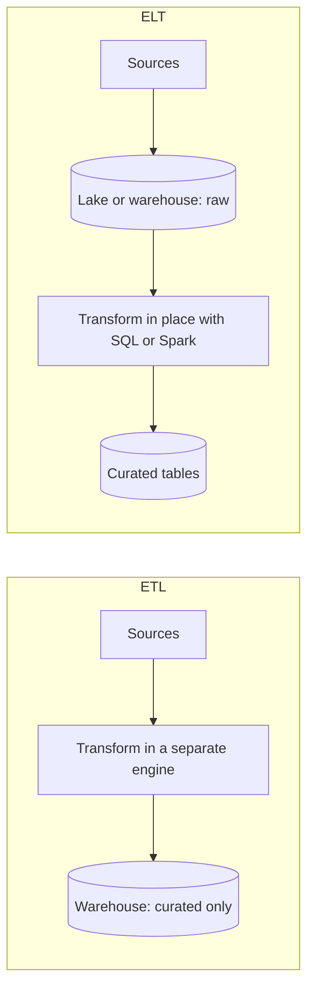
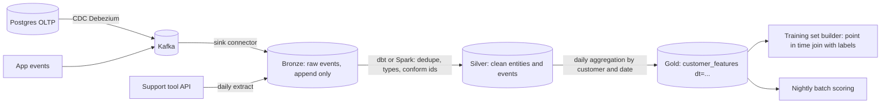

# Data sources, ETL/ELT, batch and streaming

> **Before this lesson:** read [The ML lifecycle and the anatomy of an ML system](#/lesson/mlops/ml-lifecycle)
> for where data sits in an ML system, and [Linux shell essentials and configuration management](#/lesson/mlops/shell-config)
> for pipes. It helps to have seen a database table and a little SQL, but each idea is explained.

## In plain words

A **data pipeline** is a chain of automatic steps that carries data from where it is created (an
app's database, a stream of clicks) to where it is used (a table a model can be trained on),
cleaning and reshaping it along the way.

Picture the water system of a town. Water is collected from rivers and wells (the sources),
carried through pipes, cleaned at a treatment plant, and stored in a reservoir from which every
house draws. Nobody drinks straight from the river. Data pipelines play the same role for a
model: nobody trains straight from the production database.

There are two ways to run the plant. **Batch** processing collects a day's worth and treats it in
one go, like a lorry that makes one delivery every morning. **Stream** processing treats each
drop as it arrives, like a tap that is always running. Batch is cheaper and easier to get right;
streaming gives fresher results.

Why this matters for a job: practitioners report that most of the time in a real ML project goes
into data, and "design the data pipeline for this model" is a standard interview exercise. The
vocabulary in this lesson (ETL, CDC, idempotent, event time, window) is the vocabulary of that
exercise.

## Data is the product's raw material

A model is **downstream** of its data: it receives whatever the pipeline delivers. If the
pipeline is late, broken or subtly wrong, no amount of modelling skill helps. This lesson covers
where ML data comes from, the two orders in which it is moved and cleaned (ETL and ELT), and the
two basic processing styles, **batch** and **stream**. The material follows chapters 10 and 11 of
Kleppmann's *Designing Data-Intensive Applications* (referred to below as DDIA).

## Where ML data comes from
## Where ML data comes from

| Source | Examples | Characteristics |
|---|---|---|
| Operational databases (OLTP) | Postgres, MySQL, DynamoDB | current state, row-oriented, must not be overloaded by analytics |
| Event streams / logs | clicks, page views, app events in Kafka | append-only, high volume, time-ordered |
| Third-party data | weather, credit bureaus, demographics | licensing, schema changes outside your control |
| User-generated content | text, images, reviews | unstructured, needs labeling/moderation |
| System outputs | model predictions, search logs | feedback loops (lesson 2) |
| Manual labels | annotation tools | expensive, slow, noisy |

Two families of storage serve two very different kinds of work:

- **OLTP** (online transaction processing) is the database behind an application. It handles
  enormous numbers of small requests, each reading or writing a single record ("fetch customer
  42", "add this order"), and each must be fast. Postgres and MySQL are typical.
- **OLAP** (online analytical processing) answers questions about many records at once ("average
  order value per country last month"). The systems built for this are **data warehouses**
  (BigQuery, Snowflake, Redshift) and **lakehouses** (table formats such as Delta Lake, Apache
  Iceberg and Hudi laid over files in object storage). They store data **column by column** and
  not row by row, in file formats such as **Parquet**, so a query that needs 3 of a table's 200
  columns reads only those 3 (DDIA ch. 3).

> [!TIP]
> Never run heavy training queries directly against the production OLTP database: a long scan can
> slow the application down for real users. Copy the data into the warehouse or lake first. The
> usual technique is **change data capture (CDC)**: a tool such as Debezium reads the database's
> own internal record of every insert, update and delete and publishes each as an event. DDIA ch.
> 11 describes this as turning a database into a stream of changes that other systems (search
> indexes, caches, warehouses) can follow.

## ETL vs ELT

Both names list the same three steps, in a different order. **Extract** means read data out of a
source. **Transform** means clean it, join it with other data and summarise it. **Load** means
write it into the place where it will be analysed.

- **ETL (extract, transform, load).** Data is transformed *before* it reaches the target, by a
  separate program. Only the finished, tidy tables are stored. This was the norm when companies
  ran their own warehouse hardware and storage was expensive.
- **ELT (extract, load, transform).** The raw data is loaded first, untouched, into cheap storage,
  and transformed afterwards *inside* the warehouse using SQL, often organised with the tool
  **dbt**. This is the dominant approach today, because cloud warehouses charge separately for
  storage (cheap) and for computing (paid only while a query runs).



ELT has an important benefit for ML: the **raw data is kept**. When you invent a new feature next
quarter you can compute it over all of history, because the original events are still there. DDIA
stresses this point repeatedly: if raw inputs are kept **immutable** (never changed after they are
written), any derived table can be thrown away and rebuilt.

### The medallion pattern

Lakehouse teams often organise tables in layers:

- **Bronze**: raw, append-only ingested data, exactly as received.
- **Silver**: cleaned, deduplicated, conformed (types, timezones, IDs).
- **Gold**: business-level aggregates and **feature tables** ready for training and BI.

## Batch processing

A **batch job** takes a fixed, finite input (yesterday's events, a copy of a table), runs until it
is finished, and writes its output. What matters is **throughput**, how much data is processed per
hour, and not how quickly any single record is handled. DDIA traces three generations:

1. **Unix tools**: `sort | uniq -c` on one machine (lesson 6).
2. **MapReduce** (the model behind Hadoop): the same pattern spread over thousands of machines.
   A *map* step turns each input record into a (key, value) pair. The framework then *shuffles*:
   it brings all pairs with the same key together on the same machine. A *reduce* step combines
   the values of each key, for example by adding them. Because inputs are never modified and
   outputs are written fresh, a task that fails can be run again without harm.
3. **Dataflow engines** such as Spark and Flink: a whole graph of processing steps is planned at
   once and intermediate results are kept in memory where possible, which avoids most of the
   writing to disk that chained MapReduce jobs do.

Three batch ideas matter most for ML:

- **Joins at scale.** A **join** combines rows from two tables that share a key, such as attaching
  each order to its customer. Engines have several strategies (sorting both sides, copying a small
  table to every worker, or splitting both tables by a hash of the key), and feature computation
  is mostly joins.
- **Immutability and idempotence.** An operation is **idempotent** when running it twice gives the
  same result as running it once. If the job for date D always *replaces* the output for D, a
  retry cannot create duplicates. That makes a **backfill**, recomputing past dates after a bug
  fix or for a new feature, safe.
- **Partitioning by date.** A **partition** is one slice of a table stored separately, typically
  one folder per day (`events/dt=2025-01-15/`), so a job can process and overwrite one day at a
  time.

The program below performs a miniature MapReduce by hand and then demonstrates an idempotent
write.
```python-run
# A miniature "MapReduce": count events per user per day, then a daily feature table.
from collections import defaultdict
events = [
    ("2025-01-01", "u1", "click"), ("2025-01-01", "u2", "view"), ("2025-01-01", "u1", "buy"),
    ("2025-01-02", "u1", "view"), ("2025-01-02", "u3", "click"), ("2025-01-02", "u3", "click"),
]
# map: emit ((day, user), 1)
mapped = [((d, u), 1) for d, u, _ in events]
# shuffle: group by key (the framework sorts/partitions)
groups = defaultdict(list)
for k, v in sorted(mapped):
    groups[k].append(v)
# reduce: sum per key
reduced = {k: sum(vs) for k, vs in groups.items()}
for (day, user), n in reduced.items():
    print(day, user, "events:", n)

# idempotent partition overwrite: rerunning day 2 replaces, never duplicates
table = {"2025-01-01": {"u1": 2, "u2": 1}}
def write_partition(table, day, rows):
    table[day] = dict(rows)        # overwrite the whole partition
day2 = {u: n for (d, u), n in reduced.items() if d == "2025-01-02"}
write_partition(table, "2025-01-02", day2)
write_partition(table, "2025-01-02", day2)   # retry is harmless
print(table)
```

Step by step: `mapped` turns each event into a pair whose key is `(day, user)` and whose value is
1. The shuffle sorts the pairs and collects the values of each key into a list, so
`("2025-01-01", "u1")` ends up with `[1, 1]`. The reduce adds each list. The first four output
lines are those sums:

```text
2025-01-01 u1 events: 2
2025-01-01 u2 events: 1
2025-01-02 u1 events: 1
2025-01-02 u3 events: 2
{'2025-01-01': {'u1': 2, 'u2': 1}, '2025-01-02': {'u1': 1, 'u3': 2}}
```

The last line shows the table after day 2 was written *twice*. Because `write_partition` assigns
the whole day (`table[day] = ...`) and does not add to it, the second write changed nothing. Had
it appended, user u3 would show 4 events and every later feature would be wrong.

## Stream processing

A **stream** is a sequence of events that never ends: there is no "all of the input" to wait for.
**Stream processing** handles events continuously, within seconds or less of their arrival. DDIA
ch. 11 covers the building blocks.

- **Message brokers.** A **broker** is a service that receives events from the programs that
  produce them and hands them to the programs that consume them. Traditional queues (RabbitMQ,
  SQS) delete a message once a consumer confirms it. **Log-based brokers** (Kafka, Kinesis,
  Pulsar) append every event to a long, ordered file called a log and keep it; each consumer
  remembers its own position, called an **offset**. Because events are kept, the log can be
  **replayed** from an earlier offset, which is invaluable for recomputing features or debugging.
- **Partitions** split a log into several parallel logs so that many machines can work at once.
  Order is guaranteed only inside one partition, so if per-user order matters, send all of a
  user's events to the same partition by using `user_id` as the key.
- **Event time versus processing time.** Event time is when something happened; processing time
  is when your system received it. A phone that was offline may deliver a 12:00:01 event at
  12:03. Grouping by processing time would count it in the wrong minute. Stream engines (Flink,
  Spark Structured Streaming, Beam) group by event time and use a **watermark**, a moving estimate
  of "we have probably seen everything up to this moment", to decide when a time window can be
  closed and what to do with events that arrive later still.
- **Windows.** A **window** is a slice of time over which events are summarised. *Tumbling*
  windows are fixed and do not overlap (every 5 minutes). *Hopping* windows have a fixed size and
  overlap (a 5-minute window starting every minute). *Sliding* windows cover all events within a
  given interval of each other. *Session* windows group one burst of a user's activity and close
  after a period of silence.
- **Stream joins.** Two streams can be joined (clicks with the ad impressions that preceded them
  within an hour), or a stream can be joined with a table (each event enriched with the latest
  profile of the user, where the table is itself kept current by CDC).
- **Fault tolerance.** The engine periodically saves its working state (a **checkpoint**). After a
  crash it restores the checkpoint and replays the input from that point. If outputs are
  idempotent, the visible result is as if every event had been processed exactly once.

The next program computes tumbling and hopping windows over five events, one of which arrives out
of order.

```python-run
# Tumbling vs hopping windows over event time, with a late event.
events = [  # (event_time_seconds, user, amount)
    (1, "u1", 10), (4, "u1", 5), (7, "u2", 3), (12, "u1", 8), (3, "u2", 4),  # (3,...) arrives late
]
def tumbling(events, size):
    out = {}
    for t, u, a in events:
        w = (t // size) * size
        out[(w, w + size)] = out.get((w, w + size), 0) + a
    return dict(sorted(out.items()))
def hopping(events, size, hop):
    out = {}
    tmax = max(t for t, _, _ in events)
    start = 0
    while start <= tmax:
        out[(start, start + size)] = sum(a for t, _, a in events if start <= t < start + size)
        start += hop
    return out
print("tumbling 5s :", tumbling(events, 5))
print("hopping 10s/5s:", hopping(events, 10, 5))
# Note: grouping by *event time* puts the late event (t=3) in window [0,5) where it belongs.
```

In `tumbling`, `(t // size) * size` rounds each event time down to the start of its 5-second
window: time 7 gives 5, so the event belongs to the window `(5, 10)`. In `hopping`, a 10-second
window starts every 5 seconds, so every event falls into two windows. The output:

```text
tumbling 5s : {(0, 5): 19, (5, 10): 3, (10, 15): 8}
hopping 10s/5s: {(0, 10): 22, (5, 15): 11, (10, 20): 8}
```

Check the first figure: the events at times 1, 4 and 3 have amounts 10, 5 and 4, a total of 19.
The event with time 3 is the last one in the list, meaning it *arrived* last, yet it is counted in
window `(0, 5)` because the code groups by the event's own timestamp. That is event-time
processing.

### Lambda vs kappa architecture

- **Lambda**: a batch layer recomputes accurate views periodically, a speed layer provides approximate
  real-time updates, and a serving layer merges them. Downside: two codebases for the same logic.
- **Kappa**: everything is a stream; reprocessing = replaying the log through a new version of the
  stream job. One codebase. Modern engines (Flink, Spark, Beam) blur the line by running the same code
  in batch and streaming modes.

## Batch vs streaming for ML features

| Feature | Freshness need | Typical approach |
|---|---|---|
| Customer lifetime spend | daily is fine | batch (SQL/dbt/Spark) |
| Number of transactions in last 10 minutes (fraud) | seconds | streaming (Flink/Spark Streaming) into online store |
| Embedding of product description | when product changes | event-triggered batch |
| Current session's viewed items | real time | computed at request time from session state |

Streaming is powerful but operationally expensive (always-on clusters, state management, late data). A
common rule: **start with batch; move a feature to streaming only when fresher data measurably improves
the model or product**.

> [!INTERVIEW]
> "Design features for real-time fraud detection." — Discuss: Kafka topic of transactions partitioned by
> card ID; a Flink job computing sliding-window aggregates (count/amount in last 1 min, 1 h) keyed by card
> and merchant; event-time processing with watermarks; writing to an online feature store (Redis/
> DynamoDB) for low-latency lookup; the same logic backfilled in batch to produce point-in-time-correct
> training data; and monitoring freshness lag.

## Orchestrating data pipelines and data contracts

Batch pipelines are started and supervised by orchestrators (Airflow, Dagster, Prefect; lesson
13), which handle the order of steps, retries, backfills and alerts. The teams that produce your
input data should be treated like the providers of an API, with a **data contract**: an agreed
schema, the meaning of each column, a freshness promise (an **SLA**, service level agreement, such
as "yesterday's data is complete by 03:00") and a named owner, all enforced by automated checks.
When a schema has to change (DDIA ch. 4 calls this schema evolution), the change should be
*backward compatible*: add optional fields, and never quietly give an existing column a new
meaning. Data formats such as Avro and Protobuf, used with a schema registry (a service that
stores every version of every schema), make these rules explicit.

## Worked example: designing the data flow for a churn model

Apply the concepts to a concrete case. The product database (Postgres) holds `customers` and
`subscriptions`; the app emits click events; support tickets live in a SaaS tool.



Decisions and their reasons:

1. **CDC instead of nightly dumps** of Postgres: no heavy analytical queries on the production database,
   and every *change* is captured — a nightly snapshot would miss a subscription that was paused and
   resumed the same day.
2. **Bronze is immutable and complete.** When someone later asks for "number of plan changes in the last
   90 days", the history exists to compute it.
3. **Silver deduplicates.** At-least-once delivery from Kafka means duplicates; dedupe on the event ID.
4. **Gold is partitioned by date and overwritten per partition**, so the daily job is idempotent and a
   bug fix can be backfilled one partition at a time.
5. **Batch, not streaming, for features**: the model is scored nightly; nothing needs sub-daily
   freshness. Streaming would add cost and operational burden for no benefit.

### The daily job as idempotent SQL

```sql
-- gold.customer_features, one partition per day; :ds is the logical date supplied by the orchestrator
DELETE FROM gold.customer_features WHERE dt = :ds;          -- make the rerun safe

INSERT INTO gold.customer_features
SELECT
    c.customer_id,
    :ds                                                         AS dt,
    DATE_PART('day', :ds::timestamp - c.signup_ts) / 30.0       AS tenure_months,
    COUNT(e.event_id) FILTER (WHERE e.event_ts >= :ds::date - 30)  AS events_30d,
    COUNT(t.ticket_id) FILTER (WHERE t.created_ts >= :ds::date - 30) AS support_tickets_30d
FROM silver.customers c
LEFT JOIN silver.events  e ON e.customer_id = c.customer_id AND e.event_ts  < :ds::date + 1
LEFT JOIN silver.tickets t ON t.customer_id = c.customer_id AND t.created_ts < :ds::date + 1
WHERE c.signup_ts < :ds::date + 1                              -- only customers that existed on that day
GROUP BY c.customer_id, c.signup_ts;
```

Reading the query: `:ds` is a placeholder that the orchestrator fills in with the date being
processed. The `DELETE` removes any rows already written for that date. The `INSERT … SELECT`
then computes one row per customer: `tenure_months` from the sign-up time, and two counts, each
restricted by `FILTER` to the 30 days before the date. `LEFT JOIN` keeps customers who have no
events or tickets.

Three details make this fit for production. It is driven by the **logical date** `:ds` and never
by `now()`, so rerunning it next month for the same date gives the same answer. Every source is
restricted to data **known as of that date**, so a backfill cannot leak the future into the past.
And delete-then-insert makes it **idempotent**. (One flaw remains, on purpose: joining two event
tables to the same customer multiplies rows, so 3 events and 2 tickets become 6 rows. A real
implementation summarises each table separately before joining. A test that checks the number of
output rows catches this kind of bug.)

### Late and out-of-order data in batch

Batch pipelines face the same event-time problem as streams: yesterday's partition may be incomplete at
02:00 because mobile events are still arriving. Options, in increasing sophistication:

- **Wait**: schedule the job later (trade freshness for completeness).
- **Reprocess a trailing window**: every night recompute the last three days of partitions; late data is
  picked up automatically because partitions are overwritten.
- **Watermark-based completeness checks**: only publish a partition when event volume reaches an
  expected fraction of the trailing average, else alert.

### Data quality checks at each hop

| Hop | Check | Catches |
|---|---|---|
| Source → Bronze | row count vs source, schema registry compatibility | dropped messages, breaking schema changes |
| Bronze → Silver | uniqueness of event IDs, not-null keys, referential integrity | duplicates, orphan records |
| Silver → Gold | row count = number of active customers, value ranges, null rates | join fan-out, broken aggregations |
| Gold → Model | distribution drift vs training reference, freshness | silent upstream semantic changes |

> [!TIP]
> Freshness is a data-quality dimension of its own. Record `max(event_ts)` per partition and alert when a
> table is staler than its SLA — a pipeline that silently stops is otherwise invisible until predictions
> go wrong.

## Summary

- OLTP stores serve the app; OLAP warehouses and lakehouses (columnar Parquet) serve analytics and ML.
  Use CDC to replicate rather than querying production.
- ELT keeps raw data and transforms in place — enabling recomputation of new features over history.
- Batch: bounded inputs, immutable data, idempotent partition overwrites, safe backfills.
- Streaming: unbounded, log-based brokers, partitions, event time, watermarks, windows, stateful joins.
- Prefer batch until freshness is proven to matter.

## Glossary

- **Data pipeline** - an automated chain of steps that moves and reshapes data.
- **OLTP / OLAP** - databases for many small transactions / systems for analysing many rows.
- **Data warehouse / lakehouse** - an analytical database / table formats over files in object
  storage.
- **Columnar format (Parquet)** - storage by column, so queries read only the columns they need.
- **CDC (change data capture)** - publishing every change in a database as an event.
- **ETL / ELT** - extract-transform-load / extract-load-transform.
- **Medallion (bronze, silver, gold)** - raw, cleaned and business-ready layers of tables.
- **Batch job** - a job over a finite input that runs to completion.
- **Throughput** - the amount of work done per unit of time.
- **MapReduce** - map records to key-value pairs, group by key, reduce each group.
- **Join** - combining rows of two tables that share a key.
- **Idempotent** - giving the same result whether run once or many times.
- **Backfill** - recomputing outputs for past dates.
- **Partition** - a separately stored slice of a table or log, often one per day.
- **Stream** - an unending sequence of events.
- **Broker / log / offset** - the service that passes events along / its ordered record of events
  / a consumer's position in it.
- **Event time / processing time** - when an event happened / when it was received.
- **Watermark** - an estimate of how far event time has progressed, used to close windows.
- **Window** - a slice of time over which events are aggregated (tumbling, hopping, sliding,
  session).
- **Checkpoint** - saved state from which a job can resume after a failure.
- **Data contract / SLA** - a producer's promise about a data set / its agreed service level.

```quiz
[
  {"q": "What distinguishes ELT from ETL?",
   "options": ["ELT never transforms data", "ELT loads raw data first and transforms it inside the warehouse/lake", "ETL is only for streaming", "ELT requires Kafka"],
   "answer": 1, "explain": "Cloud warehouses made it cheap to land raw data and transform in place, often with dbt."},
  {"q": "Why are column-oriented formats like Parquet preferred for training data?",
   "options": ["They support row-level transactions", "Queries reading a few columns of many rows read only those columns, and compress well", "They are human-readable", "They are required by Python"],
   "answer": 1, "explain": "Analytic scans touch few columns; columnar storage avoids reading the rest."},
  {"q": "A batch job that overwrites the partition for date D on each run is valuable because...",
   "options": ["It is faster than appending", "Retries and backfills are idempotent and never duplicate data", "It avoids using Parquet", "It enables streaming"],
   "answer": 1, "explain": "Idempotent outputs make failures and reprocessing safe."},
  {"q": "What is the main advantage of a log-based broker (Kafka) over a traditional queue for ML?",
   "options": ["Messages are deleted immediately", "Events are retained and can be replayed to recompute features or backfill", "It has no partitions", "It guarantees global ordering across all partitions"],
   "answer": 1, "explain": "Retention plus consumer offsets allow replay; ordering is only per partition."},
  {"q": "A mobile event created at 12:00 arrives at 12:05. Aggregating by processing time will...",
   "options": ["Put it in the correct window", "Put it in the wrong window, skewing time-based features", "Drop it automatically", "Crash the job"],
   "answer": 1, "explain": "Event-time processing with watermarks is needed for correct windows."},
  {"q": "Which window type groups user activity separated by an inactivity gap?",
   "options": ["Tumbling", "Hopping", "Session", "Global"],
   "answer": 2, "explain": "Session windows close after a period of inactivity."},
  {"q": "What is the main drawback of the lambda architecture?",
   "options": ["It cannot handle batch data", "The same logic is maintained in two codebases (batch and speed layers)", "It only works on GPUs", "It forbids Kafka"],
   "answer": 1, "explain": "Kappa simplifies to one streaming codebase with replay for reprocessing."}
]
```

> **Source:** Martin Kleppmann, *Designing Data-Intensive Applications*, ch. 3 (column storage), ch. 4 (schema evolution), ch. 10 (Batch Processing), ch. 11 (Stream Processing: logs, CDC, event time, windows, joins, fault tolerance); dbt and Databricks medallion architecture documentation.
