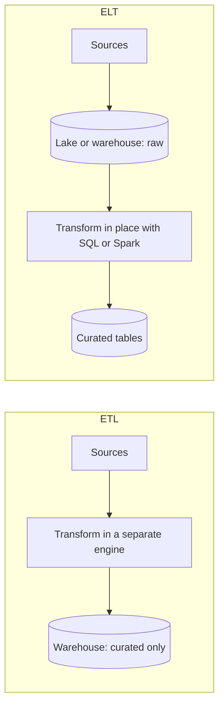

# Data sources, ETL/ELT, batch and streaming

## Data is the product's raw material

Models are downstream of data. If the data pipeline is late, broken or subtly wrong, no amount of
modeling skill helps. This lesson covers where ML data comes from, how it moves (ETL vs ELT), and the
two fundamental processing styles — **batch** and **stream** — drawing heavily on Kleppmann's
*Designing Data-Intensive Applications* (DDIA), chapters 10 and 11.

## Where ML data comes from

| Source | Examples | Characteristics |
|---|---|---|
| Operational databases (OLTP) | Postgres, MySQL, DynamoDB | current state, row-oriented, must not be overloaded by analytics |
| Event streams / logs | clicks, page views, app events in Kafka | append-only, high volume, time-ordered |
| Third-party data | weather, credit bureaus, demographics | licensing, schema changes outside your control |
| User-generated content | text, images, reviews | unstructured, needs labeling/moderation |
| System outputs | model predictions, search logs | feedback loops (lesson 2) |
| Manual labels | annotation tools | expensive, slow, noisy |

Two families of storage serve different workloads:

- **OLTP** (online transaction processing): many small reads/writes by key, low latency. Your app's database.
- **OLAP** (online analytical processing): scans over many rows but few columns, aggregations. Data
  warehouses (BigQuery, Snowflake, Redshift) and lakehouses (Delta Lake, Apache Iceberg, Hudi on object
  storage) use **column-oriented** formats like Parquet so a query reading 3 of 200 columns reads only
  those 3 (DDIA ch. 3).

> [!TIP]
> Never run heavy training queries directly against the production OLTP database. Replicate into the
> warehouse/lake first — typically via **change data capture (CDC)**, which streams the database's
> replication log (e.g., with Debezium into Kafka). DDIA ch. 11 describes CDC as turning a database into
> a stream of change events that derived systems (search indexes, caches, warehouses) consume.

## ETL vs ELT

- **ETL — Extract, Transform, Load.** Data is transformed (cleaned, joined, aggregated) *before* it lands
  in the target. Classic for on-premise warehouses where storage and compute were expensive.
- **ELT — Extract, Load, Transform.** Raw data is loaded first into cheap scalable storage, then
  transformed *inside* the warehouse with SQL (often managed with **dbt**). Dominant today because cloud
  warehouses separate storage and compute.



ELT has an important ML benefit: the **raw data is kept**. When you invent a new feature next quarter
you can recompute it over history — DDIA stresses the value of keeping immutable raw inputs so that
derived data can always be rebuilt (the idea behind lambda/kappa architectures and event sourcing).

### The medallion pattern

Lakehouse teams often organise tables in layers:

- **Bronze**: raw, append-only ingested data, exactly as received.
- **Silver**: cleaned, deduplicated, conformed (types, timezones, IDs).
- **Gold**: business-level aggregates and **feature tables** ready for training and BI.

## Batch processing

A batch job takes a bounded input (yesterday's events, a table snapshot), runs to completion, and
produces output. Throughput matters more than latency. DDIA traces the lineage:

1. **Unix tools** — `sort | uniq -c` on one machine.
2. **MapReduce** (Hadoop) — the same pattern across thousands of machines: *map* emits key-value pairs,
   the framework *shuffles* (sorts and partitions by key), *reduce* aggregates each key. Inputs are
   immutable and outputs are written fresh, so a failed task can simply be retried.
3. **Dataflow engines** — Spark, Flink (batch mode), Tez: whole DAGs of operators, intermediate state in
   memory, far fewer disk round trips than chained MapReduce jobs.

Key batch ideas for ML:

- **Joins at scale**: sort-merge joins, broadcast joins (small table copied to every worker), and
  partitioned hash joins — exactly what feature computation needs.
- **Immutability and idempotence**: rerunning the job for date D overwrites the partition for D with the
  same result. This makes **backfills** (recomputing history) safe.
- **Partitioning by date** (`events/dt=2025-01-15/`) so jobs process and overwrite one day at a time.

```python-run
# A miniature "MapReduce": count events per user per day, then a daily feature table.
from collections import defaultdict
events = [
    ("2025-01-01", "u1", "click"), ("2025-01-01", "u2", "view"), ("2025-01-01", "u1", "buy"),
    ("2025-01-02", "u1", "view"), ("2025-01-02", "u3", "click"), ("2025-01-02", "u3", "click"),
]
# map: emit ((day, user), 1)
mapped = [((d, u), 1) for d, u, _ in events]
# shuffle: group by key (the framework sorts/partitions)
groups = defaultdict(list)
for k, v in sorted(mapped):
    groups[k].append(v)
# reduce: sum per key
reduced = {k: sum(vs) for k, vs in groups.items()}
for (day, user), n in reduced.items():
    print(day, user, "events:", n)

# idempotent partition overwrite: rerunning day 2 replaces, never duplicates
table = {"2025-01-01": {"u1": 2, "u2": 1}}
def write_partition(table, day, rows):
    table[day] = dict(rows)        # overwrite the whole partition
day2 = {u: n for (d, u), n in reduced.items() if d == "2025-01-02"}
write_partition(table, "2025-01-02", day2)
write_partition(table, "2025-01-02", day2)   # retry is harmless
print(table)
```

## Stream processing

A stream is an **unbounded** sequence of events. Stream processing handles them continuously with low
latency (seconds or less). DDIA ch. 11 covers the core building blocks:

- **Message brokers**: traditional queues (RabbitMQ, SQS) delete messages once acknowledged, while
  **log-based brokers** (Kafka, Kinesis, Pulsar) append events to a partitioned, replicated log that
  consumers read at their own offsets. Logs can be **replayed** — invaluable for recomputing features or
  debugging.
- **Partitions** give parallelism; ordering is guaranteed only within a partition (so partition by
  `user_id` if per-user order matters).
- **Event time vs processing time**: an event that happened at 12:00:01 may arrive at 12:03 (a phone was
  offline). Aggregating by processing time gives wrong answers. Engines (Flink, Spark Structured
  Streaming, Beam) use **watermarks** to decide when a window is probably complete and how to handle
  late events.
- **Windows**:
  - *Tumbling*: fixed, non-overlapping (every 5 minutes).
  - *Hopping*: fixed size, overlapping (5-minute windows every 1 minute).
  - *Sliding*: all events within a time interval of each other.
  - *Session*: grouped by activity with an inactivity gap.
- **Stream joins**: stream–stream (clicks with impressions within 1 hour), stream–table (enrich events
  with the latest user profile, kept as a local table updated via CDC), table–table.
- **Fault tolerance**: checkpointing state plus replayable input gives *effectively-once* results when
  outputs are idempotent or transactional.

```python-run
# Tumbling vs hopping windows over event time, with a late event.
events = [  # (event_time_seconds, user, amount)
    (1, "u1", 10), (4, "u1", 5), (7, "u2", 3), (12, "u1", 8), (3, "u2", 4),  # (3,...) arrives late
]
def tumbling(events, size):
    out = {}
    for t, u, a in events:
        w = (t // size) * size
        out[(w, w + size)] = out.get((w, w + size), 0) + a
    return dict(sorted(out.items()))
def hopping(events, size, hop):
    out = {}
    tmax = max(t for t, _, _ in events)
    start = 0
    while start <= tmax:
        out[(start, start + size)] = sum(a for t, _, a in events if start <= t < start + size)
        start += hop
    return out
print("tumbling 5s :", tumbling(events, 5))
print("hopping 10s/5s:", hopping(events, 10, 5))
# Note: grouping by *event time* puts the late event (t=3) in window [0,5) where it belongs.
```

### Lambda vs kappa architecture

- **Lambda**: a batch layer recomputes accurate views periodically, a speed layer provides approximate
  real-time updates, and a serving layer merges them. Downside: two codebases for the same logic.
- **Kappa**: everything is a stream; reprocessing = replaying the log through a new version of the
  stream job. One codebase. Modern engines (Flink, Spark, Beam) blur the line by running the same code
  in batch and streaming modes.

## Batch vs streaming for ML features

| Feature | Freshness need | Typical approach |
|---|---|---|
| Customer lifetime spend | daily is fine | batch (SQL/dbt/Spark) |
| Number of transactions in last 10 minutes (fraud) | seconds | streaming (Flink/Spark Streaming) into online store |
| Embedding of product description | when product changes | event-triggered batch |
| Current session's viewed items | real time | computed at request time from session state |

Streaming is powerful but operationally expensive (always-on clusters, state management, late data). A
common rule: **start with batch; move a feature to streaming only when fresher data measurably improves
the model or product**.

> [!INTERVIEW]
> "Design features for real-time fraud detection." — Discuss: Kafka topic of transactions partitioned by
> card ID; a Flink job computing sliding-window aggregates (count/amount in last 1 min, 1 h) keyed by card
> and merchant; event-time processing with watermarks; writing to an online feature store (Redis/
> DynamoDB) for low-latency lookup; the same logic backfilled in batch to produce point-in-time-correct
> training data; and monitoring freshness lag.

## Orchestrating data pipelines and data contracts

Batch pipelines are scheduled by orchestrators (Airflow, Dagster, Prefect — lesson 13), which handle
dependencies, retries, backfills and alerting. Treat upstream producers as APIs with **data contracts**:
an agreed schema, semantics, freshness SLA and owner, enforced by checks in CI and at ingestion. Schema
evolution (DDIA ch. 4) should be *backward compatible* — add optional fields, never silently repurpose a
column — and formats like Avro/Protobuf with a schema registry make this explicit.

## Summary

- OLTP stores serve the app; OLAP warehouses and lakehouses (columnar Parquet) serve analytics and ML.
  Use CDC to replicate rather than querying production.
- ELT keeps raw data and transforms in place — enabling recomputation of new features over history.
- Batch: bounded inputs, immutable data, idempotent partition overwrites, safe backfills.
- Streaming: unbounded, log-based brokers, partitions, event time, watermarks, windows, stateful joins.
- Prefer batch until freshness is proven to matter.

```quiz
[
  {"q": "What distinguishes ELT from ETL?",
   "options": ["ELT never transforms data", "ELT loads raw data first and transforms it inside the warehouse/lake", "ETL is only for streaming", "ELT requires Kafka"],
   "answer": 1, "explain": "Cloud warehouses made it cheap to land raw data and transform in place, often with dbt."},
  {"q": "Why are column-oriented formats like Parquet preferred for training data?",
   "options": ["They support row-level transactions", "Queries reading a few columns of many rows read only those columns, and compress well", "They are human-readable", "They are required by Python"],
   "answer": 1, "explain": "Analytic scans touch few columns; columnar storage avoids reading the rest."},
  {"q": "A batch job that overwrites the partition for date D on each run is valuable because...",
   "options": ["It is faster than appending", "Retries and backfills are idempotent and never duplicate data", "It avoids using Parquet", "It enables streaming"],
   "answer": 1, "explain": "Idempotent outputs make failures and reprocessing safe."},
  {"q": "What is the main advantage of a log-based broker (Kafka) over a traditional queue for ML?",
   "options": ["Messages are deleted immediately", "Events are retained and can be replayed to recompute features or backfill", "It has no partitions", "It guarantees global ordering across all partitions"],
   "answer": 1, "explain": "Retention plus consumer offsets allow replay; ordering is only per partition."},
  {"q": "A mobile event created at 12:00 arrives at 12:05. Aggregating by processing time will...",
   "options": ["Put it in the correct window", "Put it in the wrong window, skewing time-based features", "Drop it automatically", "Crash the job"],
   "answer": 1, "explain": "Event-time processing with watermarks is needed for correct windows."},
  {"q": "Which window type groups user activity separated by an inactivity gap?",
   "options": ["Tumbling", "Hopping", "Session", "Global"],
   "answer": 2, "explain": "Session windows close after a period of inactivity."},
  {"q": "What is the main drawback of the lambda architecture?",
   "options": ["It cannot handle batch data", "The same logic is maintained in two codebases (batch and speed layers)", "It only works on GPUs", "It forbids Kafka"],
   "answer": 1, "explain": "Kappa simplifies to one streaming codebase with replay for reprocessing."}
]
```

> **Source:** Martin Kleppmann, *Designing Data-Intensive Applications*, ch. 3 (column storage), ch. 4 (schema evolution), ch. 10 (Batch Processing), ch. 11 (Stream Processing: logs, CDC, event time, windows, joins, fault tolerance); dbt and Databricks medallion architecture documentation.
