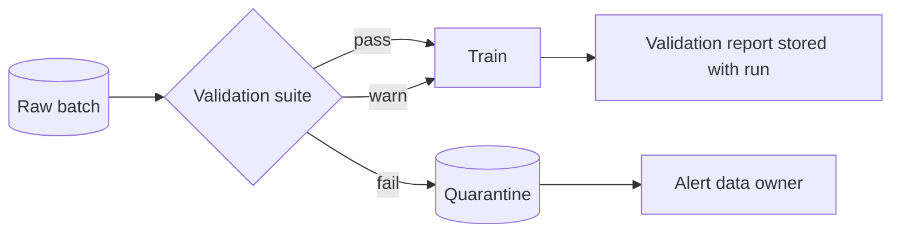
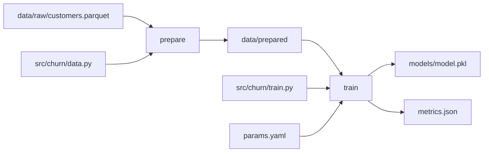

# Data validation and versioning with DVC

## Garbage in, silent garbage out

A web service that receives malformed input raises an error. A training pipeline that receives
malformed data happily trains a worse model. Typical real incidents:

- An upstream team changes `price` from dollars to cents. Every price is now 100× larger.
- A join key changes type; the join silently returns 40% nulls for a key feature.
- A logging bug duplicates a day of events, doubling "activity" features for that day.
- A category is renamed (`"premium"` → `"Premium"`), creating an unseen category at serving time.

**Data validation** catches these before they reach a model; **data versioning** lets you know exactly
which data a model was trained on and reproduce or roll back.

## What to validate

Think in three layers, from cheap to expensive:

1. **Schema checks** — columns present, types, nullability, allowed categories, uniqueness of keys.
2. **Value checks** — ranges (`0 <= age <= 120`), regex formats, referential integrity, row counts within
   expected bounds, freshness (max timestamp is recent).
3. **Distribution checks** — means/quantiles within tolerance of a reference, category frequencies,
   drift statistics (PSI, KS — module 10) compared to the training data.

Where to run them:

- **At ingestion** (data contracts): reject or quarantine bad batches.
- **Before training**: gate the pipeline; if checks fail, do not train, alert.
- **At serving**: validate request payloads (pydantic) and monitor live feature distributions.



## Great Expectations-style validation

**Great Expectations (GX)** popularised declarative *expectations* — named, parameterised assertions
about data — grouped into *suites* and run as *checkpoints* that produce human-readable "Data Docs".
Representative expectations:

```python
import great_expectations as gx

context = gx.get_context()
batch = context.data_sources.pandas_default.read_parquet("data/customers.parquet")

suite = gx.ExpectationSuite(name="customers")
suite.add_expectation(gx.expectations.ExpectColumnValuesToNotBeNull(column="customer_id"))
suite.add_expectation(gx.expectations.ExpectColumnValuesToBeUnique(column="customer_id"))
suite.add_expectation(gx.expectations.ExpectColumnValuesToBeBetween(column="age", min_value=0, max_value=120))
suite.add_expectation(gx.expectations.ExpectColumnValuesToBeInSet(column="plan", value_set=["basic", "pro", "premium"]))
suite.add_expectation(gx.expectations.ExpectColumnValuesToMatchRegex(column="email", regex=r"[^@]+@[^@]+\.[a-z]+"))
suite.add_expectation(gx.expectations.ExpectTableRowCountToBeBetween(min_value=90_000, max_value=200_000))
suite.add_expectation(gx.expectations.ExpectColumnMeanToBeBetween(column="monthly_charges", min_value=40, max_value=90))
results = batch.validate(suite)
print(results.success)
```

(The GX API has changed considerably between versions — check the docs for yours.) Note a subtle but
important convention: value expectations like *between* or *in set* **ignore nulls**; nullness is checked
separately by *not null*. Many expectations also accept `mostly=0.95` (pass if 95% of rows satisfy it),
which avoids failing on a handful of known-bad rows.

Alternatives: **pandera** (typed DataFrame schemas as Python classes, great for unit tests),
**TensorFlow Data Validation (TFDV)** (infers a schema and computes statistics at scale, used in TFX),
**Soda**, **dbt tests** (in-warehouse `not_null`, `unique`, `accepted_values`, `relationships`), and
**Deequ** (Spark).

```python
import pandera as pa
from pandera.typing import Series

class Customers(pa.DataFrameModel):
    customer_id: Series[int] = pa.Field(unique=True)
    age: Series[float] = pa.Field(ge=0, le=120, nullable=True)
    plan: Series[str] = pa.Field(isin=["basic", "pro", "premium"])

Customers.validate(df, lazy=True)   # lazy=True collects all failures instead of stopping at the first
```

### Build your own mini validator

You will implement a full version in the `mlops-validate-rows` problem. Here is the shape of it with
pandas:

```python-run
import pandas as pd
df = pd.DataFrame({
    "customer_id": [1, 2, 3, 3, 5],
    "age": [34, -2, None, 51, 130],
    "plan": ["pro", "basic", "Premium", "pro", "basic"],
})
expectations = [
    ("customer_id", "unique", {}),
    ("age", "not_null", {}),
    ("age", "between", {"min": 0, "max": 120}),
    ("plan", "in_set", {"values": {"basic", "pro", "premium"}}),
]
report = []
for col, kind, kw in expectations:
    s = df[col]
    if kind == "not_null":
        bad = s.isna()
    elif kind == "unique":
        bad = s.notna() & s.duplicated(keep=False)
    elif kind == "between":
        bad = s.notna() & ~s.between(kw["min"], kw["max"])
    elif kind == "in_set":
        bad = s.notna() & ~s.isin(kw["values"])
    report.append((col, kind, int(bad.sum()), list(df.index[bad])))
for r in report:
    status = "PASS" if r[2] == 0 else "FAIL"
    print(f"{status}  {r[0]:12s} {r[1]:9s} failures={r[2]} rows={r[3]}")
```

> [!TIP]
> Make validation **severity-aware**: a missing primary key should *fail* the pipeline; a mean that moved
> 5% should *warn* and attach a report. Over-strict validation that fails daily gets disabled by
> frustrated engineers — the worst outcome.

## Data versioning: why Git alone is not enough

Reproducing a model requires the exact training data. Git cannot hold gigabytes efficiently. Options:

- **Immutable, date-partitioned tables** plus recording the query and snapshot time.
- **Table formats with time travel**: Delta Lake, Iceberg and Hudi keep versions of tables
  (`SELECT ... VERSION AS OF 42`), and BigQuery/Snowflake offer time travel for limited windows.
- **lakeFS**: Git-like branches and commits over an object store.
- **DVC (Data Version Control)**: Git for data and pipelines for file-based projects.

## DVC in depth

DVC stores small **pointer files** in Git and the actual content in a **remote** (S3, GCS, Azure Blob,
SSH, local). Content is addressed by its **MD5 hash**, so identical files are stored once.

```bash
pip install "dvc[s3]"
dvc init                                   # creates .dvc/ (commit it)
dvc remote add -d storage s3://acme-ml/dvc-store
dvc add data/raw/customers.parquet         # creates data/raw/customers.parquet.dvc, adds file to .gitignore
git add data/raw/customers.parquet.dvc data/raw/.gitignore
git commit -m "data: customers snapshot 2025-01-15"
dvc push                                   # upload content to the remote
```

The `.dvc` file is tiny:

```yaml
outs:
- md5: 3f2a9c1e5b7d...
  size: 48213377
  hash: md5
  path: customers.parquet
```

Time travel: `git checkout <old-commit> && dvc checkout` restores the data exactly as it was. Collaborators
run `git pull && dvc pull`.

### DVC pipelines

DVC can also define a pipeline of **stages** with dependencies and outputs in `dvc.yaml`. `dvc repro`
reruns only stages whose dependencies changed (by hash) — `make` for data science.

```yaml
# dvc.yaml
stages:
  prepare:
    cmd: python -m churn.data --in data/raw/customers.parquet --out data/prepared
    deps:
      - src/churn/data.py
      - data/raw/customers.parquet
    outs:
      - data/prepared
  train:
    cmd: python -m churn.train --data data/prepared --out models/model.pkl
    deps:
      - src/churn/train.py
      - data/prepared
    params:
      - train.learning_rate
      - train.max_iter
    outs:
      - models/model.pkl
    metrics:
      - metrics.json:
          cache: false
```

```bash
dvc repro                 # run what changed; records hashes in dvc.lock (commit it)
dvc params diff           # compare params with the last commit
dvc metrics diff main     # compare metrics against main
dvc exp run -S train.learning_rate=0.02    # run an experiment with a modified param
dvc exp show              # table of experiments
dvc dag                   # visualise the pipeline
```



`dvc.lock` records the exact hash of every dependency and output — a complete, committed lineage record:
this model came from this code, these params and this data.

```python-run
# How content-addressed caching decides what to rerun (the core of dvc repro).
import hashlib, json
def h(obj): return hashlib.md5(json.dumps(obj, sort_keys=True).encode()).hexdigest()[:8]
files = {"raw": "rows-v1", "data.py": "code-v1", "train.py": "code-v1", "params": {"lr": 0.05}}
stages = {"prepare": ["raw", "data.py"], "train": ["prepare", "train.py", "params"]}
def run(files, lock):
    outs, new_lock = {}, {}
    for st, deps in stages.items():
        sig = h([files.get(d) if d in files else outs[d] for d in deps])
        status = "cached" if lock.get(st) == sig else "RUN"
        outs[st] = "out-" + sig
        new_lock[st] = sig
        print(f"  {st:8s} {status}")
    return new_lock
print("first run:");            lock = run(files, {})
print("nothing changed:");      lock = run(files, lock)
files["params"] = {"lr": 0.02}
print("param changed:");        lock = run(files, lock)
files["raw"] = "rows-v2"
print("raw data changed:");     lock = run(files, lock)
```

> [!INTERVIEW]
> "How do you guarantee you can reproduce a model from a year ago?" — Code SHA in Git; data version via
> DVC hashes / table time travel / immutable snapshot ID; params and resolved config logged; environment
> via lockfile and Docker image digest; random seeds; and all of these linked from the model registry
> entry. Mention `dvc.lock` or MLflow run metadata as the lineage record.

## Designing an expectation suite: a worked example

Take the `customers` table that feeds churn training and write its contract deliberately, column by
column, deciding **severity** as you go.

| Column | Expectation | Severity | Rationale |
|---|---|---|---|
| `customer_id` | not null, unique | error | join key; duplicates multiply rows |
| `signup_ts` | not null, ≤ run date | error | future timestamps indicate clock or timezone bugs |
| `plan` | in {basic, pro, premium} | error | unseen category breaks encoding assumptions |
| `monthly_charges` | between 0 and 10,000 (mostly 0.999) | error | unit changes show up here |
| `monthly_charges` | mean within ±15% of reference | warn | drift, pricing change |
| `last_login_days` | null rate ≤ 10% | warn | upstream join degradation |
| table | row count within ±20% of 7-day average | error | partial load or duplication |
| table | max(`updated_ts`) within 26 h | error | stale source |
| `churned` (label) | rate between 2% and 30% | error | broken label join |

Three principles are visible. **Errors** are things that make training results meaningless; **warnings**
are things a human should look at. Thresholds for distribution checks come from *observed history*, not
guesses — compute them from the last N healthy partitions and review them when they fire. And the suite
includes **table-level** checks (volume, freshness), which catch the most common failure of all: the
data is fine but incomplete.

```python-run
import pandas as pd, numpy as np
rng = np.random.default_rng(0)
n = 5000
df = pd.DataFrame({
    "customer_id": np.arange(n),
    "plan": rng.choice(["basic", "pro", "premium"], n),
    "monthly_charges": rng.uniform(20, 120, n),
    "last_login_days": np.where(rng.random(n) < 0.04, np.nan, rng.integers(0, 60, n)),
    "churned": (rng.random(n) < 0.12).astype(int),
})
# inject realistic faults
df.loc[:399, "monthly_charges"] = df.loc[:399, "monthly_charges"].clip(upper=99) * 100   # 8% of rows switched to cents
df.loc[10:14, "plan"] = "Premium"                 # casing change upstream

reference = {"rows_7d_avg": 5100, "charges_mean": 70.0}
checks = [
    ("customer_id unique",           "error", df.customer_id.is_unique),
    ("plan in allowed set",          "error", df.plan.isin(["basic", "pro", "premium"]).all()),
    ("charges in [0, 10000] mostly", "error", df.monthly_charges.between(0, 10_000).mean() >= 0.999),
    ("charges mean within 15%",      "warn",  abs(df.monthly_charges.mean() / reference["charges_mean"] - 1) <= 0.15),
    ("last_login null rate <= 10%",  "warn",  df.last_login_days.isna().mean() <= 0.10),
    ("row count within 20%",         "error", abs(len(df) / reference["rows_7d_avg"] - 1) <= 0.20),
    ("label rate in [2%, 30%]",      "error", 0.02 <= df.churned.mean() <= 0.30),
]
failed_errors = [name for name, sev, ok in checks if not ok and sev == "error"]
for name, sev, ok in checks:
    print(f"{'PASS' if ok else sev.upper():5s}  {name}")
print("\npipeline decision:", "STOP - quarantine batch, alert owner" if failed_errors else "continue (with warnings attached to the run)")
```

Notice which check caught the cents bug: not the hard range check (values stayed under 10,000) but the
**mean-shift warning** — and the casing change was caught by the allowed-set check. Different faults
need different kinds of expectations; a suite with only null checks would have passed this batch.

### Where validation results should go

A validation run is itself an artifact. Store the report with the training run (MLflow artifact) so that
for any model you can answer "what did the data look like, and did anything warn?". Emit summary
metrics (number of failed expectations, null rates) to your monitoring system to see trends, and send
failures to the **data owner**, not only to the ML team.

## DVC day-to-day: the collaboration loop

```bash
# Alice updates the dataset and retrains
dvc add data/raw/customers.parquet          # new hash written to the .dvc file
dvc repro                                    # reruns affected stages, updates dvc.lock and metrics.json
git add data/raw/customers.parquet.dvc dvc.lock metrics.json params.yaml
git commit -m "data: customers snapshot 2025-02-01; retrain"
dvc push && git push                         # push data to the remote, pointers to Git

# Bob reproduces exactly
git pull && dvc pull                         # fetch pointers, then the matching data and model
dvc status                                   # "Data and pipelines are up to date."

# Compare with the previous model
dvc metrics diff HEAD~1                      # pr_auc: 0.712 -> 0.731
dvc params diff HEAD~1

# Go back in time
git checkout v1.2.0 && dvc checkout          # code, data and model as of that tag
```

Common pitfalls:

- **Forgetting `dvc push`**: the pointer is in Git but the data is not in the remote; teammates get
  "missing cache files". Add `dvc push` to a pre-push hook (`dvc install` sets this up).
- **Editing tracked files in place**: DVC may link files from its cache; use `dvc unprotect` or re-add
  after writing a new file.
- **Huge numbers of small files**: track the directory, and prefer consolidated formats (Parquet, tar
  shards).
- **Credentials**: give CI read access to the remote through its cloud role; never commit keys in
  `.dvc/config` (use `.dvc/config.local`, which is git-ignored).

### DVC, lakeFS or table time travel?

| Situation | Good fit |
|---|---|
| Files and models in a Git-centred project, up to roughly hundreds of GB | DVC |
| Data lake shared by many teams, need branches/merges over object storage | lakeFS |
| Data lives in warehouse/lakehouse tables | Delta/Iceberg snapshots or warehouse time travel; record the snapshot ID |
| Very large, append-only event data | immutable date partitions + recorded query and date window |

Whatever the mechanism, the requirement is the same: **a training run must record an identifier that
resolves to exactly the bytes it read.**

## Summary

- Validate schema, values and distributions at ingestion, before training, and at serving.
- Expectation-based tools (Great Expectations, pandera, TFDV, dbt tests) make checks declarative and
  reportable; nulls are handled by `not_null`, other checks skip them; use severities and `mostly`.
- Version data with DVC (pointer files + remote, content-addressed), table time travel or lakeFS.
- DVC pipelines (`dvc.yaml` + `dvc.lock`) rerun only what changed and record full lineage.

```quiz
[
  {"q": "An upstream team changes a price column from dollars to cents. Which check is most likely to catch it?",
   "options": ["A not-null check", "A distribution/range check comparing to the reference mean or bounds", "A uniqueness check", "A regex check"],
   "answer": 1, "explain": "Values are still present and numeric; only their scale changed, which range/distribution checks detect."},
  {"q": "In Great Expectations conventions, how are null values treated by `expect_column_values_to_be_between`?",
   "options": ["They fail", "They are ignored; nullness is tested by a separate not-null expectation", "They are imputed with the mean", "They crash the checkpoint"],
   "answer": 1, "explain": "Value expectations skip nulls so each failure has one clear cause."},
  {"q": "What does a `.dvc` file committed to Git contain?",
   "options": ["The full dataset", "A small pointer with the content hash, size and path", "The model weights", "A Dockerfile"],
   "answer": 1, "explain": "Content lives in the DVC remote; Git tracks the pointer."},
  {"q": "What does `dvc repro` do?",
   "options": ["Deletes the cache", "Re-runs only pipeline stages whose dependencies (code, data, params) changed", "Pushes to Git", "Starts a web UI"],
   "answer": 1, "explain": "It compares hashes against dvc.lock and skips unchanged stages."},
  {"q": "Why is the `mostly` parameter useful?",
   "options": ["It speeds up validation", "It lets an expectation pass when a high fraction (e.g., 95%) of rows comply, tolerating a few known-bad rows", "It disables validation", "It converts types"],
   "answer": 1, "explain": "Overly strict checks fail constantly and get turned off."},
  {"q": "Which is NOT a data versioning approach?",
   "options": ["Delta Lake time travel", "lakeFS branches", "DVC", "Committing a 10 GB CSV to Git directly"],
   "answer": 3, "explain": "Git is not designed for large binary data; it bloats every clone forever."},
  {"q": "Where should a validation failure on a missing primary key lead?",
   "options": ["A warning only", "Failing the pipeline and quarantining the batch", "Silently dropping the column", "Retraining immediately"],
   "answer": 1, "explain": "Critical schema violations should block training; softer drift can warn."}
]
```

> **Source:** Great Expectations, pandera, TFDV and dbt documentation; DVC documentation (*Data versioning*, *Pipelines*, `dvc.yaml`, `dvc exp`); Martin Kleppmann, *DDIA*, ch. 4 (schema evolution) and ch. 10 (immutable inputs); Breck et al., *Data Validation for Machine Learning* (MLSys 2019).
