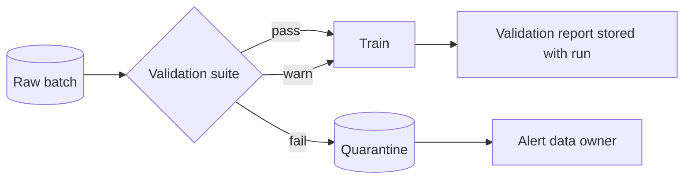
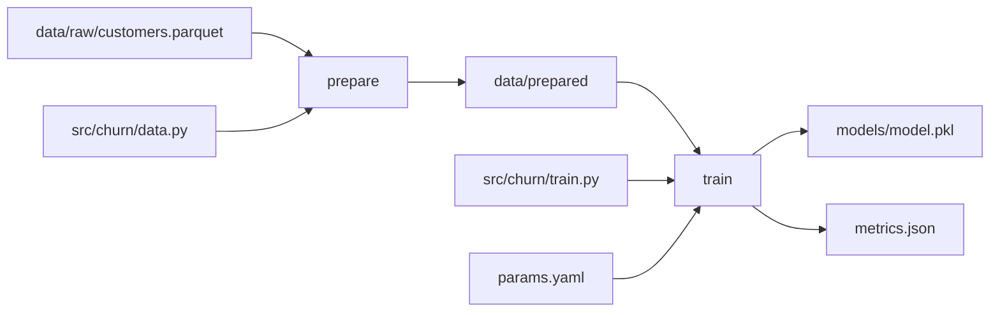

# Data validation and versioning with DVC

> **Before this lesson:** read [Data sources, ETL/ELT, batch and streaming](#/lesson/mlops/data-pipelines)
> for pipelines and partitions, and [Git workflows for ML teams](#/lesson/mlops/git-workflows) for
> commits and pointer files. The examples use pandas tables; each operation is explained.

## In plain words

**Data validation** is an automatic inspection of data before it is used: are all the expected
columns there, are the values possible, does today's batch look like the batches before it?
**Data versioning** is keeping a numbered, retrievable record of exactly which data was used, so
that a result can be repeated or undone.

A food factory is a fair comparison. Every delivery of ingredients is inspected at the door:
right product, sealed, within its date, at the right temperature. A delivery that fails is set
aside, not mixed into the dough. And every finished batch carries a lot number that says which
deliveries went into it, so that if customers complain, the factory can trace the problem and
recall exactly the affected batches. Validation is the inspection at the door; versioning is the
lot number.

Why this matters for a job: bad data is the most common cause of a model going wrong in
production, and "how would you reproduce a model from a year ago?" is among the most frequent
MLOps interview questions. Both answers come from this lesson.

## Garbage in, silent garbage out

A web service that receives a malformed request raises an error. A training pipeline that
receives malformed data raises nothing: it trains a worse model and reports success. Incidents of
this kind are common:

- An upstream team (the team that produces a table you read) changes `price` from dollars to
  cents. Every price is now 100 times larger.
- A join key changes type on one side, say from number to text. The join stops matching, and a
  key feature is suddenly 40% empty.
- A logging bug writes one day of events twice, doubling every "activity" feature for that day.
- A category is renamed from `"premium"` to `"Premium"`, so the model meets a category it has
  never seen.

Validation catches these before they reach a model. Versioning tells you exactly which data a
model was trained on, so you can reproduce it or go back.

## What to validate

Think in three layers, from cheapest to most expensive:

1. **Schema checks.** The schema is the list of columns and their types. Are all columns present,
   with the right types? Which may contain a **null** (a missing value)? Which categories are
   allowed? Is the key column unique?
2. **Value checks.** Are values in a sensible range (`0 <= age <= 120`)? Do text fields have the
   right format? Does every reference point to something that exists (every order's customer is
   in the customer table)? Is the number of rows in the expected band? Is the data **fresh**,
   meaning its newest timestamp is recent?
3. **Distribution checks.** Do averages and **quantiles** (values such as the median that split
   the data at a given percentage) stay within a tolerance of a reference? Do categories occur
   about as often as before? Module 10 introduces formal statistics for this (PSI and KS).

Where to run them:

- **At ingestion**, when data enters your systems: reject a bad batch or put it in **quarantine**,
  a holding area where it harms nothing while someone looks at it.
- **Before training**: as a gate. If checks fail, do not train; alert someone.
- **At serving**: check each incoming request (the pydantic library does this, lesson 20) and
  watch the distribution of live feature values.



## Great Expectations-style validation

**Great Expectations (GX)** is the tool that made a particular style popular. An *expectation* is
a named, parameterised statement about data ("values in column `age` lie between 0 and 120"). You
declare what should be true and the tool does the checking; this is called a **declarative**
style. Expectations are collected into a *suite*, and running a suite against a batch of data
produces a readable report. Representative expectations:

```python
import great_expectations as gx

context = gx.get_context()
batch = context.data_sources.pandas_default.read_parquet("data/customers.parquet")

suite = gx.ExpectationSuite(name="customers")
suite.add_expectation(gx.expectations.ExpectColumnValuesToNotBeNull(column="customer_id"))
suite.add_expectation(gx.expectations.ExpectColumnValuesToBeUnique(column="customer_id"))
suite.add_expectation(gx.expectations.ExpectColumnValuesToBeBetween(column="age", min_value=0, max_value=120))
suite.add_expectation(gx.expectations.ExpectColumnValuesToBeInSet(column="plan", value_set=["basic", "pro", "premium"]))
suite.add_expectation(gx.expectations.ExpectColumnValuesToMatchRegex(column="email", regex=r"[^@]+@[^@]+\.[a-z]+"))
suite.add_expectation(gx.expectations.ExpectTableRowCountToBeBetween(min_value=90_000, max_value=200_000))
suite.add_expectation(gx.expectations.ExpectColumnMeanToBeBetween(column="monthly_charges", min_value=40, max_value=90))
results = batch.validate(suite)
print(results.success)
```

Each `add_expectation` line adds one rule; the class names read as sentences. `batch.validate`
runs all of them and `results.success` is true only if every rule passed. (The GX programming
interface has changed considerably between versions, so check the documentation for yours.)

Two conventions deserve attention. First, value expectations such as *between* or *in set*
**ignore nulls**; whether nulls are allowed is tested separately by *not null*. That way each
failure has one clear cause. Second, many expectations accept `mostly=0.95`, meaning "pass if at
least 95% of rows comply". This avoids failing a whole batch over a handful of known-bad rows.

Alternatives: **pandera** (typed DataFrame schemas as Python classes, great for unit tests),
**TensorFlow Data Validation (TFDV)** (infers a schema and computes statistics at scale, used in TFX),
**Soda**, **dbt tests** (in-warehouse `not_null`, `unique`, `accepted_values`, `relationships`), and
**Deequ** (Spark).

```python
import pandera as pa
from pandera.typing import Series

class Customers(pa.DataFrameModel):
    customer_id: Series[int] = pa.Field(unique=True)
    age: Series[float] = pa.Field(ge=0, le=120, nullable=True)
    plan: Series[str] = pa.Field(isin=["basic", "pro", "premium"])

Customers.validate(df, lazy=True)   # lazy=True collects all failures instead of stopping at the first
```

### Build your own mini validator

Building a small validator yourself removes the mystery. You will implement a full version in the
`mlops-validate-rows` problem. The version below uses pandas, where a table is a `DataFrame` and a
column is a `Series`. The test table has five rows with deliberate faults: a repeated id, a
negative age, a missing age, an impossible age and a wrongly capitalised plan.

```python-run
import pandas as pd
df = pd.DataFrame({
    "customer_id": [1, 2, 3, 3, 5],
    "age": [34, -2, None, 51, 130],
    "plan": ["pro", "basic", "Premium", "pro", "basic"],
})
expectations = [
    ("customer_id", "unique", {}),
    ("age", "not_null", {}),
    ("age", "between", {"min": 0, "max": 120}),
    ("plan", "in_set", {"values": {"basic", "pro", "premium"}}),
]
report = []
for col, kind, kw in expectations:
    s = df[col]
    if kind == "not_null":
        bad = s.isna()
    elif kind == "unique":
        bad = s.notna() & s.duplicated(keep=False)
    elif kind == "between":
        bad = s.notna() & ~s.between(kw["min"], kw["max"])
    elif kind == "in_set":
        bad = s.notna() & ~s.isin(kw["values"])
    report.append((col, kind, int(bad.sum()), list(df.index[bad])))
for r in report:
    status = "PASS" if r[2] == 0 else "FAIL"
    print(f"{status}  {r[0]:12s} {r[1]:9s} failures={r[2]} rows={r[3]}")
```

For each rule the loop builds `bad`, a column of True/False values marking the rows that break it.
`s.isna()` is True where a value is missing. `s.duplicated(keep=False)` is True for every row
whose value occurs more than once. `~` means "not", and `s.notna() & ...` applies the convention
described above: a missing value is never reported by a value check. The output:

```text
FAIL  customer_id  unique    failures=2 rows=[2, 3]
FAIL  age          not_null  failures=1 rows=[2]
FAIL  age          between   failures=2 rows=[1, 4]
FAIL  plan         in_set    failures=1 rows=[2]
```

Rows are numbered from 0. Row 2 has the missing age, and it is reported once, by `not_null`; the
`between` rule reports only rows 1 (age -2) and 4 (age 130).

> [!TIP]
> Make validation **severity-aware**: a missing primary key should *fail* the pipeline; a mean that moved
> 5% should *warn* and attach a report. Over-strict validation that fails daily gets disabled by
> frustrated engineers — the worst outcome.

## Data versioning: why Git alone is not enough

To reproduce a model you need the exact data it was trained on. Git cannot hold gigabytes
efficiently (lesson 4), so something else must. The options:

- **Immutable, date-partitioned tables**, together with a record of the query and the time it was
  run.
- **Table formats with time travel.** Delta Lake, Iceberg and Hudi keep earlier versions of a
  table and let you query one (`SELECT ... VERSION AS OF 42`); BigQuery and Snowflake offer the
  same for a limited period.
- **lakeFS**: Git-style branches and commits over object storage.
- **DVC (Data Version Control)**: a command-line tool that adds data files and pipelines to a
  Git-based project.

## DVC in depth

DVC keeps small **pointer files** in Git and the real content in a **remote**, which here means a
storage location such as an S3 bucket, a Google Cloud Storage bucket or a shared disk. Each file
is identified by a **hash** of its contents (DVC uses an algorithm called MD5): a short
fingerprint that changes if a single byte changes. Storing by fingerprint is called **content
addressing**, and it means two identical files are stored once.

```bash
pip install "dvc[s3]"
dvc init                                   # creates .dvc/ (commit it)
dvc remote add -d storage s3://acme-ml/dvc-store
dvc add data/raw/customers.parquet         # creates data/raw/customers.parquet.dvc, adds file to .gitignore
git add data/raw/customers.parquet.dvc data/raw/.gitignore
git commit -m "data: customers snapshot 2025-01-15"
dvc push                                   # upload content to the remote
```

In order: install DVC with S3 support; `dvc init` prepares the project; `dvc remote add` names the
storage location; `dvc add` computes the file's hash, writes the pointer file next to it and
tells Git to ignore the big file; the two `git` commands commit the pointer; `dvc push` uploads
the content.

The `.dvc` file is tiny:

```yaml
outs:
- md5: 3f2a9c1e5b7d...
  size: 48213377
  hash: md5
  path: customers.parquet
```

Going back in time takes two commands: `git checkout <old-commit>` restores the old pointer file,
and `dvc checkout` fetches the content that pointer names. Teammates run `git pull && dvc pull`
to receive both.

### DVC pipelines

DVC can also describe a pipeline. A file named `dvc.yaml` lists **stages**; each stage has a
command (`cmd`), the files it depends on (`deps`), the settings it reads (`params`) and the files
it produces (`outs`). The command `dvc repro` ("reproduce") reruns only the stages whose inputs
have changed, judged by hash. It is the `make` idea from lesson 5 applied to data.

```yaml
# dvc.yaml
stages:
  prepare:
    cmd: python -m churn.data --in data/raw/customers.parquet --out data/prepared
    deps:
      - src/churn/data.py
      - data/raw/customers.parquet
    outs:
      - data/prepared
  train:
    cmd: python -m churn.train --data data/prepared --out models/model.pkl
    deps:
      - src/churn/train.py
      - data/prepared
    params:
      - train.learning_rate
      - train.max_iter
    outs:
      - models/model.pkl
    metrics:
      - metrics.json:
          cache: false
```

```bash
dvc repro                 # run what changed; records hashes in dvc.lock (commit it)
dvc params diff           # compare params with the last commit
dvc metrics diff main     # compare metrics against main
dvc exp run -S train.learning_rate=0.02    # run an experiment with a modified param
dvc exp show              # table of experiments
dvc dag                   # visualise the pipeline
```



`dvc.lock` is written by `dvc repro` and records the exact hash of every input and output of every
stage. Committed to Git, it is a complete lineage record: this model came from this code, these
parameters and this data.

The program below imitates the decision `dvc repro` makes. Each stage gets a signature: the hash
of everything it depends on. If the signature matches the one stored in the lock from the
previous run, the stage is skipped ("cached"); otherwise it runs.
```python-run
# How content-addressed caching decides what to rerun (the core of dvc repro).
import hashlib, json
def h(obj): return hashlib.md5(json.dumps(obj, sort_keys=True).encode()).hexdigest()[:8]
files = {"raw": "rows-v1", "data.py": "code-v1", "train.py": "code-v1", "params": {"lr": 0.05}}
stages = {"prepare": ["raw", "data.py"], "train": ["prepare", "train.py", "params"]}
def run(files, lock):
    outs, new_lock = {}, {}
    for st, deps in stages.items():
        sig = h([files.get(d) if d in files else outs[d] for d in deps])
        status = "cached" if lock.get(st) == sig else "RUN"
        outs[st] = "out-" + sig
        new_lock[st] = sig
        print(f"  {st:8s} {status}")
    return new_lock
print("first run:");            lock = run(files, {})
print("nothing changed:");      lock = run(files, lock)
files["params"] = {"lr": 0.02}
print("param changed:");        lock = run(files, lock)
files["raw"] = "rows-v2"
print("raw data changed:");     lock = run(files, lock)
```

Notice that `train` depends on `prepare`'s *output*, and that output is named after `prepare`'s
signature. A change early in the chain therefore changes every later signature. The output:

```text
first run:
  prepare  RUN
  train    RUN
nothing changed:
  prepare  cached
  train    cached
param changed:
  prepare  cached
  train    RUN
raw data changed:
  prepare  RUN
  train    RUN
```

Changing the learning rate reruns only `train`, because `prepare` does not read that parameter.
Changing the raw data reruns both. Nothing is rerun without a reason and nothing stale is reused.

> [!INTERVIEW]
> "How do you guarantee you can reproduce a model from a year ago?" — Code SHA in Git; data version via
> DVC hashes / table time travel / immutable snapshot ID; params and resolved config logged; environment
> via lockfile and Docker image digest; random seeds; and all of these linked from the model registry
> entry. Mention `dvc.lock` or MLflow run metadata as the lineage record.

## Designing an expectation suite: a worked example

Take the `customers` table that feeds churn training and write its contract deliberately, column by
column, deciding **severity** as you go.

| Column | Expectation | Severity | Rationale |
|---|---|---|---|
| `customer_id` | not null, unique | error | join key; duplicates multiply rows |
| `signup_ts` | not null, ≤ run date | error | future timestamps indicate clock or timezone bugs |
| `plan` | in {basic, pro, premium} | error | unseen category breaks encoding assumptions |
| `monthly_charges` | between 0 and 10,000 (mostly 0.999) | error | unit changes show up here |
| `monthly_charges` | mean within ±15% of reference | warn | drift, pricing change |
| `last_login_days` | null rate ≤ 10% | warn | upstream join degradation |
| table | row count within ±20% of 7-day average | error | partial load or duplication |
| table | max(`updated_ts`) within 26 h | error | stale source |
| `churned` (label) | rate between 2% and 30% | error | broken label join |

Three principles are visible. **Errors** are things that make training results meaningless; **warnings**
are things a human should look at. Thresholds for distribution checks come from *observed history*, not
guesses — compute them from the last N healthy partitions and review them when they fire. And the suite
includes **table-level** checks (volume, freshness), which catch the most common failure of all: the
data is fine but incomplete.

```python-run
import pandas as pd, numpy as np
rng = np.random.default_rng(0)
n = 5000
df = pd.DataFrame({
    "customer_id": np.arange(n),
    "plan": rng.choice(["basic", "pro", "premium"], n),
    "monthly_charges": rng.uniform(20, 120, n),
    "last_login_days": np.where(rng.random(n) < 0.04, np.nan, rng.integers(0, 60, n)),
    "churned": (rng.random(n) < 0.12).astype(int),
})
# inject realistic faults
df.loc[:399, "monthly_charges"] = df.loc[:399, "monthly_charges"].clip(upper=99) * 100   # 8% of rows switched to cents
df.loc[10:14, "plan"] = "Premium"                 # casing change upstream

reference = {"rows_7d_avg": 5100, "charges_mean": 70.0}
checks = [
    ("customer_id unique",           "error", df.customer_id.is_unique),
    ("plan in allowed set",          "error", df.plan.isin(["basic", "pro", "premium"]).all()),
    ("charges in [0, 10000] mostly", "error", df.monthly_charges.between(0, 10_000).mean() >= 0.999),
    ("charges mean within 15%",      "warn",  abs(df.monthly_charges.mean() / reference["charges_mean"] - 1) <= 0.15),
    ("last_login null rate <= 10%",  "warn",  df.last_login_days.isna().mean() <= 0.10),
    ("row count within 20%",         "error", abs(len(df) / reference["rows_7d_avg"] - 1) <= 0.20),
    ("label rate in [2%, 30%]",      "error", 0.02 <= df.churned.mean() <= 0.30),
]
failed_errors = [name for name, sev, ok in checks if not ok and sev == "error"]
for name, sev, ok in checks:
    print(f"{'PASS' if ok else sev.upper():5s}  {name}")
print("\npipeline decision:", "STOP - quarantine batch, alert owner" if failed_errors else "continue (with warnings attached to the run)")
```

The program builds 5,000 customers, then damages the data in two realistic ways: 400 rows have
their charge multiplied by 100 (a switch to cents) and five rows get a differently capitalised
plan. Each check is a triple of name, severity and a True/False result. The output:

```text
PASS   customer_id unique
ERROR  plan in allowed set
PASS   charges in [0, 10000] mostly
WARN   charges mean within 15%
PASS   last_login null rate <= 10%
PASS   row count within 20%
PASS   label rate in [2%, 30%]

pipeline decision: STOP - quarantine batch, alert owner
```

Look at which check noticed the cents bug. It was not the hard range check, because the inflated
values still stayed under 10,000. It was the **mean-shift warning**. The capitalisation change was
caught by the allowed-set check. Different faults need different kinds of expectation; a suite
containing only null checks would have passed this batch.

### Where validation results should go

A validation run is itself an artifact. Store the report with the training run (MLflow artifact) so that
for any model you can answer "what did the data look like, and did anything warn?". Emit summary
metrics (number of failed expectations, null rates) to your monitoring system to see trends, and send
failures to the **data owner**, not only to the ML team.

## DVC day-to-day: the collaboration loop

```bash
# Alice updates the dataset and retrains
dvc add data/raw/customers.parquet          # new hash written to the .dvc file
dvc repro                                    # reruns affected stages, updates dvc.lock and metrics.json
git add data/raw/customers.parquet.dvc dvc.lock metrics.json params.yaml
git commit -m "data: customers snapshot 2025-02-01; retrain"
dvc push && git push                         # push data to the remote, pointers to Git

# Bob reproduces exactly
git pull && dvc pull                         # fetch pointers, then the matching data and model
dvc status                                   # "Data and pipelines are up to date."

# Compare with the previous model
dvc metrics diff HEAD~1                      # pr_auc: 0.712 -> 0.731
dvc params diff HEAD~1

# Go back in time
git checkout v1.2.0 && dvc checkout          # code, data and model as of that tag
```

Common pitfalls:

- **Forgetting `dvc push`**: the pointer is in Git but the data is not in the remote; teammates get
  "missing cache files". Add `dvc push` to a pre-push hook (`dvc install` sets this up).
- **Editing tracked files in place**: DVC may link files from its cache; use `dvc unprotect` or re-add
  after writing a new file.
- **Huge numbers of small files**: track the directory, and prefer consolidated formats (Parquet, tar
  shards).
- **Credentials**: give CI read access to the remote through its cloud role; never commit keys in
  `.dvc/config` (use `.dvc/config.local`, which is git-ignored).

### DVC, lakeFS or table time travel?

| Situation | Good fit |
|---|---|
| Files and models in a Git-centred project, up to roughly hundreds of GB | DVC |
| Data lake shared by many teams, need branches/merges over object storage | lakeFS |
| Data lives in warehouse/lakehouse tables | Delta/Iceberg snapshots or warehouse time travel; record the snapshot ID |
| Very large, append-only event data | immutable date partitions + recorded query and date window |

Whatever the mechanism, the requirement is the same: **a training run must record an identifier that
resolves to exactly the bytes it read.**

## Summary

- Validate schema, values and distributions at ingestion, before training, and at serving.
- Expectation-based tools (Great Expectations, pandera, TFDV, dbt tests) make checks declarative and
  reportable; nulls are handled by `not_null`, other checks skip them; use severities and `mostly`.
- Version data with DVC (pointer files + remote, content-addressed), table time travel or lakeFS.
- DVC pipelines (`dvc.yaml` + `dvc.lock`) rerun only what changed and record full lineage.

## Glossary

- **Data validation** - automated checks that data has the expected structure and values.
- **Schema** - the columns of a data set and their types.
- **Null** - a missing value.
- **Quantile** - a value that splits data at a given percentage, such as the median at 50%.
- **Freshness** - how recent the newest data is.
- **Quarantine** - a holding area for data that failed validation.
- **Expectation / suite** - one declared rule about data / a named collection of rules.
- **Declarative** - stating what must be true and leaving the checking to a tool.
- **`mostly`** - the share of rows that must comply for an expectation to pass.
- **Severity** - whether a failed check stops the pipeline (error) or only reports (warning).
- **Data versioning** - keeping retrievable, identified snapshots of data.
- **Time travel** - querying a table as it was at an earlier version.
- **DVC** - a tool that versions data and pipelines alongside Git.
- **Pointer file (`.dvc`)** - a small file in Git holding the hash, size and path of large content.
- **Remote** - the storage location where DVC keeps file contents.
- **Hash / content addressing** - a fingerprint of a file's contents / storing files under that
  fingerprint.
- **Stage** - one step of a DVC pipeline, with its command, inputs and outputs.
- **`dvc.lock`** - the recorded hashes of every stage's inputs and outputs.
- **Lineage** - the record of which code, data and settings produced a result.

```quiz
[
  {"q": "An upstream team changes a price column from dollars to cents. Which check is most likely to catch it?",
   "options": ["A not-null check", "A distribution/range check comparing to the reference mean or bounds", "A uniqueness check", "A regex check"],
   "answer": 1, "explain": "Values are still present and numeric; only their scale changed, which range/distribution checks detect."},
  {"q": "In Great Expectations conventions, how are null values treated by `expect_column_values_to_be_between`?",
   "options": ["They fail", "They are ignored; nullness is tested by a separate not-null expectation", "They are imputed with the mean", "They crash the checkpoint"],
   "answer": 1, "explain": "Value expectations skip nulls so each failure has one clear cause."},
  {"q": "What does a `.dvc` file committed to Git contain?",
   "options": ["The full dataset", "A small pointer with the content hash, size and path", "The model weights", "A Dockerfile"],
   "answer": 1, "explain": "Content lives in the DVC remote; Git tracks the pointer."},
  {"q": "What does `dvc repro` do?",
   "options": ["Deletes the cache", "Re-runs only pipeline stages whose dependencies (code, data, params) changed", "Pushes to Git", "Starts a web UI"],
   "answer": 1, "explain": "It compares hashes against dvc.lock and skips unchanged stages."},
  {"q": "Why is the `mostly` parameter useful?",
   "options": ["It speeds up validation", "It lets an expectation pass when a high fraction (e.g., 95%) of rows comply, tolerating a few known-bad rows", "It disables validation", "It converts types"],
   "answer": 1, "explain": "Overly strict checks fail constantly and get turned off."},
  {"q": "Which is NOT a data versioning approach?",
   "options": ["Delta Lake time travel", "lakeFS branches", "DVC", "Committing a 10 GB CSV to Git directly"],
   "answer": 3, "explain": "Git is not designed for large binary data; it bloats every clone forever."},
  {"q": "Where should a validation failure on a missing primary key lead?",
   "options": ["A warning only", "Failing the pipeline and quarantining the batch", "Silently dropping the column", "Retraining immediately"],
   "answer": 1, "explain": "Critical schema violations should block training; softer drift can warn."}
]
```

> **Source:** Great Expectations, pandera, TFDV and dbt documentation; DVC documentation (*Data versioning*, *Pipelines*, `dvc.yaml`, `dvc exp`); Martin Kleppmann, *DDIA*, ch. 4 (schema evolution) and ch. 10 (immutable inputs); Breck et al., *Data Validation for Machine Learning* (MLSys 2019).
