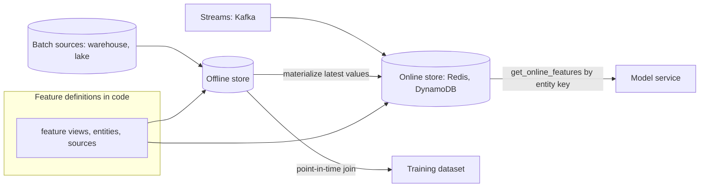

# Feature stores, training/serving skew and labeling

> **Before this lesson:** read [Data sources, ETL/ELT, batch and streaming](#/lesson/mlops/data-pipelines)
> for batch, streaming and joins, and [Data validation and versioning with DVC](#/lesson/mlops/validation-versioning).
> You should know that a **feature** is one input value a model reads and a **label** is the
> correct answer for a training example.

## In plain words

A **feature store** is a shared pantry for model inputs. Each feature (for example "number of
purchases by this customer in the last 30 days") is defined once, computed by one piece of code,
and kept in two places: a large archive holding every past value, used for training, and a small
fast shelf holding only the newest value, used when a live request arrives.

Why bother? Think of a restaurant where the chef perfects a dish in the test kitchen using the
measured, labelled ingredients there, and the line cooks then prepare it from a different
supplier's unlabelled jars. The recipe is identical and the dish comes out different. A model has
the same problem when the numbers it sees in production are computed differently from the numbers
it was trained on. That mismatch is called **training/serving skew**, and a feature store exists
mainly to prevent it.

The lesson ends with **labelling**: where the correct answers for training come from and how to
judge their quality.

Why this matters for a job: skew is one of the most common reasons a model is "great offline and
mediocre online", and "what is training/serving skew and how do you prevent it?" is asked in a
large share of ML engineering interviews. The related idea of a point-in-time join comes up in
almost every ML system design discussion.

## The problem feature stores solve

Imagine a fraud model that uses the feature `txn_count_1h`, the number of transactions on a card
in the last hour.

- For **training**, a data scientist computes it with SQL over the stored history of
  transactions: for each labelled transaction, the count *as of* the moment it happened.
- For **serving**, an engineer computes it while a live request is being answered, from a counter
  kept in Redis (a fast in-memory store).

Two implementations of one idea will drift apart. They may place the edge of the one-hour window
differently, treat time zones differently, or disagree about whether declined transactions count.
The model learned from one definition and is fed another.

A **feature store** lets you define a feature *once* and then:

1. produce its historical values for training, with **point-in-time correctness** (explained
   below);
2. serve its newest value to a live model within a few milliseconds;
3. let other teams find and reuse the feature, with a named owner and a record of its origin.

In the diagram, the **offline store** is the archive of all past values (usually tables in a
warehouse) and the **online store** is the fast lookup of current values.



## Kinds of skew

| Skew | Cause | Example |
|---|---|---|
| Logic skew | different code paths for training and serving | pandas vs Java implementation of a ratio with different null handling |
| Data skew | different source data | training reads cleaned warehouse table; serving reads raw API values |
| Time / freshness skew | training uses values not yet available at serving time | daily batch feature that is 24 h stale online but "fresh" in training |
| Leakage | training uses information from after the prediction time | joining the *latest* customer profile to old labels |
| Preprocessing skew | different tokenizer, vocab, scaler versions | serving uses an old fitted scaler |

The remedies follow from the causes. Share the feature code, through a feature store or a common
package. Save the preprocessing together with the model: a scikit-learn `Pipeline` that contains
the scaler and the model is stored as one file, so they cannot get out of step (Mueller and Guido
ch. 6). And record the features the model received at serving time and compare them with the
training features; this is **skew monitoring**, and you will build a detector for it in the
`mlops-train-serve-skew` problem.

> [!TIP]
> "Log and wait": the most robust way to build training data for an online model is to **log the exact
> feature vector the model received at serving time**, then join it with the label when the label
> arrives. Training then sees exactly what serving saw — skew is impossible by construction. The cost:
> you can only train on data logged after the feature was introduced.

## Point-in-time correctness

A training row represents a prediction that would have been made at some moment *t*. To be
honest, each feature in that row must hold the value it had **as of t**, never a later one. If you
attach the newest value of every feature to every old event, the model is trained with knowledge
of the future, which it will not have in production.

The program below shows the wrong join and the right one. `features` holds the history of one
feature for two users; `labels` holds three events we want to train on.
```python-run
import pandas as pd

# Feature values change over time (e.g., computed daily)
features = pd.DataFrame({
    "user_id": [1, 1, 1, 2, 2],
    "ts": pd.to_datetime(["2025-01-01", "2025-01-10", "2025-01-20", "2025-01-05", "2025-01-15"]),
    "purchases_30d": [2, 5, 9, 1, 0],
}).sort_values("ts")

# Labelled events we want to train on
labels = pd.DataFrame({
    "user_id": [1, 1, 2],
    "event_ts": pd.to_datetime(["2025-01-12", "2025-01-25", "2025-01-06"]),
    "churned": [0, 1, 0],
}).sort_values("event_ts")

# WRONG: join the latest value (leaks the future for early events)
latest = features.sort_values("ts").groupby("user_id").tail(1)[["user_id", "purchases_30d"]]
print("latest-value join (leaky):")
print(labels.merge(latest, on="user_id"))

# RIGHT: as-of join — the most recent feature value at or before each event
pit = pd.merge_asof(labels, features, left_on="event_ts", right_on="ts", by="user_id", direction="backward")
print("\npoint-in-time join:")
print(pit[["user_id", "event_ts", "ts", "purchases_30d", "churned"]])
```

`groupby("user_id").tail(1)` keeps the newest row per user, and the plain `merge` attaches it to
every label. `pd.merge_asof` is the **as-of join**: for each label row it finds the feature row
with the same `user_id` whose timestamp is the latest one that is not after `event_ts`
(`direction="backward"`). The output:

```text
latest-value join (leaky):
   user_id   event_ts  churned  purchases_30d
0        2 2025-01-06        0              0
1        1 2025-01-12        0              9
2        1 2025-01-25        1              9

point-in-time join:
   user_id   event_ts         ts  purchases_30d  churned
0        2 2025-01-06 2025-01-05              1        0
1        1 2025-01-12 2025-01-10              5        0
2        1 2025-01-25 2025-01-20              9        1
```

Compare the middle rows. For user 1's event on 12 January the leaky join supplies 9, a value that
was only computed on 20 January. The point-in-time join supplies 5, the value from 10 January,
which is what a live model would have read on the 12th. This is what a feature store's
`get_historical_features` call does for you, usually with a **TTL** (time to live): a limit on
how old a value may be before it is treated as missing.

## Feast: an open-source feature store

**Feast** is a widely used open-source feature store. Its vocabulary:

- **Entity**: the thing a feature describes and is looked up by, such as a customer, a driver or a
  card. Its id column is the join key.
- **Data source**: where the raw feature data lives (a Parquet file, a warehouse table, a Kafka
  stream).
- **Feature view**: a group of features about one entity from one source, with a TTL.
- **Feature service**: the named set of features that one model consumes. It can be versioned.
- **Offline store** and **online store**: the archive for training and the fast lookup for
  serving (Redis, DynamoDB, Postgres and others).
- **Materialisation**: copying the newest values from the offline store into the online store on
  a schedule.

The definitions are ordinary Python:

```python
# feature_repo/features.py
from datetime import timedelta
from feast import Entity, FeatureService, FeatureView, Field, FileSource
from feast.types import Float32, Int64

customer = Entity(name="customer", join_keys=["customer_id"])

activity_source = FileSource(
    path="data/customer_activity.parquet",
    timestamp_field="event_timestamp",
)

customer_activity = FeatureView(
    name="customer_activity",
    entities=[customer],
    ttl=timedelta(days=30),
    schema=[
        Field(name="purchases_30d", dtype=Int64),
        Field(name="avg_basket_value", dtype=Float32),
        Field(name="support_tickets_30d", dtype=Int64),
    ],
    source=activity_source,
)

churn_v1 = FeatureService(name="churn_v1", features=[customer_activity])
```

Read it from the top: `customer` is declared as an entity keyed by `customer_id`. The source is a
Parquet file whose `event_timestamp` column says when each value became true. The feature view
bundles three features about a customer, valid for 30 days. The feature service `churn_v1` is the
list a model asks for by name.

```bash
feast apply                                       # register definitions
feast materialize-incremental $(date -u +%Y-%m-%dT%H:%M:%S)   # push latest values online
```

```python
from feast import FeatureStore
store = FeatureStore(repo_path="feature_repo")

# Training: point-in-time correct join against an entity dataframe (ids + event timestamps)
training_df = store.get_historical_features(
    entity_df=labels_df,                      # columns: customer_id, event_timestamp, label
    features=store.get_feature_service("churn_v1"),
).to_df()

# Serving: low-latency lookup of the latest values
online = store.get_online_features(
    features=store.get_feature_service("churn_v1"),
    entity_rows=[{"customer_id": 1234}],
).to_dict()
```

The two calls at the end are the point of the whole system. `get_historical_features` takes a
table of ids and timestamps and performs the point-in-time join for training.
`get_online_features` takes an id and returns the current values for serving. Both are driven by
the same definition, so the two paths cannot disagree about what the feature means.

Managed alternatives: Tecton, Databricks Feature Store / Unity Catalog feature tables, Vertex AI Feature
Store, SageMaker Feature Store, Hopsworks.

### Do you need a feature store?

Not always. Signs that you do: multiple models sharing features, online models needing fresh features
with low latency, recurring skew bugs, or teams rebuilding the same features. For a single batch-scored
model, a well-tested shared feature module plus dated tables is often enough.

> [!INTERVIEW]
> "What is training/serving skew and how do you prevent it?" — Define it (feature values or
> preprocessing differ between training and serving), give causes (duplicate implementations, different
> sources, staleness, leakage), and remedies: single feature definitions (feature store or shared library),
> point-in-time joins, preprocessing bundled with the model, logging served features, and monitoring skew
> by comparing serving feature statistics to training statistics.

## On-demand features

Some features can only be computed at request time (distance between user location and store, the text
of the current query). Feast calls these **on-demand feature views**: transformation functions that run
both when building training data and at serving time, so the logic is still defined once.

## Labeling

**Supervised** learning means learning from examples that come with the correct answer attached.
Those answers, the labels, are often the scarcest resource in a project.

### Sources of labels

- **Natural labels** come from what users did or what happened: clicks, purchases, cancellations,
  disputed card charges. They cost nothing, but they arrive late and can be biased, because you
  only observe outcomes for the items you chose to show.
- **Hand labels** from human annotators are expensive and slow, and in fields such as radiology
  or law they need experts.
- **Programmatic labelling**, also called **weak supervision**: you write several rough rules
  (keyword matches, lookups in a reference list) that each vote on a label, and a statistical
  method combines the noisy votes. Snorkel is the best-known tool.
- **Model-assisted labels**: a strong model, often a large language model, proposes labels and
  people review them. Huyen (*AI Engineering*, ch. 8) discusses machine-generated annotations and
  synthetic data and warns that their quality has to be verified, not assumed.
- **Active learning**: ask humans to label the examples the current model is least sure about,
  which gives the most improvement per label.

### Label quality

- Write clear **annotation guidelines** with examples and difficult cases.
- Measure **inter-annotator agreement**: have two people label the same items and see how often
  they agree. Low agreement usually means the guidelines are ambiguous. The standard measure is
  **Cohen's kappa**, computed below.
- Mix in **gold questions**, items whose correct answer is already known, to keep an eye on each
  annotator's accuracy.
- Version labels the way you version data, and record **label lineage**: who or what produced each
  label, when, and under which version of the guidelines.

Raw agreement is misleading, because two people guessing at random would still agree part of the
time. Kappa subtracts that chance agreement: $\kappa = (p_o - p_e) / (1 - p_e)$, where $p_o$ is
the observed share of items they agree on and $p_e$ is the share they would agree on by chance.

```python-run
# Cohen's kappa for two annotators: agreement corrected for chance.
from collections import Counter
a = ["spam", "ham", "spam", "spam", "ham", "ham", "spam", "ham", "spam", "ham"]
b = ["spam", "ham", "ham",  "spam", "ham", "spam", "spam", "ham", "spam", "ham"]
n = len(a)
po = sum(x == y for x, y in zip(a, b)) / n
ca, cb = Counter(a), Counter(b)
pe = sum(ca[k] / n * cb[k] / n for k in set(a) | set(b))
kappa = (po - pe) / (1 - pe)
print(f"observed agreement={po:.2f}, chance agreement={pe:.2f}, kappa={kappa:.2f}")
```

In the code, `po` counts matching positions. `Counter` tallies how often each annotator used each
label; if annotator A says "spam" half the time and B also half the time, they would both say
"spam" on a quarter of items by chance, and `pe` adds that up over the labels. The output is
`observed agreement=0.80, chance agreement=0.50, kappa=0.60`: (0.80 - 0.50) / (1 - 0.50) = 0.60.
A kappa above roughly 0.8 is usually read as strong agreement. A value around 0.6 is moderate and
a reason to revisit the guidelines.

### Label latency and feedback

For online systems the label arrives later than the prediction. Plan a **feedback pipeline**: log the
prediction with a request ID, collect outcomes, join, and feed both monitoring (real performance) and
retraining (module 10). Huyen (ch. 10) highlights user feedback — explicit (thumbs up/down) and implicit
(edits, regenerations, abandonment) — as proprietary data that powers a "data flywheel".

## Freshness, staleness and the online store

An online feature is only as good as its age at the moment of prediction. Three clocks matter:

- **Event time**: when the underlying fact happened (a purchase at 14:02:10).
- **Availability time**: when the feature value containing that fact became readable in the online store
  (14:02:11 for a streaming feature; tomorrow 03:00 for a daily batch feature).
- **Prediction time**: when the model reads it.

Training data has to reproduce the *availability* delay, and not only the event time. Suppose a
daily feature is computed overnight and loaded into the online store at 03:00. A prediction made
at 14:00 then sees data up to the previous midnight. A training join that uses everything "up to
the prediction timestamp" gives the model fresher data than serving ever will. This **time-travel
skew** makes offline scores look better than reality. The fix is to join on the timestamp at
which the value became available, or to build an explicit delay into the point-in-time join.

```python-run
import pandas as pd
# A daily feature computed for each day and published at 03:00 the NEXT day
feat = pd.DataFrame({
    "customer_id": [1, 1, 1],
    "feature_date": pd.to_datetime(["2025-01-10", "2025-01-11", "2025-01-12"]),
    "purchases_7d": [3, 4, 9],
})
feat["available_at"] = feat["feature_date"] + pd.Timedelta(days=1, hours=3)

label = pd.DataFrame({"customer_id": [1], "prediction_ts": pd.to_datetime(["2025-01-12 14:00"])})

naive = pd.merge_asof(label, feat.sort_values("feature_date"), left_on="prediction_ts",
                      right_on="feature_date", by="customer_id")
correct = pd.merge_asof(label, feat.sort_values("available_at"), left_on="prediction_ts",
                        right_on="available_at", by="customer_id")
print("join on event/feature date  ->", int(naive.purchases_7d[0]), "(uses the 2025-01-12 value: not yet published at 14:00)")
print("join on availability time   ->", int(correct.purchases_7d[0]), "(what the online store actually held)")
```

`available_at` is the feature date plus one day and three hours. The first join matches on the
feature's own date, the second on when it could be read. The output:

```text
join on event/feature date  -> 9 (uses the 2025-01-12 value: not yet published at 14:00)
join on availability time   -> 4 (what the online store actually held)
```

The naive join hands the model the value 9, which would not exist until the next morning. In
production it would have read 4.

### Monitoring a feature store

| Signal | Why |
|---|---|
| Materialisation lag (now − latest feature timestamp) per feature view | stale features silently degrade predictions |
| Online read latency p99 and error/timeout rate | sits inside the serving latency budget |
| Null / default rate at read time | missing entities, TTL expiry, failed jobs |
| Offline vs online value parity on a sample | detects logic or pipeline skew |
| Feature usage by model | find unused features to retire |

Decide the **fallback** for a failed or slow lookup in advance: a default value the model saw during
training (and was trained to handle), a cached last-known value, or a simpler model that does not need
the feature. Returning zeros that the model never saw in training is a common silent failure.

### Feature design checklist

1. **Available at prediction time?** If not, it is leakage.
2. **Stable definition**: named, versioned (`purchases_30d_v2`), documented with owner and source.
3. **Cost vs value**: latency and compute to serve it against its measured importance.
4. **Missing-value semantics**: explicit default and a missing indicator rather than silent zeros.
5. **Entity coverage**: what happens for a brand-new user (cold start)?
6. **Backfillable**: can it be computed point-in-time for history, or only from "now" onwards?
7. **Privacy**: does it encode sensitive attributes or proxies for them?

### Embeddings as features

Embeddings (of users, items, text) are increasingly stored and served like features. They add two
versioning concerns: the **embedding model version** must match between the stored vectors and whatever
consumes them (mixing vectors from two encoder versions is meaningless), and re-embedding a corpus after
an encoder upgrade is a backfill that must be swapped in atomically.

## Summary

- Training/serving skew arises from duplicate logic, different sources, staleness, leakage and
  preprocessing mismatches.
- Feature stores define features once, provide point-in-time correct training data (as-of joins) and
  low-latency online serving, and enable sharing.
- Logging served features and comparing distributions is the strongest skew defence.
- Labels come from natural outcomes, humans, weak supervision or models; measure agreement, version labels
  and plan for label latency.

## Glossary

- **Feature store** - a system that defines features once and provides them for both training and
  serving.
- **Training/serving skew** - a difference between the inputs a model learned from and the inputs
  it gets in production.
- **Offline store / online store** - the archive of historical feature values / the fast lookup of
  current values.
- **Entity** - the thing a feature describes, identified by a key such as `customer_id`.
- **Feature view / feature service** - a group of features from one source / the named set a model
  uses.
- **Materialisation** - copying the newest feature values into the online store.
- **Point-in-time correctness** - each training row uses only values known at that row's time.
- **As-of join** - a join that picks the most recent matching row at or before a timestamp.
- **TTL (time to live)** - how long a value stays valid before it counts as missing.
- **Leakage** - training with information from after the prediction time.
- **Log and wait** - recording the features served, then joining labels when they arrive.
- **On-demand feature** - a feature computed at request time from the request itself.
- **Availability time** - the moment a feature value became readable for serving.
- **Natural / hand / weak labels** - labels from outcomes / from annotators / from combined
  heuristic rules.
- **Active learning** - choosing the most informative examples to label next.
- **Inter-annotator agreement / Cohen's kappa** - how often annotators agree / that agreement
  corrected for chance.
- **Cold start** - having no history for a new user or item.
- **Embedding** - a list of numbers representing an item such as a text or a user.

```quiz
[
  {"q": "What does point-in-time correctness guarantee in a training dataset?",
   "options": ["Features are computed with the latest values", "Each feature value is the one available at or before the label's event time", "All timestamps are in UTC", "Features are normalized"],
   "answer": 1, "explain": "Using later values leaks future information into training."},
  {"q": "Which pandas function performs an as-of (point-in-time) join?",
   "options": ["pd.concat", "pd.merge_asof", "DataFrame.pivot", "pd.get_dummies"],
   "answer": 1, "explain": "merge_asof matches each left row with the most recent right row by key."},
  {"q": "In Feast, what is materialization?",
   "options": ["Training the model", "Copying the latest feature values from the offline store to the online store", "Deleting old features", "Converting Parquet to CSV"],
   "answer": 1, "explain": "Materialization keeps the online store up to date for serving."},
  {"q": "Why does logging served feature vectors eliminate skew for future training data?",
   "options": ["It compresses data", "Training then uses exactly the values the model saw at serving time", "It speeds up inference", "It removes the need for labels"],
   "answer": 1, "explain": "Log-and-wait builds training data from served features joined with later labels."},
  {"q": "A serving path uses an older fitted StandardScaler than training. What kind of skew is this?",
   "options": ["Leakage", "Preprocessing skew", "Concept drift", "Label noise"],
   "answer": 1, "explain": "Bundle preprocessing with the model artifact (e.g., a scikit-learn Pipeline) to avoid it."},
  {"q": "Two annotators agree on 80% of items but chance agreement is 50%. Cohen's kappa is...",
   "options": ["0.8", "0.6", "0.3", "0.5"],
   "answer": 1, "explain": "kappa = (0.8 - 0.5) / (1 - 0.5) = 0.6."},
  {"q": "Active learning chooses which examples to label based on...",
   "options": ["Random sampling only", "Where the model is most uncertain or informative", "The oldest examples", "Alphabetical order"],
   "answer": 1, "explain": "Labeling informative examples gives more improvement per label."}
]
```

> **Source:** Feast documentation (*Concepts: entities, feature views, offline/online stores, point-in-time joins*); Mueller & Guido, *Introduction to Machine Learning with Python*, ch. 6 (pipelines); Chip Huyen, *AI Engineering*, ch. 8 (data annotation and synthesis) and ch. 10 (user feedback); Google, *Rules of Machine Learning* (rule 29: log features at serving time); Martin Kleppmann, *DDIA*, ch. 11 (stream–table joins).
