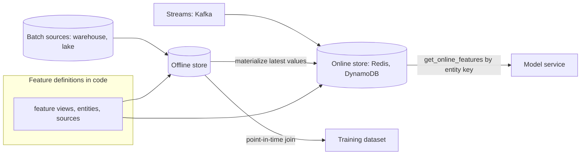

# Feature stores, training/serving skew and labeling

## The problem feature stores solve

Imagine a fraud model using the feature `txn_count_1h` (number of card transactions in the last hour).

- For **training**, a data scientist computes it in SQL over historical transactions, for each labelled
  transaction, *as of* the moment it happened.
- For **serving**, an engineer computes it in the request path from a Redis counter.

Two implementations of the same concept will diverge: different window boundaries, timezone handling,
treatment of declined transactions. The model learned on one definition and is fed another. This is
**training/serving skew**, and it is one of the most common causes of "the model was great offline and
mediocre online".

A **feature store** is a system that lets you define a feature *once* and then:

1. materialise historical values for training with **point-in-time correctness**,
2. serve the latest values online with low latency,
3. share and discover features across teams, with ownership and lineage.



## Kinds of skew

| Skew | Cause | Example |
|---|---|---|
| Logic skew | different code paths for training and serving | pandas vs Java implementation of a ratio with different null handling |
| Data skew | different source data | training reads cleaned warehouse table; serving reads raw API values |
| Time / freshness skew | training uses values not yet available at serving time | daily batch feature that is 24 h stale online but "fresh" in training |
| Leakage | training uses information from after the prediction time | joining the *latest* customer profile to old labels |
| Preprocessing skew | different tokenizer, vocab, scaler versions | serving uses an old fitted scaler |

The fixes: share feature code (feature store or a shared package), serialise preprocessing with the
model (e.g., scikit-learn `Pipeline` saved as one artifact — Mueller & Guido ch. 6), log the features
actually used at serving time and compare them to training features (**skew monitoring** — you will
build a detector in `mlops-train-serve-skew`).

> [!TIP]
> "Log and wait": the most robust way to build training data for an online model is to **log the exact
> feature vector the model received at serving time**, then join it with the label when the label
> arrives. Training then sees exactly what serving saw — skew is impossible by construction. The cost:
> you can only train on data logged after the feature was introduced.

## Point-in-time correctness

To build a training row for an event at time *t*, each feature must take the value it had **as of t** —
never a later value. Joining the latest value instead leaks the future.

```python-run
import pandas as pd

# Feature values change over time (e.g., computed daily)
features = pd.DataFrame({
    "user_id": [1, 1, 1, 2, 2],
    "ts": pd.to_datetime(["2025-01-01", "2025-01-10", "2025-01-20", "2025-01-05", "2025-01-15"]),
    "purchases_30d": [2, 5, 9, 1, 0],
}).sort_values("ts")

# Labelled events we want to train on
labels = pd.DataFrame({
    "user_id": [1, 1, 2],
    "event_ts": pd.to_datetime(["2025-01-12", "2025-01-25", "2025-01-06"]),
    "churned": [0, 1, 0],
}).sort_values("event_ts")

# WRONG: join the latest value (leaks the future for early events)
latest = features.sort_values("ts").groupby("user_id").tail(1)[["user_id", "purchases_30d"]]
print("latest-value join (leaky):")
print(labels.merge(latest, on="user_id"))

# RIGHT: as-of join — the most recent feature value at or before each event
pit = pd.merge_asof(labels, features, left_on="event_ts", right_on="ts", by="user_id", direction="backward")
print("\npoint-in-time join:")
print(pit[["user_id", "event_ts", "ts", "purchases_30d", "churned"]])
```

The user-1 event on Jan 12 should see `purchases_30d = 5` (value from Jan 10), not 9 (from Jan 20). A
point-in-time join is what feature stores' `get_historical_features` does for you, often with a **TTL**
so that very old values are treated as missing.

## Feast: an open-source feature store

Feast's core concepts:

- **Entity**: the key features are attached to (`customer`, `driver`, `card`).
- **Data source**: where raw feature data lives (Parquet file, BigQuery, Snowflake, Redshift, Kafka push).
- **Feature view**: a group of features from one source for an entity, with a TTL.
- **Feature service**: a named set of features a model consumes (versionable).
- **Offline store** (for training) and **online store** (Redis, DynamoDB, Postgres, SQLite...).
- **Materialisation**: copying the latest values from offline to online on a schedule.

```python
# feature_repo/features.py
from datetime import timedelta
from feast import Entity, FeatureService, FeatureView, Field, FileSource
from feast.types import Float32, Int64

customer = Entity(name="customer", join_keys=["customer_id"])

activity_source = FileSource(
    path="data/customer_activity.parquet",
    timestamp_field="event_timestamp",
)

customer_activity = FeatureView(
    name="customer_activity",
    entities=[customer],
    ttl=timedelta(days=30),
    schema=[
        Field(name="purchases_30d", dtype=Int64),
        Field(name="avg_basket_value", dtype=Float32),
        Field(name="support_tickets_30d", dtype=Int64),
    ],
    source=activity_source,
)

churn_v1 = FeatureService(name="churn_v1", features=[customer_activity])
```

```bash
feast apply                                       # register definitions
feast materialize-incremental $(date -u +%Y-%m-%dT%H:%M:%S)   # push latest values online
```

```python
from feast import FeatureStore
store = FeatureStore(repo_path="feature_repo")

# Training: point-in-time correct join against an entity dataframe (ids + event timestamps)
training_df = store.get_historical_features(
    entity_df=labels_df,                      # columns: customer_id, event_timestamp, label
    features=store.get_feature_service("churn_v1"),
).to_df()

# Serving: low-latency lookup of the latest values
online = store.get_online_features(
    features=store.get_feature_service("churn_v1"),
    entity_rows=[{"customer_id": 1234}],
).to_dict()
```

Managed alternatives: Tecton, Databricks Feature Store / Unity Catalog feature tables, Vertex AI Feature
Store, SageMaker Feature Store, Hopsworks.

### Do you need a feature store?

Not always. Signs that you do: multiple models sharing features, online models needing fresh features
with low latency, recurring skew bugs, or teams rebuilding the same features. For a single batch-scored
model, a well-tested shared feature module plus dated tables is often enough.

> [!INTERVIEW]
> "What is training/serving skew and how do you prevent it?" — Define it (feature values or
> preprocessing differ between training and serving), give causes (duplicate implementations, different
> sources, staleness, leakage), and remedies: single feature definitions (feature store or shared library),
> point-in-time joins, preprocessing bundled with the model, logging served features, and monitoring skew
> by comparing serving feature statistics to training statistics.

## On-demand features

Some features can only be computed at request time (distance between user location and store, the text
of the current query). Feast calls these **on-demand feature views**: transformation functions that run
both when building training data and at serving time, so the logic is still defined once.

## Labeling

Supervised models need labels, and labels are often the bottleneck.

### Sources of labels

- **Natural labels** from user behaviour or outcomes: clicks, purchases, churn, chargebacks. Free but
  delayed and sometimes biased (only observed for items shown).
- **Hand labels** from annotators: expensive, slow, and require domain expertise (radiology, legal).
- **Programmatic / weak supervision**: labeling functions (heuristics, regexes, knowledge bases) whose
  noisy votes are combined statistically (Snorkel).
- **Model-assisted / AI labels**: a strong model (often an LLM) pre-labels; humans review. Huyen
  (*AI Engineering*, ch. 8) discusses AI-generated annotations and synthetic data, and warns that
  their quality must be verified, not assumed.
- **Active learning**: label the examples the model is most uncertain about to get the most value per
  label.

### Label quality

- Write clear **annotation guidelines** with examples and edge cases.
- Measure **inter-annotator agreement** (Cohen's/Fleiss' kappa); low agreement means ambiguous guidelines.
- Use **gold questions** with known answers to monitor annotator quality.
- Version labels like data (DVC), and record **label lineage**: who/what labelled it, when, which
  guideline version.

```python-run
# Cohen's kappa for two annotators: agreement corrected for chance.
from collections import Counter
a = ["spam", "ham", "spam", "spam", "ham", "ham", "spam", "ham", "spam", "ham"]
b = ["spam", "ham", "ham",  "spam", "ham", "spam", "spam", "ham", "spam", "ham"]
n = len(a)
po = sum(x == y for x, y in zip(a, b)) / n
ca, cb = Counter(a), Counter(b)
pe = sum(ca[k] / n * cb[k] / n for k in set(a) | set(b))
kappa = (po - pe) / (1 - pe)
print(f"observed agreement={po:.2f}, chance agreement={pe:.2f}, kappa={kappa:.2f}")
```

Kappa above ~0.8 is usually considered strong agreement; around 0.6 is moderate — check your guidelines.

### Label latency and feedback

For online systems the label arrives later than the prediction. Plan a **feedback pipeline**: log the
prediction with a request ID, collect outcomes, join, and feed both monitoring (real performance) and
retraining (module 10). Huyen (ch. 10) highlights user feedback — explicit (thumbs up/down) and implicit
(edits, regenerations, abandonment) — as proprietary data that powers a "data flywheel".

## Summary

- Training/serving skew arises from duplicate logic, different sources, staleness, leakage and
  preprocessing mismatches.
- Feature stores define features once, provide point-in-time correct training data (as-of joins) and
  low-latency online serving, and enable sharing.
- Logging served features and comparing distributions is the strongest skew defence.
- Labels come from natural outcomes, humans, weak supervision or models; measure agreement, version labels
  and plan for label latency.

```quiz
[
  {"q": "What does point-in-time correctness guarantee in a training dataset?",
   "options": ["Features are computed with the latest values", "Each feature value is the one available at or before the label's event time", "All timestamps are in UTC", "Features are normalized"],
   "answer": 1, "explain": "Using later values leaks future information into training."},
  {"q": "Which pandas function performs an as-of (point-in-time) join?",
   "options": ["pd.concat", "pd.merge_asof", "DataFrame.pivot", "pd.get_dummies"],
   "answer": 1, "explain": "merge_asof matches each left row with the most recent right row by key."},
  {"q": "In Feast, what is materialization?",
   "options": ["Training the model", "Copying the latest feature values from the offline store to the online store", "Deleting old features", "Converting Parquet to CSV"],
   "answer": 1, "explain": "Materialization keeps the online store up to date for serving."},
  {"q": "Why does logging served feature vectors eliminate skew for future training data?",
   "options": ["It compresses data", "Training then uses exactly the values the model saw at serving time", "It speeds up inference", "It removes the need for labels"],
   "answer": 1, "explain": "Log-and-wait builds training data from served features joined with later labels."},
  {"q": "A serving path uses an older fitted StandardScaler than training. What kind of skew is this?",
   "options": ["Leakage", "Preprocessing skew", "Concept drift", "Label noise"],
   "answer": 1, "explain": "Bundle preprocessing with the model artifact (e.g., a scikit-learn Pipeline) to avoid it."},
  {"q": "Two annotators agree on 80% of items but chance agreement is 50%. Cohen's kappa is...",
   "options": ["0.8", "0.6", "0.3", "0.5"],
   "answer": 1, "explain": "kappa = (0.8 - 0.5) / (1 - 0.5) = 0.6."},
  {"q": "Active learning chooses which examples to label based on...",
   "options": ["Random sampling only", "Where the model is most uncertain or informative", "The oldest examples", "Alphabetical order"],
   "answer": 1, "explain": "Labeling informative examples gives more improvement per label."}
]
```

> **Source:** Feast documentation (*Concepts: entities, feature views, offline/online stores, point-in-time joins*); Mueller & Guido, *Introduction to Machine Learning with Python*, ch. 6 (pipelines); Chip Huyen, *AI Engineering*, ch. 8 (data annotation and synthesis) and ch. 10 (user feedback); Google, *Rules of Machine Learning* (rule 29: log features at serving time); Martin Kleppmann, *DDIA*, ch. 11 (stream–table joins).
