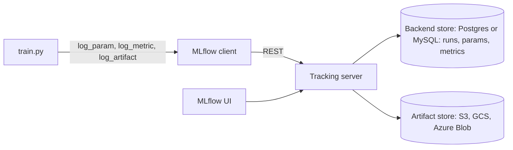

# Experiment tracking with MLflow

> **Before this lesson:** read [Git workflows for ML teams](#/lesson/mlops/git-workflows) for the
> commit SHA and [Data validation and versioning with DVC](#/lesson/mlops/validation-versioning)
> for data versions. You should have trained at least one model with scikit-learn, or have read
> code that does.

## In plain words

Training a model is an experiment: you choose some settings, run the training, and get a score.
You will do this dozens or hundreds of times. **Experiment tracking** is a laboratory notebook
that fills itself in. Every time the training code runs, a small library writes down what
settings were used, which code and data were used, what scores came out, and where the resulting
model file is.

A scientist who mixes chemicals without noting the quantities cannot repeat a success or explain
a failure. The same holds for models. Without a record, "which settings gave us the model that is
live right now?" is answered from memory, and memory is wrong.

**MLflow** is the most widely used open-source tool for this. Weights & Biases, Neptune, Comet and
the trackers built into the cloud ML platforms work on the same ideas, so what you learn here
transfers.

Why this matters for a job: an experiment tracker is the first piece of MLOps tooling most teams
adopt, and "what do you log for each experiment?" is a routine interview question. It is also the
foundation of the next two lessons, on reproducibility and the model registry.

## The spreadsheet of doom

Without tracking, the history of experiments is scattered across notebook file names
(`model_final_v3_REAL.ipynb`), chat messages and people's heads. There are questions you then
cannot answer:

- Which hyperparameters produced the model in production? (A **hyperparameter** is a setting
  chosen before training, such as the learning rate.)
- Did we already try `max_depth=12` last month? What happened?
- Which snapshot of the data was used? Which commit of the code?
- Why is the new model worse than the one from March?

Experiment tracking records, for every training run, three groups of facts: its **inputs**
(settings, data version, code version, software environment), its **outputs** (scores, files, the
model itself) and **metadata** (who ran it, when, for how long).

## MLflow components

| Component | Purpose |
|---|---|
| **Tracking** | log params, metrics, tags, artifacts per run; UI and API to query |
| **Models** | a standard format (`MLmodel` file + "flavors") to save and load models across frameworks |
| **Model Registry** | versioned, aliased, governed models (lesson 12) |
| **Projects** | packaging code for reproducible runs (less used today) |
| **Evaluation / GenAI** | `mlflow.evaluate`, LLM tracing and evaluation (module 12) |

## Core concepts

Six words make up the vocabulary. They are used the same way by every tracker.

- **Experiment**: a named folder of runs that belong together, such as `churn-gbm`.
- **Run**: one execution of the training code. It has an identifier (`run_id`), a status
  (`RUNNING`, `FINISHED`, `FAILED` or `KILLED`) and start and end times.
- **Parameters**: the inputs of the run, each written once as a name and a value:
  `learning_rate=0.05`.
- **Metrics**: numeric results. A metric can be written many times with a `step` number, for
  example the loss after each **epoch** (one full pass over the training data), which produces a
  curve.
- **Tags**: free labels for searching and filtering, such as `git_sha`, `data_version`, `owner`.
- **Artifacts**: files. Charts, tables, the configuration file, and above all the saved model.

The diagram shows where these go. Your training script calls a few logging functions; the MLflow
library (the "client") sends them over the network to a tracking server; the server keeps small
structured facts in a database and files in object storage.


The **backend store** is a database for the structured facts (runs, parameters, metrics). The
**artifact store** holds the files. On a laptop both default to a folder called `./mlruns`, and
nothing has to be installed. A team runs a shared tracking server backed by a real database and
object storage, started like this:

```bash
mlflow server \
  --backend-store-uri postgresql://mlflow:***@db:5432/mlflow \
  --artifacts-destination s3://acme-mlflow-artifacts \
  --host 0.0.0.0 --port 5000
export MLFLOW_TRACKING_URI=http://mlflow.internal:5000
```

The `mlflow server` command names the database, the storage bucket for artifacts and the port to
listen on (`\` at the end of a line continues the command on the next line). The `export` line
sets the environment variable that tells every training script where the server is.

## A complete instrumented training script

```python
# src/churn/train.py
import subprocess, json
import mlflow
import mlflow.sklearn
import pandas as pd
from mlflow.models import infer_signature
from sklearn.ensemble import HistGradientBoostingClassifier
from sklearn.metrics import roc_auc_score, average_precision_score
from sklearn.model_selection import train_test_split

def git_sha() -> str:
    return subprocess.check_output(["git", "rev-parse", "HEAD"]).decode().strip()

def main(cfg: dict) -> str:
    mlflow.set_experiment("churn-gbm")
    df = pd.read_parquet(cfg["data_path"])
    X, y = df[cfg["features"]], df[cfg["target"]]
    X_tr, X_te, y_tr, y_te = train_test_split(X, y, test_size=0.2, random_state=cfg["seed"], stratify=y)

    with mlflow.start_run(run_name=cfg.get("run_name")) as run:
        mlflow.set_tags({"git_sha": git_sha(), "data_version": cfg["data_version"], "owner": "churn-team"})
        mlflow.log_params(cfg["model"]["params"])
        mlflow.log_params({"seed": cfg["seed"], "n_features": len(cfg["features"])})
        mlflow.log_dict(cfg, "config/resolved_config.json")       # the full config as an artifact

        model = HistGradientBoostingClassifier(random_state=cfg["seed"], **cfg["model"]["params"])
        model.fit(X_tr, y_tr)

        proba = model.predict_proba(X_te)[:, 1]
        mlflow.log_metrics({
            "test_roc_auc": roc_auc_score(y_te, proba),
            "test_pr_auc": average_precision_score(y_te, proba),
        })
        signature = infer_signature(X_te, proba)                   # input/output schema
        mlflow.sklearn.log_model(model, artifact_path="model", signature=signature,
                                 input_example=X_te.head(3))
        return run.info.run_id
```

Reading the script from the top:

- `git_sha()` asks Git for the current commit, so the run can be tied to the exact code.
- `mlflow.set_experiment("churn-gbm")` chooses the folder the run will be filed under.
- `train_test_split` holds back 20% of the rows as a test set; `stratify=y` keeps the share of
  churners the same in both parts, and `random_state` fixes the random choice so it can be
  repeated.
- `with mlflow.start_run(...) as run:` opens a run. Everything logged inside the indented block
  belongs to it, and the run is closed (and marked failed if an exception occurs) when the block
  ends.
- `set_tags`, `log_params` and `log_dict` record the code and data versions, the hyperparameters
  and the complete configuration.
- The model is trained, `predict_proba(X_te)[:, 1]` gives each test customer's predicted
  probability of churning, and two scores are logged.
- `infer_signature` works out the model's **signature**: the names and types of the columns it
  expects and the type of what it returns. `log_model` then saves the model with that signature
  and three example input rows.

What ends up stored: parameters, metrics, tags, the configuration, and a model folder containing
the pickled model, its signature, an input example and files describing the Python environment
(`requirements.txt`, `conda.yaml`, `python_env.yaml`).

> [!TIP]
> **Autologging** — `mlflow.autolog()` (or `mlflow.sklearn.autolog()`, `mlflow.pytorch.autolog()`,
> `mlflow.xgboost.autolog()`...) captures params, metrics and the model automatically for supported
> libraries. Great for exploration; add explicit tags for data and code versions yourself.

### Metrics over time

```python
for epoch in range(epochs):
    train_loss, val_loss = train_one_epoch(...)
    mlflow.log_metrics({"train_loss": train_loss, "val_loss": val_loss}, step=epoch)
```

The UI plots these curves and lets you overlay runs to compare learning dynamics.

## The MLflow model format and flavors

An MLflow model is a directory:

```text
model/
├── MLmodel            # YAML: flavors, signature, run_id, dependencies
├── model.pkl
├── input_example.json
├── requirements.txt
├── conda.yaml
└── python_env.yaml
```

A **flavor** is a way of loading the saved model. Every MLflow model has its native flavor (for a
scikit-learn model, `mlflow.sklearn.load_model` gives back the original scikit-learn object) and
also the generic **`python_function`** flavor, abbreviated **pyfunc**. Pyfunc presents every
model, whatever library built it, through the same single method: `predict` on a table of inputs.
That uniformity is what lets general-purpose serving tools (MLflow's own `mlflow models serve`,
SageMaker, Azure ML, KServe) run any MLflow model without knowing what is inside.

```python
model = mlflow.pyfunc.load_model(f"runs:/{run_id}/model")
preds = model.predict(X_new)            # same call regardless of framework
```

Custom logic (pre/post-processing, multiple models) can be wrapped in a `mlflow.pyfunc.PythonModel`
subclass with a `predict(self, context, model_input)` method.

## Querying runs programmatically

The web interface is for people. Automation asks the tracking server questions through the
programming interface, for example to pick the best candidate for release:

```python
runs = mlflow.search_runs(
    experiment_names=["churn-gbm"],
    filter_string="attributes.status = 'FINISHED' and metrics.test_pr_auc > 0.6 and tags.data_version = '2025-01-15'",
    order_by=["metrics.test_pr_auc DESC", "attributes.start_time ASC"],
    max_results=5,
)
print(runs[["run_id", "metrics.test_pr_auc", "params.learning_rate"]])
```

`filter_string` keeps only finished runs with a good enough score on a given data version,
`order_by` sorts them best first, and the second sort key breaks ties by start time. The
`mlops-champion-model` problem asks you to implement the same logic: filter by status and by the
presence of the metric, then order with tie-breaks that always give the same answer.

The simulation below creates twelve fake runs, some of them failed, and selects a champion. The
sort key is a tuple, and Python compares tuples left to right: highest AUC first (the minus sign
turns "largest" into "smallest"), then lowest latency, then earliest start, then run id.
```python-run
# Simulate a tracked sweep and choose a champion with explicit tie-break rules.
import random
random.seed(3)
runs = []
for i in range(12):
    lr = random.choice([0.01, 0.03, 0.1])
    depth = random.choice([15, 31, 63])
    status = "FAILED" if random.random() < 0.15 else "FINISHED"
    auc = round(0.80 + 0.05 * (lr == 0.03) + 0.02 * (depth == 31) + random.uniform(-0.01, 0.01), 3)
    runs.append({"run_id": f"run{i:02d}", "status": status, "start_time": i,
                 "params": {"lr": lr, "max_leaf_nodes": depth},
                 "metrics": {"auc": auc, "latency_ms": depth / 4}})
eligible = [r for r in runs if r["status"] == "FINISHED"]
eligible.sort(key=lambda r: (-r["metrics"]["auc"], r["metrics"]["latency_ms"], r["start_time"], r["run_id"]))
for r in eligible[:5]:
    print(r["run_id"], r["params"], r["metrics"])
print("champion:", eligible[0]["run_id"])
```

The output lists the five best finished runs:

```text
run09 {'lr': 0.03, 'max_leaf_nodes': 31} {'auc': 0.872, 'latency_ms': 7.75}
run07 {'lr': 0.03, 'max_leaf_nodes': 15} {'auc': 0.845, 'latency_ms': 3.75}
run04 {'lr': 0.03, 'max_leaf_nodes': 63} {'auc': 0.845, 'latency_ms': 15.75}
run03 {'lr': 0.1, 'max_leaf_nodes': 31} {'auc': 0.821, 'latency_ms': 7.75}
run11 {'lr': 0.01, 'max_leaf_nodes': 31} {'auc': 0.819, 'latency_ms': 7.75}
champion: run09
```

Look at the second and third lines. Both runs have an AUC of 0.845, and run07 is placed first
because its latency is lower. Without an explicit tie-break, the winner between two equal runs
would depend on the order in which the server happened to return them, and the pipeline would not
be repeatable.

## What to log — a checklist

- **Code**: git SHA, branch, dirty flag (refuse to run "official" trainings with uncommitted changes).
- **Data**: dataset version/hash (DVC hash, table snapshot), row counts, date range, label distribution.
- **Config**: all hyperparameters and the full resolved config file.
- **Environment**: lockfile hash, Docker image digest, Python/CUDA/driver versions, hardware.
- **Metrics**: primary and secondary metrics, on validation *and* test, overall *and* by important slices
  (region, device, new vs returning users), plus calibration and latency/size.
- **Artifacts**: model with signature, plots (ROC/PR curves, confusion matrix, calibration), feature
  importances, sample predictions, the validation report from your data checks.

> [!WARNING]
> Never compare runs that were evaluated on different test sets. Fix the version of the evaluation
> data, record it as a tag, and compare only runs that share it. Otherwise a "better" model may
> owe its score to an easier test set.

## Tracking for deep learning and LLMs

For long training runs, log metrics every N steps, log checkpoints as artifacts (or reference their
storage path), and record GPU utilisation. W&B is popular here for rich real-time dashboards. For LLM
applications, MLflow and others offer **tracing** (spans of each LLM call, retrieval and tool call) and
evaluation of prompts — module 12.

> [!INTERVIEW]
> "What do you log for each experiment?" — Params and full config; metrics (overall + slices) on a pinned
> eval set; code SHA; data version; environment (lockfile/image digest); seed; artifacts (model with
> signature, plots, eval report). Then explain how you'd *use* it: `search_runs` to select a champion,
> lineage from registry version back to the run.

## Organising experiments so they stay useful

A tracker filled with thousands of unnamed runs is only slightly better than no tracker. Conventions
that keep it navigable:

- **One experiment per problem and stage**: `churn/dev`, `churn/hpo`, `churn/scheduled-retrain`. Dev
  experiments can be noisy; scheduled retrains should be clean and queryable.
- **Run names that say what changed**: `gbm-lr0.06-add-tenure-ratio`, not `run_17`.
- **Mandatory tags** enforced by a wrapper: `git_sha`, `git_dirty`, `data_version`, `owner`,
  `purpose` (`exploration` / `candidate` / `production-retrain`), `pipeline_run_id`.
- **Parent/child (nested) runs** for sweeps and cross-validation: the parent summarises (best params,
  mean and std across folds), the children hold details.

```python
with mlflow.start_run(run_name="cv-gbm") as parent:
    scores = []
    for fold, (tr, va) in enumerate(cv.split(X, y)):
        with mlflow.start_run(run_name=f"fold-{fold}", nested=True):
            model = make_model(params).fit(X.iloc[tr], y.iloc[tr])
            s = average_precision_score(y.iloc[va], model.predict_proba(X.iloc[va])[:, 1])
            mlflow.log_metric("pr_auc", s); scores.append(s)
    mlflow.log_metrics({"cv_pr_auc_mean": float(np.mean(scores)), "cv_pr_auc_std": float(np.std(scores))})
```

### A tiny wrapper that enforces discipline

Teams usually wrap the tracker so nobody forgets the essentials:

```python
import subprocess
from contextlib import contextmanager
import mlflow

def _git(*args: str) -> str:
    return subprocess.check_output(["git", *args], text=True).strip()

@contextmanager
def tracked_run(experiment: str, run_name: str, data_version: str, purpose: str = "exploration"):
    dirty = bool(_git("status", "--porcelain"))
    if dirty and purpose != "exploration":
        raise RuntimeError("refusing to start a non-exploration run with uncommitted changes")
    mlflow.set_experiment(experiment)
    with mlflow.start_run(run_name=run_name) as run:
        mlflow.set_tags({"git_sha": _git("rev-parse", "HEAD"), "git_dirty": dirty,
                         "data_version": data_version, "purpose": purpose})
        try:
            yield run
        except Exception as exc:                       # failed runs are data too
            mlflow.set_tag("failure", type(exc).__name__)
            raise
```

Refusing "official" runs from a dirty working tree is a cheap rule that eliminates the single most
common reason a model cannot be reproduced: it was trained from code that was never committed.

## Logging datasets and evaluation results

MLflow can record **which dataset** a run used as a first-class input:

```python
dataset = mlflow.data.from_pandas(train_df, source="s3://acme/churn/train/2025-01-15/",
                                  name="churn_train", targets="churned")
mlflow.log_input(dataset, context="training")     # stores name, digest (hash), schema and source
```

and `mlflow.evaluate` computes a standard metric set and plots for a logged model against an evaluation
dataset, optionally validating thresholds:

```python
result = mlflow.evaluate(model=f"runs:/{run_id}/model", data=test_df, targets="churned",
                         model_type="classifier", evaluators=["default"])
print(result.metrics["roc_auc"], result.metrics["precision_recall_auc"])
```

## Comparing runs honestly

```python-run
import numpy as np
rng = np.random.default_rng(0)
# Two candidate configurations, 5 seeds each, evaluated on the same pinned test set
runs = {"A lr=0.05": 0.731 + rng.normal(0, 0.004, 5), "B lr=0.10": 0.735 + rng.normal(0, 0.004, 5)}
for name, s in runs.items():
    print(f"{name}: seeds={np.round(s, 3)}  mean={s.mean():.4f}  std={s.std(ddof=1):.4f}")
a, b = runs.values()
diff = b.mean() - a.mean()
se = np.sqrt(a.var(ddof=1) / len(a) + b.var(ddof=1) / len(b))
print(f"difference B-A = {diff:+.4f}, standard error = {se:.4f}, ratio = {diff/se:.1f}")
print("verdict:", "likely real" if abs(diff) > 2 * se else "within noise - do not promote on this evidence")
```

This program asks whether configuration B is really better than A, or only luckier. Each
configuration is trained five times with different random **seeds** (the starting value of the
random-number generator), which gives five slightly different scores. `mean` is their average and
`std` their spread. The **standard error** combines the two spreads into one number that says how
much the difference between the averages would wobble by chance alone. The output:

```text
A lr=0.05: seeds=[0.732 0.73  0.734 0.731 0.729]  mean=0.7312  std=0.0017
B lr=0.10: seeds=[0.736 0.74  0.739 0.732 0.73 ]  mean=0.7355  std=0.0044
difference B-A = +0.0044, standard error = 0.0021, ratio = 2.1
verdict: likely real
```

The difference is about twice the standard error, which is the usual threshold for taking it
seriously, though only barely here. A single run of each would have told you nothing: B's worst
seed (0.730) is below A's best (0.734).

A checklist before believing "run B is better":

1. Same evaluation data version and same metric definition?
2. Same preprocessing and feature set, except for the intended change?
3. Is the difference larger than seed-to-seed variation?
4. Does it hold on the important slices, not only overall?
5. Was the test set used once, or was it effectively tuned on?
6. Are latency, model size and training cost comparable — or is the gain bought with 5× the compute?

## Operating the tracking server

- **Access**: put the server behind authentication; scope who can delete experiments or change registry
  aliases.
- **Storage growth**: artifacts dominate. Do not log every epoch's checkpoint as an artifact; log the
  best and last, and reference large external paths by URI. Set lifecycle rules on the artifact bucket
  for runs tagged `exploration`.
- **Database**: back up the backend store — it holds the lineage of every production model.
- **Availability**: training should not fail at hour ten because the tracker blipped. Use client retries,
  and for long jobs consider logging to local files and syncing.
- **Self-hosted vs managed**: Databricks, Azure ML and SageMaker offer managed MLflow-compatible tracking;
  W&B and Neptune are SaaS alternatives. The concepts in this lesson transfer unchanged.

> [!TIP]
> Track **failed and abandoned runs** too. Knowing that "target encoding of merchant ID was tried in
> March and leaked" saves the next person a week.

## Summary

- Tracking records inputs, outputs and metadata of every run so experiments are comparable and
  reproducible.
- MLflow: experiments contain runs; runs have params, metrics (with steps), tags and artifacts, stored in a
  backend store (DB) and artifact store (object storage).
- The MLflow model format with signatures and the pyfunc flavor makes models portable to serving tools.
- Query runs programmatically to automate selection; pin evaluation data to keep comparisons fair.

## Glossary

- **Experiment tracking** - automatic recording of the inputs, outputs and metadata of training
  runs.
- **MLflow** - an open-source platform for tracking, packaging and registering models.
- **Experiment / run** - a named group of runs / one execution of training code.
- **Parameter** - an input setting of a run, logged once.
- **Hyperparameter** - a setting chosen before training, such as the learning rate.
- **Metric** - a numeric result of a run; can be logged repeatedly with a step.
- **Epoch** - one full pass over the training data.
- **Tag** - a free-form label on a run, used for filtering.
- **Artifact** - a file saved with a run, such as a plot or the model.
- **Backend store / artifact store** - the database of run metadata / the storage for files.
- **Tracking server** - the service that receives and serves tracking data for a team.
- **Signature** - the declared input and output schema of a saved model.
- **Flavor / pyfunc** - a way of loading a saved model / the generic flavor with one `predict`
  method.
- **Autologging** - automatic capture of parameters, metrics and the model for supported
  libraries.
- **Nested run** - a child run grouped under a parent, used for sweeps and cross-validation.
- **Seed** - the starting value of a random-number generator.
- **Standard error** - how much an average would vary by chance from one sample to another.
- **Champion** - the model currently chosen as best.

```quiz
[
  {"q": "In MLflow, what is the difference between a parameter and a metric?",
   "options": ["No difference", "Parameters are inputs logged once; metrics are numeric outputs that can be logged repeatedly with steps", "Metrics are strings, parameters are numbers", "Parameters are stored in S3"],
   "answer": 1, "explain": "Params describe the configuration; metrics evolve and are compared across runs."},
  {"q": "Where are MLflow artifacts (e.g., model files, plots) stored on a team server setup?",
   "options": ["In the backend Postgres database", "In the artifact store such as S3/GCS/Azure Blob", "In Git", "In the browser"],
   "answer": 1, "explain": "The backend store keeps metadata; files go to object storage."},
  {"q": "What does a model signature describe?",
   "options": ["The author's digital signature", "The expected input and output schema of the model", "The license", "The GPU type"],
   "answer": 1, "explain": "Signatures let serving validate requests against the training schema."},
  {"q": "Why is the pyfunc flavor important?",
   "options": ["It makes models train faster", "It gives every model a uniform predict(DataFrame) interface for generic serving tools", "It encrypts models", "It is required for logging metrics"],
   "answer": 1, "explain": "Serving platforms load any MLflow model through pyfunc."},
  {"q": "Which tag is MOST important for reproducing a run's code?",
   "options": ["owner", "git commit SHA", "run_name", "color"],
   "answer": 1, "explain": "The SHA identifies the exact code version."},
  {"q": "Two runs report AUC 0.91 and 0.89 but used different test sets. What can you conclude?",
   "options": ["The first model is better", "Nothing reliable; compare only on a pinned, shared evaluation set", "The second is better", "Both are overfit"],
   "answer": 1, "explain": "Different test sets make metrics incomparable."},
  {"q": "What does `mlflow.autolog()` do?",
   "options": ["Deploys the model", "Automatically logs params, metrics and models for supported libraries", "Deletes old runs", "Starts the tracking server"],
   "answer": 1, "explain": "Autologging hooks into frameworks like scikit-learn, XGBoost and PyTorch Lightning."}
]
```

> **Source:** MLflow documentation (*Tracking*, *MLflow Models and flavors*, *Model signatures*, `mlflow.search_runs`); Mueller & Guido, *Introduction to Machine Learning with Python*, ch. 5 (model evaluation, keeping a separate test set); Chip Huyen, *AI Engineering*, ch. 4 (evaluation pipelines).
