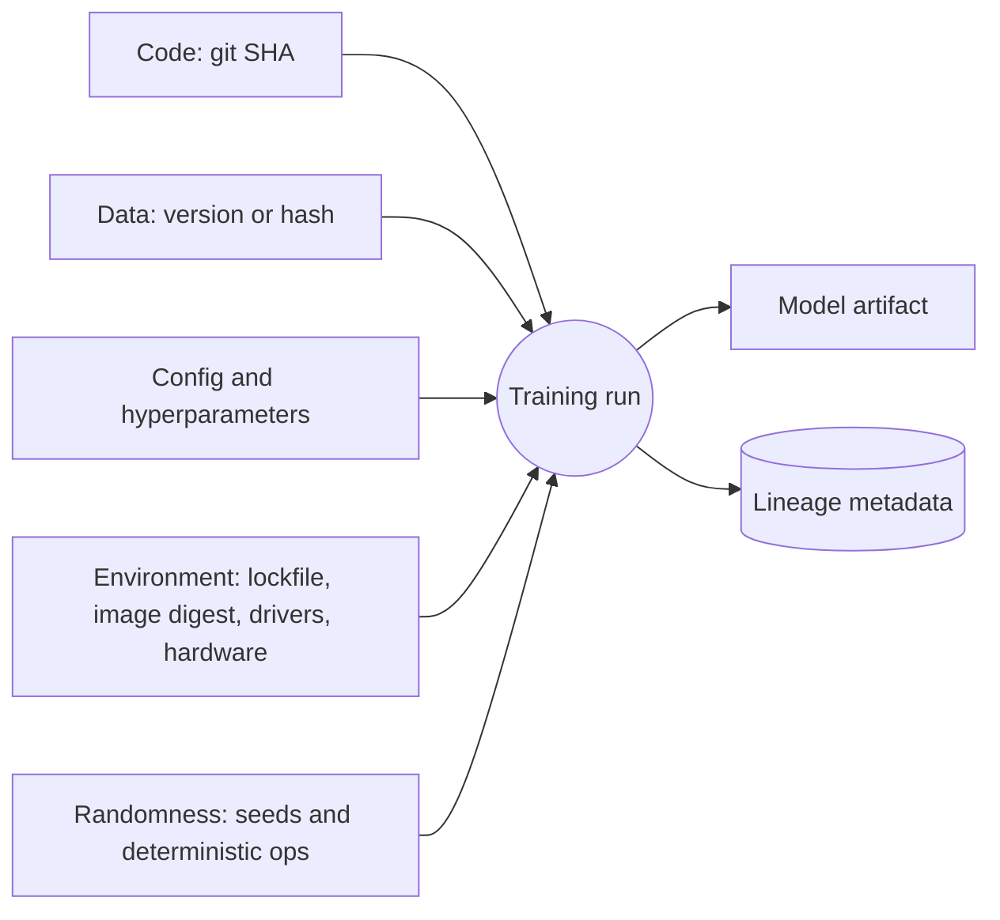
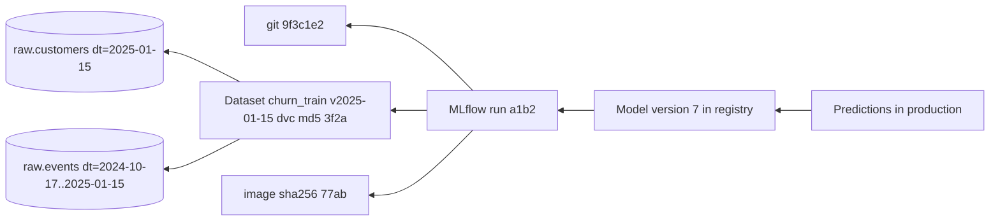

# Reproducibility: seeds, environments and lineage

> **Before this lesson:** read [Experiment tracking with MLflow](#/lesson/mlops/mlflow-tracking)
> for runs, tags and artifacts, and [Python packaging, Makefiles and pre-commit](#/lesson/mlops/packaging-tooling)
> for lockfiles. Lesson 8 covered data versions; lesson 4 the Git SHA.

## In plain words

A result is **reproducible** when someone else, or you a year from now, can run the same recipe
and get the same result. For a model, the "recipe" has five ingredients: the code, the data, the
settings, the installed software, and the random numbers used along the way. If any one of them
is not written down, the model cannot be rebuilt.

Baking is a good comparison. Two people following the same recipe get different cakes if one of
them uses a different flour, an oven that runs hot, or "a pinch" where the other measured a gram.
To get the same cake you fix every one of those. This lesson is about fixing the two ingredients
not yet covered, randomness and the software environment, and then about **lineage**: the paper
trail that connects a finished model back to everything that went into it.

Why this matters for a job: you cannot debug a model you cannot rebuild, you cannot compare two
models fairly if chance decides the winner, and in regulated industries (banking, insurance,
medicine) you may be legally required to explain a decision a model made months ago. "A model
retrained from the same commit gives different results; how do you debug it?" is a classic
interview question, answered below.

## What "reproducible" means

There are three levels, from weakest to strongest:

1. **Re-runnable**: another person can run the training code without having to ask you anything.
2. **Statistically reproducible**: running it again gives a model of the *same quality*. The
   scores differ only by the small amount that chance explains.
3. **Bit-for-bit reproducible**: running it again gives *identical* numbers inside the model and
   identical predictions.

Level 2 is the usual target for production ML. Level 3 is valuable for debugging and in regulated
fields, but it can cost speed, because the fastest GPU routines are not always the repeatable
ones. Either way, five things have to be controlled:



Lessons 4, 6, 8 and 10 handled code, config and data. This lesson covers randomness, environments and
tying everything together into lineage.

## Randomness

A surprising amount of training is random on purpose. The sources:

- how rows are divided into training, validation and test parts, and into the **folds** of
  cross-validation (a method that repeats the split several times and averages the scores);
- the starting values of a neural network's weights, **dropout** (randomly switching off parts of
  the network during training) and **data augmentation** (random variations of the inputs, such
  as flipping images);
- the order in which training examples are shuffled and fed in;
- algorithms with randomness built in, such as random forests or the starting points of k-means
  clustering;
- **parallel computation whose order is not fixed.** Computers store decimal numbers with limited
  precision (**floating point**), so every addition is rounded slightly. Adding the same numbers
  in a different order therefore gives a slightly different total, and when many processor cores
  or a GPU add numbers at the same time, the order is not guaranteed.

The last point is the least intuitive, so here it is in action.
```python-run
import numpy as np
# Floating-point addition is not associative: order changes the result.
x = np.float32(1e8); y = np.float32(-1e8); z = np.float32(1.0)
print("(x + y) + z =", (x + y) + z)
print("x + (y + z) =", x + (y + z))

# Parallel reductions sum in different orders -> tiny differences that can grow during training
rng = np.random.default_rng(0)
v = rng.normal(size=1_000_000).astype(np.float32)
print("sum forward :", float(np.sum(v)))
print("sum shuffled:", float(np.sum(rng.permutation(v))))
```

The first two lines add the same three numbers in two groupings and get 1.0 and 0.0. A 32-bit
float holds about seven significant digits, so `-1e8 + 1.0` is rounded back to `-1e8` and the 1.0
is lost. In mathematics addition is **associative** (the grouping does not matter); in floating
point it is not. The last two lines sum a million numbers forwards and in shuffled order. On this
machine the totals agree, because NumPy uses a careful summation method, but on a GPU that adds in
parallel the two would typically differ in the last digits, and during training such tiny
differences can grow from step to step.

### Seeding properly

Computers do not produce true randomness. A **random-number generator** (RNG) produces a long,
fixed sequence of numbers that only looks random, and the **seed** is the number that selects
where the sequence starts. The same seed gives the same sequence. Each library keeps its own
generator, so each must be seeded:
```python
import os, random
import numpy as np

def seed_everything(seed: int) -> None:
    os.environ["PYTHONHASHSEED"] = str(seed)   # affects hash randomisation only in *new* processes
    random.seed(seed)
    np.random.seed(seed)                       # legacy global RNG
    try:
        import torch
        torch.manual_seed(seed)                # CPU and all CUDA devices
        torch.cuda.manual_seed_all(seed)
        torch.backends.cudnn.benchmark = False # autotuner picks algorithms non-deterministically
        torch.use_deterministic_algorithms(True)   # error if an op has no deterministic implementation
        os.environ["CUBLAS_WORKSPACE_CONFIG"] = ":4096:8"
    except ImportError:
        pass
```

The function seeds Python's own generator, NumPy's, and (if it is installed) PyTorch's for both
the CPU and the GPU. The last three PyTorch lines go further than seeding: they switch off a
feature that picks the fastest routine by trial (and may pick differently each time), and they
ask PyTorch to raise an error whenever an operation has no repeatable implementation. **CUDA** is
NVIDIA's software layer for running computations on its GPUs.

Better practice in modern NumPy is to **pass explicit generators** rather than relying on global state:

```python
rng = np.random.default_rng(seed)
idx = rng.permutation(n)
model = RandomForestClassifier(random_state=seed)      # scikit-learn: pass random_state everywhere
X_tr, X_te, y_tr, y_te = train_test_split(X, y, random_state=seed, stratify=y)
```

For PyTorch DataLoaders, pass a seeded `generator` and a `worker_init_fn` so each worker's RNG is
deterministic.

> [!WARNING]
> Seeding makes runs repeatable, but **do not tune the seed**. If your result only holds for seed 42,
> it is noise. Report metrics as mean ± std across several seeds (e.g., 5) when comparing models with
> small differences.

```python-run
# Seed variance: is model B really better than A?
import numpy as np
from math import sqrt
def train_and_eval(lr, seed):
    rng = np.random.default_rng(seed)
    base = 0.850 if lr == "A" else 0.853           # true difference is tiny
    return base + rng.normal(0, 0.004)              # run-to-run noise
for n in [1, 5, 20]:
    a = [train_and_eval("A", s) for s in range(n)]
    b = [train_and_eval("B", s + 1000) for s in range(n)]
    diff = np.mean(b) - np.mean(a)
    se = sqrt(np.var(a, ddof=1) / n + np.var(b, ddof=1) / n) if n > 1 else float("nan")
    print(f"seeds={n:2d}  A={np.mean(a):.4f}  B={np.mean(b):.4f}  diff={diff:+.4f}  ~2*SE={2*se:.4f}")
```

`train_and_eval` is a stand-in for real training: configuration B is truly better than A, but only
by 0.003, while the run-to-run noise is 0.004. The loop compares them using 1, 5 and 20 seeds.
`SE` is the standard error of the difference (lesson 10); a difference larger than about twice the
SE is unlikely to be chance. The output:

```text
seeds= 1  A=0.8505  B=0.8517  diff=+0.0012  ~2*SE=nan
seeds= 5  A=0.8516  B=0.8528  diff=+0.0011  ~2*SE=0.0044
seeds=20  A=0.8499  B=0.8521  diff=+0.0022  ~2*SE=0.0024
```

With one seed there is no way to estimate the noise at all (`nan`, "not a number"), so the
"winner" is a coin flip. With five seeds the difference is still well inside the noise band. Even
with twenty it only approaches the threshold. Small improvements need many repetitions before
they can be believed.

## Environment pinning

The same code running on a different version of a library can produce a different model, because
default settings and numerical details change between releases. The software a program runs in is
its **environment**, and it has layers, each of which must be fixed ("pinned"):

| Layer | How to pin |
|---|---|
| Python packages | lockfile with hashes (`uv.lock`, `poetry.lock`, `requirements.lock`) |
| Python itself | `requires-python`, `.python-version`, base image tag |
| OS and system libs | Docker base image **by digest** (`python:3.11-slim@sha256:...`) |
| CUDA / cuDNN / NCCL | CUDA base image tag (`nvidia/cuda:12.4.1-cudnn-runtime-ubuntu22.04`), framework wheels built for it |
| GPU driver | node image / cluster config (driver must be ≥ what the CUDA runtime needs) |
| Hardware | record GPU model; different GPUs can use different kernels |

```dockerfile
FROM python:3.11.9-slim@sha256:<digest>      # immutable base
COPY uv.lock pyproject.toml ./
RUN pip install uv && uv sync --frozen --no-dev   # install exactly what is locked
```

Some terms from the table. A container **image** is a packaged file system containing an
operating system layer, libraries and your code (module 6). Its **digest** is a hash of its exact
contents, written `sha256:…`. **cuDNN** and **NCCL** are NVIDIA libraries for neural-network
arithmetic and for communication between GPUs. The **driver** is the software through which the
operating system talks to the GPU.

In each run, record the installed package versions (the output of `pip freeze`, or the hash of the
lockfile), the Python version, the image digest, and the driver and CUDA versions reported by
`nvidia-smi`. MLflow saves `requirements.txt` and `conda.yaml` with every model automatically;
add the image digest yourself as a tag.

> [!TIP]
> Label images with the **Git SHA** for people and deploy them by **digest** for machines. A label
> ("tag") such as `:latest` can be moved to point at a different image tomorrow. A digest is
> computed from the contents, so it can never refer to anything else.

## Lineage: connecting everything

**Lineage** answers "where did this come from?" in both directions:

- *Backward*: this production model version → the registry entry → the run → code SHA, data version,
  config, environment, parent datasets → raw sources.
- *Forward*: this raw table had a bug on Jan 3 → which datasets, runs, models and predictions are affected?



Tools: MLflow run tags and dataset tracking (`mlflow.log_input`), DVC's `dvc.lock`, ML metadata stores
(MLMD in TFX/Kubeflow, Vertex ML Metadata), **OpenLineage** (with Marquez) for data pipelines, and data
catalogs (DataHub, Amundsen, Unity Catalog).

### A reproducibility manifest

A habit that costs a few lines and pays for itself many times: every training run writes a
**manifest**, one small file listing the identity of all five ingredients.
```python-run
import hashlib, json, platform, sys
def sha256_of(obj):
    return hashlib.sha256(json.dumps(obj, sort_keys=True).encode()).hexdigest()[:12]

config = {"model": "hist_gbm", "learning_rate": 0.05, "max_iter": 400, "seed": 42}
manifest = {
    "git_sha": "9f3c1e2a",                         # subprocess git rev-parse HEAD
    "git_dirty": False,                            # git status --porcelain is empty
    "data": {"uri": "s3://acme/churn/train/2025-01-15/", "md5": "3f2a9c1e", "rows": 182_311},
    "config_hash": sha256_of(config),
    "config": config,
    "env": {"python": platform.python_version(), "platform": sys.platform,
            "lock_sha256": "a8e1...", "image_digest": "sha256:77ab..."},
    "seeds": {"global": 42, "split": 42},
}
print(json.dumps(manifest, indent=2))
```

`sha256_of` turns the configuration into text with its keys in sorted order and hashes it, so two
runs with the same settings get the same short `config_hash` and a single changed value gives a
different one. The manifest then gathers the commit, whether there were uncommitted changes
(`git_dirty`), the data location and hash, the configuration, the environment and the seeds, and
prints them as JSON. (The Python version and platform lines depend on where you run it.)

When two runs disagree, compare their manifests field by field. Whichever field differs is where
to look.

## Common reproducibility failures

- **Reading "latest" data**: `SELECT * FROM events WHERE dt >= current_date - 90` changes every day.
  Parameterise the date window and log it.
- **Mutable inputs**: overwritten files in S3 with the same name. Use versioned paths or object versioning.
- **Hidden state in notebooks**: cells executed out of order. Final training must run as a script/pipeline
  from a clean environment.
- **Unpinned transitive dependencies**: your direct deps are pinned, but their dependencies float.
- **Undocumented manual steps**: "then I removed outliers in Excel". Every step must be code.
- **Time-dependent code**: `datetime.now()` inside feature logic. Inject the "as of" time.

> [!INTERVIEW]
> "A model retrained from the same commit gives different results. How do you debug?" — Diff the run
> manifests: data version (did 'latest' data change?), environment (lock hash, image digest, CUDA/driver,
> GPU type), config hash, seeds. If all match, suspect non-deterministic ops (cuDNN autotuning, atomics,
> multi-worker data loading order) — enable deterministic algorithms and compare; quantify seed variance
> to decide whether the difference even matters.

## Reproducible data splits

Comparing two models is only fair if both saw the same rows for training and the same rows for
testing. `train_test_split` with a fixed seed repeats exactly *only while the data set is
unchanged*. Add one row and many assignments shift, quietly moving examples from the training
side to the test side. The robust alternative is to decide each row's side from a **stable hash
of an entity id**: compute a hash of the customer id, take the remainder after dividing by 100,
and send remainders below 20 to the test set.

```python-run
import hashlib

def split_of(entity_id: str, test_pct: int = 20, salt: str = "churn-split-v1") -> str:
    h = int(hashlib.sha256(f"{salt}:{entity_id}".encode()).hexdigest(), 16)
    return "test" if h % 100 < test_pct else "train"

ids_day1 = [f"cust-{i}" for i in range(10_000)]
ids_day2 = ids_day1 + [f"cust-{i}" for i in range(10_000, 12_000)]      # 2,000 new customers arrive
s1 = {i: split_of(i) for i in ids_day1}
s2 = {i: split_of(i) for i in ids_day2}
moved = sum(s1[i] != s2[i] for i in ids_day1)
print(f"test share day 1: {sum(v == 'test' for v in s1.values()) / len(s1):.3f}")
print(f"test share day 2: {sum(v == 'test' for v in s2.values()) / len(s2):.3f}")
print(f"customers that changed split after the data grew: {moved}")
```

`split_of` builds a text from a salt and the id, hashes it with SHA-256, reads the result as one
very large whole number and takes `% 100`, the remainder after division by 100. The output:

```text
test share day 1: 0.196
test share day 2: 0.198
customers that changed split after the data grew: 0
```

About 20% of customers land in the test set, as intended, and when 2,000 new customers arrive not
one of the original 10,000 changes side. The method has three useful properties. It gives the same
answer on any machine and in any programming language. It is stable as data grows. And every row
belonging to one customer lands on the same side, so the model is never tested on a customer it
trained on. The **salt** is an extra piece of text mixed into the hash; changing it (to `v2`)
deliberately creates a new, unrelated split. For problems where time matters, split by date and
record the cut-off dates in the run.

## Determinism in practice: what to expect

| Setting | Typical reproducibility |
|---|---|
| scikit-learn / XGBoost / LightGBM on CPU, fixed seed, same library versions, single thread | bit-identical |
| Same, multi-threaded | usually identical; some algorithms differ in the last bits |
| Same code, different library minor version | may differ (changed defaults, numerics) |
| PyTorch on one GPU with deterministic algorithms enabled | bit-identical on the same hardware and software stack |
| PyTorch default settings (cuDNN autotune, non-deterministic kernels) | statistically equivalent, not identical |
| Different GPU model or driver/CUDA version | not guaranteed identical |
| Distributed data-parallel training | sensitive to worker count and reduction order |

Decide which level you actually need. For most business models, "metrics within the seed-variance band"
is the right target, and a CI test asserting exactly that is cheap:

```python
def test_training_is_statistically_reproducible(tiny_data):
    a = train_and_eval(tiny_data, seed=0)
    b = train_and_eval(tiny_data, seed=0)
    assert a["pr_auc"] == pytest.approx(b["pr_auc"], abs=1e-9)      # same seed -> same result (CPU model)
    c = train_and_eval(tiny_data, seed=1)
    assert abs(a["pr_auc"] - c["pr_auc"]) < 0.03                    # different seed -> within expected band
```

## A worked example: reproducing a production model after an incident

*Scenario*: a regulator asks why customer X was declined by model version 31 four months ago. You must
re-create the model's behaviour.

1. **Registry → run.** Version 31 points at run `a1b2c3`.
2. **Run → code.** Tag `git_sha=9f3c1e2`, `git_dirty=false`. Check out that commit.
3. **Run → data.** Logged dataset digest and `dvc.lock` at that commit identify the exact training
   files; `dvc checkout` restores them from the remote (which has retention configured so they still
   exist).
4. **Run → environment.** The run's `requirements.txt` and the tag `image_digest=sha256:77ab...`
   identify the training image; pull it by digest.
5. **Run → config and seed.** `config/resolved_config.json` artifact.
6. **Prediction log → input.** The stored request for customer X gives the exact feature vector the
   model received (not today's recomputed features, which may differ).
7. **Verify.** Load the registered artifact, score the logged feature vector, and compare with the
   logged prediction. Optionally retrain inside the pinned image and confirm metrics match.

Every step depends on something recorded at training or serving time. The exercise is worth running as a
**fire drill** once a quarter: pick a random production model and try to rebuild it. The gaps you find
are your reproducibility debt.

### What breaks reproducibility over long horizons

- **Artifact retention**: lifecycle rules that delete old data partitions or images. Pin retention for
  anything referenced by a registered model.
- **Yanked or vanished packages** on public indexes: mirror wheels in a private index or keep the built
  image.
- **Base image tags that moved**: reference digests.
- **External services** in the pipeline (a geocoding API, an embedding endpoint) whose behaviour
  changed: snapshot their outputs as data.
- **Hardware retirement**: document that bit-exactness is scoped to a hardware/software stack.

## Summary

- Reproducibility requires controlling code, data, config, environment and randomness.
- Seed every RNG (or pass explicit generators / `random_state`), make data loading deterministic, enable
  deterministic GPU algorithms when you need bit-exactness, and measure seed variance.
- Pin environments at every layer — lockfiles with hashes, base images by digest, CUDA versions — and
  record them per run.
- Lineage links models back to runs, code, data and environment, and forward to affected predictions.

## Glossary

- **Reproducible** - able to be run again with the same result (same quality, or bit-for-bit).
- **Seed** - the number that selects where a random-number generator's sequence starts.
- **RNG (random-number generator)** - an algorithm producing a repeatable sequence of
  random-looking numbers.
- **Floating point** - the limited-precision format in which computers store decimal numbers.
- **Associative** - giving the same result however the terms are grouped; floating-point addition
  is not.
- **Deterministic** - always producing the same output from the same input.
- **Seed variance** - how much a metric changes when only the seed changes.
- **Environment** - all the software a program runs with: Python, packages, system libraries,
  drivers.
- **Pinning** - fixing something to one exact version.
- **Image digest** - a hash identifying the exact contents of a container image.
- **Tag (image)** - a movable, human-readable label on an image.
- **CUDA / cuDNN** - NVIDIA's GPU computing layer / its neural-network library.
- **Lineage** - the recorded links from a model back to its code, data, settings and environment
  (backward), and from a data source to everything built on it (forward).
- **Manifest** - a small file listing the identity of every input of a run.
- **Hash-based split** - assigning rows to train or test by a hash of an entity id.
- **Salt** - extra text mixed into a hash to produce an independent result.
- **Fold / cross-validation** - one of several train/validation divisions / the method that
  averages over them.

```quiz
[
  {"q": "Why can two identical training runs on a GPU produce slightly different weights even with the same seed?",
   "options": ["GPUs have random hardware", "Non-deterministic parallel reductions change floating-point summation order", "Python ignores seeds", "Docker randomizes memory"],
   "answer": 1, "explain": "Floating-point addition is not associative; parallel kernels may sum in different orders."},
  {"q": "What is the preferred way to handle randomness in modern NumPy code?",
   "options": ["Call np.random.seed once globally", "Create explicit generators with np.random.default_rng(seed) and pass them around", "Avoid randomness entirely", "Use time.time() as a seed"],
   "answer": 1, "explain": "Explicit generators avoid hidden global state."},
  {"q": "Why should you deploy container images by digest rather than by tag?",
   "options": ["Digests are shorter", "Tags are mutable while digests are immutable content hashes", "Tags are not supported by Kubernetes", "Digests make images smaller"],
   "answer": 1, "explain": "A tag like :latest can point to different images over time."},
  {"q": "A model only beats the baseline with seed 42. What should you conclude?",
   "options": ["Always use seed 42", "The improvement is likely noise; evaluate across multiple seeds", "Seeds do not matter", "Retrain with seed 43 only"],
   "answer": 1, "explain": "Report mean and spread across seeds."},
  {"q": "Which query pattern breaks reproducibility?",
   "options": ["Reading a dated, immutable partition", "Selecting data relative to current_date at run time without logging the window", "Using DVC-tracked files", "Reading a Delta table version"],
   "answer": 1, "explain": "The data changes every day; parameterise and log the window."},
  {"q": "'Forward lineage' helps you answer...",
   "options": ["Which code produced this model?", "Which models and predictions are affected by a bug in a raw table?", "Which GPU was used?", "Who wrote the README?"],
   "answer": 1, "explain": "Forward lineage traces from sources to downstream consumers."},
  {"q": "What does `torch.use_deterministic_algorithms(True)` do?",
   "options": ["Makes training faster", "Forces deterministic implementations and raises an error for ops without one", "Disables the GPU", "Sets all seeds"],
   "answer": 1, "explain": "It trades some speed for determinism and flags non-deterministic ops."}
]
```

> **Source:** PyTorch documentation (*Reproducibility*); NumPy documentation (*Random Generator*); scikit-learn glossary (`random_state`); Docker documentation (image digests); OpenLineage specification; Mueller & Guido, *Introduction to Machine Learning with Python*, ch. 5 (evaluation variance and cross-validation).
