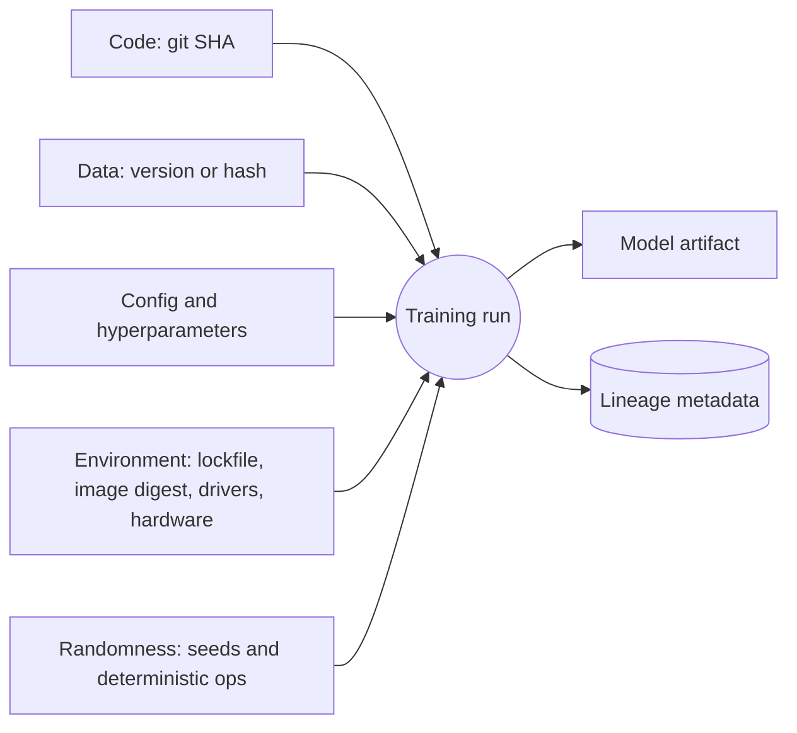
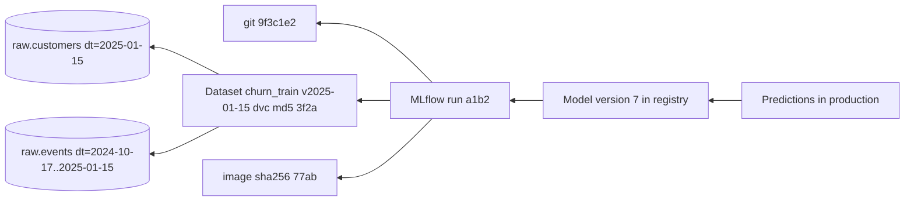

# Reproducibility: seeds, environments and lineage

## What "reproducible" means

There are several levels, from weakest to strongest:

1. **Re-runnable**: someone else can run the training code without asking you questions.
2. **Statistically reproducible**: rerunning gives a model with the *same quality* (metrics within noise).
3. **Bit-for-bit reproducible**: rerunning gives *identical* weights and predictions.

Level 2 is the usual target for production ML; level 3 is valuable for debugging and regulated domains
but can be expensive (deterministic GPU kernels are slower). Either way you need to control five things:



Lessons 4, 6, 8 and 10 handled code, config and data. This lesson covers randomness, environments and
tying everything together into lineage.

## Randomness

Sources of randomness in training:

- train/validation/test splits and cross-validation folds,
- weight initialisation, dropout, data augmentation,
- data shuffling and sampling order (DataLoader workers),
- algorithms with random components (random forests, `HistGradientBoosting` with early-stopping
  validation splits, k-means init, t-SNE/UMAP),
- **non-deterministic parallel computation**: floating-point addition is not associative, so summing in a
  different order (multi-threaded reductions, atomic adds on GPU) yields slightly different results.

```python-run
import numpy as np
# Floating-point addition is not associative: order changes the result.
x = np.float32(1e8); y = np.float32(-1e8); z = np.float32(1.0)
print("(x + y) + z =", (x + y) + z)
print("x + (y + z) =", x + (y + z))

# Parallel reductions sum in different orders -> tiny differences that can grow during training
rng = np.random.default_rng(0)
v = rng.normal(size=1_000_000).astype(np.float32)
print("sum forward :", float(np.sum(v)))
print("sum shuffled:", float(np.sum(rng.permutation(v))))
```

### Seeding properly

```python
import os, random
import numpy as np

def seed_everything(seed: int) -> None:
    os.environ["PYTHONHASHSEED"] = str(seed)   # affects hash randomisation only in *new* processes
    random.seed(seed)
    np.random.seed(seed)                       # legacy global RNG
    try:
        import torch
        torch.manual_seed(seed)                # CPU and all CUDA devices
        torch.cuda.manual_seed_all(seed)
        torch.backends.cudnn.benchmark = False # autotuner picks algorithms non-deterministically
        torch.use_deterministic_algorithms(True)   # error if an op has no deterministic implementation
        os.environ["CUBLAS_WORKSPACE_CONFIG"] = ":4096:8"
    except ImportError:
        pass
```

Better practice in modern NumPy is to **pass explicit generators** rather than relying on global state:

```python
rng = np.random.default_rng(seed)
idx = rng.permutation(n)
model = RandomForestClassifier(random_state=seed)      # scikit-learn: pass random_state everywhere
X_tr, X_te, y_tr, y_te = train_test_split(X, y, random_state=seed, stratify=y)
```

For PyTorch DataLoaders, pass a seeded `generator` and a `worker_init_fn` so each worker's RNG is
deterministic.

> [!WARNING]
> Seeding makes runs repeatable, but **do not tune the seed**. If your result only holds for seed 42,
> it is noise. Report metrics as mean ± std across several seeds (e.g., 5) when comparing models with
> small differences.

```python-run
# Seed variance: is model B really better than A?
import numpy as np
from math import sqrt
def train_and_eval(lr, seed):
    rng = np.random.default_rng(seed)
    base = 0.850 if lr == "A" else 0.853           # true difference is tiny
    return base + rng.normal(0, 0.004)              # run-to-run noise
for n in [1, 5, 20]:
    a = [train_and_eval("A", s) for s in range(n)]
    b = [train_and_eval("B", s + 1000) for s in range(n)]
    diff = np.mean(b) - np.mean(a)
    se = sqrt(np.var(a, ddof=1) / n + np.var(b, ddof=1) / n) if n > 1 else float("nan")
    print(f"seeds={n:2d}  A={np.mean(a):.4f}  B={np.mean(b):.4f}  diff={diff:+.4f}  ~2*SE={2*se:.4f}")
```

With one seed the "winner" is a coin flip; with 20 seeds the difference becomes distinguishable from noise.

## Environment pinning

The same code with a different library version can give a different model. Pin at every layer:

| Layer | How to pin |
|---|---|
| Python packages | lockfile with hashes (`uv.lock`, `poetry.lock`, `requirements.lock`) |
| Python itself | `requires-python`, `.python-version`, base image tag |
| OS and system libs | Docker base image **by digest** (`python:3.11-slim@sha256:...`) |
| CUDA / cuDNN / NCCL | CUDA base image tag (`nvidia/cuda:12.4.1-cudnn-runtime-ubuntu22.04`), framework wheels built for it |
| GPU driver | node image / cluster config (driver must be ≥ what the CUDA runtime needs) |
| Hardware | record GPU model; different GPUs can use different kernels |

```dockerfile
FROM python:3.11.9-slim@sha256:<digest>      # immutable base
COPY uv.lock pyproject.toml ./
RUN pip install uv && uv sync --frozen --no-dev   # install exactly what is locked
```

Record in each run: `pip freeze` output (or the lock hash), `python --version`, the image digest, and
`nvidia-smi` driver/CUDA versions. MLflow logs `requirements.txt`/`conda.yaml` with each model
automatically; add the image digest as a tag.

> [!TIP]
> Tag images with the **git SHA** for humans and deploy them by **digest** for machines. Tags are mutable
> (someone can push a new `:latest`); digests are content hashes and never change.

## Lineage: connecting everything

**Lineage** answers "where did this come from?" in both directions:

- *Backward*: this production model version → the registry entry → the run → code SHA, data version,
  config, environment, parent datasets → raw sources.
- *Forward*: this raw table had a bug on Jan 3 → which datasets, runs, models and predictions are affected?



Tools: MLflow run tags and dataset tracking (`mlflow.log_input`), DVC's `dvc.lock`, ML metadata stores
(MLMD in TFX/Kubeflow, Vertex ML Metadata), **OpenLineage** (with Marquez) for data pipelines, and data
catalogs (DataHub, Amundsen, Unity Catalog).

### A reproducibility manifest

A simple, powerful habit: every training run writes a manifest artifact.

```python-run
import hashlib, json, platform, sys
def sha256_of(obj):
    return hashlib.sha256(json.dumps(obj, sort_keys=True).encode()).hexdigest()[:12]

config = {"model": "hist_gbm", "learning_rate": 0.05, "max_iter": 400, "seed": 42}
manifest = {
    "git_sha": "9f3c1e2a",                         # subprocess git rev-parse HEAD
    "git_dirty": False,                            # git status --porcelain is empty
    "data": {"uri": "s3://acme/churn/train/2025-01-15/", "md5": "3f2a9c1e", "rows": 182_311},
    "config_hash": sha256_of(config),
    "config": config,
    "env": {"python": platform.python_version(), "platform": sys.platform,
            "lock_sha256": "a8e1...", "image_digest": "sha256:77ab..."},
    "seeds": {"global": 42, "split": 42},
}
print(json.dumps(manifest, indent=2))
```

If any field differs between two runs, you know where to look when results differ.

## Common reproducibility failures

- **Reading "latest" data**: `SELECT * FROM events WHERE dt >= current_date - 90` changes every day.
  Parameterise the date window and log it.
- **Mutable inputs**: overwritten files in S3 with the same name. Use versioned paths or object versioning.
- **Hidden state in notebooks**: cells executed out of order. Final training must run as a script/pipeline
  from a clean environment.
- **Unpinned transitive dependencies**: your direct deps are pinned, but their dependencies float.
- **Undocumented manual steps**: "then I removed outliers in Excel". Every step must be code.
- **Time-dependent code**: `datetime.now()` inside feature logic. Inject the "as of" time.

> [!INTERVIEW]
> "A model retrained from the same commit gives different results. How do you debug?" — Diff the run
> manifests: data version (did 'latest' data change?), environment (lock hash, image digest, CUDA/driver,
> GPU type), config hash, seeds. If all match, suspect non-deterministic ops (cuDNN autotuning, atomics,
> multi-worker data loading order) — enable deterministic algorithms and compare; quantify seed variance
> to decide whether the difference even matters.

## Summary

- Reproducibility requires controlling code, data, config, environment and randomness.
- Seed every RNG (or pass explicit generators / `random_state`), make data loading deterministic, enable
  deterministic GPU algorithms when you need bit-exactness, and measure seed variance.
- Pin environments at every layer — lockfiles with hashes, base images by digest, CUDA versions — and
  record them per run.
- Lineage links models back to runs, code, data and environment, and forward to affected predictions.

```quiz
[
  {"q": "Why can two identical training runs on a GPU produce slightly different weights even with the same seed?",
   "options": ["GPUs have random hardware", "Non-deterministic parallel reductions change floating-point summation order", "Python ignores seeds", "Docker randomizes memory"],
   "answer": 1, "explain": "Floating-point addition is not associative; parallel kernels may sum in different orders."},
  {"q": "What is the preferred way to handle randomness in modern NumPy code?",
   "options": ["Call np.random.seed once globally", "Create explicit generators with np.random.default_rng(seed) and pass them around", "Avoid randomness entirely", "Use time.time() as a seed"],
   "answer": 1, "explain": "Explicit generators avoid hidden global state."},
  {"q": "Why should you deploy container images by digest rather than by tag?",
   "options": ["Digests are shorter", "Tags are mutable while digests are immutable content hashes", "Tags are not supported by Kubernetes", "Digests make images smaller"],
   "answer": 1, "explain": "A tag like :latest can point to different images over time."},
  {"q": "A model only beats the baseline with seed 42. What should you conclude?",
   "options": ["Always use seed 42", "The improvement is likely noise; evaluate across multiple seeds", "Seeds do not matter", "Retrain with seed 43 only"],
   "answer": 1, "explain": "Report mean and spread across seeds."},
  {"q": "Which query pattern breaks reproducibility?",
   "options": ["Reading a dated, immutable partition", "Selecting data relative to current_date at run time without logging the window", "Using DVC-tracked files", "Reading a Delta table version"],
   "answer": 1, "explain": "The data changes every day; parameterise and log the window."},
  {"q": "'Forward lineage' helps you answer...",
   "options": ["Which code produced this model?", "Which models and predictions are affected by a bug in a raw table?", "Which GPU was used?", "Who wrote the README?"],
   "answer": 1, "explain": "Forward lineage traces from sources to downstream consumers."},
  {"q": "What does `torch.use_deterministic_algorithms(True)` do?",
   "options": ["Makes training faster", "Forces deterministic implementations and raises an error for ops without one", "Disables the GPU", "Sets all seeds"],
   "answer": 1, "explain": "It trades some speed for determinism and flags non-deterministic ops."}
]
```

> **Source:** PyTorch documentation (*Reproducibility*); NumPy documentation (*Random Generator*); scikit-learn glossary (`random_state`); Docker documentation (image digests); OpenLineage specification; Mueller & Guido, *Introduction to Machine Learning with Python*, ch. 5 (evaluation variance and cross-validation).
