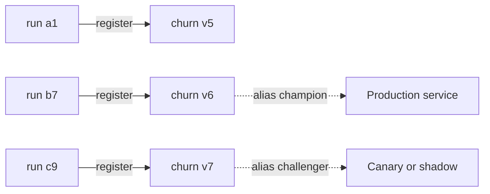
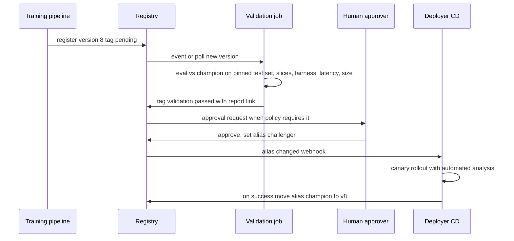

# Model registry, model cards and governance

> **Before this lesson:** read [Experiment tracking with MLflow](#/lesson/mlops/mlflow-tracking)
> for runs and artifacts, and [Reproducibility: seeds, environments and lineage](#/lesson/mlops/reproducibility)
> for lineage. The champion/challenger vocabulary comes from lesson 3.

## In plain words

An experiment tracker remembers *every* training run, including the hundreds that were thrown
away. A **model registry** is a much shorter list: the models that are serious candidates for
production, each with a version number, a note about who approved it, and a label saying which
one is live right now.

Compare a chef's notebook with a restaurant's printed menu. The notebook contains every trial,
including the failures. The menu contains only the dishes that passed tasting, each in its
approved version, and it is the menu, not the notebook, that the kitchen cooks from. Changing
what customers are served means changing the menu, and going back to last week's dish is one
reprint.

A **model card** is the label on the dish: what it is, what it is for, what is in it, and who
should not eat it. **Governance** is the set of rules about who may change the menu and the
record proving the rules were followed.

Why this matters for a job: "how do you decide to promote a new model, and how do you roll it
back?" is asked in nearly every MLOps interview. The registry is also the piece that connects
training to deployment in every later lesson of this track.

## From "a run" to "the production model"

The registry is the curated catalogue of models that are candidates for production or are in it.
It answers questions the tracker cannot:

- Which versions of the `churn` model exist? Which one is answering requests now? Which is next?
- Who approved version 7, and on what evidence?
- Which run (and therefore which code, data and settings) produced version 7?
- How do I go back to the previous version in one step?

Its most important effect is to separate two activities. **Training** produces versions.
**Deployment** chooses which version serves. The deployment code never names a file; it asks the
registry for a model by *name and label*, for example "the `churn` model labelled `champion`".
Because of that indirection, changing the live model requires no change to the serving code.



## MLflow Model Registry concepts

MLflow's registry has four ideas:

- **Registered model**: a name, such as `churn`, with a description.
- **Model version**: a numbered entry (1, 2, 3, …) under that name. Each version points to one
  saved model and to the run that produced it, and it is **immutable**: once created, its
  contents never change.
- **Alias**: a movable label that points at one version, written with an `@` sign: `@champion`,
  `@challenger`, `@shadow`. *Promoting* a model means moving an alias to it. *Rolling back* means
  moving the alias to where it was before.
- **Tags**: name-value notes on a version, such as `validation_status=approved` or
  `approved_by=alice`.

Older MLflow versions used fixed **stages** (`None`, `Staging`, `Production`, `Archived`) in place
of aliases. They were deprecated because a fixed list did not fit real workflows, for instance a
company with a different production model per region. You will still meet stages in older code
and in interview questions, so know that an alias is the modern equivalent.

```python
import mlflow
from mlflow import MlflowClient

client = MlflowClient()
# 1. register the model from a run
mv = mlflow.register_model(model_uri=f"runs:/{run_id}/model", name="churn")
# 2. annotate
client.set_model_version_tag("churn", mv.version, "validation_status", "pending")
client.update_model_version("churn", mv.version, description="GBM on 2025-01-15 snapshot; +2.1pt PR-AUC")
# 3. promote after validation gates pass
client.set_registered_model_alias("churn", "challenger", mv.version)
# ... after a successful canary:
client.set_registered_model_alias("churn", "champion", mv.version)
# 4. serving code always loads by alias
model = mlflow.pyfunc.load_model("models:/churn@champion")
```

Step by step: `register_model` creates a new version from the model saved in a run (`runs:/…`
means "inside this run's artifacts"). The next two calls attach a tag and a description. Moving
the `challenger` alias marks the version as the candidate. Moving `champion` makes it the
production model. The last line is all the serving code ever contains: the address
`models:/churn@champion` means "whichever version the `champion` alias points to today".

Other registries: SageMaker Model Registry (model packages with approval status), Vertex AI Model
Registry, Azure ML registries, Databricks Unity Catalog models, W&B Registry, Hugging Face Hub (versioned
Git repos for weights with model cards — very common for open models).

## Versioning schemes

MLflow numbers versions 1, 2, 3 and so on, which is unambiguous but says nothing about what
changed. Many teams therefore add a **semantic version** as a tag. Semantic versioning (often
"semver") is the software convention of three numbers, `MAJOR.MINOR.PATCH`, where the position
that changes tells users how much they need to care:

| Change | Example | Bump |
|---|---|---|
| Input/output schema change (breaking for clients) | new required feature, renamed output | MAJOR |
| Retrained weights, same schema | monthly retrain | MINOR |
| Non-functional fix | metadata, threshold doc, packaging fix | PATCH |

You will implement this rule in the `mlops-semver-bump` problem. One classic mistake to avoid:
comparing versions as text. Text comparison goes character by character, so `"1.10.0"` sorts
before `"1.9.0"` because the character `1` comes before `9`. Split the version into numbers and
compare those.

> [!TIP]
> The **signature** stored with an MLflow model is what makes "schema change" detectable automatically:
> diff the input/output signature of the new version against the champion's; a removed or retyped column
> is a breaking change.

## Promotion workflow and gates



The sequence diagram reads top to bottom as a conversation between five participants. The checks
the validation job runs are called **gates**, and typical ones are:

1. **Performance**: on a fixed evaluation set, the challenger must be at least as good as the
   champion, minus a small allowance ε for noise.
2. **Slices**: no important subgroup of users may get worse by more than a limit δ.
3. **Calibration**: when a model says "70% likely", the event should occur about 70% of the time.
   The expected calibration error (ECE) measures the gap; it matters whenever the probabilities
   themselves are used.
4. **Operational**: file size, memory use, and the **p95 latency** (the response time that 95% of
   requests stay under) on reference hardware.
5. **Schema compatibility**: the inputs and outputs still match what the serving code and its
   callers expect.
6. **Fairness and compliance** checks where the use case requires them.

The program below is such a gate. Each model is a dictionary holding an overall score, a score
per slice and a latency. The three constants at the top are the tolerances.

```python-run
# A promotion gate: compare challenger vs champion overall and on slices.
champion = {"overall": 0.712, "slices": {"new_users": 0.640, "returning": 0.735, "mobile": 0.701}, "p95_ms": 18}
challenger = {"overall": 0.731, "slices": {"new_users": 0.618, "returning": 0.760, "mobile": 0.722}, "p95_ms": 21}
EPS_OVERALL, MAX_SLICE_DROP, MAX_LATENCY_RATIO = 0.0, 0.01, 1.25

reasons = []
if challenger["overall"] < champion["overall"] + EPS_OVERALL:
    reasons.append("overall metric not better")
for s, v in champion["slices"].items():
    drop = v - challenger["slices"][s]
    if drop > MAX_SLICE_DROP:
        reasons.append(f"slice '{s}' regressed by {drop:.3f}")
if challenger["p95_ms"] > champion["p95_ms"] * MAX_LATENCY_RATIO:
    reasons.append("latency budget exceeded")
print("PROMOTE" if not reasons else "BLOCK: " + "; ".join(reasons))
```

The output is `BLOCK: slice 'new_users' regressed by 0.022`. Follow the numbers: the challenger's
overall score is better (0.731 against 0.712), so the first check passes. Its latency of 21 ms is
within 1.25 times the champion's 18 ms, so the last check passes. But for new users it scores
0.618 where the champion scores 0.640, a drop of 0.022, which is more than the permitted 0.01.

A model that is better on average and worse for one group is common, because the average is
dominated by the largest group. This is why slice scores belong in every gate.

> [!INTERVIEW]
> "How do you decide to promote a new model?" — Offline gates (pinned test set, slices, calibration,
> latency/size, schema), human approval when risk demands, then online validation (shadow → canary with
> automatic rollback, or an A/B test on business metrics), and finally moving the registry alias. Keep
> the previous champion one alias move away for instant rollback.

## Model cards

A **model card** is a short, structured document that travels with a model, proposed by Mitchell
and colleagues in 2019. It plays the role of the leaflet in a medicine box. The Hugging Face Hub,
the most popular public site for sharing models, displays a `README.md` model card on every
model's page, and many companies require one before a model may go to production.

Typical sections:

```markdown
# Model card: churn v8

## Model details
Gradient-boosted trees (scikit-learn HistGradientBoostingClassifier 1.5.2). Owner: churn-team.
Trained 2025-01-16 from run a1b2c3 (git 9f3c1e2), data snapshot 2025-01-15.

## Intended use
Rank active subscribers by 30-day churn risk for retention campaigns.
Out of scope: credit or employment decisions; individual-level automated denial of service.

## Training data
182k subscribers, Oct 2024 – Jan 2025, EU and US. Label: cancelled within 30 days.
Known gaps: < 2% of data from APAC.

## Evaluation
PR-AUC 0.731 (pinned test set v2025-01). Slices: new users 0.618, returning 0.760, mobile 0.722.
Calibration ECE 0.021.

## Ethical considerations and limitations
Lower performance for new users (less history). Do not use protected attributes; proxy check performed for age.

## Monitoring and maintenance
Drift monitored daily (PSI on top 10 features); retrain monthly or on alert. Contact: #churn-ml.
```

Related documentation: **datasheets for datasets** (how data was collected, composition, intended uses),
**system cards** for whole AI systems, and **AI risk assessments** required by regulations such as the
EU AI Act for high-risk use cases.

## Governance

Governance means you can show *who* did *what*, *when*, *why*, and that policies were followed.

- **Access control**: who can register, approve, or move the `champion` alias (separation of duties for
  regulated models).
- **Audit trail**: registry events (version created, alias moved, approvals) retained and reviewable.
- **Reproducibility**: lineage from version to run to code/data/env (lesson 11).
- **Approval policies by risk tier**: a low-risk ranking model may auto-promote; a credit model requires
  documented human sign-off and validation by an independent team (model risk management, e.g., SR 11-7
  in US banking).
- **Retention and privacy**: training data subject to deletion requests; know which models used it.
- **Licenses**: for open models and datasets (Hugging Face model cards list them), check commercial use
  terms.

## Hugging Face Hub as a registry

For open-weight and transformer models, the Hub works as a Git-based registry:

```python
from huggingface_hub import HfApi, snapshot_download
api = HfApi()
api.upload_folder(folder_path="outputs/model", repo_id="acme/churn-text-encoder", commit_message="v8 weights")
# pin consumers to an exact commit hash (revision) for reproducibility
path = snapshot_download("acme/churn-text-encoder", revision="3f2a9c1e5b7d0c4e8a1f2b3c4d5e6f7a8b9c0d1e")
```

Pinning `revision` to a commit hash is the Hub equivalent of deploying an image by digest.

## Rollback, hands-on

The reason to route deployment through a registry is that undoing a release becomes dull and
safe. Here is a complete promotion and rollback using aliases:

```python
from mlflow import MlflowClient
c = MlflowClient()

def promote(name: str, version: int, approved_by: str) -> None:
    try:
        previous = c.get_model_version_by_alias(name, "champion").version
        c.set_registered_model_alias(name, "previous_champion", previous)      # keep a pointer for rollback
    except Exception:
        previous = None
    c.set_registered_model_alias(name, "champion", version)
    c.set_model_version_tag(name, version, "promoted_by", approved_by)
    c.set_model_version_tag(name, version, "replaced_version", str(previous))

def rollback(name: str, reason: str) -> None:
    bad = c.get_model_version_by_alias(name, "champion").version
    good = c.get_model_version_by_alias(name, "previous_champion").version
    c.set_registered_model_alias(name, "champion", good)
    c.set_model_version_tag(name, bad, "rolled_back", reason)
```

`promote` first looks up which version is currently `champion` and parks a second alias,
`previous_champion`, on it. Only then does it move `champion` to the new version, and it records
who did it. `rollback` reads the two aliases, moves `champion` back, and tags the bad version
with the reason. Neither function touches a model file.

Two practical details:

- **Serving must notice.** A service that loaded `@champion` at startup keeps the old model in memory.
  Either roll the pods (CD resolves the alias to a pinned version and triggers a rollout — the more
  auditable option) or have the service poll the alias and hot-swap.
- **Rollback is only safe if the old version is still compatible** with today's features and request
  schema. That is why breaking schema changes need a MAJOR bump and a migration plan: deploy code that
  can serve both schemas, then switch the model.

```python-run
# A registry in miniature: immutable versions, mutable aliases, audit log.
class Registry:
    def __init__(self): self.versions, self.aliases, self.audit = {}, {}, []
    def register(self, run_id, metrics):
        v = len(self.versions) + 1
        self.versions[v] = {"run_id": run_id, "metrics": metrics}
        self.audit.append(f"v{v} registered from run {run_id}")
        return v
    def set_alias(self, alias, v, who):
        old = self.aliases.get(alias)
        self.aliases[alias] = v
        self.audit.append(f"{who}: alias '{alias}' v{old} -> v{v}")
    def resolve(self, alias): return self.aliases[alias]

r = Registry()
v1 = r.register("run-a1", {"pr_auc": 0.712}); r.set_alias("champion", v1, "ci")
v2 = r.register("run-b7", {"pr_auc": 0.731}); r.set_alias("challenger", v2, "ci")
r.set_alias("previous_champion", r.resolve("champion"), "cd"); r.set_alias("champion", v2, "cd after canary")
print("serving now loads version", r.resolve("champion"))
# incident: v2 misbehaves in production
r.set_alias("champion", r.resolve("previous_champion"), "on-call rollback")
print("after rollback serving loads version", r.resolve("champion"))
print(*r.audit, sep="\n")
```

The class keeps three things: a dictionary of versions (only ever added to), a dictionary of
aliases (freely changed), and a list recording every action. The output:

```text
serving now loads version 2
after rollback serving loads version 1
v1 registered from run run-a1
ci: alias 'champion' vNone -> v1
v2 registered from run run-b7
ci: alias 'challenger' vNone -> v2
cd: alias 'previous_champion' vNone -> v1
cd after canary: alias 'champion' v1 -> v2
on-call rollback: alias 'champion' v2 -> v1
```

The last seven lines are the **audit trail**: who changed what, in order. It is the first thing
anyone asks for when reviewing an incident. `vNone` means the alias did not exist before.

## Registry anti-patterns

- **Registering everything.** The registry is for candidates; hundreds of unreviewed versions make it as
  noisy as the experiment list.
- **Mutable artifacts.** Overwriting the files behind a version destroys lineage. Versions are immutable;
  publish a new one.
- **Aliases moved by hand in a UI** with no record of evidence. Promotion should be an automated step
  that attaches the validation report.
- **Environment-specific copies** (`churn-staging`, `churn-prod` as separate models). Prefer one model
  with aliases or tags per environment, so the bytes tested in staging are the bytes promoted.
- **No link back to data.** A version that points to a run with no data version cannot be audited.
- **Orphaned serving.** A model running in production that is not in the registry at all — usually a
  hotfix deployed by hand.

## Writing a useful model card: worked guidance

Most model cards fail by being generic. Make each section answer a concrete question a reader has:

| Reader | Question | Section must contain |
|---|---|---|
| Product manager | Can I use this for feature Y? | intended and out-of-scope uses, with examples |
| Engineer integrating it | What do I send and get back? | input schema, output semantics, latency, version |
| Risk / compliance | Where does it fail? Who is affected? | slice metrics, known failure modes, fairness analysis, data provenance |
| On-call | What do I do when it misbehaves? | monitoring links, rollback procedure, owner contact |
| Future maintainer | How was it built? | training data window, run ID, code SHA, retraining cadence |

Two rules: **generate the factual parts automatically** from the run (metrics, data window, versions) so
the card cannot drift from reality, and **write the judgement parts by hand** (limitations, ethical
considerations, out-of-scope uses) and review them like code. Store the card with the model version so
it is versioned with it.

## Deprecating and retiring models

A registry also governs the end of a model's life: mark versions `archived` when replaced, record why;
find and notify consumers before retiring an endpoint (this is where knowing your consumers matters);
keep artifacts for the retention period the business or regulator requires; delete training data and
derived models when legal obligations (such as erasure requests) demand it — which requires knowing
which models were trained on which data.

## Summary

- A registry is the curated catalog of deployable models: versions are immutable, aliases are mutable
  pointers used by deployment; rollback is an alias move.
- Promotion passes automated gates (overall + slices + calibration + latency + schema) and, depending on
  risk, human approval, followed by online validation.
- Semantic versions communicate compatibility; compare versions numerically.
- Model cards document intended use, data, evaluation by slice, limitations and maintenance.
- Governance = access control, audit trails, lineage, risk-tiered approvals, licensing and privacy.

## Glossary

- **Model registry** - the catalogue of versioned models that are candidates for, or in,
  production.
- **Registered model / model version** - a named model / one immutable numbered entry under it.
- **Alias** - a movable label such as `@champion` pointing at one version.
- **Stage** - the older, fixed set of labels (Staging, Production, Archived) that aliases
  replaced.
- **Immutable** - never changed after creation.
- **Promotion / rollback** - making a version the live one / returning to the previous one.
- **Champion / challenger** - the live model / the candidate to replace it.
- **Semantic version** - `MAJOR.MINOR.PATCH`, signalling how disruptive a change is.
- **Gate** - an automated check a model must pass before promotion.
- **Slice** - a subgroup of the data, such as new users, evaluated separately.
- **Calibration** - how well predicted probabilities match observed frequencies.
- **p95 latency** - the response time that 95% of requests stay under.
- **Model card** - a short document of a model's purpose, data, evaluation and limits.
- **Datasheet** - the equivalent document for a data set.
- **Governance** - the rules, approvals and records that show a model was handled properly.
- **Audit trail** - the stored history of who did what and when.
- **Separation of duties** - the person who builds a risky model is not the one who approves it.
- **Revision** - on the Hugging Face Hub, a commit hash that pins an exact model version.

```quiz
[
  {"q": "In the MLflow Model Registry, what is the recommended way to mark the production model?",
   "options": ["Rename the model file", "Point an alias such as @champion at the version", "Delete all other versions", "Change the run's metrics"],
   "answer": 1, "explain": "Aliases are mutable pointers; stages are deprecated in favour of aliases and tags."},
  {"q": "Why should serving code load `models:/churn@champion` rather than a file path?",
   "options": ["It is faster to download", "Promotion and rollback become a registry operation without changing serving code", "File paths are illegal", "Aliases compress models"],
   "answer": 1, "explain": "Decoupling deployment from training artifacts enables instant rollback."},
  {"q": "A challenger improves overall PR-AUC but drops 2 points for new users. A good gate should...",
   "options": ["Promote it", "Block or escalate because a key slice regressed", "Ignore slices", "Retrain with more epochs automatically"],
   "answer": 1, "explain": "Averages hide subgroup regressions; slice gates catch them."},
  {"q": "Which change should be a MAJOR semantic version bump for a model?",
   "options": ["Retraining on new data with the same features", "Fixing a typo in the description", "Adding a new required input feature", "Moving the champion alias"],
   "answer": 2, "explain": "Clients must change their requests, so it is breaking."},
  {"q": "What is the main purpose of a model card?",
   "options": ["To store weights", "To document intended use, data, evaluation (including slices), limitations and maintenance", "To speed up inference", "To replace the registry"],
   "answer": 1, "explain": "Model cards communicate how and when a model should (not) be used."},
  {"q": "On the Hugging Face Hub, how do you pin a consumer to an exact model version?",
   "options": ["Use the main branch", "Pass a specific commit hash as revision", "Use the latest tag", "Download by model name only"],
   "answer": 1, "explain": "A commit hash is immutable, like an image digest."},
  {"q": "Separation of duties in governance means...",
   "options": ["Each model has two owners", "The person who trains a high-risk model is not the one who approves its promotion", "Training and serving use different languages", "Models are split across GPUs"],
   "answer": 1, "explain": "Independent approval reduces risk in regulated settings."}
]
```

> **Source:** MLflow documentation (*Model Registry*, aliases and tags, deprecation of stages); Mitchell et al., *Model Cards for Model Reporting* (FAT* 2019); Gebru et al., *Datasheets for Datasets*; Hugging Face Hub documentation (*Model cards*, *revisions*); Semantic Versioning 2.0.0; Chip Huyen, *AI Engineering*, ch. 4 (evaluation pipeline and model selection).
