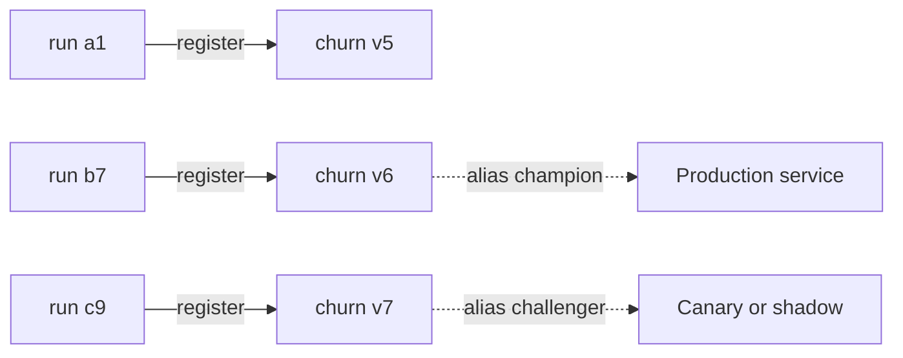
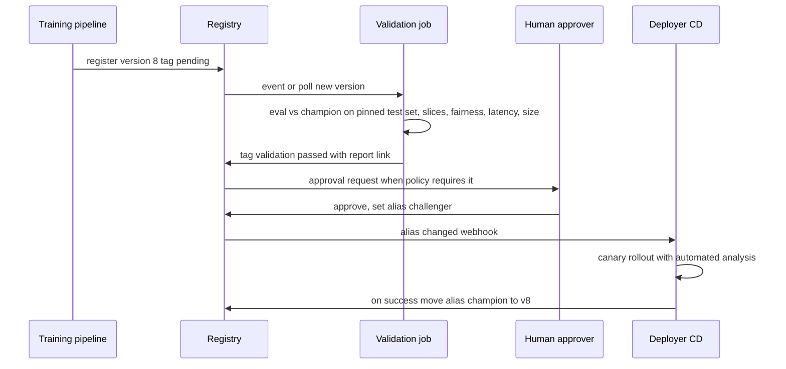

# Model registry, model cards and governance

## From "a run" to "the production model"

Experiment tracking records *every* run. Most are discarded. A **model registry** is the curated catalog
of models that are candidates for, or are in, production. It answers:

- What versions of the `churn` model exist? Which one is serving traffic now? Which is next?
- Who approved version 7, based on what evidence?
- Which run (and therefore which code, data, config) produced version 7?
- How do I roll back to the previous version in one step?

The registry decouples **training** (producing versions) from **deployment** (choosing which version
serves). Deployment code refers to a model by *name + alias/stage*, never by a file path.



## MLflow Model Registry concepts

- **Registered model**: a named entity (`churn`), with description and tags.
- **Model version**: an immutable, auto-incremented version (1, 2, 3...) pointing at a logged model
  artifact and its source run.
- **Aliases**: mutable, named pointers to a version (`@champion`, `@challenger`, `@shadow`). Promoting a
  model = moving an alias. Rolling back = moving it back.
- **Tags**: key-value metadata on versions (`validation_status=approved`, `approved_by=alice`).
- (Legacy) **stages**: `None`, `Staging`, `Production`, `Archived`. MLflow deprecated stages in favour of
  aliases and tags because fixed stages did not fit many workflows (e.g., multiple production models per
  region).

```python
import mlflow
from mlflow import MlflowClient

client = MlflowClient()
# 1. register the model from a run
mv = mlflow.register_model(model_uri=f"runs:/{run_id}/model", name="churn")
# 2. annotate
client.set_model_version_tag("churn", mv.version, "validation_status", "pending")
client.update_model_version("churn", mv.version, description="GBM on 2025-01-15 snapshot; +2.1pt PR-AUC")
# 3. promote after validation gates pass
client.set_registered_model_alias("churn", "challenger", mv.version)
# ... after a successful canary:
client.set_registered_model_alias("churn", "champion", mv.version)
# 4. serving code always loads by alias
model = mlflow.pyfunc.load_model("models:/churn@champion")
```

Other registries: SageMaker Model Registry (model packages with approval status), Vertex AI Model
Registry, Azure ML registries, Databricks Unity Catalog models, W&B Registry, Hugging Face Hub (versioned
Git repos for weights with model cards — very common for open models).

## Versioning schemes

MLflow assigns integer versions per registered model, which is simple and monotonic. Many teams also add
a **semantic version** tag to communicate compatibility to consumers, mirroring software semver:

| Change | Example | Bump |
|---|---|---|
| Input/output schema change (breaking for clients) | new required feature, renamed output | MAJOR |
| Retrained weights, same schema | monthly retrain | MINOR |
| Non-functional fix | metadata, threshold doc, packaging fix | PATCH |

You will implement this bumping logic in `mlops-semver-bump`. Note the classic pitfall: comparing version
strings lexicographically puts `"1.10.0"` before `"1.9.0"`.

> [!TIP]
> The **signature** stored with an MLflow model is what makes "schema change" detectable automatically:
> diff the input/output signature of the new version against the champion's; a removed or retyped column
> is a breaking change.

## Promotion workflow and gates



Typical automated gates:

1. **Performance**: challenger ≥ champion − ε on the pinned evaluation set (overall).
2. **Slices**: no important subgroup regresses by more than δ.
3. **Calibration**: expected calibration error under a threshold (if probabilities are consumed).
4. **Operational**: model size, p95 latency on reference hardware, memory.
5. **Schema compatibility** with the serving contract.
6. **Fairness/compliance** checks where required.

```python-run
# A promotion gate: compare challenger vs champion overall and on slices.
champion = {"overall": 0.712, "slices": {"new_users": 0.640, "returning": 0.735, "mobile": 0.701}, "p95_ms": 18}
challenger = {"overall": 0.731, "slices": {"new_users": 0.618, "returning": 0.760, "mobile": 0.722}, "p95_ms": 21}
EPS_OVERALL, MAX_SLICE_DROP, MAX_LATENCY_RATIO = 0.0, 0.01, 1.25

reasons = []
if challenger["overall"] < champion["overall"] + EPS_OVERALL:
    reasons.append("overall metric not better")
for s, v in champion["slices"].items():
    drop = v - challenger["slices"][s]
    if drop > MAX_SLICE_DROP:
        reasons.append(f"slice '{s}' regressed by {drop:.3f}")
if challenger["p95_ms"] > champion["p95_ms"] * MAX_LATENCY_RATIO:
    reasons.append("latency budget exceeded")
print("PROMOTE" if not reasons else "BLOCK: " + "; ".join(reasons))
```

The challenger wins overall but hurts new users — the gate blocks it. Overall averages hide subgroup
regressions; this is why slice metrics belong in every gate.

> [!INTERVIEW]
> "How do you decide to promote a new model?" — Offline gates (pinned test set, slices, calibration,
> latency/size, schema), human approval when risk demands, then online validation (shadow → canary with
> automatic rollback, or an A/B test on business metrics), and finally moving the registry alias. Keep
> the previous champion one alias move away for instant rollback.

## Model cards

A **model card** (Mitchell et al., 2019) is short, structured documentation shipped with a model.
Hugging Face Hub renders a `README.md` model card for every model repository; many companies require one
before production.

Typical sections:

```markdown
# Model card: churn v8

## Model details
Gradient-boosted trees (scikit-learn HistGradientBoostingClassifier 1.5.2). Owner: churn-team.
Trained 2025-01-16 from run a1b2c3 (git 9f3c1e2), data snapshot 2025-01-15.

## Intended use
Rank active subscribers by 30-day churn risk for retention campaigns.
Out of scope: credit or employment decisions; individual-level automated denial of service.

## Training data
182k subscribers, Oct 2024 – Jan 2025, EU and US. Label: cancelled within 30 days.
Known gaps: < 2% of data from APAC.

## Evaluation
PR-AUC 0.731 (pinned test set v2025-01). Slices: new users 0.618, returning 0.760, mobile 0.722.
Calibration ECE 0.021.

## Ethical considerations and limitations
Lower performance for new users (less history). Do not use protected attributes; proxy check performed for age.

## Monitoring and maintenance
Drift monitored daily (PSI on top 10 features); retrain monthly or on alert. Contact: #churn-ml.
```

Related documentation: **datasheets for datasets** (how data was collected, composition, intended uses),
**system cards** for whole AI systems, and **AI risk assessments** required by regulations such as the
EU AI Act for high-risk use cases.

## Governance

Governance means you can show *who* did *what*, *when*, *why*, and that policies were followed.

- **Access control**: who can register, approve, or move the `champion` alias (separation of duties for
  regulated models).
- **Audit trail**: registry events (version created, alias moved, approvals) retained and reviewable.
- **Reproducibility**: lineage from version to run to code/data/env (lesson 11).
- **Approval policies by risk tier**: a low-risk ranking model may auto-promote; a credit model requires
  documented human sign-off and validation by an independent team (model risk management, e.g., SR 11-7
  in US banking).
- **Retention and privacy**: training data subject to deletion requests; know which models used it.
- **Licenses**: for open models and datasets (Hugging Face model cards list them), check commercial use
  terms.

## Hugging Face Hub as a registry

For open-weight and transformer models, the Hub works as a Git-based registry:

```python
from huggingface_hub import HfApi, snapshot_download
api = HfApi()
api.upload_folder(folder_path="outputs/model", repo_id="acme/churn-text-encoder", commit_message="v8 weights")
# pin consumers to an exact commit hash (revision) for reproducibility
path = snapshot_download("acme/churn-text-encoder", revision="3f2a9c1e5b7d0c4e8a1f2b3c4d5e6f7a8b9c0d1e")
```

Pinning `revision` to a commit hash is the Hub equivalent of deploying an image by digest.

## Summary

- A registry is the curated catalog of deployable models: versions are immutable, aliases are mutable
  pointers used by deployment; rollback is an alias move.
- Promotion passes automated gates (overall + slices + calibration + latency + schema) and, depending on
  risk, human approval, followed by online validation.
- Semantic versions communicate compatibility; compare versions numerically.
- Model cards document intended use, data, evaluation by slice, limitations and maintenance.
- Governance = access control, audit trails, lineage, risk-tiered approvals, licensing and privacy.

```quiz
[
  {"q": "In the MLflow Model Registry, what is the recommended way to mark the production model?",
   "options": ["Rename the model file", "Point an alias such as @champion at the version", "Delete all other versions", "Change the run's metrics"],
   "answer": 1, "explain": "Aliases are mutable pointers; stages are deprecated in favour of aliases and tags."},
  {"q": "Why should serving code load `models:/churn@champion` rather than a file path?",
   "options": ["It is faster to download", "Promotion and rollback become a registry operation without changing serving code", "File paths are illegal", "Aliases compress models"],
   "answer": 1, "explain": "Decoupling deployment from training artifacts enables instant rollback."},
  {"q": "A challenger improves overall PR-AUC but drops 2 points for new users. A good gate should...",
   "options": ["Promote it", "Block or escalate because a key slice regressed", "Ignore slices", "Retrain with more epochs automatically"],
   "answer": 1, "explain": "Averages hide subgroup regressions; slice gates catch them."},
  {"q": "Which change should be a MAJOR semantic version bump for a model?",
   "options": ["Retraining on new data with the same features", "Fixing a typo in the description", "Adding a new required input feature", "Moving the champion alias"],
   "answer": 2, "explain": "Clients must change their requests, so it is breaking."},
  {"q": "What is the main purpose of a model card?",
   "options": ["To store weights", "To document intended use, data, evaluation (including slices), limitations and maintenance", "To speed up inference", "To replace the registry"],
   "answer": 1, "explain": "Model cards communicate how and when a model should (not) be used."},
  {"q": "On the Hugging Face Hub, how do you pin a consumer to an exact model version?",
   "options": ["Use the main branch", "Pass a specific commit hash as revision", "Use the latest tag", "Download by model name only"],
   "answer": 1, "explain": "A commit hash is immutable, like an image digest."},
  {"q": "Separation of duties in governance means...",
   "options": ["Each model has two owners", "The person who trains a high-risk model is not the one who approves its promotion", "Training and serving use different languages", "Models are split across GPUs"],
   "answer": 1, "explain": "Independent approval reduces risk in regulated settings."}
]
```

> **Source:** MLflow documentation (*Model Registry*, aliases and tags, deprecation of stages); Mitchell et al., *Model Cards for Model Reporting* (FAT* 2019); Gebru et al., *Datasheets for Datasets*; Hugging Face Hub documentation (*Model cards*, *revisions*); Semantic Versioning 2.0.0; Chip Huyen, *AI Engineering*, ch. 4 (evaluation pipeline and model selection).
