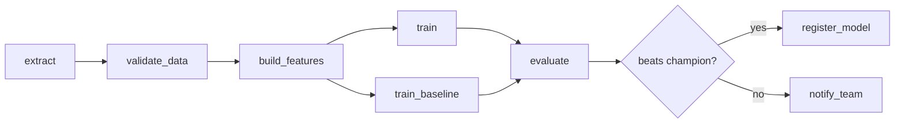

# Pipelines and orchestration

## From script to pipeline

A training "script" that does everything — pull data, validate, build features, train, evaluate,
register — works until it fails at step five after two hours and you must rerun everything. A
**pipeline** splits the work into steps with explicit inputs and outputs; an **orchestrator** runs those
steps in dependency order, on a schedule or trigger, with retries, logging, alerting and backfills.

Two different things are both called "pipeline" in ML, and it helps to separate them:

1. **In-process model pipelines** — e.g., scikit-learn's `Pipeline`, which chains preprocessing and a
   model into one estimator. Mueller & Guido (ch. 6) introduce it to prevent **leakage in
   cross-validation**: if you scale the whole training set and *then* cross-validate, each validation
   fold has already influenced the scaler. Inside a `Pipeline`, the scaler is re-fit on the training part
   of each fold only. It also means a single artifact holds preprocessing + model, which prevents
   preprocessing skew at serving time.
2. **Workflow pipelines** — DAGs of tasks (ingest → validate → train → evaluate → register) run by an
   orchestrator. This lesson is mostly about these.

```python
from sklearn.compose import ColumnTransformer
from sklearn.ensemble import HistGradientBoostingClassifier
from sklearn.model_selection import GridSearchCV
from sklearn.pipeline import Pipeline
from sklearn.preprocessing import OneHotEncoder, StandardScaler

pre = ColumnTransformer([
    ("num", StandardScaler(), ["tenure_months", "monthly_charges"]),
    ("cat", OneHotEncoder(handle_unknown="ignore"), ["plan", "country"]),
])
pipe = Pipeline([("pre", pre), ("clf", HistGradientBoostingClassifier())])
grid = GridSearchCV(pipe, {"clf__learning_rate": [0.03, 0.1]}, cv=5, scoring="average_precision")
grid.fit(X_train, y_train)          # scaler and encoder are fit inside each CV fold: no leakage
```

## DAGs

Workflow pipelines are **directed acyclic graphs**: nodes are tasks, edges are "must run before".
Acyclic, because a cycle would mean a task depends on itself. The scheduler runs any task whose upstream
tasks have succeeded — a topological ordering (you will implement the deterministic version in
`mlops-dag-order`).



```python-run
# Kahn's algorithm: execution "waves" = tasks that can run in parallel.
from collections import defaultdict
deps = [("extract", "validate"), ("validate", "features"), ("features", "train"),
        ("features", "baseline"), ("train", "evaluate"), ("baseline", "evaluate"), ("evaluate", "register")]
tasks = sorted({t for d in deps for t in d})
indeg = {t: 0 for t in tasks}; adj = defaultdict(list)
for u, v in deps:
    adj[u].append(v); indeg[v] += 1
ready = sorted(t for t in tasks if indeg[t] == 0)
wave = 0
while ready:
    print(f"wave {wave}: {ready}")
    nxt = []
    for t in ready:
        for v in adj[t]:
            indeg[v] -= 1
            if indeg[v] == 0:
                nxt.append(v)
    ready, wave = sorted(nxt), wave + 1
```

## What an orchestrator gives you

- **Scheduling** (cron-like) and **triggers** (new data, upstream success, API call, drift alert).
- **Dependency management** and parallelism limits.
- **Retries** with backoff, timeouts, and alerting on failure (SLA misses).
- **Backfills**: run the pipeline for past dates (after a bug fix or a new feature).
- **Idempotent, parameterised runs**: each run is for a logical date/partition.
- **Observability**: UI with run history, logs, durations, Gantt charts.
- **Isolation**: each task in its own container/pod with its own resources (GPU for train, small CPU for
  validate).
- **Caching** of step outputs (in some tools) so unchanged steps are skipped.

## Apache Airflow

The most widely deployed orchestrator. Pipelines are Python files defining a DAG; a scheduler triggers
task instances that executors run (locally, on Celery workers, or one Kubernetes pod per task).

```python
# dags/churn_training.py  (Airflow 2.x TaskFlow API)
from datetime import datetime, timedelta
from airflow.decorators import dag, task

default_args = {"retries": 2, "retry_delay": timedelta(minutes=5), "retry_exponential_backoff": True}

@dag(schedule="0 3 * * 1", start_date=datetime(2025, 1, 1), catchup=False,
     default_args=default_args, tags=["churn"])
def churn_training():

    @task
    def extract(ds=None) -> str:                # ds = logical date "YYYY-MM-DD", injected by Airflow
        path = f"s3://acme/churn/raw/dt={ds}/"
        # ... run the export query for the window ending at ds ...
        return path                             # small values travel between tasks via XCom

    @task
    def validate(path: str) -> str:
        # ... run expectation suite; raise on failure so downstream tasks do not run ...
        return path

    @task
    def train(path: str) -> str:
        # ... launch training (often a KubernetesPodOperator with a GPU image) ...
        return "run_id_abc"

    @task.branch
    def gate(run_id: str) -> str:
        better = True                            # compare with champion from the registry
        return "register" if better else "notify"

    @task
    def register(): ...
    @task
    def notify(): ...

    run_id = train(validate(extract()))
    gate(run_id) >> [register(), notify()]

churn_training()
```

Concepts to know:

- **Logical date / data interval** (`ds`, `data_interval_start`): the period a run *covers*, not when it
  executes. A daily run for Jan 15 typically starts after midnight on Jan 16. Using the logical date
  (never `datetime.now()`) is what makes reruns and backfills idempotent.
- **`catchup`**: whether to create runs for all past intervals since `start_date`.
- **Operators** (`BashOperator`, `PythonOperator`, `KubernetesPodOperator`, provider operators for
  BigQuery/Spark/SageMaker...) and **sensors** (wait for a file, a partition, another DAG).
- **XCom**: small messages between tasks (pass paths and IDs, not DataFrames).
- **Executors**: Local, Celery, Kubernetes.
- **Pools and concurrency limits** to protect shared resources.

> [!WARNING]
> Airflow orchestrates; it should not *be* the compute. Heavy work belongs in the systems it triggers
> (Spark, a Kubernetes pod with a GPU, a warehouse query). Tasks that load gigabytes into the scheduler's
> workers are the classic Airflow anti-pattern.

## Prefect and Dagster

**Prefect** makes ordinary Python functions into flows and tasks with decorators; the DAG is discovered
dynamically at run time, which makes loops and conditionals natural.

```python
from prefect import flow, task
from prefect.tasks import task_input_hash
from datetime import timedelta

@task(retries=3, retry_delay_seconds=[10, 60, 300], cache_key_fn=task_input_hash,
      cache_expiration=timedelta(days=1))
def extract(day: str) -> str:
    return f"s3://acme/churn/raw/dt={day}/"

@task
def train(path: str, lr: float) -> float:
    return 0.73

@flow(name="churn-training", log_prints=True)
def churn_training(day: str, lrs: list[float] = [0.03, 0.1]):
    path = extract(day)
    scores = [train.submit(path, lr) for lr in lrs]       # run concurrently
    print("best:", max(s.result() for s in scores))

if __name__ == "__main__":
    churn_training("2025-01-15")       # run locally; deploy with a schedule via `flow.serve()` / deployments
```

**Dagster** is organised around **software-defined assets** — you declare the data assets (tables,
models) and their dependencies, and the orchestrator materialises them, with strong typing, built-in data
quality checks and lineage.

## Kubeflow Pipelines and friends (ML-native)

**Kubeflow Pipelines (KFP)** runs each step as a container on Kubernetes (compiled to Argo Workflows),
tracks artifacts and lineage in ML Metadata, and caches step outputs.

```python
from kfp import dsl

@dsl.component(base_image="python:3.11", packages_to_install=["pandas", "scikit-learn"])
def train(data: dsl.Input[dsl.Dataset], model: dsl.Output[dsl.Model], learning_rate: float) -> float:
    ...   # read data.path, write model.path
    return 0.73

@dsl.pipeline(name="churn-training")
def pipeline(day: str, learning_rate: float = 0.05):
    prep = prepare(day=day)
    tr = train(data=prep.outputs["out"], learning_rate=learning_rate)
    tr.set_gpu_limit(1).set_memory_limit("16G")
    with dsl.If(tr.outputs["Output"] > 0.7):
        register(model=tr.outputs["model"])
```

Vertex AI Pipelines runs KFP pipelines as a managed service; SageMaker Pipelines and Azure ML pipelines
are the equivalents on other clouds. Others: **Argo Workflows** (YAML-defined, Kubernetes-native),
**Metaflow** (Netflix; data-scientist-friendly, runs on AWS Batch/K8s), **ZenML**, **Flyte** (typed,
versioned, strong caching).

| | Airflow | Prefect | Dagster | Kubeflow Pipelines |
|---|---|---|---|---|
| Unit | task in a static DAG | Python function | data asset | containerised component |
| Strength | ecosystem, scheduling, data eng standard | Pythonic, dynamic | assets, lineage, typing | ML artifacts, caching, K8s-native |
| Typical use | ETL + triggering ML | general workflows | data platforms | training pipelines on K8s |

## Designing good pipeline tasks

- **Idempotent**: running twice with the same inputs produces the same outputs (overwrite the partition,
  upsert by key). Retries then become safe.
- **Parameterised by logical date** and config, never by wall-clock time.
- **Atomic outputs**: write to a temp path, then rename/commit — never leave half-written data that the
  next task may read.
- **Small interfaces**: pass references (URIs, run IDs), not big objects.
- **Fail loudly**: non-zero exit / exception; validation failures stop the DAG.
- **Right-sized retries**: retry transient errors (network, spot preemption) with exponential backoff;
  do not retry deterministic failures (schema error) five times.
- **Observable**: log row counts, durations, data versions; emit metrics.

```python-run
# Retries make sense only for idempotent tasks. Simulate a flaky, idempotent write.
import random
random.seed(5)
table = {}
def write_partition(day, rows, fail_prob=0.5):
    if random.random() < fail_prob:
        raise ConnectionError("transient network error")
    table[day] = rows                      # overwrite -> idempotent

def run_with_retries(fn, retries=4):
    for attempt in range(1, retries + 2):
        try:
            fn(); print(f"  attempt {attempt}: ok"); return True
        except ConnectionError as e:
            print(f"  attempt {attempt}: {e}")
    return False

print("task:", run_with_retries(lambda: write_partition("2025-01-15", [1, 2, 3])))
print("table:", table, "(no duplicates no matter how many attempts)")
```

## Continuous training triggers

- **Schedule**: simple and predictable (weekly retrain).
- **Data-driven**: a sensor fires when a new partition lands or enough new labels accumulate.
- **Monitoring-driven**: a drift or performance alert triggers the DAG through its API (module 10).
- **On-demand**: a human or CI triggers a run for a new code version.

> [!INTERVIEW]
> "Airflow vs Kubeflow Pipelines?" — Airflow is a general-purpose scheduler with a huge operator
> ecosystem, ideal for data engineering and for *triggering* ML jobs; KFP is ML-specific and
> Kubernetes-native, with containerised steps, artifact/lineage tracking and step caching. Many teams use
> Airflow (or Dagster) for data and trigger KFP/Vertex/SageMaker pipelines for training. Then mention
> idempotency, logical dates and backfills — interviewers listen for these.

## Summary

- scikit-learn `Pipeline`s bundle preprocessing with the model and prevent CV leakage; workflow pipelines
  are DAGs of tasks run by an orchestrator.
- Orchestrators provide scheduling, triggers, retries, backfills, isolation and observability.
- Airflow (static DAGs, logical dates, operators), Prefect (dynamic Python flows), Dagster (assets),
  Kubeflow Pipelines (containerised ML steps with caching and lineage).
- Tasks should be idempotent, parameterised by logical date, atomic and loud on failure.

```quiz
[
  {"q": "Why does putting a scaler inside a scikit-learn Pipeline prevent leakage during cross-validation?",
   "options": ["It disables scaling", "The scaler is re-fit only on each fold's training portion", "It uses the test set to fit", "It caches results"],
   "answer": 1, "explain": "Fitting preprocessing on all data before CV lets validation folds influence it."},
  {"q": "What does the 'A' in DAG guarantee?",
   "options": ["Tasks run asynchronously", "There are no cycles, so a valid execution order exists", "All tasks are atomic", "Tasks are automatic"],
   "answer": 1, "explain": "Acyclic graphs always admit a topological order."},
  {"q": "In Airflow, what is the logical date of a run?",
   "options": ["The wall-clock time it started", "The data interval the run covers, used to parameterise idempotent processing", "The DAG file's modification time", "The time of the last retry"],
   "answer": 1, "explain": "Using the logical date rather than now() makes reruns and backfills reproducible."},
  {"q": "What should be passed between tasks via XCom?",
   "options": ["Large DataFrames", "Small references such as paths and run IDs", "Model weights", "Docker images"],
   "answer": 1, "explain": "XCom is for small metadata; data lives in external storage."},
  {"q": "Why must tasks be idempotent for retries to be safe?",
   "options": ["Retries are faster", "A retried task that appends rather than overwrites would duplicate data", "Idempotent tasks never fail", "Airflow requires it syntactically"],
   "answer": 1, "explain": "Overwrite/upsert semantics make repeated execution harmless."},
  {"q": "Which tool models pipelines primarily as software-defined data assets?",
   "options": ["Airflow", "Dagster", "cron", "Make"],
   "answer": 1, "explain": "Dagster centres on assets and their lineage."},
  {"q": "Which failure should NOT be retried many times?",
   "options": ["A transient network timeout", "A spot instance preemption", "A deterministic schema validation error", "A 503 from an upstream service"],
   "answer": 2, "explain": "Deterministic failures will fail again; fail fast and alert."},
  {"q": "A classic Airflow anti-pattern is...",
   "options": ["Using sensors", "Doing heavy data processing inside the Airflow workers instead of delegating to compute systems", "Setting retries", "Using the logical date"],
   "answer": 1, "explain": "Airflow should orchestrate; Spark, warehouses or pods should compute."}
]
```

> **Source:** Mueller & Guido, *Introduction to Machine Learning with Python*, ch. 6 (Algorithm Chains and Pipelines); Apache Airflow documentation (*Core concepts*, TaskFlow, data intervals); Prefect and Dagster documentation; Kubeflow Pipelines v2 documentation; Martin Kleppmann, *DDIA*, ch. 10 (workflow schedulers, idempotent batch outputs).
