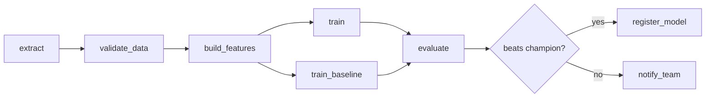

# Pipelines and orchestration

> **Before this lesson:** read [Data sources, ETL/ELT, batch and streaming](#/lesson/mlops/data-pipelines)
> for batch jobs, partitions and idempotence, and [MLOps maturity levels 0, 1 and 2](#/lesson/mlops/maturity-levels)
> for why an automated training pipeline defines level 1.

## In plain words

Producing a model takes several steps in a fixed order: fetch the data, check it, compute the
features, train, evaluate, and file the result. An **orchestrator** is the program that runs
those steps for you. It knows the order, starts each step when the ones before it have finished,
tries again when a step fails for a passing reason, and tells someone when it gives up.

Think of a factory production line with a supervisor. Each station does one job and hands its
output to the next. The supervisor does not do any of the work. The supervisor decides when each
station starts, notices when one jams, restarts it, and keeps a log of every item that went
through. Without the supervisor you have a person carrying parts between stations by hand, which
is what running notebook cells in order amounts to.

Why this matters for a job: an orchestrated training pipeline is the step that takes a team from
manual work to continuous training, so it is where most MLOps engineers spend their first months.
Interviewers expect you to know what a DAG is, to compare Airflow with at least one alternative,
and to use the words *idempotent*, *logical date* and *backfill* correctly.

## From script to pipeline

A single training script that does everything works until the day it fails at step five, two
hours in, and has to be started again from the beginning. A **pipeline** splits the work into
steps, each with stated inputs and outputs. An **orchestrator** runs the steps in the order their
dependencies require, on a schedule or in response to an event, with retries, logs, alerts and
the ability to rerun past dates.

The word "pipeline" is used for two different things in ML, and it helps to separate them:

1. **In-process model pipelines**, such as scikit-learn's `Pipeline`. This is one Python object
   that chains preprocessing steps and a model, so they are fitted, saved and applied together.
   Mueller and Guido (ch. 6) introduce it to prevent **leakage during cross-validation**.
   Cross-validation splits the training data into several parts ("folds") and repeatedly trains
   on some and checks on the rest. If you rescale the whole training set first and cross-validate
   afterwards, every checking fold has already influenced the scaling. Inside a `Pipeline` the
   scaler is fitted again on the training folds only, each time. A second benefit: preprocessing
   and model are saved as one artifact, so they cannot diverge at serving time.
2. **Workflow pipelines**: several separate tasks (ingest → validate → train → evaluate →
   register) run by an orchestrator. This lesson is mostly about these.

Here is the first kind, for comparison:
```python
from sklearn.compose import ColumnTransformer
from sklearn.ensemble import HistGradientBoostingClassifier
from sklearn.model_selection import GridSearchCV
from sklearn.pipeline import Pipeline
from sklearn.preprocessing import OneHotEncoder, StandardScaler

pre = ColumnTransformer([
    ("num", StandardScaler(), ["tenure_months", "monthly_charges"]),
    ("cat", OneHotEncoder(handle_unknown="ignore"), ["plan", "country"]),
])
pipe = Pipeline([("pre", pre), ("clf", HistGradientBoostingClassifier())])
grid = GridSearchCV(pipe, {"clf__learning_rate": [0.03, 0.1]}, cv=5, scoring="average_precision")
grid.fit(X_train, y_train)          # scaler and encoder are fit inside each CV fold: no leakage
```

`ColumnTransformer` applies a different preparation to different columns: numeric columns are
rescaled and text categories are turned into 0/1 columns ("one-hot encoding"). `Pipeline` puts
that preparation in front of the classifier. `GridSearchCV` then tries two learning rates with
5-fold cross-validation; the name `clf__learning_rate` means "the `learning_rate` setting of the
step named `clf`".

## DAGs

A workflow pipeline is described as a **directed acyclic graph**, or **DAG**. A graph is a set of
boxes joined by arrows. Here each box is a task and each arrow means "must finish before".
*Directed* means the arrows have a direction. *Acyclic* means you can never follow arrows around
in a circle, because a circle would mean a task has to wait for itself. The scheduler may start
any task whose incoming arrows all come from finished tasks. An ordering that respects all the
arrows is called a **topological order**, and you will implement one in the `mlops-dag-order`
problem.

In the diagram, `train` and `train_baseline` both depend only on `build_features`, so they can
run at the same time. The diamond is a decision.



The standard way to compute such an order is **Kahn's algorithm**. Count, for every task, how many
tasks it is still waiting for. Every task with a count of zero is ready. Run all the ready tasks
(one "wave"), reduce the count of each task that depended on them, and repeat.

```python-run
# Kahn's algorithm: execution "waves" = tasks that can run in parallel.
from collections import defaultdict
deps = [("extract", "validate"), ("validate", "features"), ("features", "train"),
        ("features", "baseline"), ("train", "evaluate"), ("baseline", "evaluate"), ("evaluate", "register")]
tasks = sorted({t for d in deps for t in d})
indeg = {t: 0 for t in tasks}; adj = defaultdict(list)
for u, v in deps:
    adj[u].append(v); indeg[v] += 1
ready = sorted(t for t in tasks if indeg[t] == 0)
wave = 0
while ready:
    print(f"wave {wave}: {ready}")
    nxt = []
    for t in ready:
        for v in adj[t]:
            indeg[v] -= 1
            if indeg[v] == 0:
                nxt.append(v)
    ready, wave = sorted(nxt), wave + 1
```

`deps` lists the arrows as pairs "before, after". `indeg` (short for in-degree) is the waiting
count and `adj` records, for each task, which tasks come after it. The output:

```text
wave 0: ['extract']
wave 1: ['validate']
wave 2: ['features']
wave 3: ['baseline', 'train']
wave 4: ['evaluate']
wave 5: ['register']
```

Wave 3 contains two tasks: once `features` has finished, nothing stops `baseline` and `train`
from running in parallel. `evaluate` has to wait for both.

## What an orchestrator gives you

- **Scheduling** (cron-like) and **triggers** (new data, upstream success, API call, drift alert).
- **Dependency management** and parallelism limits.
- **Retries** with backoff, timeouts, and alerting on failure (SLA misses).
- **Backfills**: run the pipeline for past dates (after a bug fix or a new feature).
- **Idempotent, parameterised runs**: each run is for a logical date/partition.
- **Observability**: UI with run history, logs, durations, Gantt charts.
- **Isolation**: each task in its own container/pod with its own resources (GPU for train, small CPU for
  validate).
- **Caching** of step outputs (in some tools) so unchanged steps are skipped.

## Apache Airflow

**Apache Airflow** is the most widely deployed orchestrator. A pipeline is a Python file that
defines a DAG. A component called the scheduler decides when each task is due, and an
**executor** runs it: on the same machine, on a pool of worker machines, or as a fresh Kubernetes
pod per task. In the example, the `@dag` and `@task` lines are **decorators**: markers placed
above a function that hand it to Airflow.

```python
# dags/churn_training.py  (Airflow 2.x TaskFlow API)
from datetime import datetime, timedelta
from airflow.decorators import dag, task

default_args = {"retries": 2, "retry_delay": timedelta(minutes=5), "retry_exponential_backoff": True}

@dag(schedule="0 3 * * 1", start_date=datetime(2025, 1, 1), catchup=False,
     default_args=default_args, tags=["churn"])
def churn_training():

    @task
    def extract(ds=None) -> str:                # ds = logical date "YYYY-MM-DD", injected by Airflow
        path = f"s3://acme/churn/raw/dt={ds}/"
        # ... run the export query for the window ending at ds ...
        return path                             # small values travel between tasks via XCom

    @task
    def validate(path: str) -> str:
        # ... run expectation suite; raise on failure so downstream tasks do not run ...
        return path

    @task
    def train(path: str) -> str:
        # ... launch training (often a KubernetesPodOperator with a GPU image) ...
        return "run_id_abc"

    @task.branch
    def gate(run_id: str) -> str:
        better = True                            # compare with champion from the registry
        return "register" if better else "notify"

    @task
    def register(): ...
    @task
    def notify(): ...

    run_id = train(validate(extract()))
    gate(run_id) >> [register(), notify()]

churn_training()
```

Reading the file: `default_args` gives every task two retries, with a wait between them that
grows each time. `schedule="0 3 * * 1"` is a **cron expression**; its five fields are minute,
hour, day of month, month and day of week, so this one means "03:00 every Monday". Each
`@task` function is one box of the DAG. The line `run_id = train(validate(extract()))` draws the
arrows by passing each task's result to the next, and `gate(run_id) >> [register(), notify()]`
says the gate is followed by one of two branches.

Concepts to know:

- **Logical date** (`ds`): the period of data a run *covers*, which is not the moment it
  executes. The daily run for 15 January typically starts shortly after midnight on the 16th.
  Using the logical date, and never `datetime.now()`, is what makes a rerun or a backfill produce
  the same result as the original run.
- **`catchup`**: whether Airflow should create runs for every past period since `start_date`.
- **Operators** are ready-made task types (run a shell command, run a Python function, start a
  Kubernetes pod, submit a BigQuery or Spark job). **Sensors** are tasks that wait for something:
  a file, a partition, another DAG.
- **XCom** ("cross-communication") carries small values between tasks. Pass a path or an id,
  never a table of data.
- **Pools and concurrency limits** cap how many tasks may use a shared resource at once.

> [!WARNING]
> Airflow orchestrates; it should not *be* the compute. Heavy work belongs in the systems it triggers
> (Spark, a Kubernetes pod with a GPU, a warehouse query). Tasks that load gigabytes into the scheduler's
> workers are the classic Airflow anti-pattern.

## Prefect and Dagster

**Prefect** turns ordinary Python functions into tasks and whole workflows ("flows") by adding
decorators. The graph is not declared in advance; it is discovered as the code runs, which makes
ordinary loops and `if` statements work as expected.

```python
from prefect import flow, task
from prefect.tasks import task_input_hash
from datetime import timedelta

@task(retries=3, retry_delay_seconds=[10, 60, 300], cache_key_fn=task_input_hash,
      cache_expiration=timedelta(days=1))
def extract(day: str) -> str:
    return f"s3://acme/churn/raw/dt={day}/"

@task
def train(path: str, lr: float) -> float:
    return 0.73

@flow(name="churn-training", log_prints=True)
def churn_training(day: str, lrs: list[float] = [0.03, 0.1]):
    path = extract(day)
    scores = [train.submit(path, lr) for lr in lrs]       # run concurrently
    print("best:", max(s.result() for s in scores))

if __name__ == "__main__":
    churn_training("2025-01-15")       # run locally; deploy with a schedule via `flow.serve()` / deployments

In the `@task` line, `retries=3` with `retry_delay_seconds=[10, 60, 300]` waits 10 seconds, then a
minute, then five minutes between attempts, and `cache_key_fn=task_input_hash` reuses a stored
result when the task is called again with the same inputs within a day. `train.submit(...)`
starts a task without waiting for it, so the two learning rates train at the same time, and
`.result()` collects each answer.

**Dagster** starts from a different question. You do not list tasks; you declare the **assets**
you want to exist (tables, feature sets, models) and what each is computed from. The orchestrator
works out what to run to bring them up to date, and it comes with type checking, data-quality
checks and lineage.

## Kubeflow Pipelines and friends (ML-native)

**Kubeflow Pipelines (KFP)** was built for ML on Kubernetes. Every step runs as its own
container, the inputs and outputs of each step are recorded as artifacts with lineage, and the
output of a step is reused if the same step is run again with unchanged inputs.

```python
from kfp import dsl

@dsl.component(base_image="python:3.11", packages_to_install=["pandas", "scikit-learn"])
def train(data: dsl.Input[dsl.Dataset], model: dsl.Output[dsl.Model], learning_rate: float) -> float:
    ...   # read data.path, write model.path
    return 0.73

@dsl.pipeline(name="churn-training")
def pipeline(day: str, learning_rate: float = 0.05):
    prep = prepare(day=day)
    tr = train(data=prep.outputs["out"], learning_rate=learning_rate)
    tr.set_gpu_limit(1).set_memory_limit("16G")
    with dsl.If(tr.outputs["Output"] > 0.7):
        register(model=tr.outputs["model"])
```

`@dsl.component` declares a step together with the container image it runs in. The typed
arguments `dsl.Input[dsl.Dataset]` and `dsl.Output[dsl.Model]` tell KFP which artifacts flow in
and out. In the pipeline function, `set_gpu_limit(1)` requests one GPU for the training step
only, and `dsl.If` registers the model only when the returned score exceeds 0.7.

Vertex AI Pipelines runs KFP pipelines as a managed service; SageMaker Pipelines and Azure ML pipelines
are the equivalents on other clouds. Others: **Argo Workflows** (YAML-defined, Kubernetes-native),
**Metaflow** (Netflix; data-scientist-friendly, runs on AWS Batch/K8s), **ZenML**, **Flyte** (typed,
versioned, strong caching).

| | Airflow | Prefect | Dagster | Kubeflow Pipelines |
|---|---|---|---|---|
| Unit | task in a static DAG | Python function | data asset | containerised component |
| Strength | ecosystem, scheduling, data eng standard | Pythonic, dynamic | assets, lineage, typing | ML artifacts, caching, K8s-native |
| Typical use | ETL + triggering ML | general workflows | data platforms | training pipelines on K8s |

## Designing good pipeline tasks

- **Idempotent**: running twice with the same inputs produces the same outputs (overwrite the partition,
  upsert by key). Retries then become safe.
- **Parameterised by logical date** and config, never by wall-clock time.
- **Atomic outputs**: write to a temp path, then rename/commit — never leave half-written data that the
  next task may read.
- **Small interfaces**: pass references (URIs, run IDs), not big objects.
- **Fail loudly**: non-zero exit / exception; validation failures stop the DAG.
- **Right-sized retries**: retry transient errors (network, spot preemption) with exponential backoff;
  do not retry deterministic failures (schema error) five times.
- **Observable**: log row counts, durations, data versions; emit metrics.

```python-run
# Retries make sense only for idempotent tasks. Simulate a flaky, idempotent write.
import random
random.seed(5)
table = {}
def write_partition(day, rows, fail_prob=0.5):
    if random.random() < fail_prob:
        raise ConnectionError("transient network error")
    table[day] = rows                      # overwrite -> idempotent

def run_with_retries(fn, retries=4):
    for attempt in range(1, retries + 2):
        try:
            fn(); print(f"  attempt {attempt}: ok"); return True
        except ConnectionError as e:
            print(f"  attempt {attempt}: {e}")
    return False

print("task:", run_with_retries(lambda: write_partition("2025-01-15", [1, 2, 3])))
print("table:", table, "(no duplicates no matter how many attempts)")
```

`write_partition` fails half the time with a network error and otherwise *assigns* the rows to
the day, replacing whatever was there. `run_with_retries` calls it up to five times. With this
seed the first attempt succeeds, so the output is:

```text
  attempt 1: ok
task: True
table: {'2025-01-15': [1, 2, 3]} (no duplicates no matter how many attempts)
```

Change the seed to see failed attempts before the success. The table always ends up with the same
three rows. Had the function *appended* rows, a failure after a partial write followed by a retry
would leave duplicates behind.

## Continuous training triggers

- **Schedule**: simple and predictable (weekly retrain).
- **Data-driven**: a sensor fires when a new partition lands or enough new labels accumulate.
- **Monitoring-driven**: a drift or performance alert triggers the DAG through its API (module 10).
- **On-demand**: a human or CI triggers a run for a new code version.

> [!INTERVIEW]
> "Airflow vs Kubeflow Pipelines?" — Airflow is a general-purpose scheduler with a huge operator
> ecosystem, ideal for data engineering and for *triggering* ML jobs; KFP is ML-specific and
> Kubernetes-native, with containerised steps, artifact/lineage tracking and step caching. Many teams use
> Airflow (or Dagster) for data and trigger KFP/Vertex/SageMaker pipelines for training. Then mention
> idempotency, logical dates and backfills — interviewers listen for these.

## Backfills, catch-up and partitions: a worked scenario

*A bug in `build_features` double-counted support tickets from 1 to 14 January. The fix is merged on the
15th. What now?*

1. **Scope the damage**: which partitions were written by the buggy code? (The pipeline run metadata
   records the code version per run — lineage pays off.)
2. **Backfill features** for those dates. Because the task takes the logical date as a parameter
   and overwrites its partition, a backfill is nothing more than running the same task again for
   each date:

```bash
airflow dags backfill churn_features --start-date 2025-01-01 --end-date 2025-01-14   # Airflow 2.x CLI
airflow tasks clear churn_features --start-date 2025-01-01 --end-date 2025-01-14 --downstream   # or clear and let the scheduler rerun
```

3. **Propagate downstream**: predictions scored from the bad features are wrong too; rerun scoring for
   those dates. Any model *trained* during that window used bad data; retrain it and compare.
4. **Throttle**: fourteen days at once can overload the warehouse. Limit with `max_active_runs` or a
   pool.

```python-run
# Why idempotent, date-parameterised tasks make backfills trivial.
store = {}                                        # partition -> value
def buggy(ds):  return {"tickets": 2 * int(ds[-2:])}       # double counting
def fixed(ds):  return {"tickets": int(ds[-2:])}
def run(task, ds): store[ds] = task(ds)                    # overwrite the partition

days = [f"2025-01-{d:02d}" for d in range(1, 8)]
for ds in days: run(buggy, ds)
print("before:", {k[-2:]: v["tickets"] for k, v in store.items()})
for ds in days: run(fixed, ds)                    # backfill = rerun the same task for each logical date
print("after :", {k[-2:]: v["tickets"] for k, v in store.items()})
print("rows:", len(store), "(no duplicates, no manual cleanup)")
```

The output:

```text
before: {'01': 2, '02': 4, '03': 6, '04': 8, '05': 10, '06': 12, '07': 14}
after : {'01': 1, '02': 2, '03': 3, '04': 4, '05': 5, '06': 6, '07': 7}
rows: 7 (no duplicates, no manual cleanup)
```

Seven wrong values became seven right values, and the table still has seven rows.

Contrast with a task that *appends* rows for "today": a backfill would need manual deletes, and
`datetime.now()` inside the task would make it impossible to recompute a past day at all.

### Sensors, data-aware scheduling and SLAs

Time-based schedules assume upstream data arrives on time. More robust options:

- **Sensors** wait for a condition (a partition exists, a file landed) before downstream tasks run. Use
  *deferrable* or reschedule-mode sensors so a waiting task does not occupy a worker slot.
- **Data-aware scheduling** (Airflow datasets/assets, Dagster assets): a DAG runs when the data it
  depends on is updated, not at a guessed clock time.
- **SLAs and timeouts**: alert when the pipeline has not produced its output by a deadline; kill tasks
  that hang.

### Choosing task granularity

| Too coarse (one giant task) | Too fine (hundreds of tiny tasks) |
|---|---|
| any failure reruns hours of work | scheduler overhead dominates; DAG is unreadable |
| no parallelism | data passes through storage constantly |
| logs are a haystack | hard to reason about failure boundaries |

A good task is a **unit of retry**: it has a clear input, a durable output, and it is acceptable to rerun
all of it when it fails. For training pipelines that usually means 5–10 tasks, not 2 and not 200.

### Testing pipelines

- **DAG integrity test** in CI: the DAG file imports without error, has no cycles, and every task has an
  owner and retries configured.

```python
def test_dag_loads():
    from airflow.models import DagBag
    bag = DagBag(dag_folder="dags", include_examples=False)
    assert not bag.import_errors
    dag = bag.get_dag("churn_training")
    assert dag is not None and all(t.retries >= 1 for t in dag.tasks)
```

- **Unit-test task logic as plain functions** — keep business logic out of operator boilerplate so it is
  testable without a scheduler.
- **End-to-end run on a small sample** in a staging environment before promoting a pipeline change
  (this is the CI/CD-for-pipelines step that defines MLOps level 2).

## Summary

- scikit-learn `Pipeline`s bundle preprocessing with the model and prevent CV leakage; workflow pipelines
  are DAGs of tasks run by an orchestrator.
- Orchestrators provide scheduling, triggers, retries, backfills, isolation and observability.
- Airflow (static DAGs, logical dates, operators), Prefect (dynamic Python flows), Dagster (assets),
  Kubeflow Pipelines (containerised ML steps with caching and lineage).
- Tasks should be idempotent, parameterised by logical date, atomic and loud on failure.

## Glossary

- **Orchestrator** - a program that runs the tasks of a pipeline in order, with scheduling,
  retries and alerts.
- **Task** - one step of a workflow pipeline.
- **DAG (directed acyclic graph)** - tasks joined by "must run before" arrows, with no loops.
- **Topological order** - an ordering of tasks that respects every arrow.
- **Kahn's algorithm** - computing that order by repeatedly running tasks with nothing left to
  wait for.
- **scikit-learn `Pipeline`** - one object chaining preprocessing and a model.
- **Cross-validation** - repeated train/validate splits whose scores are averaged.
- **Cron expression** - a five-field schedule string such as `0 3 * * 1`.
- **Logical date** - the period of data a run covers, as opposed to when it executes.
- **Backfill** - running a pipeline for past dates.
- **Idempotent** - safe to run again; the result is the same.
- **Atomic output** - output that appears complete or not at all.
- **Retry with backoff** - trying again after increasing waits.
- **Operator / sensor** - a ready-made task type / a task that waits for a condition.
- **XCom** - Airflow's channel for small values passed between tasks.
- **Executor** - the part of Airflow that runs tasks on some compute.
- **Asset (Dagster)** - a declared piece of data, such as a table or model, that the tool keeps
  up to date.
- **Component (KFP)** - a containerised pipeline step with typed inputs and outputs.
- **Trigger** - the event that starts a run: schedule, new data, alert or manual request.

```quiz
[
  {"q": "Why does putting a scaler inside a scikit-learn Pipeline prevent leakage during cross-validation?",
   "options": ["It disables scaling", "The scaler is re-fit only on each fold's training portion", "It uses the test set to fit", "It caches results"],
   "answer": 1, "explain": "Fitting preprocessing on all data before CV lets validation folds influence it."},
  {"q": "What does the 'A' in DAG guarantee?",
   "options": ["Tasks run asynchronously", "There are no cycles, so a valid execution order exists", "All tasks are atomic", "Tasks are automatic"],
   "answer": 1, "explain": "Acyclic graphs always admit a topological order."},
  {"q": "In Airflow, what is the logical date of a run?",
   "options": ["The wall-clock time it started", "The data interval the run covers, used to parameterise idempotent processing", "The DAG file's modification time", "The time of the last retry"],
   "answer": 1, "explain": "Using the logical date rather than now() makes reruns and backfills reproducible."},
  {"q": "What should be passed between tasks via XCom?",
   "options": ["Large DataFrames", "Small references such as paths and run IDs", "Model weights", "Docker images"],
   "answer": 1, "explain": "XCom is for small metadata; data lives in external storage."},
  {"q": "Why must tasks be idempotent for retries to be safe?",
   "options": ["Retries are faster", "A retried task that appends rather than overwrites would duplicate data", "Idempotent tasks never fail", "Airflow requires it syntactically"],
   "answer": 1, "explain": "Overwrite/upsert semantics make repeated execution harmless."},
  {"q": "Which tool models pipelines primarily as software-defined data assets?",
   "options": ["Airflow", "Dagster", "cron", "Make"],
   "answer": 1, "explain": "Dagster centres on assets and their lineage."},
  {"q": "Which failure should NOT be retried many times?",
   "options": ["A transient network timeout", "A spot instance preemption", "A deterministic schema validation error", "A 503 from an upstream service"],
   "answer": 2, "explain": "Deterministic failures will fail again; fail fast and alert."},
  {"q": "A classic Airflow anti-pattern is...",
   "options": ["Using sensors", "Doing heavy data processing inside the Airflow workers instead of delegating to compute systems", "Setting retries", "Using the logical date"],
   "answer": 1, "explain": "Airflow should orchestrate; Spark, warehouses or pods should compute."}
]
```

> **Source:** Mueller & Guido, *Introduction to Machine Learning with Python*, ch. 6 (Algorithm Chains and Pipelines); Apache Airflow documentation (*Core concepts*, TaskFlow, data intervals); Prefect and Dagster documentation; Kubeflow Pipelines v2 documentation; Martin Kleppmann, *DDIA*, ch. 10 (workflow schedulers, idempotent batch outputs).
