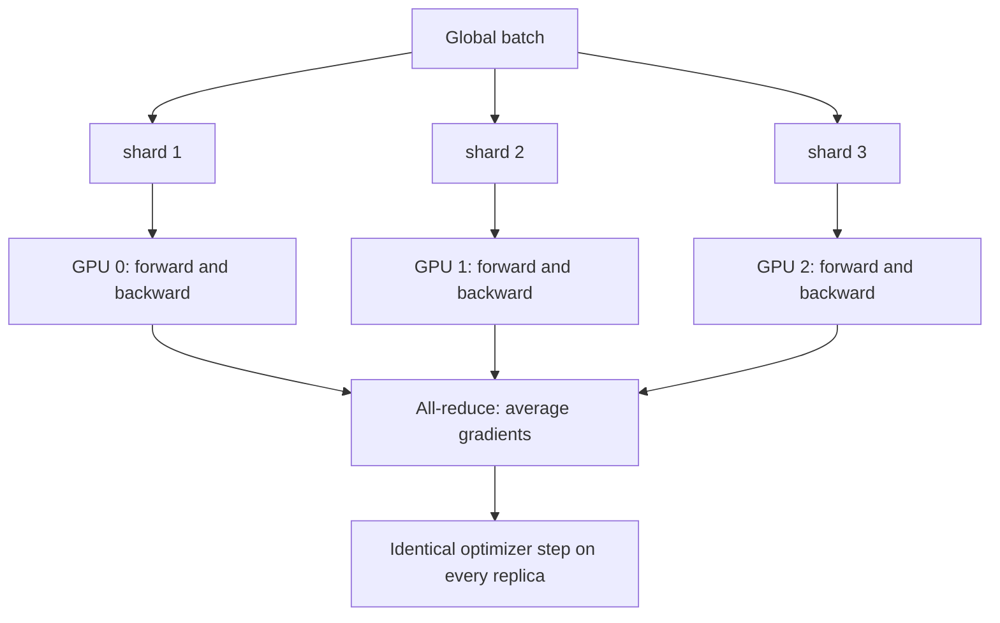

# Distributed training and GPUs

## When one machine is not enough

Training gets slow for two different reasons, and the remedies differ:

- **Too much data** for one machine to process in reasonable time → parallelise over data.
- **Model too large** to fit in one GPU's memory → split the model, or shrink its footprint.

Before distributing anything, exhaust the cheap options: a bigger single machine, better data loading,
mixed precision, a smaller sample for iteration. Distributed systems add failure modes; DDIA's chapter
8 title is literally "The Trouble with Distributed Systems".

## GPU basics for MLOps engineers

A GPU has thousands of simple cores optimised for the same operation applied to many numbers at once —
exactly what matrix multiplication needs. What you need to know operationally:

| Term | Meaning |
|---|---|
| VRAM | GPU memory. Must hold weights + activations + gradients + optimizer state (training), or weights + KV cache (LLM inference). Out-of-memory (OOM) is the most common GPU error. |
| CUDA | NVIDIA's compute platform. Framework wheels are built against a specific CUDA version. |
| cuDNN / cuBLAS | NVIDIA libraries with optimised kernels for deep learning and linear algebra. |
| Driver | Kernel-level software on the host; must be new enough for the CUDA runtime in your container. |
| `nvidia-smi` | CLI showing utilisation, memory, temperature, processes. |
| NVIDIA Container Toolkit | Lets containers access host GPUs (`docker run --gpus all`). |

The compatibility chain: **host driver ≥ what the container's CUDA runtime requires**; the framework
(PyTorch) wheel bundles or expects a CUDA version. CUDA lives in the image; the driver lives on the host.

```bash
nvidia-smi                                   # is the GPU visible? how much memory is used?
python -c "import torch; print(torch.cuda.is_available(), torch.version.cuda, torch.cuda.get_device_name(0))"
docker run --rm --gpus all nvidia/cuda:12.4.1-base-ubuntu22.04 nvidia-smi
```

### Memory math

A rough training memory estimate for a model with $P$ parameters in FP32 using Adam:

$$\text{memory} \approx \underbrace{4P}_{\text{weights}} + \underbrace{4P}_{\text{gradients}} + \underbrace{8P}_{\text{Adam } m, v} + \text{activations (∝ batch size)}$$

```python-run
def train_mem_gb(params, bytes_per=4, optimizer_states=2, act_gb_per_sample=0.0, batch=1):
    weights = params * bytes_per
    grads = params * bytes_per
    opt = params * bytes_per * optimizer_states
    return (weights + grads + opt) / 1e9 + act_gb_per_sample * batch

for name, p in [("ResNet-50", 25.6e6), ("BERT-large", 340e6), ("7B LLM", 7e9)]:
    full = train_mem_gb(p)
    print(f"{name:10s} params={p/1e6:8.0f}M  FP32+Adam ~{full:7.1f} GB (+activations)   "
          f"inference FP16 ~{p*2/1e9:6.1f} GB")
```

A 7B-parameter model needs ~112 GB just for weights, gradients and Adam state in FP32 — more than one
80 GB GPU. This is why large-model training uses mixed precision, memory-efficient optimizers,
parameter-efficient fine-tuning (LoRA trains a tiny fraction of parameters) and multiple GPUs. Huyen
(*AI Engineering*, ch. 7) walks through this style of memory calculation for fine-tuning.

### Getting more from one GPU

- **Mixed precision** (`torch.autocast` + `GradScaler`, or bf16): run most ops in 16-bit; ~2× less
  memory, faster on modern GPUs.
- **Gradient accumulation**: simulate a large batch by accumulating gradients over several small ones.
- **Gradient checkpointing**: trade compute for memory by recomputing activations in the backward pass.
- **Efficient data loading**: multiple workers, pinned memory, prefetching, pre-tokenised/pre-decoded
  data in fast formats. A GPU at 30% utilisation is usually starved by the input pipeline.
- **`torch.compile`** and channels-last memory format for further speed.

```python
scaler = torch.amp.GradScaler("cuda")
for step, (x, y) in enumerate(loader):
    with torch.autocast("cuda", dtype=torch.float16):
        loss = model(x.cuda(non_blocking=True), y.cuda(non_blocking=True)) / accum_steps
    scaler.scale(loss).backward()
    if (step + 1) % accum_steps == 0:
        scaler.step(optimizer); scaler.update(); optimizer.zero_grad(set_to_none=True)
```

> [!TIP]
> Diagnose before scaling out. If `nvidia-smi` shows low GPU utilisation while CPU cores are pegged, the
> bottleneck is data loading — adding GPUs will not help.

## Data parallelism

The dominant strategy: replicate the model on N workers, give each a different shard of each batch,
combine gradients.



- **Synchronous (all-reduce)**: every step, workers exchange and average gradients (NCCL over
  NVLink/InfiniBand/Ethernet). All replicas stay identical. This is PyTorch
  `DistributedDataParallel` (DDP) and TensorFlow `MirroredStrategy`/`MultiWorkerMirroredStrategy`.
- **Asynchronous (parameter server)**: workers push gradients to and pull weights from servers without
  waiting for each other. Tolerates stragglers but gradients are stale; common historically for huge
  sparse recommender models.

Practicalities:

- The **effective batch size** is per-GPU batch × N. Scale the learning rate accordingly (linear scaling
  rule with warmup is a common starting point).
- Each worker needs a **different data shard** per epoch (`DistributedSampler`).
- Only rank 0 should log metrics and write checkpoints.
- Batch-norm statistics are per-replica unless you use SyncBatchNorm.

```python
# launched with: torchrun --nproc_per_node=4 train.py
import torch, torch.distributed as dist
from torch.nn.parallel import DistributedDataParallel as DDP
from torch.utils.data.distributed import DistributedSampler

dist.init_process_group("nccl")
rank = dist.get_rank()
torch.cuda.set_device(rank % torch.cuda.device_count())
model = DDP(Net().cuda(), device_ids=[torch.cuda.current_device()])
sampler = DistributedSampler(dataset)
loader = torch.utils.data.DataLoader(dataset, batch_size=64, sampler=sampler, num_workers=8, pin_memory=True)
for epoch in range(epochs):
    sampler.set_epoch(epoch)                 # reshuffle differently each epoch
    for x, y in loader: ...
    if rank == 0: save_checkpoint(model.module, epoch)
```

Higher-level launchers hide this boilerplate: PyTorch Lightning (`Trainer(devices=4, strategy="ddp")`),
Hugging Face Accelerate, **Ray Train**, Horovod, and on Kubernetes the **Kubeflow Training Operator**
(`PyTorchJob`, `TFJob`, `MPIJob`).

### Why speedup is not linear

Amdahl's law: if a fraction $s$ of the work is serial (data loading, communication, logging), the
maximum speedup with $N$ workers is $\frac{1}{s + (1-s)/N}$.

```python-run
def speedup(n, serial_frac, comm_overhead_per_worker=0.0):
    return 1 / (serial_frac + (1 - serial_frac) / n + comm_overhead_per_worker * (n - 1))
print("GPUs  ideal  5% serial  5% serial + comm overhead")
for n in [1, 2, 4, 8, 16, 32]:
    print(f"{n:4d}  {n:5.1f}  {speedup(n, 0.05):9.2f}  {speedup(n, 0.05, 0.003):10.2f}")
```

With 5% serial work, 32 GPUs give ~12.5×, not 32× — and with communication overhead the curve can even
turn down. Always measure **scaling efficiency** (speedup / N) before paying for more GPUs.

## Model parallelism and large-model techniques

When the model does not fit on one device:

- **Pipeline (layer-wise) parallelism**: different layers on different GPUs; activations flow between
  them.
- **Tensor parallelism**: split individual weight matrices across GPUs (used for LLM training and
  inference, e.g., in vLLM/TGI with `tensor_parallel_size`).
- **Sharded data parallelism (FSDP, ZeRO in DeepSpeed)**: each GPU holds only a shard of parameters,
  gradients and optimizer state, gathering what it needs on the fly.
- **Parameter-efficient fine-tuning** (LoRA/QLoRA): freeze the base model, train small adapters.

## Classical ML at scale

Not everything is deep learning:

- **Spark MLlib** and distributed **XGBoost / LightGBM** (on Spark, Dask or Ray) for large tabular data.
- **Dask-ML** and **Ray** for parallelising scikit-learn-style workloads.
- Often the best "distributed" strategy for tabular models: **sample down** — gradient-boosted trees on
  10 million well-chosen rows frequently match those on a billion.

## Fault tolerance: checkpointing

Long jobs *will* be interrupted — hardware faults, spot/preemptible instance reclamation, node drains.

- **Checkpoint regularly** to durable storage (object store): model weights, optimizer state, LR
  scheduler, epoch/step, RNG state, and the config.
- **Resume automatically** on restart: look for the latest checkpoint at startup.
- Handle **SIGTERM** (spot instances give ~30 s to 2 min notice): write a checkpoint and exit cleanly.
- Keep the last K checkpoints plus the best-by-validation one; write atomically (temp file + rename).

```python
def save_checkpoint(path, model, optimizer, scheduler, step):
    tmp = path + ".tmp"
    torch.save({"model": model.state_dict(), "optimizer": optimizer.state_dict(),
                "scheduler": scheduler.state_dict(), "step": step}, tmp)
    os.replace(tmp, path)        # atomic on the same filesystem

start_step = 0
if os.path.exists(ckpt_path):
    state = torch.load(ckpt_path, map_location="cpu")
    model.load_state_dict(state["model"]); optimizer.load_state_dict(state["optimizer"])
    scheduler.load_state_dict(state["scheduler"]); start_step = state["step"] + 1
```

```python-run
# Expected cost of a 10-hour job on spot with and without checkpointing (toy simulation).
import random
random.seed(1)
def run(job_hours, preempt_rate_per_hour, ckpt_every_hours):
    done, elapsed = 0.0, 0.0
    while done < job_hours:
        t = random.expovariate(preempt_rate_per_hour)           # time until next preemption
        if done + t >= job_hours:
            elapsed += job_hours - done; break
        elapsed += t
        done = (done + t) // ckpt_every_hours * ckpt_every_hours if ckpt_every_hours else 0.0
    return elapsed
for ck in [0, 2, 0.5]:
    avg = sum(run(10, 0.15, ck) for _ in range(2000)) / 2000
    label = "no checkpoints" if ck == 0 else f"checkpoint every {ck}h"
    print(f"{label:22s} -> average wall time {avg:5.1f} h")
```

> [!INTERVIEW]
> "Training is too slow — what do you do?" — First profile: is the GPU fully utilised? If not, fix data
> loading. Then mixed precision, larger batch, `torch.compile`. Then scale out with data-parallel DDP,
> scaling the learning rate and checking scaling efficiency. For models that do not fit: gradient
> checkpointing, FSDP/ZeRO, LoRA. Always add checkpointing so you can use cheap spot capacity.

## Summary

- Know the GPU stack (driver on host, CUDA in image), memory math and `nvidia-smi`.
- Squeeze one GPU first: fix input pipelines, mixed precision, accumulation.
- Data parallelism (synchronous all-reduce via DDP) is the default way to scale; expect sub-linear speedup.
- Model/tensor parallelism, FSDP/ZeRO and PEFT handle models too big for one device.
- Checkpoint and auto-resume; treat preemption as normal.

```quiz
[
  {"q": "nvidia-smi shows 25% GPU utilisation while all CPU cores are at 100%. The most likely bottleneck is...",
   "options": ["The GPU is too small", "The data loading / preprocessing pipeline", "The learning rate", "The optimizer"],
   "answer": 1, "explain": "The GPU is waiting for input; add workers, pre-process offline, or use faster formats."},
  {"q": "In synchronous data-parallel training with 4 GPUs and per-GPU batch 64, the effective batch size is...",
   "options": ["64", "16", "256", "4"],
   "answer": 2, "explain": "Each step averages gradients over 4 x 64 examples."},
  {"q": "Where does the NVIDIA driver live when running GPU containers?",
   "options": ["Inside the container image", "On the host; the CUDA runtime libraries are in the image", "In the Python wheel", "In Kubernetes etcd"],
   "answer": 1, "explain": "The container toolkit exposes the host driver to the container."},
  {"q": "Mixed precision training mainly provides...",
   "options": ["Higher accuracy", "Lower memory use and faster computation by using 16-bit floats where safe", "Deterministic results", "Automatic hyperparameter tuning"],
   "answer": 1, "explain": "Half-precision halves memory for those tensors and speeds up modern GPUs."},
  {"q": "With 5% serial work, what is the upper bound on speedup with infinitely many workers (Amdahl)?",
   "options": ["5x", "20x", "95x", "Unlimited"],
   "answer": 1, "explain": "1 / 0.05 = 20."},
  {"q": "What must a checkpoint contain to resume training faithfully?",
   "options": ["Only model weights", "Weights, optimizer and scheduler state, and the step/epoch", "Only the config", "The dataset"],
   "answer": 1, "explain": "Without optimizer/scheduler state the resumed training behaves differently."},
  {"q": "Which technique lets a model too large for one GPU's memory be trained by sharding parameters and optimizer state across GPUs?",
   "options": ["DistributedSampler", "FSDP / ZeRO", "Gradient clipping", "Early stopping"],
   "answer": 1, "explain": "FSDP and ZeRO shard model state across data-parallel workers."}
]
```

> **Source:** PyTorch documentation (*Distributed Data Parallel*, *Automatic Mixed Precision*, *FSDP*); NVIDIA Container Toolkit documentation; Ray Train and Kubeflow Training Operator documentation; Chip Huyen, *AI Engineering*, ch. 7 (memory math for finetuning) and ch. 9 (AI accelerators); Martin Kleppmann, *DDIA*, ch. 8 (partial failures).
