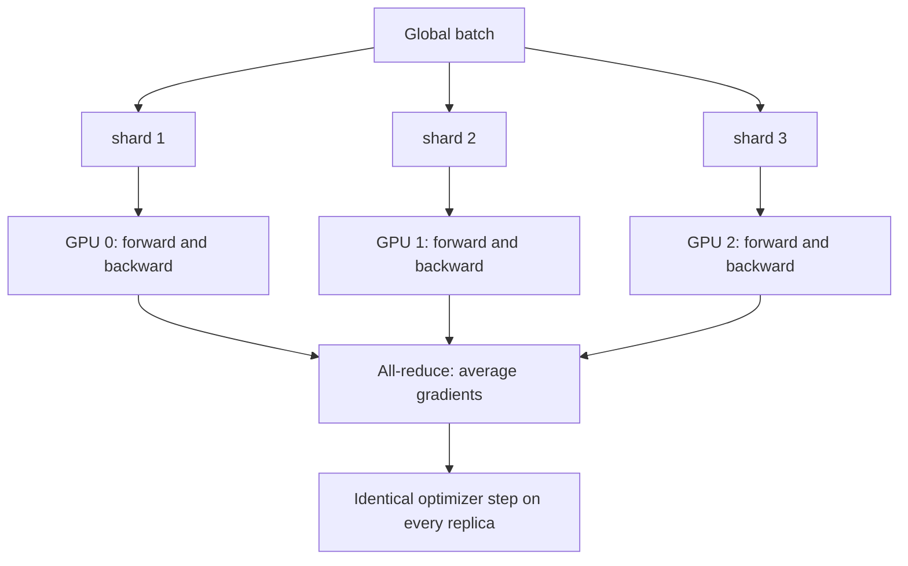

# Distributed training and GPUs

> **Before this lesson:** read [Pipelines and orchestration](#/lesson/mlops/orchestration) and
> [Reproducibility: seeds, environments and lineage](#/lesson/mlops/reproducibility). It helps to
> know roughly how a neural network is trained: the model makes predictions on a small group of
> examples (a **batch**), measures its error, and nudges its numbers to reduce it, over and over.
> The terms are explained again below.

## In plain words

Some models are too slow to train on one ordinary computer. There are two ways out. The first is
a **GPU** (graphics processing unit): a chip originally built to draw video-game images, which
happens to be extremely good at the one operation neural networks need, doing the same arithmetic
on millions of numbers at once. The second is **distributed training**: several machines, or
several GPUs, working on the same model together.

Painting a very long fence is a fair picture. One fast painter with a wide roller (a GPU) beats
one person with a small brush (an ordinary processor). Four painters each taking a section
(distributed training) are faster still, but not four times faster: they have to agree where the
sections meet, share the paint, and wait for the slowest one. And if a painter is called away
mid-job, someone needs to know where they stopped. That last point is **checkpointing**.

Why this matters for a job: GPU time is usually the single largest line in an ML budget. An
engineer who can tell why a training job is slow, estimate whether a model will fit in memory,
and make a job survive interruption saves real money. "Training is too slow, what do you do?" is
a standard interview question with a standard order of answers, given at the end of this lesson.

## When one machine is not enough

Training becomes slow for two different reasons, and the remedies differ:

- **Too much data** for one machine to get through in reasonable time. Remedy: let several
  workers process different parts of the data in parallel.
- **A model too large** to fit in one GPU's memory. Remedy: split the model across devices, or
  shrink the space it needs.

Before distributing anything, use up the cheap options: a larger single machine, faster loading
of data, lower numerical precision, a smaller sample while you are still experimenting. Several
machines working together can fail in ways one machine cannot (one dies while the others carry
on, messages are delayed), a theme DDIA devotes a whole chapter to.

## GPU basics for MLOps engineers

An ordinary processor (**CPU**) has a few powerful cores that each do complicated work one step
at a time. A GPU has thousands of simple cores that all perform the same operation on different
numbers at the same moment, which is what multiplying large tables of numbers (matrices)
requires. The vocabulary you need day to day:

| Term | Meaning |
|---|---|
| VRAM | GPU memory. Must hold weights + activations + gradients + optimizer state (training), or weights + KV cache (LLM inference). Out-of-memory (OOM) is the most common GPU error. |
| CUDA | NVIDIA's compute platform. Framework wheels are built against a specific CUDA version. |
| cuDNN / cuBLAS | NVIDIA libraries with optimised kernels for deep learning and linear algebra. |
| Driver | Kernel-level software on the host; must be new enough for the CUDA runtime in your container. |
| `nvidia-smi` | CLI showing utilisation, memory, temperature, processes. |
| NVIDIA Container Toolkit | Lets containers access host GPUs (`docker run --gpus all`). |

The compatibility chain: **host driver ≥ what the container's CUDA runtime requires**; the framework
(PyTorch) wheel bundles or expects a CUDA version. CUDA lives in the image; the driver lives on the host.

```bash
nvidia-smi                                   # is the GPU visible? how much memory is used?
python -c "import torch; print(torch.cuda.is_available(), torch.version.cuda, torch.cuda.get_device_name(0))"
docker run --rm --gpus all nvidia/cuda:12.4.1-base-ubuntu22.04 nvidia-smi
```

### Memory math

Will the model fit? The numbers inside a model that training adjusts are its **parameters**
(also called weights), and $P$ is how many there are. Each is normally stored as a 32-bit
floating-point number (**FP32**), which occupies 4 bytes. During training, the GPU must hold
several things for every parameter: the weight itself; its **gradient**, the number saying in
which direction and how strongly to adjust it; and the bookkeeping of the **optimizer**, the
algorithm that applies the adjustments. The popular optimizer **Adam** keeps two extra numbers
per parameter. On top of that come the **activations**, the intermediate results computed for
each example in the batch. So, roughly:

$$\text{memory} \approx \underbrace{4P}_{\text{weights}} + \underbrace{4P}_{\text{gradients}} + \underbrace{8P}_{\text{Adam } m, v} + \text{activations (∝ batch size)}$$

```python-run
def train_mem_gb(params, bytes_per=4, optimizer_states=2, act_gb_per_sample=0.0, batch=1):
    weights = params * bytes_per
    grads = params * bytes_per
    opt = params * bytes_per * optimizer_states
    return (weights + grads + opt) / 1e9 + act_gb_per_sample * batch

for name, p in [("ResNet-50", 25.6e6), ("BERT-large", 340e6), ("7B LLM", 7e9)]:
    full = train_mem_gb(p)
    print(f"{name:10s} params={p/1e6:8.0f}M  FP32+Adam ~{full:7.1f} GB (+activations)   "
          f"inference FP16 ~{p*2/1e9:6.1f} GB")
```

The function multiplies the parameter count by 4 bytes for the weights, again for the gradients,
and twice more for Adam, then converts to gigabytes. The output:

```text
ResNet-50  params=      26M  FP32+Adam ~    0.4 GB (+activations)   inference FP16 ~   0.1 GB
BERT-large params=     340M  FP32+Adam ~    5.4 GB (+activations)   inference FP16 ~   0.7 GB
7B LLM     params=    7000M  FP32+Adam ~  112.0 GB (+activations)   inference FP16 ~  14.0 GB
```

A language model with 7 billion parameters needs about 112 GB for weights, gradients and Adam's
bookkeeping alone, before any activations. The largest common GPUs have 80 GB. Yet *using* the
same model (**inference**) with 16-bit numbers takes only 14 GB, because no gradients or
optimizer state are needed. This gap is why training large models relies on lower precision,
lighter optimizers, several GPUs, and **parameter-efficient fine-tuning** such as LoRA, which
leaves the original weights untouched and trains a small set of added ones. Huyen (*AI
Engineering*, ch. 7) works through the same kind of memory arithmetic for fine-tuning.

### Getting more from one GPU

- **Mixed precision**: do most of the arithmetic with 16-bit numbers (FP16 or the variant bf16)
  and keep 32 bits only where accuracy needs it. Memory for those values halves and modern GPUs
  compute faster. In PyTorch this is `torch.autocast` together with a `GradScaler`, which keeps
  very small gradients from being rounded to zero.
- **Gradient accumulation**: if a large batch does not fit, process several small batches, add up
  their gradients, and adjust the weights once. The effect is that of one large batch.
- **Gradient checkpointing**: discard some activations and compute them again when needed. This
  trades extra computing time for less memory.
- **Efficient data loading**: several worker processes preparing batches in parallel, data
  already converted to a fast format. A GPU that is busy only 30% of the time is usually waiting
  for input.
- **`torch.compile`**, which optimises the model's code before running it.

### Getting more from one GPU

- **Mixed precision** (`torch.autocast` + `GradScaler`, or bf16): run most ops in 16-bit; ~2× less
  memory, faster on modern GPUs.
- **Gradient accumulation**: simulate a large batch by accumulating gradients over several small ones.
- **Gradient checkpointing**: trade compute for memory by recomputing activations in the backward pass.
- **Efficient data loading**: multiple workers, pinned memory, prefetching, pre-tokenised/pre-decoded
  data in fast formats. A GPU at 30% utilisation is usually starved by the input pipeline.
- **`torch.compile`** and channels-last memory format for further speed.

```python
scaler = torch.amp.GradScaler("cuda")
for step, (x, y) in enumerate(loader):
    with torch.autocast("cuda", dtype=torch.float16):
        loss = model(x.cuda(non_blocking=True), y.cuda(non_blocking=True)) / accum_steps
    scaler.scale(loss).backward()
    if (step + 1) % accum_steps == 0:
        scaler.step(optimizer); scaler.update(); optimizer.zero_grad(set_to_none=True)
```

In the loop, `autocast` runs the forward computation in 16-bit precision. The loss is divided by
`accum_steps` so that the accumulated gradients average correctly. `backward()` computes
gradients, and only every `accum_steps`-th step does the optimizer adjust the weights and clear
the gradients.

> [!TIP]
> Diagnose before scaling out. If `nvidia-smi` shows low GPU utilisation while CPU cores are pegged, the
> bottleneck is data loading — adding GPUs will not help.

## Data parallelism

The usual way to use several GPUs is **data parallelism**: put an identical copy of the model on
each of N GPUs, give each copy a different slice (a **shard**) of every batch, and combine the
gradients they compute.



- **Synchronous (all-reduce)**: at every step the workers exchange their gradients and average
  them, an operation called **all-reduce**, so every copy of the model stays identical. This is
  what PyTorch's `DistributedDataParallel` (**DDP**) and TensorFlow's `MirroredStrategy` do. The
  exchange runs over fast links between GPUs.
- **Asynchronous (parameter server)**: workers send gradients to central servers and fetch the
  latest weights without waiting for each other. A slow worker (a **straggler**) holds nobody up,
  but some gradients are computed from slightly outdated weights. This design was common for very
  large recommender models.

Practical points:

- The **effective batch size** is the per-GPU batch multiplied by N. The **learning rate** (how
  large each adjustment is) usually has to be raised to match, starting gently ("warm-up").
- Each worker must see a **different shard** of the data in each epoch (`DistributedSampler`).
- Only one process, by convention the one numbered 0 (its **rank**), should write logs and
  checkpoints, or you get N copies of everything.
- Statistics that some layers compute over a batch (batch normalisation) are per copy unless you
  ask for them to be synchronised.

```python
# launched with: torchrun --nproc_per_node=4 train.py
import torch, torch.distributed as dist
from torch.nn.parallel import DistributedDataParallel as DDP
from torch.utils.data.distributed import DistributedSampler

dist.init_process_group("nccl")
rank = dist.get_rank()
torch.cuda.set_device(rank % torch.cuda.device_count())
model = DDP(Net().cuda(), device_ids=[torch.cuda.current_device()])
sampler = DistributedSampler(dataset)
loader = torch.utils.data.DataLoader(dataset, batch_size=64, sampler=sampler, num_workers=8, pin_memory=True)
for epoch in range(epochs):
    sampler.set_epoch(epoch)                 # reshuffle differently each epoch
    for x, y in loader: ...
    if rank == 0: save_checkpoint(model.module, epoch)
```

`torchrun --nproc_per_node=4` starts four copies of the script, one per GPU. Each copy joins the
group (`init_process_group`), learns its own number (`rank`), wraps the model in `DDP`, and uses
a `DistributedSampler` so the four copies read different examples. Only rank 0 saves checkpoints.

Higher-level launchers hide this boilerplate: PyTorch Lightning (`Trainer(devices=4, strategy="ddp")`),
Hugging Face Accelerate, **Ray Train**, Horovod, and on Kubernetes the **Kubeflow Training Operator**
(`PyTorchJob`, `TFJob`, `MPIJob`).

### Why speedup is not linear

Four GPUs do not train four times as fast. **Amdahl's law** explains why. If a fraction $s$ of
the work cannot be divided (loading data, exchanging gradients, logging), then with $N$ workers
the best possible speed-up is $\frac{1}{s + (1-s)/N}$. However many workers you add, the
indivisible part still takes as long as before.

```python-run
def speedup(n, serial_frac, comm_overhead_per_worker=0.0):
    return 1 / (serial_frac + (1 - serial_frac) / n + comm_overhead_per_worker * (n - 1))
print("GPUs  ideal  5% serial  5% serial + comm overhead")
for n in [1, 2, 4, 8, 16, 32]:
    print(f"{n:4d}  {n:5.1f}  {speedup(n, 0.05):9.2f}  {speedup(n, 0.05, 0.003):10.2f}")
```

The first column of results uses the plain formula with 5% indivisible work. The second also
subtracts a small communication cost for each additional worker:

```text
GPUs  ideal  5% serial  5% serial + comm overhead
   1    1.0       1.00        1.00
   2    2.0       1.90        1.89
   4    4.0       3.48        3.37
   8    8.0       5.93        5.27
  16   16.0       9.14        6.48
  32   32.0      12.55        5.79
```

With 5% indivisible work, 32 GPUs give a speed-up of about 12.5, not 32. With communication cost
included, 32 GPUs are *slower* than 16. Always measure **scaling efficiency**, the speed-up
divided by N, before paying for more GPUs.

## Model parallelism and large-model techniques

When the model does not fit on one device:

- **Pipeline (layer-wise) parallelism**: different layers on different GPUs; activations flow between
  them.
- **Tensor parallelism**: split individual weight matrices across GPUs (used for LLM training and
  inference, e.g., in vLLM/TGI with `tensor_parallel_size`).
- **Sharded data parallelism (FSDP, ZeRO in DeepSpeed)**: each GPU holds only a shard of parameters,
  gradients and optimizer state, gathering what it needs on the fly.
- **Parameter-efficient fine-tuning** (LoRA/QLoRA): freeze the base model, train small adapters.

## Classical ML at scale

Not everything is deep learning:

- **Spark MLlib** and distributed **XGBoost / LightGBM** (on Spark, Dask or Ray) for large tabular data.
- **Dask-ML** and **Ray** for parallelising scikit-learn-style workloads.
- Often the best "distributed" strategy for tabular models: **sample down** — gradient-boosted trees on
  10 million well-chosen rows frequently match those on a billion.

## Fault tolerance: checkpointing

Long jobs *will* be interrupted: hardware fails, machines are taken down for maintenance, and
cheap **spot instances** (spare cloud machines sold at a large discount on the condition that the
provider may take them back at short notice, an event called **preemption**) are reclaimed. The
defence is **checkpointing**: saving the full state of the training at intervals so the job can
continue from the last save.
- **Checkpoint regularly** to durable storage (object store): model weights, optimizer state, LR
  scheduler, epoch/step, RNG state, and the config.
- **Resume automatically** on restart: look for the latest checkpoint at startup.
- Handle **SIGTERM** (spot instances give ~30 s to 2 min notice): write a checkpoint and exit cleanly.
- Keep the last K checkpoints plus the best-by-validation one; write atomically (temp file + rename).

```python
def save_checkpoint(path, model, optimizer, scheduler, step):
    tmp = path + ".tmp"
    torch.save({"model": model.state_dict(), "optimizer": optimizer.state_dict(),
                "scheduler": scheduler.state_dict(), "step": step}, tmp)
    os.replace(tmp, path)        # atomic on the same filesystem

start_step = 0
if os.path.exists(ckpt_path):
    state = torch.load(ckpt_path, map_location="cpu")
    model.load_state_dict(state["model"]); optimizer.load_state_dict(state["optimizer"])
    scheduler.load_state_dict(state["scheduler"]); start_step = state["step"] + 1
```

```python-run
# Expected cost of a 10-hour job on spot with and without checkpointing (toy simulation).
import random
random.seed(1)
def run(job_hours, preempt_rate_per_hour, ckpt_every_hours):
    done, elapsed = 0.0, 0.0
    while done < job_hours:
        t = random.expovariate(preempt_rate_per_hour)           # time until next preemption
        if done + t >= job_hours:
            elapsed += job_hours - done; break
        elapsed += t
        done = (done + t) // ckpt_every_hours * ckpt_every_hours if ckpt_every_hours else 0.0
    return elapsed
for ck in [0, 2, 0.5]:
    avg = sum(run(10, 0.15, ck) for _ in range(2000)) / 2000
    label = "no checkpoints" if ck == 0 else f"checkpoint every {ck}h"
    print(f"{label:22s} -> average wall time {avg:5.1f} h")
```

The simulation runs a 10-hour job on a machine that is preempted on average once every 6 to 7
hours (`0.15` per hour). `random.expovariate` draws the time until the next interruption. After
an interruption, progress falls back to the last checkpoint: `(done + t) // ckpt * ckpt` rounds
down to a multiple of the checkpoint interval, and with no checkpoints it falls to zero. Averaged
over 2,000 trials:

```text
no checkpoints         -> average wall time  23.0 h
checkpoint every 2h    -> average wall time  11.7 h
checkpoint every 0.5h  -> average wall time  10.4 h
```

Without checkpoints the 10-hour job takes 23 hours on average, because every interruption throws
away everything. Saving every half hour brings it to 10.4 hours, close to the uninterrupted time,
while still paying the discounted price.

> [!INTERVIEW]
> "Training is too slow — what do you do?" — First profile: is the GPU fully utilised? If not, fix data
> loading. Then mixed precision, larger batch, `torch.compile`. Then scale out with data-parallel DDP,
> scaling the learning rate and checking scaling efficiency. For models that do not fit: gradient
> checkpointing, FSDP/ZeRO, LoRA. Always add checkpointing so you can use cheap spot capacity.

## Kubernetes and cloud launchers for distributed jobs

Writing DDP code is half the job; something must also start N workers, give them each other's addresses,
restart failures and clean up. On Kubernetes the **Kubeflow Training Operator** does this:

```yaml
apiVersion: kubeflow.org/v1
kind: PyTorchJob
metadata: {name: churn-encoder-ddp}
spec:
  runPolicy: {backoffLimit: 3, cleanPodPolicy: Running}
  pytorchReplicaSpecs:
    Master:
      replicas: 1
      restartPolicy: OnFailure
      template:
        spec:
          containers:
            - name: pytorch
              image: ghcr.io/acme/train@sha256:1c2d...
              command: ["python", "-m", "encoder.train", "--config", "configs/ddp.yaml"]
              resources: {limits: {nvidia.com/gpu: 1, memory: 32Gi}}
              volumeMounts: [{name: shm, mountPath: /dev/shm}]
          volumes: [{name: shm, emptyDir: {medium: Memory}}]
    Worker:
      replicas: 3
      restartPolicy: OnFailure
      template:
        spec:
          tolerations: [{key: nvidia.com/gpu, operator: Exists, effect: NoSchedule}]
          containers:
            - name: pytorch
              image: ghcr.io/acme/train@sha256:1c2d...
              command: ["python", "-m", "encoder.train", "--config", "configs/ddp.yaml"]
              resources: {limits: {nvidia.com/gpu: 1, memory: 32Gi}}
```

The operator injects the environment variables PyTorch needs to form the process group. Two things to
get right: **gang scheduling** (start all four pods or none — otherwise three pods sit on GPUs waiting
for a fourth that cannot be scheduled; Kueue or Volcano provide this) and **`/dev/shm`** (DataLoader
workers share memory; the container default of 64 MB causes cryptic "bus error" crashes).

Managed equivalents: SageMaker (`instance_count=4` with a distribution setting), Vertex AI custom jobs
with worker pools, Azure ML distributed jobs, and Ray Train on a Ray cluster.

## Debugging slow or failing training: a field guide

| Symptom | Likely cause | Check / fix |
|---|---|---|
| `CUDA out of memory` at start | batch too large, model too big | reduce batch, mixed precision, gradient checkpointing |
| OOM after hours | memory leak: accumulating tensors with graph (`loss` instead of `loss.item()`), growing lists | profile memory; detach scalars |
| GPU utilisation saw-tooth 0→100% | data loader starvation | more workers, pinned memory, pre-processed data, faster storage |
| Utilisation high, throughput low | small batch, slow kernels, CPU↔GPU sync points (`.item()`, `.cpu()` in the loop) | larger batch, AMP, remove sync calls |
| Loss becomes NaN | LR too high, FP16 overflow, bad data | lower LR, gradient clipping, check inputs, loss scaling |
| Multi-GPU barely faster than one | communication or data bottleneck; tiny model | measure scaling efficiency; increase per-GPU batch |
| Different result on resume | optimizer/scheduler/RNG state not restored | checkpoint all state |
| Job dies silently | host OOM killer, spot preemption, node drain | `dmesg`, cluster events; checkpoint and auto-resume |

```python-run
# Where does a training step's time go? A simple profile tells you what to fix.
profiles = {
    "data-starved":   {"data loading": 310, "host->GPU copy": 15, "forward+backward": 95, "optimizer": 10, "logging": 20},
    "after fixing":   {"data loading": 18,  "host->GPU copy": 6,  "forward+backward": 95, "optimizer": 10, "logging": 2},
    "+ mixed precision": {"data loading": 18, "host->GPU copy": 6, "forward+backward": 52, "optimizer": 9, "logging": 2},
}
batch = 256
for name, p in profiles.items():
    total = sum(p.values())
    gpu_busy = (p["forward+backward"] + p["optimizer"]) / total
    worst = max(p, key=p.get)
    print(f"{name:18s} step={total:4d} ms  throughput={batch / total * 1000:6.0f} samples/s  "
          f"GPU busy={gpu_busy:4.0%}  biggest cost: {worst}")
```

Each profile is a breakdown, in milliseconds, of where one training step spends its time. The
loop adds up the parts, computes how many examples per second that allows, and what share of the
time the GPU is doing real work:

```text
data-starved       step= 450 ms  throughput=   569 samples/s  GPU busy= 23%  biggest cost: data loading
after fixing       step= 131 ms  throughput=  1954 samples/s  GPU busy= 80%  biggest cost: forward+backward
+ mixed precision  step=  87 ms  throughput=  2943 samples/s  GPU busy= 70%  biggest cost: forward+backward
```

Fixing data loading makes training 3.4 times faster without touching the model or buying
hardware. Only after that does mixed precision make a visible difference. **Profile before you
scale.** Tools include `torch.profiler`, `nvidia-smi dmon` and py-spy; timing each phase of the
loop with a stopwatch in the code also works.

## Choosing hardware

- **Tabular / classical ML**: CPUs with plenty of RAM; GPUs help XGBoost/LightGBM only on large data.
- **Fine-tuning mid-size transformers, CV**: one or a few mid-range GPUs (T4/L4/A10 class) are often the
  best price-performance.
- **Large-model training/fine-tuning**: high-memory GPUs (A100/H100 class) with fast links
  between them; memory capacity is the constraint, more than raw speed.
- Always compare by **cost per training run** (time × price), not price per hour: a GPU that costs 3×
  more but finishes 5× sooner is cheaper.
- Storage matters: reading millions of small files from network storage can dominate; use sharded
  formats (WebDataset, TFRecord, Parquet) and local NVMe caches.

## Summary

- Know the GPU stack (driver on host, CUDA in image), memory math and `nvidia-smi`.
- Squeeze one GPU first: fix input pipelines, mixed precision, accumulation.
- Data parallelism (synchronous all-reduce via DDP) is the default way to scale; expect sub-linear speedup.
- Model/tensor parallelism, FSDP/ZeRO and PEFT handle models too big for one device.
- Checkpoint and auto-resume; treat preemption as normal.

## Glossary

- **GPU / CPU** - a chip with thousands of simple cores for parallel arithmetic / an ordinary
  processor.
- **VRAM** - the memory on a GPU.
- **OOM (out of memory)** - the error when a job needs more memory than is available.
- **Parameters (weights)** - the numbers inside a model that training adjusts.
- **FP32 / FP16** - 32-bit and 16-bit floating-point numbers (4 and 2 bytes each).
- **Gradient** - for each parameter, the direction and size of the adjustment that reduces error.
- **Optimizer / Adam** - the algorithm applying the adjustments / a popular one that stores two
  extra values per parameter.
- **Activations** - intermediate results computed for each example during a step.
- **Batch** - the group of examples processed in one step.
- **Mixed precision** - using 16-bit numbers where safe to save memory and time.
- **Gradient accumulation** - summing gradients over several small batches before updating.
- **Data parallelism** - identical model copies on several GPUs, each processing part of a batch.
- **All-reduce** - the exchange in which workers average their gradients.
- **DDP** - PyTorch's `DistributedDataParallel`, synchronous data parallelism.
- **Parameter server** - a central store of weights for asynchronous training.
- **Amdahl's law** - the limit on speed-up set by the part of the work that cannot be divided.
- **Scaling efficiency** - speed-up divided by the number of workers.
- **Model / tensor parallelism** - splitting the model itself across GPUs.
- **LoRA (PEFT)** - fine-tuning a small set of added weights while the original ones stay fixed.
- **Checkpoint** - saved training state from which a job can resume.
- **Spot instance / preemption** - discounted spare capacity / the provider taking it back.
- **Gang scheduling** - starting all workers of a job together or none.

```quiz
[
  {"q": "nvidia-smi shows 25% GPU utilisation while all CPU cores are at 100%. The most likely bottleneck is...",
   "options": ["The GPU is too small", "The data loading / preprocessing pipeline", "The learning rate", "The optimizer"],
   "answer": 1, "explain": "The GPU is waiting for input; add workers, pre-process offline, or use faster formats."},
  {"q": "In synchronous data-parallel training with 4 GPUs and per-GPU batch 64, the effective batch size is...",
   "options": ["64", "16", "256", "4"],
   "answer": 2, "explain": "Each step averages gradients over 4 x 64 examples."},
  {"q": "Where does the NVIDIA driver live when running GPU containers?",
   "options": ["Inside the container image", "On the host; the CUDA runtime libraries are in the image", "In the Python wheel", "In Kubernetes etcd"],
   "answer": 1, "explain": "The container toolkit exposes the host driver to the container."},
  {"q": "Mixed precision training mainly provides...",
   "options": ["Higher accuracy", "Lower memory use and faster computation by using 16-bit floats where safe", "Deterministic results", "Automatic hyperparameter tuning"],
   "answer": 1, "explain": "Half-precision halves memory for those tensors and speeds up modern GPUs."},
  {"q": "With 5% serial work, what is the upper bound on speedup with infinitely many workers (Amdahl)?",
   "options": ["5x", "20x", "95x", "Unlimited"],
   "answer": 1, "explain": "1 / 0.05 = 20."},
  {"q": "What must a checkpoint contain to resume training faithfully?",
   "options": ["Only model weights", "Weights, optimizer and scheduler state, and the step/epoch", "Only the config", "The dataset"],
   "answer": 1, "explain": "Without optimizer/scheduler state the resumed training behaves differently."},
  {"q": "Which technique lets a model too large for one GPU's memory be trained by sharding parameters and optimizer state across GPUs?",
   "options": ["DistributedSampler", "FSDP / ZeRO", "Gradient clipping", "Early stopping"],
   "answer": 1, "explain": "FSDP and ZeRO shard model state across data-parallel workers."}
]
```

> **Source:** PyTorch documentation (*Distributed Data Parallel*, *Automatic Mixed Precision*, *FSDP*); NVIDIA Container Toolkit documentation; Ray Train and Kubeflow Training Operator documentation; Chip Huyen, *AI Engineering*, ch. 7 (memory math for finetuning) and ch. 9 (AI accelerators); Martin Kleppmann, *DDIA*, ch. 8 (partial failures).
